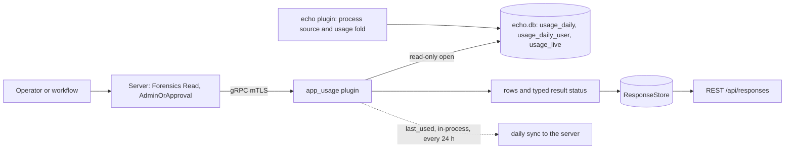
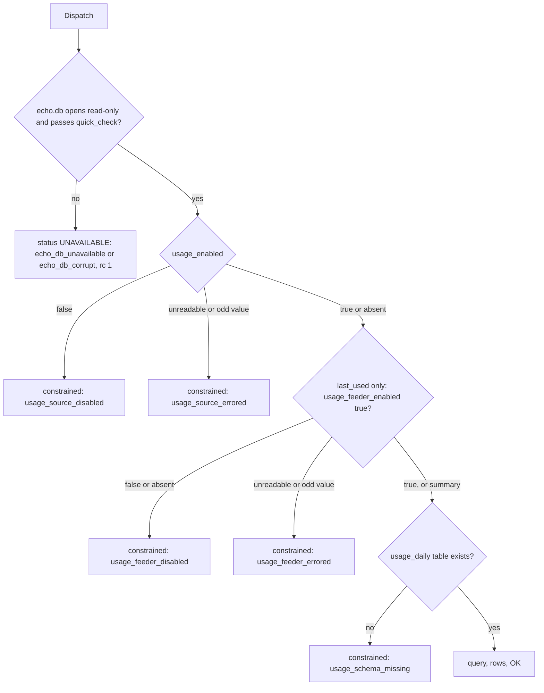
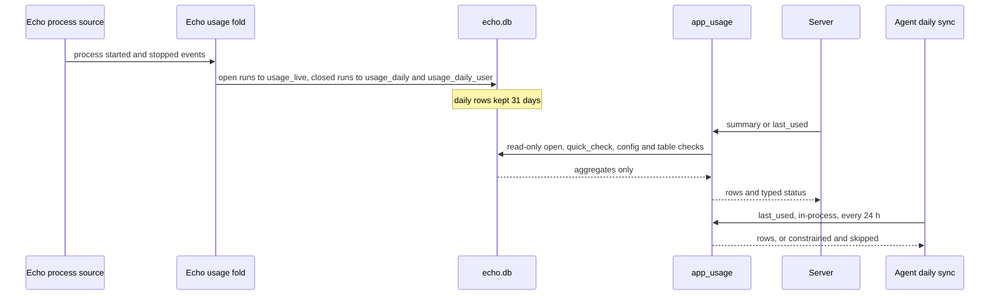

# app_usage

<!-- BEGIN GENERATED: plugin-doc-gen header -->
| | |
|---|---|
| **What it does** | Read-only machine-scope app usage inventory derived from Echo's usage fold (no pid, command line, or user names in output) |
| **Version** | 1.0.0 |
| **Kind** | Collector · read-only · gathered (crossplatform.app_usage.summary, crossplatform.app_usage.last_used, crossplatform.app_usage.foreground) |
| **Platforms** | Windows ✅ · macOS 🟡 constrained · Linux ✅ |
| **Actions** | `foreground` (definition `crossplatform.app_usage.foreground`) · `last_used` (definition `crossplatform.app_usage.last_used`) · `summary` (definition `crossplatform.app_usage.summary`) |
| **Security** | securable `Forensics` · operation Read · risk Medium · dispatch ReadOnly · approval gate AdminOrApproval |
| **Roles** | execute: endpoint-admin, security-admin · author: content-author |
<!-- END GENERATED -->

## How it works

`app_usage` answers "which executables ran on this machine, how often and for how long" without watching anything itself. The `echo` plugin's process source records starts and stops; Echo's usage fold pairs them into runs and keeps one row per executable per UTC day in `echo.db`. `app_usage` opens that file read-only, once per dispatch, and reports from it.

- `summary` totals the trailing `days` (default 30, 1-365) per executable, ranks them by `run_time` or `run_count` (`by`), returns the top `top` (default 25, 1-500) and adds a distinct-user count per executable. It leads with one `meta` row carrying the fold's own health counters: coverage start, open runs, unmatched stops, clock anomalies, capture gaps and whether the feeder is running.
- `last_used` returns, per executable, first and last seen across everything Echo still retains, plus runs and seconds over the trailing 30 UTC days. `exe` narrows it to one executable and is reduced to a lowercase basename by the same rule Echo writes under. It is also the action the daily inventory sync calls.
- `foreground` always answers "not captured" (constrained, rc 0): this plugin does not capture focus time, and the Echo data it reads has none either.

`summary` and `last_used` first check that the file opens and passes a quick integrity check (`foreground` opens nothing), then read the `usage_enabled` setting and the `usage_daily` table, and reports a typed reason instead of an empty result when the source is off, mis-set or missing. It is deliberately not a monitor: it never writes `echo.db`, never selects a pid, command line or user name (users appear only as a count), and never accepts a database path from the caller.



### What you can decide with it

| Question | Action | What you get |
|---|---|---|
| Which applications does this machine actually run, and how heavily? | `summary` | Ranked executables with runs, total seconds, first and last seen inside the window, and how many distinct accounts ran each. |
| Has application X run on this machine recently, and when last? | `last_used` with `exe` | One row, or none. Absence means "not seen within Echo's retained window", not "never installed" or "never run". |
| Which executables on the machine have not run lately? | `last_used` (unfiltered) | Last-seen per executable, to compare outside this plugin against the installed-software inventory by executable name. |
| Can I trust the numbers on this host? | `summary`, the `meta` row | Coverage start, capture gaps, clock anomalies, open runs and `feeder_enabled`. |
| How long was an application in the foreground? | none | `foreground` always reports not captured. |

Per OS: on Windows the runs come from process start and stop events and on Linux from `/proc` (executable names are truncated to 15 characters there); both are `supported`. On macOS they come from Endpoint Security when the agent holds that entitlement and from polling otherwise, so short-lived processes can be missed and the timestamps are coarser; this is why macOS is `constrained`. You get no data, only a typed row saying why, when `echo.db` does not exist, fails its integrity check, or has the usage source switched off; `last_used` also answers with a typed row when Echo's process or usage feeder is stopped, while `summary` only reports that in its `meta` row.

What a result does and does not prove: a populated `summary` on a healthy host lists the executables Echo saw run, over at most the last 31 days. It is wall-clock run time of the process, not interactive use, and it never says who used it beyond a count of accounts. History starts when the fold started; there is no "since install" figure. Use `summary` for a ranked picture, `last_used` for one executable or the full list, and read the `meta` row before treating either as complete.

### Diagrams

#### Which result you get



`summary` and `last_used` run these gates in this order and stop at the first one that fails; only the last box returns data. The feeder check applies to `last_used` only, because a stopped fold would otherwise keep serving an ageing window as if it were live; `summary` reports the same fact in its `meta` row instead.

#### From process start to a row



Echo is the only writer; `app_usage` only reads aggregates, so a pid, command line or user name cannot reach a row. The daily sync calls `last_used` on the agent itself and skips a constrained answer rather than sending an empty replacement, so an off or broken source never wipes the server's last good view.

## OS capability

<!-- BEGIN GENERATED: plugin-doc-gen capability -->
| Action | Windows | macOS | Linux |
|---|---|---|---|
| `foreground` | 🟡 constrained · rung 1 · not captured | 🟡 constrained · rung 1 · not captured | 🟡 constrained · rung 1 · not captured |
| `last_used` | ✅ supported · rung 1 · echo.db usage_daily (derived from Echo process/etw) | 🟡 constrained · rung 1 · echo.db usage_daily (derived from Echo process/endpoint_security or sysctl poll) | ✅ supported · rung 1 · echo.db usage_daily (derived from Echo process/procfs) |
| `summary` | ✅ supported · rung 1 · echo.db usage_daily (derived from Echo process/etw) | 🟡 constrained · rung 1 · echo.db usage_daily (derived from Echo process/endpoint_security or sysctl poll) | ✅ supported · rung 1 · echo.db usage_daily (derived from Echo process/procfs) |

**Declared limits per leg** (descriptor fallback text, verbatim):

- **`foreground` / Windows** — foreground/focus time and per-session attribution are not captured; promoted by the user-context-bridge roadmap without a schema change
- **`foreground` / macOS** — foreground/focus time and per-session attribution are not captured; promoted by the user-context-bridge roadmap without a schema change
- **`foreground` / Linux** — foreground/focus time and per-session attribution are not captured; promoted by the user-context-bridge roadmap without a schema change
- **`last_used` / macOS** — inherits the process source's names-only constraint; ES entitlement absent -> poll granularity
- **`summary` / macOS** — inherits the process source's names-only constraint; ES entitlement absent -> poll granularity
<!-- END GENERATED -->

## Privileges and prerequisites

| OS | Runs as | Extra grant needed | Measured | If the read is refused |
|---|---|---|---|---|
| Windows | agent service account (LocalSystem today, `#1442`) | None — opening `echo.db` read-only needs only whatever access LocalSystem already has (the file is created and owned by the agent via the `echo` plugin) | captured 2026-09-15 as interactive user (elevated) (`docs/samples/windows.txt`) — the capture ran under the operator's own elevated session, not the agent's LocalSystem posture | result status `UNAVAILABLE`/`PARTIAL`, row `constrained\|echo_db_unavailable\|<path>\|<sqlite error>` |
| macOS | agent daemon, root — the shipped LaunchDaemon has no `UserName` key (`docs/agent-privilege-model.md` "macOS is the current exception", required today for Echo's Endpoint Security client) | None beyond that — the read-only open needs no additional entitlement of its own | captured 2026-09-15 at euid 501 (`docs/samples/macos.txt`) — a lower-privilege posture than the agent's actual root LaunchDaemon; no live `echo.db` at the default path on the capture host | result status `UNAVAILABLE`/`PARTIAL`, row `constrained\|echo_db_unavailable\|<path>\|<sqlite error>`; a schema-missing or disabled host instead reports `CONSTRAINED`/`PARTIAL`, row `constrained\|usage_schema_missing` / `constrained\|usage_source_disabled` |
| Linux | agent daemon, dedicated unprivileged `yuzu-agent` account on the packaged unit (`docs/agent-privilege-model.md` TL;DR) | None — same read-only open | captured 2026-09-15 (`docs/samples/linux.txt`) | same shape as Windows/macOS |

No external binaries, no subprocesses, no network access — every branch is a `sqlite3_*` call against an already-open handle; no `popen`/`CreateProcess`/socket call appears anywhere in `app_usage_plugin.cpp` or `app_usage_parsers.hpp`.

## Data contract

### Inputs

<!-- BEGIN GENERATED: plugin-doc-gen inputs -->
| Definition | Parameter | Type | Required | Default | Constraints | Description |
|---|---|---|---|---|---|---|
| `crossplatform.app_usage.last_used` | `exe` | string | no | - | - | Optional executable name (or path — only the basename is used) to narrow the result to. Omit to return every executable Echo has recorded within its retained usage window. |
| `crossplatform.app_usage.summary` | `days` | int32 | no | 30 | - | Number of trailing days to summarise. Clamped to 1-365. |
| `crossplatform.app_usage.summary` | `top` | int32 | no | 25 | - | Maximum number of executables to return. Clamped to 1-500. |
| `crossplatform.app_usage.summary` | `by` | string | no | run_time | - | Ranking metric: "run_time" (total_seconds, default) or "run_count". Any other value is rejected with error\|bad_param\|by. |
<!-- END GENERATED -->

### Outputs

Pipe-delimited rows via `write_output()`. `summary` emits exactly one `meta` row (fold health counters) followed by zero or more `usage` rows, most-active-first. `last_used` emits zero or more `last_used` rows, one per executable, ordered by `exe_key`. Every action's failure path instead emits a single row in the shared `<class>|<reason>[|<detail>]` shape (`constrained|...`, `unavailable|...`, `error|...`) — described row-by-row in Result status below — never mixed with a `meta`/`usage`/`last_used` row in the same call.

<!-- BEGIN GENERATED: plugin-doc-gen outputs -->
**`crossplatform.app_usage.foreground` — `status|reason|detail`**

| Field | Type | Values | Available | Example | Description |
|---|---|---|---|---|---|
| `status` | string | - | Windows, Linux, macOS | `constrained` | Always "constrained" — this action never returns a success row. Values: constrained. |
| `reason` | string | - | Windows, Linux, macOS | `foreground_not_captured` | Always "foreground_not_captured". Values: foreground_not_captured. |
| `detail` | string | - | Windows, Linux, macOS | `user-context-bridge roadmap (session-scope attribution)` | Free-text pointer to the roadmap item that will fill this action in. Values: human-readable text. |

**`crossplatform.app_usage.last_used` — `exe_key|last_seen|first_seen|run_count_30d|total_seconds_30d`**

| Field | Type | Values | Available | Example | Description |
|---|---|---|---|---|---|
| `exe_key` | string | - | Windows, Linux, macOS | `chrome.exe` | Lowercased basename of the executable (P5-escaped, same rule as summary's exe_key column). Never a full path, pid, or command line. |
| `last_seen` | int64 | - | Windows, Linux, macOS | `1717286400` | Unix timestamp of the most recent run within Echo's retained usage window. Values: unix seconds. |
| `first_seen` | int64 | - | Windows, Linux, macOS | `1717200000` | Unix timestamp of the earliest run within Echo's retained usage window. Values: unix seconds. |
| `run_count_30d` | int64 | - | Windows, Linux, macOS | `8` | Number of runs recorded in the trailing 30 days. Values: non-negative integer. |
| `total_seconds_30d` | int64 | - | Windows, Linux, macOS | `28800` | Total wall-clock seconds observed running in the trailing 30 days. Values: non-negative integer. |

**`crossplatform.app_usage.summary` — `exe_key|run_count|total_seconds|first_seen|last_seen|distinct_users|superseded_runs|expired_runs`**

| Field | Type | Values | Available | Example | Description |
|---|---|---|---|---|---|
| `exe_key` | string | - | Windows, Linux, macOS | `chrome.exe` | Lowercased basename of the executable (P5-escaped: a literal "\|" becomes "\\|", CR/LF fold to a space, "\" folds to "/"). Never a full path, pid, or command line. |
| `run_count` | int64 | - | Windows, Linux, macOS | `12` | Number of runs recorded for this executable within the window. Values: non-negative integer. |
| `total_seconds` | int64 | - | Windows, Linux, macOS | `43200` | Total wall-clock seconds this executable was observed running within the window. Values: non-negative integer. |
| `first_seen` | int64 | - | Windows, Linux, macOS | `1717200000` | Unix timestamp of the earliest run within Echo's retained usage window (not every run ever recorded — rows older than Echo's retention are already gone). Values: unix seconds. |
| `last_seen` | int64 | - | Windows, Linux, macOS | `1717286400` | Unix timestamp of the most recent run within Echo's retained usage window. Values: unix seconds. |
| `distinct_users` | int64 | - | Windows, Linux, macOS | `2` | COUNT(DISTINCT user) over the window — a count only; no user name ever leaves the agent's SQLite database. Values: non-negative integer. |
| `superseded_runs` | int64 | - | Windows, Linux, macOS | `0` | Runs whose stop event was superseded by a newer start for the same pid before a clean stop was observed. Values: non-negative integer. |
| `expired_runs` | int64 | - | Windows, Linux, macOS | `1` | Runs closed by the fold's own timeout rather than an observed stop event. Values: non-negative integer. |
<!-- END GENERATED -->

### Result status

| Status | Completeness | Provenance | When |
|---|---|---|---|
| `OK` | full | — | `summary`/`last_used`: the query succeeded (rows may legitimately be empty on a quiet host). |
| `CONSTRAINED` | partial | `usage_source_disabled` | `echo_config.usage_enabled` reads `"false"` — the host has turned the fold off. |
| `CONSTRAINED` | partial | `usage_source_errored` | `echo_config.usage_enabled` holds a value that is neither `"true"` nor `"false"` (Echo itself is in an inconsistent tri-state, mirroring Echo's own `canonical_source_enabled`), or the `echo_config` read itself failed to prepare/step — a read failure maps here, fail-closed, and is never treated as an absent key (which falls through to `Enabled`, Echo's own default). |
| `CONSTRAINED` | partial | `usage_schema_missing` | The `usage_daily` table does not exist — the host's Echo schema predates this fold. |
| `CONSTRAINED` | partial | `usage_feeder_disabled` | `last_used` only: `echo_config.usage_feeder_enabled` reads `"false"` **or is absent** — Echo's own fold has stopped advancing (its `usage`/`process` collector is off), so `usage_daily` would otherwise silently serve a frozen, aging window as if it were live. Unlike `usage_enabled`, an absent feeder key is deliberately NOT treated as enabled — a missing key here is itself anomalous (a hand-restored or hand-edited `echo.db`), so it fails closed the same as an explicit `"false"`. `summary` surfaces the same signal via its `meta` row's `feeder_enabled` field instead of refusing to run. |
| `CONSTRAINED` | partial | `usage_feeder_errored` | `last_used` only: `echo_config.usage_feeder_enabled` holds a value that is neither `"true"` nor `"false"`, or the read itself failed to prepare/step — same fail-closed tri-state as `usage_source_errored`, applied to the feeder key. |
| `UNAVAILABLE` | partial | `echo_db_unavailable` | `echo.db` failed to open read-only (missing file, permission denied, lock contention; on Windows also an `echo.db`, `-wal`, `-shm` or `-journal` owned by an account other than SYSTEM, Administrators or the agent's, or with more than one hard link, which is checked before SQLite opens it and again after its first read, the detail naming the file and why; where the owner cannot be read, as on FAT or exFAT, nothing is refused on that ground) — every sample below shows this branch, because none of the capture hosts had a live `echo.db` with usage collection enabled at the default path. |
| `UNAVAILABLE` | partial | `echo_db_corrupt` | `echo.db` opened successfully but failed `PRAGMA quick_check(1)` — a distinct token from `echo_db_unavailable` so an operator can tell "benign, often transient" apart from "possible disk corruption, worth investigating" without parsing the free-text error detail. |
| `UNAVAILABLE` | partial | `bad_param` | `summary`'s `by` parameter is neither `run_time` nor `run_count`. |
| `UNAVAILABLE` | partial | `query_failed` | A prepared statement failed against an otherwise open, enabled, schema-correct db — `read_meta`'s accumulated `open_runs_query_failed`/`days_present_query_failed` reasons (`yuzu::shared::ConstraintAccumulator`), or a raw sqlite error surfaced from `run_summary`/`run_last_used`. |
| `CONSTRAINED` | partial | `last_used_truncated` | `last_used`, unfiltered form only: the result hit `kMaxLastUsedRows` (5000) distinct executables and was cut off there — a trailing row, not a replacement for the real `last_used` rows already emitted. Bounds the C++-side result-set size (row count returned to the caller, and the SQL `LIMIT` itself) against an unprivileged local user minting unboundedly many exe_keys — it does **not** bound the underlying query's own scan/sort cost against the same growth (`EXPLAIN QUERY PLAN` still shows a full scan+group before `LIMIT` trims the output), which is a separate, still-open concern. |
| `CONSTRAINED` | partial | `foreground_not_captured` | `foreground`: always, rc 0 — a permanent degraded outcome, never a hard failure; this source has no per-session focus-time capture on any platform (see Caveats). |

### Where the data goes

- **Instruction result.** Every action's rows travel over the agent's mTLS gRPC channel as the command response and land in the ResponseStore, queryable at `/api/responses/{id}`. Rows written by this plugin are served only to callers holding `Forensics:Read` on the stored-response read paths (REST legacy and v1, MCP, the dashboard including the executions drawer and the hardware result poll) and in the server's own consumers of them (bundle collation, result-set membership, policy checks, the live output stream); other readers see them as absent, so an empty result does not imply that no data exists. A read that serves them is audited as `response.forensics.read`, in addition to the ordinary read row where the surface writes one (the dashboard results fragment writes only the forensics row; bundle collation writes this row too, with `surface=bundle`, next to its own `bundle.collate` row). Only the `plugin` name is stored with a row, so the filter works per plugin, not per action. A command's failure text is reduced to a short machine token in the server's derived copies of it (execution record, event outbox and stream, failure notification, analytics event, webhook and offload payload); the stored response row keeps the plugin's own message and is served through the tier. The tier is decided by the plugin the server recorded when it dispatched the command, not by the command id the agent echoes back; a response with no server dispatch record is stored `~unverified` and is served under the same tier.
- **Also consumed by daily-sync.** `last_used` is additionally invoked in-process (`LocalDispatcher`, no extra network hop) once per sync cycle by `sync_source_app_usage.cpp` (ADR-0016), once per 24 hours; the server persists the projection in `AppUsageStore`. A `constrained` capture is parsed and skipped (`collect()` returns `std::nullopt`) rather than sent as an empty replace, so a disabled/errored/schema-missing host never overwrites a previously-good server view with "zero usage". `summary` and `foreground` are not sync sources — instruction-result only.
- **Not consumed by** Echo itself, DEX, or metrics — `app_usage` only reads `echo.db`; it emits no Prometheus series of its own.
- **Sensitivity.** Executable names and run times are a working-hours/presence proxy even with no user column at all — a host whose interactive tools (shell, editor, browser) cluster their `usage_daily` rows in a narrow daily window says something about when its operator is active, regardless of who that operator is. `distinct_users` is a `COUNT(DISTINCT user)` only; no user name, pid, or command line ever leaves the agent's SQLite database — enforced by a grep-based test over the plugin's own sources (`test_app_usage_parsers.cpp`) for the raw process-event table name and `cmdline`.
- **Siblings:** the `echo` plugin's own `usage`-source `query`/`export` actions read the identical tables through Echo's general-purpose action surface; `app_usage` is a narrower, purpose-built read with its own Forensics-gated approval posture and daily-sync integration.

## Sample output

<!-- BEGIN GENERATED: plugin-doc-gen samples -->
**Windows** — captured: windows Windows 10.0.26200 x86_64 · bare-metal · 2026-09-15 · interactive user (elevated) · leg-hash pending

```
== action=summary
constrained|echo_db_unavailable|C:\ProgramData\yuzu\agent\echo.db|unable to open database file
[result_status] UNAVAILABLE / PARTIAL / unable to open database file
[rc] 1

== action=last_used
constrained|echo_db_unavailable|C:\ProgramData\yuzu\agent\echo.db|unable to open database file
[result_status] UNAVAILABLE / PARTIAL / unable to open database file
[rc] 1

== action=foreground
constrained|foreground_not_captured|user-context-bridge roadmap (session-scope attribution)
[result_status] CONSTRAINED / PARTIAL / foreground/focus attribution not captured by this source
```

**macOS** — captured: macos macOS 26.6.2 arm64 · bare-metal · 2026-09-15 · euid 501 · leg-hash abdc9bc615f2

```
== action=summary
constrained|echo_db_unavailable|/var/lib/yuzu/agent/echo.db|unable to open database file
[result_status] UNAVAILABLE / PARTIAL / unable to open database file
[rc] 1

== action=last_used
constrained|echo_db_unavailable|/var/lib/yuzu/agent/echo.db|unable to open database file
[result_status] UNAVAILABLE / PARTIAL / unable to open database file
[rc] 1

== action=foreground
constrained|foreground_not_captured|user-context-bridge roadmap (session-scope attribution)
[result_status] CONSTRAINED / PARTIAL / foreground/focus attribution not captured by this source
```

**Linux** — captured: linux Debian GNU/Linux 13 (trixie) aarch64 · container · 2026-09-15 · euid 0 · leg-hash pending

```
== action=summary
constrained|echo_db_unavailable|/var/lib/yuzu/agent/echo.db|unable to open database file
[result_status] UNAVAILABLE / PARTIAL / unable to open database file
[rc] 1

== action=last_used
constrained|echo_db_unavailable|/var/lib/yuzu/agent/echo.db|unable to open database file
[result_status] UNAVAILABLE / PARTIAL / unable to open database file
[rc] 1

== action=foreground
constrained|foreground_not_captured|user-context-bridge roadmap (session-scope attribution)
[result_status] CONSTRAINED / PARTIAL / foreground/focus attribution not captured by this source
```
<!-- END GENERATED -->

## Caveats and known gaps

1. **History is forward-only and bounded.** `usage_daily` holds rows only from when the `usage` fold started on the host and Echo prunes it on a 31-day default, so a new agent or a source switched on late has no history for the gap. `summary` takes first and last seen from the requested window; `last_used` takes them from every retained row; neither is a lifetime figure.
2. **`foreground` is always constrained.** This plugin does not capture per-session focus time (the Echo data it reads has none), so every call reports `CONSTRAINED`/`foreground_not_captured` with rc 0 and never a hard failure. Nothing here can answer "how long was it in use".
3. **macOS granularity follows Echo's process source.** `usage_daily` is derived from the process fold, so without the Endpoint Security entitlement Echo polls, which can miss short-lived processes and coarsens `first_seen`, `last_seen` and `run_count`. The plugin cannot tell which regime produced a row.
4. **Only as fresh as the feeder, and the unfiltered scan is not cost-bounded.** `last_used` refuses a stopped feeder, but `summary` still returns `OK` over a frozen window, so read `feeder_enabled` and the coverage fields in its `meta` row. The 5000-row cap limits what is returned, not the scan and sort the unfiltered `last_used` query performs before the limit.
5. **Samples show only the failure path.** No capture host had a live `echo.db`, so every sample is `echo_db_unavailable` plus the constant `foreground` answer; a successful row has not been captured, and the Windows sample predates the owner check on `echo.db` and its sidecar files. Row shapes are as specified by the generated tables and the parser tests.

## Source and tests

<!-- BEGIN GENERATED: plugin-doc-gen source -->
- Plugin: `agents/plugins/app_usage/src/app_usage_parsers.hpp` · `agents/plugins/app_usage/src/app_usage_plugin.cpp`
- Definitions: `content/definitions/app_usage.yaml`
- Capability rows: `server/core/src/capability_decls/plugin_action_catalogue_app_usage.hpp`
- Tests: `tests/unit/server/test_app_usage_ingestion.cpp` · `tests/unit/server/test_app_usage_routes.cpp` · `tests/unit/server/test_app_usage_store.cpp` · `tests/unit/test_app_usage_local_dispatcher.cpp` · `tests/unit/test_app_usage_parsers.cpp`
- Privilege row: `docs/agent-privilege-model.md` (no row yet)
<!-- END GENERATED -->
