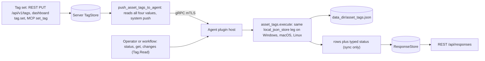
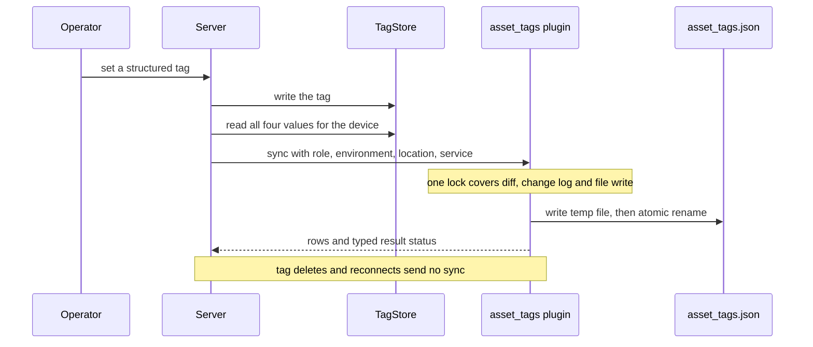
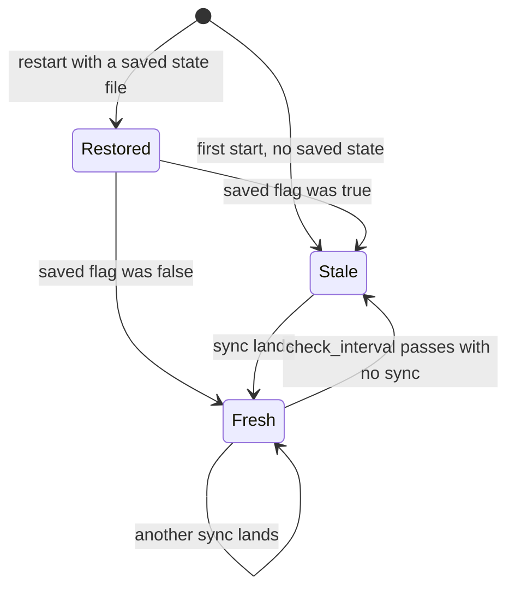

# asset_tags

<!-- BEGIN GENERATED: plugin-doc-gen header -->
| | |
|---|---|
| **What it does** | Structured asset tag awareness — syncs server-assigned tags locally and detects changes |
| **Version** | 0.1.0 |
| **Kind** | Action · mutating · gathered (device.asset_tags.sync, device.asset_tags.status, device.asset_tags.get, device.asset_tags.changes) |
| **Platforms** | Windows ✅ · macOS ✅ · Linux ✅ |
| **Actions** | `changes` (definition `device.asset_tags.changes`) · `get` (definition `device.asset_tags.get`) · `status` (definition `device.asset_tags.status`) · `sync` (definition `device.asset_tags.sync`) |
| **Security** | `sync`: securable `Tag` · operation Write · risk Medium · dispatch Mutating · approval gate None; `status`: securable `Tag` · operation Read · risk Low · dispatch ReadOnly · approval gate None; `get`: securable `Tag` · operation Read · risk Low · dispatch ReadOnly · approval gate None; `changes`: securable `Tag` · operation Read · risk Low · dispatch ReadOnly · approval gate None |
| **Roles** | execute: endpoint-admin, endpoint-operator · author: content-author |
<!-- END GENERATED -->

## How it works

`asset_tags` keeps a local copy, on the endpoint, of the four tag categories the server treats as authoritative: `role`, `environment`, `location` and `service`. The server is the only writer. When an operator sets one of those tags through the REST API, the dashboard or MCP `set_tag`, the server reads all four of the device's current values from its TagStore and pushes them to the agent as one `sync` call (a system-reserved push, not an operator instruction). `sync` replaces the whole local copy: the four values are compared with the cache, each difference is appended to a change log (the newest 50 entries are kept), and the new state is written atomically to `<data_dir>/asset_tags.json`. A category that is empty or missing in a `sync` is erased, so a hand-dispatched `sync` that names one category clears the other three locally. `status`, `get` and `changes` only read the local copy. A background thread sets `stale` to true when `check_interval` seconds (default 300, minimum 30) pass without a sync; it never asks for one.

Deliberately not: the tag store that scope targeting uses. `tag:` scope expressions resolve against the server's TagStore and never read this file, and no other agent component reads it. It is also not the free-form tag plugin (`tags`, `content/definitions/tags.yaml`), and it never pulls: the agent never initiates a sync.



### What you can decide with it

The plugin answers questions about the endpoint's local copy of the four tags. It does not call the server, so it cannot say whether the server's value is different.

| Question | Action | What you get |
|---|---|---|
| What does this device currently hold for role, environment, location and service? | `status` (all four) or `get` with `key` | The cached value; an empty value means never synced or cleared by a sync. |
| When did the server last push? | `status`, `last_sync` | Epoch seconds of the last sync; `0` means no sync has landed. |
| What changed, and when? | `changes` | The last 50 transitions, oldest first, each with old value, new value and epoch time; `changes\|none` when the log is empty. |
| Is the plugin failing to save its state? | `status`, `persist_failures` and `last_persist_error` | Counters for this process lifetime; `-` means no failure or warning since start. |
| Is the local copy current? | Compare `get` or `status` output with the server's tag read | The plugin gives the device side only; the comparison is yours. |

On Windows, macOS and Linux the plugin reads and writes the same JSON file and returns the same rows, so there is no per-OS difference in what you learn. It returns nothing when the agent is offline or the plugin is disabled for the device.

`stale` reports how long ago the last push landed, not whether the copy is correct. Pushes happen only when someone sets a structured tag, so a device whose tags have not changed in more than `check_interval` seconds reads `stale|true` while holding the right values, and `stale|false` is only re-checked once per interval. A clean `sync` result proves the push arrived and was saved (or that no data directory is configured and there was nothing to save); it does not prove the device holds what the server holds for the other categories you did not touch.

### Diagrams

#### Sync and what does not trigger one



The server pushes only after a structured tag is set. The plugin compares, logs and saves under a single lock, so the file always holds one consistent state. Deleting a tag, or an agent that was offline when the push was sent, leaves the local copy as it was until the next structured set for that device.

#### The `stale` flag



`stale` starts true and becomes false only when a `sync` lands. After a restart the flag is read back from the saved file and is re-derived from `last_sync` on the next interval tick, so it can read false for up to one interval after a restart even when the last sync is old. The flag is held in memory and is not rewritten when the thread flips it.

## OS capability

<!-- BEGIN GENERATED: plugin-doc-gen capability -->
| Action | Windows | macOS | Linux |
|---|---|---|---|
| `changes` | ✅ supported · rung 1 · local_json_store | ✅ supported · rung 1 · local_json_store | ✅ supported · rung 1 · local_json_store |
| `get` | ✅ supported · rung 1 · local_json_store | ✅ supported · rung 1 · local_json_store | ✅ supported · rung 1 · local_json_store |
| `status` | ✅ supported · rung 1 · local_json_store | ✅ supported · rung 1 · local_json_store | ✅ supported · rung 1 · local_json_store |
| `sync` | ✅ supported · rung 1 · local_json_store | ✅ supported · rung 1 · local_json_store | ✅ supported · rung 1 · local_json_store |
<!-- END GENERATED -->

## Privileges and prerequisites

| OS | Runs as | Extra grant needed | Measured | If the read is refused |
|---|---|---|---|---|
| Windows | Agent service account: LocalSystem today, not yet the intended `NT SERVICE\YuzuAgent` (`docs/agent-privilege-model.md`) | None. Plain file I/O under `<data_dir>`; the shared writer calls `ReplaceFileW`, which needs no extra privilege | 2026-09-07 on bare metal as SYSTEM | No refusal path exists. A write failure is logged and reported as `CONSTRAINED` / `persist_failed` on `sync`; an unreadable or corrupt state file is logged and ignored |
| macOS | Agent daemon as root: the shipped LaunchDaemon has no `UserName` key (`docs/agent-privilege-model.md`) | None | 2026-09-07 on bare metal at euid 501, unprivileged and not the production root daemon | Same as Windows |
| Linux | Dedicated unprivileged account (`yuzu`; `docs/agent-privilege-model.md`) | None | 2026-09-07 in a container at euid 0, more privileged than the production account | Same as Windows |

No external binaries, no subprocesses, no network access: every action is an in-process read or write of one local JSON file under the agent data directory. `docs/agent-privilege-model.md` has no row for this plugin because it needs nothing beyond that.

**Persistence.** The write happens under the same lock as the state change. Directory creation, the temp-file write (flushed and closed first) and the rename are each error-checked. The temp file is a randomly named sibling (`<dest>.tmp.<16 hex>`) created exclusively, so a file already at that path, planted or left over, fails the create instead of being followed or overwritten; leftovers from a crash between create and rename are not swept. On POSIX it is created with `O_CREAT|O_EXCL|O_NOFOLLOW` at mode `0600`, fsync'd (`F_FULLFSYNC` then `fsync` on macOS) before close, and the directory is fsync'd after the rename. A failed directory fsync reports `asset_tags:persist_dir_unsynced`, because a power loss can still roll the rename back. The mode is re-asserted once more before the rename; a failure there does not block persistence but reports `asset_tags:persist_mode_reassert_failed`, and the file may then be narrower than `0600` and unreadable at the next load. On Windows the temp file is created with exclusive-create semantics, the DACL is inherited rather than tightened, and the write does not fsync, so a power loss right after a reported success can lose it. A persistence failure (unwritable `data_dir`, full disk) is logged and reported on `sync` as `CONSTRAINED` / `PARTIAL`; the in-memory state for that process stays authoritative and the returned rows are truthful.

**Loading.** A state file that is unreadable, not valid JSON, has a wrong-typed known field, or names an unrecognised tag category or change-record key is rejected whole: defaults (`stale=true`, no tags) are kept, one warning names the field, and the next `sync` replaces the file. An unrecognised top-level field is ignored, so a file written by a newer version still loads. `init()` resets the store path, the cache and the check interval before it reads configuration, so a second `init()` in the same process never inherits the previous one; `shutdown()` does not reset them, so a `sync` still queued when the agent shuts plugins down keeps persisting.

## Data contract

### Inputs

<!-- BEGIN GENERATED: plugin-doc-gen inputs -->
| Definition | Parameter | Type | Required | Default | Constraints | Description |
|---|---|---|---|---|---|---|
| `device.asset_tags.get` | `key` | string | yes | - | enum: role, environment, location, service | One of the 4 structured tag categories (e.g. "role"). |
| `device.asset_tags.sync` | `role` | string | no | - | - | The device's operational role, free-form text (e.g. "db-primary"). |
| `device.asset_tags.sync` | `environment` | string | no | - | enum: Dev, UAT, Production | Deployment stage for this device — one of "Dev", "UAT", "Production". |
| `device.asset_tags.sync` | `location` | string | no | - | - | Physical or logical location of the device, free-form text (e.g. "us-east-dc2"). |
| `device.asset_tags.sync` | `service` | string | no | - | - | IT service this device belongs to, free-form text (e.g. "billing-api"). |
<!-- END GENERATED -->

### Outputs

Every action writes one or more pipe-delimited lines via `ctx.write_output`. There is no single row shape shared across an action's own output: `get` emits exactly one `tag|<key>|<value>` line per call, and `changes` emits one `change|<key>|<old_value>|<new_value>|<timestamp>` line per recorded change followed by `total_changes|<n>` (or the sentinel line `changes|none` when the log is empty, with no trailing count on that path). `status` and `sync` each emit several different line shapes in one response: `sync` writes `sync|no_changes` or one `sync|<event>|<key>|...` line per change, then four `tag|<key>|<value>` lines and `last_sync|<epoch>`. There is no shared empty-result placeholder convention: an unset tag reports as an empty string, never `-`. Every string field on every row — values, keys, and the echoed text of the two error rows (`unknown action: …`, `error|unknown category: …`) — is escaped with the shared `safe_output_field` (`|` becomes `\|`, CR/LF become a space, a literal backslash is folded to `/`), so a value such as `Rack A|3` renders as `Rack A\|3` in a stable row shape. The stored value is never rejected or stripped; the backslash fold is a limitation of the shared server decoder and applies on the wire only. Values are capped at 448 bytes on `sync` and again on load from disk.

<!-- BEGIN GENERATED: plugin-doc-gen outputs -->
**`device.asset_tags.changes` — `key|old_value|new_value|timestamp`**

| Field | Type | Values | Available | Example | Description |
|---|---|---|---|---|---|
| `key` | string | `role` `environment` `location` `service` | Windows, Linux, macOS | `-` | The tag category the change record is for. |
| `old_value` | string | - | Windows, Linux, macOS | `-` | The value before the change. Values: free text. |
| `new_value` | string | - | Windows, Linux, macOS | `-` | The value after the change. Values: free text. |
| `timestamp` | int64 | - | Windows, Linux, macOS | `-` | Epoch seconds when the change was recorded. Values: integer (unix epoch seconds). |

**`device.asset_tags.get` — `key|value`**

| Field | Type | Values | Available | Example | Description |
|---|---|---|---|---|---|
| `key` | string | `role` `environment` `location` `service` | Windows, Linux, macOS | `role` | The category key that was requested, echoed back. |
| `value` | string | - | Windows, Linux, macOS | - | The cached value for that category; empty string if never set. Values: free text or empty. |

**`device.asset_tags.status` — `key|value|last_sync|stale|check_interval|change_count|persist_failures|last_persist_error`**

| Field | Type | Values | Available | Example | Description |
|---|---|---|---|---|---|
| `key` | string | `role` `environment` `location` `service` | Windows, Linux, macOS | `role` | The tag category named on a "tag\|key\|value" line. |
| `value` | string | - | Windows, Linux, macOS | - | The cached value for that category; empty string if the category has never been synced. Values: free text or empty. |
| `last_sync` | int64 | - | Windows, Linux, macOS | `0` | Epoch seconds of the last successful sync; 0 before any sync has landed. Values: integer (unix epoch seconds). |
| `stale` | bool | - | Windows, Linux, macOS | `true` | True when no sync has landed within check_interval seconds of the last one, or none has ever landed. |
| `check_interval` | int32 | - | Windows, Linux, macOS | `300` | The configured staleness-check interval in seconds, read from asset_tags.check_interval and floored at 30; default 300. Values: integer seconds, >= 30. |
| `change_count` | int32 | - | Windows, Linux, macOS | `0` | Number of entries currently in the change log (in memory and persisted, capped at the last 50). Values: integer 0-50. |
| `persist_failures` | int64 | - | Windows, Linux, macOS | `0` | Number of sync persistence failures since the plugin started; not persisted across restarts. |
| `last_persist_error` | string | - | Windows, Linux, macOS | `-` | Message of the most recent persistence failure or write warning, or `-` when none. |

**`device.asset_tags.sync` — `event|key|old_value|new_value`**

| Field | Type | Values | Available | Example | Description |
|---|---|---|---|---|---|
| `event` | string | `no_changes` `tag_added` `tag_removed` `tag_changed` | Windows, Linux, macOS | `-` | What changed in this sync call, relative to the previously cached value. |
| `key` | string | `role` `environment` `location` `service` | Windows, Linux, macOS | `-` | The tag category this change applies to. Absent from the wire line when event is no_changes. |
| `old_value` | string | - | Windows, Linux, macOS | `-` | The category's value before this sync call. Omitted from the wire line (not merely empty) when event is tag_added or no_changes. Values: free text. |
| `new_value` | string | - | Windows, Linux, macOS | `-` | The category's value after this sync call. Omitted from the wire line when event is tag_removed or no_changes. Values: free text. |
<!-- END GENERATED -->

### Result status

`sync` declares a typed result status on every call: `OK` / `FULL` when the state file was written with no warning (or no data directory is configured and there is nothing to write), or `CONSTRAINED` with one of the provenance tokens below when the write failed or carried a warning. The in-memory state advances in every case and the rows are truthful, so the return code stays `0`. `status`, `get` and `changes` set none, so the agent records `UNDECLARED` for them. `sync` is not captured in the samples (mutator capture policy), so no sample shows its typed status.

| Status | Completeness | Provenance | When |
|---|---|---|---|
| `OK` | full | (empty) | `sync`: the new state was written to `<data_dir>/asset_tags.json` with no warning, or no data dir is configured and there is nothing to write |
| `CONSTRAINED` | partial | `asset_tags:persist_failed` | `sync`: the temp-file write or the rename over `asset_tags.json` failed (data dir not creatable, not a directory, disk error, or on Windows another process holding the file open without `FILE_SHARE_DELETE`); the reason is in the agent log |
| `CONSTRAINED` | full | `asset_tags:persist_mode_reassert_failed` | `sync`: the file was written but re-asserting owner-only mode (`fchmod` to 0600) failed; the file is never wider than 0600 (created at `0600 & ~umask`) but may be narrower, so the next load may fail; outranks `persist_dir_unsynced` when both occur (the status row's `last_persist_error` carries both causes) |
| `CONSTRAINED` | full | `asset_tags:persist_dir_unsynced` | `sync`: the file was written and renamed but the parent-directory fsync failed, so the rename is durable only after the next OS flush |

`persist_failures` and `last_persist_error` are held in memory for the process lifetime: they reset on restart and are never persisted. A write warning's `last_persist_error` begins with its typed cause label(s) (`mode_reassert_failed`, `dir_fsync_failed`, joined by `+` when both apply), so a long path in the detail text never hides a cause. A restart in the middle of a persistence outage loses every unpersisted change-log entry; the counter makes the outage visible but cannot recover them. The counter is plugin-local, not a Prometheus metric, because the SDK has no plugin metrics facility. `last_persist_error` is kept until the next failure or warning overwrites it or the process restarts; a later clean `sync` does not clear it, so read it alongside `persist_failures` and the latest `sync` status.

**Recovery.** Persistence and load are self-healing. A repeated `CONSTRAINED` / `persist_failed` means the underlying OS condition (disk full, a permission or ownership change on `data_dir`, an antivirus lock) needs fixing; once it is fixed the next `sync` writes cleanly with no restart or file deletion. A corrupt state file is rejected and replaced by the next successful `sync`, so deleting it by hand is never necessary.

### Where the data goes

- **Instruction result only** for row data. Rows reach the ResponseStore through the standard command-response path, queryable at `/api/responses/{id}`.
- **Trigger and delivery metric.** `sync` is sent by the server, never directly by an operator: a structured tag-category set through the dashboard `tag.set` handler, REST `PUT /api/v1/tags` or MCP `set_tag` calls the same `push_asset_tags_to_agent` closure. Each push increments `yuzu_server_system_reserved_push_total{capability="asset_tags.sync"}` with `result` `sent` or `undelivered` (the agent was not connected); this is a delivery metric, not row data.
- **Not consumed by** daily-sync inventory, the TAR warehouse, DEX or metrics. No other agent component reads `asset_tags.json`.
- **Sensitivity.** `role`, `environment`, `location` and `service` are free-form organizational tags an operator assigns, and can reveal a device's physical site or business role. Values are byte-capped (448 bytes) but not content-validated: an operator can type anything into them, including a hostname, a serial or a person's name, so classify by what is actually assigned, not by the category name. The on-disk copy is owner-only (`0600`) on POSIX.
- **Siblings:** `tags` (`content/definitions/tags.yaml`) is the general-purpose, agent-authoritative free-form key/value store; `asset_tags` holds only the four server-authoritative categories.
- **MCP / REST.** Discover: `discover_plugins` (summary) then `yuzu://plugin-docs` (this page as data) then `discover_instructions` / `get_definition("device.asset_tags.status")`. Run: `execute_instruction {definition_id, parameters}`. Read: `/api/responses/{id}`.

## Sample output

<!-- BEGIN GENERATED: plugin-doc-gen samples -->
**Windows** — captured: windows Microsoft Windows NT 10.0.26200.0 x64 · bare-metal · 2026-09-07 · SYSTEM · leg-hash pending

```
== action=sync
[not captured] Mutating/Reversible: not executed on a live host

== action=status
tag|role|
tag|environment|
tag|location|
tag|service|
last_sync|0
stale|true
check_interval|300
change_count|0
[result_status] UNDECLARED / UNKNOWN

== action=get key=role
tag|role|
[result_status] UNDECLARED / UNKNOWN

== action=changes
changes|none
[result_status] UNDECLARED / UNKNOWN
```

**macOS** — captured: macos macOS 26.6.2 arm64 · bare-metal · 2026-09-07 · euid 501 (jsmith) · leg-hash pending

```
== action=sync
[not captured] Mutating/Reversible: not executed on a live host

== action=status
tag|role|
tag|environment|
tag|location|
tag|service|
last_sync|0
stale|true
check_interval|300
change_count|0
[result_status] UNDECLARED / UNKNOWN

== action=get key=role
tag|role|
[result_status] UNDECLARED / UNKNOWN

== action=changes
changes|none
[result_status] UNDECLARED / UNKNOWN
```

**Linux** — captured: linux Debian GNU/Linux 13 (trixie) aarch64 · container · 2026-09-07 · euid 0 · leg-hash pending

```
== action=sync
[not captured] Mutating/Reversible: not executed on a live host

== action=status
tag|role|
tag|environment|
tag|location|
tag|service|
last_sync|0
stale|true
check_interval|300
change_count|0
[result_status] UNDECLARED / UNKNOWN

== action=get key=role
tag|role|
[result_status] UNDECLARED / UNKNOWN

== action=changes
changes|none
[result_status] UNDECLARED / UNKNOWN
```
<!-- END GENERATED -->

## Caveats and known gaps

1. **Pushes follow a tag set, nothing else.** Deleting a structured tag (REST, dashboard or MCP), an agent that is offline when a tag is set, and an agent reconnecting all send no `sync`, so the local copy can hold a deleted or outdated value until the next structured tag set for that device. Watch `yuzu_server_system_reserved_push_total{result="undelivered"}` for pushes that missed an offline agent.
2. **`stale` is push recency, not correctness.** It is true when no `sync` landed within `check_interval`, which is the normal state of a device whose tags have not changed, and it is re-evaluated only once per interval. Compare the values themselves with the server when the question is whether the copy is right.
3. **`sync` replaces the whole copy, and its output is wider than its declared schema.** A hand-dispatched `sync` that omits a category erases it locally and logs a `tag_removed` change. Every real `sync` also emits four `tag|<key>|<value>` rows and a `last_sync|<epoch>` line that the definition's `result.columns` does not describe.
4. **A stalled data directory stalls every action.** `status`, `get`, `changes` and the staleness thread take the same lock as the file write, so a hung filesystem under `data_dir` blocks all of them, not only `sync`.
5. **The samples show cold-boot defaults and predate two `status` rows.** The capture harness never calls `init()`, so every sample shows empty tags, `last_sync=0` and `stale=true` rather than any real state file, and `sync` is not captured. All three captures carry `leg-hash pending` and end `status` at `change_count`; the shipped plugin also emits `persist_failures` and `last_persist_error`, so treat the Outputs table, not the sample, as the `status` shape.

## Source and tests

<!-- BEGIN GENERATED: plugin-doc-gen source -->
- Plugin: `agents/plugins/asset_tags/src/asset_tags_parsers.hpp` · `agents/plugins/asset_tags/src/asset_tags_plugin.cpp` · `agents/plugins/asset_tags/src/asset_tags_store.hpp`
- Definitions: `content/definitions/asset_tags.yaml`
- Capability rows: `server/core/src/capability_decls/core_dispatch_capabilities.hpp` · `server/core/src/capability_decls/plugin_action_catalogue_d.hpp`
- Tests: `tests/unit/test_asset_tags_actions.cpp` · `tests/unit/test_asset_tags_parsers.cpp` · `tests/unit/test_asset_tags_store.cpp` · `tests/unit/test_asset_tags_sync_lock.cpp`
- Privilege row: `docs/agent-privilege-model.md` (no row yet)
<!-- END GENERATED -->
