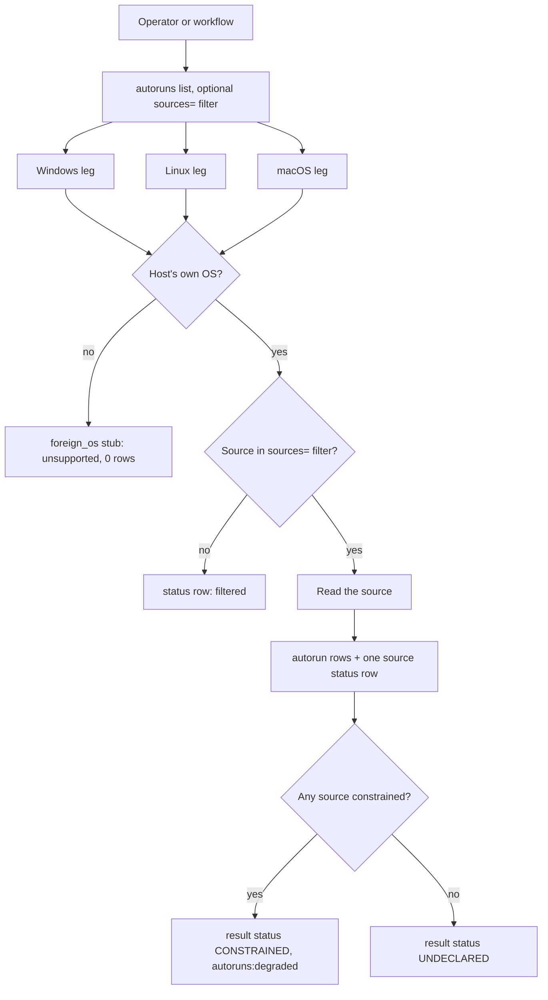
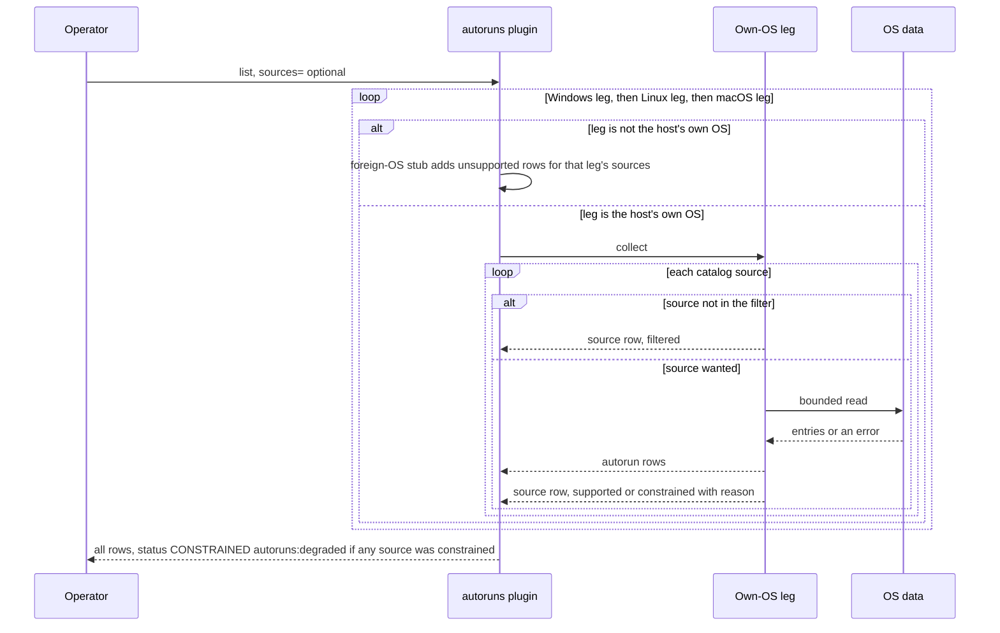
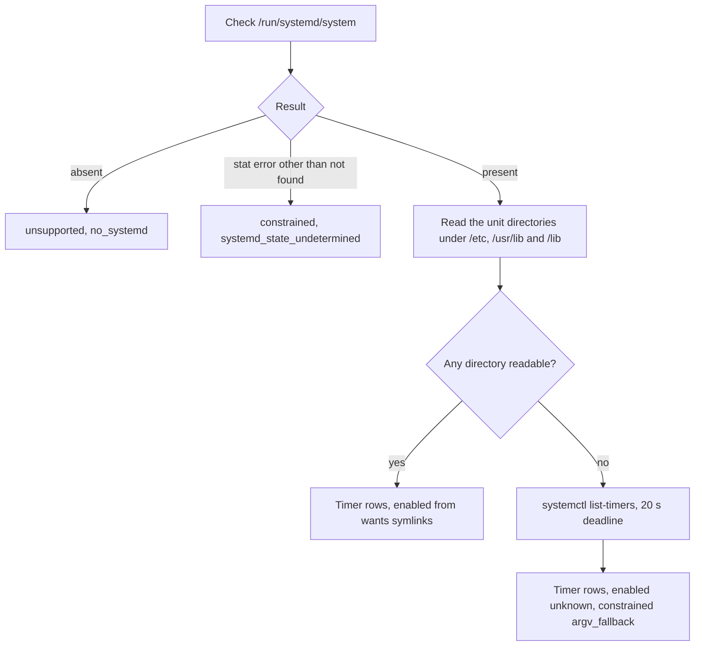

# autoruns

<!-- BEGIN GENERATED: plugin-doc-gen header -->
| | |
|---|---|
| **What it does** | Enumerates persistence sources (what starts automatically) across Windows, Linux and macOS |
| **Version** | 1.0.0 |
| **Kind** | Collector · read-only · on-demand |
| **Platforms** | Windows ✅ · macOS ✅ · Linux ✅ |
| **Actions** | `catalog` (definition `crossplatform.autoruns.catalog`) · `list` (definition `crossplatform.autoruns.list`) |
| **Security** | securable `Security` · operation Read · risk Low · dispatch ReadOnly · approval gate None |
| **Roles** | execute: endpoint-admin, endpoint-operator, security-admin · author: content-author |
<!-- END GENERATED -->

## How it works

`catalog` and `list` answer two different questions, and neither changes the host. `catalog` makes no OS call: it prints the plugin's own versioned list of 34 persistence sources and whether this build supports each one on this OS. `list` reads those sources and returns one `autorun|` row per persistence entry it finds, plus exactly one `source|` status row per source, so a source that found nothing, a source that could not be read and a source that does not exist on this OS are never confused.

`list` runs the Windows, Linux and macOS legs one after another on every build. Only the leg for the host's own OS reads anything. The other two print `source|<id>|unsupported|0|foreign_os` for each of their sources, so every capture names all 34 sources. The optional `sources=` filter (an exact, comma-separated list of source ids) skips the reads for the ids left out and reports them as `source|<id>|supported|-|filtered` (or `constrained` for the two permanently constrained Linux sources). It does not hide the foreign-OS rows, the macOS Login Items row ignores the filter and is always the same constrained row, and an id that matches nothing filters every source without an error.

- **Windows.** Registry `Run`, `RunOnce`, `RunOnceEx`, `StartupApproved`, Winlogon `Shell` and `Userinit`, `AppInit_DLLs` and Image File Execution Options `Debugger` under `HKLM`; `Run`, `RunOnce` and `StartupApproved` again in every reachable user hive (a loaded hive first, otherwise an offline mount of the profile's hive file); the common and per-user Startup folders; Scheduled Tasks through the Task Scheduler COM interface; and permanent WMI event subscriptions from `root\subscription`. No `schtasks.exe`, `wmic.exe` or PowerShell is run.
- **Linux.** Bounded file reads and directory listings of `/etc/crontab`, `/etc/cron.d`, the periodic cron directories, per-user crontabs, `/etc/anacrontab`, the `at` spool, systemd timer units (system and user), XDG autostart (system and per-user), `/etc/rc.local` and a name-only listing of `/etc/init.d`. The one subprocess, `systemctl list-timers`, is a fallback used only when systemd is present but none of its unit directories can be read.
- **macOS.** launchd property lists in `/Library/LaunchDaemons`, `/Library/LaunchAgents`, `/System/Library/LaunchDaemons`, `/System/Library/LaunchAgents` and each account's `~/Library/LaunchAgents`, plus `/etc/periodic` (names only) and the `/etc/emond.d/rules` plists. Login Items is not read. No process is spawned.

The plugin is deliberately not a live-state tool and not a trust verdict. It reports what is configured to start automatically, from files, registry values and scheduler objects. It does not say what is running now, does not verify any code signature, and does not enumerate services, drivers, shell profiles, kernel modules or browser extensions.



### What you can decide with it

| Question | Use | What you get |
|---|---|---|
| Which things start on their own on this device? | `list` | One `autorun\|` row per entry, with its source, location, target program, arguments, scope and an enabled flag. Windows: Run keys, Winlogon, IFEO, Startup folders, Scheduled Tasks, WMI subscriptions. macOS: launchd jobs, periodic scripts, emond rules. Linux: cron, anacron, `at`, systemd timers, XDG autostart, `rc.local`, SysV script names. |
| Is a particular persistence mechanism present? | `list` with `sources=` | Read only the ids you name (for example `win_wmi_subscriptions` or `mac_user_launchagents`); every other id is reported `filtered`. |
| Did the read cover everything, or is there a blind spot? | the `source\|` rows | `supported` with a row count means the source was read in full. `constrained` plus a reason names what was not seen. `unsupported` with `foreign_os` is an OS that is not this one. |
| What can this build look at on this OS? | `catalog` | A `catalog|<version>` row (the version of the source list, `1` today), then one `source|` row per id with this build's declared support. It reads nothing, so it says what could be read, not what is there. |

What a result does and does not prove:

- **A clean `list` is not a clean bill of health.** On Linux and macOS the command status is always `CONSTRAINED` (`autoruns:degraded`) because some sources are permanently constrained (`lnx_init_d` on Linux, `mac_login_items` on macOS, and `lnx_systemd_timers_user` where systemd is present), so look at the individual `source|` rows, not the command status.
- **`enabled` is only as good as its source.** Run keys, WMI subscriptions and SysV scripts carry no on/off bit and report `unknown`; a Startup-folder entry or an IFEO debugger is `enabled` because its presence is the setting; a Windows `StartupApproved` value or a scheduled task's own flag gives `enabled` or `disabled`; a malformed value reports `unmodelled`. A macOS job is `enabled` unless its plist says `Disabled`, which does not prove that launchd starts it.
- **`signed` is a path judgement.** It is `apple_system` for a macOS job under `/System/Library/` and `not_checked` for everything else, on every OS. It never reflects a verified code signature.
- **Persistence classes not covered.** Windows services and drivers, Linux service units other than timers, shell start-up files, kernel modules and macOS Login Items are outside the catalog (the `services` plugin reports service state).

Persistence classes the catalog covers, by OS:

| Class | Windows | macOS | Linux |
|---|---|---|---|
| Logon and boot hooks | `win_run_hklm`, `win_runonce_hklm`, `win_runonceex_hklm`, `win_run_hku`, `win_runonce_hku`, `win_startup_approved`, `win_winlogon_shell`, `win_winlogon_userinit`, `win_startup_folder_common`, `win_startup_folder_user` | `mac_launchdaemons`, `mac_launchagents`, `mac_system_launchdaemons`, `mac_system_launchagents`, `mac_user_launchagents` | `lnx_rc_local`, `lnx_init_d` (names only), `lnx_xdg_autostart_system`, `lnx_xdg_autostart_user` |
| Scheduled execution | `win_scheduled_tasks` | `mac_periodic` | `lnx_etc_crontab`, `lnx_cron_d`, `lnx_cron_periodic`, `lnx_user_crontabs`, `lnx_anacrontab`, `lnx_at_spool`, `lnx_systemd_timers_system`, `lnx_systemd_timers_user` |
| Injection and hijack points | `win_appinit_dlls`, `win_ifeo_debugger` | none | none |
| Event-driven | `win_wmi_subscriptions` | `mac_emond` | none |
| Desktop login items | in the Run keys and Startup folders above | `mac_login_items` (reported `constrained`, never read) | XDG autostart above |

### Diagrams

#### The `list` sequence



The plugin visits the three legs in the fixed order Windows, Linux, macOS, so the foreign-OS rows appear before and after the host's own rows (on Linux and macOS, the Windows stub rows come first). The own-OS leg walks its sources one at a time. Each source ends in exactly one `source|` row, whether it was read, filtered out or failed, and the command status is set to `CONSTRAINED` only once, at the end, if any source came back constrained.

#### Linux systemd timers



The leg decides in three steps whether systemd is there at all, then reads the timer unit files directly and works out `enabled` from the wants symlinks. Only when systemd exists but every unit directory is unreadable does it run `systemctl list-timers`, whose text carries no enablement evidence, so those rows are `enabled=unknown`. When systemd is present, the user-timer source (`lnx_systemd_timers_user`) is always `constrained` because it scans a fixed, narrower set of user unit directories; without systemd it reports `unsupported` with `no_systemd`.

## OS capability

<!-- BEGIN GENERATED: plugin-doc-gen capability -->
| Action | Windows | macOS | Linux |
|---|---|---|---|
| `catalog` | ✅ supported · rung 1 · Reg*W over HKLM + every HKU via win_profiles with_user_hive; ITaskService COM; WMI root\\subscription bounded query | ✅ supported · rung 1 · CFPropertyListCreateWithData over launchd plists; file reads of /etc/periodic, /etc/emond.d | ✅ supported · rung 1 · file reads of cron/anacron/at/systemd unit dirs/XDG autostart; systemctl list-timers argv fallback only when no unit dir is readable |
| `list` | ✅ supported · rung 1 · Reg*W over HKLM + every HKU via win_profiles with_user_hive; ITaskService COM; WMI root\\subscription bounded query | ✅ supported · rung 1 · CFPropertyListCreateWithData over launchd plists; file reads of /etc/periodic, /etc/emond.d | ✅ supported · rung 1 · file reads of cron/anacron/at/systemd unit dirs/XDG autostart; systemctl list-timers argv fallback only when no unit dir is readable |

**Declared limits per leg** (descriptor fallback text, verbatim):

- **`catalog` / Windows** — Pure reflection of this build's static kSourceCatalog declarations for the Windows sources above -- no OS call itself, but the same LocalSystem session this build's ITaskService/WMI mechanism relies on is A1's the-rig probe (tests/unit/fixtures/wave7/probes/the-rig-probe-findings.md, 2026-09-06), Probe 3, quoted verbatim: CoInitializeEx/Connect/GetFolder HRESULT 0x00000000, 322 tasks recursively enumerated (COINIT_MULTITHREADED and COINIT_APARTMENTTHREADED gave identical HRESULTs and counts); WMI root\\subscription ConnectServer/ExecQuery HRESULT 0x00000000, Next() 0x00000001 (WBEM_S_FALSE) after exactly 1 binding. See the `list` descriptor's note for the full per-source `list` behaviour this catalog entry declares support for.
- **`catalog` / macOS** — Pure reflection of this build's static kSourceCatalog declarations for the macOS sources above -- no OS call. See the `list` descriptor's note for what those declarations mean once `list` actually runs each mechanism.
- **`catalog` / Linux** — Pure reflection of this build's static kSourceCatalog declarations for the Linux sources above -- no OS call. See the `list` descriptor's note for what those declarations mean once `list` actually runs each mechanism.
- **`list` / Windows** — Reg*W over HKLM plus every reachable HKU hive via win_profiles.hpp's with_user_hive ladder (live hive first; offline RegLoadKeyW under SeBackup/SeRestore -- enabled on the process token for the offline arm only, serialised process-wide by offline_hive_mutex() -- when the profile is not logged in; unload_failed is surfaced as a warning line, never dropped, when RegUnLoadKeyW fails on the way out). ITaskService COM (yuzu::shared::win::ComInit, COINIT_MULTITHREADED, no dedicated STA thread) and a bounded WMI root\\subscription query, one row per __FilterToConsumerBinding joined on the ref Name -- a dangling ref still emits its row, tagged constrained|unresolved_ref, never dropped or collapsed into another binding's row. A1's the-rig probe (tests/unit/fixtures/wave7/probes/the-rig-probe-findings.md, 2026-09-06), Probe 3, quoted verbatim for the LocalSystem session: CoInitializeEx/Connect/GetFolder HRESULT 0x00000000, 322 tasks recursively enumerated (COINIT_MULTITHREADED and COINIT_APARTMENTTHREADED gave identical HRESULTs and counts -- MTA is not a problem for ITaskService here, including as LocalSystem); WMI root\\subscription ConnectServer/ExecQuery HRESULT 0x00000000, Next() 0x00000001 (WBEM_S_FALSE) after exactly 1 binding -- the same stock 'SCM Event Log Filter'/'SCM Event Log Consumer' binding the admin session saw, confirming LocalSystem reaches both APIs with no apartment-model or session-identity gap. CoInitializeEx itself failing is the one COM failure this leg cannot render as a real hr_<hex> token (ComInit::ok() exposes no HRESULT) -- reported as the fixed sentinel hr_cominit_failed; every other COM/WMI failure carries the real HRESULT or wmi_bounded.hpp's error token. Zero spawn primitives: schtasks.exe, wmic.exe and PowerShell are never invoked. Real-hardware verification: docs/wave7/rig-checklist-autoruns-win.md's 10-step checklist.
- **`list` / macOS** — File-truth only, rung 1: CFPropertyListCreateWithData over launchd plists (system + per-user LaunchDaemons/LaunchAgents), /etc/periodic directory listings, and /etc/emond.d/rules plists. Login Items is CONSTRAINED -- the list lives in a private per-user BTM database with no public read API; this leg never shells out to osascript, launchctl, or sfltool. A plist's own Disabled key is read, but launchctl print-disabled's separate override database is NOT consulted -- this is file truth, not launchd's live runtime state, a deliberate divergence from a services-style plugin that does read launchctl state. Real capture on this Mac (2026-09-07): mac_system_launchdaemons|supported|422, mac_system_launchagents|supported|456, mac_launchdaemons|supported|2, mac_user_launchagents|supported|1, mac_launchagents|supported|0, mac_periodic|supported|0, mac_emond|supported|0, mac_login_items|constrained|0|btm_private_database_no_public_api -- login items always emits that one constrained status line and zero rows, never a real read attempt (docs/user-manual/autoruns.md has the full `source|` capture).
- **`list` / Linux** — Every acquisition is a bounded local file read or directory listing (read_file_bounded, O_NOFOLLOW on the leaf) except one declared exception: systemd timer enumeration is a tri-state on /run/systemd/system -- absent reports UNSUPPORTED (no_systemd), a stat() error other than ENOENT reports CONSTRAINED (systemd_state_undetermined), and present reads /etc/systemd/system, /usr/lib/systemd/system and /lib/systemd/system directly. Only when systemd is present but all three dirs are unreadable does it fall back to `systemctl list-timers --all --no-pager --no-legend` (rung 2, autoruns/collect_linux#1, docs/agent-spawn-sink-manifest.md), whose rows carry enabled=unknown -- that text has no wants-symlink evidence. A rung-1-scanned timer row can ALSO carry enabled=unknown, even with a real wants-symlink read attempted: if a wants directory consulted for it hit a real I/O error partway through, or hit its entry cap, the matching symlink could be among what wasn't read (#4182); or, with no failed read among the wants directories it actually checked, when /home itself couldn't be fully enumerated, the very set of user wants directories to search is itself incomplete. Real captures (2026-09-07): this Mac reports the Linux source through the foreign-OS stub as lnx_systemd_timers_system|unsupported|0|foreign_os (this build cannot exercise the leg at all); a real ubuntu:24.04 Docker container read lnx_systemd_timers_system|unsupported|0|no_systemd -- the container has no init system at all, so this confirms the absent branch; the rung-2 fallback itself needs a host with systemd present but its unit dirs unreadable, not exercised here. `absent` (ENOENT) on /etc/crontab and /etc/anacrontab reports CONSTRAINED (their absence is itself a real constraint, classify_read_error's required_by_catalog=true); the same ENOENT on every other file/dir source reports SUPPORTED (nothing there is a valid, fully-read answer) -- a genuine read failure (permission_denied or any other errno) always reports CONSTRAINED with that token, never folded into `absent`. lnx_init_d lists /etc/init.d script names only (no runlevel/systemctl wiring cross-check) -- CONSTRAINED by design, per-user reads report owning uid numerically (no NSS/getpwuid_r lookup, no directory-service deadline risk on this read-only path). lnx_systemd_timers_user is likewise always CONSTRAINED (narrow_search_path_coverage) when reportable -- the scanned search-path set omits several standard `systemd --user` unit roots (~/.local/share/systemd/user, /run/systemd/user, /usr/local/{lib,share}/systemd/user, /usr/share/systemd/user), a permanent gap, not a transient failure.
<!-- END GENERATED -->

## Privileges and prerequisites

| OS | Runs as | Extra grant needed | Measured | If the read is refused |
|---|---|---|---|---|
| Windows | Agent service account, LocalSystem today. Machine-scope reads (`Run`, `RunOnce`, `RunOnceEx`, `Winlogon`, `AppInit_DLLs`, IFEO, the Startup folders, Scheduled Tasks through the Task Scheduler COM interface, WMI permanent subscriptions) need no privilege beyond the account's own registry, COM and file access. | **None.** The per-profile pass (`win_run_hku`, `win_runonce_hku`, `win_startup_approved`, `win_startup_folder_user`; the last opens the same hive only to resolve a possible Startup-folder redirect under `User Shell Folders`) shares the `with_user_hive` ladder with `installed_apps.list_per_user` and `license_scan.list`. A loaded `HKEY_USERS\<sid>` hive is read first with no privilege; the offline mount for a logged-out profile uses `SeBackupPrivilege` and `SeRestorePrivilege`, which the agent account already holds (`docs/agent-privilege-model.md`). | Sample taken on bare-metal Windows (NT 10.0.26200) on 2026-09-08 as an elevated interactive user, not LocalSystem. A separate probe run as LocalSystem on 2026-09-06 (findings recorded in `tests/unit/fixtures/wave7/probes/the-rig-probe-findings.md`) showed both the Task Scheduler COM interface and the WMI namespace answer from that session; the ten-step manual check is `docs/wave7/rig-checklist-autoruns-win.md`. | On a hardened install that strips `SeBackup` or `SeRestore`, machine-scope sources still report; only a logged-out profile's four per-user sources degrade to a per-SID `privilege_missing` reason, never a dropped row or a false-empty read. The offline arm's hive-file guard is on by default for every profile: a refused hive file degrades those four sources to a per-SID reason naming the guard (`hive_owner_unexpected`, `hive_path_reparse_ancestor`, `hive_path_redirected` and so on) instead of `mount_failed`. |
| macOS | Agent daemon. The shipped LaunchDaemon has no `UserName` key, so launchd runs it as **root** (`docs/agent-privilege-model.md`). The leg's file reads (launchd plists, `/etc/periodic`, `/etc/emond.d`) need no more than that, and the per-user `~/Library/LaunchAgents` walk reads each real account's home under `/Users` directly. | None: no sudoers entry, no entitlement. `mac_login_items` is permanently constrained whatever the privilege, because the list lives in a private per-user database with no public read API and this leg does not shell out to approximate it. | Bare-metal macOS 26.6.2 on 2026-09-08 as an ordinary user (euid 501), not root. That run reports `permission_denied` for some `/Library/LaunchDaemons` plists, which a root run does not. | A plist that cannot be read or parsed makes its source `constrained` with a `permission_denied`, `symlink_refused`, `not_a_directory` or `malformed` reason and the other plists are still reported; Login Items always reports `constrained` with `btm_private_database_no_public_api`. |
| Linux | Agent daemon, an unprivileged account by design (`docs/agent-privilege-model.md`). Machine-scope files need no elevation. | None for the direct reads. The only subprocess, `systemctl list-timers --all --no-pager --no-legend`, runs as the same account with no elevation and only as the fallback. On stock permissions another user's crontab, systemd user directory or autostart directory is not readable, so the per-user sources degrade (see the next column). | Bare-metal Ubuntu 26.04.1 on 2026-09-10 as an ordinary user (euid 1000), dispatched through the shipped plugin. That run shows `lnx_user_crontabs` as `constrained` with `permission_denied` and `lnx_systemd_timers_user` as `constrained` with `partial_permission_denied`. | A real read failure makes the source `constrained` with the specific errno token (for example `permission_denied`, or `partial_permission_denied` when some entries were readable). A missing `/etc/crontab` or `/etc/anacrontab` is `constrained` with `absent`. A missing file anywhere else is a clean `supported` with zero rows. |

Subprocesses: `systemctl` on Linux only, as a fallback command (resolved by `probe_tool_path`, no shell, 20 s deadline). The Windows and macOS legs spawn nothing. No network use on any leg.

## Data contract

### Inputs

<!-- BEGIN GENERATED: plugin-doc-gen inputs -->
| Definition | Parameter | Type | Required | Default | Constraints | Description |
|---|---|---|---|---|---|---|
| `crossplatform.autoruns.list` | `sources` | string | no | - | - | Comma-separated source ids to filter to. Empty means every source. |
<!-- END GENERATED -->

### Outputs

Two row shapes share one stream, discriminated by field 0. A `source|<id>|<support>|<row_count>|<reason>` status line appears exactly once per catalog source on every `list` and `catalog`; `support` is `supported`, `constrained` or `unsupported`, and `reason` is `ok`, `-`, `declared`, `filtered`, `foreign_os` or a short cause token that varies by leg. Zero or more `autorun|<source_id>|<catalog_version>|<location>|<entry>|<target>|<args>|<enabled>|<scope>|<user>|<signed>|<mtime>` data rows follow for a source that produced entries. In the generated table below `field_1` to `field_11` are those positions in order, and a `source|` row fills only `field_1` to `field_4`. `enabled` is `enabled`, `disabled`, `unmodelled` (a value the parser saw and deliberately does not decode) or `unknown` (the source has no on/off signal). `scope` is `system` or `user`. `signed` is `apple_system`, `not_checked` or `unmodelled`, and is a path judgement, not a signature check. `mtime` is a Unix time or `0` when none applies. `row_count` is `-` on a `catalog` line and on a filtered-out source, to tell "never read" from a real zero. A literal `|` inside a text field (`location`, `entry`, `target`, `args`, `user`) is folded to U+2502 rather than escaped, so a plain `split('|')` always yields the same field count. `catalog_version` lets a consumer detect that a source id was added, renamed or removed between agent versions.

<!-- BEGIN GENERATED: plugin-doc-gen outputs -->
**`crossplatform.autoruns.catalog` — `row_kind|source_id|support|row_count|reason`**

| Field | Type | Values | Available | Example | Description |
|---|---|---|---|---|---|
| `row_kind` | string | - | all | - | - |
| `source_id` | string | - | all | - | - |
| `support` | string | - | all | - | - |
| `row_count` | string | - | all | - | - |
| `reason` | string | - | all | - | - |

**`crossplatform.autoruns.list` — `row_kind|field_1|field_2|field_3|field_4|field_5|field_6|field_7|field_8|field_9|field_10|field_11`**

| Field | Type | Values | Available | Example | Description |
|---|---|---|---|---|---|
| `row_kind` | string | - | all | - | - |
| `field_1` | string | - | all | - | - |
| `field_2` | string | - | all | - | - |
| `field_3` | string | - | all | - | - |
| `field_4` | string | - | all | - | - |
| `field_5` | string | - | all | - | - |
| `field_6` | string | - | all | - | - |
| `field_7` | string | - | all | - | - |
| `field_8` | string | - | all | - | - |
| `field_9` | string | - | all | - | - |
| `field_10` | string | - | all | - | - |
| `field_11` | string | - | all | - | - |
<!-- END GENERATED -->

### Result status

Surfaced as `plugin_result_status` on the command response, set via `ctx.set_result_status` or forwarded from a runner failure via `yuzu::agent::forward_runner_failure`. A per-source degraded read (permission denied, a malformed plist, an unreachable hive) is always reported inside that source's own `source|` row first — see Outputs above — and, on `list`, ALSO aggregated into this command-level status via `autoruns:degraded` whenever any source came back `CONSTRAINED`; the rows below are the only paths that set it, and the agent keeps the last status set. Because `list` sets `autoruns:degraded` last, the `subprocess_runner:*` rows below reach the stored result only in principle (caveat 2).

| Status | Completeness | Provenance | When |
|---|---|---|---|
| `UNDECLARED` (agent default) | — | — | No `set_result_status` call fires on this path — `catalog` runs, and a `list` run where every source came back `SUPPORTED`/`UNSUPPORTED` (in practice only Windows). Every per-source outcome, including a degraded one, is also carried in that source's own `source\|` row. |
| `UNAVAILABLE` | `PARTIAL` | `autoruns:exception` | `execute()`'s top-level `catch` — either `catch (const std::exception&)` or `catch (...)` — caught an exception escaping `do_catalog`/`do_list` before any OS-ABI boundary crossing (in `AutorunsPlugin::execute`). No exception may cross the plugin's `extern "C"` boundary, so this is the last-resort backstop, not an expected per-source outcome. |
| `UNAVAILABLE` | `PARTIAL` | `subprocess_runner:spawn_error` | The Linux fallback (`systemctl list-timers`, used by `lnx_systemd_timers_system`) could not spawn the child at all, forwarded via `forward_runner_failure`. `do_list` then overwrites it with `autoruns:degraded` (caveat 2). |
| `CONSTRAINED` | `PARTIAL` | `subprocess_runner:deadline` | The same fallback's 20s deadline elapsed and the still-running `systemctl` was killed. |
| `CONSTRAINED` | `PARTIAL` | `subprocess_runner:cancelled` | The same fallback's run was cancelled before it finished. |
| `CONSTRAINED` | `PARTIAL` | `subprocess_runner:signaled` | The same fallback's `systemctl` child was killed by a signal rather than exiting cleanly. |
| `OK` | `PARTIAL` | `subprocess_runner:line_limit` | The same fallback hit the runner's output line cap — a deliberate bounded stop, not a failure; `trim_possibly_truncated_tail` additionally drops a possibly-partial trailing line before parsing. |
| `CONSTRAINED` | `PARTIAL` | `autoruns:degraded` | `list` sets this once the three legs have returned, whenever any source in any leg emitted `CONSTRAINED`. On Linux and macOS, permanently constrained sources (`lnx_init_d` on Linux, `mac_login_items` on macOS, and `lnx_systemd_timers_user` wherever systemd is present) always report `CONSTRAINED`, so this status fires on every `list` run on those two platforms regardless of host health — it is NOT by itself evidence of a new degradation there; only Windows's signal varies with live host state. It also replaces any earlier status of this run, including the runner failures above. Consult the per-source `source\|` rows for the specific cause on any platform. |

`subprocess_runner:*` is the only subprocess this plugin ever runs anywhere on any OS — the Windows and macOS legs never call `forward_runner_failure` because they never spawn a child process at all.

### Where the data goes

- **Instruction result only.** Every `source|` and `autorun|` row and the command's result status travel over the agent's mTLS gRPC channel as the command response and land in the ResponseStore, kept 90 days by default and read through `GET /api/responses` (legacy), `GET /api/v1/responses/{id}` and the MCP result-poll tools.
- **Not consumed by** daily-sync inventory, the TAR warehouse, DEX or metrics. Nothing here runs on a schedule; the plugin executes only when an operator, workflow or MCP client dispatches `crossplatform.autoruns.list` or `crossplatform.autoruns.catalog`.
- **Sensitivity.** `autorun|` rows carry real host paths under a user's profile (`location` and `target` for a per-user Startup-folder entry, a `~/Library/LaunchAgents` plist or a `/home/<user>/.config/autostart` desktop file) and, on Linux, a numeric `user` uid or, on Windows, the profile name in `user` (the SID when the name cannot be resolved) and the account SID in `location` for per-user registry keys: enough to identify an account on the device, though not a person's name directly. `entry`, `target` and `args` name real installed software and scheduled-task names, which is an installed-software fingerprint of the endpoint. `signed` is a path judgement only and must not be read as attesting to a file's trustworthiness.
- **Siblings:** `services.list` and `services.running` and `registry.get_value` and `enumerate_*` cover adjacent but distinct ground (running-service state and arbitrary registry reads); neither enumerates persistence sources. `tar.process_tree` and `processes.list` observe what is running now, not what is configured to start.
- **MCP / REST.** Discover with `discover_plugins` (summary) then `yuzu://plugin-docs` (this page as data) then `discover_instructions` or `get_definition("crossplatform.autoruns.list")`. Run with `execute_instruction {definition_id, parameters}`. Read with `/api/responses/{id}`.

## Sample output

<!-- BEGIN GENERATED: plugin-doc-gen samples -->
**Windows** — captured: windows Microsoft Windows NT 10.0.26200.0 x64 · bare-metal · 2026-09-08 · interactive user (elevated; account SID replaced with a placeholder) · leg-hash d105f619923a

```
== action=list
autorun|win_run_hklm|1|HKLM\SOFTWARE\Microsoft\Windows\CurrentVersion\Run|SecurityHealth|%windir%\system32\SecurityHealthSystray.exe||unknown|system|-|not_checked|1784160697
autorun|win_run_hklm|1|HKLM\SOFTWARE\Microsoft\Windows\CurrentVersion\Run|RtkAudUService|C:\WINDOWS\System32\DriverStore\FileRepository\realtekservice.inf_amd64_c607c18cb15933d8\RtkAudUService64.exe|-background|unknown|system|-|not_checked|1784160697
source|win_run_hklm|supported|2|ok
source|win_runonce_hklm|supported|0|ok
source|win_runonceex_hklm|supported|0|ok
autorun|win_run_hku|1|HKU\S-1-5-21-1111111111-2222222222-3333333333-1001\Run|Discord|C:\Users\jsmith\AppData\Local\Discord\Update.exe|--processStart Discord.exe|unknown|user|jsmith|not_checked|1787048046
autorun|win_run_hku|1|HKU\S-1-5-21-1111111111-2222222222-3333333333-1001\Run|com.poly.lens.client.app|C:\Users\jsmith\AppData\Local\Programs\oz-client\Poly|Lens.exe --openAsHidden|unknown|user|jsmith|not_checked|1787048046
autorun|win_run_hku|1|HKU\S-1-5-21-1111111111-2222222222-3333333333-1001\Run|org.whispersystems.signal-desktop|C:\Users\jsmith\AppData\Local\Programs\signal-desktop\Signal.exe|--start-in-tray|unknown|user|jsmith|not_checked|1787048046
autorun|win_run_hku|1|HKU\S-1-5-21-1111111111-2222222222-3333333333-1001\Run|Adobe Acrobat Synchronizer|C:\Program Files\Adobe\Acrobat DC\Acrobat\AdobeCollabSync.exe||unknown|user|jsmith|not_checked|1787048046
autorun|win_run_hku|1|HKU\S-1-5-21-1111111111-2222222222-3333333333-1001\Run|NordVPN|C:\Program Files\NordVPN\NordVPN.exe|--auto-start|unknown|user|jsmith|not_checked|1787048046
autorun|win_run_hku|1|HKU\S-1-5-21-1111111111-2222222222-3333333333-1001\Run|Docker Desktop|C:\Program|Files\Docker\Docker\Docker Desktop.exe|unknown|user|jsmith|not_checked|1787048046
autorun|win_run_hku|1|HKU\S-1-5-21-1111111111-2222222222-3333333333-1001\Run|electron.app.NordPass|C:\Users\jsmith\AppData\Local\Programs\nordpass\NordPass.exe|"\"--hidden\""|unknown|user|jsmith|not_checked|1787048046
… 12 of 399 rows shown
[result_status] UNDECLARED / UNKNOWN

== action=catalog
catalog|1
source|win_run_hklm|supported|-|declared
source|win_runonce_hklm|supported|-|declared
source|win_runonceex_hklm|supported|-|declared
source|win_run_hku|supported|-|declared
source|win_runonce_hku|supported|-|declared
source|win_startup_approved|supported|-|declared
source|win_winlogon_shell|supported|-|declared
source|win_winlogon_userinit|supported|-|declared
source|win_appinit_dlls|supported|-|declared
source|win_ifeo_debugger|supported|-|declared
source|win_startup_folder_common|supported|-|declared
… 12 of 35 rows shown
[result_status] UNDECLARED / UNKNOWN
```

**macOS** — captured: macos macOS 26.6.2 arm64 · bare-metal · 2026-09-08 · euid 501 (jsmith) · leg-hash d105f619923a

```
== action=list
source|win_run_hklm|unsupported|0|foreign_os
source|win_runonce_hklm|unsupported|0|foreign_os
source|win_runonceex_hklm|unsupported|0|foreign_os
source|win_run_hku|unsupported|0|foreign_os
source|win_runonce_hku|unsupported|0|foreign_os
source|win_startup_approved|unsupported|0|foreign_os
source|win_winlogon_shell|unsupported|0|foreign_os
source|win_winlogon_userinit|unsupported|0|foreign_os
source|win_appinit_dlls|unsupported|0|foreign_os
source|win_ifeo_debugger|unsupported|0|foreign_os
source|win_startup_folder_common|unsupported|0|foreign_os
source|win_startup_folder_user|unsupported|0|foreign_os
… 12 of 915 rows shown
[result_status] CONSTRAINED / PARTIAL / autoruns:degraded

== action=catalog
catalog|1
source|win_run_hklm|unsupported|-|declared
source|win_runonce_hklm|unsupported|-|declared
source|win_runonceex_hklm|unsupported|-|declared
source|win_run_hku|unsupported|-|declared
source|win_runonce_hku|unsupported|-|declared
source|win_startup_approved|unsupported|-|declared
source|win_winlogon_shell|unsupported|-|declared
source|win_winlogon_userinit|unsupported|-|declared
source|win_appinit_dlls|unsupported|-|declared
source|win_ifeo_debugger|unsupported|-|declared
source|win_startup_folder_common|unsupported|-|declared
… 12 of 35 rows shown
[result_status] UNDECLARED / UNKNOWN
```

**Linux** — captured: linux Ubuntu 26.04.1 LTS (x86_64) · bare-metal · 2026-09-10 · euid 1000 · leg-hash d105f619923a

```
== action=catalog
catalog|1
source|win_run_hklm|unsupported|-|declared
source|win_runonce_hklm|unsupported|-|declared
source|win_runonceex_hklm|unsupported|-|declared
source|win_run_hku|unsupported|-|declared
source|win_runonce_hku|unsupported|-|declared
source|win_startup_approved|unsupported|-|declared
source|win_winlogon_shell|unsupported|-|declared
source|win_winlogon_userinit|unsupported|-|declared
source|win_appinit_dlls|unsupported|-|declared
source|win_ifeo_debugger|unsupported|-|declared
source|win_startup_folder_common|unsupported|-|declared
… 12 of 35 rows shown
[result_status] UNDECLARED / UNKNOWN

== action=list
source|win_run_hklm|unsupported|0|foreign_os
source|win_runonce_hklm|unsupported|0|foreign_os
source|win_runonceex_hklm|unsupported|0|foreign_os
source|win_run_hku|unsupported|0|foreign_os
source|win_runonce_hku|unsupported|0|foreign_os
source|win_startup_approved|unsupported|0|foreign_os
source|win_winlogon_shell|unsupported|0|foreign_os
source|win_winlogon_userinit|unsupported|0|foreign_os
source|win_appinit_dlls|unsupported|0|foreign_os
source|win_ifeo_debugger|unsupported|0|foreign_os
source|win_startup_folder_common|unsupported|0|foreign_os
source|win_startup_folder_user|unsupported|0|foreign_os
… 12 of 135 rows shown
[result_status] CONSTRAINED / PARTIAL / autoruns:degraded
```
<!-- END GENERATED -->

## Caveats and known gaps

1. **macOS Login Items has no read path.** `mac_login_items` always emits `constrained|0|btm_private_database_no_public_api` and no rows, because the list lives in a private per-user database with no public API and the only route is `osascript` driving System Events, which this leg does not use. A macOS result therefore cannot say what a user has added to Login Items.
2. **The final status is overwritten, and on Linux and macOS it is always `CONSTRAINED`.** `list` sets `autoruns:degraded` after the legs run and the agent keeps the last status set, so on Linux and macOS (permanently constrained sources) it is the only command status you see, and a `subprocess_runner:*` status from the Linux fallback never survives to the stored result. The `source|` rows still carry the real cause, so judge coverage from them.
3. **macOS `enabled` is file truth, not launchd's live state.** A plist's own `Disabled` key is read but `launchctl print-disabled` is never consulted, and the parser does not model `RunAtLoad`, `KeepAlive` or `Start*` keys, so a job with no `Disabled` key reports `enabled` even if launchd never starts it, and the `unmodelled` value never occurs on this leg.
4. **The Linux `systemctl` fallback has not run on a real host.** It fires only when systemd is present but all three unit directories are unreadable; the Linux sample host could read them, so `parse_list_timers_fallback` is covered by fixtures only. Its rows are `enabled=unknown` because the command text carries no wants-symlink evidence.
5. **Windows Startup-folder redirects are resolved against each profile, and unresolved ones are reported.** `resolve_profile_shell_folder` expands per-user tokens against the enumerated profile's own path and name, never the agent's environment, and expands only a short list of machine-wide tokens from the agent's environment. A token outside that list, or one it cannot resolve, makes `win_startup_folder_user` `constrained` with `startup_redirect_unresolved` instead of guessing a location.

## Source and tests

<!-- BEGIN GENERATED: plugin-doc-gen source -->
- Plugin: `agents/plugins/autoruns/src/autoruns_catalog.hpp` · `agents/plugins/autoruns/src/autoruns_legs.hpp` · `agents/plugins/autoruns/src/autoruns_linux.cpp` · `agents/plugins/autoruns/src/autoruns_macos.cpp` · `agents/plugins/autoruns/src/autoruns_macos.hpp` · `agents/plugins/autoruns/src/autoruns_parsers.hpp` · `agents/plugins/autoruns/src/autoruns_plugin.cpp` · `agents/plugins/autoruns/src/autoruns_win.cpp` · `agents/plugins/autoruns/src/autoruns_win_wmi_join.hpp`
- Definitions: `content/definitions/autoruns.yaml`
- Capability rows: `server/core/src/capability_decls/plugin_action_catalogue_autoruns.hpp`
- Tests: `tests/unit/test_autoruns_linux_local.cpp` · `tests/unit/test_autoruns_local_dispatcher.cpp` · `tests/unit/test_autoruns_macos_local.cpp` · `tests/unit/test_autoruns_parsers.cpp` · `tests/unit/test_autoruns_win_local.cpp`
- Privilege row: `docs/agent-privilege-model.md`
<!-- END GENERATED -->
