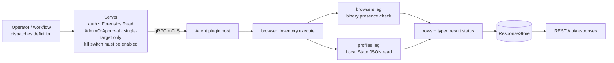
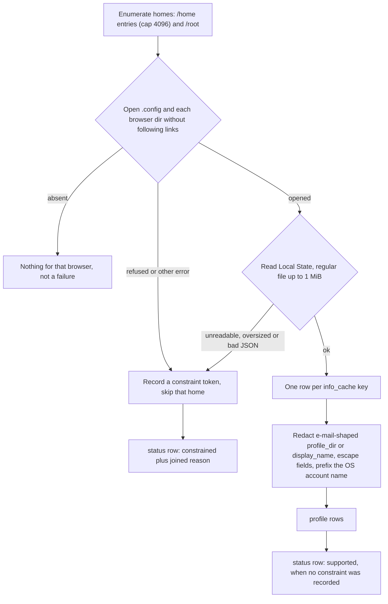
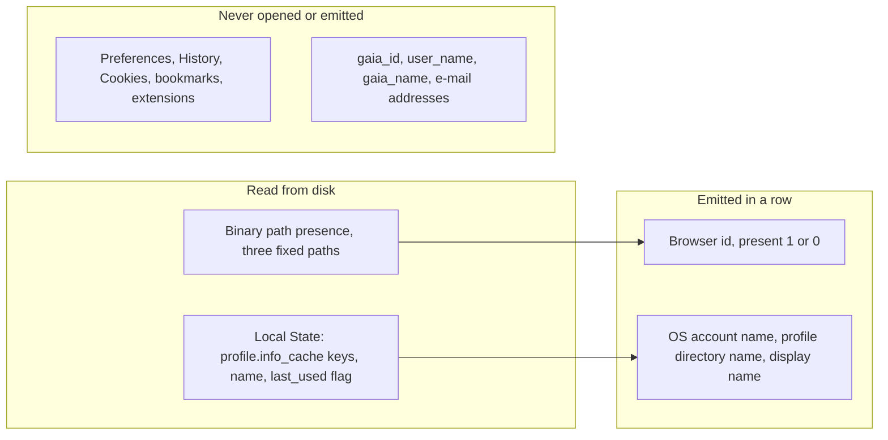

# browser_inventory

<!-- BEGIN GENERATED: plugin-doc-gen header -->
| | |
|---|---|
| **What it does** | Chromium-family browser and profile inventory |
| **Version** | 1.0.0 |
| **Kind** | Collector · read-only · gathered (crossplatform.browser_inventory.browsers, crossplatform.browser_inventory.profiles) |
| **Platforms** | Windows 🟡 planned · macOS 🟡 planned · Linux ✅ |
| **Actions** | `browsers` (definition `crossplatform.browser_inventory.browsers`) · `profiles` (definition `crossplatform.browser_inventory.profiles`) |
| **Security** | securable `Forensics` · operation Read · risk High · dispatch ReadOnly · approval gate AdminOrApproval |
| **Roles** | execute: admin · author: content-author |
<!-- END GENERATED -->

## How it works

`browsers` and `profiles` are two independent read-only actions, dispatched and gated separately, so a failure in one never blocks the other. Each one answers with a `status|<action>|...` row first (`supported`, or `constrained` plus a reason), then its data rows, so a consumer never mistakes silence for "nothing was checked".

- **`browsers`** checks three fixed system-wide binary paths (`/opt/google/chrome/chrome`, `/opt/microsoft/msedge/msedge`, `/usr/lib/chromium/chromium`) and emits one row per candidate, `1` when a regular file is there and `0` when not. The version column is always `-`; no version or channel is probed.
- **`profiles`** walks the home directories under `/home` and the `/root` home, opens each of `~/.config/google-chrome`, `~/.config/chromium` and `~/.config/microsoft-edge`, and reads exactly one file in each: `Local State`. It emits one row per entry in that file's `profile.info_cache`. No profile directory is opened and no file inside one (`Preferences`, `History`, `Cookies` and so on) is ever read.
- It is deliberately not a browser-activity source: no row carries history, cookie, bookmark, extension or last-used information, and Firefox and Safari are not covered. Every directory is opened without following links, and every walk is bounded (4096 home entries, 1 MiB for `Local State`).
- Both actions need the `Forensics` securable at admin-or-approval level, run against a single named device only, and stay refused until an operator enables the plugin's server-side kill switch.



**Privacy contract.** No row on any action or OS ever carries a browsing-account identifier, browsing history, cookies or bookmarks: no `gaia_id`, no e-mail address, no Chromium `user_name` or `gaia_name`. The first three are structural: the row model in `browser_inventory_parsers.hpp` (`BrowserProfileRow`) has no field for them. E-mail addresses are removed by value: `profile_dir` (a signed-in Edge profile is often keyed by its account e-mail) and `display_name` are replaced whole with `[redacted-email]` when they contain an e-mail-shaped substring (`looks_like_email_address`), including decorated or multiple addresses. That filter is a coarse shape check that over-matches on purpose; an address in an unusual shape such as `user@localhost` is not caught, and it is not a general personal-data detector.

Two exceptions are accepted and stated plainly. First, each `profiles` row starts with the local OS account name whose home holds the profile; it tells apart several users of one machine and is added by the Linux row builder, never by the parser. Second, a `display_name` that contains no e-mail-shaped text is emitted as-is, and Chromium-family browsers often fill it with the signed-in person's real name, so it can be a personal name.

**Why Forensics, not Inventory.** The rows describe per-user browser profile state for one named machine, the kind of evidence that could be used to profile a specific person's activity. The plugin therefore shares the `Forensics:Read` and admin-or-approval boundary of `execution_artifacts` and `app_usage`; the rationale is recorded in `plugin_action_catalogue_browser_inventory.hpp`.

### What you can decide with it

| Question | Action | Linux | macOS and Windows |
|---|---|---|---|
| Is a managed Chrome, Edge or Chromium installed at its standard system path? | `browsers` | A `1` or `0` per browser; `0` does not rule out an install elsewhere (Snap, Flatpak, a user-local copy) | Nothing: `UNAVAILABLE` with `macos:planned` or `windows:planned` |
| Which browser profiles exist for which local users? | `profiles` | One row per profile per user per browser, for the homes the agent account can read | Nothing, as above |
| Is a profile named after, or labelled with, a person or an account? | `profiles` | Visible in `display_name` (account e-mail forms are redacted) | Nothing |
| Which browser did someone use, when, or for what? | none | Not answerable: no history, timestamps or last-used flag are emitted | Not answerable |

A `constrained` status with a `permission_denied` reason means at least one home or browser directory could not be entered, so the list may be incomplete; rows that were readable are still returned. A clean `OK` with zero `profiles` rows means every home the walk reached had no readable `Local State` with profiles, which is not proof that no browser data exists in a place the walk does not look.

### Diagrams

#### Profile discovery



The walk treats a missing directory as normal and anything else that stops a read as a recorded constraint, so a refused home produces a `constrained` status instead of a silently shorter list. Rows from homes that could be read are still returned alongside the constrained status.

#### What is emitted and what is never read



Only the profile registry in `Local State` is read, and only its directory keys and display names are carried into rows. Account identifiers and everything inside a profile directory stay out of the plugin's reach.

## OS capability

<!-- BEGIN GENERATED: plugin-doc-gen capability -->
| Action | Windows | macOS | Linux |
|---|---|---|---|
| `browsers` | 🟡 planned · rung 1 · ProfileList walk + %LOCALAPPDATA% User Data; Program Files Application\\<semver> dirs | 🟡 planned · rung 1 · /Applications/{Google Chrome,Microsoft Edge}.app Info.plist + ~/Library/Application Support/{Google/Chrome,Microsoft Edge} walk; Safari bundle + .appex containers | 🟡 constrained · rung 1 · fixed system binary path presence (/opt/google/chrome/chrome, /opt/microsoft/msedge/msedge, /usr/lib/chromium/chromium) |
| `profiles` | 🟡 planned · rung 1 · ProfileList walk + %LOCALAPPDATA% User Data; Program Files Application\\<semver> dirs | 🟡 planned · rung 1 · /Applications/{Google Chrome,Microsoft Edge}.app Info.plist + ~/Library/Application Support/{Google/Chrome,Microsoft Edge} walk; Safari bundle + .appex containers | ✅ supported · rung 1 · ~/.config/{google-chrome,chromium,microsoft-edge}/Local State JSON read |

**Declared limits per leg** (descriptor fallback text, verbatim):

- **`browsers` / Windows** — follows as its own PR
- **`browsers` / macOS** — follows as its own PR
- **`browsers` / Linux** — presence-only; no version/channel detection in this package
- **`profiles` / Windows** — follows as its own PR
- **`profiles` / macOS** — follows as its own PR
<!-- END GENERATED -->

## Privileges and prerequisites

| OS | Runs as | Extra grant needed | Measured | If the read is refused |
|---|---|---|---|---|
| Windows | n/a | n/a: the Windows leg is a placeholder that returns the `UNAVAILABLE` row and reads nothing | not measured (no read exists) | always the `windows:planned` row, `UNAVAILABLE`/`PARTIAL` |
| macOS | n/a | n/a: the macOS leg (including Safari) is a placeholder that returns the `UNAVAILABLE` row and reads nothing | not measured (no read exists) | always the `macos:planned` row, `UNAVAILABLE`/`PARTIAL` |
| Linux | the agent service account (`yuzu-agent` in the packaged unit); unprivileged, no sudo | None granted. `browsers` presence-checks fixed system-wide paths that are world-readable. `profiles` can only enter a home directory the account is allowed to enter, so with default home permissions most users' browser data is out of reach | Container capture as root only; no capture as the unprivileged service account, and no real Chrome install (Chrome fixtures are synthetic, shaped like a real Edge capture) | `constrained` with a `linux:browser_inventory:<cause>` token (for example `permission_denied`); a genuinely absent browser or home gives fewer rows, not `constrained` |

No external binaries, no subprocesses and no network access: every call is an in-process filesystem read and JSON parse. The plugin performs no authorization of its own; `Forensics:Read`, admin-or-approval and single-target enforcement happen at the server dispatch layer, and every dispatch is additionally refused while the server-side plugin-config kill switch (`PluginConfigStore::seed_kill_switch_default_off`) is off.

## Data contract

### Inputs

<!-- BEGIN GENERATED: plugin-doc-gen inputs -->
Neither action takes parameters.
<!-- END GENERATED -->

### Outputs

Pipe-delimited rows. Every action's stream leads with a `status|<action>|<supported|constrained|unsupported>|<reason>` row (CC-07 typed-status pairing; `unsupported` is the macOS and Windows placeholder, `<os>:planned`), followed by zero or more data rows discriminated by their own leading tag (`browser|...`, `profile|...`); every untrusted string field (usernames, profile directory and display names) is escaped through `safe_output_field`. A directory or file that cannot be opened or read anywhere in the walk (`ConstraintAccumulator`) sets the action's `status` row to `constrained` with the accumulated reason — a genuinely absent browser install or user directory is never treated as a failure, only as fewer rows.

<!-- BEGIN GENERATED: plugin-doc-gen outputs -->
**`crossplatform.browser_inventory.browsers` — `row_kind|field_1|field_2|field_3`**

| Field | Type | Values | Available | Example | Description |
|---|---|---|---|---|---|
| `row_kind` | string | - | all | `browser` | Discriminates the row shape - "status" or "browser". |
| `field_1` | string | - | all | `chrome` | status row: the action name ("browsers"). browser row: the browser identifier. |
| `field_2` | string | - | all | `1` | status row: "supported" or "constrained". browser row: "1" if the binary is present, "0" otherwise. |
| `field_3` | string | - | all | `-` | status row: the constraint reason, "-" when supported. browser row: version, always "-" this wave (no version/channel probe). |

**`crossplatform.browser_inventory.profiles` — `row_kind|field_1|field_2|field_3|field_4`**

| Field | Type | Values | Available | Example | Description |
|---|---|---|---|---|---|
| `row_kind` | string | - | all | `profile` | Discriminates the row shape - "status" or "profile". |
| `field_1` | string | - | all | `jdoe` | status row: the action name ("profiles"). profile row: the owning OS user, redacted per the sample-capture convention in non-sample contexts this is the real local username. |
| `field_2` | string | - | all | `chrome` | status row: "supported" or "constrained". profile row: the browser identifier. |
| `field_3` | string | - | all | `Default` | status row: the constraint reason, "-" when supported. profile row: the profile directory name (the Local State info_cache key), e.g. "Default", "Profile 1" — redacted whole to "[redacted-email]" when the raw value contains an e-mail-shaped substring — bare, decorated or several addresses (some Chromium builds key a signed-in profile by its account e-mail). |
| `field_4` | string | - | all | `Work` | status row: empty. profile row: the profile's user-editable display name — redacted whole to "[redacted-email]" under the same rule as field_3, otherwise emitted as-is (may legitimately be a personal name). |
<!-- END GENERATED -->

### Result status

| Status | Completeness | Provenance | When |
|---|---|---|---|
| `OK` | full | *(empty)* | The leg's walk completed with no unreadable directory or malformed file anywhere along the way (`status\|supported\|-`). |
| `CONSTRAINED` | partial | `linux:browser_inventory:local_state_malformed` · `linux:browser_inventory:local_state_too_large` · `linux:browser_inventory:busy` · `linux:browser_inventory:not_a_directory` · `linux:browser_inventory:not_regular` · `linux:browser_inventory:open_failed` · `linux:browser_inventory:permission_denied` · `linux:browser_inventory:readdir_error:home` · `linux:browser_inventory:row_cap:home` · `linux:browser_inventory:symlink_refused` | A `Local State` file existed but failed to parse as valid JSON, exceeded the 1 MiB read cap (distinct from malformed — a size-policy refusal, not invalid content), or a directory/file in the walk (a user's config directory, a browser's data directory, or the "browsers" action's binary-path probe) could not be opened, read, or safely followed (symlink refusal, non-directory, non-regular file, busy/locked, permission denied, a `readdir` failure, or the per-user row cap) for a reason other than benign absence. |
| `UNAVAILABLE` | partial | `macos:planned` · `windows:planned` | macOS and Windows, every action: neither leg reads anything yet. The row itself is `status\|<action>\|unsupported\|<os_tag>:planned`. |

### Where the data goes

- **Instruction result only.** Rows travel over the agent's mTLS gRPC channel as the command response, land in the ResponseStore, and are queryable at `/api/responses/{id}` — single-target only; fleet or scope targeting is refused at the server dispatch layer before this plugin ever runs.
- **Not consumed by** daily-sync inventory, the TAR warehouse, DEX, or metrics. Nothing here runs on a schedule; each action dispatches only when an operator or workflow explicitly requests it, and only once the plugin-config kill switch is enabled.
- **Sensitivity.** `profiles` rows name a real local OS username and a browser-supplied `display_name` that MAY be the signed-in account's real name (see the two accepted exceptions in the privacy contract above) for a single named machine — they let a reader reconstruct which browsers and profiles a specific person on that machine uses, and potentially who that person is, which is exactly the kind of per-user fingerprint an unauthorized reader could misuse. No `gaia_id`, e-mail address, browsing history or cookie is ever included.
- **Siblings:** `execution_artifacts` and `app_usage` are the other Forensics-gated, default-off evidence sources in the catalogue; none share a store or a format with this plugin.
- **MCP / REST.** Discover: `discover_plugins` (summary) → `yuzu://plugin-docs` (this page as data) → `discover_instructions` / `get_definition("crossplatform.browser_inventory.profiles")`. Run: `execute_instruction {definition_id, parameters}` (single explicit `agent_id` required). Read: `/api/responses/{id}`.

## Sample output

<!-- BEGIN GENERATED: plugin-doc-gen samples -->
**Linux** — captured: linux Debian GNU/Linux 13 (trixie) aarch64 · container · 2026-09-22 · euid 0 · leg-hash 66c026fa18f1

```
== action=browsers
status|browsers|supported|-
browser|chrome|0|-
browser|edge|0|-
browser|chromium|0|-
[result_status] OK / FULL

== action=profiles
status|profiles|supported|-
[result_status] OK / FULL
```
<!-- END GENERATED -->

## Caveats and known gaps

1. **Linux only, Chromium-family only.** On macOS and Windows every action returns the fixed `status|<action>|unsupported|<os_tag>:planned` row and `UNAVAILABLE`; those legs, Safari, Firefox and a per-profile `extensions` action are planned and not implemented. An operator cannot use this plugin to inventory browsers on those systems.
2. **An unprivileged agent sees little.** `profiles` opens each home under `/home` plus `/root`, and a denied open is reported as a constraint rather than skipped, so on a host where the service account cannot enter other users' homes (the common default) the status is `CONSTRAINED` with `permission_denied` and rows appear only for readable homes. Treat `CONSTRAINED` as the normal outcome there and read the rows that are present, not the status alone.
3. **Fixed paths, presence only.** `browsers` probes three exact binary paths and `profiles` three exact config directories, so browsers installed through Snap or Flatpak, in a user-local directory or under another name read as `0` or as no profiles. The `Local State` profile list is a registry, not evidence of use: a listed profile may no longer have a directory, and no timestamps are read.
4. **Off until an operator turns it on.** Neither action dispatches until `PUT /api/v1/plugin-config/browser_inventory/kill-switch {"enabled":true}`; on a fresh install the server refuses the dispatch before the plugin runs, which is not reported as a plugin failure.

## Source and tests

<!-- BEGIN GENERATED: plugin-doc-gen source -->
- Plugin: `agents/plugins/browser_inventory/src/browser_inventory_legs.hpp` · `agents/plugins/browser_inventory/src/browser_inventory_linux.cpp` · `agents/plugins/browser_inventory/src/browser_inventory_linux_parsers.hpp` · `agents/plugins/browser_inventory/src/browser_inventory_macos.cpp` · `agents/plugins/browser_inventory/src/browser_inventory_parsers.hpp` · `agents/plugins/browser_inventory/src/browser_inventory_plugin.cpp` · `agents/plugins/browser_inventory/src/browser_inventory_win.cpp`
- Definitions: `content/definitions/browser_inventory.yaml`
- Capability rows: `server/core/src/capability_decls/plugin_action_catalogue_browser_inventory.hpp`
- Tests: `tests/unit/test_browser_inventory_linux_parsers.cpp` · `tests/unit/test_browser_inventory_local_dispatcher.cpp` · `tests/unit/test_browser_inventory_parsers.cpp`
- Privilege row: `docs/agent-privilege-model.md`
<!-- END GENERATED -->
