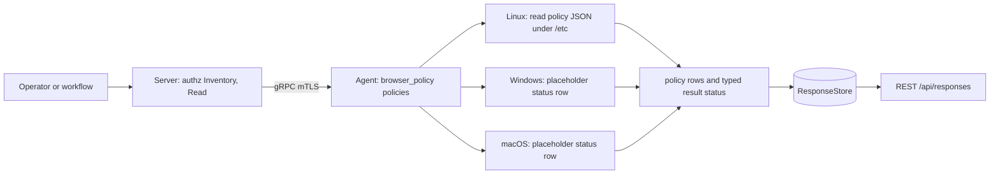
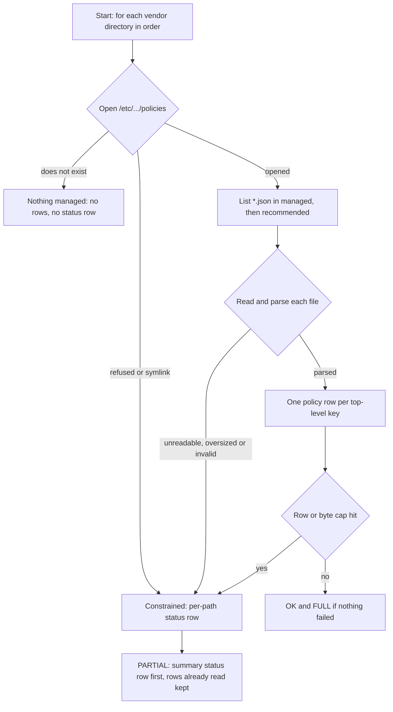

# browser_policy

<!-- BEGIN GENERATED: plugin-doc-gen header -->
| | |
|---|---|
| **What it does** | Enterprise-managed Chrome, Chromium and Edge browser policy inventory |
| **Version** | 1.0.0 |
| **Kind** | Collector · read-only · gathered (crossplatform.browser_policy.policies) |
| **Platforms** | Windows 🟡 planned · macOS 🟡 planned · Linux ✅ |
| **Actions** | `policies` (definition `crossplatform.browser_policy.policies`) |
| **Security** | securable `Inventory` · operation Read · risk Low · dispatch ReadOnly · approval gate None |
| **Roles** | execute: endpoint-admin, endpoint-operator · author: content-author |
<!-- END GENERATED -->

## How it works

`policies` reports which enterprise-managed browser policies an administrator has configured on the device, as facts only. It reads local policy files, in a fixed order: Chrome (`/etc/opt/chrome/policies`), then Chromium (`/etc/chromium/policies`), then Edge (`/etc/opt/edge/policies`), and within each the `managed` directory before `recommended`. Every `*.json` file in those directories is parsed and each top-level key becomes one `policy` row: browser, level (mandatory or recommended), scope, policy name, typed value and the file it came from. Directories are opened one hop at a time without following symlinks, each file is capped at 1 MiB (16 MiB in total per run), and a file that is not a regular file is refused.

The plugin starts no process, uses no network and writes nothing. It enforces and judges nothing: a policy is a row, not a verdict. A missing policy directory means "nothing managed" and produces no rows. A directory or file that exists but cannot be read or decoded makes the result partial and is also written as a `status` row at the top of the output. Only Linux reads policy today; on Windows and macOS the action answers with a single `status` row saying the host was not inspected (see Caveats). The action carries no default-off kill switch because the data is IT-authored configuration, not personal data; the operator-settable per-plugin kill switch still applies.



### What you can decide with it

| Question | Linux | Windows | macOS |
|---|---|---|---|
| Is a browser policy configured on this device, and which ones? | Yes, from the three vendor directories. | No answer: one `status` row, `windows:planned`. | No answer: one `status` row, `macos:planned`. |
| Is a given policy mandatory or only recommended? | Yes: the `level` column. | No answer. | No answer. |
| Which file set it, so an administrator can trace it? | Yes: the `source` column. | No answer. | No answer. |
| Is this policy actually in force in the browser? | No. Rows are what the files say, not what the browser applied. | No answer. | No answer. |

Use `policies` for a fleet question such as "which devices force-install an extension or pin a homepage". A clean Linux result (`OK`, zero rows, no `status` row) means the three directories were read and held no policy files; it does not mean no browser on the host is managed (per-user policy, snap or flatpak paths and Firefox are out of scope). Never read an empty result from Windows or macOS as "no policy": those hosts were not inspected, and the `status` row says so. Pair it with `installed_apps` to know which browsers are installed at all.

### Diagrams

#### How a Linux read becomes a result



The read never treats a failure as an absence. A directory that does not exist is the only silent case; everything else that cannot be completed turns the result into `CONSTRAINED` / `PARTIAL`, writes a summary `status` row first and a per-path `status` row for each failure, and keeps the policy rows it did read. The caps are a lower bound: when one is hit, the file that crossed it is named and the walk stops.

## OS capability

<!-- BEGIN GENERATED: plugin-doc-gen capability -->
| Action | Windows | macOS | Linux |
|---|---|---|---|
| `policies` | 🟡 planned · rung 1 · HKLM\\SOFTWARE\\Policies\\{Google\\Chrome,Microsoft\\Edge} registry reads (RegKey enumerate_value_names) | 🟡 planned · rung 1 · /Library/Managed Preferences/{,<user>/}{com.google.Chrome,com.microsoft.Edge}.plist (CFPropertyListCreateWithData) | ✅ supported · rung 1 · /etc/opt/{chrome,edge} and /etc/chromium policies/{managed,recommended}/*.json (nlohmann) |

**Declared limits per leg** (descriptor fallback text, verbatim):

- **`policies` / Windows** — follows as its own PR
- **`policies` / macOS** — follows as its own PR
<!-- END GENERATED -->

## Privileges and prerequisites

| OS | Runs as | Extra grant needed | Measured | If the read is refused |
|---|---|---|---|---|
| Windows | n/a - placeholder leg | n/a - the leg reads nothing | n/a - the leg reads nothing | n/a - the placeholder reports `UNAVAILABLE` with `windows:planned` and reads nothing |
| macOS | n/a - placeholder leg | n/a - the leg reads nothing | n/a - the leg reads nothing | n/a - the placeholder reports `UNAVAILABLE` with `macos:planned` and reads nothing |
| Linux | agent daemon, dedicated unprivileged account (`yuzu-agent` on the packaged unit), never root by design (`docs/agent-privilege-model.md`) | None to read - the policy directories are root-owned and, as shipped by the browser packages, world-readable (the browser runs as the user, so it needs the same read access; not verified here) | Measured in a Debian 13 container as euid 0 (`docs/samples/linux.txt`: the seeded policy files read with no extra grant); the refusal path (`permission_denied`) is proven by the unit suite as a non-root user, not by a service-account run on a real host | `CONSTRAINED` / partial with a `linux:<detail>` token (for example `linux:permission_denied` or `linux:symlink_refused`); the unreadable directory or file contributes no rows, one `status` row repeats the outcome, and the result never reads as "no policy configured" |

No external binaries, no subprocesses, no shell-out and no network use: the Linux leg is an in-process, bounded read of local files.

## Data contract

### Inputs

<!-- BEGIN GENERATED: plugin-doc-gen inputs -->
The action takes no parameters.
<!-- END GENERATED -->

### Outputs

Every row is pipe-delimited and has nine fields; field 0 is `policy` for a policy row, or `status` for the outcome rows described under Result status. A host with no managed policy returns zero rows. Free text is escaped for the server's pipe grammar (`safe_output_field`, lossy on backslash by design), a field with an embedded NUL byte, or with a byte that is not valid UTF-8 (only a Linux file name can carry one, in `source`), has it replaced by U+FFFD and is flagged in `detail` (`nul_replaced`, `utf8_replaced`), a field longer than 64 KiB is cut and flagged `truncated` (these flags are set on `policy` rows; a `status` row's `source` is repaired and escaped the same way but not flagged, since its `detail` field carries only the reason tokens, repeating the typed status's provenance), and a value that cannot be represented is typed `unmodelled` (`detail` `json_type`) instead of being dropped, and a `list`/`dict` value whose JSON dump contains a backslash — the escaper's fold makes the result lossy and not trustworthy as the original JSON, and an escaped quote in particular can make it syntactically invalid — keeps its type and (folded) text but is flagged `json_escaped` in `detail` rather than presented as trustworthy JSON. `browser_policy` is not in the server's key/value plugin set, so rows are decoded as pipe-separated fields, not as `key|rest`.

<!-- BEGIN GENERATED: plugin-doc-gen outputs -->
**`crossplatform.browser_policy.policies` — `row_kind|browser|level|scope|name|value_type|value|source|detail`**

| Field | Type | Values | Available | Example | Description |
|---|---|---|---|---|---|
| `row_kind` | string | `policy` `status` | Windows, Linux, macOS | `policy` | Row shape discriminator (field 0): policy (one per configured policy) or status (written first, and only when the read was not complete; the one exception is a leg that throws after it has reported, which appends a second, unavailable status row behind its rows -- the last status row is the outcome). A status row repeats the typed result status in band; its name field is the action, its value field the state and its detail field the reason tokens; its other fields are "-", except source on a per-path status row (the logical path the reason token names). |
| `browser` | string | `chrome` `chromium` `edge` | Linux | `chrome` | Browser the policy applies to. Values: chrome (Google Chrome), chromium (Chromium), edge (Microsoft Edge); "-" on a status row. |
| `level` | string | `mandatory` `recommended` | Linux | `mandatory` | Policy level. Values: mandatory (the user cannot override it), recommended (a default the user may change); "-" on a status row. |
| `scope` | string | - | Linux | `machine` | Where the policy applies. Values: machine, or user:<name> where a leg reads per-user policy (the Linux leg reads machine policy only, so it always reports machine). The user name is untrusted text. |
| `name` | string | - | Windows, Linux, macOS | `HomepageLocation` | Policy name exactly as the browser documents it. On a status row: the action name, policies. |
| `value_type` | string | `bool` `int` `real` `string` `list` `dict` `null` `unmodelled` | Linux | `string` | Type of the value. Values: bool, int, real, string, list, dict, null, unmodelled (the policy is present but its value could not be represented; see detail); "-" on a status row. |
| `value` | string | - | Windows, Linux, macOS | `https://intranet.example.com` | The policy value as text: true or false for a bool, decimal text for int and real, the string verbatim, compact JSON text for a list or dict (flagged json_escaped in detail, and lossy and not trustworthy as the original JSON -- an escaped quote can make it syntactically invalid -- if the escaper folded a backslash inside it), the literal null for null, and "-" for unmodelled. Reported verbatim: a value can carry a credential-bearing URL or an enrollment token an administrator put in the file. On a status row: the state, constrained or unavailable. |
| `source` | string | - | Linux | `/etc/opt/chrome/policies/managed/corp.json` | The logical absolute file the policy was read from, never an injected test root. Only the Linux leg reads policy today; the Windows and macOS legs will report the registry key or plist path. On a status row: "-" on the summary row; on a per-path row the logical /etc/... path of the file or directory whose failure token is in detail, never an injected test root. |
| `detail` | string | - | Windows, Linux, macOS | `-` | A short qualifier, or "-" when there is none. json_type marks an unmodelled value; json_escaped marks a list/dict value whose JSON dump held a backslash, now folded to / by the wire escaper -- the result is lossy and not trustworthy as the original JSON, and an escaped quote can make it syntactically invalid -- the value is still reported, just flagged; nul_replaced and utf8_replaced (appended, comma-joined) mark a free-text field that held an embedded NUL byte or a byte that is not valid UTF-8 (possible in a Linux file name), each replaced by U+FFFD; truncated marks a field longer than 64 KiB, cut. On a status row: the comma-joined reason tokens, for example linux:permission_denied or macos:planned. |
<!-- END GENERATED -->

### Result status

`policies` sets `OK`/`FULL` when the Linux read completed, including a host with no policy files at all: an absent policy set is a complete answer, not a degradation, and it writes no row. Any directory, file or value that exists but could not be read or decoded makes the result `CONSTRAINED`/`PARTIAL` with the failure tokens as the reason; the rows that were read are still emitted. The Windows and macOS placeholders report `UNAVAILABLE`/`PARTIAL`: that host was not inspected, which is never the same as "no policy configured". No exception crosses the plugin boundary: a leg that throws is reported as `UNAVAILABLE`/`PARTIAL` with an exception token.

Every result other than a complete read is ALSO written as a summary `status` row, first in the output (read it first; per-path rows follow it): `status|-|-|-|policies|-|<state>|-|<reason>`, where `<state>` is `constrained` or `unavailable` and `<reason>` is the same comma-joined token list the typed status carries as its provenance. The row exists because the server's response queries (REST, MCP and the dashboard) do not return the typed result status today, so without it a host that was not inspected, or a read that failed, would look exactly like a host with no policy. Zero rows and no `status` row means the read completed. The summary row's `source` is `-`. For a `CONSTRAINED` read, the summary row is followed by one per-path `status` row for each failure, `status|-|-|-|policies|-|constrained|<logical_path>|<token>`, naming the file or directory (the logical `/etc/...` path, never an injected root) the token describes, so the unreadable, unparseable, oversized, non-regular or symlinked entry no longer has to be found by hand. At most 64 per-path rows are written; when more failed, the summary reason gains `linux:status_rows_capped`. A byte-cap or row-cap stop names the file that crossed the bound.

| Status | Completeness | Provenance | When |
|---|---|---|---|
| `OK` | `FULL` | (empty) | Linux: every read completed, populated or genuinely empty; no `status` row |
| `CONSTRAINED` | `PARTIAL` | `linux:<detail>` with `<detail>` one of `permission_denied`, `symlink_refused`, `not_a_directory`, `open_failed`, `stat_failed`, `not_regular`, `oversized`, `read_failed`, `readdir_error`; also `linux:row_cap` (more than 8192 rows in one run), `linux:entry_cap` (one policy directory holds more than 4096 entries), `linux:byte_cap` (more than 16 MiB of policy files read in one run), `linux:json_unparseable`, `linux:json_not_object`, `linux:json_too_deep` and `linux:json_too_complex` (more than 65536 containers in one file); also `linux:status_rows_capped` (more than 64 per-path `status` rows were due; the first 64 are written) (several tokens are comma-joined) | Linux: a policy directory or file exists but could not be read completely or decoded, or a bound (row cap, directory entry cap, 1 MiB file cap, 16 MiB total parse cap, nesting depth, container count) was hit; a summary `constrained` `status` row plus per-path rows |
| `UNAVAILABLE` | `PARTIAL` | `windows:planned` | Windows: the leg is a placeholder; one `unavailable` `status` row, no policy rows |
| `UNAVAILABLE` | `PARTIAL` | `macos:planned` | macOS: the leg is a placeholder; one `unavailable` `status` row, no policy rows |
| `UNAVAILABLE` | `PARTIAL` | `windows:leg:exception:<category>` / `macos:leg:exception:<category>` / `linux:leg:exception:<category>`, `<category>` one of `bad_alloc`, `std_exception`, `unknown` (the exception text is deliberately never carried) | a leg threw; reported (with one `unavailable` `status` row) instead of unwinding across the plugin boundary. Under sustained allocation failure the category suffix can be lost, leaving the bare `<os>:leg:exception`, and the row itself may not be written; the typed status (or rc 1) still reaches the host. A leg that throws after it has already reported (an allocation failure while its rows are being written) leaves this `unavailable` row BEHIND the rows already written, after the earlier `constrained` summary and per-path rows: the one case where the status row is neither first nor alone; the last status row and the typed status are the outcome. |

### Where the data goes

- **Instruction result.** Rows travel over the agent's mTLS gRPC channel as the command response and land in the ResponseStore, queryable at `/api/responses/{id}`. `policies` is also a gathered definition (`crossplatform.browser_policy.policies`, `gather.ttlSeconds` 300: informational, nothing re-dispatches on it).
- **Not consumed by** daily-sync, TAR, DEX, or metrics.
- **Sensitivity.** Rows are operator/IT-authored configuration: policy names and values such as homepage URLs, allowed or blocked extension ids and proxy settings can disclose part of an organisation's browser-management posture and internal hostnames. They carry no browsing history, bookmarks, cookies or per-user data, and the Linux leg's `scope` column always reports `machine`, never a user. Values are reported verbatim and are not screened: a value an administrator wrote can itself hold a credential-bearing URL or an enrollment token, and the files are world-readable so the browser can load them, so treat the rows as sensitive. Stored responses are kept for the ResponseStore's retention period (90 days by default, `docs/user-manual/response-store.md`); with RBAC on, dispatch needs `Execution:Execute` plus `Inventory:Read` and reading needs `Response:Read`. The classification is deliberate: unlike `browser_inventory`'s per-user browsing data, this content is machine policy the organisation itself wrote, so the action is an ordinary `Inventory:Read` with no execute gate.
- **Sibling:** `installed_apps` (which browsers are installed, not how they are managed).

## Sample output

<!-- BEGIN GENERATED: plugin-doc-gen samples -->
**macOS** — captured: macos macOS 26.6.2 arm64 · bare-metal · 2026-09-23 · euid 501 · leg-hash 3349c5d2765b

```
== action=policies
status|-|-|-|policies|-|unavailable|-|macos:planned
[result_status] UNAVAILABLE / PARTIAL / macos:planned
```

**Linux** — captured: linux Debian GNU/Linux 13 (trixie) aarch64 · container · 2026-09-23 · euid 0 (container seeded with two synthetic Chrome policy files for this capture; see the note under the samples) · leg-hash 3349c5d2765b

```
== action=policies
policy|chrome|mandatory|machine|ExtensionInstallForcelist|list|["aaaabbbbccccddddeeeeffffgggghhhh;https://clients2.google.com/service/update2/crx"]|/etc/opt/chrome/policies/managed/seeded.json|-
policy|chrome|mandatory|machine|HomepageLocation|string|https://intranet.example.com/|/etc/opt/chrome/policies/managed/seeded.json|-
policy|chrome|mandatory|machine|RestoreOnStartup|int|4|/etc/opt/chrome/policies/managed/seeded.json|-
policy|chrome|recommended|machine|BookmarkBarEnabled|bool|true|/etc/opt/chrome/policies/recommended/seeded.json|-
[result_status] OK / FULL
```
<!-- END GENERATED -->

The Linux capture is taken from a real Debian container that was seeded, for the capture only, with two synthetic Chrome policy files (the image ships no browser): `/etc/opt/chrome/policies/managed/seeded.json` holding `ExtensionInstallForcelist`, `HomepageLocation` and `RestoreOnStartup`, and `/etc/opt/chrome/policies/recommended/seeded.json` holding `BookmarkBarEnabled`. The sample therefore shows the shipping leg reading real files through the production root; the same container with no policy files reports zero rows with `OK` / `FULL`. The walk, the caps and every failure token the tests can provoke are covered by the fixture-driven unit tests; the kernel-error tokens (`stat_failed`, `readdir_error`, `open_failed`, `read_failed`) cannot be provoked without a syscall seam and are not. The macOS capture shows the one placeholder `status` row, and there is no Windows capture.

## Caveats and known gaps

1. **Configured policy, not effective policy.** Rows are what is written in the policy files, not what the browser enforces. What this leg does is shown by its code: it parses JSON with comments ignored and nothing else relaxed (anything else that does not parse is `linux:json_unparseable`), refuses symlinks (`linux:symlink_refused`), reports one row per file with its `source` rather than resolving which file wins, and reads only files named `*.json`. Chromium's own policy loader is documented upstream to be more lenient (non-strict JSON, symlinks followed, the last file in name order winning, every file in the directory parsed); that upstream behaviour is not verified here. If it holds, a valid policy file with another name is applied by the browser and skipped here with no constraint reported, so this leg can read as complete while missing a policy.
2. **Windows and macOS are placeholders.** `policies` on those hosts returns one `status` row (`unavailable`) with result status `UNAVAILABLE` and provenance `windows:planned` or `macos:planned`, so a host that was not inspected never reads as having no policy. The Windows registry and macOS Managed Preferences legs are declared but not yet implemented.
3. **Linux reads machine-level JSON policy files in three vendor directories only.** Only the `managed` and `recommended` `*.json` files under `/etc/opt/chrome`, `/etc/chromium` and `/etc/opt/edge` are read; per-user policy, snap and flatpak Chromium paths, other Chromium-based browsers and Firefox `policies.json` are not, and every row reports scope `machine`. `OK` / `FULL` therefore means those directories were read completely, not that no browser on the host has a policy.
4. **A file rewritten during the read can be misread for that run.** Each file is read to end after one `fstat` with no second stability check: a file that grows is `linux:oversized` or `linux:json_unparseable`, but a same-size in-place overwrite that lands during the read can parse as a mix of old and new content for that one run, with no token raised. A writer that replaces the file by rename is unaffected, and a run of failing reads is bounded by the per-file (1 MiB) and per-directory (4096 entries) caps rather than the 16 MiB total.
5. **Values are reported, not validated.** A policy name is emitted as written and is not checked against the browser's schema, so a misspelt policy still appears as a row. Lists and dicts are emitted as compact JSON text, a backslash inside one is folded to `/` and flagged `json_escaped`, and a name, value or source longer than 64 KiB is cut and flagged `truncated`. `value_type` describes how the value is stored in its source, not the browser's schema.

## Source and tests

<!-- BEGIN GENERATED: plugin-doc-gen source -->
- Plugin: `agents/plugins/browser_policy/src/browser_policy_legs.hpp` · `agents/plugins/browser_policy/src/browser_policy_linux.cpp` · `agents/plugins/browser_policy/src/browser_policy_linux_parsers.hpp` · `agents/plugins/browser_policy/src/browser_policy_macos.cpp` · `agents/plugins/browser_policy/src/browser_policy_parsers.hpp` · `agents/plugins/browser_policy/src/browser_policy_plugin.cpp` · `agents/plugins/browser_policy/src/browser_policy_win.cpp`
- Definitions: `content/definitions/browser_policy.yaml`
- Capability rows: `server/core/src/capability_decls/plugin_action_catalogue_browser_policy.hpp`
- Tests: `tests/test_browser_policy_definition.py` · `tests/unit/test_browser_policy_local_dispatcher.cpp` · `tests/unit/test_browser_policy_parsers.cpp`
- Privilege row: `docs/agent-privilege-model.md`
<!-- END GENERATED -->
