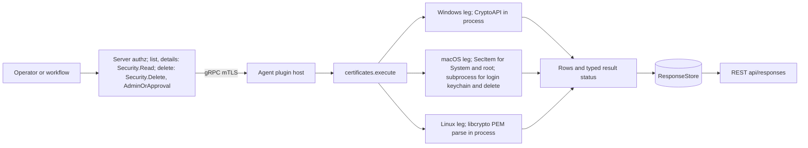
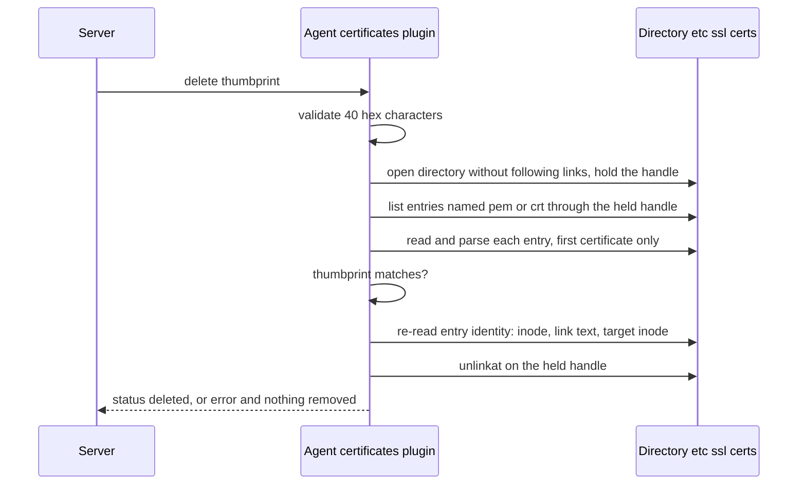
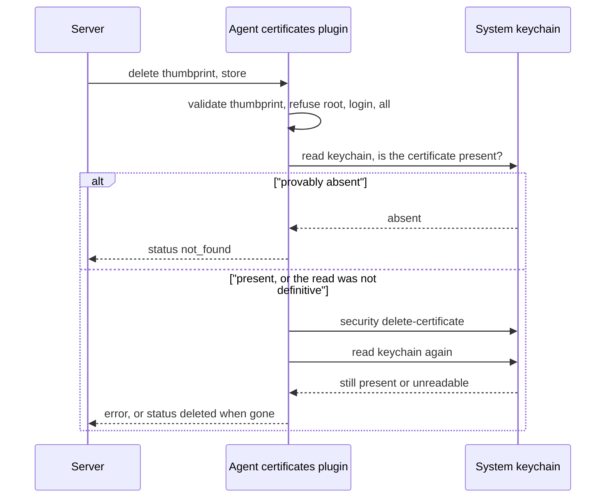
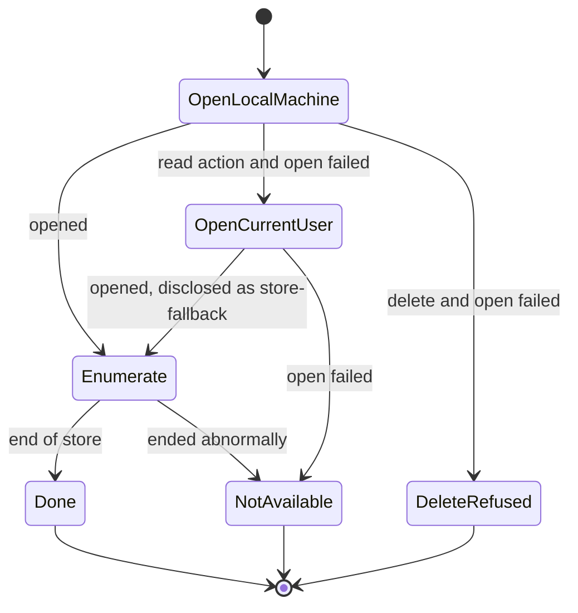

# certificates

<!-- BEGIN GENERATED: plugin-doc-gen header -->
| | |
|---|---|
| **What it does** | Certificate inventory and management for system stores |
| **Version** | 1.0.0 |
| **Kind** | Action · mutating · gathered (security.certificates.list, security.certificates.details, security.certificates.delete) |
| **Platforms** | Windows ✅ · macOS ✅ · Linux ✅ |
| **Actions** | `delete` (definition `security.certificates.delete`) · `details` (definition `security.certificates.details`) · `list` (definition `security.certificates.list`) |
| **Security** | `list`: securable `Security` · operation Read · risk Low · dispatch ReadOnly · approval gate None; `details`: securable `Security` · operation Read · risk Low · dispatch ReadOnly · approval gate None; `delete`: securable `Security` · operation Delete · risk High · dispatch Destructive · approval gate AdminOrApproval |
| **Roles** | execute: `list`: endpoint-admin, endpoint-operator, security-admin; `details`: endpoint-admin, endpoint-operator, security-admin; `delete`: endpoint-admin, security-admin · author: content-author |
<!-- END GENERATED -->

## How it works

`list` and `details` read the certificates held in the operating system's own trust stores and emit one eight-field row per certificate; `list` returns every match (filtered by `store` and `expiring_within_days`) and `details` returns the row whose SHA-1 thumbprint matches, or `status|not_found`. `delete` removes one certificate by thumbprint from one store. It validates the thumbprint as 40 hex characters first, acts on exactly one named store, and reports `status|deleted`, `status|not_found`, `status|delete_failed` (Windows and Linux, when the removal itself fails) or an `error|...` line with a non-zero exit. The plugin does not build or validate a trust chain, check revocation, import or renew certificates, or read stores other than those named below.

Windows reads the CryptoAPI stores `MY`, `ROOT`, `CA` and `Trust` in process under the LocalMachine hive; a read falls back to CurrentUser if LocalMachine cannot be opened and says so, but `delete` never falls back. Linux reads the `.pem` and `.crt` files directly under `/etc/ssl/certs` and parses them in process with libcrypto; only the first certificate in each file is read. macOS reads `System.keychain` and `SystemRootCertificates.keychain` in process through the Security framework (15 seconds per keychain) and the console user's login keychain through a subprocess: `launchctl asuser` and `sudo -u` run `security find-certificate`, and each returned block is parsed by `/usr/bin/openssl`. Before that spawn the agent re-checks the owner of `/dev/console` and refuses to read if it changed. Every macOS action runs inside a shared 60-second budget, so a wedged directory service shows as a `not_available` row with `CONSTRAINED` status rather than a hang.

`delete` is destructive and cannot be undone by Yuzu; the certificate has to be re-imported by other means. On macOS it first proves the certificate is present (an absent one is `status|not_found`, not a command failure), runs `security delete-certificate` against `System.keychain`, then re-reads the keychain and reports `deleted` only if the certificate is gone. On Linux it removes the matching directory entry (a symlink is removed, never its target) after re-checking the entry's identity immediately before `unlinkat`. The plugin does not run `update-ca-certificates` or edit any combined bundle.



The diagram shows where each OS leg gets its data. Reads need Security read; `delete` needs Security delete, is classed Destructive and is gated on an administrator or an approval.

### What you can decide with it

| Question | Action | Windows | macOS | Linux |
|---|---|---|---|---|
| Which certificates does this device trust? | `list` | Machine stores `ROOT`, `CA`, `Trust` and `MY`. Per-user stores are read only as a disclosed fallback. | System and system-root keychains, plus the login keychain when a user is at the console. | Files named `*.pem` or `*.crt` in `/etc/ssl/certs`, first certificate of each file. |
| What expires soon? | `list` with `expiring_within_days` | Same filter on `not_after`. | Same. | Same. |
| Is this specific certificate present, and where? | `details` with a thumbprint | Searches all four stores. | `store` narrows to `login`, `System`, `root` or `all`. | Searches the directory. |
| Which certificates are not from the usual public authorities? | `list`, compare `issuer` and `subject` against a known list | Yes. | Yes. | Yes. |
| Remove a rogue or expired certificate | `delete` | Named store, LocalMachine only. | `System.keychain` only. | The matching file or link in `/etc/ssl/certs`. |

`expiring_within_days=N` keeps certificates whose `not_after` is within N days, including ones that have already expired, and any whose date could not be parsed. `0` returns everything.

Safe workflow for `delete`: run `details` with the thumbprint to confirm the exact store and subject, dispatch `delete` to that one device with the same thumbprint and store, then run `details` again; it should report `status|not_found`. There is no preview and no undo. On macOS the root keychain is sealed by System Integrity Protection, so `delete` with `store=root`, `login` or `all` is rejected rather than redirected. On Linux, a file holding several certificates is removed whole when its first certificate matches.

What a result does and does not prove:

- Presence in a store is not the same as being trusted for every purpose. The plugin reads store contents only; it does not read macOS trust settings, Windows disallowed lists or application-specific bundles.
- A `CONSTRAINED` status or a `not_available` row means part of the inventory is missing. Treat the list as incomplete, never as "nothing there".
- An empty Linux list with no status means `/etc/ssl/certs` does not exist. Distributions that keep trust anchors elsewhere are not covered.
- Thumbprints identify certificates, not devices or people, but `subject` for code-signing certificates is effectively a software-publisher list (see Sensitivity).

### Diagrams

Linux `delete` binds to one directory handle for the whole operation, so a swapped directory cannot redirect it:



If the entry's identity changed since the match, or cannot be re-derived, nothing is removed and the result is `CONSTRAINED` with `posix:delete-recheck`. If any entry could not be read, the scan cannot prove the certificate is absent, so it reports an error rather than `not_found`. Identity is inode and link text, not content, so an in-place rewrite of the same file between match and unlink is not detected.

macOS `delete` proves its own result:



The first absent answer short-circuits to `not_found` only when the read was definitive. Exit code zero from `security` is never trusted on its own: if the keychain cannot be re-read, or still holds the certificate, the result is an `error` and the exit code is non-zero.

Windows store fallback differs between reads and `delete`:



A CurrentUser fallback row is announced by a `not_available` line before that store's rows and marks the result `CONSTRAINED` with `cryptoapi:store-fallback`. `delete` has no CurrentUser path: an unopenable store is `error|<store> store could not be opened; nothing removed`.

## OS capability

<!-- BEGIN GENERATED: plugin-doc-gen capability -->
| Action | Windows | macOS | Linux |
|---|---|---|---|
| `delete` | ✅ supported · rung 1 · CryptoAPI (CertDeleteCertificateFromStore) | 🟡 constrained · rung 2 · security delete-certificate via subprocess runner | ✅ supported · rung 1 · libcrypto X509 match + held-dirfd openat/fstatat/unlinkat with pre-unlink identity recheck |
| `details` | ✅ supported · rung 1 · CryptoAPI (CertEnumCertificatesInStore) | ✅ supported · rung 2 · SecItem (System/root, in-process) + security find-certificate argv via subprocess runner (login) | ✅ supported · rung 1 · libcrypto X509 (in-process PEM parse) |
| `list` | ✅ supported · rung 1 · CryptoAPI (CertEnumCertificatesInStore) | ✅ supported · rung 2 · SecItem (System/root, in-process) + security find-certificate argv via subprocess runner (login) | ✅ supported · rung 1 · libcrypto X509 (in-process PEM parse) |

**Declared limits per leg** (descriptor fallback text, verbatim):

- **`delete` / macOS** — SystemRootCertificates.keychain is sealed under SIP and rejected outright; only System/MY store deletes are supported
- **`details` / macOS** — System.keychain and SystemRootCertificates.keychain are read natively via SecItemCopyMatching (rung 1); the login keychain still requires the launchctl/sudo session hop, run as a pre-split argv through the bounded subprocess runner
- **`list` / macOS** — System.keychain and SystemRootCertificates.keychain are read natively via SecItemCopyMatching (rung 1); the login keychain still requires the launchctl/sudo session hop, run as a pre-split argv through the bounded subprocess runner
<!-- END GENERATED -->

## Privileges and prerequisites

| OS | Runs as | Extra grant needed | Measured | If the read is refused |
|---|---|---|---|---|
| Windows | agent service account (LocalSystem today) | `list` and `details`: none, since reading the machine stores needs no elevation. `delete`: the plugin requests and enables no privilege of its own; the write to a LocalMachine store succeeds as `SYSTEM`. `docs/agent-privilege-model.md` lists `SeBackupPrivilege` and `SeRestorePrivilege` for this action, but nothing in the plugin code uses or requires either, and a narrower account has not been measured | `SYSTEM` on bare-metal Windows 10.0.26200, 2026-09-07, `list` and `details`; the captured `delete` exercises only its parameter check | A store that cannot be opened (even after the CurrentUser fallback) is a `not_available` row with `CONSTRAINED` and `cryptoapi:store-open`; one that ends abnormally is `cryptoapi:store-enum`. `details` never reports `not_found` for a store it could not fully read; it reports one combined scan-incomplete row. `delete` opens LocalMachine only and reports `error` with a non-zero exit, never `not_found` |
| macOS | agent daemon, root (the LaunchDaemon has no `UserName` key; the sample was captured unprivileged, see Measured) | System and root keychains: none, read in process. Login keychain: root, through `launchctl asuser` and `sudo -n -u`; this works only because the daemon runs as root today, and a non-root agent would need the sudoers grant described in `docs/agent-privilege-model.md`. `delete` (System keychain only) runs `/usr/bin/security delete-certificate` as the daemon | bare-metal macOS 26.6.2, euid 501, 2026-09-07, through the test harness rather than the root LaunchDaemon, so the sample shows the login-keychain read degrading | A keychain that is unreadable, times out, hits the bounded-call ceiling or is capped emits a `not_available` row naming it, with `CONSTRAINED` and provenance `secitem:<keychain>`; an empty answer counts as "zero certificates" only if the keychain's read-permission bit is set. A login-keychain failure (no console user, user changed, spawn failed) is `not_available` with `login-keychain` |
| Linux | agent daemon, dedicated unprivileged account, never root by design (`docs/agent-privilege-model.md`) | `list` and `details`: none, a filesystem read and in-process parse. `delete`: write permission on the `/etc/ssl/certs` directory itself, which is normally root-owned; without it the `unlinkat` fails and the result is `status\|delete_failed` with a non-zero exit | Debian GNU/Linux 13 container, euid 0, 2026-09-06; delete as the unprivileged account is not measured | An unreadable or unparseable file is a row marked `(unreadable)` with `CONSTRAINED` and `libcrypto:unreadable-file`. A directory that cannot be opened (including a symlink or non-directory at that path) is `not_available` with `posix:cert-dir`; a listing that fails part-way is `posix:cert-enum`. An identity change between match and unlink is `error` with `posix:delete-recheck`, and nothing is removed |

Binaries and network: Windows runs none, in-process CryptoAPI only. Linux runs none, in-process libcrypto only. macOS runs `/usr/bin/openssl` (parses each login-keychain PEM block), `/usr/bin/security` (`find-certificate` for the login keychain, `delete-certificate`), `/bin/launchctl` and `/usr/bin/sudo` (the login-keychain session hop) and `/usr/bin/stat` (console-user lookup), all through the bounded subprocess runner with a pre-split argv and no shell. No network access on any OS.

## Data contract

### Inputs

<!-- BEGIN GENERATED: plugin-doc-gen inputs -->
| Definition | Parameter | Type | Required | Default | Constraints | Description |
|---|---|---|---|---|---|---|
| `security.certificates.delete` | `thumbprint` | string | yes | - | - | SHA-1 thumbprint (hex string, no colons) of the certificate to delete. Case-insensitive. |
| `security.certificates.delete` | `store` | string | no | MY | - | The certificate store to delete from. On Windows: MY, ROOT, CA, or Trust. Defaults to "MY". On macOS: "MY" (the default) or "System" deletes from /Library/Keychains/System.keychain, matching prior behaviour. "root" is REJECTED (non-zero exit, unsupported) -- SystemRootCertificates.keychain is sealed by System Integrity Protection on modern macOS and cannot actually be modified, so attempting it would report a change that never took effect. "login" and "all" are also not supported for delete and are rejected with an error rather than silently deleting from an unintended store, as is any other unrecognized value. Ignored on Linux. On Windows the named store is opened under the LocalMachine hive only; if it cannot be opened there the action reports error\|<store> store could not be opened; nothing removed (non-zero exit) and never falls back to the CurrentUser hive. |
| `security.certificates.details` | `thumbprint` | string | yes | - | - | SHA-1 thumbprint (hex string, no colons) of the certificate to retrieve. Case-insensitive. |
| `security.certificates.details` | `store` | string | no | all | - | On macOS, restrict the search to one store: "login" (the current console user's login keychain -- returns not_available\|no console session when nobody is logged in at the console, or not_available\|<reason> when the console user could not be determined; in the latter case the search result is PARTIAL and never a definitive status\|not_found, because the login keychain was not opened), "System" (/Library/Keychains/System.keychain), "root" (SystemRootCertificates.keychain), or "all" (System and root, plus login when a console user is present). Ignored on Windows and Linux, which always search every store. Defaults to "all". |
| `security.certificates.list` | `store` | string | no | all | - | Filter by store name. On Windows: MY, ROOT, CA, Trust, or "all" for all stores. On macOS: "login" (the current console user's login keychain -- returns not_available\|no console session when nobody is logged in at the console, or not_available\|<reason> when the console user could not be determined, e.g. the directory lookup timed out; the two are deliberately distinct, a degraded lookup is never reported as an empty console), "System" (/Library/Keychains/System.keychain), "root" (SystemRootCertificates.keychain), or "all" (System and root, plus login when a console user is present). Ignored on Linux, which always enumerates every available certificate. Defaults to "all". |
| `security.certificates.list` | `expiring_within_days` | int32 | no | 0 | minimum 0 | Only return certificates expiring within this many days. Set to 0 to return all certificates regardless of expiry. Useful for compliance audits of soon-to-expire certificates. |
<!-- END GENERATED -->

### Outputs

`list` and `details` write a header row followed by zero or more pipe-delimited certificate rows, or a `status|not_found` / `not_available|<reason>` line in place of a row when nothing matched or a store couldn't be read; on Windows, a `not_available|<store> store (LocalMachine) could not be opened; rows read from CurrentUser` line precedes that store's own rows rather than replacing them, disclosing the CurrentUser fallback. `delete` writes one line only: `status|<value>`, `error|<message>`, or (macOS only) `not_available|<reason>`. `(unknown)` is the honest per-field sentinel for a value that failed to parse — it never means zero or empty; `subject`/`issuer`/`serial`/`key_usage` are escaped so a hostile value can never inject an extra pipe-delimited column or newline-delimited row.

<!-- BEGIN GENERATED: plugin-doc-gen outputs -->
**`security.certificates.delete` — `status`**

| Field | Type | Values | Available | Example | Description |
|---|---|---|---|---|---|
| `status` | string | - | Windows, Linux, macOS | `error\|thumbprint parameter required` | A successful macOS delete emits status\|deleted; a delete targeting a certificate already provably absent from the keychain emits status\|not_found (rc 0), matching the Windows/Linux contract for an absent cert. store=root is rejected with error\|MESSAGE (SystemRootCertificates.keychain is sealed by System Integrity Protection). Every other macOS rejection or failure -- an unsupported store, a failed delete command, or a post-delete verification that still finds the certificate or could not re-read the keychain -- also emits error\|MESSAGE. Windows and Linux emit status\|deleted, status\|delete_failed, or status\|not_found on a store that opened successfully; either OS instead emits error\|<store> store could not be opened; nothing removed if every open attempt for the target store fails. Values: status\|deleted, status\|not_found, status\|delete_failed (Windows/Linux only), error\|<message> (any OS: bad thumbprint, unsupported/rejected store, an unopenable Windows/Linux store, or a macOS delete that could not be verified), not_available\|<reason> (macOS only, pre-validation). |

**`security.certificates.details` — `subject|issuer|thumbprint|not_before|not_after|serial|store|key_usage`**

| Field | Type | Values | Available | Example | Description |
|---|---|---|---|---|---|
| `subject` | string | - | Windows, Linux, macOS | `CN=com.apple.systemdefault, O=System Identity` | The certificate's Subject distinguished name, rendered by the OS's own name printer (CryptoAPI simple display name on Windows, OpenSSL/libcrypto's default name rendering on Linux and macOS System/root reads, the `security find-certificate` subprocess's `subject=` line on the macOS login keychain). Values: free text (distinguished name). |
| `issuer` | string | - | Windows, Linux, macOS | `CN=com.apple.systemdefault, O=System Identity` | The certificate's Issuer distinguished name, rendered the same way as subject. Values: free text (distinguished name). |
| `thumbprint` | string | - | Windows, Linux, macOS | `0C24DA5DE02640D8924F5C7BCB7D5F734815228D` | SHA-1 fingerprint of the certificate's DER encoding, uppercase hex with no separators -- always equal to the request's `thumbprint` parameter (canonicalized to uppercase) on a matching row. Values: 40 uppercase hex characters. |
| `not_before` | string | - | Windows, Linux, macOS | `2026-07-18` | Validity-period start date, YYYY-MM-DD (no time-of-day). Values: date (YYYY-MM-DD), or "(unknown)" when the source date could not be parsed. |
| `not_after` | string | - | Windows, Linux, macOS | `2046-07-13` | Validity-period end date, YYYY-MM-DD. Values: date (YYYY-MM-DD), or "(unknown)" when the source date could not be parsed. |
| `serial` | string | - | Windows, Linux, macOS | `076C11D1` | Certificate serial number as hex text, via the OS's own serial renderer (Windows: little-endian byte reversal; Linux/macOS: `i2a_ASN1_INTEGER` or the openssl `-serial` line). Values: free text (hex). |
| `store` | string | - | Windows, Linux, macOS | `System.keychain` | Which store/keychain/directory the matching row was found in. Values: Windows: MY, ROOT, CA, Trust. macOS: System.keychain, SystemRootCertificates.keychain, login.keychain-db. Linux: the literal path "/etc/ssl/certs".. |
| `key_usage` | string | - | Windows, Linux, macOS | `Digital Signature, Key Encipherment, Data Encipherment` | Comma-separated X.509 Key Usage extension names, or "(none)" when the extension is absent, empty, or could not be read. Values: comma-separated usage names, or "(none)". |

**`security.certificates.list` — `subject|issuer|thumbprint|not_before|not_after|serial|store|key_usage`**

| Field | Type | Values | Available | Example | Description |
|---|---|---|---|---|---|
| `subject` | string | - | Windows, Linux, macOS | `Logitech Inc` | The certificate's Subject distinguished name, rendered by the OS's own name printer (CryptoAPI simple display name on Windows, OpenSSL/libcrypto's default name rendering on Linux and macOS System/root reads, the `security find-certificate` subprocess's `subject=` line on the macOS login keychain). Values: free text (distinguished name). |
| `issuer` | string | - | Windows, Linux, macOS | `DigiCert Trusted G4 Code Signing RSA4096 SHA384 2021 CA1` | The certificate's Issuer distinguished name, rendered the same way as subject. Values: free text (distinguished name). |
| `thumbprint` | string | - | Windows, Linux, macOS | `FBD3B2C0991549EC5FB12FA1A994D2E0C32D8057` | SHA-1 fingerprint of the certificate's DER encoding, uppercase hex with no separators -- the identifier `details`/`delete` match against (the request parameter is case-insensitive, this column is always uppercase). "(unknown)" when the row's identity could not be established (a failed/timed-out per-block parse) and "(skipped)" for a Linux file that could not be read at all. Values: 40 uppercase hex characters, or "(unknown)"/"(skipped)". |
| `not_before` | string | - | Windows, Linux, macOS | `2025-01-09` | Validity-period start date, YYYY-MM-DD (no time-of-day). Values: date (YYYY-MM-DD), or "(unknown)" when the source date could not be parsed. |
| `not_after` | string | - | Windows, Linux, macOS | `2026-01-09` | Validity-period end date, YYYY-MM-DD. Also the field `expiring_within_days` filters on. Values: date (YYYY-MM-DD), or "(unknown)" when the source date could not be parsed. |
| `serial` | string | - | Windows, Linux, macOS | `09CFB6DE3AB5124757FFEFDF3759BBF2` | Certificate serial number as hex text, via the OS's own serial renderer (Windows: little-endian byte reversal; Linux/macOS: `i2a_ASN1_INTEGER` or the openssl `-serial` line). Values: free text (hex). |
| `store` | string | - | Windows, Linux, macOS | `ROOT` | Which store/keychain/directory the row was read from. Values: Windows: MY, ROOT, CA, Trust. macOS: System.keychain, SystemRootCertificates.keychain, login.keychain-db. Linux: the literal path "/etc/ssl/certs" for every row.. |
| `key_usage` | string | - | Windows, Linux, macOS | `Digital Signature` | Comma-separated X.509 Key Usage extension names, or "(none)" when the extension is absent, empty, or could not be read. Values: comma-separated usage names, or "(none)". |
<!-- END GENERATED -->

### Result status

| Status | Completeness | Provenance | When |
|---|---|---|---|
| `CONSTRAINED` | `PARTIAL` | `libcrypto:unreadable-file` | Linux: a PEM file under `/etc/ssl/certs` could not be read or parsed |
| `CONSTRAINED` | `PARTIAL` | `cryptoapi:store-open` | Windows: a CryptoAPI store could not be opened for `list`/`details`/`delete` |
| `CONSTRAINED` | `PARTIAL` | `cryptoapi:store-enum` | Windows: `CertEnumCertificatesInStore` ended abnormally part-way through a store for `list`/`details`/`delete` |
| `CONSTRAINED` | `PARTIAL` | `cryptoapi:store-fallback` | Windows: the LocalMachine store could not be opened and `list`/`details` read the CurrentUser store instead; `list_certs_win` discloses it with a `not_available` row before that store's rows; `details_cert_win` discloses every such store the same way — either as its own row immediately before a match served from it, or, if an earlier fallback store didn't match, as a combined row emitted alongside whichever later store's match ends the scan — and folds every fallback store into the combined scan-incomplete verdict only when no store ever matches |
| `CONSTRAINED` | `PARTIAL` | `posix:cert-dir` | Linux: `/etc/ssl/certs` could not be opened (including a non-directory or symlink at that path) |
| `CONSTRAINED` | `PARTIAL` | `posix:cert-enum` | Linux: a readdir(3)/fdopendir enumeration of `/etc/ssl/certs` failed part-way through |
| `CONSTRAINED` | `PARTIAL` | `posix:delete-recheck` | Linux: `delete`'s pre-unlink identity recheck found the entry changed or could not be re-derived since the earlier match |
| `CONSTRAINED` | `PARTIAL` | `login-keychain` | macOS: console-user resolution failed, the console user changed or its owner recheck failed immediately before the login-keychain spawn, or the login-keychain read/scan failed, degraded, or was capped |
| `CONSTRAINED` | `PARTIAL` | `secitem:System.keychain` | macOS: System.keychain was not readable (no read permission), timed out, was refused at the bounded-call ceiling, failed to open, or its scan was capped |
| `CONSTRAINED` | `PARTIAL` | `secitem:SystemRootCertificates.keychain` | macOS: SystemRootCertificates.keychain was not readable (no read permission), timed out, was refused at the bounded-call ceiling, failed to open, or its scan was capped |

A clean run on any OS leaves the default `UNDECLARED` / `UNKNOWN` status. The plugin sets a status only to report a degraded read, so the table rows above are the only statuses it emits; the Sample output shows this. A failed `delete` is reported by its `error|...` line and a non-zero exit, and sets a status only on the paths named above.

### Where the data goes

- **Instruction result.** Rows travel over the agent's mTLS gRPC channel as the command response and land in the ResponseStore (90-day default retention), queryable at `/api/responses/{id}`; `list` also aggregates by `store` and `issuer` through its definition's `aggregation` block.
- **Not consumed by** daily-sync inventory, the TAR warehouse, DEX, or metrics — no reference to the `certificates` plugin or its definition ids exists outside `server/core/src/capability_decls/plugin_action_catalogue_c.hpp`.
- **Sensitivity.** `list`/`details` rows carry every certificate's `subject` and `issuer` — for code-signing certs (the Windows sample) this is effectively an installed-software-publisher inventory (e.g. `Logitech Inc`, `Microsoft Corporation`) by another route, and on macOS a successful login-keychain read can surface the signed-in user's own personal certificates; `thumbprint`/`serial` uniquely identify a specific certificate but not a device or person directly.
- **Siblings:** none in this plugin group; the `diagnostics.certificates` action (a different plugin, TLS cert/key diagnostics) is unrelated despite the similar name.
- **MCP / REST.** Discover: `discover_plugins` (summary) → `yuzu://plugin-docs` (this page as data) → `discover_instructions` / `get_definition("security.certificates.list")`. Run: `execute_instruction {definition_id, parameters}`. Read: `/api/responses/{id}`.

## Sample output

<!-- BEGIN GENERATED: plugin-doc-gen samples -->
**Windows** — captured: windows Microsoft Windows NT 10.0.26200.0 x64 · bare-metal · 2026-09-07 · SYSTEM · leg-hash 12fa059e66fa

```
== action=list
subject|issuer|thumbprint|not_before|not_after|serial|store|key_usage
Logitech Inc|DigiCert Trusted G4 Code Signing RSA4096 SHA384 2021 CA1|FBD3B2C0991549EC5FB12FA1A994D2E0C32D8057|2025-01-09|2026-01-09|09CFB6DE3AB5124757FFEFDF3759BBF2|ROOT|Digital Signature
Microsoft Identity Verification Root Certificate Authority 2020|Microsoft Identity Verification Root Certificate Authority 2020|F40042E2E5F7E8EF8189FED15519AECE42C3BFA2|2020-04-16|2045-04-16|5498D2D1D45B1995481379C811C08799|ROOT|Digital Signature, Certificate Signing, CRL Signing
Logitech Inc|DigiCert Trusted G4 Code Signing RSA4096 SHA384 2021 CA1|D8D11D216CC42B72EA838CAD51F4F4932A1940A0|2026-01-08|2027-01-13|0CADE25B085DD33813FD746151BF6B5E|ROOT|Digital Signature
Baltimore CyberTrust Root|Baltimore CyberTrust Root|D4DE20D05E66FC53FE1A50882C78DB2852CAE474|2000-05-12|2025-05-12|020000B9|ROOT|Certificate Signing, CRL Signing
AAA Certificate Services|AAA Certificate Services|D1EB23A46D17D68FD92564C2F1F1601764D8E349|2004-01-01|2028-12-31|01|ROOT|Certificate Signing, CRL Signing
Microsoft Root Certificate Authority|Microsoft Root Certificate Authority|CDD4EEAE6000AC7F40C3802C171E30148030C072|2001-05-09|2021-05-09|79AD16A14AA0A5AD4C7358F407132E65|ROOT|Digital Signature, Certificate Signing, CRL Signing, Non-Repudiation
Logitech Inc|DigiCert Trusted G4 Code Signing RSA4096 SHA384 2021 CA1|C27999A8CEE208F833289CB1A129666E952C7EC2|2022-04-11|2025-04-10|08FABFA8F305A513536B9F231CD3249C|ROOT|Digital Signature
Thawte Timestamping CA|Thawte Timestamping CA|BE36A4562FB2EE05DBB3D32323ADF445084ED656|1997-01-01|2020-12-31|00|ROOT|(none)
Starfield Root Certificate Authority - G2|Starfield Root Certificate Authority - G2|B51C067CEE2B0C3DF855AB2D92F4FE39D4E70F0E|2009-09-01|2037-12-31|00|ROOT|Certificate Signing, CRL Signing
Microsoft Root Authority|Microsoft Root Authority|A43489159A520F0D93D032CCAF37E7FE20A8B419|1997-01-10|2020-12-31|00C1008B3C3C8811D13EF663ECDF40|ROOT|(none)
Symantec Enterprise Mobile Root for Microsoft|Symantec Enterprise Mobile Root for Microsoft|92B46C76E13054E104F230517E6E504D43AB10B5|2012-03-15|2032-03-14|0F6B552F9EBF907B0F6629A9BDF4D8CE|ROOT|Certificate Signing, CRL Signing
… 12 of 81 rows shown
[result_status] UNDECLARED / UNKNOWN

== action=details thumbprint=FBD3B2C0991549EC5FB12FA1A994D2E0C32D8057
subject|issuer|thumbprint|not_before|not_after|serial|store|key_usage
Logitech Inc|DigiCert Trusted G4 Code Signing RSA4096 SHA384 2021 CA1|FBD3B2C0991549EC5FB12FA1A994D2E0C32D8057|2025-01-09|2026-01-09|09CFB6DE3AB5124757FFEFDF3759BBF2|ROOT|Digital Signature
[result_status] UNDECLARED / UNKNOWN

== action=delete
error|thumbprint parameter required
[result_status] UNDECLARED / UNKNOWN
[rc] 1
```

**macOS** — captured: macos macOS 26.6.2 arm64 · bare-metal · 2026-09-07 · euid 501 (jsmith) · leg-hash 12fa059e66fa

```
== action=list
subject|issuer|thumbprint|not_before|not_after|serial|store|key_usage
CN=com.apple.systemdefault, O=System Identity|CN=com.apple.systemdefault, O=System Identity|0C24DA5DE02640D8924F5C7BCB7D5F734815228D|2026-07-18|2046-07-13|076C11D1|System.keychain|Digital Signature, Key Encipherment, Data Encipherment
CN=com.apple.kerberos.kdc, O=System Identity|CN=com.apple.kerberos.kdc, O=System Identity|3CB6CE678431CB8DD8FDCF6601AA6A4F8CAD329A|2026-07-18|2046-07-13|38F8E0C5|System.keychain|Digital Signature, Key Encipherment
C=US, O=DigiCert, Inc., CN=DigiCert TLS ECC P384 Root G5|C=US, O=DigiCert, Inc., CN=DigiCert TLS ECC P384 Root G5|17F3DE5E9F0F19E98EF61F32266E20C407AE30EE|2021-01-15|2046-01-14|09E09365ACF7D9C8B93E1C0B042A2EF3|SystemRootCertificates.keychain|Digital Signature, Certificate Sign, CRL Sign
C=US, OU=www.xrampsecurity.com, O=XRamp Security Services Inc, CN=XRamp Global Certification Authority|C=US, OU=www.xrampsecurity.com, O=XRamp Security Services Inc, CN=XRamp Global Certification Authority|B80186D1EB9C86A54104CF3054F34C52B7E558C6|2004-11-01|2035-01-01|50946CEC18EAD59C4DD597EF758FA0AD|SystemRootCertificates.keychain|Digital Signature, Certificate Sign, CRL Sign
C=CH, O=WISeKey, OU=OISTE Foundation Endorsed, CN=OISTE WISeKey Global Root GB CA|C=CH, O=WISeKey, OU=OISTE Foundation Endorsed, CN=OISTE WISeKey Global Root GB CA|0FF9407618D3D76A4B98F0A8359E0CFD27ACCCED|2014-12-01|2039-12-01|76B1205274F0858746B3F8231AF6C2C0|SystemRootCertificates.keychain|Digital Signature, Certificate Sign, CRL Sign
C=US, O=Amazon, CN=Amazon Root CA 2|C=US, O=Amazon, CN=Amazon Root CA 2|5A8CEF45D7A69859767A8C8B4496B578CF474B1A|2015-05-26|2040-05-26|066C9FD29635869F0A0FE58678F85B26BB8A37|SystemRootCertificates.keychain|Digital Signature, Certificate Sign, CRL Sign
C=IT, L=Milan, O=Actalis S.p.A./03358520967, CN=Actalis Authentication Root CA|C=IT, L=Milan, O=Actalis S.p.A./03358520967, CN=Actalis Authentication Root CA|F373B387065A28848AF2F34ACE192BDDC78E9CAC|2011-09-22|2030-09-22|570A119742C4E3CC|SystemRootCertificates.keychain|Certificate Sign, CRL Sign
C=US, O=Internet Security Research Group, CN=ISRG Root X1|C=US, O=Internet Security Research Group, CN=ISRG Root X1|CABD2A79A1076A31F21D253635CB039D4329A5E8|2015-06-04|2035-06-04|8210CFB0D240E3594463E0BB63828B00|SystemRootCertificates.keychain|Certificate Sign, CRL Sign
C=US, O=Apple Inc., CN=Apple Platform Code Signing ECC Root CA - G1|C=US, O=Apple Inc., CN=Apple Platform Code Signing ECC Root CA - G1|E8DA8B1EFCFE2EB2FCEB9D41981E1869A71A9C13|2024-12-13|2049-12-08|521223A7BFF487D04BD387D29127D824|SystemRootCertificates.keychain|Certificate Sign, CRL Sign
CN=ACCVRAIZ1, OU=PKIACCV, O=ACCV, C=ES|CN=ACCVRAIZ1, OU=PKIACCV, O=ACCV, C=ES|93057A8815C64FCE882FFA9116522878BC536417|2011-05-05|2030-12-31|5EC3B7A6437FA4E0|SystemRootCertificates.keychain|Certificate Sign, CRL Sign
C=US, O=Certainly, CN=Certainly Root R1|C=US, O=Certainly, CN=Certainly Root R1|A050EE0F2871F427B2126D6F509625BACC8642AF|2021-04-01|2046-04-01|8E0FF94B907168653354F4D44439B7E0|SystemRootCertificates.keychain|Certificate Sign, CRL Sign
… 12 of 162 rows shown
[result_status] CONSTRAINED / PARTIAL / login-keychain

== action=details thumbprint=0C24DA5DE02640D8924F5C7BCB7D5F734815228D
subject|issuer|thumbprint|not_before|not_after|serial|store|key_usage
CN=com.apple.systemdefault, O=System Identity|CN=com.apple.systemdefault, O=System Identity|0C24DA5DE02640D8924F5C7BCB7D5F734815228D|2026-07-18|2046-07-13|076C11D1|System.keychain|Digital Signature, Key Encipherment, Data Encipherment
[result_status] UNDECLARED / UNKNOWN

== action=delete
error|thumbprint parameter required
[result_status] UNDECLARED / UNKNOWN
[rc] 1
```

**Linux** — captured: linux Debian GNU/Linux 13 (trixie) aarch64 · container · 2026-09-06 · euid 0 · leg-hash 12fa059e66fa

```
== action=list
subject|issuer|thumbprint|not_before|not_after|serial|store|key_usage
C=US, O=Google Trust Services LLC, CN=GTS Root R4|C=US, O=Google Trust Services LLC, CN=GTS Root R4|77D30367B5E00C15F60C3861DF7CE13B92464D47|2016-06-22|2036-06-22|0203E5C068EF631A9C72905052|/etc/ssl/certs|Digital Signature, Certificate Sign, CRL Sign
C=ES, O=IZENPE S.A., CN=Izenpe.com|C=ES, O=IZENPE S.A., CN=Izenpe.com|2F783D255218A74A653971B52CA29C45156FE919|2007-12-13|2037-12-13|B0B75A16485FBFE1CBF58BD719E67D|/etc/ssl/certs|Certificate Sign, CRL Sign
C=BM, O=QuoVadis Limited, CN=QuoVadis Root CA 2 G3|C=BM, O=QuoVadis Limited, CN=QuoVadis Root CA 2 G3|093C61F38B8BDC7D55DF7538020500E125F5C836|2012-01-12|2042-01-12|445734245B81899B35F2CEB82B3B5BA726F07528|/etc/ssl/certs|Certificate Sign, CRL Sign
C=US, OU=emSign PKI, O=eMudhra Inc, CN=emSign Root CA - C1|C=US, OU=emSign PKI, O=eMudhra Inc, CN=emSign Root CA - C1|E72EF1DFFCB20928CF5DD4D56737B151CB864F01|2018-02-18|2043-02-18|AECF00BAC4CF32F843B2|/etc/ssl/certs|Certificate Sign, CRL Sign
C=DE, O=D-Trust GmbH, CN=D-TRUST BR Root CA 1 2020|C=DE, O=D-Trust GmbH, CN=D-TRUST BR Root CA 1 2020|1F5B98F0E3B5F7743CEDE6B0367D32CDF4094167|2020-02-11|2035-02-11|7CC98F2B84D7DFEA0FC9659AD34B4D96|/etc/ssl/certs|Certificate Sign, CRL Sign
C=US, O=The Go Daddy Group, Inc., OU=Go Daddy Class 2 Certification Authority|C=US, O=The Go Daddy Group, Inc., OU=Go Daddy Class 2 Certification Authority|2796BAE63F1801E277261BA0D77770028F20EEE4|2004-06-29|2034-06-29|00|/etc/ssl/certs|(none)
C=FR, O=Dhimyotis, CN=Certigna|C=FR, O=Dhimyotis, CN=Certigna|B12E13634586A46F1AB2606837582DC4ACFD9497|2007-06-29|2027-06-29|FEDCE3010FC948FF|/etc/ssl/certs|Certificate Sign, CRL Sign
C=US, O=Microsoft Corporation, CN=Microsoft ECC Root Certificate Authority 2017|C=US, O=Microsoft Corporation, CN=Microsoft ECC Root Certificate Authority 2017|999A64C37FF47D9FAB95F14769891460EEC4C3C5|2019-12-18|2042-07-18|66F23DAF87DE8BB14AEA0C573101C2EC|/etc/ssl/certs|Digital Signature, Certificate Sign, CRL Sign
C=CN, O=TrustAsia Technologies, Inc., CN=TrustAsia Global Root CA G3|C=CN, O=TrustAsia Technologies, Inc., CN=TrustAsia Global Root CA G3|63CFB6C1272B56E4888E1C239AB62E814724C3C7|2021-05-20|2046-05-19|64F60E6577616AAB3BB4EA8584BBB189B871930F|/etc/ssl/certs|Certificate Sign, CRL Sign
C=US, O=Amazon, CN=Amazon Root CA 2|C=US, O=Amazon, CN=Amazon Root CA 2|5A8CEF45D7A69859767A8C8B4496B578CF474B1A|2015-05-26|2040-05-26|066C9FD29635869F0A0FE58678F85B26BB8A37|/etc/ssl/certs|Digital Signature, Certificate Sign, CRL Sign
C=BE, O=GlobalSign nv-sa, CN=GlobalSign Root R46|C=BE, O=GlobalSign nv-sa, CN=GlobalSign Root R46|53A2B04BCA6BD645E6398A8EC40DD2BF77C3A290|2019-03-20|2046-03-20|11D2BBB9D723189E405F0A9D2DD0DF2567D1|/etc/ssl/certs|Digital Signature, Certificate Sign, CRL Sign
… 12 of 152 rows shown
[result_status] UNDECLARED / UNKNOWN

== action=details thumbprint=77D30367B5E00C15F60C3861DF7CE13B92464D47
subject|issuer|thumbprint|not_before|not_after|serial|store|key_usage
C=US, O=Google Trust Services LLC, CN=GTS Root R4|C=US, O=Google Trust Services LLC, CN=GTS Root R4|77D30367B5E00C15F60C3861DF7CE13B92464D47|2016-06-22|2036-06-22|0203E5C068EF631A9C72905052|/etc/ssl/certs|Digital Signature, Certificate Sign, CRL Sign
[result_status] UNDECLARED / UNKNOWN

== action=delete
error|thumbprint parameter required
[result_status] UNDECLARED / UNKNOWN
[rc] 1
```
<!-- END GENERATED -->

## Caveats and known gaps

1. **Coverage is a fixed set of stores, not everything the device trusts.** Windows reads the machine stores `MY`, `ROOT`, `CA` and `Trust`; Linux reads `.pem` and `.crt` files directly in `/etc/ssl/certs` and only the first certificate in each; macOS reads the System, system-root and (with a console user, and as root) login keychains. Trust settings, the Windows disallowed store, application-private bundles and any other trust-store location are not read, so presence in a listed store does not prove a certificate is trusted for every purpose.
2. **Linux `delete` is coarse and keeps a narrow race.** It removes the first matching directory entry as a whole, so a file holding several certificates goes with its first one, and a symlink is removed without touching its target. POSIX has no unlink by descriptor, so a small window remains between the identity re-check and `unlinkat`, and because identity is inode and link text rather than content, an in-place rewrite of the same file in that window is not detected.
3. **macOS `delete` covers the System keychain only, and the login keychain read is a subprocess.** `SystemRootCertificates.keychain` is sealed by System Integrity Protection and is rejected, and `login` and `all` are rejected for `delete` rather than redirected. The login-keychain read runs through `launchctl asuser` and `sudo -u`, works only because the daemon runs as root today, and the console-owner re-check narrows but does not close the fast-user-switch race.
4. **Degraded reads are disclosed, with one quiet exception.** An unopenable or incomplete store, an unreadable file, a timed-out keychain or an unavailable login keychain each produces a `not_available` row and a `CONSTRAINED` / `PARTIAL` status. A Linux host with no `/etc/ssl/certs` directory returns the header row alone with no status, which looks the same as an empty store.
5. **The macOS sample was captured unprivileged, and test-only overrides exist.** The sample shows the login-keychain read degrading and never a successful one. The `YUZU_CERTIFICATES_SYSTEM_KEYCHAIN_PATH_OVERRIDE`, `YUZU_CERTIFICATES_ROOT_KEYCHAIN_PATH_OVERRIDE`, `YUZU_CERTIFICATES_CONSOLE_USER_OVERRIDE`, `YUZU_CERTIFICATES_CONSOLE_OWNER_UID_OVERRIDE` and `YUZU_CERTIFICATES_LOGIN_KEYCHAIN_READ_FAIL_OVERRIDE` environment variables redirect or simulate those reads for unit tests and must never be set in production; `delete` ignores the keychain path overrides.

## Source and tests

<!-- BEGIN GENERATED: plugin-doc-gen source -->
- Plugin: `agents/plugins/certificates/src/certificates_linux_store.hpp` · `agents/plugins/certificates/src/certificates_macos_parsers.hpp` · `agents/plugins/certificates/src/certificates_plugin.cpp` · `agents/plugins/certificates/src/certificates_x509.hpp`
- Definitions: `content/definitions/certificates.yaml`
- Capability rows: `server/core/src/capability_decls/plugin_action_catalogue_c.hpp`
- Tests: `tests/unit/test_certificates_linux_store.cpp` · `tests/unit/test_certificates_macos.cpp` · `tests/unit/test_certificates_macos_actions.cpp` · `tests/unit/test_certificates_store_honesty.cpp` · `tests/unit/test_certificates_x509.cpp`
- Privilege row: `docs/agent-privilege-model.md`
<!-- END GENERATED -->
