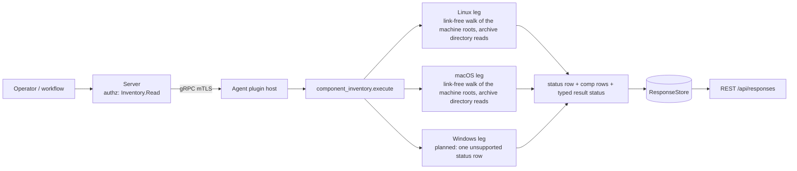

# component_inventory

<!-- BEGIN GENERATED: plugin-doc-gen header -->
| | |
|---|---|
| **What it does** | Installed software components found in application trees (Java archives, native libraries) |
| **Version** | 1.1.0 |
| **Kind** | Collector · read-only · gathered (crossplatform.components.scan, crossplatform.components.native) |
| **Platforms** | Windows 🟡 planned · macOS ✅ · Linux ✅ |
| **Actions** | `native` (definition `crossplatform.components.native`) · `scan` (definition `crossplatform.components.scan`) |
| **Security** | securable `Inventory` · operation Read · risk Low · dispatch ReadOnly · approval gate None |
| **Roles** | execute: endpoint-admin, endpoint-operator · author: content-author |
<!-- END GENERATED -->

## How it works

Two actions, neither takes a parameter; the roots come from the OS leg and from nothing a request can supply.

- `scan` answers one question: which Java archives, and which libraries bundled inside them, sit in the machine-wide application trees of this host.
- `native` answers the sibling question for compiled code: which versioned shared libraries (ELF `.so` on Linux, Mach-O `.dylib` on macOS) are shipped inside applications. It is **switched off until an operator enables it** (see "Switching `native` on" below) and returns at most 5,000 rows.

The leg reads the mount table once, drops any root that is missing, reached through a link or on a network mount, and walks the rest breadth first without following a link at any path component: a link met inside a tree is not entered, and a `supported` status row says so with `link_skipped`. Every file ending `.jar`, `.war` or `.ear` is opened once and read in-process: the archive's central directory is parsed and the libraries nested one level deep (`BOOT-INF/lib/`, `WEB-INF/lib/`, `lib/`) are listed from that directory alone.

The version comes from the file name. The scan asks the archive (`pom.properties`, then `MANIFEST.MF`) only when the name gave none or is ambiguous, and an archive value replaces the file name's split only when the file name carries it (`<name>-<version>` or `<name>-<version>-...`; `<name>_<version>` for an OSGi `Bundle-Version`). A `pom.properties` is used only when it is the archive's only one or the only one whose artifact segment (`META-INF/maven/<group>/<artifact>/`) equals the archive's name, because a shaded archive carries its dependencies' own; otherwise the manifest decides, else the version is `unreadable`.

No nested archive is unpacked, no `java` process is started and nothing is written to the host except the plugin's own cost counters. The plugin is not a vulnerability matcher, not a package-manager query and not a view of per-user installs.

### The `native` action

`native` uses the same walk, the same mount-table guard, the same link refusal and the same bounds as `scan`, with two differences: a 5,000-row cap, and different roots. The roots are Linux `/opt` and `/usr/local/lib`, and macOS `/Applications`, `/usr/local` and `/opt/homebrew`. The package manager's own trees are kept out: on Linux `/usr/lib` and the other system library directories are not roots at all, and on macOS the Homebrew package trees `/usr/local/Cellar` and `/opt/homebrew/Cellar` are not entered. A tree kept out that way is counted and a `supported` status row says so with `package_tree_skipped`; it is never skipped silently.

A candidate is a file named `<stem>.so` or `<stem>.so.<digits and dots>` (Linux) or `<stem>.dylib` (macOS). Each is opened once and its header is read in-process, within fixed bounds (at most 128 ELF program headers, 64 KiB of dynamic section, 4,096 Mach-O load commands in 256 KiB, a 255-byte name). A file is never trusted for a count or an offset it declares: every read is checked against the file size first, and a Mach-O fat or fat64 file is read through its first slice only, with every offset bounded by that slice, so a slice cannot reach into its neighbour.

- A file whose name matches but whose header says it is not a shared library (a script called `libfoo.so`, an executable) gives no row.
- A shared library whose header cannot be read inside the bounds still gives a row, named from its file name, with the version the file name carries or `unreadable`. That is a gap in one row; the scan stays complete.
- The name is the SONAME stem (Linux) or the install-name leaf (macOS) without its `.so` or `.dylib` suffix and version. The version is the file name's (`libssl.so.3.0.13` reads `3.0.13`, `version_source` `filename`), else the SONAME's suffix (`elf`), else, on macOS, the library's `current_version` when it is not `0.0.0` (`macho`).

#### Switching `native` on

The server seeds an action-level kill-switch row for `component_inventory.native` at boot, switched off, and refuses the action until an operator lifts it: `PUT /api/v1/plugin-config/component_inventory/kill-switch` with `action` set to `native` and `enabled` true. `scan` is a separate row and stays on. A restart never overwrites an operator's own row.



### What you can decide with it

| Question | Linux | macOS |
|---|---|---|
| Which Java archives are installed under the application trees, at what version? | One row per `.jar`, `.war` or `.ear` under `/opt`, `/usr/share/java`, `/usr/lib/jvm`, `/usr/local/lib`, `/usr/local/share` and `/usr/share/maven` | One row per archive under `/Applications`, `/Library/Java`, `/usr/local` and `/opt/homebrew` |
| Which libraries ride inside an application archive? | One row per nested library, with the path `<archive>!<entry>` and the application folder it belongs to | The same |
| Can this list be trusted as complete? | Yes only when the status is `supported` and no token names something passed over (`root_link_skipped`, `link_skipped`, `network_fs_skipped`), which a `supported` answer carries; `constrained` names its one cause | The same |
| Which versioned shared libraries ship inside applications? (`native`, once switched on) | One row per `.so` or `.so.<version>` under `/opt` and `/usr/local/lib`; `/usr/lib` and the package manager's other trees are not read | One row per `.dylib` under `/Applications`, `/usr/local` and `/opt/homebrew`; the Homebrew Cellar trees are not entered and are named by `package_tree_skipped` |

What a result proves. `supported` means the scan finished: no bound was reached and every directory and archive it opened was read in full. What it passed over on purpose (a link, a network mount) is named by an informational token on the status row, never silent. It does not mean nothing is installed outside the roots above, or in a per-user location. `constrained` means a bound was reached or something could not be read in full, so the list may be incomplete; the rows already read are still returned, but when time runs out archives not yet read give no rows, and a walk that used the whole budget returns none. A row whose version no source gives is listed with `version_source` `unreadable`; that is a gap in one row and does not make the scan constrained.

## OS capability

<!-- BEGIN GENERATED: plugin-doc-gen capability -->
| Action | Windows | macOS | Linux |
|---|---|---|---|
| `native` | 🟡 planned · rung 1 · bounded Program Files walk with the same library reads | ✅ supported · rung 1 · bounded read-only walk of /Applications, /usr/local and /opt/homebrew for .dylib files, at most 5,000 rows; no link followed at any path component; the Mach-O header, load commands and LC_ID_DYLIB (thin, fat or fat64) read in-process within fixed bounds; /usr/local/Cellar and /opt/homebrew/Cellar excluded and counted; network mounts skipped via getmntinfo_r_np | ✅ supported · rung 1 · bounded read-only walk of /opt and /usr/local/lib for .so and .so.<version> files, at most 5,000 rows; no link followed at any path component; the ELF program headers, dynamic section and SONAME read in-process within fixed bounds; network mounts skipped via /proc/<pid>/mountinfo |
| `scan` | 🟡 planned · rung 1 · bounded Program Files walk with the same archive reads | ✅ supported · rung 1 · bounded read-only walk of /Applications, /Library/Java, /usr/local and /opt/homebrew; no link followed at any path component; archive central directory, pom.properties and MANIFEST.MF read in-process; network mounts skipped via getmntinfo_r_np | ✅ supported · rung 1 · bounded read-only walk of /opt, /usr/share/java, /usr/lib/jvm, /usr/local/lib, /usr/local/share and /usr/share/maven; no link followed at any path component; archive central directory, pom.properties and MANIFEST.MF read in-process; network mounts skipped via /proc/<pid>/mountinfo |

**Declared limits per leg** (descriptor fallback text, verbatim):

- **`native` / Windows** — not read yet: one unsupported status row, windows:planned
- **`native` / macOS** — versioned dynamic libraries inside applications only: extension-less framework binaries are not read; machine roots only; the server refuses it until an operator switches it on; any budget, unreadable directory or changed file answers constrained
- **`native` / Linux** — versioned shared libraries inside applications only: package-owned trees (/usr/lib and friends) are not walked; machine roots only; the server refuses it until an operator switches it on; any budget, unreadable directory or changed file answers constrained
- **`scan` / Windows** — not read yet: one unsupported status row, windows:planned
- **`scan` / macOS** — Java archives only; machine roots only (per-user installs are not read); any budget, unreadable directory or unenumerable archive answers constrained
- **`scan` / Linux** — Java archives only; machine roots only (per-user installs are not read); any budget, unreadable directory or unenumerable archive answers constrained
<!-- END GENERATED -->

## Privileges and prerequisites

| OS | Runs as | Extra grant needed | Measured | If the read is refused |
|---|---|---|---|---|
| Windows | n/a: the leg is planned and reads nothing | None | n/a | `status\|scan\|unsupported\|windows:planned` (and `status\|native\|unsupported\|windows:planned`), result `UNAVAILABLE` |
| macOS | agent daemon (root under the shipped LaunchDaemon today, `docs/agent-privilege-model.md`) | None expected: application trees under `/Applications`, `/Library/Java`, `/usr/local` and `/opt/homebrew` are normally world-readable (inferred, not measured as the agent account); the mount table read (`getmntinfo_r_np`) needs no grant | See the sample below if one is present for this leg; otherwise not measured | A directory that cannot be listed records `macos:component_inventory:dir_unreadable` and the answer is `constrained`; an archive that cannot be read in full records `macos:component_inventory:archive_unenumerated` |
| Linux | agent daemon, dedicated unprivileged account (`yuzu-agent` on the packaged unit), never root by design (`docs/agent-privilege-model.md`) | None expected: the roots under `/opt` and `/usr` are normally world-readable (inferred, not measured as the packaged account); `/proc/<pid>/mountinfo` (the agent's own pid) is world-readable; the packaged unit also holds ambient `CAP_DAC_READ_SEARCH`, which makes `dir_unreadable` rarely reachable there | See the sample below if one is present for this leg; otherwise not measured | A directory that cannot be listed records `linux:component_inventory:dir_unreadable` and the answer is `constrained`; an unreadable mount table walks nothing and records `linux:component_inventory:mount_table_unreadable` |

No external binaries, no subprocesses, no network use: the plugin lists directories and reads file bytes only. Every directory and file is reached one path component at a time with no link followed. One scan is bounded to 400,000 directory entries, 45 seconds (checked between directories and between archives; a single blocked read is not interrupted), 32 directory levels, 50,000 entries per directory listing, 3,000 rows per application folder under each root and 20,000 rows in all (`native`: 5,000). Per archive, the central directory is read up to 16 MiB, each entry name up to 1,024 bytes, and the `pom.properties` and `MANIFEST.MF` entries up to 64 KiB compressed and 64 KiB inflated. Per shared library (`native`), at most 128 ELF program headers, 64 KiB of dynamic section, a 255-byte SONAME, and at most 16 fat slices, 4,096 load commands in 256 KiB for a Mach-O file; a count or size past one of those makes that file `unreadable`, never a partial answer. No privilege beyond reading the files is needed, and `native` reads only the header, never the whole library.

## Data contract

### Inputs

<!-- BEGIN GENERATED: plugin-doc-gen inputs -->
Neither action takes parameters.
<!-- END GENERATED -->

### Outputs

Every row is pipe-delimited. The first row is always `status|<action>|<level>|<tokens>` (`status|scan|...` for `scan`, `status|native|...` for `native`) (`level` is `supported`, `constrained` or `unsupported`; `tokens` is comma-joined cause tokens, or `-`). Component rows follow as `comp|java|<name>|<version>|<version_source>|<path>|<size>|<mtime>|<anchor_app>`, one per archive and one per nested library, or `comp|native|...` with the same columns, one per shared library (`version_source` is then `filename`, `elf`, `macho` or `unreadable`); the first field is `row_kind` (`status` or `comp`) and is the first column below, and on a status row the next columns carry the action name, the level and the tokens. `version` is empty when `version_source` is `unreadable`. `supported` with zero component rows and no informational token means none was found at the roots; `constrained` means the list may be incomplete. Rows are written at both levels.

<!-- BEGIN GENERATED: plugin-doc-gen outputs -->
**`crossplatform.components.native` — `row_kind|kind|name|version|version_source|path|size|mtime|anchor_app`**

| Field | Type | Values | Available | Example | Description |
|---|---|---|---|---|---|
| `row_kind` | string | `status` `comp` | macOS, Linux | `comp` | Row shape discriminator (the wire row's leading tag). Values: status (exactly one per result, always first), comp (one per shared library found). |
| `kind` | string | - | macOS, Linux | `native` | Component kind. Values: native. Status rows: the action name (native). |
| `name` | string | - | macOS, Linux | `libssl` | Library name: the SONAME (Linux) or install-name leaf (macOS) without its .so or .dylib suffix and version, or the file name's equivalent when the library declares none (libssl.so.3 reads libssl). A name with bytes outside printable ASCII is kept with those bytes shown as ?; pipes, backslashes and line breaks are escaped or flattened on the wire. Status rows: the level (supported, constrained or unsupported). |
| `version` | string | - | macOS, Linux | `3.0.13` | Version from the file name (libssl.so.3.0.13 reads 3.0.13); when the name gives none, from the SONAME suffix (Linux) or the Mach-O current_version when it is not 0.0.0 (macOS); empty when none gives one. Status rows: the comma-joined cause tokens, or -. |
| `version_source` | string | `filename` `elf` `macho` `unreadable` | macOS, Linux | `filename` | Where the version came from. Values: filename, elf (the SONAME, Linux), macho (current_version, macOS), unreadable (no source gave a version, or the header could not be read inside the fixed bounds; the row is still listed and the scan is not made incomplete by it). |
| `path` | string | - | macOS, Linux | `/opt/app/lib/libssl.so.3.0.13` | Absolute path of the library file. A NUL or a byte outside valid UTF-8 in a folder or file name is shown as ?. |
| `size` | int64 | - | macOS, Linux | `3086784` | Size of the library file in bytes. |
| `mtime` | int64 | - | macOS, Linux | `1700000000` | Modification time of the library file as Unix seconds. |
| `anchor_app` | string | - | macOS, Linux | `app` | First path component below the scanned root: the application folder the library sits under (the file name itself when it sits directly in a root). A NUL or a byte outside valid UTF-8 in the name is shown as ?. |

**`crossplatform.components.scan` — `row_kind|kind|name|version|version_source|path|size|mtime|anchor_app`**

| Field | Type | Values | Available | Example | Description |
|---|---|---|---|---|---|
| `row_kind` | string | `status` `comp` | macOS, Linux | `comp` | Row shape discriminator (the wire row's leading tag). Values: status (exactly one per result, always first), comp (one per archive or nested library found). |
| `kind` | string | - | macOS, Linux | `java` | Component kind. Values: java. Status rows: the action name (scan). |
| `name` | string | - | macOS, Linux | `log4j-core` | Artifact name taken from the file name, without the version and extension (log4j-core-2.17.1.jar reads log4j-core). A name with bytes outside printable ASCII is kept with those bytes shown as ?; pipes, backslashes and line breaks are escaped or flattened on the wire. Status rows: the level (supported, constrained or unsupported). |
| `version` | string | - | macOS, Linux | `2.17.1` | Version from the file name, corrected by the archive's pom.properties or MANIFEST.MF only when the file name carries that version; when the name gives none, from pom.properties, else MANIFEST.MF; empty when none gives one. Nested libraries take it from the entry name only. A pre-release or build qualifier (rc, beta, M1, snapshot, a build number) stays in it. Status rows: the comma-joined cause tokens, or -. |
| `version_source` | string | `filename` `pom` `manifest` `unreadable` | macOS, Linux | `filename` | Where the version came from. Values: filename, pom, manifest, unreadable (no source gave a version; the row is still listed and the scan is not made incomplete by it). |
| `path` | string | - | macOS, Linux | `/opt/app/lib/app.war!WEB-INF/lib/log4j-core-2.17.1.jar` | Absolute path of the archive; a nested library is <archive path>!<entry name>. A NUL or a byte outside valid UTF-8 in a folder, file or entry name is shown as ?. |
| `size` | int64 | - | macOS, Linux | `1789769` | Size in bytes: the archive file size, or the nested entry's uncompressed size. |
| `mtime` | int64 | - | macOS, Linux | `1700000000` | Modification time of the archive file as Unix seconds; a nested library carries its archive's. |
| `anchor_app` | string | - | macOS, Linux | `app` | First path component below the scanned root: the application folder the archive sits under (the file name itself when it sits directly in a root). A NUL or a byte outside valid UTF-8 in the name is shown as ?. |
<!-- END GENERATED -->

### Result status

Every read sets a typed result status; a degraded read is `CONSTRAINED`, never an empty `OK`.

| Status | Completeness | Provenance | When |
|---|---|---|---|
| `OK` | full | (empty) | The scan finished with no bound reached and every directory and archive it opened read in full, populated or empty. Informational tokens may still ride the status row without changing the level: `<os>:component_inventory:root_link_skipped` (a root was dropped for a link), `<os>:component_inventory:link_skipped` (a link inside a tree was not entered or listed; no link is followed), `<os>:component_inventory:network_fs_skipped` (a root or a directory inside the tree sat on a network mount and was passed over) `<os>:component_inventory:version_unreadable` (at least one row has no version) and, for `native` only, `<os>:component_inventory:package_tree_skipped` (a package-owned tree, the Homebrew Cellar, was not entered) |
| `CONSTRAINED` | partial | `<os>:component_inventory:mount_table_unreadable` / `<os>:component_inventory:budget_entries` / `<os>:component_inventory:budget_time` / `<os>:component_inventory:section_rows` / `<os>:component_inventory:anchor_rows` / `<os>:component_inventory:depth` / `<os>:component_inventory:dir_unreadable` / `<os>:component_inventory:dir_truncated` / `<os>:component_inventory:archive_unenumerated` / `<os>:component_inventory:archive_changed` / `<os>:component_inventory:internal_error` | A bound was reached (`budget_entries`, `budget_time`, `section_rows`, `anchor_rows`, `depth`), a directory could not be listed (`dir_unreadable`) or was cut at its entry cap (`dir_truncated`), an archive could not be enumerated (`archive_unenumerated`: it could not be opened or read, is not a ZIP archive or is cut short, uses ZIP64, has a directory over 16 MiB, an entry name over 1,024 bytes, an encrypted entry or a corrupt record) or changed while it was read (`archive_changed`), or the mount table could not be read so nothing was walked (`mount_table_unreadable`). `os` is `linux` or `macos`. The first cause recorded is the one reported. `internal_error` (`linux:component_inventory:internal_error`, `macos:component_inventory:internal_error`, `windows:component_inventory:internal_error`) is the catch-all for an unexpected failure and the command fails |
| `UNAVAILABLE` | unknown | `windows:planned` / `macos:planned` / `linux:planned` | Only the Windows leg is declared planned today (the other two tokens are the shared reporter's and are not emitted by a shipped leg): the action answers `status\|scan\|unsupported\|windows:planned` and nothing else |

### What to do about a token

A `constrained` answer names one cause (the first recorded); the informational tokens ride a `supported` answer only.

| Token | Terminal or retryable | Action |
|---|---|---|
| `budget_entries` | Terminal for this tree: a repeat reaches the same limit | The 400,000-entry budget is shared by all roots, which are walked cheapest first; read the list as the part of the host reached before it ran out |
| `budget_time` | Retryable once the host is less busy | Run again off-peak; archives not yet read give no rows |
| `section_rows`, `anchor_rows`, `depth`, `dir_truncated` | Terminal | A row, depth or listing cap was reached; rows past it are not listed |
| `dir_unreadable` | Retryable after a permission fix | Check what the agent account may read (the packaged Linux unit holds `CAP_DAC_READ_SEARCH`, which makes this rare there) |
| `archive_unenumerated` | Terminal for that archive | Its nested libraries are unknown; inspect the archive by hand |
| `archive_changed` | Retryable | The archive was replaced while it was read; run again |
| `mount_table_unreadable` | Retryable | Nothing was walked; check the agent can read its mount table |
| `internal_error` | Retry once, then report | The command failed; the status row is the only output |
| `root_link_skipped`, `link_skipped`, `network_fs_skipped`, `version_unreadable` | Informational | The scan finished; a skipped link or network location is not in the list |
| `package_tree_skipped` (`native` only) | Informational | The scan finished; the package manager's own tree (macOS Homebrew Cellar) was not entered, by design: those libraries belong to the package inventory |

For `native`, `archive_changed` means a library changed or vanished between being listed and being read; the causes `archive_unenumerated` and the Java-only ones never occur.

### Where the data goes

- **Instruction result.** Every row is server instruction-result data, with the standard retention policy, served over REST `/api/responses`. Nothing here is a durable server-side table of its own.
- **Not consumed by** the daily sync, Echo, DEX or metrics: the action runs on demand only. `scan` publishes the cost of its last run as the agent's `yuzu.plugin.component_inventory.*` heartbeat tags (entries walked, rows, milliseconds, roots skipped, links skipped, mounts skipped). `native` publishes none: `scan` already uses 6 of the 8 keys a plugin may publish, so the fleet cost of `native` is not collected by this plugin.
- **Sensitivity.** Rows name the archives and libraries installed on the device (`native`: every shared library found under the application roots, which is why it ships off), with their versions, paths and application folder names, which is a detailed software inventory for that device. The root list holds only machine-wide locations and no per-user location is in it; that is a property of the list, not a boundary the scan enforces, so an archive found under a root is read wherever it sits. Names are echoed as they appear on disk (scrubbed for the wire only), and the names of nested libraries can reveal a customer's internal dependency names.
- **Siblings:** `crossplatform.software.inventory` (packaged applications) and `crossplatform.runtimes.jvm` (installed Java runtimes).

## Sample output

<!-- BEGIN GENERATED: plugin-doc-gen samples -->
**macOS** — captured: macos macOS 26.6.2 arm64 · bare-metal · 2026-11-17 · euid 501 · leg-hash 80173557ecbf

```
== action=scan
status|scan|constrained|macos:component_inventory:budget_entries
comp|java|test||unreadable|/opt/homebrew/Library/Homebrew/test/support/fixtures/test.jar|397|1787153877|Library
comp|java|concurrent_ruby||unreadable|/opt/homebrew/Library/Homebrew/vendor/bundle/ruby/4.0.0/gems/concurrent-ruby-1.3.8/lib/concurrent-ruby/concurrent/concurrent_ruby.jar|136802|1787153877|Library
[result_status] CONSTRAINED / PARTIAL / macos:component_inventory:budget_entries

== action=native
status|native|constrained|macos:component_inventory:budget_entries
[result_status] CONSTRAINED / PARTIAL / macos:component_inventory:budget_entries
```

**Linux** — captured: linux Ubuntu 26.04.1 LTS x86_64 · vm · 2026-11-15 · euid 0 · leg-hash 80173557ecbf

```
== action=scan
status|scan|supported|linux:component_inventory:link_skipped,linux:component_inventory:version_unreadable
comp|java|libintl|0.23.2|filename|/usr/share/java/libintl-0.23.2.jar|2594|1763054400|libintl-0.23.2.jar
comp|java|gradle-wrapper|2.10|manifest|/opt/vcpkg/buildtrees/grpc/src/v1.76.0-c85157dbaa.clean/examples/android/helloworld/gradle/wrapper/gradle-wrapper.jar|53636|1760754624|vcpkg
comp|java|gradle-wrapper||unreadable|/opt/vcpkg/buildtrees/grpc/src/v1.81.1-f067b41624.clean/examples/android/helloworld/gradle/wrapper/gradle-wrapper.jar|43764|1780610306|vcpkg
comp|java|gradle-wrapper|2.10|manifest|/opt/vcpkg/buildtrees/grpc/src/v1.76.0-c85157dbaa.clean/src/android/test/interop/gradle/wrapper/gradle-wrapper.jar|53636|1760754624|vcpkg
comp|java|gradle-wrapper||unreadable|/opt/vcpkg/buildtrees/grpc/src/v1.81.1-f067b41624.clean/src/android/test/interop/gradle/wrapper/gradle-wrapper.jar|43764|1780610306|vcpkg
[result_status] OK / FULL

== action=native
[not captured] agent-context: TEMPORARY placeholder, replaced by the lane capture
```
<!-- END GENERATED -->

## Caveats and known gaps

1. **Java archives and shared libraries only, machine roots only.** Python and Node components are not read, and the roots are fixed (`scan`: six on Linux and four on macOS; `native`: two on Linux and three on macOS): a file in a per-user location, a home directory or a custom prefix is not looked for. `native` also leaves out what the package manager owns: on Linux `/usr/lib` and the other system trees are not roots, so a distribution package's libraries are never listed (use `crossplatform.software.inventory`), and on macOS the Homebrew Cellar trees are counted and named by `package_tree_skipped`, not entered; a library copied under `/opt` or `/usr/local/lib` by hand is read. macOS frameworks ship an extension-less binary (`Foo.framework/Versions/A/Foo`) that the `.dylib` rule does not see, so frameworks are not listed.
2. **No Windows leg yet, for either action.** Windows answers one `unsupported` status row (`windows:planned`). The plugin has no Windows filesystem leg at all, so a Windows walk (and with it a reparse-point-safe, network-drive-aware one) is its own later change.
3. **Completeness is bounded, not guaranteed.** A scan that reaches a bound answers `constrained` and returns what it reached; one blocked read inside a directory listing or file read is not interrupted by the 45 second budget. The 400,000-entry budget is shared by every root, so the roots are walked cheapest first (on macOS `/Applications`, whose app bundles hold many entries, is last): a host whose first roots exhaust it answers `constrained` with `budget_entries` and the later roots are not walked. `native` has the same budget, so on a macOS host whose `/Applications` holds very large bundles it can answer `constrained` with `budget_entries` before `/usr/local` and `/opt/homebrew` are reached (seen on a development Mac, and it returned the libraries reached first). The network-mount guard is a snapshot of a deny-list: a mount that appears after the table was read, a stacked filesystem over a dead mount or a network filesystem type not on the list is not seen.
4. **Names are parsed, not proven; nested libraries are listed, not read.** Only `BOOT-INF/lib/`, `WEB-INF/lib/` and `lib/` entries ending `.jar` are listed, from the central directory; their version comes from the entry name alone, so a nested library with an unversioned name reads `unreadable`, and a qualifier word the parser does not know reads as a classifier (nested `guava-31.1-jre.jar` reads `31.1`). An outer archive with no `pom.properties` or manifest takes the file name's word too. A pre-release or build qualifier (`alpha`, `beta`, `rc`, `m`, `ea`, `preview`, `snapshot`, digits and dots) stays in the version. An OSGi-style name (`name_1.2.3...`) keeps everything after the `_` as its version, a classifier word included (`bundle_1.2.3-sources.jar` reads `1.2.3-sources`). Separately, a sole `pom.properties` is trusted: an archive that has no pom of its own but bundles exactly one dependency's reads that dependency's version, marked `pom`, when its file name has no version (`app.jar`, `ROOT.war`); a name that carries a version keeps it (`myapp-2.0.jar` is not affected) unless the archive's value sits in the name; with two or more poms the name rule applies. For `native` the name and version are header and file-name facts, not proof of what the code is: a SONAME or install name is only as honest as whoever built the library; a file named like a library but of another format (a script, a linker script, a thin object) gives no row, while a position-independent executable named `.so` is listed; and a fat Mach-O file is read through its first slice inside the file only, the other slices are not compared.
5. **Not collected yet; `native` ships off; no customer opt-out.** The daily report does not carry these rows. The server seeds `component_inventory.native` switched off at boot and refuses it until an operator enables it (`PUT /api/v1/plugin-config/component_inventory/kill-switch` with `action`); `scan` is unaffected and a restart never overwrites an operator's own setting. `native` publishes no cost counters, so the fleet-wide cost evidence wanted before it is ever on by default is not collected by this plugin. The permanent customer opt-out of ADR-0028 Decisions 2 and 8 is still open (#7737).

## Source and tests

<!-- BEGIN GENERATED: plugin-doc-gen source -->
- Plugin: `agents/plugins/component_inventory/src/component_fs_posix.cpp` · `agents/plugins/component_inventory/src/component_inventory_plugin.cpp` · `agents/plugins/component_inventory/src/component_java_parsers.hpp` · `agents/plugins/component_inventory/src/component_legs.hpp` · `agents/plugins/component_inventory/src/component_native_parsers.hpp` · `agents/plugins/component_inventory/src/component_native_scan.hpp` · `agents/plugins/component_inventory/src/component_scan.hpp` · `agents/plugins/component_inventory/src/component_walk.hpp` · `agents/plugins/component_inventory/src/zip_directory.hpp`
- Definitions: `content/definitions/component_inventory.yaml`
- Capability rows: `server/core/src/capability_decls/plugin_action_catalogue_component_inventory.hpp`
- Tests: `tests/test_component_inventory_definition.py` · `tests/unit/test_component_inventory_local_dispatcher.cpp`
- Privilege row: `docs/agent-privilege-model.md`
<!-- END GENERATED -->
