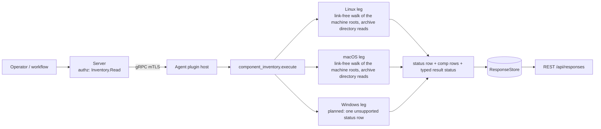

# component_inventory

<!-- BEGIN GENERATED: plugin-doc-gen header -->
<!-- END GENERATED -->

## How it works

`scan` answers one question: which Java archives, and which libraries bundled inside them, sit in the machine-wide application trees of this host. It takes no parameters; the roots come from the OS leg and from nothing a request can supply.

The leg reads the mount table once, drops any root that is missing, reached through a link or on a network mount, and walks the rest breadth first without following a link at any path component: a link met inside a tree is not entered, and a `supported` status row says so with `link_skipped`. Every file ending `.jar`, `.war` or `.ear` is opened once and read in-process: the archive's central directory is parsed and the libraries nested one level deep (`BOOT-INF/lib/`, `WEB-INF/lib/`, `lib/`) are listed from that directory alone.

The version comes from the file name. The scan asks the archive (`pom.properties`, then `MANIFEST.MF`) only when the name gave none or is ambiguous, and an archive value replaces the file name's split only when the file name carries it (`<name>-<version>` or `<name>-<version>-...`; `<name>_<version>` for an OSGi `Bundle-Version`). A `pom.properties` is used only when it is the archive's only one or the only one whose artifact segment (`META-INF/maven/<group>/<artifact>/`) equals the archive's name, because a shaded archive carries its dependencies' own; otherwise the manifest decides, else the version is `unreadable`.

No nested archive is unpacked, no `java` process is started and nothing is written to the host except the plugin's own cost counters. The plugin is not a vulnerability matcher, not a package-manager query and not a view of per-user installs.

### What you can decide with it

| Question | Linux | macOS |
|---|---|---|
| Which Java archives are installed under the application trees, at what version? | One row per `.jar`, `.war` or `.ear` under `/opt`, `/usr/share/java`, `/usr/lib/jvm`, `/usr/local/lib`, `/usr/local/share` and `/usr/share/maven` | One row per archive under `/Applications`, `/Library/Java`, `/usr/local` and `/opt/homebrew` |
| Which libraries ride inside an application archive? | One row per nested library, with the path `<archive>!<entry>` and the application folder it belongs to | The same |
| Can this list be trusted as complete? | Yes only when the status is `supported` and no token names something passed over (`root_link_skipped`, `link_skipped`, `network_fs_skipped`), which a `supported` answer carries; `constrained` names its one cause | The same |

What a result proves. `supported` means the scan finished: no bound was reached and every directory and archive it opened was read in full. What it passed over on purpose (a link, a network mount) is named by an informational token on the status row, never silent. It does not mean nothing is installed outside the roots above, or in a per-user location. `constrained` means a bound was reached or something could not be read in full, so the list may be incomplete; the rows already read are still returned, but when time runs out archives not yet read give no rows, and a walk that used the whole budget returns none. A row whose version no source gives is listed with `version_source` `unreadable`; that is a gap in one row and does not make the scan constrained.

## OS capability

<!-- BEGIN GENERATED: plugin-doc-gen capability -->
<!-- END GENERATED -->

## Privileges and prerequisites

| OS | Runs as | Extra grant needed | Measured | If the read is refused |
|---|---|---|---|---|
| Windows | n/a: the leg is planned and reads nothing | None | n/a | `status\|scan\|unsupported\|windows:planned`, result `UNAVAILABLE` |
| macOS | agent daemon (root under the shipped LaunchDaemon today, `docs/agent-privilege-model.md`) | None expected: application trees under `/Applications`, `/Library/Java`, `/usr/local` and `/opt/homebrew` are normally world-readable (inferred, not measured as the agent account); the mount table read (`getmntinfo_r_np`) needs no grant | See the sample below if one is present for this leg; otherwise not measured | A directory that cannot be listed records `macos:component_inventory:dir_unreadable` and the answer is `constrained`; an archive that cannot be read in full records `macos:component_inventory:archive_unenumerated` |
| Linux | agent daemon, dedicated unprivileged account (`yuzu-agent` on the packaged unit), never root by design (`docs/agent-privilege-model.md`) | None expected: the roots under `/opt` and `/usr` are normally world-readable (inferred, not measured as the packaged account); `/proc/<pid>/mountinfo` (the agent's own pid) is world-readable; the packaged unit also holds ambient `CAP_DAC_READ_SEARCH`, which makes `dir_unreadable` rarely reachable there | See the sample below if one is present for this leg; otherwise not measured | A directory that cannot be listed records `linux:component_inventory:dir_unreadable` and the answer is `constrained`; an unreadable mount table walks nothing and records `linux:component_inventory:mount_table_unreadable` |

No external binaries, no subprocesses, no network use: the plugin lists directories and reads file bytes only. Every directory and file is reached one path component at a time with no link followed. One scan is bounded to 400,000 directory entries, 45 seconds (checked between directories and between archives; a single blocked read is not interrupted), 32 directory levels, 50,000 entries per directory listing, 3,000 rows per application folder under each root and 20,000 rows in all. Per archive, the central directory is read up to 16 MiB, each entry name up to 1,024 bytes, and the `pom.properties` and `MANIFEST.MF` entries up to 64 KiB compressed and 64 KiB inflated.

## Data contract

### Inputs

<!-- BEGIN GENERATED: plugin-doc-gen inputs -->
<!-- END GENERATED -->

### Outputs

Every row is pipe-delimited. The first row is always `status|scan|<level>|<tokens>` (`level` is `supported`, `constrained` or `unsupported`; `tokens` is comma-joined cause tokens, or `-`). Component rows follow as `comp|java|<name>|<version>|<version_source>|<path>|<size>|<mtime>|<anchor_app>`, one per archive and one per nested library; the first field is `row_kind` (`status` or `comp`) and is the first column below, and on a status row the next columns carry the action name, the level and the tokens. `version` is empty when `version_source` is `unreadable`. `supported` with zero component rows and no informational token means none was found at the roots; `constrained` means the list may be incomplete. Rows are written at both levels.

<!-- BEGIN GENERATED: plugin-doc-gen outputs -->
<!-- END GENERATED -->

### Result status

Every read sets a typed result status; a degraded read is `CONSTRAINED`, never an empty `OK`.

| Status | Completeness | Provenance | When |
|---|---|---|---|
| `OK` | full | (empty) | The scan finished with no bound reached and every directory and archive it opened read in full, populated or empty. Informational tokens may still ride the status row without changing the level: `<os>:component_inventory:root_link_skipped` (a root was dropped for a link), `<os>:component_inventory:link_skipped` (a link inside a tree was not entered or listed; no link is followed), `<os>:component_inventory:network_fs_skipped` (a root or a directory inside the tree sat on a network mount and was passed over) and `<os>:component_inventory:version_unreadable` (at least one row has no version) |
| `CONSTRAINED` | partial | `<os>:component_inventory:mount_table_unreadable` / `<os>:component_inventory:budget_entries` / `<os>:component_inventory:budget_time` / `<os>:component_inventory:section_rows` / `<os>:component_inventory:anchor_rows` / `<os>:component_inventory:depth` / `<os>:component_inventory:dir_unreadable` / `<os>:component_inventory:dir_truncated` / `<os>:component_inventory:archive_unenumerated` / `<os>:component_inventory:archive_changed` / `<os>:component_inventory:internal_error` | A bound was reached (`budget_entries`, `budget_time`, `section_rows`, `anchor_rows`, `depth`), a directory could not be listed (`dir_unreadable`) or was cut at its entry cap (`dir_truncated`), an archive could not be enumerated (`archive_unenumerated`: it could not be opened or read, is not a ZIP archive or is cut short, uses ZIP64, has a directory over 16 MiB, an entry name over 1,024 bytes, an encrypted entry or a corrupt record) or changed while it was read (`archive_changed`), or the mount table could not be read so nothing was walked (`mount_table_unreadable`). `os` is `linux` or `macos`. The first cause recorded is the one reported. `internal_error` (`linux:component_inventory:internal_error`, `macos:component_inventory:internal_error`, `windows:component_inventory:internal_error`) is the catch-all for an unexpected failure and the command fails |
| `UNAVAILABLE` | unknown | `windows:planned` / `macos:planned` / `linux:planned` | Only the Windows leg is declared planned today (the other two tokens are the shared reporter's and are not emitted by a shipped leg): the action answers `status\|scan\|unsupported\|windows:planned` and nothing else |

### What to do about a token

A `constrained` answer names one cause (the first recorded); the informational tokens ride a `supported` answer only.

| Token | Terminal or retryable | Action |
|---|---|---|
| `budget_entries` | Terminal for this tree: a repeat reaches the same limit | The 400,000-entry budget is shared by all roots, which are walked cheapest first; read the list as the part of the host reached before it ran out |
| `budget_time` | Retryable once the host is less busy | Run again off-peak; archives not yet read give no rows |
| `section_rows`, `anchor_rows`, `depth`, `dir_truncated` | Terminal | A row, depth or listing cap was reached; rows past it are not listed |
| `dir_unreadable` | Retryable after a permission fix | Check what the agent account may read (the packaged Linux unit holds `CAP_DAC_READ_SEARCH`, which makes this rare there) |
| `archive_unenumerated` | Terminal for that archive | Its nested libraries are unknown; inspect the archive by hand |
| `archive_changed` | Retryable | The archive was replaced while it was read; run again |
| `mount_table_unreadable` | Retryable | Nothing was walked; check the agent can read its mount table |
| `internal_error` | Retry once, then report | The command failed; the status row is the only output |
| `root_link_skipped`, `link_skipped`, `network_fs_skipped`, `version_unreadable` | Informational | The scan finished; a skipped link or network location is not in the list |

### Where the data goes

- **Instruction result.** Every row is server instruction-result data, with the standard retention policy, served over REST `/api/responses`. Nothing here is a durable server-side table of its own.
- **Not consumed by** the daily sync, Echo, DEX or metrics: the action runs on demand only. The plugin publishes the cost of its last scan as the agent's `yuzu.plugin.component_inventory.*` heartbeat tags (entries walked, rows, milliseconds, roots skipped, links skipped, mounts skipped).
- **Sensitivity.** Rows name the archives and libraries installed on the device, with their versions, paths and application folder names, which is a detailed software inventory for that device. The root list holds only machine-wide locations and no per-user location is in it; that is a property of the list, not a boundary the scan enforces, so an archive found under a root is read wherever it sits. Names are echoed as they appear on disk (scrubbed for the wire only), and the names of nested libraries can reveal a customer's internal dependency names.
- **Siblings:** `crossplatform.software.inventory` (packaged applications) and `crossplatform.runtimes.jvm` (installed Java runtimes).

## Sample output

<!-- BEGIN GENERATED: plugin-doc-gen samples -->
<!-- END GENERATED -->

## Caveats and known gaps

1. **Java archives only, machine roots only.** Python and Node components are not read, and the six roots on Linux and four on macOS are fixed: an archive in a per-user location, a home directory or a custom prefix is not looked for.
2. **No Windows leg yet.** Windows answers one `unsupported` status row (`windows:planned`); a Program Files walk with the same archive reads follows as a later change.
3. **Completeness is bounded, not guaranteed.** A scan that reaches a bound answers `constrained` and returns what it reached; one blocked read inside a directory listing or file read is not interrupted by the 45 second budget. The 400,000-entry budget is shared by every root, so the roots are walked cheapest first (on macOS `/Applications`, whose app bundles hold many entries, is last): a host whose first roots exhaust it answers `constrained` with `budget_entries` and the later roots are not walked. The network-mount guard is a snapshot of a deny-list: a mount that appears after the table was read, a stacked filesystem over a dead mount or a network filesystem type not on the list is not seen.
4. **Names are parsed, not proven; nested libraries are listed, not read.** Only `BOOT-INF/lib/`, `WEB-INF/lib/` and `lib/` entries ending `.jar` are listed, from the central directory; their version comes from the entry name alone, so a nested library with an unversioned name reads `unreadable`, and a qualifier word the parser does not know reads as a classifier (nested `guava-31.1-jre.jar` reads `31.1`). An outer archive with no `pom.properties` or manifest takes the file name's word too. A pre-release or build qualifier (`alpha`, `beta`, `rc`, `m`, `ea`, `preview`, `snapshot`, digits and dots) stays in the version. An OSGi-style name (`name_1.2.3...`) keeps everything after the `_` as its version, a classifier word included (`bundle_1.2.3-sources.jar` reads `1.2.3-sources`). Separately, a sole `pom.properties` is trusted: an archive that has no pom of its own but bundles exactly one dependency's reads that dependency's version, marked `pom`, when its file name has no version (`app.jar`, `ROOT.war`); a name that carries a version keeps it (`myapp-2.0.jar` is not affected) unless the archive's value sits in the name; with two or more poms the name rule applies.
5. **Not collected yet; one kill switch, no customer opt-out.** The daily report does not carry these rows. The per-plugin kill switch exists (`component_inventory/scan`, `PUT /api/v1/plugin-config/component_inventory/kill-switch`), but the permanent customer opt-out of ADR-0028 Decisions 2 and 8 is still open (#7737).

## Source and tests

<!-- BEGIN GENERATED: plugin-doc-gen source -->
<!-- END GENERATED -->
