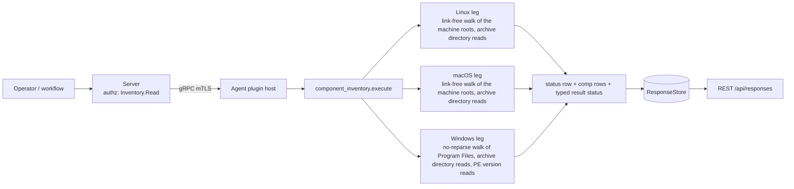

# component_inventory

<!-- BEGIN GENERATED: plugin-doc-gen header -->
| | |
|---|---|
| **What it does** | Installed software components found in application trees (Java archives, native libraries, Python distributions, Node packages) |
| **Version** | 1.2.0 |
| **Kind** | Collector · read-only · gathered (crossplatform.components.scan, crossplatform.components.native, crossplatform.components.python, crossplatform.components.node) |
| **Platforms** | Windows 🟡 constrained · macOS ✅ · Linux ✅ |
| **Actions** | `native` (definition `crossplatform.components.native`) · `node` (definition `crossplatform.components.node`) · `python` (definition `crossplatform.components.python`) · `scan` (definition `crossplatform.components.scan`) |
| **Security** | securable `Inventory` · operation Read · risk Low · dispatch ReadOnly · approval gate None |
| **Roles** | execute: endpoint-admin, endpoint-operator · author: content-author |
<!-- END GENERATED -->

## How it works

Four actions, none takes a parameter; the roots come from the OS leg and from nothing a request can supply.

- `scan` answers one question: which Java archives, and which libraries bundled inside them, sit in the machine-wide application trees of this host.
- `native` answers the sibling question for compiled code: which versioned shared libraries (ELF `.so` on Linux, Mach-O `.dylib` on macOS, PE `.dll` on Windows) are shipped inside applications. It is **switched off until an operator enables it** (see "Switching `native` on" below) and returns at most 5,000 rows.
- `python` lists installed Python distributions (a `METADATA` inside a `.dist-info`, a `PKG-INFO` inside an `.egg-info`, or a single-file `.egg-info`) and `node` lists installed Node packages (the `package.json` of each package under `node_modules`). Both ship enabled; see "The `python` and `node` actions" below.

The leg reads the mount table once, drops any root that is missing, reached through a link or on a network mount, and walks the rest breadth first without following a link at any path component: a link met inside a tree is not entered, and a `supported` status row says so with `link_skipped`. Every file ending `.jar`, `.war` or `.ear` is opened once and read in-process: the archive's central directory is parsed and the libraries nested one level deep (`BOOT-INF/lib/`, `WEB-INF/lib/`, `lib/`) are listed from that directory alone. The network types come from the shared list in `agents/shared/network_fstype.hpp`, which also names `ncpfs`, `coda`, `smb2` and the network-backed FUSE clients `gcsfuse`, `goofys`, `blobfuse`, `blobfuse2`, `ossfs`, `obsfs`, `cosfs`, `juicefs`, `mfsmount`, `moosefs`, `lizardfs`, `seaweedfs`, `weed`, `curlftpfs`, `httpfs2`, `s3ql`, `onedrive`, `google-drive-ocamlfuse`, `davfs2` and `fuse-nfs` (a mount of those types is treated as a network mount); an unlisted FUSE subtype and a stacked filesystem over a network mount are not detected by this list.

The version comes from the file name. The scan asks the archive (`pom.properties`, then `MANIFEST.MF`) only when the name gave none or is ambiguous, and an archive value replaces the file name's split only when the file name carries it (`<name>-<version>` or `<name>-<version>-...`; `<name>_<version>` for an OSGi `Bundle-Version`). A `pom.properties` is used only when it is the archive's only one or the only one whose artifact segment (`META-INF/maven/<group>/<artifact>/`) equals the archive's name, because a shaded archive carries its dependencies' own; otherwise the manifest decides, else the version is `unreadable`.

On Windows there is no mount table. The leg walks the `Program Files` and `Program Files (x86)` directories, named by the shell's known-folder lookup and never by an environment variable, on fixed local drives only: a root on a mapped network drive or a UNC path, on removable or optical media or on a RAM drive is dropped and counted as `network_fs_skipped`, while a drive whose type cannot be told, or a known-folder path that names no walkable directory (empty, relative or a bare drive root), makes the answer `constrained` with `mount_table_unreadable`, because a tree that was never read must not read as an empty one. The drive type is asked again before every directory and every file is opened, so a drive that stops being a fixed local disk during a scan (a re-pointed drive letter, a swapped disk) is refused from then on, as an unreadable directory or a file that changed under the scan, never walked on. The `WindowsApps` directory directly under each root (the Store packages) is not entered, matched by exact path without regard to case, and is counted and named by `package_tree_skipped`. Every directory and file is opened relative to its volume root in one kernel name resolution that refuses a reparse point (a junction, a symbolic link, a volume mount point) at any component, so nothing under a link's target is ever listed or read: a reparse point met inside a tree is counted as `link_skipped` and never opened, a directory swapped for one after it was listed is refused when it is listed itself, and a file is read through the handle that was opened and checked, never by path again. A root that is itself a reparse point is refused and the answer is `constrained` (`dir_unreadable`). If the shell cannot name the Program Files directories, nothing is walked and the answer is `constrained` with `mount_table_unreadable`: a failed read is never an empty host. Every candidate root is therefore walked, counted or constraining; none is dropped silently.

No nested archive is unpacked, no `java` process is started and nothing is written to the host except the plugin's own cost counters. The plugin is not a vulnerability matcher, not a package-manager query and not a view of per-user installs.

### The `native` action

`native` uses the same walk, the same mount-table guard, the same link refusal and the same bounds as `scan`, with two differences: a 5,000-row cap, and different roots. The roots are Linux `/opt` and `/usr/local/lib`, macOS `/Applications`, `/usr/local` and `/opt/homebrew`, and Windows `Program Files` and `Program Files (x86)`. The package manager's own trees are kept out: on Linux `/usr/lib` and the other system library directories are not roots at all, on macOS the Homebrew package trees `/usr/local/Cellar` and `/opt/homebrew/Cellar` are not entered, and on Windows the `WindowsApps` directory directly under each root (the Store packages) is not entered, matched by exact path without regard to case; `scan` keeps out of it too. A tree kept out that way is counted and a `supported` status row says so with `package_tree_skipped`; it is never skipped silently.

A candidate is a file named `<stem>.so` or `<stem>.so.<digits and dots>` (Linux), `<stem>.dylib` (macOS) or `<stem>.dll` (Windows; the extension is compared without regard to case, so `.DLL` and `.dll` are both candidates and `.dll.mui` is not). Each is opened once and its header is read in-process by the shared bounded readers (`agents/shared/binary_header_elf.hpp`, `binary_header_macho.hpp` and `binary_header_pe.hpp`), within fixed bounds (at most 128 ELF program headers, 4,096 dynamic entries, 1,024 Mach-O load commands in 512 KiB, 16 fat slices, 96 PE sections, a three-level resource directory and 256 KiB of version data, and a 255-byte name kept by this plugin). A file is never trusted for a count or an offset it declares: every read is checked against the file size first. A Mach-O universal file is read slice by slice and the first slice without an error that is a dynamic library is the one used; a slice that could not be read is never taken as an answer. The name and version a library declares are the file's own claim: the signature is not checked.

- A file whose name matches but whose header says it is not a shared library (a script called `libfoo.so`, an executable) gives no row.
- A shared library whose header cannot be read inside the bounds still gives a row, named from its file name, with the version the file name carries or `unreadable`. That is a gap in one row; the scan stays complete.
- The name is the SONAME stem (Linux) or the install-name leaf (macOS) without its `.so` or `.dylib` suffix and version; on Windows it is the file name without `.dll`, because a PE carries no library name of its own. On Linux the version is the file name's `.so.<version>` suffix (`libssl.so.3.0.13` reads `3.0.13`, `version_source` `filename`), else the SONAME's suffix (`elf`). On macOS it is the Mach-O `current_version` when that is not `0.0.0` (`macho`), else the file name's version (`libfoo.1.2.dylib` reads `1.2`, `filename`). On Windows it is the fixed file version of the PE's `VS_VERSIONINFO` resource (`a.b.c.d`, `version_source` `pe`); a PE with no version resource, or a fixed version of `0.0.0.0`, gives a row with no version and `unreadable`, a truncated or malformed one is `unreadable` too, and a `.dll` that has no PE header gives no row.

#### Switching `native` on

The server seeds an action-level kill-switch row for `component_inventory.native` at boot, switched off, and refuses the action until an operator lifts it: `PUT /api/v1/plugin-config/component_inventory/kill-switch` with `action` set to `native` and `enabled` true. `scan` is a separate row and stays on. A restart never overwrites an operator's own row.

### The `python` and `node` actions

Both use the same walk, mount-table guard, link refusal and bounds as `scan` (400,000 directory entries, 45 seconds, 3,000 rows per application folder, 20,000 rows). `python` walks to a depth of 8 (a virtualenv under `/opt` sits about six directories below its root); `node` keeps the default depth and bounds its nesting by the rule below. Nothing is executed: no `python` or `node` process is started and no script is run. They ship **enabled** (there is no kill-switch seed), are dispatched by an operator and are not part of the daily report. Windows answers `planned`; a Windows leg is a separate change.

| | `python` | `node` |
|---|---|---|
| Linux roots | each `python3` or `python3.<digits>` directory in `/usr/local/lib`, and `/opt` | `/usr/lib/node_modules`, `/usr/local/lib/node_modules` and `/opt` |
| macOS roots | `/Library/Frameworks/Python.framework/Versions`, and each `python3.<digits>` directory in `/opt/homebrew/lib` and `/usr/local/lib` | `/opt/homebrew/lib/node_modules`, `/usr/local/lib/node_modules` and `/Applications` |
| Candidate | `METADATA` in a `.dist-info`, `PKG-INFO` in an `.egg-info`, or a single-file `.egg-info` | `package.json` of a package directly under `node_modules` (or `node_modules/@scope`) |
| Read cap | first 16 KiB of the file | 64 KiB of the file; a larger one is a defect and reads `unreadable` |
| `version_source` | `metadata`, `filename` (the directory name carried the version), `unreadable` | `package_json`, `unreadable` |

- **Pruned by design.** Inside `site-packages` and `dist-packages` only the `.dist-info` and `.egg-info` directories are listed, so an installed package's source tree is never walked. For `node`, nothing below a package other than its own `node_modules` is listed, `.bin` is skipped, and nesting stops after 8 levels of `node_modules`. This is the design of the actions, not a gap, so it does not change the status: the count of directories passed over is written once per run at info level through the plugin's own spdlog logger, never put on the status row (a plugin can bind its own spdlog registry, so the line is not guaranteed to reach the agent's log file; `docs/darwin-compat.md`), and `package_tree_skipped` is not emitted by these two actions.
- **System interpreter trees are not walked on Linux.** `/usr/lib` is not a `python` root: the interpreters under it belong to the package manager and their distributions are already package rows (use `crossplatform.software.inventory`). A copy placed under `/usr/local/lib` or `/opt` by hand is read.
- **An unreadable metadata file is a row, not a failure.** A file that cannot be read in full, or a `package.json` that is not a JSON object or nests too deeply, still gives a row named from its directory, with `unreadable` (`python` gives `filename` when the directory name carries the version). The scan stays complete. A file that changes between open and read keeps its row and answers `constrained` with `archive_changed`.
- **Not read.** Packages packed into an Electron `asar` archive, per-user installs (home directories, `~/.local`, `~/.nvm`) and custom prefixes are not looked for.



### What you can decide with it

| Question | Linux | macOS | Windows |
|---|---|---|---|
| Which Java archives are installed under the application trees, at what version? | One row per `.jar`, `.war` or `.ear` under `/opt`, `/usr/share/java`, `/usr/lib/jvm`, `/usr/local/lib`, `/usr/local/share` and `/usr/share/maven` | One row per archive under `/Applications`, `/Library/Java`, `/usr/local` and `/opt/homebrew` | One row per archive under `Program Files` and `Program Files (x86)` on fixed drives |
| Which libraries ride inside an application archive? | One row per nested library, with the path `<archive>!<entry>` and the application folder it belongs to | The same | The same |
| Can this list be trusted as complete? | Yes only when the status is `supported` and no token names something passed over (`root_link_skipped`, `link_skipped`, `network_fs_skipped`, `package_tree_skipped`), which a `supported` answer carries; `constrained` names its one cause | The same | The same |
| Which versioned shared libraries ship inside applications? (`native`, once switched on) | One row per `.so` or `.so.<version>` under `/opt` and `/usr/local/lib`; `/usr/lib` and the package manager's other trees are not read | One row per `.dylib` under `/Applications`, `/usr/local` and `/opt/homebrew`; the Homebrew Cellar trees are not entered and are named by `package_tree_skipped` | One row per `.dll` under `Program Files` and `Program Files (x86)`, versioned from the file's fixed file version; `WindowsApps` is not entered and is named by `package_tree_skipped` |
| Which Python distributions are installed outside the package manager? (`python`) | One row per distribution under the `python3` and `python3.<digits>` directories of `/usr/local/lib` and under `/opt`; `/usr/lib` is not read | One row per distribution under the framework's `Versions` and the `python3.<digits>` directories of `/opt/homebrew/lib` and `/usr/local/lib` | Not read yet: the leg answers `windows:planned` |
| Which Node packages sit in the machine-wide `node_modules` locations? (`node`) | One row per package under `/usr/lib/node_modules`, `/usr/local/lib/node_modules` and `/opt`, nested ones down to 8 levels of `node_modules` | One row per package under `/opt/homebrew/lib/node_modules`, `/usr/local/lib/node_modules` and `/Applications` | Not read yet: the leg answers `windows:planned` |

What a result proves. `supported` means the scan finished: no bound was reached and every directory and archive it opened was read in full. What it passed over on purpose (a link, a network mount, a package-owned tree) is named by an informational token on the status row, never silent. It does not mean nothing is installed outside the roots above, or in a per-user location. `constrained` means a bound was reached or something could not be read in full, so the list may be incomplete; the rows already read are still returned, but when time runs out archives not yet read give no rows, and a walk that used the whole budget returns none. A row whose version no source gives is listed with `version_source` `unreadable`; that is a gap in one row and does not make the scan constrained.

## OS capability

<!-- BEGIN GENERATED: plugin-doc-gen capability -->
| Action | Windows | macOS | Linux |
|---|---|---|---|
| `native` | 🟡 constrained · rung 1 · bounded read-only walk of the Program Files and Program Files (x86) directories for .dll files, at most 5,000 rows; every directory and file opened relative to its volume root with no reparse point followed at any path component (NtCreateFile, OBJ_DONT_REPARSE); the PE fixed file version read in-process within fixed bounds; WindowsApps under each root excluded and counted | ✅ supported · rung 1 · bounded read-only walk of /Applications, /usr/local and /opt/homebrew for .dylib files, at most 5,000 rows; no link followed at any path component; the Mach-O header, load commands and LC_ID_DYLIB (thin, fat or fat64) read in-process within fixed bounds; /usr/local/Cellar and /opt/homebrew/Cellar excluded and counted; network mounts skipped via getmntinfo_r_np | ✅ supported · rung 1 · bounded read-only walk of /opt and /usr/local/lib for .so and .so.<version> files, at most 5,000 rows; no link followed at any path component; the ELF program headers, dynamic section and SONAME read in-process within fixed bounds; network mounts skipped via /proc/<pid>/mountinfo |
| `node` | 🟡 planned · rung 1 · bounded walk of the Node install roots with the same package.json reads | ✅ supported · rung 1 · bounded read-only walk of /opt/homebrew/lib/node_modules, /usr/local/lib/node_modules and /Applications for the package.json of each package under node_modules, at most 64 KiB read in-process; a package's own source tree is not listed; no link followed at any path component; network mounts skipped via getmntinfo_r_np | ✅ supported · rung 1 · bounded read-only walk of /usr/lib/node_modules, /usr/local/lib/node_modules and /opt for the package.json of each package under node_modules, at most 64 KiB read in-process; a package's own source tree is not listed; no link followed at any path component; network mounts skipped via /proc/<pid>/mountinfo |
| `python` | 🟡 planned · rung 1 · bounded walk of the Python install roots with the same metadata reads | ✅ supported · rung 1 · bounded read-only walk of /Library/Frameworks/Python.framework/Versions and of the python3.<digits> directories under /opt/homebrew/lib and /usr/local/lib for METADATA, PKG-INFO and .egg-info files, the first 16 KiB of each read in-process; package source trees inside site-packages are not listed; no link followed at any path component; network mounts skipped via getmntinfo_r_np | ✅ supported · rung 1 · bounded read-only walk of the python3 and python3.<digits> directories under /usr/local/lib and of /opt for METADATA, PKG-INFO and .egg-info files, the first 16 KiB of each read in-process; package source trees inside site-packages are not listed; no link followed at any path component; network mounts skipped via /proc/<pid>/mountinfo |
| `scan` | 🟡 constrained · rung 1 · bounded read-only walk of the Program Files and Program Files (x86) directories (the shell's known-folder paths, fixed drives only); every directory and file opened relative to its volume root with no reparse point followed at any path component (NtCreateFile, OBJ_DONT_REPARSE); archive central directory, pom.properties and MANIFEST.MF read in-process; WindowsApps under each root excluded and counted | ✅ supported · rung 1 · bounded read-only walk of /Applications, /Library/Java, /usr/local and /opt/homebrew; no link followed at any path component; archive central directory, pom.properties and MANIFEST.MF read in-process; network mounts skipped via getmntinfo_r_np | ✅ supported · rung 1 · bounded read-only walk of /opt, /usr/share/java, /usr/lib/jvm, /usr/local/lib, /usr/local/share and /usr/share/maven; no link followed at any path component; archive central directory, pom.properties and MANIFEST.MF read in-process; network mounts skipped via /proc/<pid>/mountinfo |

**Declared limits per leg** (descriptor fallback text, verbatim):

- **`native` / Windows** — not yet verified against a real capture; libraries inside applications only; machine roots only; the server refuses it until an operator switches it on; a reparse point is counted and never read; any budget, unreadable directory or changed file answers constrained
- **`native` / macOS** — versioned dynamic libraries inside applications only: extension-less framework binaries are not read; machine roots only; the server refuses it until an operator switches it on; any budget, unreadable directory or changed file answers constrained
- **`native` / Linux** — versioned shared libraries inside applications only: package-owned trees (/usr/lib and friends) are not walked; machine roots only; the server refuses it until an operator switches it on; any budget, unreadable directory or changed file answers constrained
- **`node` / Windows** — not read yet: one unsupported status row, windows:planned
- **`node` / macOS** — Node packages under those roots only; machine roots only (per-user installs are not read); a package.json that is too large or not a JSON object is a row with an unreadable version; any budget, unreadable directory or changed file answers constrained
- **`node` / Linux** — Node packages under those roots only; machine roots only (per-user installs are not read); a package.json that is too large or not a JSON object is a row with an unreadable version; any budget, unreadable directory or changed file answers constrained
- **`python` / Windows** — not read yet: one unsupported status row, windows:planned
- **`python` / macOS** — Python distributions in those library directories only; machine roots only (per-user installs are not read); any budget, unreadable directory or changed file answers constrained
- **`python` / Linux** — Python distributions installed outside the package manager only (/usr/lib is not walked); machine roots only (per-user installs are not read); any budget, unreadable directory or changed file answers constrained
- **`scan` / Windows** — not yet verified against a real capture; Java archives only; machine roots only (per-user installs are not read); a reparse point is counted and never read; any budget, unreadable directory or unenumerable archive answers constrained
- **`scan` / macOS** — Java archives only; machine roots only (per-user installs are not read); any budget, unreadable directory or unenumerable archive answers constrained
- **`scan` / Linux** — Java archives only; machine roots only (per-user installs are not read); any budget, unreadable directory or unenumerable archive answers constrained
<!-- END GENERATED -->

## Privileges and prerequisites

| OS | Runs as | Extra grant needed | Measured | If the read is refused |
|---|---|---|---|---|
| Windows | agent service, LocalSystem today (`#1442`; the intended identity is `NT SERVICE\YuzuAgent`, `docs/agent-privilege-model.md`) | None: the walker runs as LocalSystem, a far wider reach than `Users`, which is why no reparse point is ever followed (a junction planted by a non-administrator would otherwise be read with that reach). Under the intended `NT SERVICE\YuzuAgent` account, `Program Files` and `Program Files (x86)` are readable by `Users` by default (inferred, not measured as either account) and an application directory with a tighter ACL may not be (`WindowsApps` is never entered) | Not measured: no capture from a Windows host is committed yet, so the leg is declared constrained | A directory that cannot be listed records `windows:component_inventory:dir_unreadable` and the answer is `constrained`; a Program Files location the shell cannot name, a path that is not a walkable directory, or a drive whose type cannot be told walks nothing and records `windows:component_inventory:mount_table_unreadable`; `python` and `node` have no Windows leg yet and answer `status\|<action>\|unsupported\|windows:planned`, result `UNAVAILABLE` |
| macOS | agent daemon (root under the shipped LaunchDaemon today, `docs/agent-privilege-model.md`) | None expected: application trees under `/Applications`, `/Library/Java`, `/usr/local` and `/opt/homebrew` are normally world-readable (inferred, not measured as the agent account); the mount table read (`getmntinfo_r_np`) needs no grant | See the sample below if one is present for this leg; otherwise not measured | A directory that cannot be listed records `macos:component_inventory:dir_unreadable` and the answer is `constrained`; an archive that cannot be read in full records `macos:component_inventory:archive_unenumerated` |
| Linux | agent daemon, dedicated unprivileged account (`yuzu-agent` on the packaged unit), never root by design (`docs/agent-privilege-model.md`) | None expected: the roots under `/opt` and `/usr` are normally world-readable (inferred, not measured as the packaged account); `/proc/<pid>/mountinfo` (the agent's own pid) is world-readable; the packaged unit also holds ambient `CAP_DAC_READ_SEARCH`, which makes `dir_unreadable` rarely reachable there | See the sample below if one is present for this leg; otherwise not measured | A directory that cannot be listed records `linux:component_inventory:dir_unreadable` and the answer is `constrained`; an unreadable mount table walks nothing and records `linux:component_inventory:mount_table_unreadable` |

No external binaries, no subprocesses, no network use: the plugin lists directories and reads file bytes only. Every directory and file is reached with no link followed at any path component (one component at a time from `/` on Linux and macOS; in one kernel name resolution relative to the volume root, refusing any reparse point, on Windows). One scan is bounded to 400,000 directory entries, 45 seconds (checked between directories and between archives; a single blocked read is not interrupted), 32 directory levels (`python`: 8; `node`: 32, inside which its own rule allows 8 levels of `node_modules`), 50,000 entries per directory listing, 3,000 rows per application folder under each root and 20,000 rows in all (`native`: 5,000). `python` reads the first 16 KiB of a metadata file and `node` at most 64 KiB + 1 byte of a `package.json`, one read each. Per archive, the central directory is read up to 16 MiB, each entry name up to 1,024 bytes, and the `pom.properties` and `MANIFEST.MF` entries up to 64 KiB compressed and 64 KiB inflated. Per shared library (`native`), the shared readers' bounds apply: at most 128 ELF program headers, 4,096 dynamic entries, a 255-byte SONAME or install name kept, and for a Mach-O file at most 16 fat slices and 1,024 load commands in 512 KiB; for a PE file (`.dll`) at most 96 sections, 4,096 resource directory entries, 256 KiB of version data and 512 version nodes (the fixed file version is the one value read); a count or size past one of those makes that file `unreadable`, never a partial answer. No privilege beyond reading the files is needed, and `native` reads only the header, never the whole library.

## Data contract

### Inputs

<!-- BEGIN GENERATED: plugin-doc-gen inputs -->
No action takes parameters.
<!-- END GENERATED -->

### Outputs

Every row is pipe-delimited. The first row is always `status|<action>|<level>|<tokens>` (`status|<action>|...`, for example `status|scan|...` for `scan`) (`level` is `supported`, `constrained` or `unsupported`; `tokens` is comma-joined cause tokens, or `-`). Component rows follow as `comp|java|<name>|<version>|<version_source>|<path>|<size>|<mtime>|<anchor_app>`, one per archive and one per nested library, or `comp|native|...` with the same columns, one per shared library (`version_source` is then `filename`, `elf`, `macho`, `pe` or `unreadable`), `comp|python|...` one per distribution (`version_source` `metadata`, `filename` or `unreadable`) or `comp|node|...` one per package (`version_source` `package_json` or `unreadable`); the first field is `row_kind` (`status` or `comp`) and is the first column below, and on a status row the next columns carry the action name, the level and the tokens. `version` is empty when `version_source` is `unreadable`. `supported` with zero component rows and no informational token means none was found at the roots; `constrained` means the list may be incomplete. Rows are written at both levels.

<!-- BEGIN GENERATED: plugin-doc-gen outputs -->
**`crossplatform.components.native` — `row_kind|kind|name|version|version_source|path|size|mtime|anchor_app`**

| Field | Type | Values | Available | Example | Description |
|---|---|---|---|---|---|
| `row_kind` | string | `status` `comp` | macOS, Linux, Windows | `comp` | Row shape discriminator (the wire row's leading tag). Values: status (exactly one per result, always first), comp (one per shared library found). |
| `kind` | string | - | macOS, Linux, Windows | `native` | Component kind. Values: native. Status rows: the action name (native). |
| `name` | string | - | macOS, Linux, Windows | `libssl` | Library name: the SONAME (Linux) or install-name leaf (macOS) without its .so or .dylib suffix and version, or the file name's equivalent when the library declares none (libssl.so.3 reads libssl); on Windows the file name without .dll. A name with bytes outside printable ASCII is kept with those bytes shown as ?; pipes, backslashes and line breaks are escaped or flattened on the wire. Status rows: the level (supported, constrained or unsupported). |
| `version` | string | - | macOS, Linux, Windows | `3.0.13` | Linux: the version in the file name (libssl.so.3.0.13 reads 3.0.13), else the SONAME suffix. macOS: the Mach-O current_version when it is not 0.0.0, else the version in the file name (libfoo.1.2.dylib reads 1.2). Windows: the fixed file version of the PE version resource (10.0.26100.1), unless it is 0.0.0.0. Empty when none gives one. Status rows: the comma-joined cause tokens, or -. |
| `version_source` | string | `filename` `elf` `macho` `pe` `unreadable` | macOS, Linux, Windows | `filename` | Where the version came from. Values: filename, elf (the SONAME, Linux), macho (current_version, macOS), pe (the fixed file version, Windows), unreadable (no source gave a version, or the header could not be read inside the fixed bounds; the row is still listed and the scan is not made incomplete by it). |
| `path` | string | - | macOS, Linux, Windows | `/opt/app/lib/libssl.so.3.0.13` | Absolute path of the library file. On Windows the separators are / (C:/Program Files/app/lib/app.dll). A NUL, another control character or a byte outside valid UTF-8 in a folder or file name is shown as ?. |
| `size` | int64 | - | macOS, Linux, Windows | `3086784` | Size of the library file in bytes. |
| `mtime` | int64 | - | macOS, Linux, Windows | `1700000000` | Modification time of the library file as Unix seconds. |
| `anchor_app` | string | - | macOS, Linux, Windows | `app` | First path component below the scanned root: the application folder the library sits under (the file name itself when it sits directly in a root). A NUL, another control character or a byte outside valid UTF-8 in the name is shown as ?. |

**`crossplatform.components.node` — `row_kind|kind|name|version|version_source|path|size|mtime|anchor_app`**

| Field | Type | Values | Available | Example | Description |
|---|---|---|---|---|---|
| `row_kind` | string | `status` `comp` | macOS, Linux | `comp` | Row shape discriminator (the wire row's leading tag). Values: status (exactly one per result, always first), comp (one per package found). |
| `kind` | string | - | macOS, Linux | `node` | Component kind. Values: node. Status rows: the action name (node). |
| `name` | string | - | macOS, Linux | `express` | Package name from its package.json, else the directory name (scoped packages keep their @scope/). A name with bytes outside printable ASCII is kept with those bytes shown as ?; pipes, backslashes and line breaks are escaped or flattened on the wire. Status rows: the level (supported, constrained or unsupported). |
| `version` | string | - | macOS, Linux | `4.19.2` | The version field of its package.json. Empty when none gives one. Status rows: the comma-joined cause tokens, or -. |
| `version_source` | string | `package_json` `unreadable` | macOS, Linux | `package_json` | Where the version came from. Values: package_json (the file was read and parsed; the version may still be empty when it declares none), unreadable (the file could not be read in full, is not a JSON object or nests too deep; the row is still listed, named from the directory, and the scan is not made incomplete by it). |
| `path` | string | - | macOS, Linux | `/usr/local/lib/node_modules/express/package.json` | Absolute path of the package.json. A NUL, another control character or a byte outside valid UTF-8 in a folder or file name is shown as ?. |
| `size` | int64 | - | macOS, Linux | `1800` | Size of the package.json in bytes. |
| `mtime` | int64 | - | macOS, Linux | `1700000000` | Modification time of the package.json as Unix seconds. |
| `anchor_app` | string | - | macOS, Linux | `express` | First path component below the scanned root: the application folder the package.json sits under (the folder name itself when it sits directly in a root). A NUL, another control character or a byte outside valid UTF-8 in the name is shown as ?. |

**`crossplatform.components.python` — `row_kind|kind|name|version|version_source|path|size|mtime|anchor_app`**

| Field | Type | Values | Available | Example | Description |
|---|---|---|---|---|---|
| `row_kind` | string | `status` `comp` | macOS, Linux | `comp` | Row shape discriminator (the wire row's leading tag). Values: status (exactly one per result, always first), comp (one per distribution found). |
| `kind` | string | - | macOS, Linux | `python` | Component kind. Values: python. Status rows: the action name (python). |
| `name` | string | - | macOS, Linux | `requests` | Distribution name from its metadata (Name: of a METADATA or PKG-INFO), else the name in the .dist-info or .egg-info directory name, else that directory or file name itself. A name with bytes outside printable ASCII is kept with those bytes shown as ?; pipes, backslashes and line breaks are escaped or flattened on the wire. Status rows: the level (supported, constrained or unsupported). |
| `version` | string | - | macOS, Linux | `2.31.0` | The Version: of its metadata, else the version in the .dist-info or .egg-info directory name (requests-2.31.0.dist-info reads 2.31.0). Empty when none gives one. Status rows: the comma-joined cause tokens, or -. |
| `version_source` | string | `metadata` `filename` `unreadable` | macOS, Linux | `metadata` | Where the version came from. Values: metadata (the Version: header), filename (the directory name carried it), unreadable (neither gave a version; the row is still listed and the scan is not made incomplete by it). |
| `path` | string | - | macOS, Linux | `/usr/local/lib/python3.12/site-packages/requests-2.31.0.dist-info/METADATA` | Absolute path of the distribution metadata file. A NUL, another control character or a byte outside valid UTF-8 in a folder or file name is shown as ?. |
| `size` | int64 | - | macOS, Linux | `6300` | Size of the distribution metadata file in bytes. |
| `mtime` | int64 | - | macOS, Linux | `1700000000` | Modification time of the distribution metadata file as Unix seconds. |
| `anchor_app` | string | - | macOS, Linux | `site-packages` | First path component below the scanned root: the application folder the distribution metadata file sits under (the folder name itself when it sits directly in a root). A NUL, another control character or a byte outside valid UTF-8 in the name is shown as ?. |

**`crossplatform.components.scan` — `row_kind|kind|name|version|version_source|path|size|mtime|anchor_app`**

| Field | Type | Values | Available | Example | Description |
|---|---|---|---|---|---|
| `row_kind` | string | `status` `comp` | macOS, Linux, Windows | `comp` | Row shape discriminator (the wire row's leading tag). Values: status (exactly one per result, always first), comp (one per archive or nested library found). |
| `kind` | string | - | macOS, Linux, Windows | `java` | Component kind. Values: java. Status rows: the action name (scan). |
| `name` | string | - | macOS, Linux, Windows | `log4j-core` | Artifact name taken from the file name, without the version and extension (log4j-core-2.17.1.jar reads log4j-core). A name with bytes outside printable ASCII is kept with those bytes shown as ?; pipes, backslashes and line breaks are escaped or flattened on the wire. Status rows: the level (supported, constrained or unsupported). |
| `version` | string | - | macOS, Linux, Windows | `2.17.1` | Version from the file name, corrected by the archive's pom.properties or MANIFEST.MF only when the file name carries that version; when the name gives none, from pom.properties, else MANIFEST.MF; empty when none gives one. Nested libraries take it from the entry name only. A pre-release or build qualifier (rc, beta, M1, snapshot, a build number) stays in it. Status rows: the comma-joined cause tokens, or -. |
| `version_source` | string | `filename` `pom` `manifest` `unreadable` | macOS, Linux, Windows | `filename` | Where the version came from. Values: filename, pom, manifest, unreadable (no source gave a version; the row is still listed and the scan is not made incomplete by it). |
| `path` | string | - | macOS, Linux, Windows | `/opt/app/lib/app.war!WEB-INF/lib/log4j-core-2.17.1.jar` | Absolute path of the archive; a nested library is <archive path>!<entry name>. On Windows the separators are / (C:/Program Files/app/lib/app.war). A NUL, another control character or a byte outside valid UTF-8 in a folder, file or entry name is shown as ?. |
| `size` | int64 | - | macOS, Linux, Windows | `1789769` | Size in bytes: the archive file size, or the nested entry's uncompressed size. |
| `mtime` | int64 | - | macOS, Linux, Windows | `1700000000` | Modification time of the archive file as Unix seconds; a nested library carries its archive's. |
| `anchor_app` | string | - | macOS, Linux, Windows | `app` | First path component below the scanned root: the application folder the archive sits under (the file name itself when it sits directly in a root). A NUL, another control character or a byte outside valid UTF-8 in the name is shown as ?. |
<!-- END GENERATED -->

### Result status

Every read sets a typed result status; a degraded read is `CONSTRAINED`, never an empty `OK`.

| Status | Completeness | Provenance | When |
|---|---|---|---|
| `OK` | full | (empty) | The scan finished with no bound reached and every directory and archive it opened read in full, populated or empty. Informational tokens may still ride the status row without changing the level: `<os>:component_inventory:root_link_skipped` (a root was dropped for a link), `<os>:component_inventory:link_skipped` (a link inside a tree was not entered or listed; no link is followed; on Windows, a reparse point of any kind), `<os>:component_inventory:network_fs_skipped` (a root or a directory inside the tree sat on a network mount and was passed over; on Windows, a root on a UNC path or on a drive that is not a fixed local disk was dropped) `<os>:component_inventory:version_unreadable` (at least one row has `version_source` `unreadable`; a `python` row whose version came from its directory name (`filename`), and a `node` package.json that declares no version, which gives an empty version with source `package_json`, are not counted) and, for `native` only, `<os>:component_inventory:package_tree_skipped` (a package-owned tree was not entered: `WindowsApps` on Windows for both actions, the Homebrew Cellar on macOS for `native` only) |
| `CONSTRAINED` | partial | `<os>:component_inventory:mount_table_unreadable` / `<os>:component_inventory:budget_entries` / `<os>:component_inventory:budget_time` / `<os>:component_inventory:section_rows` / `<os>:component_inventory:anchor_rows` / `<os>:component_inventory:depth` / `<os>:component_inventory:dir_unreadable` / `<os>:component_inventory:dir_truncated` / `<os>:component_inventory:archive_unenumerated` / `<os>:component_inventory:archive_changed` / `<os>:component_inventory:internal_error` | A bound was reached (`budget_entries`, `budget_time`, `section_rows`, `anchor_rows`, `depth`), a directory could not be listed (`dir_unreadable`) or was cut at its entry cap (`dir_truncated`), an archive could not be enumerated (`archive_unenumerated`: it could not be opened or read, is not a ZIP archive or is cut short, uses ZIP64, has a directory over 16 MiB, an entry name over 1,024 bytes, an encrypted entry or a corrupt record) or changed while it was read (`archive_changed`), or the mount table could not be read so nothing was walked (`mount_table_unreadable`; on Windows, where there is no mount table, a Program Files location could not be named or is not a walkable directory, or a drive's type could not be told). `os` is `linux`, `macos` or `windows`. The first cause recorded is the one reported. `internal_error` (`linux:component_inventory:internal_error`, `macos:component_inventory:internal_error`, `windows:component_inventory:internal_error`) is the catch-all for an unexpected failure and the command fails |
| `UNAVAILABLE` | unknown | `windows:planned` / `macos:planned` / `linux:planned` | Only the Windows leg of `python` and `node` is declared planned today (the other two tokens are the shared reporter's and are not emitted by a shipped leg): the action answers `status\|<action>\|unsupported\|windows:planned` and nothing else |

### What to do about a token

A `constrained` answer names one cause (the first recorded); the informational tokens ride a `supported` answer only.

| Token | Terminal or retryable | Action |
|---|---|---|
| `budget_entries` | Terminal for this tree: a repeat reaches the same limit | The 400,000-entry budget is shared by all roots, which are walked cheapest first; read the list as the part of the host reached before it ran out |
| `budget_time` | Retryable once the host is less busy | Run again off-peak; archives not yet read give no rows |
| `section_rows`, `anchor_rows`, `depth`, `dir_truncated` | Terminal | A row, depth or listing cap was reached; rows past it are not listed |
| `dir_unreadable` | Retryable after a permission fix | Check what the agent account may read (the packaged Linux unit holds `CAP_DAC_READ_SEARCH`, which makes this rare there). On Windows it is also what a root or directory that is itself a reparse point answers, and what a directory the service account cannot list answers |
| `archive_unenumerated` | Terminal for that archive | Its nested libraries are unknown; inspect the archive by hand |
| `archive_changed` | Retryable | The archive was replaced while it was read; run again |
| `mount_table_unreadable` | Retryable | Nothing was walked; check the agent can read its mount table (on Windows: the shell could not name the Program Files directories, a name it returned is not a walkable directory, or a drive's type could not be told) |
| `internal_error` | Retry once, then report | The command failed; the status row is the only output |
| `root_link_skipped`, `link_skipped`, `network_fs_skipped`, `version_unreadable` | Informational | The scan finished; a skipped link or network location is not in the list. On Windows a file stored behind a reparse point (a cloud placeholder, a file compressed with the Windows Overlay Filter) is counted in `link_skipped` and not read |
| `package_tree_skipped` | Informational | The scan finished; the package manager's own tree (Windows `WindowsApps`, for `scan` and `native`; macOS Homebrew Cellar, for `native` only) was not entered, by design: those components belong to the package inventory |

For `native`, `archive_changed` means a library changed or vanished between being listed and being read; the causes `archive_unenumerated` and the Java-only ones never occur.

### Where the data goes

- **Instruction result.** Every row is server instruction-result data, with the standard retention policy, served over REST `/api/responses`. Nothing here is a durable server-side table of its own.
- **Not consumed by** the daily sync, Echo, DEX or metrics: the action runs on demand only. `scan` publishes the cost of its last run as the agent's `yuzu.plugin.component_inventory.*` heartbeat tags (entries walked, rows, milliseconds, roots skipped, links skipped, mounts skipped). `native`, `python` and `node` publish none: `scan` already uses 6 of the 8 keys a plugin may publish, so the fleet cost of the other three is not collected by this plugin.
- **Sensitivity.** Rows name the archives and libraries installed on the device (`native`: every shared library found under the application roots, which is why it ships off; `python` and `node`: every installed distribution or package, whose names can reveal a customer's internal package names), with their versions, paths and application folder names, which is a detailed software inventory for that device. The root list holds only machine-wide locations and no per-user location is in it; that is a property of the list, not a boundary the scan enforces, so an archive found under a root is read wherever it sits. Names are echoed as they appear on disk (scrubbed for the wire only), and the names of nested libraries can reveal a customer's internal dependency names.
- **Siblings:** `crossplatform.software.inventory` (packaged applications) and `crossplatform.runtimes.jvm` (installed Java runtimes).

## Sample output

<!-- BEGIN GENERATED: plugin-doc-gen samples -->
**macOS** — captured: macos macOS 26.6.2 arm64 · bare-metal · 2026-11-22 · euid 501 (application and library names in the native rows and application, scope and package names in the node rows outside npm redacted) · leg-hash f0b0b7eb29ce

```
== action=scan
status|scan|constrained|macos:component_inventory:budget_entries
comp|java|test||unreadable|/opt/homebrew/Library/Homebrew/test/support/fixtures/test.jar|397|1787153877|Library
comp|java|concurrent_ruby||unreadable|/opt/homebrew/Library/Homebrew/vendor/bundle/ruby/4.0.0/gems/concurrent-ruby-1.3.8/lib/concurrent-ruby/concurrent/concurrent_ruby.jar|136802|1787153877|Library
[result_status] CONSTRAINED / PARTIAL / macos:component_inventory:budget_entries

== action=native
status|native|constrained|macos:component_inventory:budget_entries
comp|native|libredacted1|1.0.0|macho|/Applications/App1.app/Contents/Frameworks/libredacted1.dylib|1667840|1794983369|App1.app
comp|native|libredacted2|7.1.1|macho|/Applications/App1.app/Contents/Frameworks/libredacted2.dylib|3298656|1794983369|App1.app
comp|native|libredacted1|1.0.0|macho|/Applications/App2.app/Contents/Frameworks/libredacted1.dylib|1667840|1792608728|App2.app
comp|native|libredacted1|1.0.0|macho|/Applications/App3.app/Contents/Frameworks/libredacted1.dylib|1667840|1795062596|App3.app
comp|native|libredacted3||unreadable|/Applications/App4.app/Contents/Frameworks/libredacted3.dylib|8679504|1793040832|App4.app
comp|native|libredacted4||unreadable|/Applications/App4.app/Contents/Frameworks/libredacted4.dylib|717216|1793040832|App4.app
comp|native|libredacted5||unreadable|/Applications/App4.app/Contents/Frameworks/libredacted5.dylib|22244352|1793040832|App4.app
comp|native|libredacted6||unreadable|/Applications/App4.app/Contents/Frameworks/libredacted6.dylib|49004576|1793040832|App4.app
comp|native|libredacted7||unreadable|/Applications/App4.app/Contents/Frameworks/libredacted7.dylib|383520|1793705004|App4.app
comp|native|libredacted8||unreadable|/Applications/App4.app/Contents/Frameworks/libredacted8.dylib|79632352|1793705004|App4.app
comp|native|libredacted9||unreadable|/Applications/App4.app/Contents/Frameworks/libredacted9.dylib|865040|1793705004|App4.app
… 12 of 196 rows shown
[result_status] CONSTRAINED / PARTIAL / macos:component_inventory:budget_entries

== action=python
status|python|supported|macos:component_inventory:link_skipped
comp|python|PyYAML|6.0.3|metadata|/opt/homebrew/lib/python3.14/site-packages/pyyaml-6.0.3.dist-info/METADATA|2351|1787235380|site-packages
[result_status] OK / FULL

== action=node
status|node|constrained|macos:component_inventory:budget_entries
comp|node|npm|11.19.0|package_json|/opt/homebrew/lib/node_modules/npm/package.json|6597|1787233796|npm
comp|node|@scope1/pkg1|2.1.323|package_json|/opt/homebrew/lib/node_modules/@scope1/pkg1/package.json|1476|1794573006|@scope1
comp|node|@scope2/pkg2|0.38.0|package_json|/opt/homebrew/lib/node_modules/@scope2/pkg2/package.json|4363|1787235407|@scope2
comp|node|@scope3/pkg3|0.153.4|package_json|/opt/homebrew/lib/node_modules/@scope3/pkg3/package.json|1082|1788883177|@scope3
comp|node|abbrev|4.0.0|package_json|/opt/homebrew/lib/node_modules/npm/node_modules/abbrev/package.json|1232|1787233796|npm
comp|node|agent-base|7.1.4|package_json|/opt/homebrew/lib/node_modules/npm/node_modules/agent-base/package.json|1059|1787233796|npm
comp|node|aproba|2.1.0|package_json|/opt/homebrew/lib/node_modules/npm/node_modules/aproba/package.json|740|1787233796|npm
comp|node|archy|1.0.0|package_json|/opt/homebrew/lib/node_modules/npm/node_modules/archy/package.json|978|1787233796|npm
comp|node|balanced-match|4.0.4|package_json|/opt/homebrew/lib/node_modules/npm/node_modules/balanced-match/package.json|1596|1787233796|npm
comp|node|bin-links|6.0.2|package_json|/opt/homebrew/lib/node_modules/npm/node_modules/bin-links/package.json|1478|1787233796|npm
comp|node|binary-extensions|3.1.0|package_json|/opt/homebrew/lib/node_modules/npm/node_modules/binary-extensions/package.json|827|1787233796|npm
… 12 of 166 rows shown
[result_status] CONSTRAINED / PARTIAL / macos:component_inventory:budget_entries
```

**Linux** — captured: linux Ubuntu 26.04.1 LTS x86_64 · vm · 2026-11-22 · euid 0 · leg-hash f0b0b7eb29ce

```
== action=scan
status|scan|supported|linux:component_inventory:link_skipped,linux:component_inventory:version_unreadable
comp|java|libintl|0.23.2|filename|/usr/share/java/libintl-0.23.2.jar|2594|1763054400|libintl-0.23.2.jar
comp|java|gradle-wrapper|2.10|manifest|/opt/vcpkg/buildtrees/grpc/src/v1.76.0-c85157dbaa.clean/examples/android/helloworld/gradle/wrapper/gradle-wrapper.jar|53636|1760754624|vcpkg
comp|java|gradle-wrapper||unreadable|/opt/vcpkg/buildtrees/grpc/src/v1.81.1-f067b41624.clean/examples/android/helloworld/gradle/wrapper/gradle-wrapper.jar|43764|1780610306|vcpkg
comp|java|gradle-wrapper|2.10|manifest|/opt/vcpkg/buildtrees/grpc/src/v1.76.0-c85157dbaa.clean/src/android/test/interop/gradle/wrapper/gradle-wrapper.jar|53636|1760754624|vcpkg
comp|java|gradle-wrapper||unreadable|/opt/vcpkg/buildtrees/grpc/src/v1.81.1-f067b41624.clean/src/android/test/interop/gradle/wrapper/gradle-wrapper.jar|43764|1780610306|vcpkg
[result_status] OK / FULL

== action=native
status|native|supported|linux:component_inventory:link_skipped,linux:component_inventory:version_unreadable
comp|native|erl_gl||unreadable|/opt/erlang/OTP-28.5.0.7/lib/wx-2.5.4.1/priv/erl_gl.so|836168|1790067434|erlang
comp|native|wxe_driver||unreadable|/opt/erlang/OTP-28.5.0.7/lib/wx-2.5.4.1/priv/wxe_driver.so|5924744|1790067434|erlang
comp|native|_elementpath.cpython-314-x86_64-linux-gnu||unreadable|/opt/gcovr-venv/lib/python3.14/site-packages/lxml/_elementpath.cpython-314-x86_64-linux-gnu.so|209128|1791929246|gcovr-venv
comp|native|builder.cpython-314-x86_64-linux-gnu||unreadable|/opt/gcovr-venv/lib/python3.14/site-packages/lxml/builder.cpython-314-x86_64-linux-gnu.so|120912|1791929246|gcovr-venv
comp|native|etree.cpython-314-x86_64-linux-gnu||unreadable|/opt/gcovr-venv/lib/python3.14/site-packages/lxml/etree.cpython-314-x86_64-linux-gnu.so|5256080|1791929246|gcovr-venv
comp|native|objectify.cpython-314-x86_64-linux-gnu||unreadable|/opt/gcovr-venv/lib/python3.14/site-packages/lxml/objectify.cpython-314-x86_64-linux-gnu.so|2916792|1791929246|gcovr-venv
comp|native|sax.cpython-314-x86_64-linux-gnu||unreadable|/opt/gcovr-venv/lib/python3.14/site-packages/lxml/sax.cpython-314-x86_64-linux-gnu.so|182128|1791929246|gcovr-venv
comp|native|_speedups.cpython-314-x86_64-linux-gnu||unreadable|/opt/gcovr-venv/lib/python3.14/site-packages/markupsafe/_speedups.cpython-314-x86_64-linux-gnu.so|44168|1791929246|gcovr-venv
comp|native|_yaml.cpython-314-x86_64-linux-gnu||unreadable|/opt/gcovr-venv/lib/python3.14/site-packages/yaml/_yaml.cpython-314-x86_64-linux-gnu.so|2620168|1791929245|gcovr-venv
comp|native|asn1rt_nif||unreadable|/opt/erlang/OTP-28.5.0.7/lib/asn1-5.4.3.1/priv/lib/asn1rt_nif.so|66376|1790067434|erlang
comp|native|crypto||unreadable|/opt/erlang/OTP-28.5.0.7/lib/crypto-5.8.3.3/priv/lib/crypto.so|448152|1790067435|erlang
… 12 of 19 rows shown
[result_status] OK / FULL

== action=python
status|python|constrained|linux:component_inventory:depth
comp|python|meson|1.12.1|metadata|/usr/local/lib/python3.14/dist-packages/meson-1.12.1.dist-info/METADATA|1732|1791900866|dist-packages
comp|python|colorlog|6.10.1|metadata|/opt/gcovr-venv/lib/python3.14/site-packages/colorlog-6.10.1.dist-info/METADATA|11202|1791929246|gcovr-venv
comp|python|gcovr|8.6|metadata|/opt/gcovr-venv/lib/python3.14/site-packages/gcovr-8.6.dist-info/METADATA|12158|1791929246|gcovr-venv
comp|python|Jinja2|3.1.6|metadata|/opt/gcovr-venv/lib/python3.14/site-packages/jinja2-3.1.6.dist-info/METADATA|2871|1791929246|gcovr-venv
comp|python|lxml|6.1.0|metadata|/opt/gcovr-venv/lib/python3.14/site-packages/lxml-6.1.0.dist-info/METADATA|3953|1791929246|gcovr-venv
comp|python|MarkupSafe|3.0.3|metadata|/opt/gcovr-venv/lib/python3.14/site-packages/markupsafe-3.0.3.dist-info/METADATA|2690|1791929246|gcovr-venv
comp|python|meson|1.12.0|metadata|/opt/gcovr-venv/lib/python3.14/site-packages/meson-1.12.0.dist-info/METADATA|1732|1791929245|gcovr-venv
comp|python|pip|25.1.1|metadata|/opt/gcovr-venv/lib/python3.14/site-packages/pip-25.1.1.dist-info/METADATA|3649|1791929243|gcovr-venv
comp|python|Pygments|2.20.0|metadata|/opt/gcovr-venv/lib/python3.14/site-packages/pygments-2.20.0.dist-info/METADATA|2476|1791929245|gcovr-venv
comp|python|PyYAML|6.0.3|metadata|/opt/gcovr-venv/lib/python3.14/site-packages/pyyaml-6.0.3.dist-info/METADATA|2351|1791929245|gcovr-venv
[result_status] CONSTRAINED / PARTIAL / linux:component_inventory:depth

== action=node
status|node|supported|linux:component_inventory:link_skipped
comp|node|corepack|0.34.6|package_json|/usr/local/lib/node_modules/corepack/package.json|2897|1769666419|corepack
comp|node|npm|10.8.2|package_json|/usr/local/lib/node_modules/npm/package.json|6609|1774310434|npm
comp|node|abbrev|2.0.0|package_json|/usr/local/lib/node_modules/npm/node_modules/abbrev/package.json|1002|1774310434|npm
comp|node|agent-base|7.1.1|package_json|/usr/local/lib/node_modules/npm/node_modules/agent-base/package.json|1106|1774310434|npm
comp|node|aggregate-error|3.1.0|package_json|/usr/local/lib/node_modules/npm/node_modules/aggregate-error/package.json|694|1774310434|npm
comp|node|ansi-regex|5.0.1|package_json|/usr/local/lib/node_modules/npm/node_modules/ansi-regex/package.json|841|1774310434|npm
comp|node|ansi-styles|6.2.1|package_json|/usr/local/lib/node_modules/npm/node_modules/ansi-styles/package.json|1022|1774310434|npm
comp|node|aproba|2.0.0|package_json|/usr/local/lib/node_modules/npm/node_modules/aproba/package.json|740|1774310434|npm
comp|node|archy|1.0.0|package_json|/usr/local/lib/node_modules/npm/node_modules/archy/package.json|978|1665485975|npm
comp|node|balanced-match|1.0.2|package_json|/usr/local/lib/node_modules/npm/node_modules/balanced-match/package.json|1069|1774310434|npm
comp|node|bin-links|4.0.4|package_json|/usr/local/lib/node_modules/npm/node_modules/bin-links/package.json|1379|1774310434|npm
… 12 of 204 rows shown
[result_status] OK / FULL
```
<!-- END GENERATED -->

## Caveats and known gaps

1. **Machine roots only.** The roots are fixed (`scan`: six on Linux, four on macOS and two on Windows; `native`: two on Linux, three on macOS and two on Windows; `python` and `node`: see the table above, and no Windows roots): a file in a per-user location, a home directory or a custom prefix is not looked for. `native` also leaves out what the package manager owns: on Linux `/usr/lib` and the other system trees are not roots, so a distribution package's libraries are never listed (use `crossplatform.software.inventory`), and on macOS the Homebrew Cellar trees are counted and named by `package_tree_skipped`, not entered; a library copied under `/opt` or `/usr/local/lib` by hand is read. macOS frameworks ship an extension-less binary (`Foo.framework/Versions/A/Foo`) that the `.dylib` rule does not see, so frameworks are not listed.
2. **The Windows leg of `scan` and `native` is declared constrained: it has not yet been verified against a real capture, and `python` and `node` have no Windows leg yet (they answer `windows:planned`, tracked in #8440).** It was written and unit tested without a Windows host to run it on (the pure decisions are tested on every OS over synthetic, format-true inputs; the filesystem binding is tested over a real temporary tree on a Windows runner), and no sample from a Windows host is committed, so the descriptor says `constrained` and the Samples section has no Windows block. It becomes `supported` with a green Windows leg and a committed real capture. Known limits: `WindowsApps` under each root is not entered by either action, so the Store packages are not listed (use the package inventory for them); a file the OS stores behind a reparse point is counted as a link and not read; only fixed local drives are walked; a directory or file name that a Win32 path cannot spell (a segment ending in `.` or a space) reads as unreadable or changed, never as absent; and the open, listing and read calls carry no deadline of their own, so the 45 second budget is checked between directories and files and a dead fixed volume can park one call, as it can for the `runtimes` plugin's read of the same primitive. The Windows leg shares `agents/shared/win_no_reparse_open.hpp` with the `runtimes` plugin; it duplicates part of the filesystem layer the on-demand file search plans for Windows, by owner ruling, and is written as a thin binding so that layer can adopt or replace it.
3. **Completeness is bounded, not guaranteed.** A scan that reaches a bound answers `constrained` and returns what it reached; one blocked read inside a directory listing or file read is not interrupted by the 45 second budget. The 400,000-entry budget is shared by every root, so the roots are walked cheapest first (on macOS `/Applications`, whose app bundles hold many entries, is last): a host whose first roots exhaust it answers `constrained` with `budget_entries` and the later roots are not walked. `native` has the same budget, so on a macOS host whose `/Applications` holds very large bundles it can answer `constrained` with `budget_entries` before `/usr/local` and `/opt/homebrew` are reached (seen on a development Mac, and it returned the libraries reached first). On Windows `native` can reach the 5,000-row cap (`section_rows`) or the 3,000-row cap for one first-level folder under a root (`anchor_rows`; a Visual Studio or .NET tree can hold thousands of `.dll` files): the rows returned are the ones the name-sorted walk reached first, so the list is partial, and no Windows host has been measured for how often this happens. The network-mount guard is a snapshot of a deny-list: a mount that appears after the table was read, a stacked filesystem over a dead mount or a network filesystem type not on the list is not seen.
4. **Names are parsed, not proven; nested libraries are listed, not read.** Only `BOOT-INF/lib/`, `WEB-INF/lib/` and `lib/` entries ending `.jar` are listed, from the central directory; their version comes from the entry name alone, so a nested library with an unversioned name reads `unreadable`, and a qualifier word the parser does not know reads as a classifier (nested `guava-31.1-jre.jar` reads `31.1`). An outer archive with no `pom.properties` or manifest takes the file name's word too. A pre-release or build qualifier (`alpha`, `beta`, `rc`, `m`, `ea`, `preview`, `snapshot`, digits and dots) stays in the version. An OSGi-style name (`name_1.2.3...`) keeps everything after the `_` as its version, a classifier word included (`bundle_1.2.3-sources.jar` reads `1.2.3-sources`). Separately, a sole `pom.properties` is trusted: an archive that has no pom of its own but bundles exactly one dependency's reads that dependency's version, marked `pom`, when its file name has no version (`app.jar`, `ROOT.war`); a name that carries a version keeps it (`myapp-2.0.jar` is not affected) unless the archive's value sits in the name; with two or more poms the name rule applies. For `native` the name and version are header and file-name facts, not proof of what the code is: a SONAME or install name is only as honest as whoever built the library; a file named like a library but of another format (a script, a linker script, a thin object) gives no row, while a position-independent executable named `.so` is listed; and in a universal Mach-O file only the first readable dynamic-library slice is used, the other slices are not compared. `native` depends on the shared binary header readers and cannot ship before the change that adds them.
5. **Not collected yet; `native` ships off; no customer opt-out.** The daily report does not carry these rows, for any of the four actions. `python` and `node` ship enabled and are operator-dispatched only. The server seeds `component_inventory.native` switched off at boot and refuses it until an operator enables it (`PUT /api/v1/plugin-config/component_inventory/kill-switch` with `action`); `scan` is unaffected and a restart never overwrites an operator's own setting. `native` publishes no cost counters, so the fleet-wide cost evidence wanted before it is ever on by default is not collected by this plugin. The permanent customer opt-out of ADR-0028 Decisions 2 and 8 is still open (#7737).

## Source and tests

<!-- BEGIN GENERATED: plugin-doc-gen source -->
- Plugin: `agents/plugins/component_inventory/src/component_fs_posix.cpp` · `agents/plugins/component_inventory/src/component_fs_win.cpp` · `agents/plugins/component_inventory/src/component_inventory_plugin.cpp` · `agents/plugins/component_inventory/src/component_java_parsers.hpp` · `agents/plugins/component_inventory/src/component_legs.hpp` · `agents/plugins/component_inventory/src/component_legs_win.hpp` · `agents/plugins/component_inventory/src/component_native_parsers.hpp` · `agents/plugins/component_inventory/src/component_native_scan.hpp` · `agents/plugins/component_inventory/src/component_node_parsers.hpp` · `agents/plugins/component_inventory/src/component_pkg_scan.hpp` · `agents/plugins/component_inventory/src/component_python_parsers.hpp` · `agents/plugins/component_inventory/src/component_scan.hpp` · `agents/plugins/component_inventory/src/component_walk.hpp` · `agents/plugins/component_inventory/src/zip_directory.hpp`
- Definitions: `content/definitions/component_inventory.yaml`
- Capability rows: `server/core/src/capability_decls/plugin_action_catalogue_component_inventory.hpp`
- Tests: `tests/test_component_inventory_definition.py` · `tests/unit/test_component_inventory_local_dispatcher.cpp`
- Privilege row: `docs/agent-privilege-model.md`
<!-- END GENERATED -->
