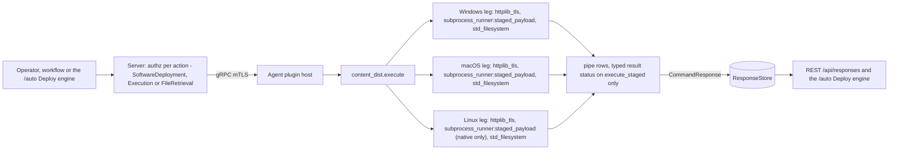
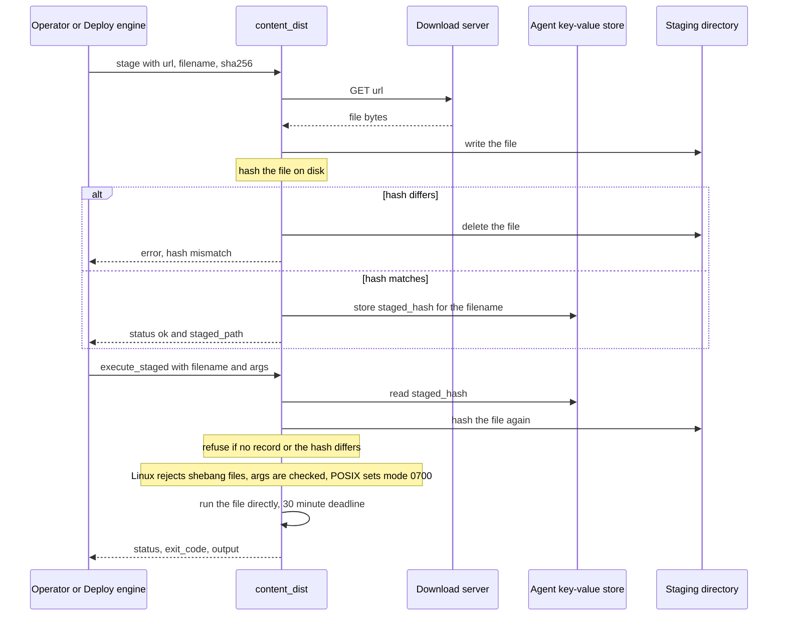
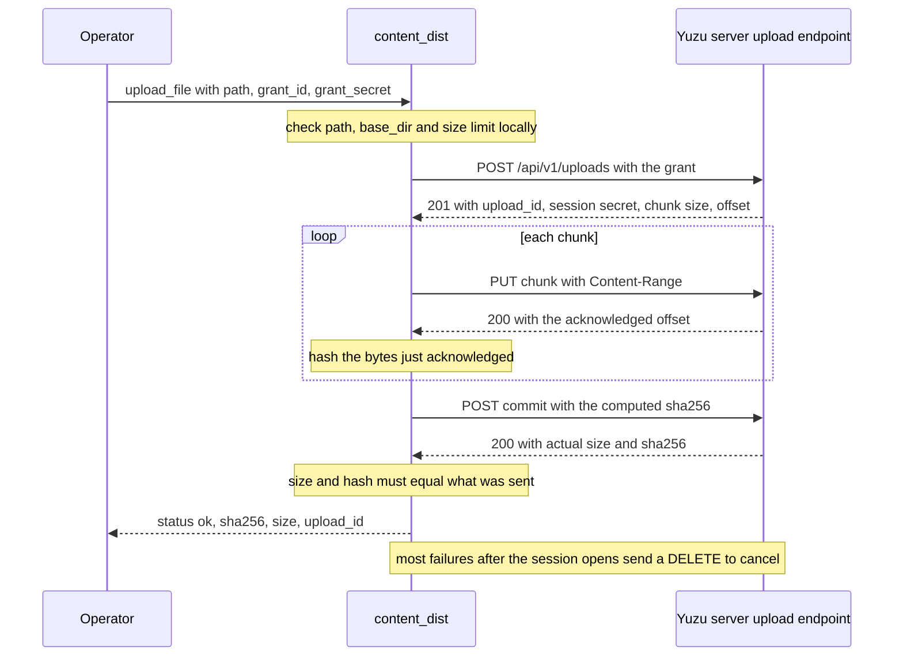

# content_dist

<!-- BEGIN GENERATED: plugin-doc-gen header -->
| | |
|---|---|
| **What it does** | Content staging — download, verify, execute, and manage staged files (no shell-out) |
| **Version** | 1.1.0 |
| **Kind** | Action · mutating · gathered (agent.content_dist.upload_file) |
| **Platforms** | Windows ✅ · macOS ✅ · Linux ✅ |
| **Actions** | `cleanup` (definition `agent.content_dist.cleanup`) · `execute_staged` (definition `agent.content_dist.execute_staged`) · `list_staged` (definition `agent.content_dist.list_staged`) · `stage` (definition `agent.content_dist.stage`) · `upload_file` (definition `agent.content_dist.upload_file`) |
| **Security** | `stage`: securable `SoftwareDeployment` · operation Write · risk High · dispatch Destructive · approval gate AdminOrApproval; `execute_staged`: securable `Execution` · operation Execute · risk High · dispatch Destructive · approval gate AdminOrApproval; `list_staged`: securable `SoftwareDeployment` · operation Read · risk Low · dispatch ReadOnly · approval gate None; `cleanup`: securable `SoftwareDeployment` · operation Delete · risk High · dispatch Destructive · approval gate AdminOrApproval; `upload_file`: securable `FileRetrieval` · operation Write · risk High · dispatch Destructive · approval gate AdminOrApproval |
| **Roles** | execute: `stage`: endpoint-admin; `execute_staged`: endpoint-admin; `list_staged`: endpoint-admin, endpoint-operator; `cleanup`: endpoint-admin; `upload_file`: endpoint-admin · author: content-author |
<!-- END GENERATED -->

## How it works

`content_dist` moves files onto and off an endpoint without a shell. `stage` downloads a file into the agent's own staging directory (`<agent.data_dir>/staged`, owner-only on POSIX) over a socket the agent opens itself, hashes it, and keeps it only if the SHA-256 equals the `sha256` the caller supplied; a match also records that hash in the agent's key-value store under `staged_hash:<filename>`. `execute_staged` takes only a file name: it reads the recorded hash back, hashes the file again, refuses on any difference, then runs the file directly (no shell) with a fixed 30-minute deadline and reports its exit code and combined output. `list_staged` and `cleanup` are plain directory walks of the staging directory; `cleanup` deletes files older than `hours` (default 24) and drops their recorded hash. `upload_file` is a separate path: it sends one local file to the Yuzu server's upload endpoint in chunks, using a one-time grant minted by an operator, and reports the size and SHA-256 the server confirmed.

Deliberately not: a shell, because no action invokes `/bin/sh`, `cmd.exe` or an interpreter, and downloads and uploads are direct socket clients. Not a general file manager either: `stage`, `execute_staged`, `list_staged` and `cleanup` only touch the staging directory. `upload_file` is the exception, because it reads the local `path` you give it (anywhere the agent can read, unless `base_dir` restricts it) and talks only to the agent's own configured server address, never an address supplied in the call.



### What you can decide with it

| Goal | Action | What you get |
|---|---|---|
| Put a known file on the device and prove it arrived intact | `stage` | `status\|ok` and `staged_path` only when the downloaded bytes hash to the `sha256` you supplied. A mismatch deletes the file and returns `error\|hash mismatch`. |
| See what is staged and whether it is still the same bytes | `list_staged` | One `file\|size\|sha256` row per file, with the hash recomputed now. It does not compare against the recorded hash, so you compare it with the hash you staged. |
| Run a staged installer or tool | `execute_staged` | `status\|ok` for exit 0, `error` otherwise, with `exit_code` and up to 16 MiB of combined output. An exit 0 shows the program ended cleanly, not that the software is installed. |
| Free the staging directory | `cleanup` | `removed\|<n>`; `hours` of 0 or less removes every staged file. |
| Pull one file off the device | `upload_file` | `status\|ok` with the `sha256`, `size` and `upload_id` the server confirmed, which must match the bytes sent. |

Per OS: all five actions work on Windows, macOS and Linux. On Windows, `stage` and `upload_file` need the agent to have been built with OpenSSL; without it HTTPS fails with an error row. On Linux, `execute_staged` refuses files that start with `#!`, so stage a native executable. Nothing here returns a permission-denied status: a filesystem or network failure is an `error|...` row.

A successful `stage` proves the bytes match the hash the caller gave, which is only as good as that hash. It says nothing about who built the file, because no code signature is checked.

### The trust chain for `execute_staged`

1. The hash you pass to `stage` is the root of trust. The URL, the network path and a plain `http://` source are not trusted; the hash is the only integrity check on the download.
2. `stage` keeps the file only if its SHA-256 equals that hash, then stores the hash in the agent's key-value store, a separate database outside the staging directory.
3. `execute_staged` ignores any hash in the call for authorisation. It reads the recorded hash from the key-value store, hashes the file on disk again, and refuses if there is no record or the two differ. A file dropped into the staging directory by anything other than `stage` has no record and does not run.
4. The optional `expected_hash` parameter is only a drift check: it must equal the recorded hash or the call fails, and it can never authorise anything the record does not.
5. On Linux the file is then run from the descriptor the runner opened, pinned to its verified size. A small window between the hash check and that open remains (Caveat 3).
6. What is not covered: anyone who can act as the agent account can rewrite both the file and the stored hash, and the plugin does not verify a vendor signature.

### Diagrams

#### `stage`, then `execute_staged`



The download is only trusted after its hash matches the one you supplied, and the run is only allowed against the hash recorded at that moment. The run uses the agent's own identity and environment, with loader variables such as `LD_*` and `DYLD_*` removed on POSIX.

#### `upload_file`



The grant is minted beforehand by an operator through the upload-grants API and is single use. The agent checks the file locally (regular file, resolved path inside `base_dir` if given, not larger than `max_size_mb`, default 100, at most 1000), retries transient failures with backoff, resumes from the server's acknowledged offset, and hashes the exact bytes the server acknowledged, so a file that changes mid-upload yields the hash of what was sent. The connection is TLS only, with certificate verification, to `agent.server_web_url`.

## OS capability

<!-- BEGIN GENERATED: plugin-doc-gen capability -->
| Action | Windows | macOS | Linux |
|---|---|---|---|
| `cleanup` | ✅ supported · rung 1 · std_filesystem | ✅ supported · rung 1 · std_filesystem | ✅ supported · rung 1 · std_filesystem |
| `execute_staged` | ✅ supported · rung 2 · subprocess_runner:staged_payload | ✅ supported · rung 2 · subprocess_runner:staged_payload | 🟡 constrained · rung 2 · subprocess_runner:staged_payload |
| `list_staged` | ✅ supported · rung 1 · std_filesystem | ✅ supported · rung 1 · std_filesystem | ✅ supported · rung 1 · std_filesystem |
| `stage` | 🟡 constrained · rung 1 · httplib_tls | ✅ supported · rung 1 · httplib_tls | ✅ supported · rung 1 · httplib_tls |
| `upload_file` | 🟡 constrained · rung 1 · httplib_tls | ✅ supported · rung 1 · httplib_tls | ✅ supported · rung 1 · httplib_tls |

**Declared limits per leg** (descriptor fallback text, verbatim):

- **`execute_staged` / Linux** — shebang-interpreted (#!) staged payloads are rejected -- B6 fd-exec (execveat O_CLOEXEC) is incompatible with the kernel's binfmt_script re-open; native executables only
- **`stage` / Windows** — requires OpenSSL to be found at build time; HTTPS unavailable if absent
- **`upload_file` / Windows** — requires OpenSSL to be found at build time; HTTPS unavailable if absent
<!-- END GENERATED -->

## Privileges and prerequisites

| OS | Runs as | Extra grant needed | Measured | If the read is refused |
|---|---|---|---|---|
| Windows | Agent service account: LocalSystem today, intended `NT SERVICE\YuzuAgent` (`docs/agent-privilege-model.md`). The staged program runs as the same account | **None.** Every action stays inside the agent-owned staging directory or a socket the agent opens itself; `upload_file` reads the file at `path` as the agent | 2026-09-07, bare-metal, as `SYSTEM` (`windows.txt`) | No typed status: a filesystem or network failure surfaces as an `error\|<message>` line, not a `PERMISSION_DENIED` result status |
| macOS | Agent daemon as root: the shipped LaunchDaemon has no `UserName` key (`docs/agent-privilege-model.md`). The staged program runs as root | **None.** `staging_dir()` creates the directory owner-only (`owner_all`) | 2026-09-07, bare-metal, euid 501 (`macos.txt`), below the production root daemon | Same: an `error\|` line, no typed status |
| Linux | Agent daemon, unprivileged account (`yuzu`). The staged program runs as the same account | **None.** Same owner-only staging directory | 2026-09-06, container, euid 0 (`linux.txt`): captured as root, not as the unprivileged account `execute_staged` runs as in production | Same: an `error\|` line, no typed status |

Binaries, subprocesses and network: `stage` and `upload_file` open raw TCP/TLS sockets through cpp-httplib (no subprocess). `execute_staged` spawns exactly one process, the staged file itself, through `yuzu::agent::run_bounded_subprocess` (no shell, no other binary), and that child inherits the agent's environment. `list_staged` and `cleanup` touch no network and spawn nothing.

## Data contract

### Inputs

<!-- BEGIN GENERATED: plugin-doc-gen inputs -->
| Definition | Parameter | Type | Required | Default | Constraints | Description |
|---|---|---|---|---|---|---|
| `agent.content_dist.cleanup` | `filename` | string | no | - | - | Declared but NOT read by the current implementation (content_dist_plugin.cpp's do_cleanup only reads "hours") — setting this parameter has no effect on which files are removed. Left in place for API compatibility; see the plugin README's Caveats section. |
| `agent.content_dist.cleanup` | `hours` | int32 | no | 24 | maximum 876000 | Remove staged files whose last-write time is older than this many hours, e.g. 24 or 168. Default: 24. A value of 0 or less removes every staged file. Maximum 876000 (100 years). The plugin bounds the value itself, so this holds on every dispatch surface: any number above 876000, however large, is clamped to 876000, and zero or any negative number is treated as 0. Unclamped, large values overflow the cutoff arithmetic on Linux/libstdc++ (1500000 for example) and make the cutoff lie in the future, which removes every staged file. Whole numbers only. POST /api/instructions/{id}/execute answers 400 for a value above the maximum or a non-whole number; MCP execute_instruction, /api/command, schedules and workflows do not validate parameters, so there the value is clamped silently and text with no leading number falls back to 24. |
| `agent.content_dist.execute_staged` | `filename` | string | yes | - | - | Name of a previously staged file, e.g. pkg-1.2.3.msi. Must already have a verified hash on record from a prior stage action (agent KV key staged_hash:<filename>) — the hash is re-verified against that record, not against this parameter, before anything runs. |
| `agent.content_dist.execute_staged` | `args` | string | no | - | - | Optional whitespace-separated argv tail, e.g. "/quiet /norestart". Never shell-parsed (no quoting/escaping); rejected outright if it contains a shell metacharacter such as ; \| & ` $ ( ) { } < >. |
| `agent.content_dist.execute_staged` | `expected_hash` | string | no | - | pattern: ^[0-9a-f]{64}$ | Optional lowercase hex SHA-256 (64 characters) the caller believes the staged file has, e.g. to detect orchestration drift. Compared to the hash recorded at stage time; a mismatch fails the action before anything runs. The recorded hash, not this value, is what authorises execution. |
| `agent.content_dist.stage` | `url` | string | yes | - | - | Source URL, e.g. https://cdn.example.com/pkg-1.2.3.msi. Must start with http:// or https://; downloaded directly over a socket the agent opens itself, never via a shell command. |
| `agent.content_dist.stage` | `filename` | string | yes | - | - | Destination filename inside the agent's staging directory, e.g. pkg-1.2.3.msi. Alphanumeric, dots, hyphens, and underscores only (no path separators or ".."); any other character is refused. |
| `agent.content_dist.stage` | `sha256` | string | yes | - | - | Lowercase hex SHA-256 the downloaded file must hash to, e.g. "a94a8fe5ccb19ba61c4c0873d391e987982fbbd3...". A mismatch deletes the downloaded file and fails the action; the verified hash is what execute_staged later re-checks from agent KV, not this parameter. |
| `agent.content_dist.upload_file` | `path` | string | yes | - | maxLength 4096 | The local file path on the endpoint to upload. |
| `agent.content_dist.upload_file` | `grant_id` | string | yes | - | maxLength 64 | The one-time upload grant's id, minted operator-side via POST /api/v1/upload-grants. Paired with grant_secret to authenticate the session; both are revealed by the mint response exactly once. |
| `agent.content_dist.upload_file` | `grant_secret` | string | yes | - | maxLength 128 | The one-time upload grant's secret, minted alongside grant_id. Never logged or echoed back by the server after the mint response. |
| `agent.content_dist.upload_file` | `base_dir` | string | no | - | maxLength 4096 | If set, path must resolve (after symlink canonicalisation) inside this directory, or the upload is refused before anything is read. |
| `agent.content_dist.upload_file` | `max_size_mb` | int32 | no | 100 | minimum 1 · maximum 1000 | Maximum allowed file size in megabytes, checked locally before the session opens. Default: 100. Out-of-range values are rejected with a 400 by POST /api/instructions/{id}/execute. |
<!-- END GENERATED -->

### Outputs

Every action writes independent `key|value` lines via `ctx.write_output` — not a fixed-width pipe row like a collector's table. A validation or transport failure typically replaces the whole declared line set with a single unstructured `error|<message>` line rather than filling the declared columns with a placeholder value; there is no `-`-for-unknown convention in this plugin. `execute_staged` on POSIX can also emit a `warn|failed to set execute permission on staged file: ...` line before the run when the `0700` chmod fails; the run then proceeds and fails with its own error.

<!-- BEGIN GENERATED: plugin-doc-gen outputs -->
**`agent.content_dist.cleanup` — `status|files_removed`**

| Field | Type | Values | Available | Example | Description |
|---|---|---|---|---|---|
| `status` | string | - | all | `-` | Declared but never emitted — do_cleanup writes only a "removed\|<n>" line, no "status\|" line at all, on every run (including a hours-parse failure, which is silently ignored rather than reported). |
| `files_removed` | int32 | - | Windows, Linux, macOS | `-` | Declared column name does not match the wire field: the actual emitted line is "removed\|<n>", not "files_removed\|<n>" — the count of files whose last-write time was older than the cutoff. Values: non-negative integer. |

**`agent.content_dist.execute_staged` — `status|exit_code|output`**

| Field | Type | Values | Available | Example | Description |
|---|---|---|---|---|---|
| `status` | string | `ok` `error` | Windows, Linux, macOS | `ok` | "ok" when the staged file exited 0, "error" for any nonzero exit, spawn failure, or a deadline/cancel kill. On an early rejection (not staged, no trusted hash, hash mismatch, unsafe args) this column is never emitted at all — only an "error\|<message>" line is. |
| `exit_code` | int32 | - | Windows, Linux, macOS | `-` | The staged process's exit code, or -1 for a spawn failure or a deadline/cancel kill (subprocess_runner's sentinel, never a real process exit status in that case). Values: process exit code, or -1. |
| `output` | string | - | Windows, Linux, macOS | `-` | Combined stdout+stderr, capped at 16 MiB, with a "[output truncated at 16 MiB]" and/or "[terminated: deadline exceeded]"/"[terminated: cancelled]" annotation appended when applicable. Omitted entirely (no output\| line at all) when the captured text is empty. Values: free text, truncated/terminated annotations, or omitted. |

**`agent.content_dist.list_staged` — `file|size|sha256`**

| Field | Type | Values | Available | Example | Description |
|---|---|---|---|---|---|
| `file` | string | - | Windows, Linux, macOS | `-` | Filename of one staged file (relative, no path). One row per file in the staging directory; a "count\|<n>" summary line follows the last row and is not itself a declared column. An empty directory emits zero rows and count\|0, never an error. Values: free text. |
| `size` | int64 | - | Windows, Linux, macOS | `-` | File size in bytes, from std::filesystem::file_size. Values: non-negative integer. |
| `sha256` | string | - | Windows, Linux, macOS | `-` | Lowercase hex SHA-256 of the file's current on-disk contents, recomputed on every list_staged call (not cached from stage time). Values: 64 lowercase hex characters. |

**`agent.content_dist.stage` — `status|staged_path`**

| Field | Type | Values | Available | Example | Description |
|---|---|---|---|---|---|
| `status` | string | `ok` | Windows, Linux, macOS | `ok` | Literal "ok" on a verified download. content_dist never writes "status\|error" — a failure instead replaces this whole line with a single unstructured "error\|<message>" line, so a failed stage never populates this column at all. |
| `staged_path` | string | - | Windows, Linux, macOS | `-` | Absolute filesystem path of the downloaded, hash-verified file under the agent's staging directory (content_dist_plugin.cpp's staging_dir(): <agent.data_dir>/staged, or a temp-dir fallback). Only present on success — no captured sample shows a populated value. Values: absolute path. |

**`agent.content_dist.upload_file` — `status|sha256|size|upload_id`**

| Field | Type | Values | Available | Example | Description |
|---|---|---|---|---|---|
| `status` | string | `ok` | Windows, Linux, macOS | `not observed in any capture (every capture failed at parameter validation, before this line could be reached)` | Outcome of the upload; the only value the plugin emits on success (content_dist_plugin.cpp:1171). |
| `sha256` | string | - | Windows, Linux, macOS | `not observed in any capture (every capture failed at parameter validation, before this line could be reached)` | Server-confirmed SHA-256 digest of the committed upload, computed from the exact bytes the server acknowledged. Values: hex digest. |
| `size` | int64 | - | Windows, Linux, macOS | `not observed in any capture (every capture failed at parameter validation, before this line could be reached)` | Server-reported size in bytes of the committed upload (commit_result.actual_size), which must match the local file size. Values: integer (bytes). |
| `upload_id` | string | - | Windows, Linux, macOS | `not observed in any capture (every capture failed at parameter validation, before this line could be reached)` | Server-assigned session id from the upload grant, used to address the /api/v1/uploads/{id}/... endpoints. Values: free text (opaque session id). |
<!-- END GENERATED -->

### Result status

| Status | Completeness | Provenance | When |
|---|---|---|---|
| `UNAVAILABLE` | PARTIAL | `subprocess_runner:spawn_error` | `execute_staged` only: the runner never confirmed exec (missing or non-executable staged file, or a Linux exec-verification rejection) |
| `CONSTRAINED` | PARTIAL | `subprocess_runner:deadline` | `execute_staged` only: the fixed 30-minute deadline fired and the process was killed |
| `CONSTRAINED` | PARTIAL | `subprocess_runner:cancelled` | `execute_staged` only: a cancellation reached the runner mid-run |
| `CONSTRAINED` | PARTIAL | `subprocess_runner:signaled` | `execute_staged` only: the staged process died of a signal it received itself |
| `OK` | PARTIAL | `subprocess_runner:line_limit` | never reached for this plugin: `content_dist` never sets `max_lines` or `stop_after_max_lines` |

`execute_staged`'s ordinary exit (rc 0 or nonzero) sets no typed status at all, because `classify_runner_failure` returns `nullopt` for a normal exit by design; the `status` and `exit_code` lines carry the outcome. `stage`, `list_staged`, `cleanup` and `upload_file` never call `set_result_status`, so the agent records `UNDECLARED` for them. The samples below only exercise parameter validation and an empty staging directory, so none shows a typed status.

### Where the data goes

- **Instruction result, and the `/auto` Deploy engine.** Rows travel over the agent's mTLS gRPC channel as the command response and land in the ResponseStore. `stage` and `execute_staged` are also dispatched by the `/auto` Deploy engine (`server/core/src/deployment_engine.cpp`), which parses this wire contract through `server/core/src/deployment_parse.hpp` to drive its own per-device state machine, so that surface needed no extra agent code.
- **`upload_file`'s `grant_id` and `grant_secret` are redacted before any persisted audit or history copy** (`server/core/src/sensitive_instruction_params.hpp`); the server keeps only a hash of the grant secret in the upload store.
- **Not consumed by** daily-sync inventory, the TAR warehouse, DEX or metrics.
- **Sensitivity.** `execute_staged`'s `output` line is the combined stdout and stderr of whatever program was staged and run, so it can carry anything that process prints, including usernames, hostnames or credentials. The plugin's own declared columns (`staged_path`, `file`, `sha256`, `upload_id`) carry only caller-chosen filenames and content hashes. `upload_file` moves the whole content of the named file off the device, so the sensitivity of that data is the file's own.
- **Siblings:** none in this catalogue. `execute_staged` is the only "run a verified binary" action here; compare `script_exec.exec` for ad hoc admin commands and scripts.
- **MCP / REST.** Discover: `discover_plugins` (summary) then `yuzu://plugin-docs` (this page as data) then `discover_instructions` / `get_definition("agent.content_dist.execute_staged")`. Run: `execute_instruction {definition_id, parameters}`. Read: `/api/responses/{id}`; `stage` and `execute_staged` results are also polled by the `/auto` Deploy engine's `deployment_run_store`.

## Sample output

<!-- BEGIN GENERATED: plugin-doc-gen samples -->
**Windows** — captured: windows Microsoft Windows NT 10.0.26200.0 x64 · bare-metal · 2026-09-07 · SYSTEM · leg-hash 590399d7174c

```
== action=stage
error|missing required parameters: url, filename, sha256
[result_status] UNDECLARED / UNKNOWN
[rc] 1

== action=execute_staged
error|missing required parameter: filename
[result_status] UNDECLARED / UNKNOWN
[rc] 1

== action=list_staged
count|0
[result_status] UNDECLARED / UNKNOWN

== action=cleanup
[not captured] Destructive/Irreversible: not executed on a live host

== action=upload_file
error|missing required parameters: path, grant_id, grant_secret
[result_status] UNDECLARED / UNKNOWN
[rc] 1
```

**macOS** — captured: macos macOS 26.6.2 arm64 · bare-metal · 2026-09-07 · euid 501 (jsmith) · leg-hash 590399d7174c

```
== action=stage
error|missing required parameters: url, filename, sha256
[result_status] UNDECLARED / UNKNOWN
[rc] 1

== action=execute_staged
error|missing required parameter: filename
[result_status] UNDECLARED / UNKNOWN
[rc] 1

== action=list_staged
count|0
[result_status] UNDECLARED / UNKNOWN

== action=cleanup
[not captured] Destructive/Irreversible: not executed on a live host

== action=upload_file
error|missing required parameters: path, grant_id, grant_secret
[result_status] UNDECLARED / UNKNOWN
[rc] 1
```

**Linux** — captured: linux Debian GNU/Linux 13 (trixie) aarch64 · container · 2026-09-06 · euid 0 · leg-hash 590399d7174c

```
== action=stage
error|missing required parameters: url, filename, sha256
[result_status] UNDECLARED / UNKNOWN
[rc] 1

== action=execute_staged
error|missing required parameter: filename
[result_status] UNDECLARED / UNKNOWN
[rc] 1

== action=list_staged
count|0
[result_status] UNDECLARED / UNKNOWN

== action=cleanup
[not captured] Destructive/Irreversible: not executed on a live host

== action=upload_file
error|missing required parameters: path, grant_id, grant_secret
[result_status] UNDECLARED / UNKNOWN
[rc] 1
```
<!-- END GENERATED -->

## Caveats and known gaps

1. **`cleanup` ignores `filename`, and its declared columns do not match its output.** `do_cleanup` reads only `hours` and sweeps the whole staging directory by age (default 24; 0 or less removes everything), so removing a single file is not possible. The declared `status` column is never emitted, an unparseable `hours` silently falls back to 24, and the declared `files_removed` is actually written as `removed|<n>`.
2. **`execute_staged` rejects Linux shebang scripts by design; do not "fix" this.** The Linux runner executes the verified descriptor with `execveat` and an empty path, which gives the kernel no path to build an interpreter command line from, so a `#!` file is refused up front instead of failing opaquely. Stage a native executable instead.
3. **A small window between the hash check and the exec is accepted, not closed.** The key-value hash check and the runner's own open of the file target the same path but not the same descriptor, and closing it needs the runner to accept a caller-supplied digest. The staging directory is owner-only, so exploiting the window already requires the agent's own identity, and the runner pins the executed descriptor to the verified size.
4. **Termination grace differs by OS.** On Linux and macOS a deadline or cancel sends SIGTERM to the process group and waits 30 seconds before the hard kill. On Windows the child has no console (`CREATE_NO_WINDOW`), so a soft stop cannot reach it and the grace is zeroed: a deadline or cancel is an immediate hard kill, which can interrupt an installer mid-transaction.
5. **The hash you supply is the only integrity control on a download.** `stage` accepts plain `http://` sources, does not follow redirects, applies no size cap to the download, and does not check a code signature, so a wrong or attacker-chosen hash makes a wrong file trusted. Samples exercise only parameter validation, so `stage`, `execute_staged` and `upload_file` have no successful capture, and `cleanup` is not captured although it only touches the plugin's own staging directory.

## Source and tests

<!-- BEGIN GENERATED: plugin-doc-gen source -->
- Plugin: `agents/plugins/content_dist/src/content_dist_exec_parsers.hpp` · `agents/plugins/content_dist/src/content_dist_exec_seam.hpp` · `agents/plugins/content_dist/src/content_dist_plugin.cpp` · `agents/plugins/content_dist/src/content_dist_upload_parsers.hpp`
- Definitions: `content/definitions/content_dist.yaml` · `content/definitions/t2_capabilities.yaml`
- Capability rows: `server/core/src/capability_decls/plugin_action_catalogue_content_dist.hpp`
- Tests: `tests/unit/test_content_dist_actions.cpp` · `tests/unit/test_content_dist_exec_parsers.cpp` · `tests/unit/test_content_dist_exec_seam.cpp` · `tests/unit/test_content_dist_exec_seam_win.cpp` · `tests/unit/test_content_dist_upload_parsers.cpp`
- Privilege row: `docs/agent-privilege-model.md`
<!-- END GENERATED -->
