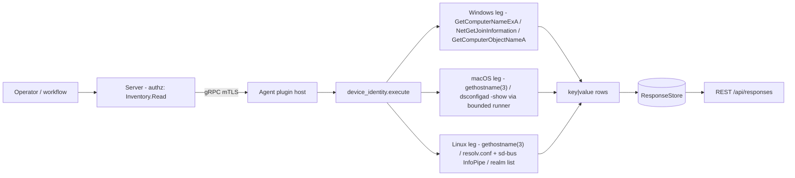

# device_identity

<!-- BEGIN GENERATED: plugin-doc-gen header -->
| | |
|---|---|
| **What it does** | Reports device hostname, domain membership, and AD organizational unit |
| **Version** | 1.0.0 |
| **Kind** | Collector · read-only · gathered (device.device_identity.device_name, device.device_identity.domain, device.device_identity.ou) |
| **Platforms** | Windows ✅ · macOS ✅ · Linux ✅ |
| **Actions** | `device_name` (definition `device.device_identity.device_name`) · `domain` (definition `device.device_identity.domain`) · `ou` (definition `device.device_identity.ou`) |
| **Security** | securable `Inventory` · operation Read · risk Low · dispatch ReadOnly · approval gate None |
| **Roles** | execute: endpoint-admin, endpoint-operator · author: content-author |
<!-- END GENERATED -->

## How it works

`device_name` is a single native call on every OS — `gethostname(3)` on Linux/macOS, `GetComputerNameExA` on Windows — with no fallback and no subprocess. `domain` and `ou` are AD-join lookups, and each platform has its own chain: Windows makes one native call each (`NetGetJoinInformation`, `GetComputerObjectNameA`). The join call is an RPC with no deadline of its own, so agent-core runs it bounded to 5 s, one read in flight at a time (`yuzu/agent/win_join_info.hpp`); a `domain` read that gets no answer writes no rows and returns non-zero. `GetComputerObjectNameA` has no such limit. Linux's `domain` first parses `/etc/resolv.conf` for the DNS domain, then asks sssd's D-Bus InfoPipe whether the host is AD-joined (zero subprocesses); on any InfoPipe failure it falls through to a bounded `realm list` call, then to reading `/etc/sssd/sssd.conf` directly. Linux's `ou` skips InfoPipe (it has no OU surface) and goes straight to `realm list`, falling back to the same `sssd.conf` file. macOS's `domain` and `ou` each independently run the bounded `dsconfigad -show` subprocess and parse it with the shared `device_identity_macos.hpp` parser; `domain` additionally falls back to a native `gethostname()` + `getaddrinfo(AI_CANONNAME)` lookup when the device isn't AD-bound.

Apart from that unanswered Windows join read, the plugin does not distinguish "not domain-joined" from "the AD lookup was refused or failed": every other degraded path in `domain`/`ou` reports the same `N/A` / `joined=false` shape as a clean not-joined read and sets no typed result status (see Caveats).



## OS capability

<!-- BEGIN GENERATED: plugin-doc-gen capability -->
| Action | Windows | macOS | Linux |
|---|---|---|---|
| `device_name` | ✅ supported · rung 1 · GetComputerNameExA | ✅ supported · rung 1 · gethostname(3) | ✅ supported · rung 1 · gethostname(3) |
| `domain` | ✅ supported · rung 1 · NetGetJoinInformation | ✅ supported · rung 2 · run_bounded_subprocess(dsconfigad -show) + native parser (device_identity_macos.hpp) [fallback: gethostname(3) + getaddrinfo(AI_CANONNAME)] | ✅ supported · rung 1 · /etc/resolv.conf read + sd-bus org.freedesktop.sssd.infopipe ListDomains [fallback: run_bounded_subprocess(realm list); further fallback: /etc/sssd/sssd.conf read] |
| `ou` | ✅ supported · rung 1 · GetComputerObjectNameA | ✅ supported · rung 2 · run_bounded_subprocess(dsconfigad -show) + native parser (device_identity_macos.hpp) | ✅ supported · rung 2 · run_bounded_subprocess(realm list) [fallback: /etc/sssd/sssd.conf read] |
<!-- END GENERATED -->

## Privileges and prerequisites

| OS | Runs as | Extra grant needed | Measured | If the read is refused |
|---|---|---|---|---|
| Windows | agent service account (LocalSystem today, #1442 — `docs/agent-privilege-model.md:12`) | None. All three calls are unprivileged native APIs. | 2026-09-07, bare-metal, `SYSTEM` (sample stamp) | a failure the call returns makes `domain`/`ou` silently report `N/A` / `joined=false` (`device_identity_win.hpp`, `domain_answer`; `do_ou`) — no distinct "refused" signal. A `domain` join read with no answer is reported as such (see Result status) |
| macOS | agent daemon, root (no `UserName` key in the LaunchDaemon — `docs/agent-privilege-model.md:8`) | None. `dsconfigad -show` runs unprivileged (`docs/agent-spawn-sink-manifest.md:77-78`). | 2026-09-07, bare-metal, euid 501 (jsmith) — i.e. captured unprivileged, not as the daemon's real root identity | falls through to the `gethostname()`+`getaddrinfo` fallback (`device_identity_plugin.cpp:344-354`); `ou` reports `N/A` |
| Linux | unprivileged `yuzu` account (`docs/agent-privilege-model.md`, Linux account section) | None for the sd-bus call and `realm list`, which are unprivileged (`docs/agent-spawn-sink-manifest.md:76,79`). The `sssd.conf` read (mode 0600 root) needs read access: the packaged unit grants `CAP_DAC_READ_SEARCH` as an ambient capability by default, so it succeeds there (not measured for this plugin). | 2026-09-06, container, euid 0 (root) — captured privileged, not as the daemon's real unprivileged identity | can fail closed on a stock host where the agent lacks `CAP_DAC_READ_SEARCH` (an operator opt-out, a dev install, or a manual launch): sssd's InfoPipe defaults to root-only (a D-Bus ACL the capability does not change) and `/etc/sssd/sssd.conf` ships mode 0600, so a genuinely joined host can report `joined=false` (`device_identity_plugin.cpp:253-269`, BR-011) |

Subprocesses: `realm list` (Linux, `domain`/`ou` fallback, path resolved via `probe_tool_path`) and `/usr/sbin/dsconfigad -show` (macOS, `domain` and `ou`, each its own call), both via the bounded runner with a 10s deadline. Local IPC: one sd-bus call to sssd's InfoPipe (Linux `domain`, only when built with `YUZU_HAVE_LIBSYSTEMD`). No outbound network.

## Data contract

### Inputs

<!-- BEGIN GENERATED: plugin-doc-gen inputs -->
No action takes parameters.
<!-- END GENERATED -->

### Outputs

Each action writes one or more `key|value` lines via `write_output()` (`device_identity_plugin.cpp:9-10`); there is no shared multi-field row shape. `device_name` and `ou` each write exactly one line; `domain` writes two (`domain|...` then `joined|...`), or none when the Windows join read gets no answer. A value of `N/A` (for `domain`/`ou`) means there was nothing to report — it is not distinguishable from a lookup that answered with a failure (see Caveats).

<!-- BEGIN GENERATED: plugin-doc-gen outputs -->
**`device.device_identity.device_name` — `device_name`**

| Field | Type | Values | Available | Example | Description |
|---|---|---|---|---|---|
| `device_name` | string | - | Windows, Linux, macOS | `DESKTOP-04DNSIG` | The device's hostname as reported by the OS. Values: free text. |

**`device.device_identity.domain` — `domain|joined`**

| Field | Type | Values | Available | Example | Description |
|---|---|---|---|---|---|
| `domain` | string | - | Windows, Linux, macOS | `WORKGROUP` | The DNS or Active Directory domain name the device reports, or "N/A" if none was found. Values: free text (or the literal "N/A"). |
| `joined` | bool | - | Windows, Linux, macOS | `false` | Whether the device is currently joined to a domain or realm. |

**`device.device_identity.ou` — `ou`**

| Field | Type | Values | Available | Example | Description |
|---|---|---|---|---|---|
| `ou` | string | - | Windows, Linux, macOS | `N/A` | The Active Directory organizational unit distinguished-name path, or "N/A" if the device is not domain-joined or the OU could not be read. Values: free text (AD DN fragment) or the literal "N/A". |
<!-- END GENERATED -->

### Result status

Only the Windows `domain` action sets a typed result status, and only when its join read gets no answer; it then returns non-zero with no rows. The samples show `UNDECLARED / UNKNOWN /` for every action on every OS.

| Status | Completeness | Provenance | When |
|---|---|---|---|
| `UNDECLARED` (no call made) | UNKNOWN | - | every other case on every OS, including a lookup that answered with a failure (`N/A` / `joined=false`) |
| `CONSTRAINED` | PARTIAL | `windows:device_identity:join_information:deadline_exceeded` / `windows:device_identity:join_information:call_in_progress` / `windows:device_identity:join_information:abandoned_call_pending` | Windows `domain`, rc non-zero and no rows: respectively, the join read did not answer within 5 s or could not be started; another join read was still in flight for the whole 5 s; an earlier one passed its deadline and is still blocked, so none was started |

### Where the data goes

- **Instruction result.** Rows travel over the agent's mTLS gRPC channel as the command response and land in the ResponseStore, rendered as `Agent · Key · Value` (`device_identity` is in `kKeyValuePlugins`, `server/core/src/result_parsing.hpp:63`) for SSE, ResponseStore facet extraction, and dashboard fragments.
- **Daily sync.** The `device_ci` source runs `device_name`, `domain` and `ou` as required actions (`agents/core/src/sync_source_device_ci.cpp:690-691`); a non-zero return from any of them skips that cycle.
- **Not consumed by** the Echo warehouse, DEX, or metrics.
- **Sensitivity.** `device_name` is the host's own hostname, and `domain`/`ou` report its AD domain membership and organizational-unit placement — all three directly identify the specific device (and, via the OU, the org unit it belongs to); nothing here names a person or installed software.
- **Siblings:** `os_info`, `hardware`, `status` — other inventory/system plugins declared alongside `device_identity` in the same ABI4 capability pass (`changelog.d/2204-declarations-group-b.added.md`).
- **MCP / REST.** Discover: `discover_plugins` (summary) → `yuzu://plugin-docs` (this page as data) → `discover_instructions` / `get_definition("device.device_identity.domain")`. Run: `execute_instruction {definition_id, parameters}`. Read: `/api/responses/{id}`.

## Sample output

<!-- BEGIN GENERATED: plugin-doc-gen samples -->
**Windows** — captured: windows Microsoft Windows NT 10.0.26200.0 x64 · bare-metal · 2026-09-07 · SYSTEM · leg-hash fdf67a9b8831

```
== action=device_name
device_name|DESKTOP-04DNSIG
[result_status] UNDECLARED / UNKNOWN

== action=domain
domain|WORKGROUP
joined|false
[result_status] UNDECLARED / UNKNOWN

== action=ou
ou|N/A
[result_status] UNDECLARED / UNKNOWN
```

**macOS** — captured: macos macOS 26.6.2 arm64 · bare-metal · 2026-09-07 · euid 501 (jsmith) · leg-hash fdf67a9b8831

```
== action=device_name
device_name|workstation1.local
[result_status] UNDECLARED / UNKNOWN

== action=domain
domain|local
joined|false
[result_status] UNDECLARED / UNKNOWN

== action=ou
ou|N/A
[result_status] UNDECLARED / UNKNOWN
```

**Linux** — captured: linux Debian GNU/Linux 13 (trixie) aarch64 · container · 2026-09-06 · euid 0 · leg-hash fdf67a9b8831

```
== action=device_name
device_name|d7023653759f
[result_status] UNDECLARED / UNKNOWN

== action=domain
domain|N/A
joined|false
[result_status] UNDECLARED / UNKNOWN

== action=ou
ou|N/A
[result_status] UNDECLARED / UNKNOWN
```
<!-- END GENERATED -->

## Caveats and known gaps

1. **Linux AD-join detection can fail closed on a host where the agent lacks `CAP_DAC_READ_SEARCH`.** sssd's InfoPipe defaults to root-only access and `/etc/sssd/sssd.conf` ships mode 0600. The packaged unit grants the agent `CAP_DAC_READ_SEARCH` by default, which makes `sssd.conf` readable; the InfoPipe D-Bus ACL stays root-only, so that path is still denied to the agent account. Where the capability is absent (an operator opt-out, a dev install, or a manual launch; see `docs/user-manual/upgrading.md`, "Behaviour change: the packaged Linux agent can read root-only files") both paths can be denied on a stock SSSD host. `realm list` is kept as the confirmed-unprivileged fallback specifically to cover this gap (`device_identity_plugin.cpp:253-269`, BR-011). The grant is not measured for this plugin.
2. **An answered failure carries no typed result status.** Only an unanswered Windows join read sets one. A permission failure or an error the lookup returns, on any OS, reads the same to a consumer as a genuine "not joined" answer.
3. **macOS runs `dsconfigad -show` twice per full identity read.** `domain` and `ou` each make their own independent bounded-subprocess call (`device_identity_plugin.cpp:322-324`, `:454-456`); there is no cross-action caching of the AD-bind check within one instruction batch.
4. **macOS AD lookups are capped at rung 2 (bounded subprocess), not native.** An OpenDirectory native implementation is explicitly deferred, coordinated with a parallel effort doing the same OpenDirectory work elsewhere (`device_identity_plugin.cpp:316-321`); do not reintroduce a raw `popen(dsconfigad)` in its place — that was already replaced by the bounded runner (`changelog.d/2380-hardware-device-identity-native-acquisition.changed.md`).
5. **The macOS and Linux samples were captured at the extremes of privilege, not the daemon's real identity.** The macOS sample ran unprivileged (euid 501); the Linux sample ran as root in a container (euid 0). Neither matches the daemon's actual runtime account (root on macOS, unprivileged `yuzu` on Linux) — see the Privileges table.

## Source and tests

<!-- BEGIN GENERATED: plugin-doc-gen source -->
- Plugin: `agents/plugins/device_identity/src/device_identity_macos.hpp` · `agents/plugins/device_identity/src/device_identity_plugin.cpp` · `agents/plugins/device_identity/src/device_identity_win.hpp`
- Definitions: `content/definitions/device_identity.yaml`
- Capability rows: `server/core/src/capability_decls/plugin_action_catalogue_b.hpp`
- Tests: `tests/unit/test_device_identity_macos.cpp` · `tests/unit/test_device_identity_win.cpp`
- Privilege row: `docs/agent-privilege-model.md` (no row yet)
<!-- END GENERATED -->
