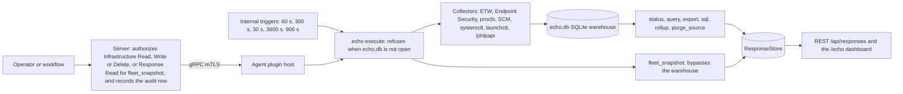
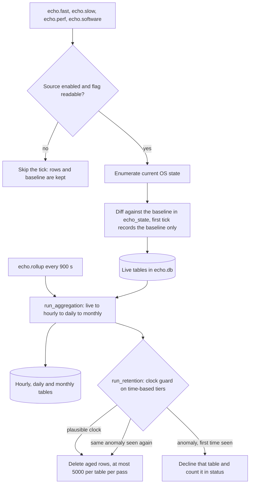
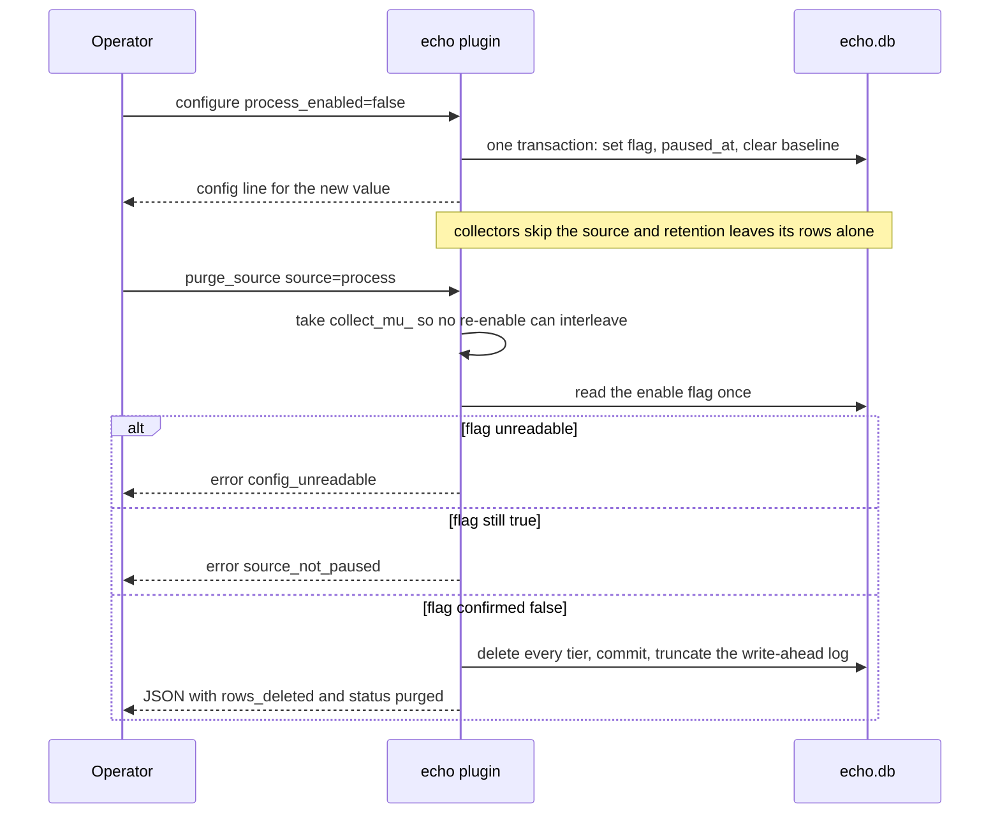
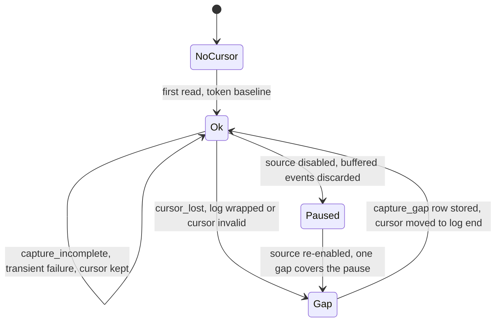

# echo

<!-- BEGIN GENERATED: plugin-doc-gen header -->
| | |
|---|---|
| **What it does** | Echo activity record -- continuous system state change tracking |
| **Version** | 1.0.0 |
| **Kind** | Action · mutating · gathered (crossplatform.echo.status, crossplatform.echo.query, crossplatform.echo.snapshot, crossplatform.echo.export, crossplatform.echo.configure, crossplatform.echo.collect_fast, crossplatform.echo.collect_slow, crossplatform.echo.compatibility, crossplatform.echo.fleet_snapshot, crossplatform.echo.sql, crossplatform.echo.recent_processes, crossplatform.echo.tcp_by_process, crossplatform.echo.listening_ports, crossplatform.echo.hourly_process_summary, crossplatform.echo.service_state_changes, crossplatform.echo.connections_to_ip, crossplatform.echo.daily_connection_summary, crossplatform.echo.user_sessions, crossplatform.echo.process_tree, crossplatform.echo.daily_process_summary, crossplatform.echo.recent_processes_iso, crossplatform.echo.rollup, crossplatform.echo.recent_arp, crossplatform.echo.recent_dns, crossplatform.echo.recent_mapdrive) |
| **Platforms** | Windows ✅ · macOS ✅ · Linux ✅ |
| **Actions** | `collect_fast` (definition `crossplatform.echo.collect_fast`) · `collect_perf` · `collect_slow` (definition `crossplatform.echo.collect_slow`) · `collect_software` · `compatibility` (definition `crossplatform.echo.compatibility`) · `configure` (definition `crossplatform.echo.configure`) · `export` (definition `crossplatform.echo.export`) · `fleet_snapshot` (definition `crossplatform.echo.fleet_snapshot`) · `purge_source` · `query` (definition `crossplatform.echo.query`) · `rollup` (definition `crossplatform.echo.rollup`) · `snapshot` (definition `crossplatform.echo.snapshot`) · `sql` (definition `crossplatform.echo.connections_to_ip`, `crossplatform.echo.daily_connection_summary`, `crossplatform.echo.daily_process_summary`, `crossplatform.echo.hourly_process_summary`, `crossplatform.echo.listening_ports`, `crossplatform.echo.process_tree`, `crossplatform.echo.recent_arp`, `crossplatform.echo.recent_dns`, `crossplatform.echo.recent_mapdrive`, `crossplatform.echo.recent_processes`, `crossplatform.echo.recent_processes_iso`, `crossplatform.echo.service_state_changes`, `crossplatform.echo.sql`, `crossplatform.echo.tcp_by_process`, `crossplatform.echo.user_sessions`) · `status` (definition `crossplatform.echo.status`) |
| **Security** | `fleet_snapshot`: securable `Response` · operation Read · risk Low · dispatch ReadOnly · approval gate None; `status`: securable `Infrastructure` · operation Read · risk Low · dispatch ReadOnly · approval gate None; `query`: securable `Infrastructure` · operation Read · risk Medium · dispatch ReadOnly · approval gate None; `snapshot`: securable `Infrastructure` · operation Read · risk Low · dispatch ReadOnly · approval gate None; `export`: securable `Infrastructure` · operation Read · risk Medium · dispatch ReadOnly · approval gate None; `configure`: securable `Infrastructure` · operation Write · risk Medium · dispatch Mutating · approval gate AdminOrApproval; `collect_fast`: securable `Infrastructure` · operation Read · risk Low · dispatch ReadOnly · approval gate None; `collect_slow`: securable `Infrastructure` · operation Read · risk Low · dispatch ReadOnly · approval gate None; `collect_perf`: securable `Infrastructure` · operation Read · risk Low · dispatch ReadOnly · approval gate None; `collect_software`: securable `Infrastructure` · operation Read · risk Low · dispatch ReadOnly · approval gate None; `rollup`: securable `Infrastructure` · operation Delete · risk High · dispatch Destructive · approval gate None; `sql`: securable `Infrastructure` · operation Read · risk Medium · dispatch ReadOnly · approval gate None; `compatibility`: securable `Infrastructure` · operation Read · risk Low · dispatch ReadOnly · approval gate None; `purge_source`: securable `Infrastructure` · operation Delete · risk High · dispatch Destructive · approval gate None |
| **Roles** | execute: `status`: endpoint-admin, endpoint-operator; `query`: endpoint-admin, endpoint-operator; `snapshot`: endpoint-admin; `export`: endpoint-admin, endpoint-operator; `configure`: endpoint-admin; `collect_fast`: endpoint-admin; `collect_slow`: endpoint-admin; `compatibility`: endpoint-admin, endpoint-operator; `fleet_snapshot`: endpoint-admin, endpoint-operator; `sql`: endpoint-admin, endpoint-operator; `sql`: endpoint-admin, endpoint-operator; `sql`: endpoint-admin, endpoint-operator; `sql`: endpoint-admin, endpoint-operator; `sql`: endpoint-admin, endpoint-operator; `sql`: endpoint-admin, endpoint-operator; `sql`: endpoint-admin, endpoint-operator; `sql`: endpoint-admin, endpoint-operator; `sql`: endpoint-admin, endpoint-operator; `sql`: endpoint-admin, endpoint-operator; `sql`: endpoint-admin, endpoint-operator; `sql`: endpoint-admin, endpoint-operator; `rollup`: endpoint-admin; `sql`: endpoint-admin, endpoint-operator; `sql`: endpoint-admin, endpoint-operator; `sql`: endpoint-admin, endpoint-operator · author: content-author |
<!-- END GENERATED -->

## How it works

Echo is the agent's local telemetry warehouse. Each capture source has a collector that reads current
OS state on a timer, compares it with the baseline saved at the previous tick and appends only the
differences, as change events, to a SQLite database (`echo.db`) on the device. Four interval triggers
run the collectors and a fifth rolls the live rows up into hourly, daily and monthly tiers and then
trims every tier to its limit. Three sources (`power`, `removable`, `registry`) do not diff a
snapshot: they follow a saved position in an OS log or callback stream, and when that position is
lost they record a `capture_gap` row and start again from the log's current end instead of replaying
history. All 17 sources are on by default on every OS (`default_enabled` in `echo_schema_registry.cpp`,
enforced by a registry-wide test). `configure` turns any of them off per host, which stops capture
and keeps the rows already stored; `purge_source` then deletes that source's rows. Reads are on
demand and local: `status`, `query`, `export` and `sql` read `echo.db`, `snapshot` forces an
out-of-cycle collection, and `fleet_snapshot` re-enumerates processes and connections without
touching `echo.db`.

Deliberately not: Echo does not stream events to the server in real time (everything lands in the
local warehouse first and is pulled by a read action), it does not replay history from zero when a
cursor-model source loses its position, and it never fabricates OS support (a leg with no collector
reports `planned`, not a guessed read).

| Trigger | Default cadence | Action | What it drives |
|---|---|---|---|
| `echo.fast` | 60 s (10-3600) | `collect_fast` | `process`, `tcp`, `arp`, `dns`, `netqual`, `module` and the derived `usage` fold |
| `echo.slow` | 300 s (30-7200) | `collect_slow` | `service`, `user`, `netconn`, `mapdrive` and the cursor sources `power`, `removable`, `registry` |
| `echo.perf` | 30 s | `collect_perf` | `perf`, `procperf` (device and per-application counters, sampled rather than diffed) |
| `echo.software` | 3600 s (0 removes the trigger, otherwise 300-86400) | `collect_software` | `software` |
| `echo.rollup` | 900 s | `rollup` | aggregation into hourly, daily and monthly tiers, then retention |

The fast interval must stay below the slow interval. A diffed source's first tick records its baseline and
no events, so a quiet first tick is not evidence about the past.

### What you can decide with it

| Question | Use | What you get, and the limit |
|---|---|---|
| Is Echo healthy on this device? | `status` | Storage state, row counts, per-source `last_status`, `consecutive_failures` and `last_status_at`, and the retention clock-guard counters. `status` is the only fleet-readable health signal (the agent has no `/metrics` endpoint for Echo). |
| What can this OS do? | `compatibility` | One row per source and OS, with status `supported`, `constrained`, `planned` or `unsupported` and the capture method. |
| What ran, and when did it start or stop? | `query type=process`, `recent_processes`, `process_tree`, `hourly_process_summary`, `daily_process_summary` | Windows records start and stop from a gap-free ETW stream, names only. Linux polls `/proc` every fast interval and keeps the command line (redacted by pattern), so a process shorter than the interval can be missed. macOS uses Endpoint Security when root and the entitlement are present and a poll otherwise, names only. |
| Who talked to this address, and what is listening? | `connections_to_ip`, `tcp_by_process`, `listening_ports`, `daily_connection_summary` | Polled connection tables on every OS; a connection that opens and closes inside one interval is not seen. macOS sees every flow only with root. |
| Did a service change state, who logged on? | `service_state_changes`, `user_sessions` | Windows is complete. Linux and macOS are constrained: no start type, and `utmp` or `utmpx` can miss GUI logins and containers without them. |
| Which software was installed or removed? | `query type=software` | Windows only (machine-wide Uninstall keys). Empty on Linux and macOS means not collected. |
| Did a persistence or policy registry value change? | `sql` over `$Registry_Live` | Windows only. Old and new data of each change, unmasked, with no acting process. |
| Did the device sleep, wake, change power source, or have media attached? | `sql` over `$Power_Live`, `$Removable_Live` | `capture_gap` rows mark any stretch the agent could not see. |
| Who is on the network segment, what did it resolve, which shares are mapped? | `recent_arp`, `recent_dns`, `recent_mapdrive`, or `query` with type arp, dns or mapdrive | `dns` is Windows only; `mapdrive` outbound live only on macOS. These are device-state sources: they are never part of the default `query` feed. |
| Anything else in the warehouse | `sql` | A single SELECT against `$`-prefixed tables, validated by `validate_and_translate_sql` and run through the read-only `execute_user_query`. The `usage` tables are not queryable here. |
| Pull a time range out for another tool | `export` | JSON array of events, same filters as `query`. `limit` defaults to 1000; a value above 10000 (or zero or less) falls back to 1000. |

What a result proves. A row says the collector saw that change at that tick; it does not say nothing
else happened. An empty table on a `planned` leg means Echo is not collecting there, never that
nothing occurred. An empty table on a live leg can also mean the source is disabled (check
`<source>_enabled` in `status`), the first tick was a baseline, or the last tick reported
`capture_incomplete`. `snapshot` answers `complete` or `partial|<sources>`; a partial answer names
the sources that kept a stale baseline.

Safe workflow for the changing actions:

1. `configure` (Write, admin only): run `compatibility` and `status` first, apply the setting, then
   read `status` again. The setting is undone by writing the old value back; rows already stored are
   not touched, and re-enabling a source re-baselines it so nothing is invented for the paused
   window.
2. `purge_source` (Delete, irreversible): `export` what you need, disable the source with
   `configure`, run `purge_source`, then confirm with `status` that its row count is zero. It accepts
   only a registered source name that is confirmed disabled.
3. `rollup` (Delete, irreversible): runs by itself every 900 s; a manual run only brings that
   same pass forward. The server refuses to dispatch a Destructive action fleet-wide, so
   both `rollup` and `purge_source` need explicit device ids.

### Capture sources by OS

`live` means the collector is wired and is the primary mechanism; `constrained` means it works with
a stated limit; `planned` means the leg is declared with no collector (its tables are queryable and
empty); `n/a` means the source does not apply to that OS. The table is read from the schema registry
(`build_sources()` in `echo_schema_registry.cpp`); `compatibility` reports the same data on a host.

| Source | Records | Windows | macOS | Linux |
|---|---|---|---|---|
| `process` | process start and stop | live: ETW, poll fallback | constrained: Endpoint Security (root and entitlement), else poll | live: procfs |
| `tcp` | TCP and UDP connection changes | live: iphlpapi poll | constrained: nstat (root), else `proc_pidfdinfo` poll | live: procfs poll |
| `service` | service state changes | live: SCM | constrained: `launchctl`, no start type | constrained: `systemctl`, start type `unknown`, systemd only |
| `user` | logon sessions | live: WTS | constrained: `utmpx` | constrained: `utmp` |
| `perf` | device CPU, memory, disk, network rates | live: kernel counters | planned | live: procfs |
| `procperf` | top-N per-application CPU and memory | live: `NtQuerySystemInformation` | planned | live: procfs, version empty |
| `netqual` | per-connection TCP quality | constrained: TCP ESTATS, elevated agent only | constrained: nstat, root only | live: netlink `INET_DIAG` |
| `module` | image and driver loads with signing verdict | live: ETW | planned | planned |
| `software` | installed-software changes | live: HKLM Uninstall keys | planned | planned |
| `arp` | neighbour-table changes | live: `GetIpNetTable2` | constrained: `entry_type` always `unknown` | live: `/proc/net/arp`, IPv4 |
| `dns` | resolver-cache changes | live: DNS client cache | planned | planned |
| `netconn` | connectivity transitions | live: event logs, backfills history | planned | planned |
| `mapdrive` | mapped network shares, both directions | live: outbound, history and inbound (inbound needs local admin) | constrained: outbound live only | constrained: mounts and fstab, inbound needs Samba |
| `power` | sleep, wake, AC transitions (cursor) | constrained: power broadcast | live: `pmset -g log` replay | constrained: logind, needs the libsystemd build, AC read always |
| `removable` | media attach and detach, exec from removable (cursor) | live: event-log channels | constrained: DiskArbitration | constrained: udev netlink |
| `registry` | registry value and key changes (cursor) | live: `RegNotifyChangeKeyValue` | n/a | n/a |
| `usage` | per-executable runs, derived from `process` | live | constrained: inherits `process` | live |

### Source notes

- **Retention.** Live tables are row-count capped; the hourly, daily and monthly tiers are
  time-based (typically 24 hours, 31 days and about a year; a few tiers differ). Each pass deletes at
  most 5000 rows per table, and a disabled source's rows are never pruned.
- **`netconn` and `power`/`removable` history.** On first enablement the read can reach back into
  OS-retained history, bounded by `netconn_lookback_seconds`, `power_lookback_seconds` (effective on
  macOS only) and `removable_lookback_seconds` (default 7 days, `0` means forward-only). If the
  setting cannot be read, Echo reads forward-only.
- **`mapdrive` history backfill.** A one-time historical pass runs at agent init. A profile it could
  not read is retried individually, at most 7 attempts in total and no more than once per 24 hours,
  until it resolves or is abandoned. A hive mount that exceeds its 30 s bound ends that run's
  mounting. The stuck mount's thread cannot be stopped: until it returns it keeps the process-wide
  offline-hive lock (every other per-user hive read on the agent waits behind it) and keeps the
  backup and restore privileges enabled on the agent process, and if it stalls after the hive has
  loaded, that hive stays mounted and the profile's `NTUSER.DAT` stays locked. The plugin module is
  pinned in memory before the first mount; if the pin fails no hive is read, and while a stuck
  mount is still running later runs do not start new mounts. `purge_source mapdrive` also clears the
  pending-retry list so a retry cannot re-insert purged rows.
- **`registry`.** Values are stored unmasked and rows carry `actor_pid` 0; see Caveats.

### Diagrams

#### Dispatch and read path



Operators reach the plugin through the server, which authorizes and audits the dispatch. The
triggers call the same entry point inside the agent. Every action except `fleet_snapshot` works on
`echo.db`, and every result comes back as a normal instruction response.

#### Collector pipeline and retention



Collectors write only the difference from the last complete snapshot, and a failed or partial read
keeps the old baseline rather than inventing events. Aggregation always runs before retention so each
tier is consumed before the tier below it can be trimmed. The clock guard declines a time-based pass
that looks like a wall-clock jump (a pass that would wipe a table, more than 30 days since the last
pass, a stored reading ahead of now, or no stored reading) and counts it in
`retention_guard_declines_total`. It declines once per distinct anomaly: while the same anomaly
persists, later passes delete again but never more than 5000 rows per table per pass. Row-count
trimming needs no clock and is not clock-guarded, though it has the same per-pass cap.

#### Disable, then purge a source



The enable check and the delete happen under the same collector lock that `configure` takes, so a
concurrent re-enable cannot slip between them and have a collecting source purged. An unreadable
flag is treated as unconfirmed and refused, never as disabled. The best-effort truncation of the
SQLite write-ahead log (WAL) clears the purged pages from that log so the erasure is complete.

#### Cursor source states



`power`, `removable` and `registry` keep one saved position each in the `echo_cursor` table (readable
through `sql`). A transient read failure raises an incomplete-capture error (`IncompleteCaptureError`), which keeps the cursor so
the next tick retries from the same place. A lost cursor or wrapped log writes a single
`capture_gap` row and re-baselines at the log's current end, never a replay from zero, and the
window of a disable is likewise reported only as a gap, never as its own events.

## OS capability

<!-- BEGIN GENERATED: plugin-doc-gen capability -->
| Action | Windows | macOS | Linux |
|---|---|---|---|
| `collect_fast` | ✅ supported · rung 1 · etw+iphlpapi | 🟡 constrained · rung 1 · endpoint_security+nstat+route_sysctl | 🟡 constrained · rung 1 · procfs |
| `collect_perf` | ✅ supported · rung 1 · ntcounters | 🟡 planned · rung 1 · host_statistics | ✅ supported · rung 1 · procfs |
| `collect_slow` | ✅ supported · rung 1 · scm+wts+wnet+wevtapi | 🟡 constrained · rung 2 · launchctl+utmpx+getfsstat | 🟡 constrained · rung 2 · systemctl+utmp |
| `collect_software` | ✅ supported · rung 1 · registry | 🟡 planned · rung 2 · pkgutil | 🟡 planned · rung 2 · dpkg_rpm |
| `compatibility` | ✅ supported · rung 1 · sqlite | ✅ supported · rung 1 · sqlite | ✅ supported · rung 1 · sqlite |
| `configure` | ✅ supported · rung 1 · sqlite | ✅ supported · rung 1 · sqlite | ✅ supported · rung 1 · sqlite |
| `export` | ✅ supported · rung 1 · sqlite | ✅ supported · rung 1 · sqlite | ✅ supported · rung 1 · sqlite |
| `fleet_snapshot` | ✅ supported · rung 1 · iphlpapi+win32_process_enum | 🟡 constrained · rung 1 · libproc(proc_pidfdinfo) | ✅ supported · rung 1 · procfs |
| `purge_source` | ✅ supported · rung 1 · sqlite | ✅ supported · rung 1 · sqlite | ✅ supported · rung 1 · sqlite |
| `query` | ✅ supported · rung 1 · sqlite | ✅ supported · rung 1 · sqlite | ✅ supported · rung 1 · sqlite |
| `rollup` | ✅ supported · rung 1 · sqlite | ✅ supported · rung 1 · sqlite | ✅ supported · rung 1 · sqlite |
| `snapshot` | ✅ supported · rung 1 · etw+iphlpapi+scm+wts+wnet+wevtapi+registry | 🟡 constrained · rung 2 · endpoint_security+nstat+launchctl+getfsstat+pkgutil(planned) | 🟡 constrained · rung 2 · procfs+systemctl+dpkg_rpm(planned) |
| `sql` | ✅ supported · rung 1 · sqlite | ✅ supported · rung 1 · sqlite | ✅ supported · rung 1 · sqlite |
| `status` | ✅ supported · rung 1 · sqlite | ✅ supported · rung 1 · sqlite | ✅ supported · rung 1 · sqlite |

**Declared limits per leg** (descriptor fallback text, verbatim):

- **`collect_fast` / macOS** — process/tcp fall back to a KERN_PROC_ALL/proc_pidfdinfo poll without the Endpoint Security entitlement or nstat root privilege; dns sub-source is PLANNED (no-op) on macOS; arp sub-source is native but constrained (route_sysctl, entry_type always 'unknown')
- **`collect_fast` / Linux** — dns sub-source is PLANNED (no-op) on Linux; arp sub-source is native (procfs, /proc/net/arp); core process/network/netqual collection is native
- **`collect_slow` / macOS** — service enumeration runs bounded argv (rung 2) via the shared subprocess runner; no startup_type; mapdrive source is wired but outbound-live-only (getfsstat, no username, no inbound, no history); netconn source is PLANNED (no-op) on macOS
- **`collect_slow` / Linux** — service enumeration runs bounded argv (rung 2) via the shared subprocess runner; startup_type reads 'unknown'; netconn source is PLANNED (no-op) on Linux
- **`fleet_snapshot` / macOS** — inherent TOCTOU between pid enumeration and per-fd query; short-lived sockets may be missed
- **`snapshot` / macOS** — software collection is PLANNED on macOS; mapdrive is wired but outbound-live-only (getfsstat, no username, no inbound, no history); service enumeration runs bounded argv (rung 2) via the shared subprocess runner; process/tcp fall back to a poll without the Endpoint Security entitlement or nstat root privilege
- **`snapshot` / Linux** — software inventory collection is PLANNED (dpkg/rpm not yet wired) on Linux; service enumeration runs bounded argv (rung 2) via the shared subprocess runner
<!-- END GENERATED -->

## Privileges and prerequisites

| OS | Runs as | Extra grant needed | Measured | If the read is refused |
|---|---|---|---|---|
| Windows | Agent service account (LocalSystem today, #1442; the `echo.*` row of `docs/agent-privilege-model.md` lists `SeBackupPrivilege` and `Performance Log Users` for the intended account; the only Echo code that enables `SeBackupPrivilege` and `SeRestorePrivilege` is the `mapdrive` history backfill, and only for the span of mounting a logged-out profile's offline `NTUSER.DAT`) | **None beyond the service account's own rights.** LocalSystem already satisfies the ETW session requirements; the `software` source needs no extra privilege beyond the account's existing registry-read access. The `netqual` source needs an elevated agent: a non-elevated agent records nothing and `status` reports `netqual_capture_method=none`. | 2026-09-07, bare-metal, captured as `SYSTEM` — broader privilege than the deployed service account; no OS-level read was reached in this capture (see Caveats) | Not observed in this capture. Not every Windows leg is plain `supported`: `process` falls back to a `CreateToolhelp32Snapshot` poll if the ETW session cannot start, and `netqual` and `power` are `constrained`. For the other Windows legs a refused read is expected to surface as an `error\|` line from the underlying Win32 call rather than a degrade (inferred from the code, not shown in the capture). |
| macOS | **root** (LaunchDaemon, no `UserName`; see the TL;DR and the `echo.*` row of `docs/agent-privilege-model.md`) | Endpoint Security process capture needs root **and** the `com.apple.developer.endpoint-security.client` entitlement; without both, `es_new_client`/`es_subscribe` fails and the process/tcp legs self-heal to the `KERN_PROC_ALL`/`proc_pidfdinfo` poll (`ProcEsCollector::start`). The `nstat` flow source (`tcp`, `netqual`) likewise needs root for system-wide visibility. | 2026-09-07, bare-metal, captured at **euid 501**, an ordinary user account; the root LaunchDaemon path was not exercised by this capture. | A missing entitlement/privilege never blocks the leg outright — it logs a warning and falls back to the poll (`ProcEsCollector::start`). |
| Linux | Agent account (`yuzu-agent` on the packaged unit); not root. The `echo.*` row of `docs/agent-privilege-model.md` assumes `cap_dac_read_search` set on the binary by `scripts/install-agent-user.sh` | A file capability on the binary does not take effect under the packaged unit's `NoNewPrivileges=true`, so on the packaged unit the working route is `AmbientCapabilities=CAP_DAC_READ_SEARCH` in a drop-in (not measured for this plugin). Service enumeration (`systemctl`) runs as bounded argv under the agent account, not elevated. | 2026-09-06, container, captured at **euid 0 (root)** — broader than the deployed unprivileged account. | Not observed in this capture. |

Binaries/subprocesses/network: `systemctl list-units --type=service --all --plain --no-pager --no-legend` and
`launchctl list` (both through the shared bounded-argv runner `yuzu::agent::run_bounded_subprocess`,
never a shell string; see `enumerate_services`). The same runner executes `smbstatus`, `wevtutil`
and `journalctl` for the mapdrive collector (`enumerate_mapdrive`, `enumerate_mapdrive_history`).
Windows runs an ETW session on provider `Microsoft-Windows-Kernel-Process`
(`ProcEtwCollector::start`) and a second session for module-load capture
(`ModuleEtwCollector::start`). macOS runs an in-process Endpoint Security client
(`ProcEsCollector::start`) and a `PF_SYSTEM`/`SYSPROTO_CONTROL` socket for the nstat client
(`NstatClient::start`); Linux opens an `AF_NETLINK`/`NETLINK_SOCK_DIAG` socket for TCP quality
(`collect_tcp_quality`). No `popen`, `CreateProcess` or `posix_spawn` call exists anywhere under
`agents/plugins/echo/src`.

## Data contract

### Inputs

<!-- BEGIN GENERATED: plugin-doc-gen inputs -->
| Definition | Parameter | Type | Required | Default | Constraints | Description |
|---|---|---|---|---|---|---|
| `crossplatform.echo.configure` | `retention_days` | string | no | - | pattern: ^[0-9]+$ | Number of days to retain Echo events before automatic purging. Valid range: 1-365. Default: 7. |
| `crossplatform.echo.configure` | `fast_interval` | string | no | - | pattern: ^[0-9]+$ | Interval in seconds for process and network collection. Valid range: 10-3600. Default: 60. |
| `crossplatform.echo.configure` | `slow_interval` | string | no | - | pattern: ^[0-9]+$ | Interval in seconds for service and user session collection. Valid range: 30-7200. Default: 300. |
| `crossplatform.echo.configure` | `redaction_patterns` | string | no | - | - | JSON array of case-insensitive SUBSTRING patterns (not glob) for command-line redaction. Leading/trailing `*` are stripped; `?` and `[abc]` are literals. Any process command line containing a pattern has its cmdline replaced with "[REDACTED by Echo]". At most 256 elements of at most 256 characters each; over-cap elements are dropped at load. Default patterns: ["*password*", "*secret*", "*token*", "*api_key*", "*credential*"]. These defaults are ALWAYS MERGED IN — your patterns are ADDED to them, never replace them, so an empty or all-invalid array cannot disable the baseline redaction. |
| `crossplatform.echo.configure` | `process_enabled` | string | no | - | pattern: ^(true\|false)$ | Enable or disable the process collector on this agent. "true" (default) keeps the collector active; "false" short-circuits the process branch of every collect_fast cycle. Existing rows remain queryable until they age out by retention. Requires agent v0.12.0+; older agents silently ignore. Valid: "true" \| "false". |
| `crossplatform.echo.configure` | `tcp_enabled` | string | no | - | pattern: ^(true\|false)$ | Enable or disable the TCP/network collector on this agent. See process_enabled for semantics. Requires agent v0.12.0+; older agents silently ignore. Valid: "true" \| "false". |
| `crossplatform.echo.configure` | `service_enabled` | string | no | - | pattern: ^(true\|false)$ | Enable or disable the service collector on this agent. See process_enabled for semantics. Requires agent v0.12.0+; older agents silently ignore. Valid: "true" \| "false". |
| `crossplatform.echo.configure` | `user_enabled` | string | no | - | pattern: ^(true\|false)$ | Enable or disable the user-session collector on this agent. See process_enabled for semantics. Requires agent v0.12.0+; older agents silently ignore. Valid: "true" \| "false". |
| `crossplatform.echo.configure` | `perf_enabled` | string | no | - | pattern: ^(true\|false)$ | Enable or disable the device performance sampler (CPU / memory / disk / network rates → $Perf_*) on this agent. "true" (default) keeps it active. Device-level perf carries no per-application identity. See process_enabled for the disable semantics. Requires agent v0.12.0+; older agents silently ignore. Valid: "true" \| "false". |
| `crossplatform.echo.configure` | `procperf_enabled` | string | no | - | pattern: ^(true\|false)$ | Enable or disable the per-application top-N CPU/working-set sampler (procperf source → $ProcPerf_*). **On by default**; independent of perf_enabled. Image names only — never command lines. **This also sends per-app names + versions OFF-DEVICE**: the top-N is synced daily to the central app_perf store (the B1 per-device and B2 fleet views), so it is not local-triage-only. To keep the device fully local, set this to "false", or suppress the upload with --inventory-disable / YUZU_AGENT_INVENTORY_DISABLE. Set to "false" to opt out. Requires agent v0.12.0+; older agents silently ignore. Valid: "true" \| "false". |
| `crossplatform.echo.configure` | `netqual_enabled` | string | no | - | pattern: ^(true\|false)$ | Enable or disable the per-connection TCP-quality sampler (netqual source → $NetQual_Live, plus the per-boot retrospective baseline $NetQual_Boot). **On by default**; only a coarse destination class (loopback/private/public) is stored, raw remote addresses are dropped at the edge. Linux (netlink INET_DIAG) and Windows (TCP ESTATS — ADR-0020); **Windows requires an elevated agent** (non-elevated records nothing and echo.status reports netqual_capture_method=none). macOS is planned. Independent of tcp_enabled. Queried via echo.sql only ($NetQual_Live / $NetQual_Boot); the legacy echo.query / echo.export actions do not surface netqual. Set to "false" to opt out. Requires agent v0.12.0+; older agents silently ignore. Valid: "true" \| "false". |
| `crossplatform.echo.configure` | `netconn_enabled` | string | no | - | pattern: ^(true\|false)$ | Enable or disable the connectivity-transition source (netconn → $NetConn_Live, ADR-0020). **On by default**. Windows reads the OS-retained NetworkProfile / NCSI / WLAN-AutoConfig event logs, so the FIRST read backfills connectivity history from BEFORE the source was enabled (bounded by netconn_lookback_seconds; set that to 0 for forward-only). Only closed enum tokens + numeric reason codes are stored — NO SSID, BSSID, profile name, interface GUID, or MAC. Windows-only collector today (Linux journald / macOS oslog planned; the table is queryable-empty there). Queried via echo.sql only ($NetConn_Live); the legacy echo.query / echo.export actions do not surface netconn. Requires agent v0.12.0+; older agents silently ignore. Valid: "true" \| "false". |
| `crossplatform.echo.configure` | `netconn_lookback_seconds` | string | no | - | pattern: ^[0-9]+$ | How far BEFORE enablement the netconn backfill reads OS-retained connectivity history (ADR-0020 privacy note). Because the timing of network / Wi-Fi connect/disconnect events is a presence / working-hours proxy — behavioral data even with SSIDs stripped — enabling netconn retroactively ingests a window that predates any monitoring disclosure. Set to "0" to DISABLE the pre-enablement read entirely (the source then records only forward connectivity from the moment it is enabled) for jurisdictions or works-council agreements where retrospective collection is not permitted. Clamped to 0-7776000 (0 - 90 days); default 604800 (7 days). Applies to the first read after enablement (and after a late enable); once caught up the source reads only forward. Requires agent v0.12.0+. |
| `crossplatform.echo.configure` | `module_enabled` | string | no | - | pattern: ^(true\|false)$ | Enable or disable the image-load / module-stream capture source (module source → $Module_*). **On by default** — module-load capture is high-volume (every library and driver load per process, with a code-signing verdict); no command line is ever captured. Windows records image loads today (ETW); the Linux and macOS collectors are planned, and there the $Module_* tables are queryable-empty. Set to "false" to opt out. Requires agent v0.12.0+; older agents silently ignore. Valid: "true" \| "false". |
| `crossplatform.echo.configure` | `software_enabled` | string | no | - | pattern: ^(true\|false)$ | Enable or disable the software install/uninstall source (software → $Software_*) on this agent. **On by default** — records machine-wide installed-software inventory (HKLM Uninstall), which is device asset-management and vulnerability-relevance data and carries NO user identity (machine scope only — no per-user / profile-name data). Names, versions, and publisher only. See process_enabled for the disable semantics (atomic, existing rows remain queryable, clean re-baseline on re-enable). Requires agent v0.12.0+; older agents silently ignore. Valid: "true" \| "false". |
| `crossplatform.echo.configure` | `software_interval` | string | no | - | pattern: ^[0-9]+$ | Interval in seconds for the software install/uninstall sampler (echo.software trigger). "0" disables the trigger entirely; any other value must be 300-86400 (5 minutes - 1 day). Default: 3600 (hourly). Installs are rare, so this runs on its own slower trigger. Requires agent v0.12.0+. |
| `crossplatform.echo.configure` | `arp_enabled` | string | no | - | pattern: ^(true\|false)$ | Enable or disable the ARP / neighbour-table capture source (ADR-0015). **On by default.** See process_enabled for semantics. Native on every OS today: GetIpNetTable2 on Windows, /proc/net/arp on Linux, and a route_sysctl dump on macOS (constrained there -- entry_type always reports "unknown"). Requires agent v0.12.0+; older agents silently ignore. Valid: "true" \| "false". |
| `crossplatform.echo.configure` | `dns_enabled` | string | no | - | pattern: ^(true\|false)$ | Enable or disable the DNS resolver-cache capture source (ADR-0015). **On by default** — the DNS cache reveals visited domains. Windows-only collector today (Linux/macOS planned). Requires agent v0.12.0+; older agents silently ignore. Valid: "true" \| "false". |
| `crossplatform.echo.configure` | `mapdrive_enabled` | string | no | - | pattern: ^(true\|false)$ | Enable or disable the mapped-drive capture source (capability-map §3.8, mapdrive → $MapDrive_*). Records network-share mappings in BOTH directions — outbound (drives this host maps to remote shares) and inbound (remote hosts mapping this host's shares, the lateral-movement signal). **On by default** — rows expose usernames and remote share paths. Windows + Linux (macOS planned); inbound needs local-admin / Server-Operator on Windows and Samba on Linux and degrades to empty otherwise. NOTE: the one-time HISTORICAL backfill (all PREVIOUSLY mapped drives, from the registry / fstab / event logs) is seeded at agent init, so it materializes on the first agent restart AFTER you enable this (or after upgrade, where it is now on by default). See software_enabled for disable semantics (disabling leaves existing rows queryable). degrades to empty otherwise. NOTE: the HISTORICAL backfill (all PREVIOUSLY mapped drives, from the registry / fstab / event logs) runs its first pass at agent init, so it materializes on the first agent restart AFTER you enable this; any profile whose hive could not be read on that first pass (including a logged-out profile the offline hive-file guard refuses) is retried individually, bounded at 7 attempts per profile 24 hours apart, until it resolves or is abandoned. See software_enabled for disable semantics (same opt-in posture; disabling leaves existing rows queryable). Requires agent v0.12.0+; older agents silently ignore. Valid: "true" \| "false". |
| `crossplatform.echo.configure` | `power_enabled` | string | no | - | pattern: ^(true\|false)$ | Enable or disable the sleep/wake/AC-power transition source (power → $Power_Live, cursor-model seam). **ON by default ("true")**, like every other capture source. The SOC 2 data inventory classifies $Power_Live as usage-class / behavioral-adjacent, because the TIMING of sleep/wake and AC events is a presence and working-hours proxy. Treat it as co-determination-relevant and use power_lookback_seconds=0 where a retrospective read is not lawful. The source WILL use a durable log-position cursor (not a snapshot diff), so a restart will resume from where it left off rather than re-scanning; a lost/invalid cursor or a wrapped OS event log will re-baseline forward and record a capture_gap rather than replaying from the beginning. Set to "false" to opt out. Requires agent v0.12.0+; older agents silently ignore. Valid: "true" \| "false". |
| `crossplatform.echo.configure` | `power_lookback_seconds` | string | no | - | pattern: ^[0-9]+$ | How far BEFORE enablement the power source's first read may reach into OS-retained sleep/wake/AC-power history (same shape as netconn_lookback_seconds, ADR-0020). Set to "0" to disable the pre-enablement read entirely (forward-only from the moment it is enabled). Clamped to 0-7776000 (0 - 90 days); default 604800 (7 days). Applies to the first read after enablement (and after a late enable); once caught up the source reads only forward. Effective on macOS only — Windows and Linux have no power-history API, so their first read is always forward-only regardless of this value. Requires agent v0.12.0+. |
| `crossplatform.echo.configure` | `removable_enabled` | string | no | - | pattern: ^(true\|false)$ | Enable or disable the removable-media attach/detach source (removable → $Removable_Live, cursor-model seam), including exec_from_removable correlation (a process observed running from a removable volume). **ON by default ("true")**, like every other capture source. This is the MORE sensitive of power and removable. The SOC 2 data inventory classifies $Removable_Live as usage/identity-class: it records device vendor, product and SERIAL, plus the executed binary path and pid of any process running from a removable volume. Treat it as co-determination-relevant and set removable_lookback_seconds=0 where a retrospective read of OS-retained removable history is not lawful. The source WILL use the same durable log-position cursor model as power (see power_enabled) — a lost/invalid cursor will re-baseline forward and record a capture_gap rather than replaying history. Queried via echo.sql only ($Removable_Live); the legacy echo.query / echo.export actions do not surface removable. Set to "false" to opt out. Requires agent v0.12.0+; older agents silently ignore. Valid: "true" \| "false". |
| `crossplatform.echo.configure` | `removable_lookback_seconds` | string | no | - | pattern: ^[0-9]+$ | How far BEFORE enablement the removable source's first read may reach into OS-retained device-attach history (same shape as netconn_lookback_seconds / power_lookback_seconds above). Set to "0" to disable the pre-enablement read entirely (forward-only from the moment it is enabled). Clamped to 0-7776000 (0 - 90 days); default 604800 (7 days). Applies to the first read after enablement (and after a late enable); once caught up the source reads only forward. Requires agent v0.12.0+. |
| `crossplatform.echo.configure` | `registry_enabled` | string | no | - | pattern: ^(true\|false)$ | Enable or disable the Windows registry change source (registry → $Registry_Live, cursor-model seam). **ON by default ("true")**, like every other capture source. Windows only; on Linux and macOS the source is listed as unsupported and records nothing. A curated watch list (Run and RunOnce, Services, Image File Execution Options, AppInit_DLLs, Winlogon, LSA, Policies and Defender under HKLM, plus Run, RunOnce, Policies and Winlogon under every loaded user hive) is watched for changes; each added, changed or removed value is recorded with its old and new data. VALUES ARE STORED UNMASKED: any value under a watched key, changed or not, is readable through echo.sql - the per-key baseline in echo_state stores every current value (for example a Winlogon autologon DefaultPassword) and $Registry_Live holds the old and new data of every change; the source's cursor row (echo_cursor) holds the old and new data of a change still waiting for its writer. Treat all three accordingly, or set "false" to opt out. The acting process is CORRELATED to each change from a write-only Kernel-Registry ETW session (value writes, value deletions and key deletions) by value name, type, size and time window: actor_pid and actor_image name the single process that made a matching write, which is a lead to verify against $Process_Live, not proof, and detail says attr:corr, attr:ambiguous, attr:none, attr:degraded, attr:off or attr:lost-restart. The ETW session needs an elevated agent; without one rows say attr:off and the key watch alone runs. A change is read at the slow tick that sees it (every slow_interval, 300 s by default) and its row lands in that tick once its writer is settled, or in the next one when the write was within a few seconds of the tick or was found by the full re-read of every watched key (every 12 slow ticks, hourly at the default). A change whose marker cannot depend on a later event (attr:off, attr:lost-restart) is written in the tick that sees it, never held. A value written and reverted between two reads is not recorded. A key is baselined silently at its first read, so for a user hive that loads at logon (or a user who logs off and back on) anything written to its watched keys before that first read is not a row. Retention is a row count (500000 rows). Setting "false" pauses capture and a later "true" re-baselines every watched key (no row is invented for what changed while paused). Requires an agent newer than v0.14.1; older agents silently ignore. Valid: "true" \| "false". |
| `crossplatform.echo.configure` | `usage_enabled` | string | no | - | pattern: ^(true\|false)$ | Enable or disable the `usage` derived fold (usage → $Usage_Live / $Usage_Daily), a checked_transaction-based pairing of the process source's started/stopped events into per-executable run/duration aggregates plus a per-day distinct-user count. **ON by default ("true")**, like every other capture source. The SOC 2 data inventory classifies $Usage_Live/$Usage_Daily as usage-class / behavioral-adjacent: $Usage_Live persists the owning pid and user for each open run, and the per-day username membership (queryable via echo.sql) reveals which applications run on a device, when, and by whom. Treat as co-determination-relevant, same basis as power/removable. Forward-only, no retrospective backfill: disabling and later re-enabling always re-baselines from the moment of re-enable, never a retrospective fold over whatever process history accrued during the disabled window — this is a lifecycle-state-machine property, not a best-effort marker check. Set to "false" to opt out. Requires agent v0.12.0+; older agents silently ignore. Valid: "true" \| "false". |
| `crossplatform.echo.configure` | `network_capture_method` | string | no | - | - | TCP capture mechanism. "polling" (always accepted) drives the collector via the platform polling API at fast_interval cadence and is the only mechanism wired today. Validation is OS-AWARE and scoped to the NETWORK (tcp) source: besides "polling", only the tcp-source method valid on the RUNNING host's OS is accepted — iphlpapi on Windows, procfs on Linux, proc_pidfdinfo on macOS (run the `compatibility` action for the live list). Process-source methods such as "etw" / "endpoint_security" are NOT network_capture_method values and are rejected even on their own OS. A method belonging to a DIFFERENT OS is also rejected, so a Linux agent can no longer store "iphlpapi". A host-valid future method is accepted for pre-staging; the agent emits a warn line and continues polling until that collector lands. The mechanism actually in force is observable via network_capture_method_effective in the status action (always polling today). Requires agent v0.12.0+. |
| `crossplatform.echo.configure` | `process_stabilization_exclusions` | string | no | - | - | JSON array of case-insensitive substring patterns matched against the process name. Any process whose name contains a pattern is dropped before the diff so noisy short-lived helpers do not dwarf real activity. Trade-off: forensic completeness — anything matching is invisible to Echo. Leading and trailing `*` are stripped (so `*-helper*` is the same as `-helper`). NOT real glob — `?` and `[abc]` are treated as literals. At most 256 elements of at most 256 characters each, and the EFFECTIVE substring (after stripping `*`) must be at least 3 characters — a shorter core like "a" or "*a*" would match almost every process and is rejected at configure AND dropped at load. Requires agent v0.12.0+. Example: '["chrome-helper","ms-edge-helper"]'. |
| `crossplatform.echo.connections_to_ip` | `sql` | string | yes | SELECT ts, process_name, pid, remote_port, proto FROM $TCP_Live WHERE remote_addr = '10.0.0.1' ORDER BY ts DESC LIMIT 500 | - | Query with target IP. Edit the IP address in the WHERE clause. |
| `crossplatform.echo.daily_connection_summary` | `sql` | string | yes | SELECT day_ts, remote_addr, process_name, connect_count FROM $TCP_Daily ORDER BY day_ts DESC, connect_count DESC LIMIT 500 | - | The preset SQL text this canned query runs. Hidden from the operator UI (not editable via the dashboard); see metadata.description for what it returns. Edit this file to change the query. |
| `crossplatform.echo.daily_process_summary` | `sql` | string | yes | SELECT datetime(day_ts, 'unixepoch') AS day, name, user, start_count, stop_count FROM $Process_Daily WHERE day_ts > strftime('%s', 'now', '-30 days') ORDER BY day_ts DESC, start_count DESC LIMIT 1000 | - | The preset SQL text this canned query runs. Hidden from the operator UI (not editable via the dashboard); see metadata.description for what it returns. Edit this file to change the query. |
| `crossplatform.echo.export` | `from` | string | no | - | - | Start of export range as Unix epoch seconds. |
| `crossplatform.echo.export` | `to` | string | no | - | - | End of export range as Unix epoch seconds. |
| `crossplatform.echo.export` | `type` | string | no | - | - | Filter by event type (process, network, service, user, software, arp, dns, mapdrive). |
| `crossplatform.echo.export` | `limit` | string | no | - | - | Maximum events to export. Default 1000, max 10000. |
| `crossplatform.echo.hourly_process_summary` | `sql` | string | yes | SELECT hour_ts, name, start_count FROM $Process_Hourly ORDER BY hour_ts DESC LIMIT 168 | - | The preset SQL text this canned query runs. Hidden from the operator UI (not editable via the dashboard); see metadata.description for what it returns. Edit this file to change the query. |
| `crossplatform.echo.listening_ports` | `sql` | string | yes | SELECT local_port, proto, pid, process_name FROM $TCP_Live WHERE state = 'LISTEN' ORDER BY local_port | - | The preset SQL text this canned query runs. Hidden from the operator UI (not editable via the dashboard); see metadata.description for what it returns. Edit this file to change the query. |
| `crossplatform.echo.process_tree` | `sql` | string | yes | SELECT pid, ppid, name, user, ts FROM $Process_Live WHERE action = 'started' AND ts > strftime('%s','now','-1 hours') ORDER BY ts | - | The preset SQL text this canned query runs. Hidden from the operator UI (not editable via the dashboard); see metadata.description for what it returns. Edit this file to change the query. |
| `crossplatform.echo.query` | `from` | string | no | - | - | Start of the query time range as Unix epoch seconds. Defaults to 0 (beginning of time). |
| `crossplatform.echo.query` | `to` | string | no | - | - | End of the query time range as Unix epoch seconds. Defaults to the current time. |
| `crossplatform.echo.query` | `type` | string | no | - | enum: process, network, service, user, software, arp, dns, mapdrive,  | Filter results by event type. Valid values: process, network, service, user, software, arp, dns, mapdrive. software is part of the default feed (see software_enabled); arp/dns/mapdrive are device-state sources reached only by an explicit filter — they are excluded from the default (empty-filter) feed. mapdrive (§3.8) returns network-share mappings in both directions, including historical (action='historical') rows. Leave empty to return the core process/network/service/user/software types. |
| `crossplatform.echo.query` | `limit` | string | no | - | pattern: ^[0-9]+$ | Maximum number of events to return. Default 1000, max 10000. |
| `crossplatform.echo.recent_arp` | `sql` | string | yes | SELECT interface, ip_address, mac_address, entry_type, action, ts FROM $ARP_Live ORDER BY ts DESC LIMIT 500 | - | The preset SQL text this canned query runs. Hidden from the operator UI (not editable via the dashboard); see metadata.description for what it returns. Edit this file to change the query. |
| `crossplatform.echo.recent_dns` | `sql` | string | yes | SELECT name, record_type, data, ttl_remaining_s, source, action, ts FROM $DNS_Live ORDER BY ts DESC LIMIT 500 | - | The preset SQL text this canned query runs. Hidden from the operator UI (not editable via the dashboard); see metadata.description for what it returns. Edit this file to change the query. |
| `crossplatform.echo.recent_mapdrive` | `sql` | string | yes | SELECT direction, local_mount, remote_path, remote_host, username, provider, origin, action, ts FROM $MapDrive_Live ORDER BY ts DESC LIMIT 500 | - | The preset SQL text this canned query runs. Hidden from the operator UI (not editable via the dashboard); see metadata.description for what it returns. Edit this file to change the query. |
| `crossplatform.echo.recent_processes` | `sql` | string | yes | SELECT name, pid, cmdline, user, ts FROM $Process_Live WHERE ts > strftime('%s','now','-24 hours') ORDER BY ts DESC LIMIT 500 | - | The preset SQL text this canned query runs. Hidden from the operator UI (not editable via the dashboard); see metadata.description for what it returns. Edit this file to change the query. |
| `crossplatform.echo.recent_processes_iso` | `sql` | string | yes | SELECT datetime(ts, 'unixepoch') AS event_time, action, name, pid, user FROM $Process_Live WHERE ts > strftime('%s', 'now', '-24 hours') ORDER BY ts DESC LIMIT 500 | - | The preset SQL text this canned query runs. Hidden from the operator UI (not editable via the dashboard); see metadata.description for what it returns. Edit this file to change the query. |
| `crossplatform.echo.service_state_changes` | `sql` | string | yes | SELECT ts, name, action, status, prev_status FROM $Service_Live WHERE action = 'state_changed' ORDER BY ts DESC LIMIT 200 | - | The preset SQL text this canned query runs. Hidden from the operator UI (not editable via the dashboard); see metadata.description for what it returns. Edit this file to change the query. |
| `crossplatform.echo.sql` | `sql` | string | yes | - | - | A SELECT query using $-prefixed table names. Available tables include $Process_Live, $Process_Hourly, $Process_Daily, $Process_Monthly, $TCP_Live, $TCP_Hourly, $TCP_Daily, $TCP_Monthly, $Service_Live, $Service_Hourly, $User_Live, $User_Daily, and $ARP_Live/$ARP_Hourly and $DNS_Live/$DNS_Hourly (ADR-0015; need arp_enabled / dns_enabled left on; $ARP_* is collected on Windows, Linux and macOS (constrained), $DNS_* on Windows only today — empty elsewhere). |
| `crossplatform.echo.tcp_by_process` | `sql` | string | yes | SELECT process_name, remote_addr, remote_port, proto, COUNT(*) as conn_count FROM $TCP_Live GROUP BY process_name, remote_addr, remote_port, proto ORDER BY conn_count DESC LIMIT 200 | - | The preset SQL text this canned query runs. Hidden from the operator UI (not editable via the dashboard); see metadata.description for what it returns. Edit this file to change the query. |
| `crossplatform.echo.user_sessions` | `sql` | string | yes | SELECT ts, user, domain, logon_type, action FROM $User_Live ORDER BY ts DESC LIMIT 200 | - | The preset SQL text this canned query runs. Hidden from the operator UI (not editable via the dashboard); see metadata.description for what it returns. Edit this file to change the query. |
<!-- END GENERATED -->

### Outputs

Every action writes its response as a sequence of independent lines (one `ctx.write_output` call
per line); most, but not all, actions follow the plugin-wide `discriminator\|field\|field...`
pipe-delimited convention (see `echo_status_format.hpp` and `echo_collectors.hpp`). The four
collection actions share one line shape, `echo\|collect_<leg>\|<events_recorded>\|<token>`, where
`<token>` is one of `source_disabled`, `unsupported_platform`, `baseline`, `sample_recorded`,
`apps_recorded`, `cursor_advanced`, `cursor_lost`, `capture_incomplete`, `counters_unavailable`, `state_unreadable` (the `kCollectStatus*` tokens in `echo_collectors.hpp`; `state_unreadable` is emitted by `skip_token()` in `echo_plugin.cpp`). Cursor sources (`power`, `removable`, `registry`) add their own `echo|collect_<source>|<n>|<token>` line to the `collect_slow` stream.
`status`'s wire format is line-oriented `key\|value` pairs (`storage_state\|ok`,
`record_count\|<n>`, `config\|<key>\|<value>`, ...), not one positional row — the five YAML columns
below correspond to five of those lines; the rest (`config\|*`, `retention_guard\|*`,
`retention_guard_failed\|*`) are operational fields the YAML schema does not model. `query`'s rows
match its five columns exactly, followed by an un-modelled `total\|<n>` summary line. `sql` (and
every canned query in `echo_warehouse.yaml`) emits a leading `__schema__\|<col>\|<col>...` line,
then one pipe-joined data line per row, then a trailing `__total__\|<n>` line — all three land in
the single declared `output` column. `snapshot`'s and `rollup`'s actual lines do not decompose into
their declared columns at all; see Caveats.

<!-- BEGIN GENERATED: plugin-doc-gen outputs -->
**`crossplatform.echo.collect_fast` — `events_recorded`**

| Field | Type | Values | Available | Example | Description |
|---|---|---|---|---|---|
| `events_recorded` | int32 | - | Windows, Linux, macOS | `-` | Count of change events this tick appended to the warehouse. Carried as the third field of the actual response line `echo\|collect_fast\|<events_recorded>\|<token>`, where <token> is one of source_disabled / unsupported_platform / baseline / sample_recorded / cursor_advanced / cursor_lost / capture_incomplete / counters_unavailable / state_unreadable. Values: non-negative integer. |

**`crossplatform.echo.collect_slow` — `events_recorded`**

| Field | Type | Values | Available | Example | Description |
|---|---|---|---|---|---|
| `events_recorded` | int32 | - | Windows, Linux, macOS | `-` | Count of change events this tick appended to the warehouse. Carried as the third field of the actual response line `echo\|collect_slow\|<events_recorded>\|<token>` (same token vocabulary as collect_fast). Values: non-negative integer. |

**`crossplatform.echo.compatibility` — `output`**

| Field | Type | Values | Available | Example | Description |
|---|---|---|---|---|---|
| `output` | clob | - | Windows, Linux, macOS | `-` | One `header\|source\|os\|status\|capture_method\|notes` line, then one `row\|<source>\|<os>\|<status>\|<capture_method>\|<notes>` line per registered capture source x OS combination (every OS, not only the host's own). Values: header\|... or row\|... lines; status is supported, constrained, planned, or unsupported. |

**`crossplatform.echo.configure` — `key|value`**

| Field | Type | Values | Available | Example | Description |
|---|---|---|---|---|---|
| `key` | string | - | Windows, Linux, macOS | `-` | Name of one configuration setting that was changed by this call (e.g. retention_days, arp_enabled); one row is emitted per persisted key — unchanged keys emit nothing. Values: one of the parameter names listed under Inputs. |
| `value` | string | - | Windows, Linux, macOS | `-` | The new value that was persisted for that key, as a string (post-clamp / post-validation where the parameter defines one). Values: free text, mirrors the parameter's own type/values. |

**`crossplatform.echo.connections_to_ip` — `output`**

| Field | Type | Values | Available | Example | Description |
|---|---|---|---|---|---|
| `output` | clob | - | Windows, Linux, macOS | `-` | One line per row of the underlying query result (pipe-delimited field values, as produced by `sql`'s row loop). The base `sql` action additionally emits a leading `__schema__\|<col>\|<col>...` line and a trailing `__total__\|<n>` line; this canned query executes through that same action and inherits the identical wire shape. Values: pipe-delimited row text, or the __schema__/__total__ marker lines. |

**`crossplatform.echo.daily_connection_summary` — `output`**

| Field | Type | Values | Available | Example | Description |
|---|---|---|---|---|---|
| `output` | clob | - | Windows, Linux, macOS | `-` | One line per row of the underlying query result (pipe-delimited field values, as produced by `sql`'s row loop). The base `sql` action additionally emits a leading `__schema__\|<col>\|<col>...` line and a trailing `__total__\|<n>` line; this canned query executes through that same action and inherits the identical wire shape. Values: pipe-delimited row text, or the __schema__/__total__ marker lines. |

**`crossplatform.echo.daily_process_summary` — `output`**

| Field | Type | Values | Available | Example | Description |
|---|---|---|---|---|---|
| `output` | clob | - | Windows, Linux, macOS | `-` | One line per row of the underlying query result (pipe-delimited field values, as produced by `sql`'s row loop). The base `sql` action additionally emits a leading `__schema__\|<col>\|<col>...` line and a trailing `__total__\|<n>` line; this canned query executes through that same action and inherits the identical wire shape. Values: pipe-delimited row text, or the __schema__/__total__ marker lines. |

**`crossplatform.echo.export` — `json_output`**

| Field | Type | Values | Available | Example | Description |
|---|---|---|---|---|---|
| `json_output` | clob | - | Windows, Linux, macOS | `-` | A JSON array of event objects; each carries id, timestamp, event_type, event_action, snapshot_id and a nested detail object with type-specific fields. |

**`crossplatform.echo.fleet_snapshot` — `json_output`**

| Field | Type | Values | Available | Example | Description |
|---|---|---|---|---|---|
| `json_output` | clob | - | Windows, Linux, macOS | `-` | A single fleet_snapshot.v1 JSON document: hostname, timestamp, local IPs, up to 4096 processes and 4096 TCP connections (each list truncated with a truncated_processes / truncated_connections flag), and source_paused.* markers when process or tcp capture is paused. Values: JSON object (fleet_snapshot.v1). |

**`crossplatform.echo.hourly_process_summary` — `output`**

| Field | Type | Values | Available | Example | Description |
|---|---|---|---|---|---|
| `output` | clob | - | Windows, Linux, macOS | `-` | One line per row of the underlying query result (pipe-delimited field values, as produced by `sql`'s row loop). The base `sql` action additionally emits a leading `__schema__\|<col>\|<col>...` line and a trailing `__total__\|<n>` line; this canned query executes through that same action and inherits the identical wire shape. Values: pipe-delimited row text, or the __schema__/__total__ marker lines. |

**`crossplatform.echo.listening_ports` — `output`**

| Field | Type | Values | Available | Example | Description |
|---|---|---|---|---|---|
| `output` | clob | - | Windows, Linux, macOS | `-` | One line per row of the underlying query result (pipe-delimited field values, as produced by `sql`'s row loop). The base `sql` action additionally emits a leading `__schema__\|<col>\|<col>...` line and a trailing `__total__\|<n>` line; this canned query executes through that same action and inherits the identical wire shape. Values: pipe-delimited row text, or the __schema__/__total__ marker lines. |

**`crossplatform.echo.process_tree` — `output`**

| Field | Type | Values | Available | Example | Description |
|---|---|---|---|---|---|
| `output` | clob | - | Windows, Linux, macOS | `-` | One line per row of the underlying query result (pipe-delimited field values, as produced by `sql`'s row loop). The base `sql` action additionally emits a leading `__schema__\|<col>\|<col>...` line and a trailing `__total__\|<n>` line; this canned query executes through that same action and inherits the identical wire shape. Values: pipe-delimited row text, or the __schema__/__total__ marker lines. |

**`crossplatform.echo.query` — `timestamp|event_type|event_action|snapshot_id|detail_json`**

| Field | Type | Values | Available | Example | Description |
|---|---|---|---|---|---|
| `timestamp` | int64 | - | Windows, Linux, macOS | `-` | Unix epoch seconds the event was recorded. |
| `event_type` | string | - | Windows, Linux, macOS | `-` | Which capture source the row came from. Values: process, network, service, user, software, arp, dns, mapdrive. |
| `event_action` | string | - | Windows, Linux, macOS | `-` | The lifecycle verb for this event (e.g. started/stopped, appeared/removed, opened/closed); the vocabulary is source-specific. Values: free text, source-dependent verb. |
| `snapshot_id` | int64 | - | Windows, Linux, macOS | `-` | Internal id of the collection cycle that produced this row, used to correlate rows from the same tick. Values: integer. |
| `detail_json` | clob | - | Windows, Linux, macOS | `-` | JSON object with type-specific fields (see metadata.description for the per-type shape); empty string on the default (no type filter) union branches, which project only ts/event_type/action/snapshot_id. Values: JSON object, or empty string. |

**`crossplatform.echo.recent_arp` — `output`**

| Field | Type | Values | Available | Example | Description |
|---|---|---|---|---|---|
| `output` | clob | - | Windows | `-` | One line per row of the underlying query result (pipe-delimited field values, as produced by `sql`'s row loop). The base `sql` action additionally emits a leading `__schema__\|<col>\|<col>...` line and a trailing `__total__\|<n>` line; this canned query executes through that same action and inherits the identical wire shape. Values: pipe-delimited row text, or the __schema__/__total__ marker lines. |

**`crossplatform.echo.recent_dns` — `output`**

| Field | Type | Values | Available | Example | Description |
|---|---|---|---|---|---|
| `output` | clob | - | Windows | `-` | One line per row of the underlying query result (pipe-delimited field values, as produced by `sql`'s row loop). The base `sql` action additionally emits a leading `__schema__\|<col>\|<col>...` line and a trailing `__total__\|<n>` line; this canned query executes through that same action and inherits the identical wire shape. Values: pipe-delimited row text, or the __schema__/__total__ marker lines. |

**`crossplatform.echo.recent_mapdrive` — `output`**

| Field | Type | Values | Available | Example | Description |
|---|---|---|---|---|---|
| `output` | clob | - | Windows, Linux | `-` | One line per row of the underlying query result (pipe-delimited field values, as produced by `sql`'s row loop). The base `sql` action additionally emits a leading `__schema__\|<col>\|<col>...` line and a trailing `__total__\|<n>` line; this canned query executes through that same action and inherits the identical wire shape. Values: pipe-delimited row text, or the __schema__/__total__ marker lines. |

**`crossplatform.echo.recent_processes` — `output`**

| Field | Type | Values | Available | Example | Description |
|---|---|---|---|---|---|
| `output` | clob | - | Windows, Linux, macOS | `-` | One line per row of the underlying query result (pipe-delimited field values, as produced by `sql`'s row loop). The base `sql` action additionally emits a leading `__schema__\|<col>\|<col>...` line and a trailing `__total__\|<n>` line; this canned query executes through that same action and inherits the identical wire shape. Values: pipe-delimited row text, or the __schema__/__total__ marker lines. |

**`crossplatform.echo.recent_processes_iso` — `output`**

| Field | Type | Values | Available | Example | Description |
|---|---|---|---|---|---|
| `output` | clob | - | Windows, Linux, macOS | `-` | One line per row of the underlying query result (pipe-delimited field values, as produced by `sql`'s row loop). The base `sql` action additionally emits a leading `__schema__\|<col>\|<col>...` line and a trailing `__total__\|<n>` line; this canned query executes through that same action and inherits the identical wire shape. Values: pipe-delimited row text, or the __schema__/__total__ marker lines. |

**`crossplatform.echo.rollup` — `status|rows_aggregated`**

| Field | Type | Values | Available | Example | Description |
|---|---|---|---|---|---|
| `status` | string | - | all | `-` | Declared as a literal status token; the plugin's actual response line is `echo\|rollup\|<n>\|rows_aggregated` (a single positional line, not a status/rows_aggregated pair), so this column is not populated by the current wire format — see Caveats and known gaps. Values: not emitted by the current wire format. |
| `rows_aggregated` | int32 | - | Windows, Linux, macOS | `-` | Number of rows the aggregation pass moved into the hourly/daily/monthly tiers this cycle (run_aggregation's return value); carried as the third field of the `echo\|rollup\|<n>\|rows_aggregated` line rather than a named column. Values: non-negative integer. |

**`crossplatform.echo.service_state_changes` — `output`**

| Field | Type | Values | Available | Example | Description |
|---|---|---|---|---|---|
| `output` | clob | - | Windows, Linux, macOS | `-` | One line per row of the underlying query result (pipe-delimited field values, as produced by `sql`'s row loop). The base `sql` action additionally emits a leading `__schema__\|<col>\|<col>...` line and a trailing `__total__\|<n>` line; this canned query executes through that same action and inherits the identical wire shape. Values: pipe-delimited row text, or the __schema__/__total__ marker lines. |

**`crossplatform.echo.snapshot` — `status|events_recorded`**

| Field | Type | Values | Available | Example | Description |
|---|---|---|---|---|---|
| `status` | string | - | Windows, Linux, macOS | `-` | Outcome token for the forced snapshot. The actual response line is `echo\|snapshot\|complete` when every enabled source collected cleanly, or `echo\|snapshot\|partial\|<comma-joined source names>` when one or more sources threw an incomplete-capture error and retained their previous baseline instead of collecting, or whose `<source>_enabled` flag could not be read (that source's leg was skipped and its rows are kept). Values: complete, partial. |
| `events_recorded` | int32 | - | all | `-` | Declared as a count of events the forced snapshot recorded; the current wire format (echo\|snapshot\|complete or \|partial\|<sources>) does not carry a numeric count, so this column is not populated — see Caveats and known gaps. Values: not emitted by the current wire format. |

**`crossplatform.echo.sql` — `output`**

| Field | Type | Values | Available | Example | Description |
|---|---|---|---|---|---|
| `output` | clob | - | Windows, Linux, macOS | `-` | One line per row of the underlying query result (pipe-delimited field values, as produced by `sql`'s row loop). The base `sql` action additionally emits a leading `__schema__\|<col>\|<col>...` line and a trailing `__total__\|<n>` line; this canned query executes through that same action and inherits the identical wire shape. Values: pipe-delimited row text, or the __schema__/__total__ marker lines. |

**`crossplatform.echo.status` — `record_count|oldest_timestamp|newest_timestamp|db_size_bytes|retention_days`**

| Field | Type | Values | Available | Example | Description |
|---|---|---|---|---|---|
| `record_count` | int64 | - | Windows, Linux, macOS | `-` | Total number of Echo event rows currently stored across all warehouse tables. Values: non-negative integer. |
| `oldest_timestamp` | int64 | - | Windows, Linux, macOS | `-` | Unix epoch seconds of the oldest event row still retained, or 0 when the warehouse is empty. Values: epoch seconds, or 0. |
| `newest_timestamp` | int64 | - | Windows, Linux, macOS | `-` | Unix epoch seconds of the newest event row, or 0 when the warehouse is empty. Values: epoch seconds, or 0. |
| `db_size_bytes` | int64 | - | Windows, Linux, macOS | `-` | Size in bytes of echo.db on disk. Values: non-negative integer. |
| `retention_days` | int32 | - | Windows, Linux, macOS | `-` | Currently configured retention window in days (see configure.retention_days). Values: 1-365. |

**`crossplatform.echo.tcp_by_process` — `output`**

| Field | Type | Values | Available | Example | Description |
|---|---|---|---|---|---|
| `output` | clob | - | Windows, Linux, macOS | `-` | One line per row of the underlying query result (pipe-delimited field values, as produced by `sql`'s row loop). The base `sql` action additionally emits a leading `__schema__\|<col>\|<col>...` line and a trailing `__total__\|<n>` line; this canned query executes through that same action and inherits the identical wire shape. Values: pipe-delimited row text, or the __schema__/__total__ marker lines. |

**`crossplatform.echo.user_sessions` — `output`**

| Field | Type | Values | Available | Example | Description |
|---|---|---|---|---|---|
| `output` | clob | - | Windows, Linux, macOS | `-` | One line per row of the underlying query result (pipe-delimited field values, as produced by `sql`'s row loop). The base `sql` action additionally emits a leading `__schema__\|<col>\|<col>...` line and a trailing `__total__\|<n>` line; this canned query executes through that same action and inherits the identical wire shape. Values: pipe-delimited row text, or the __schema__/__total__ marker lines. |
<!-- END GENERATED -->

**Actions without a definition.** `collect_perf` writes `echo\|collect_perf\|<n>\|<token>`, the same
shape as `collect_fast`/`collect_slow` (see `do_collect_perf` in `echo_plugin.cpp`). `collect_software` follows the
same convention. A failed perf/procperf counter read reports `counters_unavailable` where the registry lists the OS as supported and `unsupported_platform` where it has no perf collector. `status` additionally emits `db_health|<ok|quarantined>|<epoch>`, `config|perf_capture_method|<m>`, `config|procperf_procs_seen|<n>` and, per capture source, `config|<src>_last_status|<token>`, `config|<src>_consecutive_failures|<n>` and `config|<src>_last_status_at|<epoch>` (process memory only; see the user manual). A failed baseline-only save emits `error|<source> state_save_failed`. `purge_source` writes a single JSON line,
`{"source":"<name>","rows_deleted":<n>,"status":"purged"}` (see `do_purge_source` in `echo_plugin.cpp`), or an
`error|` line if the named source is unknown, still enabled, or its enable flag cannot be read (`config_unreadable`).

**Empty-result / not-yet-collected convention.** A `planned` leg (see Capture sources by OS) ships
its schema and config key with no collector, so its `$..._*` tables stay queryable and empty,
which means "not yet collecting", never "nothing happened". `module` is the clearest case: Windows
has a collector (ETW), Linux and macOS do not. The `registry` source is `unsupported` off Windows:
the Windows registry does not exist there, so it records nothing and `compatibility` says so.

### Result status

Echo sets a typed `plugin_result_status` in exactly one place in the whole plugin: `do_snapshot`
calls `ctx.set_result_status(YUZU_RESULT_STATUS_CONSTRAINED, YUZU_RESULT_COMPLETENESS_PARTIAL,
"echo:snapshot_skipped_sources")` when any capture source retained a stale baseline instead of
collecting during a forced snapshot. No other action — including
`status`, `query`, `sql`, `rollup`, `collect_fast`/`collect_slow`, and the early `db_` guard that
every action shares — ever calls the setter, so the agent records the default `UNDECLARED` /
`UNKNOWN` for everything else, exactly as every sample below shows.

| Status | Completeness | Provenance | When |
|---|---|---|---|
| `CONSTRAINED` | `PARTIAL` | `echo:snapshot_skipped_sources` | `snapshot` only, when `collect_or_retain` skipped at least one enabled source this pass. |
| `UNDECLARED` (default) | `UNKNOWN` | *(empty)* | Every other action and every early-return path, including the `db_`-not-open guard. |
| *(not a `set_result_status` call)* | *(n/a)* | `linux:netlink:remove:` | Not an action-level result status — the literal prefix of the per-row `evidence` column the Linux `removable` cursor-source writes on a normal `detached` device event (udev netlink), followed by the device name; the event itself is a successful capture, not a degraded read (`echo_removable_collector.cpp`). |
| *(not a `set_result_status` call)* | *(n/a)* | `macos:diskarbitration:` | Same, on macOS: the literal prefix of `evidence` the DiskArbitration `removable` cursor-source writes on a normal `attached`/`detached` device event, followed by the BSD device name (`echo_removable_collector.cpp`). |

### Where the data goes

- **Instruction result, primarily.** `status`/`query`/`export`/`sql`/`compatibility` rows travel
  over the agent's mTLS gRPC channel as the command response and land in the ResponseStore,
  queryable at `/api/responses/{id}` and rendered by the `/echo` dashboard
  (`docs/echo-dashboard.md`, `docs/echo-implementer.md`).
- **`fleet_snapshot`** feeds the server-side `FleetTopologyStore` on a cache miss, assembling the
  3D `/viz/fleet` topology view (the `fleet_snapshot` definition in `echo.yaml`); it is not itself a warehouse read.
- **`rollup`/`purge_source`** mutate `echo.db` directly (aggregation, retention, source purge) — their
  effect is visible through later `status`/`query`/`sql` reads, not a separate sink.
- **Not consumed by** daily-sync inventory, DEX, or metrics — Echo has no `/metrics` endpoint;
  `status`'s retention-guard counters are the plugin's only fleet-readable health signal
  (`do_status` in `echo_plugin.cpp` and `format_retention_guard_lines` in `echo_aggregator.hpp`).
- **Sensitivity.** `user` events name the logged-in account; `process` events carry the invoking
  user and, on Linux only, the command line (Windows and macOS capture names only; where a command
  line is kept it is redacted only against the configured `*password*`-style substring patterns); `network`/`arp` events carry remote IP/MAC addresses (device identifiers) and
  the owning `process_name`; the `software` source is an installed-software inventory
  (name/publisher/version) reachable via `query type=software`/`sql`; `dns`/`mapdrive` add
  resolved hostnames and mapped-drive usernames/remote hosts; `removable` events name an
  attached device's vendor/product/serial and its BSD/udev device name; `registry` rows hold the
  old and new data of every changed watched value, unmasked.
- **Siblings:** `crossplatform.echo.*` (this plugin) is standalone; the `installed_software`
  daily-sync source (ADR-0016) is a separate, machine-scope inventory feed, distinct from Echo's
  `software` capture source.
- **MCP / REST.** Discover: `discover_plugins` (summary) → `yuzu://plugin-docs` (this page as data)
  → `discover_instructions` / `get_definition("crossplatform.echo.status")`. Run:
  `execute_instruction {definition_id, parameters}`. Read: `/api/responses/{id}`, and
  `/viz/fleet` for `fleet_snapshot`.

## Sample output

<!-- BEGIN GENERATED: plugin-doc-gen samples -->
**Windows** — captured: windows Microsoft Windows NT 10.0.26200.0 x64 · bare-metal · 2026-09-07 · SYSTEM · leg-hash 20eab902257c

```
== action=status
error|Echo database not initialized
[result_status] UNDECLARED / UNKNOWN
[rc] 1

== action=query
error|Echo database not initialized
[result_status] UNDECLARED / UNKNOWN
[rc] 1

== action=snapshot
error|Echo database not initialized
[result_status] UNDECLARED / UNKNOWN
[rc] 1

== action=export
error|Echo database not initialized
[result_status] UNDECLARED / UNKNOWN
[rc] 1

== action=configure
[not captured] Mutating/Reversible: not executed on a live host

== action=collect_fast
error|Echo database not initialized
[result_status] UNDECLARED / UNKNOWN
[rc] 1

== action=collect_slow
error|Echo database not initialized
[result_status] UNDECLARED / UNKNOWN
[rc] 1

== action=collect_perf
error|Echo database not initialized
[result_status] UNDECLARED / UNKNOWN
[rc] 1

== action=collect_software
error|Echo database not initialized
[result_status] UNDECLARED / UNKNOWN
[rc] 1

== action=rollup
[not captured] Destructive/Irreversible: not executed on a live host

== action=sql sql="SELECT 1"
error|Echo database not initialized
[result_status] UNDECLARED / UNKNOWN
[rc] 1

== action=compatibility
error|Echo database not initialized
[result_status] UNDECLARED / UNKNOWN
[rc] 1

== action=fleet_snapshot
error|Echo database not initialized
[result_status] UNDECLARED / UNKNOWN
[rc] 1

== action=purge_source
[not captured] Destructive/Irreversible: not executed on a live host
```

**macOS** — captured: macos macOS 26.6.2 arm64 · bare-metal · 2026-09-07 · euid 501 (jsmith) · leg-hash 20eab902257c

```
== action=status
error|Echo database not initialized
[result_status] UNDECLARED / UNKNOWN
[rc] 1

== action=query
error|Echo database not initialized
[result_status] UNDECLARED / UNKNOWN
[rc] 1

== action=snapshot
error|Echo database not initialized
[result_status] UNDECLARED / UNKNOWN
[rc] 1

== action=export
error|Echo database not initialized
[result_status] UNDECLARED / UNKNOWN
[rc] 1

== action=configure
[not captured] Mutating/Reversible: not executed on a live host

== action=collect_fast
error|Echo database not initialized
[result_status] UNDECLARED / UNKNOWN
[rc] 1

== action=collect_slow
error|Echo database not initialized
[result_status] UNDECLARED / UNKNOWN
[rc] 1

== action=collect_perf
error|Echo database not initialized
[result_status] UNDECLARED / UNKNOWN
[rc] 1

== action=collect_software
error|Echo database not initialized
[result_status] UNDECLARED / UNKNOWN
[rc] 1

== action=rollup
[not captured] Destructive/Irreversible: not executed on a live host

== action=sql sql="SELECT 1"
error|Echo database not initialized
[result_status] UNDECLARED / UNKNOWN
[rc] 1

== action=compatibility
error|Echo database not initialized
[result_status] UNDECLARED / UNKNOWN
[rc] 1

== action=fleet_snapshot
error|Echo database not initialized
[result_status] UNDECLARED / UNKNOWN
[rc] 1

== action=purge_source
[not captured] Destructive/Irreversible: not executed on a live host
```

**Linux** — captured: linux Debian GNU/Linux 13 (trixie) aarch64 · container · 2026-09-06 · euid 0 · leg-hash 20eab902257c

```
== action=status
error|Echo database not initialized
[result_status] UNDECLARED / UNKNOWN
[rc] 1

== action=query
error|Echo database not initialized
[result_status] UNDECLARED / UNKNOWN
[rc] 1

== action=snapshot
error|Echo database not initialized
[result_status] UNDECLARED / UNKNOWN
[rc] 1

== action=export
error|Echo database not initialized
[result_status] UNDECLARED / UNKNOWN
[rc] 1

== action=configure
[not captured] Mutating/Reversible: not executed on a live host

== action=collect_fast
error|Echo database not initialized
[result_status] UNDECLARED / UNKNOWN
[rc] 1

== action=collect_slow
error|Echo database not initialized
[result_status] UNDECLARED / UNKNOWN
[rc] 1

== action=collect_perf
error|Echo database not initialized
[result_status] UNDECLARED / UNKNOWN
[rc] 1

== action=collect_software
error|Echo database not initialized
[result_status] UNDECLARED / UNKNOWN
[rc] 1

== action=rollup
[not captured] Destructive/Irreversible: not executed on a live host

== action=sql sql="SELECT 1"
error|Echo database not initialized
[result_status] UNDECLARED / UNKNOWN
[rc] 1

== action=compatibility
error|Echo database not initialized
[result_status] UNDECLARED / UNKNOWN
[rc] 1

== action=fleet_snapshot
error|Echo database not initialized
[result_status] UNDECLARED / UNKNOWN
[rc] 1

== action=purge_source
[not captured] Destructive/Irreversible: not executed on a live host
```
<!-- END GENERATED -->

Every read-capable action on every OS returns the identical `error|Echo database not initialized` /
`rc=1` pair, including `sql` (invoked with `sql="SELECT 1"`) and `compatibility` (a static-metadata
action that touches neither the database nor the filesystem per its own description). This is not
three broken legs; it is one chokepoint. See Caveats item 1.

## Caveats and known gaps

1. **No sample exercises a real action.** `execute()` returns `error|Echo database not initialized`
   with rc 1 whenever the plugin's database handle is null, and that handle is opened only by
   `init()` (through `EchoDatabase::open`), which the `plugin-capture` driver never calls. Every
   action in the samples above, including `compatibility` which needs no database, fails at that
   one guard, so the samples show only that the plugin loads.
2. **`rollup` is Destructive/Irreversible and its output is positional.** `do_rollup` always runs
   `run_aggregation()` before `run_retention()`, which permanently deletes aged rows. Its response
   is the single line `echo|rollup|<n>|rows_aggregated`, so the declared `status` column is never
   populated, and `snapshot` has the same gap (`echo|snapshot|complete` or `partial|<sources>`
   carries no event count).
3. **`retention_days` does not set how long data is kept.** The setting is validated, stored and
   echoed by `status`, but `run_retention` prunes each tier against the window in the schema
   registry (row-count caps on live tables, typically 24 hours for hourly, 31 days for daily and
   about a year for monthly). Changing it alters nothing that is deleted.
4. **Several legs are declared but have no collector.** `perf` and `procperf` on macOS,
   `software` on Linux and macOS, `module` on Linux and macOS, and `dns` and `netconn` on Linux and
   macOS are `planned`: no code path exists for them (confirmed absent in `echo_perf.cpp`,
   `echo_proc_perf.cpp` and the non-Windows branch of `echo_software_collector.cpp`). A `planned`
   leg's table is queryable and empty, which means "not yet collecting", never "nothing happened".
5. **Registry capture stores values unmasked and does not name the writer.** Every watched value,
   changed or not, is readable through `sql` (the per-key baseline in `echo_state` holds the current
   values, for example a Winlogon autologon `DefaultPassword`), and every row's `actor_pid` is 0.
   A value written and reverted between two reads is not recorded, and a user hive that loads at
   logon is baselined silently at its first read.

## Source and tests

<!-- BEGIN GENERATED: plugin-doc-gen source -->
- Plugin: `agents/plugins/echo/src/echo_aggregator.cpp` · `agents/plugins/echo/src/echo_aggregator.hpp` · `agents/plugins/echo/src/echo_arp_collector.cpp` · `agents/plugins/echo/src/echo_arp_parsers.hpp` · `agents/plugins/echo/src/echo_capture_status.hpp` · `agents/plugins/echo/src/echo_collectors.hpp` · `agents/plugins/echo/src/echo_cursor.hpp` · `agents/plugins/echo/src/echo_cursor_sources.cpp` · `agents/plugins/echo/src/echo_db.cpp` · `agents/plugins/echo/src/echo_db.hpp` · `agents/plugins/echo/src/echo_diff.cpp` · `agents/plugins/echo/src/echo_dns_collector.cpp` · `agents/plugins/echo/src/echo_fleet_snapshot.cpp` · `agents/plugins/echo/src/echo_fleet_snapshot.hpp` · `agents/plugins/echo/src/echo_local_image_path.hpp` · `agents/plugins/echo/src/echo_mapdrive_backfill.hpp` · `agents/plugins/echo/src/echo_mapdrive_collector.cpp` · `agents/plugins/echo/src/echo_mapdrive_macos_parsers.hpp` · `agents/plugins/echo/src/echo_module_etw.cpp` · `agents/plugins/echo/src/echo_module_etw.hpp` · `agents/plugins/echo/src/echo_module_stream.cpp` · `agents/plugins/echo/src/echo_module_stream.hpp` · `agents/plugins/echo/src/echo_netconn.hpp` · `agents/plugins/echo/src/echo_netconn_win.cpp` · `agents/plugins/echo/src/echo_netqual.hpp` · `agents/plugins/echo/src/echo_netqual_boot.cpp` · `agents/plugins/echo/src/echo_netqual_boot.hpp` · `agents/plugins/echo/src/echo_netqual_nstat.cpp` · `agents/plugins/echo/src/echo_netqual_nstat.hpp` · `agents/plugins/echo/src/echo_network_collector.cpp` · `agents/plugins/echo/src/echo_perf.cpp` · `agents/plugins/echo/src/echo_perf.hpp` · `agents/plugins/echo/src/echo_plugin.cpp` · `agents/plugins/echo/src/echo_power_collector.cpp` · `agents/plugins/echo/src/echo_power_parsers.hpp` · `agents/plugins/echo/src/echo_proc_es.cpp` · `agents/plugins/echo/src/echo_proc_es.hpp` · `agents/plugins/echo/src/echo_proc_etw.cpp` · `agents/plugins/echo/src/echo_proc_etw.hpp` · `agents/plugins/echo/src/echo_proc_perf.cpp` · `agents/plugins/echo/src/echo_proc_perf.hpp` · `agents/plugins/echo/src/echo_proc_stream.cpp` · `agents/plugins/echo/src/echo_proc_stream.hpp` · `agents/plugins/echo/src/echo_registry_parsers.hpp` · `agents/plugins/echo/src/echo_registry_source.cpp` · `agents/plugins/echo/src/echo_registry_source.hpp` · `agents/plugins/echo/src/echo_removable_collector.cpp` · `agents/plugins/echo/src/echo_removable_diskarb.mm` · `agents/plugins/echo/src/echo_removable_parsers.hpp` · `agents/plugins/echo/src/echo_schema_registry.cpp` · `agents/plugins/echo/src/echo_schema_registry.hpp` · `agents/plugins/echo/src/echo_service_collector.cpp` · `agents/plugins/echo/src/echo_service_parsers.hpp` · `agents/plugins/echo/src/echo_software_collector.cpp` · `agents/plugins/echo/src/echo_software_core.cpp` · `agents/plugins/echo/src/echo_software_core.hpp` · `agents/plugins/echo/src/echo_source_health.hpp` · `agents/plugins/echo/src/echo_sql_executor.cpp` · `agents/plugins/echo/src/echo_sql_executor.hpp` · `agents/plugins/echo/src/echo_status_format.hpp` · `agents/plugins/echo/src/echo_usage.cpp` · `agents/plugins/echo/src/echo_usage.hpp` · `agents/plugins/echo/src/echo_user_collector.cpp` · `agents/plugins/echo/src/echo_version.hpp` · `agents/plugins/echo/src/echo_win_process_name.hpp` · `agents/plugins/echo/src/echo_win_raii_guards.hpp`
- Definitions: `content/definitions/echo.yaml` · `content/definitions/echo_warehouse.yaml`
- Capability rows: `server/core/src/capability_decls/core_dispatch_capabilities.hpp` · `server/core/src/capability_decls/plugin_action_catalogue_a.hpp`
- Tests: `tests/test_echo_adoption_wiring_lexical.py` · `tests/test_echo_mapdrive_pin_lexical.py` · `tests/test_echo_timeline_script_behaviour.py` · `tests/unit/server/test_echo_process_tree.cpp` · `tests/unit/server/test_echo_rename_migration_pg.cpp` · `tests/unit/server/test_echo_retention_tiers.cpp` · `tests/unit/server/test_echo_timeline_page.cpp` · `tests/unit/server/test_echo_timeline_render.cpp` · `tests/unit/server/test_echo_tree_routes.cpp` · `tests/unit/test_echo_aggregator.cpp` · `tests/unit/test_echo_arp.cpp` · `tests/unit/test_echo_capability_table.cpp` · `tests/unit/test_echo_capture_status.cpp` · `tests/unit/test_echo_cursor.cpp` · `tests/unit/test_echo_diff.cpp` · `tests/unit/test_echo_local_dispatcher.cpp` · `tests/unit/test_echo_mapdrive.cpp` · `tests/unit/test_echo_module_etw.cpp` · `tests/unit/test_echo_module_stream.cpp` · `tests/unit/test_echo_netconn.cpp` · `tests/unit/test_echo_netqual_nstat.cpp` · `tests/unit/test_echo_perf.cpp` · `tests/unit/test_echo_power.cpp` · `tests/unit/test_echo_proc_es.cpp` · `tests/unit/test_echo_proc_etw.cpp` · `tests/unit/test_echo_proc_perf.cpp` · `tests/unit/test_echo_registry_source.cpp` · `tests/unit/test_echo_removable.cpp` · `tests/unit/test_echo_retention_tiers_table.cpp` · `tests/unit/test_echo_schema_registry.cpp` · `tests/unit/test_echo_service.cpp` · `tests/unit/test_echo_software.cpp` · `tests/unit/test_echo_source_health.cpp` · `tests/unit/test_echo_store.cpp` · `tests/unit/test_echo_usage.cpp` · `tests/unit/test_echo_warehouse.cpp` · `tests/unit/test_echo_win_raii_guards.cpp`
- Privilege row: `docs/agent-privilege-model.md`
<!-- END GENERATED -->
