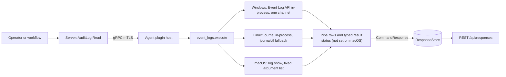
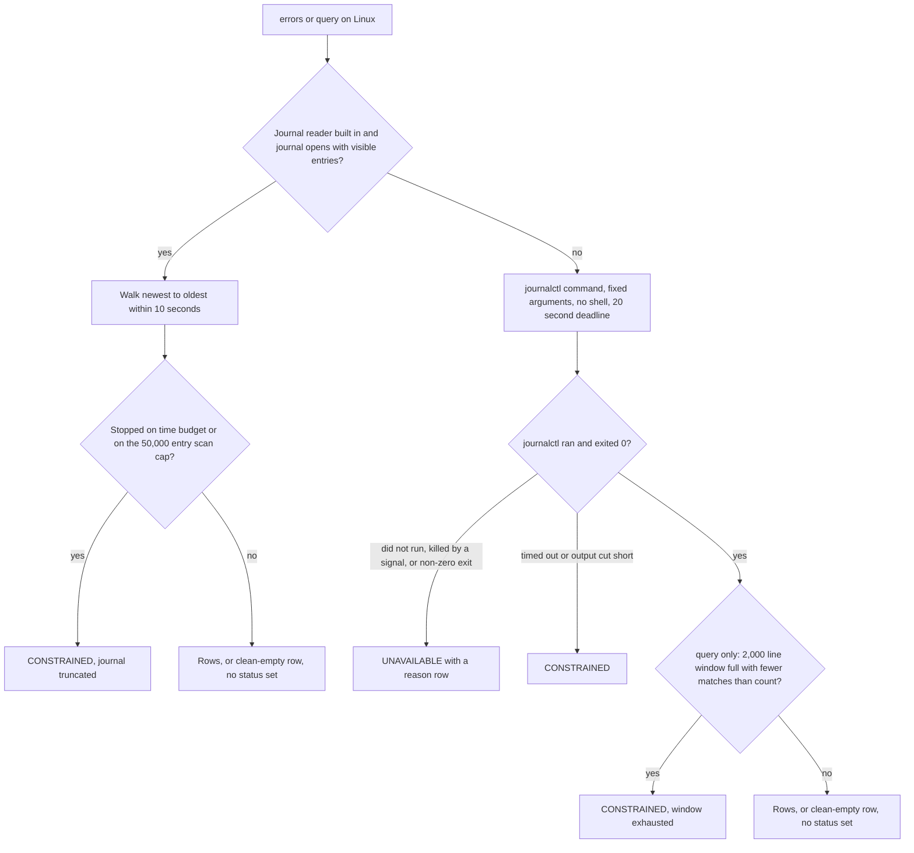
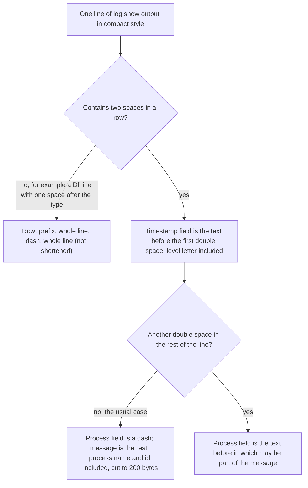

# event_logs

<!-- BEGIN GENERATED: plugin-doc-gen header -->
| | |
|---|---|
| **What it does** | Queries system event logs for errors and filtered events |
| **Version** | 1.1.0 |
| **Kind** | Collector · read-only · gathered (device.event_logs.errors, device.event_logs.query) |
| **Platforms** | Windows ✅ · macOS ✅ · Linux ✅ |
| **Actions** | `errors` (definition `device.event_logs.errors`) · `query` (definition `device.event_logs.query`) |
| **Security** | securable `AuditLog` · operation Read · risk Medium · dispatch ReadOnly · approval gate None |
| **Roles** | execute: endpoint-admin, endpoint-operator · author: content-author |
<!-- END GENERATED -->

## How it works

`event_logs` reads the operating system's event log on the device and changes nothing: nothing is deleted, rotated or acknowledged. `errors` returns recent error-level events, newest 100 at most (on macOS, the first 100 lines of the window, oldest first), from the last `hours` hours (default 24, 1 to 720). `query` returns events whose message contains a keyword, up to `count` of them (default 50, at most 500). Each OS has its own source and its own limits, so the same action does not mean exactly the same thing on every host. Windows reads one named channel (default `System`) in-process through the Event Log API. Linux reads the systemd journal in-process and falls back to a bounded `journalctl` command if the journal cannot be read. macOS runs `log show` against the unified log, with a 10 second deadline.

A read that is refused, times out or is cut short by its bound reports a typed status on Windows and Linux rather than a confident empty result. macOS signals the same conditions only through a sentinel row and a non-zero return code. The `log` parameter selects a channel on Windows only; Linux and macOS accept it and ignore it. Every untrusted field (message text, provider or process name) is escaped before it joins a pipe-delimited row, so log content containing `|` or a line break cannot forge extra columns or rows.



### What you can decide with it

| Question | Action | Windows | macOS | Linux |
|---|---|---|---|---|
| What went wrong on this device recently? | `errors` | The newest 100 events at level Error (not Critical) from the chosen channel in the last `hours` hours | Error-type entries in the last `hours` hours, oldest first, so a busy host shows the start of the window and the cap drops the most recent | The newest 100 entries at priority err or worse (emergency, alert, critical, error) in the last `hours` hours |
| Did anything mention this keyword? | `query` | The newest `count` events of any level in the chosen channel, then matched case-insensitively on message values and provider name. Nothing older than those `count` events is searched | Entries from the last 24 hours (fixed) whose message contains the keyword, **case-sensitively**; at most `count` lines in total, header row included | The newest `count` entries of any priority whose message contains the keyword, case-insensitively; scan bounded to 50,000 entries (native) or the newest 2,000 journal lines (fallback) |
| Is the answer complete? | `errors`, `query` | Any non-clean status (`CONSTRAINED`, `UNAVAILABLE` or `PERMISSION_DENIED`) says it is not. The 100-event cap of `errors` raises no status | Only the sentinel rows and the return code (`timeout`, `permission_denied`, `unavailable`) say it is not; no status is set | A `CONSTRAINED` or `UNAVAILABLE` status says it is not. The 100-entry cap of `errors` raises no status |

Row order differs by OS for both actions: Windows returns newest first, Linux returns oldest first (the newest entries are selected, then reversed), and macOS returns oldest first, as `log show` prints them.

What a clean result proves. Zero rows with no status means the read ran and found nothing inside the bounds above. It does not mean the event never happened: the OS may have rotated or overwritten older entries, and the window, the 100-event cap and the `count` limit all hide older ones. It also says nothing about a different channel or log source, or about entries the agent's account is not allowed to see.

What this plugin cannot answer: anything older than the OS still retains; completeness of an audit trail (the Windows `Security` channel needs an extra privilege, and `query` matches event data values rather than the formatted message); filtering by event ID, level or source; a count of how many events matched beyond the cap; a like-for-like comparison across operating systems, because the row shape, level coverage and ordering differ (below).

Row shape by operating system. Field 0 is always `error` (for `errors`) or `event` (for `query`).

| OS | `errors` row | `query` row | Placeholder row (nothing found or read failed) |
|---|---|---|---|
| Windows | `error\|timestamp\|event_id\|source\|message` | `event\|timestamp\|level\|event_id\|source\|message` | `error\|none\|<text>\|-\|-` and `event\|none\|-\|-\|-\|<text>` |
| Linux | `error\|timestamp\|unit\|message` | `event\|timestamp\|unit\|message` | `error\|none\|-\|<text>` and `event\|none\|-\|<text>` |
| macOS | `error\|<timestamp and level letter>\|<process or ->\|<rest of line>` | the same with `event` | A run with no matches prints only the `log show` header, so the result is the single row `error\|Timestamp\|\|...`; the `none` row is written only if no line at all arrives. Degraded runs add `error\|timeout\|-\|<reason>` (or `permission_denied`, `unavailable`) after any partial rows |

On Windows the message is the event's data values joined by spaces, not the provider's formatted message text, and the timestamp is UTC. On Linux the timestamp is local time with a zone offset and `unit` is the syslog identifier with the process id in brackets, falling back to the systemd unit, then `-`. The macOS rows are not split into clean columns; see the next section.

### Diagrams

#### Linux: which mechanism answers



The journal reader opens only the local journal and never waits for new entries. A reader that can see no entries at all is treated as a denied read, not an empty log, and falls to the `journalctl` command. The `errors` walk stops at 100 entries without any status.

#### macOS: how one `log show` line becomes a row



`log show` prints Error entries as `<date> <time> E  process[pid:tid] ...` (two spaces after the one-letter type), so the timestamp field carries the trailing `E` and the process name stays inside the message. Default-level entries use a two-letter type (`Df`) followed by one space, so they take the whole-line path and the line appears twice in the row. The column header line that `log show` prints first is also converted to a row (`error|Timestamp||...`), and a message that spans several lines produces one extra row per continuation line. The 100-line cap on `errors` (`count` on `query`) includes that header row, and a search with no matches returns the header row alone. In a hand run on macOS 26, `log show` logged its own command line, which contains the keyword, and matched it, so a `query` can return a row from the `log` process itself; treat that as noise.

## OS capability

<!-- BEGIN GENERATED: plugin-doc-gen capability -->
| Action | Windows | macOS | Linux |
|---|---|---|---|
| `errors` | ✅ supported · rung 1 · wevtapi (EvtQuery/EvtRender, Level=2, bounded EvtNext) | ✅ supported · rung 2 · log_show | ✅ supported · rung 1 · sd_journal (bounded local read, PRIORITY<=err) |
| `query` | ✅ supported · rung 1 · wevtapi (EvtQuery/EvtRender, bounded EvtNext) | ✅ supported · rung 2 · log_show | ✅ supported · rung 1 · sd_journal (bounded local read, keyword match) |

**Declared limits per leg** (descriptor fallback text, verbatim):

- **`errors` / macOS** — requires root or a real login session to open the local unified-log data store -- a non-root headless process gets EX_NOPERM/77 regardless of Full Disk Access (docs/darwin-compat.md); no gap in production, which runs as a root LaunchDaemon
- **`errors` / Linux** — falls back to a bounded journalctl argv invocation (rung 2) when libsystemd is compiled out (-Dsystemd_guard) or the journal is unreachable
- **`query` / macOS** — requires root or a real login session to open the local unified-log data store -- a non-root headless process gets EX_NOPERM/77 regardless of Full Disk Access (docs/darwin-compat.md); no gap in production, which runs as a root LaunchDaemon
- **`query` / Linux** — falls back to a bounded journalctl argv invocation (rung 2) when libsystemd is compiled out (-Dsystemd_guard) or the journal is unreachable
<!-- END GENERATED -->

## Privileges and prerequisites

| OS | Runs as | Extra grant needed | Measured | If the read is refused |
|---|---|---|---|---|
| Windows | agent service account (LocalSystem today; the packaged service has not yet moved to the virtual service account) | `Event Log Readers` group; the `Security` channel additionally needs `SeSecurityPrivilege` | 2026-09-07 on bare-metal Windows 10.0.26200 as `SYSTEM` | `PERMISSION_DENIED`, message "Cannot access the event log channel (requires elevated privileges)" |
| macOS | agent daemon; production runs as a root LaunchDaemon (`docs/agent-privilege-model.md`) | none for root; a non-root process outside a login session cannot open the log store at all | 2026-09-07 on bare-metal macOS 26.6.2 at euid 501 in a login session, not as the root daemon | `log show` exits 77; the output ends in an `error\|permission_denied\|-\|...` row and the return code is 1; no typed result status is set |
| Linux | agent daemon, dedicated unprivileged account (`yuzu-agent` on the packaged unit) | `systemd-journal` group, a world-readable journal, or (packaged unit) the agent's ambient `CAP_DAC_READ_SEARCH`, which bypasses the journal's group-only read permission (not measured for this plugin) | 2026-09-06 in a container as euid 0, which exercised neither Linux mechanism (Caveat 4) | native reader sees no entries and falls through to `journalctl`. The fallback is expected to report `UNAVAILABLE` with the reason when `journalctl` fails (for example "journalctl did not run"); a refused read has not been measured outside a container. The fallback runs `journalctl -q`, so if it exits 0 with no entries the answer is "No error events found" (or the `query` equivalent) with no status set |

Subprocesses and network: none on Windows and none on the Linux native reader (both read in-process). The Linux fallback runs `/usr/bin/journalctl` with a fixed argument list and no shell, and macOS runs `/usr/bin/log show` the same way, both through the bounded subprocess runner. No network access on any leg.

## Data contract

### Inputs

<!-- BEGIN GENERATED: plugin-doc-gen inputs -->
| Definition | Parameter | Type | Required | Default | Constraints | Description |
|---|---|---|---|---|---|---|
| `device.event_logs.errors` | `log` | string | no | System | maxLength 128 | The event log to query, e.g. "System" or "Application". Windows only — the value is accepted but has no effect on Linux/macOS, which always read the system journal / unified log. Default: "System". |
| `device.event_logs.errors` | `hours` | int32 | no | 24 | minimum 1 · maximum 720 | Number of hours to look back for error events, e.g. 24 or 168. Range: 1-720 (30 days). Default: 24. Out-of-range values are rejected with a 400 by POST /api/instructions/{id}/execute. |
| `device.event_logs.query` | `log` | string | yes | - | minLength 1 · maxLength 128 | The event log to search, e.g. "System" or "Application". On Windows this selects the channel; on Linux/macOS the value is accepted but does not select a log (both always read the journal / unified log). |
| `device.event_logs.query` | `filter` | string | yes | - | minLength 1 · maxLength 256 | Keyword to search for in event messages, e.g. "error" or "disk-warning". Case-insensitive substring match. Only alphanumeric characters, spaces, dots, hyphens, underscores, and slashes are allowed. |
| `device.event_logs.query` | `count` | int32 | no | 50 | minimum 1 · maximum 500 | Maximum number of recent events EXAMINED for a match on Windows (the filter is applied within that window); the maximum number of matches returned on Linux and macOS. Range: 1-500. Default: 50. Out-of-range values are rejected with a 400 by POST /api/instructions/{id}/execute. |
<!-- END GENERATED -->

### Outputs

Pipe-delimited rows, one per event; field 0 is a literal discriminator (`error` or `event`). **The row shape differs by OS**, not only by action, as the table under "What you can decide with it" shows: Windows carries `event_id` and `source` (and `level` for `query`), Linux collapses them into one `unit` field, and macOS has no clean process column at all. A missing value renders `-`, except the macOS header row, which has an empty process field. The message is cut to 200 bytes at a UTF-8 character boundary, so a non-ASCII message can be shorter than 200 characters; the macOS whole-line fallback row is not cut. A placeholder row has `none` in field 1 and carries its explanation in the text; on Windows and Linux a typed status accompanies it and is the authoritative signal.

<!-- BEGIN GENERATED: plugin-doc-gen outputs -->
**`device.event_logs.errors` — `timestamp|event_id|source|message`**

| Field | Type | Values | Available | Example | Description |
|---|---|---|---|---|---|
| `timestamp` | string | - | Windows, Linux, macOS | `2026-09-06T14:55:55.0521384Z` | Event timestamp. Full-precision UTC ISO-8601 on Windows; local short-iso time on Linux; the `log show --style compact` column timestamp on macOS. Values: free text. |
| `event_id` | string | - | Windows | `6008` | Windows numeric Event ID. Not populated on Linux or macOS. Values: integer. |
| `source` | string | - | Windows | `EventLog` | Windows event provider name. Not populated on Linux or macOS — those legs report a journal unit or process name in this row position instead, which is a different field outside this schema. Values: free text. |
| `message` | string | - | Windows, Linux, macOS | `16:11:31 ‎05/‎09/‎2026 105614` | Event message text, truncated to 200 bytes at a UTF-8 character boundary. Values: free text. |

**`device.event_logs.query` — `timestamp|level|event_id|source|message`**

| Field | Type | Values | Available | Example | Description |
|---|---|---|---|---|---|
| `timestamp` | string | - | Windows, Linux, macOS | `2026-09-06 10:55:53.560` | Event timestamp. Full-precision UTC ISO-8601 on Windows; local short-iso time on Linux; the `log show --style compact` column timestamp on macOS. Values: free text. |
| `level` | string | - | Windows | `not observed in any capture (the Windows query run matched no rows)` | Windows event level display name derived from the numeric `<Level>`. Not populated on Linux or macOS. Values: Critical, Error, Warning, Information, Verbose, or Level<n> for an unmapped numeric level. |
| `event_id` | string | - | Windows | `6008 (from the errors sample; the query run matched no rows)` | Windows numeric Event ID. Not populated on Linux or macOS. Values: integer. |
| `source` | string | - | Windows | `Kernel-General` | Windows event provider name. Not populated on Linux or macOS — those legs report a journal unit or process name in this row position instead, which is a different field outside this schema. Values: free text. |
| `message` | string | - | Windows, Linux, macOS | `2026-09-06 10:55:53.560 Df WeatherWidget[977:d9fa44] [com.apple.weather:WidgetRefresh] About to compute error refresh policy. (5 min to next refresh).` | Matched event message text, truncated to 200 bytes at a UTF-8 character boundary. The `filter` keyword is matched against this field (and the provider name, on Windows). Values: free text. |
<!-- END GENERATED -->

### Result status

| Status | Completeness | Provenance | When |
|---|---|---|---|
| `PERMISSION_DENIED` | PARTIAL | `event_logs_win:access_denied` | Windows: the channel query is refused (access denied) |
| `UNAVAILABLE` | PARTIAL | `event_logs_win:channel_not_found` | Windows: the channel does not exist |
| `CONSTRAINED` | PARTIAL | `event_logs_win:evt_next_timeout` | Windows: the Event Log service does not answer within 10 seconds mid-query |
| `UNAVAILABLE` | PARTIAL | `event_logs_win:evt_query_failed` | Windows: any other query failure, including every returned event failing to render |
| `CONSTRAINED` | PARTIAL | `event_logs_win:count_window_full` | Windows `query`: the `count` events examined were all read, so older events were not searched |
| `CONSTRAINED` | PARTIAL | `event_logs_journal:errors_truncated`, `event_logs_journal:query_truncated` | Linux native reader: stopped on its 10 second budget, its 50,000-entry scan cap (`query`), or a read error after some entries |
| `UNAVAILABLE` | PARTIAL | `event_logs_journalctl:errors_unavailable`, `event_logs_journalctl:query_unavailable` | Linux fallback: `journalctl` did not run, was killed by a signal, or exited non-zero |
| `CONSTRAINED` | PARTIAL | the same two `event_logs_journalctl` tokens | Linux fallback: timed out at 20 seconds, its output was cut short, or (`query`) the 2,000-line window filled with fewer than `count` matches |
| *(none set)* | - | - | Windows and Linux clean success, **and** the 100-event cap of `errors` on every OS; **macOS never sets a status on any path**, so the agent records `UNDECLARED`/`UNKNOWN` |

### Where the data goes

- **Instruction result only.** Rows travel over the agent's mTLS gRPC channel as the command response and land in the ResponseStore (90-day default retention; the definitions carry no override), queryable at `/api/responses/{id}` and aggregatable (`errors` groups by `source`, `query` by `level` and `source`, both meaningful on Windows only).
- **Not consumed by** daily-sync inventory, the Echo warehouse, DEX or metrics. `event_logs` is among the plugins whose results the legacy dashboard row renderer shows as generic `Agent|Key|Value` pairs rather than a fixed column set, which fits the per-OS row shapes above.
- **Sensitivity.** `message` is raw log text and can carry user names, host names or other identifying content depending on what the OS logged; the Windows `source` and the Linux `unit` can name installed software or services. These rows are the least predictable in the catalogue for what they may disclose.
- **Siblings:** none expose a general event-log query. The `users` and `echo` plugins read specific Windows event channels internally (`users_plugin.cpp`, `echo_netconn_win.cpp`), and the agent daemon reads the Linux journal for its own use (`agents/core/src/dex_linux_journal.cpp`); none of those return event-log rows to an operator.
- **MCP / REST.** Discover: `discover_plugins` (summary) → `yuzu://plugin-docs` (this page as data) → `discover_instructions` / `get_definition("device.event_logs.errors")`. Run: `execute_instruction {definition_id, parameters}`. Read: `/api/responses/{id}`.

## Sample output

<!-- BEGIN GENERATED: plugin-doc-gen samples -->
**Windows** — captured: windows Microsoft Windows NT 10.0.26200.0 x64 · bare-metal · 2026-09-07 · SYSTEM · leg-hash 81838b2b5566

```
== action=errors
error|2026-09-06T14:55:55.0521384Z|6008|EventLog|16:11:31 ‎05/‎09/‎2026 105614
[result_status] UNDECLARED / UNKNOWN

== action=query log=System filter=error
event|none|-|-|-|No match within the newest events examined (count window full; older events not searched)
[result_status] CONSTRAINED / PARTIAL / event_logs_win:count_window_full
```

**macOS** — captured: macos macOS 26.6.2 arm64 · bare-metal · 2026-09-07 · euid 501 (jsmith) · leg-hash 81838b2b5566

```
== action=errors
error|Timestamp||           Ty Process[PID:TID]
error|2026-09-06 10:55:53.370 E|-|chronod[704:da8004] [com.apple.chrono:location] [ext:com.apple.weather::com.apple.weather.widget] failed to acquire new underlying visibility assertion
error|2026-09-06 10:55:53.370 E|-|chronod[704:da8004] [com.apple.chrono:location] [ext:com.apple.weather::com.apple.weather.widget] failed to acquire new underlying activity assertion
error|2026-09-06 10:55:53.668 E|-|chronod[704:da8004] [com.apple.chrono:location] [ext:com.apple.weather::com.apple.weather.widget] failed to acquire new underlying visibility assertion
error|2026-09-06 10:56:10.400 E|-|contactsd[85796:da8129] [com.apple.accounts:core] "Remote account store returned fatal error: Error Domain=NSCocoaErrorDomain Code=4099 "The connection to service named com.apple.accountsd.accountmana
error|2026-09-06 10:56:10.400 E|-|contactsd[85796:da8129] [com.apple.accounts:core] "Remote account store returned fatal error: Error Domain=NSCocoaErrorDomain Code=4099 "The connection to service named com.apple.accountsd.accountmana
error|2026-09-06 10:56:10.407 E|-|contactsd[85795:da812b] [com.apple.accounts:core] "Remote account store returned fatal error: Error Domain=NSCocoaErrorDomain Code=4099 "The connection to service named com.apple.accountsd.accountmana
error|2026-09-06 10:56:10.407 E|-|contactsd[85797:da8128] [com.apple.accounts:core] "Remote account store returned fatal error: Error Domain=NSCocoaErrorDomain Code=4099 "The connection to service named com.apple.accountsd.accountmana
error|2026-09-06 10:56:10.410 E|-|contactsd[85799:da812c] [com.apple.accounts:core] "Remote account store returned fatal error: Error Domain=NSCocoaErrorDomain Code=4099 "The connection to service named com.apple.accountsd.accountmana
error|2026-09-06 10:56:10.411 E|-|contactsd[85798:da812a] [com.apple.accounts:core] "Remote account store returned fatal error: Error Domain=NSCocoaErrorDomain Code=4099 "The connection to service named com.apple.accountsd.accountmana
error|2026-09-06 10:56:10.411 E|-|contactsd[85794:da8127] [com.apple.accounts:core] "Remote account store returned fatal error: Error Domain=NSCocoaErrorDomain Code=4099 "The connection to service named com.apple.accountsd.accountmana
error|2026-09-06 10:56:10.412 E|-|contactsd[85796:da812f] [com.apple.accounts:core] "Remote account store returned fatal error: Error Domain=NSCocoaErrorDomain Code=4099 "The connection to service named com.apple.accountsd.accountmana
… 12 of 100 rows shown
[result_status] UNDECLARED / UNKNOWN

== action=query log=system filter=error
event|Timestamp||           Ty Process[PID:TID]
event|2026-09-06 10:55:53.560 Df WeatherWidget[977:d9fa44] [com.apple.weather:WidgetRefresh] Location state is not fresh; returning error refresh policy; state=stale|-|2026-09-06 10:55:53.560 Df WeatherWidget[977:d9fa44] [com.apple.weather:WidgetRefresh] Location state is not fresh; returning error refresh policy; state=stale
event|2026-09-06 10:55:53.560 Df WeatherWidget[977:d9fa44] [com.apple.weather:WidgetRefresh] About to compute error refresh policy. (5 min to next refresh).|-|2026-09-06 10:55:53.560 Df WeatherWidget[977:d9fa44] [com.apple.weather:WidgetRefresh] About to compute error refresh policy. (5 min to next refresh).
event|2026-09-06 10:56:10.400 E|-|contactsd[85796:da8129] [com.apple.accounts:core] "Remote account store returned fatal error: Error Domain=NSCocoaErrorDomain Code=4099 "The connection to service named com.apple.accountsd.accountmana
event|2026-09-06 10:56:10.400 E|-|contactsd[85796:da8129] [com.apple.accounts:core] "Remote account store returned fatal error: Error Domain=NSCocoaErrorDomain Code=4099 "The connection to service named com.apple.accountsd.accountmana
event|2026-09-06 10:56:10.407 E|-|contactsd[85795:da812b] [com.apple.accounts:core] "Remote account store returned fatal error: Error Domain=NSCocoaErrorDomain Code=4099 "The connection to service named com.apple.accountsd.accountmana
event|2026-09-06 10:56:10.407 E|-|contactsd[85797:da8128] [com.apple.accounts:core] "Remote account store returned fatal error: Error Domain=NSCocoaErrorDomain Code=4099 "The connection to service named com.apple.accountsd.accountmana
event|2026-09-06 10:56:10.410 E|-|contactsd[85799:da812c] [com.apple.accounts:core] "Remote account store returned fatal error: Error Domain=NSCocoaErrorDomain Code=4099 "The connection to service named com.apple.accountsd.accountmana
event|2026-09-06 10:56:10.411 E|-|contactsd[85798:da812a] [com.apple.accounts:core] "Remote account store returned fatal error: Error Domain=NSCocoaErrorDomain Code=4099 "The connection to service named com.apple.accountsd.accountmana
event|2026-09-06 10:56:10.411 E|-|contactsd[85794:da8127] [com.apple.accounts:core] "Remote account store returned fatal error: Error Domain=NSCocoaErrorDomain Code=4099 "The connection to service named com.apple.accountsd.accountmana
event|2026-09-06 10:56:10.412 E|-|contactsd[85796:da812f] [com.apple.accounts:core] "Remote account store returned fatal error: Error Domain=NSCocoaErrorDomain Code=4099 "The connection to service named com.apple.accountsd.accountmana
event|2026-09-06 10:56:10.413 E|-|contactsd[85796:da812f] [com.apple.accounts:core] "Remote account store returned fatal error: Error Domain=NSCocoaErrorDomain Code=4099 "The connection to service named com.apple.accountsd.accountmana
… 12 of 50 rows shown
[result_status] UNDECLARED / UNKNOWN
```

**Linux** — captured: linux Debian GNU/Linux 13 (trixie) aarch64 · container · 2026-09-06 · euid 0 · leg-hash 81838b2b5566

```
== action=errors
error|none|-|journalctl did not run
[result_status] UNAVAILABLE / PARTIAL / event_logs_journalctl:errors_unavailable

== action=query log=system filter=error
event|none|-|journalctl did not run
[result_status] UNAVAILABLE / PARTIAL / event_logs_journalctl:query_unavailable
```
<!-- END GENERATED -->

## Caveats and known gaps

1. **macOS rows are not split into the documented columns.** The timestamp field carries the trailing level letter (`2026-09-06 10:55:53.370 E`), the process field is `-` and the process name and id stay inside the message, `Df` lines come back as a whole-line row with the text repeated, the `log show` column header is returned as the first row, and multi-line messages add one row per continuation line. `log show` also prints oldest first, so when the 100-line cap bites `errors` keeps the oldest part of the window, and the cap includes the header, so at most 99 events come back (`count` minus one for `query`).
2. **macOS `query` differs from the other legs and sets no status.** Its keyword match is case-sensitive (checked by hand: `error` does not match `ERROR`), although the parameter text says case-insensitive, and its window is a fixed 24 hours. Degradation shows only as a `timeout`, `permission_denied` or `unavailable` row plus return code 1, so a consumer must read the rows, not the status, to tell a partial macOS result from a complete one.
3. **The caps are silent.** `errors` returns at most 100 events on every OS and sets no status when it reaches them, so a busy host looks complete; on Windows `query` examines only the newest `count` events (at most 500) and says so only through `count_window_full`. Bounds that do raise a status are the 10 second journal budget, the 50,000-entry native scan cap, and the fallback's 20 second deadline and 2,000-line window.
4. **The Linux capture did not exercise either mechanism.** In the container capture both actions ended `UNAVAILABLE` ("journalctl did not run"), so the sample shows neither the native journal reader nor a working `journalctl` returning rows. A caller outside the `systemd-journal` group and without `CAP_DAC_READ_SEARCH` can open the journal and see no entries; the reader treats that as a denied read and falls through to the fallback instead of reporting an empty log.
5. **Windows differences to know before automating.** The message column is the event's data values joined by spaces, not the provider's formatted text, so a rule that matches message wording from older releases no longer matches; match on event ID and provider. `errors` covers level Error only, not Critical, and `query` also matches on the provider name.

## Source and tests

<!-- BEGIN GENERATED: plugin-doc-gen source -->
- Plugin: `agents/plugins/event_logs/src/event_logs_journal.hpp` · `agents/plugins/event_logs/src/event_logs_journalctl.hpp` · `agents/plugins/event_logs/src/event_logs_macos.hpp` · `agents/plugins/event_logs/src/event_logs_parsers.hpp` · `agents/plugins/event_logs/src/event_logs_plugin.cpp`
- Definitions: `content/definitions/event_logs.yaml`
- Capability rows: `server/core/src/capability_decls/plugin_action_catalogue_d.hpp`
- Tests: `tests/unit/test_event_logs_journalctl.cpp` · `tests/unit/test_event_logs_macos.cpp` · `tests/unit/test_event_logs_parsers.cpp` · `tests/unit/test_event_logs_posix_actions.cpp` · `tests/unit/test_event_logs_win_actions.cpp`
- Privilege row: `docs/agent-privilege-model.md`
<!-- END GENERATED -->
