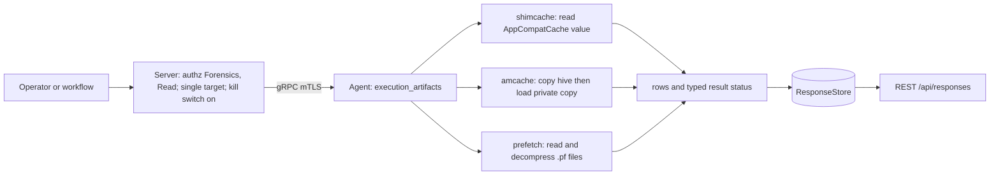
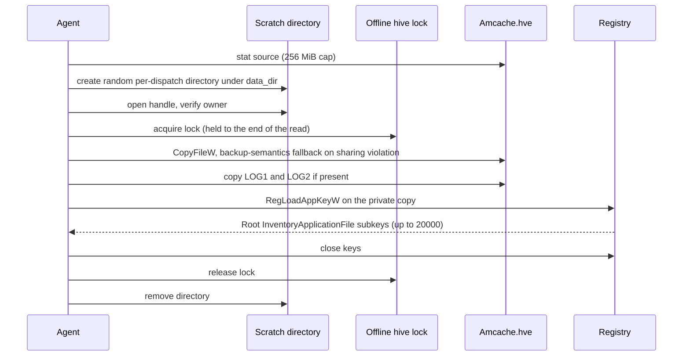
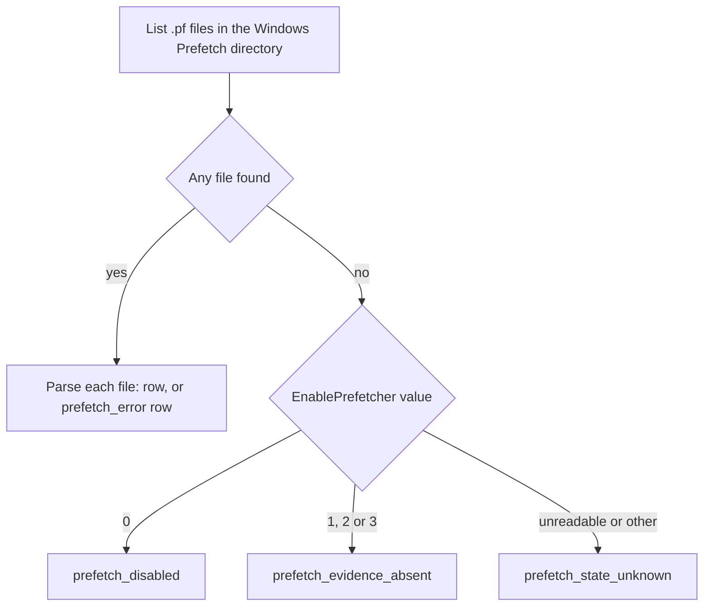

# execution_artifacts

<!-- BEGIN GENERATED: plugin-doc-gen header -->
| | |
|---|---|
| **What it does** | Windows execution-evidence sources: ShimCache, Amcache InventoryApplicationFile, and Prefetch. Forensics-gated, single-target, default-off |
| **Version** | 1.0.0 |
| **Kind** | Collector · read-only · gathered (windows.execution_artifacts.shimcache, windows.execution_artifacts.amcache, windows.execution_artifacts.prefetch) |
| **Platforms** | Windows ✅ · macOS ⛔ unsupported · Linux ⛔ unsupported |
| **Actions** | `amcache` (definition `windows.execution_artifacts.amcache`) · `prefetch` (definition `windows.execution_artifacts.prefetch`) · `shimcache` (definition `windows.execution_artifacts.shimcache`) |
| **Security** | securable `Forensics` · operation Read · risk High · dispatch ReadOnly · approval gate AdminOrApproval |
| **Roles** | execute: admin · author: content-author |
<!-- END GENERATED -->

## How it works

Three independent, read-only actions read Windows execution-evidence sources on one named device; a failure in one never affects the others. `shimcache` reads the `AppCompatCache` value under `HKLM\SYSTEM\CurrentControlSet\Control\Session Manager` (up to 16 MiB) and decodes the Windows 10/11 layout into one row per cached executable path with its cached last-modified time and size. `amcache` copies `C:\Windows\appcompat\Programs\Amcache.hve` (and its `.LOG1` / `.LOG2` sidecars when present) into a private scratch directory, loads the copy as a private read-only registry hive, and turns every `Root\InventoryApplicationFile` entry into a row of path, SHA-1, size, link date, publisher, binary type and product identity. `prefetch` lists `C:\Windows\Prefetch\*.pf`, decompresses each file with the built-in Windows decompressor, and parses it into executable name, hash, run count, up to eight last-run timestamps and volume and file-reference counts.

Every source is bounded (file counts, byte totals, subkey counts) and a source that cannot be read completely says so with a named reason instead of returning an empty success. Only paths, hashes and timestamps are read; file contents are never read or emitted. The plugin starts no process and makes no network call. Each action is authorised at `Forensics:Read` with an administrator-or-approval gate, accepts one explicit target only, and stays refused until an operator enables the plugin's server-side kill switch.



### What you can decide with it

All three actions answer one question on one Windows device: what executables does Windows have a record of, and where did that record come from. They do not answer it on macOS or Linux, where each action returns a single `unsupported` row with provenance `windows_only_artefact`.

| Source | What a row means | What it does not prove | Reading an empty or partial result |
|---|---|---|---|
| `shimcache` | Windows cached this executable path with its file last-modified time and size. `insert_flag` is always `-`: the Windows 10/11 layout has no execution-confirmation bit. | That the file ever ran, or when. The timestamp is a file time, not a run time. | Zero rows is reported as `constrained` (`shimcache_empty`), never as success. Older Windows layouts report `unknown_version`. |
| `amcache` | Windows' application-compatibility inventory recorded this file, with its SHA-1 and product identity. | That the file ran. Some entries legitimately carry only a SHA-1 and blank fields. | A copy, load or enumeration failure reports `constrained` with a named reason. |
| `prefetch` | A prefetch file exists for this executable, with a run count and up to eight last-run times. This is the most direct of the three for "it ran, how often, when". | Anything about the executable when prefetching is off or the files were deleted. | No files is classified: `prefetch_disabled` (prefetching configured off), `prefetch_evidence_absent` (configured on, no files: consistent with removal, not proof of it) or `prefetch_state_unknown`. |

Use `prefetch` for "did it run and when", `amcache` for "which binary (by SHA-1) was present, and `shimcache` for the executable paths Windows cached. Agreement across sources raises confidence; presence in one source alone is a lead, not a finding. A clean result is never "nothing ran": it means the source held no entries or could not show them, and the status tells you which.

### Diagrams

#### Amcache acquisition



The registry never loads the live hive; only a private copy in a fresh, random-named directory is loaded. One process-wide lock serialises everything that loads an offline hive, so the copy, load, enumeration and close happen under a single hold. The scratch directory is removed on every exit path, and a sweep at agent start and before each `amcache` dispatch reclaims directories a crashed run left behind.

#### Why prefetch can be empty



An empty prefetch directory is not one answer. Prefetching configured off explains it; configured on with no files is consistent with files having been removed afterward, but the SysMain service state is not consulted, so it is a lead rather than proof; and an unreadable setting stays unknown. A failed registry read never blocks the action.

## OS capability

<!-- BEGIN GENERATED: plugin-doc-gen capability -->
| Action | Windows | macOS | Linux |
|---|---|---|---|
| `amcache` | 🟡 constrained · rung 1 · copy Amcache.hve(+.LOG1/.LOG2) then RegLoadAppKeyW; whole sequence serialised by offline_hive_mutex | ⛔ unsupported | ⛔ unsupported |
| `prefetch` | ✅ supported · rung 1 · CreateFileW read + ntdll RtlGetCompressionWorkSpaceSize/RtlDecompressBufferEx(COMPRESSION_FORMAT_XPRESS_HUFF) | ⛔ unsupported | ⛔ unsupported |
| `shimcache` | ✅ supported · rung 1 · RegQueryValueExW HKLM\\SYSTEM\\CurrentControlSet\\Control\\Session Manager\\AppCompatCache (local bounded reader, 16 MiB) | ⛔ unsupported | ⛔ unsupported |

**Declared limits per leg** (descriptor fallback text, verbatim):

- **`amcache` / Windows** — A1's the-rig probe (2026-09-06) found the copy succeeds as a PLAIN Copy-Item in every session tested (admin and LocalSystem) — the sharing violation that would require CreateFile(FILE_SHARE_READ|WRITE|DELETE, FILE_FLAG_BACKUP_SEMANTICS) + SeBackupPrivilege was never hit, so that fallback path is unexercised on this hardware. RegLoadAppKeyW does NOT require SeBackupPrivilege: it succeeded (LSTATUS 0x00000000) with the privilege explicitly disabled via AdjustTokenPrivileges, in both the admin session and under LocalSystem, against all 8889 real InventoryApplicationFile subkeys. Reported CONSTRAINED because the plain-copy path is a best-effort acquisition method not guaranteed on every host (a locked/exclusively-held hive on another machine could still need the backup-semantics fallback), not because anything failed on the probe host
- **`amcache` / macOS** — Windows-only artefact; no equivalent exists
- **`amcache` / Linux** — Windows-only artefact; no equivalent exists
- **`prefetch` / Windows** — A1's the-rig LocalSystem probe (2026-09-06): GetProcAddress resolved both ntdll entry points to non-null addresses in every session (admin and LocalSystem); all four decompression attempts across the three real MAM .pf captures returned NTSTATUS 0x00000000 (STATUS_SUCCESS) from both RtlGetCompressionWorkSpaceSize (workspace size 166495 bytes, format COMPRESSION_FORMAT_XPRESS_HUFF, engine standard) and RtlDecompressBufferEx, with every decompressed payload's bytes 4-7 reading 'SCCA'. Real captures parsed as prefetch format version 31 (Windows 10/11), not version 30 as originally planned — see execution_artifacts_parsers.hpp's file header
- **`prefetch` / macOS** — Windows-only artefact; no equivalent exists
- **`prefetch` / Linux** — Windows-only artefact; no equivalent exists
- **`shimcache` / Windows** — Windows 10/11 layout only ('win10' header scheme, DWORD 0x34 or 0x30); no exec-flag bit exists in this layout, so every row's insert_flag is '-'. A1's real capture (the-rig, 2026-09-06) was 7886 bytes, well under the 16 MiB bound, and parsed with the header-size DWORD reading 0x34
- **`shimcache` / macOS** — Windows-only artefact; no equivalent exists
- **`shimcache` / Linux** — Windows-only artefact; no equivalent exists
<!-- END GENERATED -->

## Privileges and prerequisites

| OS | Runs as | Extra grant needed | Measured | If the read is refused |
|---|---|---|---|---|
| Windows | agent service account (LocalSystem today, `docs/agent-privilege-model.md`) | None known. `shimcache` is a bounded `HKLM` value read and `prefetch` a directory listing plus per-file reads under `C:\Windows\Prefetch`. `amcache` loads its private copy with `RegLoadAppKeyW`, which did not need `SeBackupPrivilege`; a backup-semantics copy is attempted only when the plain copy hits a sharing violation, and takes no privilege beyond what the service account can already request. | Probed in an administrator session and as LocalSystem on one workstation: the plain copy always succeeded and the private load succeeded with the privilege disabled. Not measured under a least-privilege service account, and the backup-semantics fallback has never been exercised on real hardware. | `constrained` with a named reason (`reg_<code>`, `hive_locked`, `regload_<code>`, `subkey_open_failed`, and so on). The tokens do not separate "access denied" from "not found" or "vanished mid-walk": a refused open and a missing key report through the same per-source token family. |
| macOS | n/a - the plugin loads but reads nothing | n/a | n/a - no macOS mechanism exists | Every action returns `unsupported` with provenance `windows_only_artefact` and rc 1 |
| Linux | n/a - the plugin loads but reads nothing | n/a | n/a - no Linux mechanism exists | Every action returns `unsupported` with provenance `windows_only_artefact` and rc 1 |

No external binaries, no subprocesses and no network access: every call is an in-process Win32 registry or file call, or an in-process `ntdll` decompression call. The plugin performs no authorization of its own. `Forensics:Read`, the administrator-or-approval gate and single-target enforcement live at the server dispatch layer, and the server-side plugin-config kill switch (`PluginConfigStore::seed_kill_switch_default_off`) keeps every action refused until an operator enables it.

## Data contract

### Inputs

<!-- BEGIN GENERATED: plugin-doc-gen inputs -->
No action takes parameters.
<!-- END GENERATED -->

### Outputs

Pipe-delimited rows, one discriminator-prefixed row per artefact entry (`shimcache|...`, `amcache|...`, `prefetch|...`); every untrusted string field is escaped through `safe_output_field`. A source that fails outright emits no data row, only `constrained|<token>`, and sets the matching typed status. `shimcache` is all or nothing: any decode failure in the blob is that single `constrained` row. `amcache` and `prefetch` read entry by entry. `prefetch` emits one `prefetch_error|<file>|<reason>` row per skipped file and, when a cap or an enumeration fault truncated the walk, a closing `constrained|<reason>` row. `amcache` folds per-entry failures into the typed status only (see Caveats). `amcache` adds `note|malformed_fileid_count=<n>` when a `FileId` could not be normalised to a 40-hex SHA-1 and `note|temp_cleanup_failed` when its scratch directory could not be removed; `note|` lines are diagnostics, not data, and a consumer of `amcache|` rows skips any line without that prefix. `shimcache`'s `insert_flag` is always `-`; every other field is the decoded value, or `-` when that field could not be read.

<!-- BEGIN GENERATED: plugin-doc-gen outputs -->
**`windows.execution_artifacts.amcache` — `lower_case_long_path|sha1|size|link_date|publisher|binary_type|product_name|product_version`**

| Field | Type | Values | Available | Example | Description |
|---|---|---|---|---|---|
| `lower_case_long_path` | string | - | Windows | `c:/program files/app/app.exe` | Lower-cased full executable path from the InventoryApplicationFile subkey, escaped. |
| `sha1` | string | - | Windows | `da39a3ee5e6b4b0d3255bfef95601890afd80709` | Normalised 40-hex-character SHA-1 from the subkey's FileId; "-" when absent or malformed. |
| `size` | string | - | Windows | `2048576` | File size as recorded by Amcache (raw string form, not re-parsed). |
| `link_date` | string | - | Windows | `01/02/2026 03:04:05` | Linker timestamp as recorded by Amcache. |
| `publisher` | string | - | Windows | `Example Corp` | Publisher string as recorded by Amcache, escaped. |
| `binary_type` | string | - | Windows | `pe32_amd64` | Binary type as recorded by Amcache. |
| `product_name` | string | - | Windows | `Example App` | Product name as recorded by Amcache, escaped. |
| `product_version` | string | - | Windows | `1.2.3.4` | Product version as recorded by Amcache. |

**`windows.execution_artifacts.prefetch` — `exe_name|hash_hex|version|run_count|last_runs_epoch_ms|volume_count|file_ref_count`**

| Field | Type | Values | Available | Example | Description |
|---|---|---|---|---|---|
| `exe_name` | string | - | Windows | `NOTEPAD.EXE` | Executable name recorded in the Prefetch file's header, escaped. |
| `hash_hex` | string | - | Windows | `DDFD0A8D` | 8-uppercase-hex-digit Prefetch hash from the filename/header. |
| `version` | int32 | - | Windows | `31` | Prefetch format version; only 23, 26, 30 and 31 decode — see Caveats. |
| `run_count` | int64 | - | Windows | `42` | Recorded run count. |
| `last_runs_epoch_ms` | string | - | Windows | `1690000000000,1689999999000` | Comma-separated last-run timestamps (up to 8 on versions 26/30/31, 1 on version 23), epoch milliseconds. |
| `volume_count` | int64 | - | Windows | `1` | Number of volume entries in the file-information block. |
| `file_ref_count` | int64 | - | Windows | `12` | Total number of NTFS file references, summed across every declared volume entry in the file-information block (not just the first). |

**`windows.execution_artifacts.shimcache` — `path|last_modified_epoch_ms|data_size|insert_flag`**

| Field | Type | Values | Available | Example | Description |
|---|---|---|---|---|---|
| `path` | string | - | Windows | `C:/Windows/System32/notepad.exe` | Executable path recorded in the AppCompatCache entry, escaped. |
| `last_modified_epoch_ms` | int64 | - | Windows | `1690000000000` | Cached last-modified timestamp from the entry, epoch milliseconds. |
| `data_size` | int64 | - | Windows | `175616` | Cached file size in bytes, from the entry. |
| `insert_flag` | string | `-` | Windows | `-` | Always "-": the Windows 10/11 AppCompatCache layout this plugin decodes carries no execution-confirmation bit. |
<!-- END GENERATED -->

### Result status

| Status | Completeness | Provenance | When |
|---|---|---|---|
| `OK` | full | *(empty)* | `shimcache`: the AppCompatCache value opened, read within the 16 MiB bound, and parsed to at least one row. `amcache`: every enumerated subkey and value read cleanly, no cap hit. `prefetch`: every `.pf` file was enumerated, read, decompressed and parsed with no per-file error and no cap hit. |
| `OK` | partial | `file_oversized` · `read_failed` · `ntdll_symbol_missing` · `ntstatus_<hex>` · `bad_magic` · `truncated_header` · `unknown_version` · `truncated_entry` · `oversize_count` · `bad_path_length` (comma-joined when several fire) | `prefetch` only: the directory enumeration completed in full but one or more individual `.pf` files failed to open, read, decompress or parse; each failed file is already on the stream as its own `prefetch_error\|<file>\|<reason>` row, so the run is reported as a degraded success rather than a failure — one truncated file must never fail every other good row. |
| `CONSTRAINED` | partial | `shimcache`: `reg_<code>` · `oversized` · `reg_changed_during_read` · `shimcache_empty` · `bad_magic` · `truncated_header` · `unknown_version` · `truncated_entry` · `oversize_count` · `bad_path_length` · `internal_error`. `amcache`: `data_dir_unset` · `dest_dir_create_<code>` · `dest_dir_open_<code>` · `dest_dir_acl` · `hive_missing` · `hive_oversized` · `hive_locked` · `win32_<code>` · `hive_short_write` · `regload_<code>` · `amcache_root_missing` · `subkey_cap` · `enum_<code>` · `subkey_open_failed` · `value_enum_incomplete` · `value_read_failed` · `amcache_empty` · `internal_error` (comma-joined; `amcache_empty` is always listed together with any other accumulated reason, never alone when a real cause is known). `prefetch`: `prefetch_disabled` · `prefetch_evidence_absent` · `prefetch_state_unknown` · `prefetch_enum_<code>` · `file_cap` · `byte_cap` · `internal_error` (plus any of the `OK`/partial per-file tokens above, accumulated alongside a cap). | `shimcache`: the key/value could not be opened or read, the blob exceeded the 16 MiB cap, changed mid-read, parsed to zero rows, failed header parsing, or an unexpected exception was caught. `amcache`: `agent.data_dir` was never configured for this host (`data_dir_unset`); its per-dispatch random scratch directory could not be created (`dest_dir_create_<code>`) or could not be re-opened as a handle immediately afterward (`dest_dir_open_<code>`); or that freshly-created directory failed an owner/reparse-point safety check proving it is really the object this process just created (`dest_dir_acl`) — otherwise the hive could not be found, copied, size-checked, loaded, or enumerated within `kAmcacheMaxSubkeys` (20000), or an unexpected exception was caught. `prefetch`: no `.pf` file exists under `C:\Windows\Prefetch` — reported as `prefetch_disabled` when `HKLM\SYSTEM\CurrentControlSet\Control\Session Manager\Memory Management\PrefetchParameters\EnablePrefetcher` reads `0` (prefetching is configured off), `prefetch_evidence_absent` when it reads `1`, `2` or `3` (prefetching is configured on, yet no file exists — consistent with, but not proof of, removal after the fact: the SysMain service state is not consulted, and a disabled SysMain leaves the directory legitimately empty with the value still `3`), or `prefetch_state_unknown` when the best-effort registry read failed or returned an undocumented value (a read failure never blocks or fails the action); otherwise the Prefetch directory could not be enumerated, or the per-file-count (2048) or total-byte (256 MiB) cap truncated the walk before every file was seen, or an unexpected exception was caught. |
| `UNAVAILABLE` | partial | `windows_only_artefact` | All three actions, on every non-Windows build — this plugin has no macOS or Linux mechanism for ShimCache, Amcache, or Prefetch; the fixed fallback reports this token and rc 1 without attempting any OS call. The row itself is `<action>\|unsupported\|windows_only_artefact` — action-name-prefixed, the same leading-discriminator shape as every other row this plugin emits and the `registry`/`rdp_control` sibling convention. |

### Where the data goes

- **Instruction result only.** Rows travel over the agent's mTLS gRPC channel as the command response, land in the ResponseStore, and are queryable at `/api/responses/{id}` — single-target only; fleet or scope targeting is refused at the server dispatch layer before this plugin ever runs. Rows written by this plugin are served only to callers holding `Forensics:Read` on the stored-response read paths (REST legacy and v1, MCP, the dashboard including the executions drawer and the hardware result poll) and in the server's own consumers of them (bundle collation, result-set membership, policy checks, the live output stream); other readers see them as absent, so an empty result does not imply that no data exists. A read that serves them is audited as `response.forensics.read`, in addition to the ordinary read row where the surface writes one (the dashboard results fragment writes only the forensics row; bundle collation writes this row too, with `surface=bundle`, next to its own `bundle.collate` row). Only the `plugin` name is stored with a row, so the filter works per plugin, not per action. A command's failure text is reduced to a short machine token in the server's derived copies of it (execution record, event outbox and stream, failure notification, analytics event, webhook and offload payload); the stored response row keeps the plugin's own message and is served through the tier. The tier is decided by the plugin the server recorded when it dispatched the command, not by the command id the agent echoes back; a response with no server dispatch record is stored `~unverified` and is served under the same tier.
- **Not consumed by** daily-sync inventory, the Echo warehouse, DEX, or metrics. Nothing here runs on a schedule; each action dispatches only when an operator or workflow explicitly requests it, and only once the plugin-config kill switch is enabled.
- **Sensitivity.** ShimCache/Amcache/Prefetch rows are forensic evidence: real executable paths (which may embed a Windows profile/username segment), Amcache's SHA-1 hashes and product/publisher identity, and Prefetch's precise run counts and last-run timestamps together let a reader reconstruct what software ran on a single named machine and when — the kind of evidence an incident responder pulls during an active investigation, and exactly what an unauthorized reader could use to fingerprint a target's activity. No row ever carries file contents.
- **Siblings:** `app_usage` (machine-scope application usage, same `Forensics:Read` boundary) and `autoruns` (persistence-point evidence) are the other execution/activity-evidence sources in the catalogue; none share a store or a format with this plugin.
- **MCP / REST.** Discover: `discover_plugins` (summary) → `yuzu://plugin-docs` (this page as data) → `discover_instructions` / `get_definition("windows.execution_artifacts.shimcache")`. Run: `execute_instruction {definition_id, parameters}` (single explicit `agent_id` required). Read: `/api/responses/{id}`.

## Sample output

<!-- BEGIN GENERATED: plugin-doc-gen samples -->
**Windows** — captured: windows Windows 10.0.26200 x86_64 · bare-metal · 2026-09-17 · interactive user (elevated) · leg-hash 421f7d82a099

```
== action=shimcache
shimcache|00000009	03e865f424f10000	000a00007fff0000	8664	MicrosoftWindows.Client.CoreAI	cw5n1h2txyewy	|0|100|-
shimcache|C:/Program Files/Git/usr/bin/file.exe|1776703804000|72|-
shimcache|C:/Program Files/Git/usr/bin/sed.exe|1776703722000|72|-
shimcache|C:/WINDOWS/system32/la57setup.exe|1771278093368|72|-
shimcache|C:/WINDOWS/SoftwareDistribution/Download/Install/AM_Delta_Patch_1.459.111.0.exe|1788939517775|72|-
shimcache|C:/WINDOWS/SysWOW64/regsvr32.exe|1788174299287|604|-
shimcache|C:/WINDOWS/system32/regsvr32.exe|1788174299287|604|-
shimcache|00000009	03e865f424e40000	000a00007fff0000	8664	MicrosoftWindows.Client.CoreAI	cw5n1h2txyewy	|0|36|-
shimcache|C:/WINDOWS/system32/SbUpdateWorker.exe|1788888386924|148|-
shimcache|C:/Program Files/Git/usr/bin/xxd.exe|1776703802000|72|-
shimcache|D:/yuzu-dev/Yuzu-worktrees/feat-wave9-pr91a/build-windows/tools/plugin-capture/plugin-capture.exe|1788887960842|84|-
shimcache|C:/WINDOWS/winsxs/amd64_microsoft-windows-servicingstack_31bf3856ad364e35_10.0.26100.9441_none_a5253a19774da03c/TiWorker.exe|1788438536000|148|-
… 12 of 26 rows shown
[result_status] OK / FULL

== action=amcache
amcache||69cb415403de1ae2d4af937c0d2b6927a24a7553||||||
amcache||3a73d566a6bcd68518fe786ae33d25b2cb0b6473||||||
amcache||c7dea815b5f548a7619f4811d01c0b8af7bd7bf1||||||
amcache||c7dea815b5f548a7619f4811d01c0b8af7bd7bf1||||||
amcache||c7dea815b5f548a7619f4811d01c0b8af7bd7bf1||||||
amcache||c737866bf375bb9c5d0217f60680ea4c23f451d9||||||
amcache||569002bb6b12556826aa49176beb972425ea53e8||||||
amcache||afdfac7ba0bffa66a18477d2b80139d9797fad98||||||
amcache||5b94a0c08e13cf31493be1ce239f1e4e9c42eefb||||||
amcache||305ac3116e895257cd38673664e0750b82ef4789||||||
amcache||f869ae2fc9db261dba1a6e79554266cb87d8168c||||||
amcache||c6aa7959dadf274f066b9ee093665efc34df00c1||||||
… 12 of 26 rows shown
[result_status] OK / FULL

== action=prefetch
prefetch|ACROBAT.EXE|4E1700B6|31|17|1782139503883,1782139502989,1781888840096,1781532567812,1781532568325,1778602224391,1778602225066,1775144109458|1|65
prefetch|ACROBAT.EXE|4E1700B7|31|13|1782139503088,1781888840199,1781532877455,1781532606215,1781532603318,1781532577675,1781532579663,1781532567890|1|150
prefetch|ADOBEARM_UCB.EXE|699477AF|31|8|1781888881590,1781532923846,1781532763225,1781532746374,1781532732471,1781532722873,1781532714314,1781532691179|1|86
prefetch|AM_DELTA_PATCH_1.459.235.0.EX|2A451206|31|1|1789608233479|1|28
prefetch|AM_DELTA_PATCH_1.459.242.0.EX|7DEB36D4|31|1|1789643346854|1|29
prefetch|APPLICATIONFRAMEHOST.EXE|4CE44C83|31|13|1789416505926,1788293894278,1788268755499,1788174626805,1787914810795,1787853706962,1787836052340,1787670246111|1|157
prefetch|BASH.EXE|48EFF813|31|7|1789643981062,1789643788477,1789643719871,1789643498301,1789643400046,1789643123084,1789643055226|1|29
prefetch|BASH.EXE|9F01E358|31|12|1789595786712,1789594513759,1789594513912,1789594513896,1789594513880,1789594513862,1789594513854,1789594513841|2|98
prefetch|BASH.EXE|E0DADEC9|31|15|1789643981070,1789643719879,1789643400060,1789643400120,1789643055234,1789643055394,1789643055378,1789643055360|2|97
prefetch|BLIZZARD UNINSTALLER.EXE|9315A60E|31|1|1781888609592|1|164
prefetch|CALCULATORAPP.EXE|C6E3451F|31|4|1777546250945,1774701267760,1771862077416,1771862054413|1|232
prefetch|CCLEANER.EXE|9768B079|31|35|1787047972018,1787047970346,1787038430500,1787038428816,1785787922675,1784885968351,1784885966299,1784124629815|1|85
… 12 of 26 rows shown
[result_status] OK / PARTIAL / unknown_version,truncated_header
```

**macOS** — captured: macos macOS 26.6.2 arm64 · bare-metal · 2026-09-17 · euid 501 · leg-hash 421f7d82a099

```
== action=shimcache
shimcache|unsupported|windows_only_artefact
[result_status] UNAVAILABLE / PARTIAL / windows_only_artefact
[rc] 1

== action=amcache
amcache|unsupported|windows_only_artefact
[result_status] UNAVAILABLE / PARTIAL / windows_only_artefact
[rc] 1

== action=prefetch
prefetch|unsupported|windows_only_artefact
[result_status] UNAVAILABLE / PARTIAL / windows_only_artefact
[rc] 1
```
<!-- END GENERATED -->

## Caveats and known gaps

1. **Presence is evidence of a record, not proof of execution.** ShimCache and Amcache record that Windows saw a file, and ShimCache's timestamp is the file's own last-modified time. Only Prefetch carries a run count and run times, and a Prefetch gap (disabled, cleared or never created) says nothing about what ran. Corroborate across sources before concluding anything.
2. **A partial Amcache read is visible only in the typed result status.** When the walk is truncated or an entry fails, `amcache` returns the rows it read with status `CONSTRAINED` / `PARTIAL` but writes no `constrained|<reason>` row, unlike `prefetch`; a consumer reading rows alone cannot tell the list is incomplete. Some rows also legitimately carry only a SHA-1 with every other field blank, because the registry entry itself holds nothing else.
3. **Prefetch v17 is rejected and the v23/v26 volume layout is unverified.** Windows XP/2003 (v17) files report `unknown_version` rather than being decoded with the wrong offsets. The v23 and v26 volume-entry size comes from published format documentation and was not checked against a real capture here (every real fixture is v31); a naturally wrong size fails closed, but a deliberately crafted file could still parse to fabricated counts, which needs administrator-tier write access to the Prefetch directory.
4. **The actions stay refused until an operator enables the kill switch.** `PUT /api/v1/plugin-config/execution_artifacts/kill-switch {"enabled":true}` turns them on; until then every dispatch is refused at the server rather than reported as a plugin failure. This is the expected state on a fresh install or an unconfigured fleet, so a refusal there is not a fault.
5. **Amcache needs a configured data directory and normally leaves nothing behind.** `amcache` reports `constrained|data_dir_unset` without `agent.data_dir` (the agent daemon always sets it) and `dest_dir_acl` if the fresh scratch directory fails its owner check; re-dispatching creates a new directory. The scratch directory is removed on every normal exit, and one left by a crashed agent or by antivirus holding the copy open (`note|temp_cleanup_failed`) is reclaimed by a capped sweep at agent start and before each `amcache` dispatch once it is over an hour old. The sweep is bounded and pauses for an hour after a forward wall-clock step, so reclamation can be delayed.

## Source and tests

<!-- BEGIN GENERATED: plugin-doc-gen source -->
- Plugin: `agents/plugins/execution_artifacts/src/execution_artifacts_legs.hpp` · `agents/plugins/execution_artifacts/src/execution_artifacts_parsers.hpp` · `agents/plugins/execution_artifacts/src/execution_artifacts_plugin.cpp` · `agents/plugins/execution_artifacts/src/execution_artifacts_scratch_identity.hpp` · `agents/plugins/execution_artifacts/src/execution_artifacts_scratch_sweep.hpp` · `agents/plugins/execution_artifacts/src/execution_artifacts_scratch_sweep_win.cpp` · `agents/plugins/execution_artifacts/src/execution_artifacts_win.cpp`
- Definitions: `content/definitions/execution_artifacts.yaml`
- Capability rows: `server/core/src/capability_decls/plugin_action_catalogue_execution_artifacts.hpp`
- Tests: `tests/unit/test_execution_artifacts_local_dispatcher.cpp` · `tests/unit/test_execution_artifacts_parsers.cpp` · `tests/unit/test_execution_artifacts_scratch_sweep.cpp` · `tests/unit/test_execution_artifacts_win_internals.cpp` · `tests/unit/test_execution_artifacts_win_local.cpp`
- Privilege row: `docs/agent-privilege-model.md`
<!-- END GENERATED -->
