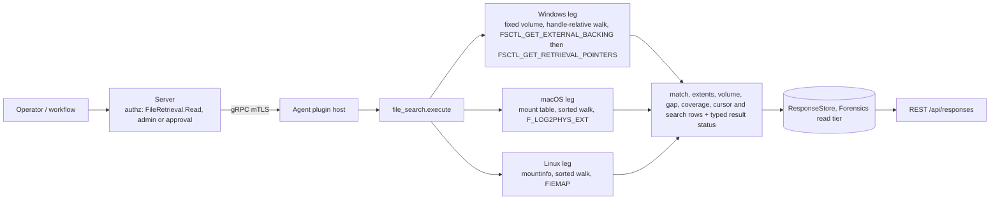

# file_search

<!-- BEGIN GENERATED: plugin-doc-gen header -->
| | |
|---|---|
| **What it does** | On-demand, resumable search of the local disks by file or directory name, with the extents of every matched file; names, types, sizes, times and extents only |
| **Version** | 1.0.0 |
| **Kind** | Collector · read-only · gathered (crossplatform.file_search.search) |
| **Platforms** | Windows 🟡 planned · macOS 🟡 constrained · Linux 🟡 constrained |
| **Actions** | `search` (definition `crossplatform.file_search.search`) |
| **Security** | securable `FileRetrieval` · operation Read · risk High · dispatch ReadOnly · approval gate AdminOrApproval |
| **Roles** | execute: admin · author: content-author |
<!-- END GENERATED -->

## How it works

`search` finds files or directories by leaf name under one absolute root on the local disks of one device. Each match is reported with its type, size, modification time and, for a regular file, its extents (where on the volume the filesystem keeps the file's data). The plugin reads names, types, sizes, times and extents. No file content is read or hashed. A matched regular file is opened read-only, without following a link, so the system can be asked for its size, time and extents; no byte of it is read, but other software still reacts to the open: an on-access scanner, an audit rule or an endpoint-security product can alert on it, and an open can break a lease on an exported file. Listing a directory can trigger an automount, and the system may update the access time of a directory it lists, subject to mount options. On Windows a matched file is opened for its attributes only (no data right, so the handle can neither read nor recall it) and its extents come from two control calls on that handle. A matched directory carries no size, time or extents. The search writes no file content, creates nothing and changes no file or directory content.

One call is one slice of the search. A slice ends when the walk finishes, or when it reaches a time, entry, row or byte budget, or when the search reaches its slice maximum (the budgets are named constants in the source and are not restated here). The slice's byte budget is sized against the server's default cap on stored rows per command and agent, `--response-max-rows-per-agent` (`YUZU_RESPONSE_MAX_ROWS_PER_AGENT`): a server set much lower can drop a slice's rows at the store, counted on `yuzu_server_response_ingest_dropped_total{reason=per_agent_cap}`. Every slice ends with exactly one `search` row, and an answer without one was cut short: read it as unknown, never as an empty result. A slice that stopped early also writes a `cursor` row; the caller repeats the call with that token as `cursor` until a slice answers without one. The agent spends about half of each slice working and the rest asleep, and it backs off when its own directory listings slow down: within a slice it times each listing of new work, and a listing that is slow, either on its own or against the faster listings of the same slice, lengthens the sleeps up to a bounded pause that never takes more than half of the slice's remaining time; sleeps shorten again as listings recover, and the back-off can only slow a search down. A slice that resumes from a cursor first lists again every directory above its resume point, before it reaches anything new: those listings are paced by the plain duty cycle and are not judged by the back-off, so a slow disk cannot spend the slice on the way back to where the last one stopped. It is a heuristic on the search's own listings, kept per slice (each slice starts with none and nothing is carried in a cursor), and it is not reported in any row, heartbeat tag or log line: the `search` row has no column for it and the heartbeat tags are at their cap. Its limits are reasoned defaults, not measured on a saturated disk. The agent does not pace the caller: a loop that repeats the call with no pause keeps one device at that duty for the whole search, and on Linux the idle I/O class a worker asks for is a request the block scheduler may not honour. A search roots at one directory but may cross several mounts: each searched mount is one unit and a slice searches one unit, the mount that contains the root first and the others in order of mount point. Within a unit the walk is depth-first and visits the names of each directory in byte order. A Windows search is one unit: the volume that holds the root (a mount point is a reparse entry and is never crossed). Every answer carries a `coverage` row that says whether everything under the root was searched, so an empty result is never confusable with a failed or partial one.



### The request

| Parameter | Rule |
|---|---|
| `root` | Mandatory and absolute. A trailing slash is ignored and `/` is the whole filesystem. An empty path, a doubled slash, a `.` or `..` component and a NUL byte are refused (`missing_root`, `root_not_absolute`, `root_too_long`, `root_bad_component`). On the first slice the leg checks the root itself: a root that is a link at any component answers `root_is_link`, one that does not exist `root_not_found`, one that is not a directory `root_not_a_directory`. The three tokens are the whole answer: nothing is searched. On macOS `/tmp`, `/var` and `/etc` are links, so those roots answer `root_is_link`; search `/private/tmp`, `/private/var` and `/private/etc` instead. **Windows roots** are a drive path (`C:\Users` or `C:/Users`, a trailing separator ignored) or a volume GUID path (`\\?\Volume{guid}\dir`, the prefix in any case). Rows name paths in one canonical form with a leading slash and forward slashes: `/C:/Users/x` (the drive letter upper-cased) and `/Volume{guid}/dir` (the GUID lower-cased), components exactly as typed; a backslash in a name is written `%5C`. A network (UNC) root, in any spelling, answers `root_unc`; any other device or NT-namespace form (`\\.\`, `\??\`, `\\?\C:\`, a malformed volume GUID) answers `root_device_path`; a drive-relative or relative path answers `root_not_absolute`; a component that is empty, `.`, `..`, ends in a dot or a space, holds a control byte or any of `< > : " \| ? *` (a colon would name an alternate data stream), and any byte that is not well-formed UTF-8, answers `root_bad_component`. A drive letter that does not exist reads as a `not_searched` volume row (`fstype_not_allowed`), not `root_not_found`: the volume plan runs before the root check. |
| `pattern` | Mandatory. A leaf-name glob matched against each entry's name, never the whole path: `*` matches any run of bytes including none, `?` matches one UTF-8 character (one byte where the bytes at that position are not well-formed UTF-8), and every other byte, `[` and `]` included, is a literal. There is no regex, no character class and no escape; `/` and NUL are refused. A pattern that could match nearly everything is refused with its own token rather than run: too long (`pattern_too_long`), too many `*` (`pattern_too_many_stars`, each `*` of a run counts) or too few literal bytes (`pattern_too_few_literals`, a literal is any byte other than `*` and `?`). |
| `kinds` | `files` (the default), `directories` or `both`. |
| `cursor` | The token of the `cursor` row of the previous slice of this same search; empty for the first slice. A cursor is valid only in the agent process that issued it, for this root, pattern and kinds: a token the agent did not issue (made up, edited, from another query (root, pattern or kinds) or another device) and any token from before an agent restart is refused with `bad_cursor` before anything is read, and the search starts again without one. The token is sealed: it carries no readable name, so a copy of the request that the server keeps discloses none. |

The pattern dialect differs from `device.filesystem.search_dir` in three ways: there is no regex mode and `[` and `]` are literals where `search_dir`'s glob reads a character class; the bounds above refuse a pattern `search_dir` would accept; and names are compared by the rule of the OS the agent runs on (next section), where `search_dir` compares the bytes of the name it is given on every OS.

### What a name is compared as

On Linux names compare byte for byte: case-sensitive, no normalisation. On macOS the pattern and every candidate name are normalised to Unicode form C and case-folded (CoreFoundation; ASCII is folded inline) before they are compared, whatever the volume's own rule: a case-sensitive volume is still compared case-insensitively, so two names that differ only in case both match. A macOS name that is not well-formed UTF-8 compares as the bytes it is. On Windows the pattern and every candidate name are upper-cased (strict UTF-8 to UTF-16, the system's invariant-locale upper-casing, back to UTF-8; ASCII is folded inline), so the match is case-insensitive; a name that is not well-formed UTF-8 compares as the bytes it is. The `search` row states the rule that ran: `bytes` on Linux, `macos_nfc_casefold_v1` on macOS, `windows_upcase_v1` on Windows.

A name longer than 765 bytes (255 UTF-16 units are at most 765 UTF-8 bytes, which is the longest name a Windows or HFS-family volume allows) cannot be placed in a cursor position, so it is not searched: it appears as a `name_too_long` gap. A name whose compared form is too long to match is the same gap. On Windows a name with an unpaired surrogate cannot round-trip UTF-8 and is a `name_too_long` gap too; its lossy form can equal a real sibling's name, and the walk never merges the two.

### What is searched, and what is not

Only mounts of a local filesystem type on an exact, case-sensitive allow-list are walked: `ext2`, `ext3`, `ext4`, `xfs`, `btrfs`, `zfs`, `f2fs`, `apfs` and `hfs`, and on Windows `NTFS`, `ReFS`, `FAT`, `FAT32` and `exFAT` (see "Windows volumes" below). Every other mount at or under the root, or containing it, is not walked and is named by its own `volume` row with `not_searched` and the reason:

| Reason | Mount |
|---|---|
| `network_mount` | a network, cluster or paravirtualised type (NFS, SMB, FUSE network types and the like) and an `autofs` trigger point |
| `private_namespace` | a `/tmp` or `/var/tmp` bound from a systemd private per-service directory answers this reason, whatever filesystem that directory is on (a tmpfs `/tmp` included), decided before the allow-list is consulted; the rule recognises systemd's private directory layout only |
| `fstype_not_allowed` | any other type: memory and pseudo filesystems (`tmpfs`, `proc`, `sysfs`, `devfs`), `overlay`, `squashfs`, `fuse` and `fuseblk`, FAT, exFAT and NTFS as the Linux and macOS tables name them |
| `behind_network_mount` | an allow-listed disk mounted beneath a network mount: reaching it would open a directory on that mount |
| `duplicate_mount` | a second mount of the same subtree (same device label and same root inside the filesystem); one is walked, the other is named |
| `firmlinks_only` | macOS, a root of `/`: the data volume (`/System/Volumes/Data`), which the system volume reaches through its firmlinks; the row reads `partial` |

A mount of another refused type that lies above an allow-listed disk (a `tmpfs` or `overlay` with an ext4 disk mounted inside it) does not block the disk: the walk crosses it with one no-follow open per directory and never lists it. A network mount above a disk does block it, because listing or opening on that mount can hang. These are deliberate exclusions, not omissions. The plan refuses a mount by the filesystem type the mount table reports and by its position under a network mount, from the table the slice read; it does not look at what backs a volume, so a volume of an allowed type whose backing store stops answering is walked and can block a worker (caveat 2). For the mounts in the table the slice read, a search never lists a memory or pseudo filesystem and never enters a link; `tmpfs` stays off the allow-list, and admitting it would not make a search from `/` complete, because the other memory and pseudo filesystems stay refused, and a `/tmp` or `/var/tmp` bound from a systemd private per-service directory is classed `private_namespace` before the allow-list is consulted (considered in #8399, closed as not planned). The mount table is read once per slice, so a mount made under a searched directory after that read is not in the plan and the walk can open it: it opens and lists the directory before it compares devices, discards what it listed and records an `other_device` gap (a different device is not walked), and if the open or the listing never returns the worker is abandoned and the volume reads stalled ("A volume that stalls"). The next slice reads the table again and prunes that mount. Refusing such a mount at open time is tracked in #8442.

Each unit's walk never enters, lists or names another mount point below it, among the mounts in the table the slice read (a mount made after that read is the case in #8442 above): the plan's `volume` rows are the one record of a pruned mount. So a mount point's own directory name is never a match candidate, and a directory bind-mounted at a second path (same device label, different root inside the filesystem) is a separate unit and is reported at both paths. Links are never followed and never matched; each one seen is counted in `links_skipped` on the `search` row. Entries that are neither a file, a directory nor a link (a FIFO, a socket, a device node) are never opened and never matched.

**Windows volumes.** The plan holds one entry: the volume that holds the root, named `/C:` or `/Volume{guid}` and carrying its volume GUID path, so a drive letter that is re-pointed at another volume between two slices ends the search (`mount_table_changed`). Its type is the filesystem name for a fixed drive that has a volume GUID, and otherwise a drive-type token that is not on the allow-list, so the volume is refused with `fstype_not_allowed`: `removable`, `cdrom`, `ramdisk`, `no_volume` (a drive letter that is not in use), `not_a_volume` (a `subst` drive), `unreadable` (a fixed drive whose filesystem could not be read) or `unknown`; a network drive (`remote`) is refused as `network_mount`. The volume queries run inside a bounded call with hard-error dialogs suppressed for the thread, so a dead network or optical drive cannot hold the agent. A query that times out is not asked again while it is still blocked: a search of that volume under the spelling the search used (`C:` or its `Volume{guid}` form) answers `mount_table_unreadable` at once until the query returns; the other spelling of the same volume can start one blocked query of its own, and a search of another volume is unaffected. A junction, a mount point and a symbolic link (also a WSL symbolic link) are links: skipped, counted in `links_skipped` and never entered; WSL special files, sockets and FIFOs are never opened or matched; an entry with a reparse tag the leg does not understand is a `reparse_unknown` gap and is neither opened nor entered.

A search rooted at `/` reads `partial`, and says so on every slice, wherever a refused mount sits under it: every refused mount counts as a gap, and the verdict reads partial for anything not searched. On a typical Linux host that is the pseudo and memory filesystems; on macOS it is the data volume's own row and any mount of another type. A narrower root that holds no refused mount can read `complete`. On macOS the data volume is searched only through the system volume's firmlinks, so a data-volume directory that no firmlink exposes is not searched and the data volume's own row reads `partial` (`firmlinks_only`); from `/` every other APFS mount under `/System/Volumes` is its own unit, and where the update mount is present system files are reported again under it (pairing a snapshot with its base volume is tracked in #8454). A host that mounts a btrfs top-level subvolume also reads partial through `other_device` gaps on that mount.

### Identity, extents and what a row can say

The match row carries `<device>:<file id>` in 16 hex digits each (the `extents` row names the same key). The device part is the number the system reports for the directory the entry was listed from, and the file id is the inode or file id. Identity is only as stable as the filesystem makes it: a remount can change a device number, a filesystem may reuse a file id after a deletion, and btrfs reports one device number per subvolume, so a nested subvolume that is not mounted reads as another device and is not entered (an `other_device` gap). A subvolume mounted at its own mount point is its own unit and is searched from there.

The `extents` row lists, for each file, up to a named cap of extents as `<logical>:<physical>:<length>:<flags>` and then the count, an exact number or a lower bound (`>=<n>`) where the system cannot count without listing. The offsets are the numbers the filesystem reports and what they are offsets into depends on it (a block device, a btrfs logical address space, an APFS container); no column of the row says what a physical offset is an offset into, and the `btrfs_logical` flag is the only marker. On Linux the request is `FS_IOC_FIEMAP` with no flags, so a file with data not yet allocated shows a `delalloc` extent with no physical offset, and the sync flag, which writes dirty pages back, is never used: the extent request never writes file data back. A filesystem without the interface answers `unsupported`. On macOS the request is `F_LOG2PHYS_EXT` in pieces: a device offset of -1 is an `unallocated` hole, a file the filesystem keeps compressed answers `compressed` (with no extents), and `shared` is set on every extent of a file that shares all of its blocks with another (a clone) and on no other. A hole in a sparse file is listed and counted on macOS and not listed on Linux, so the same sparse file reads fewer extents on Linux. A file that cannot be opened for its facts is still reported, with size and time `-` and the extents state `failed`; a macOS file that is not present locally (dataless) is never downloaded to answer.

On Windows the file id is reported on NTFS only, for files and folders alike: the listing id is the low half of the 128-bit file id, which was measured equal on NTFS, and a file or folder on ReFS or the FAT family reads `0` (the FAT family's own numbers are derived from the directory position, non-zero and not stable, so they are never read), so the walk's identity backstop is inert there; the device is the volume serial and is never zero. The extents come from the file's own attribute-only handle in two control calls, once each per matched file: `FSCTL_GET_EXTERNAL_BACKING` first, then `FSCTL_GET_RETRIEVAL_POINTERS` (one call, no paging, listing at most the cap and reading `>=33` beyond it). A file the filesystem keeps compressed outside its own extents (CompactOS, WOF) lists as a plain file and its retrieval pointers read as one hole, so the backing is asked first and such a file reads `unsupported:wof_external_backing`, never an extent list; if the backing question cannot be answered the extents read `failed`. A hole in a sparse file is an `unallocated` extent (a wholly sparse file is one such extent); an NTFS-compressed file marks every extent `compressed`, and its data runs alternate with `unallocated` runs; the data of a small file that lives inside the file record is one `resident` extent. A range just written to a sparse file can read `unallocated` until the system writes it out (measured on NTFS: a file with 40 written ranges read as one allocated run and one hole before a flush and as 80 runs after), the retrieval-pointer answer carries no marker for it, and the search never flushes. The `encrypted` flag follows the documented attribute and was not verified on a real EFS file. Deduplication is detected by its reparse tag and was not measured (the feature is not on client Windows). Every file-like entry that is not an ordinary file says so in the extents state: `unsupported:placeholder` (a cloud placeholder or offline file, never opened, its size and time `-`), `unsupported:wof_external_backing`, `unsupported:dedup_external_backing`, `unsupported:app_exec_alias` (an application-execution alias) and `ok:cloud` (a fully local cloud-synced file, with its real extents).

### Cloud-synced folders

The search asks, for its own worker thread and for one slice, never for the agent process, to be shown cloud files as they are, because Windows hides the cloud reparse tag and the sparse and offline bits from an ordinary process; the rules decide on the recall bits, and the one measured, recall-on-data-access (carried by every measured unhydrated file and not-populated folder), was present in both views; recall-on-open was measured in neither. With that view, a populated folder of a cloud-synced root carries a cloud reparse tag and is searched like any folder: its files are listed, and a fully local file reads `ok:cloud`. Where the view cannot be switched (a Windows release without the call, or a call that fails), a fully local cloud file reads plain `ok` with its real extents, and a populated folder is searched as an ordinary one. A search whose root is the sync-root folder itself works. A folder that is not populated, and any folder or file marked recall-on-open, recall-on-data-access or offline, is never opened for use, listed or read: the file reads `unsupported:placeholder`, the folder is one `dataless` gap and the verdict reads `partial`. What makes this safe is not an open flag (`FILE_OPEN_NO_RECALL` was measured to protect nothing and is sent on no open) but three rules: a matched file's handle carries no data right, so it can neither read nor recall the file; the decision is taken from the directory listing, so a marked entry is never opened; and a directory's attributes and tag are read again on its opened handle before anything is enumerated (inside the confinement primitive for a directory that carries a reparse tag, in the leg for one that does not), and a handle that fails is closed unread. Opening a cloud folder was measured to cause no provider callback of any kind. One window cannot be closed from user mode: between that check and the first listing of the same handle a provider can turn a populated folder back into a not-populated one, and no listing mode refuses population, so in that case the provider may fill in that one folder's entries once (names and metadata, never file content), or, with no provider running, the listing fails and the folder is a `dataless` gap. A recall-on-open folder named on the root path itself is opened but not listed; that case was not measured. The shapes were measured on a synthetic sync root with a real provider, not on a commercial sync client.

### Users' directories

A match whose path is a user profile directory, or below one, carries `user` in its last column; every other match carries `system`. The rule is on the path: on Linux `/home/<name>` and `/root`, and `/var/home/<name>` and `/var/roothome` (the spellings an image-based system uses, where `/home` is a link the walk never follows); on macOS `/Users/<name>` except `/Users/Shared`, and `/private/var/root`, each also when it is reached below `/System/Volumes/Data`. On Windows `/<volume>/Users/<name>` and below, in either label form, with `Users` compared without regard to ASCII case, except `Public`, `Default`, `Default User` and `All Users`; and the profile directories the system's profile list names, translated into the searched volume's label form, so the same profile reads `user` from a drive-letter root and from a volume GUID root (a profile on another volume is no root of this search, and one that cannot be resolved is tagged by the built-in rule only). A home relocated elsewhere, or spelled in another letter case, is not tagged on Linux and macOS, so the tag is not a complete answer to "which rows are about a person"; it exists so a consumer of the rows can drop the ones it knows are. User directories are always searched: a root of `/` lists names under every user's home.

### A search of more than one slice is not a snapshot

The coverage row reads `consistency=single_pass` for a search that finished in one slice and `consistency=not_a_snapshot` otherwise. A later slice resumes by name and by the identity of the directories on the resume path, so a change between slices that moves neither is not seen and leaves no gap: an entry added at or before the resume point of a directory that kept its identity, a completed directory swapped for another of the same name, and a replacement that reports the same identity as the directory it replaced (a filesystem may reuse one) or differs from it only in the half (device or file id) the earlier record left unreported. Entries missed that way are not visited. A directory that changed identity is searched again from its start, so a match can repeat; it is never silently skipped. A `complete` verdict over more than one slice is therefore not proof that a name is absent.

### A volume that stalls

A slice that has not returned by its deadline plus a grace period leaves its worker running, blocked inside one system call, which the agent cannot cancel (a mount made under a searched directory after the slice read the mount table can cause it: see "What is searched, and what is not"). The agent records that volume as stalled in memory, in this agent process only, and any slice that reaches it answers a `stalled` `volume` row, counts one gap and moves on to the next volume without walking. When the blocked worker returns the entry is dropped by the next slice and the volume is searched again; nothing needs to be cleared by an operator. A completed agent restart clears the record: the agent keeps no state across a restart, so a volume that is still dead costs the next slice one more timeout. A worker blocked in a call the system cannot interrupt can delay the agent's exit, so the restart itself can wait. While the mount that holds the root is stalled, a search under it answers `stalled` without checking the root. An agent stop or reconnect waits for a running slice: up to the slice time plus the grace period when its worker is blocked (tracked in #3756 for an agent stop and #5165 for a reconnect). With two workers still blocked every call answers `busy` until one returns or the agent restarts. The count of non-advancing attempts on one cursor is held the same way and starts again after a restart. A restart also ends every search in progress on that device: a cursor is valid only in the agent process that issued it, so the next call with an earlier cursor answers `bad_cursor` and the search starts again without one.

The runbook: the search is read-only; the agent keeps no state across restarts, and a cursor does not survive one; if a slice answers without a cursor and with a retryable reason (`timed_out`, `rejected`, `no_progress`, `internal_error`), repeat the call with the previous cursor, a bounded number of times, unless the agent has restarted since it was issued (the call then answers `bad_cursor`: start the search again); without a cursor, `stalled` and `unstable` are final: do not repeat the previous cursor (it is still accepted, and repeating it starts the attempt count again).

### Who can run it and who can read the results

The catalogue row is `FileRetrieval` · Read · risk High · `AdminOrApproval`: an administrator can launch a search; anyone else needs an approval. One approval covers a whole search, over MCP: the first slice spends it as any approval is spent, and every later slice that carries a `cursor` and the `approval_id`, from the same caller with the same root, pattern, kinds and targets, rides the spent approval for 24 hours after that first use, or until the approval's own 7-day lifetime ends, whichever comes first. A spent approval cannot be withdrawn: nothing reviews, expires or revokes a ticket once it is spent. Turning the plugin's kill switch off, or removing the caller's `Execution:Execute`, refuses each slice while it lasts but does not end the cover: restoring either before the cover's own end (24 hours from first use, or the approval's 7-day lifetime) lets the same ticket cover slices again. Withdrawal is tracked in #8501. The server never reads a cursor; it sees only that a non-empty printable token is present, and the agent answers `bad_cursor`, before it reads anything, to a cursor it did not issue for the same arguments. Any change to the call (another root, pattern, kinds, action or target set, including one device widened to a group or the fleet), another caller, a call after the cover has ended, and a call without a cursor each need an approval of their own; so does a first slice that fails before it returns a cursor. A caller who holds the approval can repeat an earlier cursor while the cover lasts and so re-run a slice, and the approver's role is not checked again per slice. Each slice is still its own dispatch with its own audit row: the approval's id is on every one, so one approval joins all of a search's executions. A bundle, a workflow or a schedule needs one approval per call or occurrence, as before. It is not single-target, so a search can be sent to a group or the fleet: it starts one slice on every device in it, and each device stores its own rows. A cursor works only on the device that issued it, so a search is continued by repeating the same targets, one call per device, and a device that did not issue the cursor answers `bad_cursor` and reads nothing. A group or fleet dispatch today has no per-search or per-dispatch cap, no canary and no confirmation step (#8471): every device in the target set runs a full slice, so narrow the root and the target set. The plugin ships on: the server seeds no kill switch for it, and an operator turns it off with `PUT /api/v1/plugin-config/file_search/kill-switch {"enabled":false}`. Turning the switch off refuses the next dispatch; a running slice finishes.

What a search stores is a different matter from who may launch it. The stored rows are Forensics-tier: only a caller holding a global `Forensics:Read` reads them (the Administrator and ForensicsAnalyst roles by default, and Administrator only while RBAC is off), and a read of the rows is audited as `response.forensics.read`; aggregate, facet-option and count reads write no row (`docs/user-manual/audit-log.md`), and a facet option lists column values, which for a `match` row include the path. A non-administrator who launches a search under an approval therefore cannot read its results unless they also hold `Forensics:Read`. That includes the next cursor: it reaches a caller only as the stored `cursor` row, and the live output publishes nothing for a Forensics-tier plugin, so the one approval over a whole search helps only a launcher who also holds `Forensics:Read`; without it a search can be started under an approval and not continued. This follows from the tier rule. There is no second tier and no second permission check for this plugin; the rule is the one in `docs/authz-model.md` section 4. The `cursor` parameter is dispatched to the agent unchanged. The server erases it from the execution record and from the recorded arguments of the approval for an `execute_instruction` call, and a schedule that carries one is refused. A cursor placed in a bundle step or in a definition run stays in that approval's recorded arguments, and the cursor each slice issues is stored as a `cursor` row with the search's other rows, in the Forensics tier. The token is sealed, so no stored copy of it shows a name the search found. The root, pattern, kinds and targets the caller typed stay in the execution record and in the approval's recorded arguments.

## OS capability

<!-- BEGIN GENERATED: plugin-doc-gen capability -->
| Action | Windows | macOS | Linux |
|---|---|---|---|
| `search` | 🟡 planned · rung 1 · NTFS volume search and a directory walk with the same rows | 🟡 constrained · rung 1 · resumable sorted depth-first search of the requested root, one slice per call, through no-follow directory opens; the mount table from getmntinfo_r_np decides which mounts are searched; the extents of every matched regular file from F_LOG2PHYS_EXT; dataless files are never materialised; matched files are opened and never read | 🟡 constrained · rung 1 · resumable sorted depth-first search of the requested root, one slice per call, through no-follow directory opens; the mount table from /proc/<pid>/mountinfo decides which mounts are searched; the extents of every matched regular file from FIEMAP; matched files are opened and never read |

**Declared limits per leg** (descriptor fallback text, verbatim):

- **`search` / Windows** — not read yet: one unsupported status row, windows:planned
- **`search` / macOS** — constrained: names compare by Unicode normalisation and case folding whatever the volume's own rule, so a case-sensitive volume can over-match; folders protected by the system's privacy controls are permission-denied gaps; a search rooted at / reaches the data volume through its firmlinks and reads partial; the verdict reads partial when any mount, directory or name was not searched
- **`search` / Linux** — constrained: only local filesystem types on the allow-list are searched and every other mount is reported by its own row; names compare byte for byte; a directory the agent cannot search is a gap, and the capability that lets the agent search directories of other accounts is held on the walking thread only around directory opens, directory listings and the leaf open (hygiene, not a boundary); the verdict reads partial when any mount, directory or name was not searched
<!-- END GENERATED -->

## Privileges and prerequisites

| OS | Runs as | Extra grant needed | Measured | If the read is refused |
|---|---|---|---|---|
| Windows | agent service: `LocalSystem` today (`docs/agent-privilege-model.md`; a low-privilege agent account is tracked in #1442) | None: no extra privilege. The search never enables or adjusts a backup or restore privilege, or any other: the walk runs on the agent's own token | 2026-11-23, one Windows 11 build 26200 host, as the interactive administrator and as SYSTEM, for the cloud-folder, external-backing, retrieval-pointer and identity behaviour (host facts), over scratch trees only. Not measured: a ReFS volume, a real EFS file, deduplication, a commercial sync client | A folder the token is refused is a `permission_denied` gap row; a file that cannot be opened for its facts is a match row with size and time `-` and extents `failed`; the verdict reads `partial`. Under the low-privilege agent account of #1442 the leg does not change and still takes no privilege, so every folder that account's token is refused, user profile directories included, is a `permission_denied` gap and the verdict reads `partial` |
| macOS | agent daemon: a root LaunchDaemon today (`docs/agent-privilege-model.md`) | None: no new privilege. Folders protected by the system's privacy controls (TCC, Full Disk Access) are refused to a daemon without that access; how to grant it to the agent is not settled here (`deploy/packaging/macos/README.md`, Privacy permissions, describes a profile that names the agent binary, written for another plugin and not verified for this one) | 2026-11-21, one macOS 26.6.2 arm64 bare-metal host, as an unprivileged account (euid 501), over a scratch tree only (the sample). Not measured as the root LaunchDaemon; the behaviour of a daemon with no Full Disk Access over protected folders is not measured | A directory that cannot be listed is a `permission_denied` gap row; a file that cannot be opened for its facts is a match row with size and time `-` and extents `failed`; the verdict reads `partial` |
| Linux | agent daemon, dedicated unprivileged account (`yuzu-agent` on the packaged unit), never root by design (`docs/agent-privilege-model.md`) | None added by this plugin. The packaged unit already holds `CAP_DAC_READ_SEARCH` for every plugin; the search worker thread drops it from its effective set and raises it only around the lookups that need it (hygiene, not a boundary: caveat 5) | 2026-11-21, one Ubuntu 26.04.1 LTS x86_64 virtual machine, as root (euid 0) over a scratch tree only (the sample); the capability-scope cases ran as root there. Not measured as the packaged unprivileged `yuzu-agent` account holding the ambient capability over another account's directories | A directory the account cannot search is a `permission_denied` gap row (`dir_unreadable` for another failure); a file that cannot be opened for its facts is a match row with size and time `-` and extents `failed`; the verdict reads `partial` |

No external binaries, no subprocesses, no network use. The Windows leg opens nothing by path: the volume root is opened by its volume GUID path and every directory below it, the hops of the root path included, parent-handle-relative with no reparse point followed (so long paths work); the only file open is an attribute-only one, and the only control calls are the two named under "Identity, extents and what a row can say". The Linux leg reads `/proc/<pid>/mountinfo` of the agent's own process (opened without following a link, streamed, never held whole) and the macOS leg reads the kernel's mount table through `getmntinfo_r_np` without a call into any server. A worker runs on the idle I/O class on Linux, the throttled disk class on macOS and background priority on Windows, with dataless materialisation off on macOS for the whole walk and hard-error dialogs suppressed for the worker thread on Windows. In the agent container image the agent runs as an unprivileged account with no capability (the image sets none): adding the capability to the container is necessary but not sufficient for that account, because it reaches only the bounding set, so a root container or an ambient grant is needed as well; otherwise the raise does nothing and the directories the account cannot search are `permission_denied` gaps. In the stock image the container's own root is an overlay mount, which the plan refuses (`fstype_not_allowed`), so only allow-listed host filesystems mounted into the container are searched; the single-file mounts a container runtime adds (the hosts, hostname and resolver files) are planned as units too, and each ends in a gap, so the verdict reads `partial`.

A walk holds directory descriptors, and the agent's limit on them is not raised. A walk keeps the directories of its current path open, at most 62 per worker, plus one transient descriptor at the peak (the matched file, or the next directory, which opens before the spare one closes), so 63 per worker. One worker runs per slice, and one more, abandoned after a timeout, can still be blocked, so up to two can hold descriptors at once (with two blocked workers recorded no worker starts: every call answers `busy`), 126 at the most. The limit on open descriptors is whatever the agent's service manager sets (one reading on one macOS host gave 256 for a launchd daemon, an example and not a constant); this plugin does not raise it, and descriptor exhaustion affects the whole agent process, not only this plugin (measuring the agent's descriptor use and setting its limit is tracked in #8453). A directory that cannot be opened for lack of descriptors is a `dir_unreadable` gap, so the verdict reads `partial`, and a later search may clear it.

## Data contract

### Inputs

<!-- BEGIN GENERATED: plugin-doc-gen inputs -->
| Definition | Parameter | Type | Required | Default | Constraints | Description |
|---|---|---|---|---|---|---|
| `crossplatform.file_search.search` | `root` | string | yes | - | pattern: ^/ · maxLength 4096 | The absolute directory to search from. A root of / is the whole filesystem. A trailing slash is ignored; empty, . and .. components, a doubled slash and a NUL byte are refused. A root that is a link, does not exist or is not a directory is refused with its own token (root_is_link, root_not_found, root_not_a_directory). |
| `crossplatform.file_search.search` | `pattern` | string | yes | - | maxLength 128 | A leaf-name glob matched against each entry name, never the whole path: * matches any run of characters and ? any one character; there is no regex. A pattern with too few literal characters, too many * or a forbidden byte is refused with its own token, so it cannot be made to match everything. Names compare by the rule of the agent's OS: byte for byte on Linux; on macOS normalised to NFC and case-folded whatever the volume's own rule. |
| `crossplatform.file_search.search` | `kinds` | string | no | files | enum: files, directories, both | What to match: "files" (default), "directories" or "both". A directory match carries no size or time, because the search never opens a directory for its facts. |
| `crossplatform.file_search.search` | `cursor` | string | no | - | maxLength 32896 | The token of the cursor row of the previous slice of this same search; leave empty for the first slice. A cursor is valid only in the agent process that issued it, for this root, pattern and kinds: a token the agent did not issue, and any token from before an agent restart, is refused with bad_cursor before anything is read, and the search starts again without one. |
<!-- END GENERATED -->

### Outputs

Every row is one line of `|`-separated columns, and `row_kind` (field 0) names its shape. A name or path in any column is written with each byte outside well-formed printable UTF-8, and each `%`, `|` and `\`, as `%XX`, so a column never holds the delimiter. Row grammars by `row_kind`: `match|<path>|<file or directory>|<device:id or ->|<size or ->|<mtime or ->|<system or user>`, `extents|<device:id>|<state or state:note>|<count>|<list or ->`, `volume|<mount>|<fstype>|<complete, partial or not_searched>|<reason>|extents=<collected, not_collected or unsupported>|entries=<n>`, `gap|<path>|<cause>`, `gaps_dropped|<n>`, `volumes_dropped|<n>`, `coverage|<complete or partial>|slices=<n>|prior_gaps=<n>|consistency=<single_pass or not_a_snapshot>`, `cursor|<token>` and `search|<ok, invalid, busy or failed>|<reason>|<name rule or ->|seq=<n>|q=<8 hex>|links_skipped=<n>`. Every leg ships, so there is no planned-leg row. Matches and their `extents` rows come first, then the `volume`, `gap` and `coverage` rows, then the `cursor` row when one is issued, and last the `search` row. The `volume` and `gap` rows describe the slice that wrote them, and a `volume` row reading `complete` means the unit's walk finished: a gap inside it shows in the `gap` rows and on the `coverage` row; the verdict on the `coverage` row is cumulative across slices. A search with no match is the `volume` and `coverage` rows and the `search` row, never an empty answer. The `q` value names a search without revealing its pattern or root. On a `volume` row `extents=collected` marks a unit of the plan (the slice asks for the extents of each matched file there; the answer for each file is its `extents` row), `not_collected` a mount that is refused or not reached, and `unsupported` is reserved: this version never writes it. The `<note>` of an `extents` state is a closed token: `placeholder`, `wof_external_backing`, `dedup_external_backing`, `app_exec_alias` or `cloud`. Reserved tokens, which the shared vocabulary names and this version never writes: the gap causes `network_mount` and `private_namespace` (a refused mount is named by its `volume` row with that reason, and its entries never reach the walk); the `volume` reasons `permission_denied`, `other_device` and `unsupported`; and `mount_table_unreadable` and `mount_table_changed`, which appear only as the `reason` of the `search` row and never on a `volume` row.

<!-- BEGIN GENERATED: plugin-doc-gen outputs -->
**`crossplatform.file_search.search` — `row_kind|field_1|field_2|field_3|field_4|field_5|field_6`**

| Field | Type | Values | Available | Example | Description |
|---|---|---|---|---|---|
| `row_kind` | string | `match` `extents` `volume` `gap` `gaps_dropped` `volumes_dropped` `coverage` `cursor` `search` `status` | Windows, Linux, macOS | `match` | Row shape discriminator (field 0). Values: match, extents, volume, gap, gaps_dropped, volumes_dropped, coverage, cursor, search (the last row of every slice), and status (one row on a leg that is planned and not read yet). |
| `field_1` | string | - | Windows, Linux, macOS | `/srv/data/report-2026.pdf` | match: the path, with each byte outside well-formed printable UTF-8 and each % \| \ written as %XX. extents: the file identity, device:file id in 16 hex digits each, equal to field 3 of the match row of the same file. volume: the mount point, escaped like a path. gap: the path of the directory or entry that was not searched. gaps_dropped and volumes_dropped: how many were left out of the answer. coverage: complete or partial. cursor: the token to pass back as the cursor parameter. search: ok, invalid, busy or failed. status: the literal "search". |
| `field_2` | string | - | Windows, Linux, macOS | `file` | match: file or directory. extents: ok, compressed (the filesystem keeps the file encoded and reports no extents), unsupported or failed. volume: the filesystem type. gap: the cause (depth, dir_unreadable, dir_truncated, other_device, memory_cap, permission_denied, dataless, name_too_long, match_cap; network_mount and private_namespace are reserved and never written by this version). coverage: slices=<n>, the slices of this search so far. search: the reason, a closed token (none, a coverage reason, a fault such as busy or timed_out, or a request error such as bad_kinds). status: unsupported. |
| `field_3` | string | - | Windows, Linux, macOS | `00000000000000fd:0000000000a1b2c3` | match: the file identity, device:file id in 16 hex digits each, or "-" when unknown; the key of the extents row. extents: the extent count, or >=<n> when the system cannot count without listing. volume: complete, partial or not_searched. coverage: prior_gaps=<n>, gaps carried from earlier slices. search: the name rule that ran (bytes on Linux, macos_nfc_casefold_v1 on macOS), or "-" when no pattern was compiled. status: the planned token such as windows:planned. |
| `field_4` | string | - | Windows, Linux, macOS | `48213` | match: the size in bytes, or "-" for a directory or a file that could not be opened. extents: the extents, each logical:physical:length:flags joined by commas, or "-" for none; flags are resident, delalloc, shared, compressed, encrypted, unwritten, unallocated and btrfs_logical joined by +, or "-". volume: the reason the volume was not fully searched (none, budget_entries, budget_time, budget_rows, cancelled, fstype_not_allowed, network_mount, private_namespace, stalled, unstable, duplicate_mount, behind_network_mount, max_slices, firmlinks_only; permission_denied, other_device and unsupported are reserved and never written by this version, and mount_table_unreadable and mount_table_changed appear only as the reason of the search row). coverage: consistency=single_pass or not_a_snapshot. search: seq=<n>, the slice number. |
| `field_5` | string | - | Linux, macOS | `1763251200` | match: the modification time in seconds since the epoch, or "-" when unknown. volume: extents=collected on the row of a unit of the plan (the slice asks for the extents of each matched file there; the answer for each file is its extents row), not_collected on a mount that is refused or not reached; unsupported is reserved and never written by this version. search: q=<8 hex>, a short name for this query that reveals neither the pattern nor the root. |
| `field_6` | string | - | Linux, macOS | `system` | match: system, or user for a path under a user profile directory (a rule on the path, so a home relocated elsewhere is not tagged). volume: entries=<n>, the entries visited on the volume. search: links_skipped=<n>, links seen and never followed. |
<!-- END GENERATED -->

### Result status

The status is a coarse summary for the host; the `search` row and the `coverage` row are the answer.

| Status | Completeness | Provenance | When |
|---|---|---|---|
| `OK` | full | (empty) | The slice ran, no cursor remains and the coverage verdict is `complete`: every volume was searched in full and there is no gap |
| `OK` | partial | (empty) | The slice ran and either a cursor continues the search or the verdict reads `partial` (a refused or stalled volume, a gap, a dropped volume) |
| `UNAVAILABLE` | unknown | `file_search:busy` | Another search slice holds the agent's one slot, or two blocked workers are still recorded; repeat the call |
| `UNAVAILABLE` | unknown | `file_search:<token>` for a request token (`missing_root`, `root_not_absolute`, `root_too_long`, `root_bad_component`, `missing_pattern`, `pattern_too_long`, `pattern_too_many_stars`, `pattern_too_few_literals`, `pattern_forbidden_byte`, `bad_kinds`, `bad_cursor`, `root_is_link`, `root_not_found`, `root_not_a_directory`, and on Windows `root_unc` and `root_device_path`) | The request was refused (the command also returns 1); the `search` row says `invalid` and nothing was searched |
| `UNAVAILABLE` | unknown | `file_search:<reason>` for a failure reason (`timed_out`, `rejected`, `no_progress`, `stalled`, `unstable`, `cancelled`, `cursor_refused`, `max_slices`, `mount_table_unreadable`, `mount_table_changed`, `internal_error`) | The slice or the search ended without a result for that reason; the `search` row says `failed` |
| `UNAVAILABLE` | unknown | `linux:file_search:exception` / `macos:file_search:exception` / `windows:file_search:exception` | The body threw: one `search\|failed\|internal_error` row and the command returns 0 |

### What to do about a reason

| Reason | Terminal or retryable | Action |
|---|---|---|
| `busy` | Retryable | Another search holds the slot, or two blocked workers are recorded; repeat the call after a moment. With two blocked workers the answer stays `busy` until one returns or the agent restarts (see "A volume that stalls") |
| `timed_out`, `rejected`, `no_progress`, `internal_error` | Retryable, a bounded number of times on one cursor | Repeat the previous cursor, while the agent process that issued it is still running (after a restart it answers `bad_cursor`: start the search again). A slice that returns no result writes its volume as `partial` / `stalled`, and the attempt did not advance. The agent counts non-advancing attempts per cursor in memory; the last one allowed ends the search `stalled`. Only `timed_out` leaves a blocked worker, which makes later slices skip that volume until the worker returns. The command returns 0 |
| `stalled`, `unstable` | Terminal when the slice carries no `cursor` row | A volume does not answer, or a directory kept changing identity under the resume. A slice that skips a stalled volume answers `ok` / `stalled`, with a cursor unless it was the last volume, and the search continues: repeat the call with that cursor, unless the agent has restarted since (then it answers `bad_cursor`: start the search again). Without a cursor the search has ended; start a new search. The volumes not reached are named `not_searched` with the same reason; search them by their own root. A stalled volume clears itself when its worker returns and on an agent restart |
| `mount_table_changed` | Terminal for that search | The set of searchable mounts changed between slices; start again. A change in refused mounts alone does not end a search. On a host whose searchable mounts change constantly a search from a wide root cannot finish: narrow the root to one volume |
| `mount_table_unreadable` | Terminal for that call | The mount table could not be read in full, no mount contains the root, or the host has more mounts at or under the root than the plan keeps; a narrower root may work |
| `max_slices` | Terminal | The search reached its slice maximum; the volumes not reached are named `not_searched`. Narrow the root or the pattern |
| `cancelled` | Terminal | The agent is shutting down |
| `cursor_refused` | Terminal | The slice ran but the agent could not issue a cursor that advances the search; start a new search |
| `bad_cursor` | Terminal for that request | The token is not one this agent process issued for this search: it was edited or made up, it belongs to another query (root, pattern or kinds) or another device, or the agent has restarted since it was issued (a cursor does not survive a restart). Start the search again without a cursor |
| `bad_kinds`, `root_unc`, `root_device_path`, any other request token | Terminal for that request | The request was refused; fix the parameter (a Windows root is a drive path or a volume GUID path, never a network or device path) |
| gap cause `dir_truncated` | Not retryable | A directory of more than 50,000 entries is searched in none of them, and its whole subtree is skipped. This action cannot search that directory at all: a narrower root or pattern does not change it. The verdict reads `partial` |
| gap cause `depth` | Not retryable from the same root | A directory deeper than 61 levels below the root is matched by name but not entered. A new search rooted nearer that directory reaches what is below it. The verdict reads `partial` |
| gap cause `memory_cap` | Not retryable from the same root | A directory is skipped, with its entries, when holding its listing would take the names retained for the current path past 48 MiB; that takes a chain of very large ancestors, so a root below them helps. The verdict reads `partial` |
| gap cause `dir_unreadable` | Retryable, a later search may clear it | A directory could not be listed or opened for a reason other than a refusal (a lack of descriptors is one). The verdict reads `partial`; a later search may clear it |
| gap cause `permission_denied` | Not retryable by repeating | The agent's account is refused the directory: on Linux a directory the account cannot search, on macOS a folder the system's privacy controls protect, on Windows a folder the agent's token is refused. The verdict reads `partial`; see "Privileges and prerequisites" for what the account holds |
| gap cause `other_device` | Not retryable from the same root for an unmounted btrfs subvolume; a new search clears a late mount | The directory is on a different device from the unit being walked and is not entered: a nested btrfs subvolume that is not mounted, or a mount made after the slice read the mount table. A mount made late is pruned by the next slice, which reads the table again; a btrfs subvolume mounted at its own mount point is its own unit and is searched from there. The verdict reads `partial` |
| gap cause `dataless` | Not retryable from the same root | macOS: a directory that is not present locally is named and not listed, and nothing is downloaded to answer. Windows: a cloud folder that is not populated, or any folder marked recall or offline, is named and not listed (see "Cloud-synced folders"), and so is a folder whose provider is not running. The verdict reads `partial` |
| gap cause `reparse_unknown` | Not retryable | Windows: an entry with a reparse tag the leg does not understand, or a directory of a kind it will not enter (a deduplication, compression-backed or application-execution reparse directory), is named and neither opened nor entered. The verdict reads `partial` |
| gap cause `name_too_long` | Not retryable | An entry whose name, or whose compared form, is too long to place in a cursor position or to match, or (Windows) whose name cannot round-trip UTF-8, is not searched. This action cannot search it. The verdict reads `partial` |
| gap cause `match_cap` | Retryable with a narrower pattern | A directory had more matches in one slice than the per-directory cap, and the rest were not reported; a narrower pattern reports more of them. The verdict reads `partial` |

The gap causes `network_mount` and `private_namespace` are reserved: this version never writes them (see "Outputs"). The full list of causes is the `GapCause` enum in `agents/shared/file_search_position.hpp`.

### Where the data goes

- **Instruction result.** Every row is server instruction-result data under the Forensics read tier: stored under the standard response retention and served over REST `/api/responses` and MCP only to a caller who holds a global `Forensics:Read` (Administrator and ForensicsAnalyst by default; Administrator only while RBAC is off). The live output events never carry these rows.
- **Not consumed by** the daily sync, Echo or DEX: the action runs on demand only. Eight counters (`slices`, `budget_stops`, `stalled`, `unstable`, `timed_out`, `rejected`, `failed` and `gaps`, each a total since the agent started) are published as heartbeat status tags `yuzu.plugin.file_search.<counter>`, a counter appearing on its first count; they carry no path, pattern or root. A log line names a search by the `q` prefix and a reason, never a path or pattern.
- **On by default, and how to turn it off.** The server seeds no kill switch for this plugin, so it dispatches on every OS unless an operator runs `PUT /api/v1/plugin-config/file_search/kill-switch {"enabled":false}` (`PluginConfig:Write`, audited as `plugin_config.kill_switch.set`); add `?os=windows` to switch off the Windows leg only. The server no longer writes this row; a row already present is left as it is. Launch is `FileRetrieval` with `AdminOrApproval`, so an unapproved non-administrator cannot start a search. Run the failure-injection scenarios tracked in #8472 before a customer fleet relies on it.
- **Sensitivity.** Rows list the names of files and directories under every directory searched, including other accounts' profile directories, with sizes, modification times and the physical layout of each file. Names can identify a person (a profile directory carries an account name, and a file name can name a document or a client) and the listing is reconnaissance material about what a machine holds. A match under a profile directory is tagged `user` so a consumer of the rows can drop it; on Linux and macOS a relocated home is not tagged. No file content appears in any row and none is hashed. A search can be sent to a group or the fleet and lists names in users' home directories, which is works-council co-determination-relevant: it is on by default, so turn it off (the `PUT` above) until the customer's co-determination process is complete, where one applies. The committed sample was taken over a scratch tree.
- **Siblings:** `device.filesystem.search_dir` (names under a confined root, glob or regex, no extents), `device.filesystem.find_by_hash` (matches by content hash), `crossplatform.components.scan` (installed components) and `crossplatform.storage.mounts` (the mount inventory).

## Sample output

<!-- BEGIN GENERATED: plugin-doc-gen samples -->
**macOS** — captured: macos macOS 26.6.2 arm64 · bare-metal · 2026-11-21 · euid 501 · leg-hash c2884861b725

```
== action=search root=/private/tmp/yuzu_test_file_search_sample pattern=yuzu-fs-control-* kinds=both
match|/private/tmp/yuzu_test_file_search_sample/n1/n2/n3/n4/n5/n6/n7/n8/n9/n10/n11/yuzu-fs-control-d12.bin|file|0000000001000011:0000000039e1242b|8|1795261130|system
extents|0000000001000011:0000000039e1242b|ok|1|0:98863116288:8:-
match|/private/tmp/yuzu_test_file_search_sample/yuzu-fs-control-d1.bin|file|0000000001000011:0000000039e1241f|8|1795261130|system
extents|0000000001000011:0000000039e1241f|ok|1|0:98863112192:8:-
match|/private/tmp/yuzu_test_file_search_sample/yuzu-fs-control-dir|directory|0000000001000011:0000000039e1242c|-|-|system
volume|/|apfs|complete|none|extents=collected|entries=16
coverage|complete|slices=1|prior_gaps=0|consistency=single_pass
search|ok|none|macos_nfc_casefold_v1|seq=0|q=f25c9ba4|links_skipped=1
[result_status] OK / FULL
```

**Linux** — captured: linux Ubuntu 26.04.1 LTS x86_64 · vm · 2026-11-21 · euid 0 · leg-hash c2884861b725

```
== action=search root=/tmp/yuzu_test_file_search_sample pattern=yuzu-fs-control-* kinds=both
match|/tmp/yuzu_test_file_search_sample/n1/n2/n3/n4/n5/n6/n7/n8/n9/n10/n11/yuzu-fs-control-d12.bin|file|0000000000000830:000000000004b5d6|8|1795264901|system
extents|0000000000000830:000000000004b5d6|ok|1|0:0:4096:delalloc
match|/tmp/yuzu_test_file_search_sample/yuzu-fs-control-d1.bin|file|0000000000000830:000000000004b5c7|8|1795264901|system
extents|0000000000000830:000000000004b5c7|ok|1|0:0:4096:delalloc
match|/tmp/yuzu_test_file_search_sample/yuzu-fs-control-dir|directory|0000000000000830:000000000004b5d7|-|-|system
volume|/tmp|ext4|complete|none|extents=collected|entries=16
coverage|complete|slices=1|prior_gaps=0|consistency=single_pass
search|ok|none|bytes|seq=0|q=a3032aca|links_skipped=1
[result_status] OK / FULL
```
<!-- END GENERATED -->

## Caveats and known gaps

1. **Windows is walk and extents only, with stated limits.** It searches fixed local volumes only (a removable, optical, RAM or network drive, and a `subst` drive, is a refused volume row), one volume per search, by walking directories; it does not read the NTFS master file table. A name with an unpaired surrogate and an entry with an unknown reparse tag are gaps. A cloud folder that is not populated, and any folder marked recall or offline, is a `dataless` gap; a cloud folder that its provider empties between the handle check and the listing may be populated once (names and metadata only); a recall-on-open folder named on the root path is opened but not listed, which was not measured. The cloud behaviour was measured on a synthetic sync root, not on a commercial sync client. Ids on ReFS and the FAT family read `0`. The `encrypted` flag and deduplication detection were not verified on a real EFS file or a deduplicated volume, and no ReFS volume was measured. A drive letter that does not exist reads as a `not_searched` volume row, not `root_not_found`. Block-cloned ReFS extents are not marked shared.
2. **A search from `/` reads partial, and the mount rules have limits.** Every refused mount is a gap, so a search rooted at `/` cannot read `complete` on a host that has a pseudo, memory or network mount; narrow the root to read `complete` (the macOS data volume, update mount and btrfs cases are under "What is searched, and what is not"; #8454). The plan decides from the mount table the slice read, by filesystem type and by position under a network mount; it does not look at what backs a volume or who made a mount, and a stacked or loop filesystem reports its own local type. A user without privilege can mount an image of an allowed type (on Linux, a loop-backed ext4 image kept on a user-space filesystem of their own; on macOS, an attached disk image) and then stop its backing store answering, so a search that walks that volume can block a worker: the volume reads `stalled`, and two such volumes make every search on the device answer `busy` until a worker returns. A user can also mount a user-space filesystem of their own over one of their directories: that type is not on the allow-list, so the row for the mount reads `not_searched` with `fstype_not_allowed`, the verdict reads `partial`, and what lies beneath the mount is not searched. Both are reasoned from the mount rules, not reproduced; refusing loop-backed and user-owned volumes is tracked in #8442. On ZFS with snapshot directories visible, listing a snapshot directory can mount the snapshot, which changes the set of searchable mounts and can end a search with `mount_table_changed` (#8467); this has not been run on a ZFS host, and narrowing the root away from the snapshot directories avoids it.
3. **Only part of what changes between slices is seen.** The limits under "A search of more than one slice is not a snapshot" apply to every search that needs a cursor, and matches beyond the per-directory cap of one slice are not reported: that directory is named by a `match_cap` gap and the verdict reads partial, so a very broad pattern in one directory reads partial. The cap is counted per slice, so a cut search can report more of a large directory than an uncut one, and the verdict follows the cut.
4. **macOS name matching and permissions are approximate.** A case-sensitive volume over-matches because names are compared case-insensitively whatever the volume says. Folders protected by the system's privacy controls are `permission_denied` gaps, a dataless directory is a `dataless` gap, and the behaviour of a daemon that holds no Full Disk Access over protected folders has not been measured.
5. **On Linux the capability scope is hygiene, not a boundary.** The packaged unit already gives the agent `CAP_DAC_READ_SEARCH` for every plugin, so this plugin adds no grant and no packaging change. The search worker thread drops the bit from its effective set and raises it only around lookups, but the bit stays permitted on the thread and every other thread of the agent holds it effective; scoping it agent-wide is tracked in #8398.

## Source and tests

<!-- BEGIN GENERATED: plugin-doc-gen source -->
- Plugin: `agents/plugins/file_search/src/file_search_driver.hpp` · `agents/plugins/file_search/src/file_search_execute.hpp` · `agents/plugins/file_search/src/file_search_extents.hpp` · `agents/plugins/file_search/src/file_search_extents_linux.cpp` · `agents/plugins/file_search/src/file_search_extents_macos.cpp` · `agents/plugins/file_search/src/file_search_legs.hpp` · `agents/plugins/file_search/src/file_search_plugin.cpp` · `agents/plugins/file_search/src/file_search_posix.cpp` · `agents/plugins/file_search/src/file_search_request.hpp` · `agents/plugins/file_search/src/file_search_rows.hpp` · `agents/plugins/file_search/src/file_search_state.hpp` · `agents/plugins/file_search/src/file_search_volumes.hpp`
- Definitions: `content/definitions/file_search.yaml`
- Capability rows: `server/core/src/capability_decls/plugin_action_catalogue_file_search.hpp`
- Tests: `tests/test_file_search_definition.py` · `tests/test_file_search_read_tier_tripwire.py` · `tests/test_file_search_source_tripwire.py` · `tests/unit/test_file_search_coverage.cpp` · `tests/unit/test_file_search_cursor.cpp` · `tests/unit/test_file_search_driver.cpp` · `tests/unit/test_file_search_governor.cpp` · `tests/unit/test_file_search_local_dispatcher.cpp` · `tests/unit/test_file_search_names.cpp` · `tests/unit/test_file_search_posix_shell.cpp` · `tests/unit/test_file_search_query.cpp` · `tests/unit/test_file_search_resume_contract.cpp` · `tests/unit/test_file_search_rows.cpp` · `tests/unit/test_file_search_volumes.cpp`
- Privilege row: `docs/agent-privilege-model.md`
<!-- END GENERATED -->
