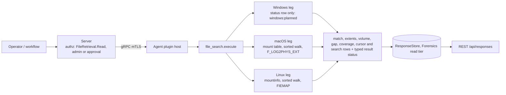

# file_search

<!-- BEGIN GENERATED: plugin-doc-gen header -->
| | |
|---|---|
| **What it does** | On-demand, resumable search of the local disks by file or directory name, with the extents of every matched file; names, types, sizes, times and extents only |
| **Version** | 1.0.0 |
| **Kind** | Collector · read-only · gathered (crossplatform.file_search.search) |
| **Platforms** | Windows 🟡 planned · macOS 🟡 constrained · Linux 🟡 constrained |
| **Actions** | `search` (definition `crossplatform.file_search.search`) |
| **Security** | securable `FileRetrieval` · operation Read · risk High · dispatch ReadOnly · approval gate AdminOrApproval |
| **Roles** | execute: admin · author: content-author |
<!-- END GENERATED -->

## How it works

`search` finds files or directories by leaf name under one absolute root on the local disks of one device. Each match is reported with its type, size, modification time and, for a regular file, its extents (where on the volume the filesystem keeps the file's data). The plugin reads names, types, sizes, times and extents. It never reads the contents of a file and takes no hash of anything. A matched regular file is opened read-only, without following a link, so the system can be asked for its size, time and extents; no byte of it is read, and an on-access scanner on the host sees the open. A matched directory carries no size, time or extents. Nothing is written, signalled or changed.

One call is one slice of the search. A slice ends when the walk finishes, or when it reaches a time, entry, row or byte budget, or when the search reaches its slice maximum (the budgets are named constants in the source and are not restated here). Every slice ends with exactly one `search` row. A slice that stopped early also writes a `cursor` row; the caller repeats the call with that token as `cursor` until a slice answers without one. A search roots at one directory but may cross several mounts: each searched mount is one unit and a slice searches one unit, the mount that contains the root first and the others in order of mount point. Within a unit the walk is depth-first and visits the names of each directory in byte order. Every answer carries a `coverage` row that says whether everything under the root was searched, so an empty result is never confusable with a failed or partial one.



### The request

| Parameter | Rule |
|---|---|
| `root` | Mandatory and absolute. A trailing slash is ignored and `/` is the whole filesystem. An empty path, a doubled slash, a `.` or `..` component and a NUL byte are refused (`missing_root`, `root_not_absolute`, `root_too_long`, `root_bad_component`). On the first slice the leg checks the root itself: a root that is a link at any component answers `root_is_link`, one that does not exist `root_not_found`, one that is not a directory `root_not_a_directory`. The three tokens are the whole answer: nothing is searched. |
| `pattern` | Mandatory. A leaf-name glob matched against each entry's name, never the whole path: `*` matches any run of bytes including none, `?` matches one UTF-8 character (one byte where the bytes at that position are not well-formed UTF-8), and every other byte, `[` and `]` included, is a literal. There is no regex, no character class and no escape; `/` and NUL are refused. A pattern that could match nearly everything is refused with its own token rather than run: too long (`pattern_too_long`), too many `*` (`pattern_too_many_stars`, each `*` of a run counts) or too few literal bytes (`pattern_too_few_literals`, a literal is any byte other than `*` and `?`). |
| `kinds` | `files` (the default), `directories` or `both`. |
| `cursor` | The token of the `cursor` row of the previous slice of this same search; empty for the first slice. A token that was not issued for this root, pattern and kinds is refused with `bad_cursor` before anything is read. |

The pattern dialect differs from `device.filesystem.search_dir` in three ways: there is no regex mode and `[` and `]` are literals where `search_dir`'s glob reads a character class; the bounds above refuse a pattern `search_dir` would accept; and names are compared by the rule of the OS the agent runs on (next section), where `search_dir` compares the bytes of the name it is given on every OS.

### What a name is compared as

On Linux names compare byte for byte: case-sensitive, no normalisation. On macOS the pattern and every candidate name are normalised to Unicode form C and case-folded (CoreFoundation; ASCII is folded inline) before they are compared, whatever the volume's own rule: a case-sensitive volume is still compared case-insensitively, so two names that differ only in case both match. A macOS name that is not well-formed UTF-8 compares as the bytes it is. The `search` row states the rule that ran: `bytes` on Linux, `macos_nfc_casefold_v1` on macOS.

A name longer than 255 bytes cannot be placed in a cursor position, so it is not searched: it appears as a `name_too_long` gap. A filesystem that allows longer names (the HFS family counts 255 UTF-16 units, which can be more bytes) can hold such names. A name whose compared form is too long to match is the same gap.

### What is searched, and what is not

Only mounts of a local filesystem type on an exact, case-sensitive allow-list are walked: `ext2`, `ext3`, `ext4`, `xfs`, `btrfs`, `zfs`, `f2fs`, `apfs` and `hfs` (the list also carries the Windows volume-type names, which neither mount table reports). Every other mount at or under the root, or containing it, is not walked and is named by its own `volume` row with `not_searched` and the reason:

| Reason | Mount |
|---|---|
| `network_mount` | a network, cluster or paravirtualised type (NFS, SMB, FUSE network types and the like) and an `autofs` trigger point |
| `private_namespace` | a `/tmp` or `/var/tmp` that a service manager bound in from a private per-service directory |
| `fstype_not_allowed` | any other type: memory and pseudo filesystems (`tmpfs`, `proc`, `sysfs`, `devfs`), `overlay`, `squashfs`, `fuse` and `fuseblk`, FAT, exFAT and NTFS as the Linux and macOS tables name them |
| `behind_network_mount` | an allow-listed disk mounted beneath a network mount: reaching it would open a directory on that mount |
| `duplicate_mount` | a second mount of the same subtree (same device label and same root inside the filesystem); one is walked, the other is named |
| `firmlinks_only` | macOS, a root of `/`: the data volume (`/System/Volumes/Data`), which the system volume reaches through its firmlinks; the row reads `partial` |

A mount of another refused type that lies above an allow-listed disk (a `tmpfs` or `overlay` with an ext4 disk mounted inside it) does not block the disk: the walk crosses it with one no-follow open per directory and never lists it. A network mount above a disk does block it, because listing or opening on that mount can hang. These are deliberate exclusions, not omissions: a search never touches a mount that may hang, never enters a link, and never lists a memory or pseudo filesystem; whether `tmpfs` belongs on the allow-list is an open decision (#8399).

Each unit's walk never enters, lists or names another mount point below it: the plan's `volume` rows are the one record of a pruned mount. So a mount point's own directory name is never a match candidate, and a directory bind-mounted at a second path (same device label, different root inside the filesystem) is a separate unit and is reported at both paths. Links are never followed and never matched; each one seen is counted in `links_skipped` on the `search` row. Entries that are neither a file, a directory nor a link (a FIFO, a socket, a device node) are never opened and never matched.

A search rooted at `/` reads `partial`, and says so on every slice, wherever a refused mount sits under it: every refused mount counts as a gap, and the verdict reads partial for anything not searched. On a typical Linux host that is the pseudo and memory filesystems; on macOS it is the data volume's own row and any mount of another type. A narrower root that holds no refused mount can read `complete`.

### Identity, extents and what a row can say

The match row carries `<device>:<file id>` in 16 hex digits each (the `extents` row names the same key). The device part is the number the system reports for the directory the entry was listed from, and the file id is the inode or file id. Identity is only as stable as the filesystem makes it: a remount can change a device number, a filesystem may reuse a file id after a deletion, and btrfs reports one device number per subvolume, so a nested subvolume that is not mounted reads as another device and is not entered (an `other_device` gap). A subvolume mounted at its own mount point is its own unit and is searched from there.

The `extents` row lists, for each file, up to a named cap of extents as `<logical>:<physical>:<length>:<flags>` and then the count, an exact number or a lower bound (`>=<n>`) where the system cannot count without listing. The offsets are the numbers the filesystem reports and what they are offsets into depends on it (a block device, a btrfs logical address space, an APFS container); the `btrfs_logical` flag marks the one case the leg can name. On Linux the request is `FS_IOC_FIEMAP` with no flags, so a file with data not yet allocated shows a `delalloc` extent with no physical offset, and the sync flag, which writes dirty pages back, is never used: a search never causes a write. A filesystem without the interface answers `unsupported`. On macOS the request is `F_LOG2PHYS_EXT` in pieces: a device offset of -1 is an `unallocated` hole, a file the filesystem keeps compressed answers `compressed` (with no extents), and `shared` is set on every extent of a file that shares all of its blocks with another (a clone) and on no other. A file that cannot be opened for its facts is still reported, with size and time `-` and the extents state `failed`; a macOS file that is not present locally (dataless) is never downloaded to answer.

### Users' directories

A match whose path is a user profile directory, or below one, carries `user` in its last column; every other match carries `system`. The rule is on the path: on Linux `/home/<name>` and `/root`; on macOS `/Users/<name>` except `/Users/Shared`, and `/private/var/root`. A home relocated elsewhere is not tagged, so the tag is not a complete answer to "which rows are about a person"; it exists so an export can drop the rows it knows are. User directories are always searched: a root of `/` lists names under every user's home.

### A search of more than one slice is not a snapshot

The coverage row reads `consistency=single_pass` for a search that finished in one slice and `consistency=not_a_snapshot` otherwise. A later slice resumes by name and by the identity of the directories on the resume path, so a change between slices that moves neither is not seen and leaves no gap: an entry added at or before the resume point of a directory that kept its identity, a completed directory swapped for another of the same name, and a replacement that reports the same identity as the directory it replaced (a filesystem may reuse one) or differs from it only in the half (device or file id) the earlier record left unreported. Entries missed that way are not visited. A directory that changed identity is searched again from its start, so a match can repeat; it is never silently skipped.

### A volume that stalls

A slice that has not returned by its deadline plus a grace period leaves its worker running, blocked inside one system call, which the agent cannot cancel. The agent records that volume as stalled in memory, in this agent process only, and any slice that reaches it answers a `stalled` `volume` row, counts one gap and moves on to the next volume without walking. When the blocked worker returns the entry is dropped by the next slice and the volume is searched again; nothing needs to be cleared by an operator. An agent restart also clears it: the agent keeps no state across a restart, so a volume that is still dead costs the next slice one more timeout. With two workers still blocked every call answers `busy` until one returns. The count of non-advancing attempts on one cursor is held the same way and starts again after a restart.

The runbook: the search is read-only; the agent keeps no state across restarts; if a slice answers without a cursor and with a retryable reason (`timed_out`, `rejected`, `no_progress`, `internal_error`), repeat the call with the previous cursor, a bounded number of times; `stalled` and `unstable` are final.

### Who can run it and who can read the results

The catalogue row is `FileRetrieval` · Read · risk High · `AdminOrApproval`: an administrator can launch a search; anyone else needs an approval. It is not single-target, so a search can be sent to a group or the fleet. The plugin ships off: the server seeds a default-off kill switch, and an operator enables it with `PUT /api/v1/plugin-config/file_search/kill-switch {"enabled":true}`.

What a search stores is a different matter from who may launch it. The stored rows are Forensics-tier: only a caller holding a global `Forensics:Read` reads them (the Administrator and ForensicsAnalyst roles by default, and Administrator only while RBAC is off), and each read is audited as `response.forensics.read`. A non-administrator who launches a search under an approval therefore cannot read its results unless they also hold `Forensics:Read`. There is no second tier and no second permission check for this plugin; the rule is the one in `docs/authz-model.md` section 4.

## OS capability

<!-- BEGIN GENERATED: plugin-doc-gen capability -->
| Action | Windows | macOS | Linux |
|---|---|---|---|
| `search` | 🟡 planned · rung 1 · NTFS volume search and a directory walk with the same rows | 🟡 constrained · rung 1 · resumable sorted depth-first search of the requested root, one slice per call, through no-follow directory opens; the mount table from getmntinfo_r_np decides which mounts are searched; the extents of every matched regular file from F_LOG2PHYS_EXT; dataless files are never materialised; matched files are opened and never read | 🟡 constrained · rung 1 · resumable sorted depth-first search of the requested root, one slice per call, through no-follow directory opens; the mount table from /proc/<pid>/mountinfo decides which mounts are searched; the extents of every matched regular file from FIEMAP; matched files are opened and never read |

**Declared limits per leg** (descriptor fallback text, verbatim):

- **`search` / Windows** — not read yet: one unsupported status row, windows:planned
- **`search` / macOS** — constrained: names compare by Unicode normalisation and case folding whatever the volume's own rule, so a case-sensitive volume can over-match; folders protected by the system's privacy controls are permission-denied gaps; a search rooted at / reaches the data volume through its firmlinks and reads partial; the verdict reads partial when any mount, directory or name was not searched
- **`search` / Linux** — constrained: only local filesystem types on the allow-list are searched and every other mount is reported by its own row; names compare byte for byte; a directory the agent cannot search is a gap, and the capability that lets the agent search directories of other accounts is held on the walking thread only around opens (hygiene, not a boundary); the verdict reads partial when any mount, directory or name was not searched
<!-- END GENERATED -->

## Privileges and prerequisites

| OS | Runs as | Extra grant needed | Measured | If the read is refused |
|---|---|---|---|---|
| Windows | n/a: the leg reads nothing (caveat 1) | None | n/a | `status\|search\|unsupported\|windows:planned`, result `UNAVAILABLE` |
| macOS | agent daemon: a root LaunchDaemon today (`docs/agent-privilege-model.md`) | None: no new privilege. Folders protected by the system's privacy controls (TCC, Full Disk Access) are refused to a daemon without that access; how to grant it to the agent is not settled here | 2026-11-21, one macOS 26.6.2 arm64 bare-metal host, as an unprivileged account (euid 501), over a scratch tree only (the sample). Not measured as the root LaunchDaemon; the behaviour of a daemon with no Full Disk Access over protected folders is not measured | A directory that cannot be listed is a `permission_denied` gap row; a file that cannot be opened for its facts is a match row with size and time `-` and extents `failed`; the verdict reads `partial` |
| Linux | agent daemon, dedicated unprivileged account (`yuzu-agent` on the packaged unit), never root by design (`docs/agent-privilege-model.md`) | None added by this plugin. The packaged unit already holds `CAP_DAC_READ_SEARCH` for every plugin; the search worker thread drops it from its effective set and raises it only around the lookups that need it (hygiene, not a boundary: caveat 5) | Not measured: no Linux capture exists yet, so no host, kernel or account is recorded here | A directory the account cannot search is a `permission_denied` gap row (`dir_unreadable` for another failure); a file that cannot be opened for its facts is a match row with size and time `-` and extents `failed`; the verdict reads `partial` |

No external binaries, no subprocesses, no network use. The Linux leg reads `/proc/<pid>/mountinfo` of the agent's own process (opened without following a link, streamed, never held whole) and the macOS leg reads the kernel's mount table through `getmntinfo_r_np` without a call into any server. A worker runs on the idle I/O class on Linux and the throttled disk class on macOS, with dataless materialisation off on macOS for the whole walk.

## Data contract

### Inputs

<!-- BEGIN GENERATED: plugin-doc-gen inputs -->
| Definition | Parameter | Type | Required | Default | Constraints | Description |
|---|---|---|---|---|---|---|
| `crossplatform.file_search.search` | `root` | string | yes | - | pattern: ^/ · maxLength 4096 | The absolute directory to search from. A root of / is the whole filesystem. A trailing slash is ignored; empty, . and .. components, a doubled slash and a NUL byte are refused. A root that is a link, does not exist or is not a directory is refused with its own token (root_is_link, root_not_found, root_not_a_directory). |
| `crossplatform.file_search.search` | `pattern` | string | yes | - | maxLength 128 | A leaf-name glob matched against each entry name, never the whole path: * matches any run of characters and ? any one character; there is no regex. A pattern with too few literal characters, too many * or a forbidden byte is refused with its own token, so it cannot be made to match everything. Names compare the way the device's own system compares them: byte for byte on Linux, by Unicode normalisation and case folding on macOS. |
| `crossplatform.file_search.search` | `kinds` | string | no | files | enum: files, directories, both | What to match: "files" (default), "directories" or "both". A directory match carries no size or time, because the search never opens a directory for its facts. |
| `crossplatform.file_search.search` | `cursor` | string | no | - | maxLength 32896 | The token of the cursor row of the previous slice of this same search; leave empty for the first slice. A token that was not issued for this root, pattern and kinds is refused with bad_cursor before anything is read. |
<!-- END GENERATED -->

### Outputs

Every row is one line of `|`-separated columns, and `row_kind` (field 0) names its shape. A name or path in any column is written with each byte outside well-formed printable UTF-8, and each `%`, `|` and `\`, as `%XX`, so a column never holds the delimiter. Row grammars by `row_kind`: `match|<path>|<file or directory>|<device:id or ->|<size or ->|<mtime or ->|<system or user>`, `extents|<device:id>|<state>|<count>|<list or ->`, `volume|<mount>|<fstype>|<complete, partial or not_searched>|<reason>|extents=<collected, not_collected or unsupported>|entries=<n>`, `gap|<path>|<cause>`, `gaps_dropped|<n>`, `volumes_dropped|<n>`, `coverage|<complete or partial>|slices=<n>|prior_gaps=<n>|consistency=<single_pass or not_a_snapshot>`, `cursor|<token>` and `search|<ok, invalid, busy or failed>|<reason>|<name rule or ->|seq=<n>|q=<8 hex>|links_skipped=<n>`. On a leg that is not read yet the answer is the one row `status|search|unsupported|windows:planned`. Matches and their `extents` rows come first, then the `volume`, `gap` and `coverage` rows, then the `cursor` row when one is issued, and last the `search` row. The `volume` and `gap` rows describe the slice that wrote them; the verdict on the `coverage` row is cumulative across slices. A search with no match is the `volume` and `coverage` rows and the `search` row, never an empty answer. The `q` value names a search without revealing its pattern or root.

<!-- BEGIN GENERATED: plugin-doc-gen outputs -->
**`crossplatform.file_search.search` — `row_kind|field_1|field_2|field_3|field_4|field_5|field_6`**

| Field | Type | Values | Available | Example | Description |
|---|---|---|---|---|---|
| `row_kind` | string | `match` `extents` `volume` `gap` `gaps_dropped` `volumes_dropped` `coverage` `cursor` `search` `status` | Windows, Linux, macOS | `match` | Row shape discriminator (field 0). Values: match, extents, volume, gap, gaps_dropped, volumes_dropped, coverage, cursor, search (the last row of every slice), and status (one row on a leg that is planned and not read yet). |
| `field_1` | string | - | Windows, Linux, macOS | `/srv/data/report-2026.pdf` | match: the path, with each byte outside well-formed printable UTF-8 and each % \| \ written as %XX. extents: the file identity, device:file id in 16 hex digits each, equal to field 3 of the match row of the same file. volume: the mount point, escaped like a path. gap: the path of the directory or entry that was not searched. gaps_dropped and volumes_dropped: how many were left out of the answer. coverage: complete or partial. cursor: the token to pass back as the cursor parameter. search: ok, invalid, busy or failed. status: the literal "search". |
| `field_2` | string | - | Windows, Linux, macOS | `file` | match: file or directory. extents: ok, compressed (the filesystem keeps the file encoded and reports no extents), unsupported or failed. volume: the filesystem type. gap: the cause (depth, dir_unreadable, dir_truncated, other_device, network_mount, memory_cap, permission_denied, dataless, private_namespace, name_too_long, match_cap). coverage: slices=<n>, the slices of this search so far. search: the reason, a closed token (none, a coverage reason, a fault such as busy or timed_out, or a request error such as bad_kinds). status: unsupported. |
| `field_3` | string | - | Windows, Linux, macOS | `00000000000000fd:0000000000a1b2c3` | match: the file identity, device:file id in 16 hex digits each, or "-" when unknown; the key of the extents row. extents: the extent count, or >=<n> when the system cannot count without listing. volume: complete, partial or not_searched. coverage: prior_gaps=<n>, gaps carried from earlier slices. search: the name rule that ran (bytes on Linux, macos_nfc_casefold_v1 on macOS), or "-" when no pattern was compiled. status: the planned token such as windows:planned. |
| `field_4` | string | - | Windows, Linux, macOS | `48213` | match: the size in bytes, or "-" for a directory or a file that could not be opened. extents: the extents, each logical:physical:length:flags joined by commas, or "-" for none; flags are resident, delalloc, shared, compressed, encrypted, unwritten, unallocated and btrfs_logical joined by +, or "-". volume: the reason the volume was not fully searched (none, budget_entries, budget_time, budget_rows, cancelled, fstype_not_allowed, network_mount, mount_table_unreadable, permission_denied, private_namespace, other_device, stalled, unstable, unsupported, duplicate_mount, behind_network_mount, max_slices, mount_table_changed, firmlinks_only). coverage: consistency=single_pass or not_a_snapshot. search: seq=<n>, the slice number. |
| `field_5` | string | - | Linux, macOS | `1763251200` | match: the modification time in seconds since the epoch, or "-" when unknown. volume: extents=collected, not_collected or unsupported, whether the matches on this volume carry extents. search: q=<8 hex>, a short name for this query that reveals neither the pattern nor the root. |
| `field_6` | string | - | Linux, macOS | `system` | match: system, or user for a path under a user profile directory (a rule on the path, so a home relocated elsewhere is not tagged). volume: entries=<n>, the entries visited on the volume. search: links_skipped=<n>, links seen and never followed. |
<!-- END GENERATED -->

### Result status

The status is a coarse summary for the host; the `search` row and the `coverage` row are the answer.

| Status | Completeness | Provenance | When |
|---|---|---|---|
| `OK` | full | (empty) | The slice ran, no cursor remains and the coverage verdict is `complete`: every volume was searched in full and there is no gap |
| `OK` | partial | (empty) | The slice ran and either a cursor continues the search or the verdict reads `partial` (a refused or stalled volume, a gap, a dropped volume) |
| `UNAVAILABLE` | unknown | `file_search:busy` | Another search slice holds the agent's one slot, or two blocked workers are still recorded; repeat the call |
| `UNAVAILABLE` | unknown | `file_search:<token>` for a request token (`missing_root`, `root_not_absolute`, `root_too_long`, `root_bad_component`, `missing_pattern`, `pattern_too_long`, `pattern_too_many_stars`, `pattern_too_few_literals`, `pattern_forbidden_byte`, `bad_kinds`, `bad_cursor`, `root_is_link`, `root_not_found`, `root_not_a_directory`) | The request was refused (the command also returns 1); the `search` row says `invalid` and nothing was searched |
| `UNAVAILABLE` | unknown | `file_search:<reason>` for a failure reason (`timed_out`, `rejected`, `no_progress`, `stalled`, `unstable`, `cancelled`, `cursor_refused`, `max_slices`, `mount_table_unreadable`, `mount_table_changed`, `internal_error`) | The slice or the search ended without a result for that reason; the `search` row says `failed` |
| `UNAVAILABLE` | unknown | `linux:file_search:exception` / `macos:file_search:exception` | The body threw: one `search\|failed\|internal_error` row and the command returns 0 |
| `UNAVAILABLE` | unknown | `windows:planned` / `macos:planned` / `linux:planned` | The leg reads nothing (caveat 1): one `status\|search\|unsupported\|<os>:planned` row. `macos:planned` and `linux:planned` are the shared reporter's tokens and are not emitted by this plugin's POSIX legs |

### What to do about a reason

| Reason | Terminal or retryable | Action |
|---|---|---|
| `busy` | Retryable | Another search holds the slot, or two blocked workers are recorded; repeat the call after a moment |
| `timed_out`, `rejected`, `no_progress`, `internal_error` | Retryable, a bounded number of times on one cursor | Repeat the previous cursor. The agent counts non-advancing attempts per cursor in memory; the last one allowed ends the search `stalled`. The command returns 0 |
| `stalled`, `unstable` | Terminal for that search | A volume does not answer, or a directory kept changing identity under the resume; start a new search. A stalled volume clears itself when its worker returns and on an agent restart |
| `mount_table_changed` | Terminal for that search | The set of searchable mounts changed between slices; start again. A change in refused mounts alone does not end a search |
| `mount_table_unreadable` | Terminal for that call | The mount table could not be read in full, no mount contains the root, or the host has more mounts at or under the root than the plan keeps; a narrower root may work |
| `max_slices` | Terminal | The search reached its slice maximum; the volumes not reached are named `not_searched`. Narrow the root or the pattern |
| `cancelled` | Terminal | The agent is shutting down |
| `bad_cursor`, `cursor_refused`, `bad_kinds`, any other request token | Terminal for that request | The request or token was refused; fix the parameter, or start without a cursor |

### Where the data goes

- **Instruction result.** Every row is server instruction-result data under the Forensics read tier: stored under the standard response retention and served over REST `/api/responses` and MCP only to a caller who holds a global `Forensics:Read` (Administrator and ForensicsAnalyst by default; Administrator only while RBAC is off). The live output events never carry these rows.
- **Not consumed by** the daily sync, Echo or DEX: the action runs on demand only. Eight counters (`slices`, `budget_stops`, `stalled`, `unstable`, `timed_out`, `rejected`, `failed` and `gaps`, each a total since the agent started) are published as heartbeat status tags `yuzu.plugin.file_search.<counter>`; they carry no path, pattern or root. A log line names a search by the `q` prefix and a reason, never a path or pattern.
- **Default off, and how to turn it on.** The server seeds a default-off kill switch at boot, so nothing dispatches until an operator runs `PUT /api/v1/plugin-config/file_search/kill-switch {"enabled":true}` (`PluginConfig:Write`, audited as `plugin_config.kill_switch.set`). Launch is then `FileRetrieval` with `AdminOrApproval`.
- **Sensitivity.** Rows list the names of files and directories under every directory searched, including other accounts' profile directories, with sizes, modification times and the physical layout of each file. Names can identify a person (a profile directory carries an account name, and a file name can name a document or a client) and the listing is reconnaissance material about what a machine holds. A match under a profile directory is tagged `user` so an export can drop it; a relocated home is not tagged. No file content and no hash appears in any row. The committed sample was taken over a scratch tree.
- **Siblings:** `device.filesystem.search_dir` (names under a confined root, glob or regex, no extents), `device.filesystem.find_by_hash` (matches by content hash), `crossplatform.components.scan` (installed components) and `crossplatform.storage.mounts` (the mount inventory).

## Sample output

<!-- BEGIN GENERATED: plugin-doc-gen samples -->
**macOS** — captured: macos macOS 26.6.2 arm64 · bare-metal · 2026-11-21 · euid 501 · leg-hash c2884861b725

```
== action=search root=/private/tmp/yuzu_test_file_search_sample pattern=yuzu-fs-control-* kinds=both
match|/private/tmp/yuzu_test_file_search_sample/n1/n2/n3/n4/n5/n6/n7/n8/n9/n10/n11/yuzu-fs-control-d12.bin|file|0000000001000011:0000000039e1242b|8|1795261130|system
extents|0000000001000011:0000000039e1242b|ok|1|0:98863116288:8:-
match|/private/tmp/yuzu_test_file_search_sample/yuzu-fs-control-d1.bin|file|0000000001000011:0000000039e1241f|8|1795261130|system
extents|0000000001000011:0000000039e1241f|ok|1|0:98863112192:8:-
match|/private/tmp/yuzu_test_file_search_sample/yuzu-fs-control-dir|directory|0000000001000011:0000000039e1242c|-|-|system
volume|/|apfs|complete|none|extents=collected|entries=16
coverage|complete|slices=1|prior_gaps=0|consistency=single_pass
search|ok|none|macos_nfc_casefold_v1|seq=0|q=f25c9ba4|links_skipped=1
[result_status] OK / FULL
```
<!-- END GENERATED -->

## Caveats and known gaps

1. **Windows is planned.** The Windows leg reads nothing and answers `status|search|unsupported|windows:planned`; a later change adds an NTFS volume search and a directory walk with the same rows. The descriptor and the capability matrix already declare all three legs.
2. **A search from `/` reads partial.** Every refused mount is a gap, so a search rooted at `/` cannot read `complete` on a host that has a pseudo, memory or network mount; narrow the root to read `complete`. On macOS the data volume is searched only through the system volume's firmlinks, so a data-volume directory that no firmlink exposes is not searched and the data volume's own row reads `partial` (`firmlinks_only`). A host that mounts a btrfs top-level subvolume also reads partial through `other_device` gaps on that mount.
3. **Only part of what changes between slices is seen.** The limits under "A search of more than one slice is not a snapshot" apply to every search that needs a cursor, and matches beyond the per-directory cap of one slice are not reported: that directory is named by a `match_cap` gap and the verdict reads partial, so a very broad pattern in one directory reads partial.
4. **macOS name matching and permissions are approximate.** A case-sensitive volume over-matches because names are compared case-insensitively whatever the volume says. Folders protected by the system's privacy controls are `permission_denied` gaps, a dataless directory is a `dataless` gap, and the behaviour of a daemon that holds no Full Disk Access over protected folders has not been measured.
5. **On Linux the capability scope is hygiene, not a boundary.** The packaged unit already gives the agent `CAP_DAC_READ_SEARCH` for every plugin, so this plugin adds no grant and no packaging change. The search worker thread drops the bit from its effective set and raises it only around lookups, but the bit stays permitted on the thread, so code running on it could raise it, and every other thread of the agent holds it effective. Scoping it agent-wide is tracked in #8398.

## Source and tests

<!-- BEGIN GENERATED: plugin-doc-gen source -->
- Plugin: `agents/plugins/file_search/src/file_search_driver.hpp` · `agents/plugins/file_search/src/file_search_execute.hpp` · `agents/plugins/file_search/src/file_search_extents.hpp` · `agents/plugins/file_search/src/file_search_extents_linux.cpp` · `agents/plugins/file_search/src/file_search_extents_macos.cpp` · `agents/plugins/file_search/src/file_search_legs.hpp` · `agents/plugins/file_search/src/file_search_plugin.cpp` · `agents/plugins/file_search/src/file_search_posix.cpp` · `agents/plugins/file_search/src/file_search_request.hpp` · `agents/plugins/file_search/src/file_search_rows.hpp` · `agents/plugins/file_search/src/file_search_state.hpp` · `agents/plugins/file_search/src/file_search_volumes.hpp`
- Definitions: `content/definitions/file_search.yaml`
- Capability rows: `server/core/src/capability_decls/plugin_action_catalogue_file_search.hpp`
- Tests: `tests/test_file_search_definition.py` · `tests/test_file_search_read_tier_tripwire.py` · `tests/unit/test_file_search_coverage.cpp` · `tests/unit/test_file_search_cursor.cpp` · `tests/unit/test_file_search_driver.cpp` · `tests/unit/test_file_search_governor.cpp` · `tests/unit/test_file_search_local_dispatcher.cpp` · `tests/unit/test_file_search_names.cpp` · `tests/unit/test_file_search_posix_shell.cpp` · `tests/unit/test_file_search_query.cpp` · `tests/unit/test_file_search_resume_contract.cpp` · `tests/unit/test_file_search_rows.cpp` · `tests/unit/test_file_search_volumes.cpp`
- Privilege row: `docs/agent-privilege-model.md`
<!-- END GENERATED -->
