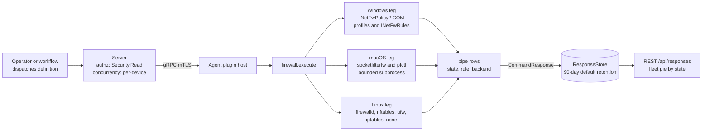
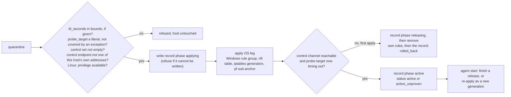
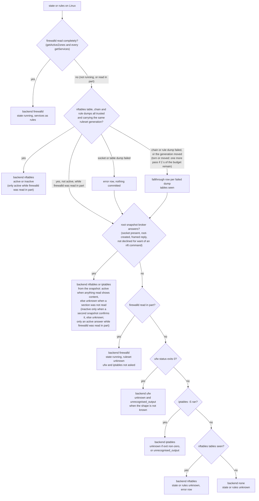
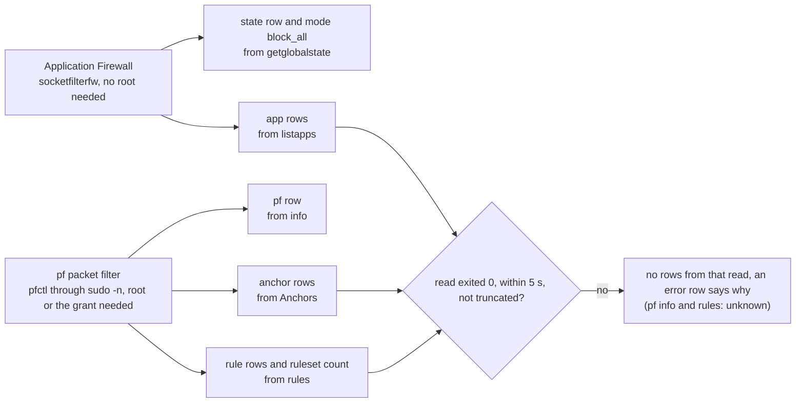

# firewall

<!-- BEGIN GENERATED: plugin-doc-gen header -->
| | |
|---|---|
| **What it does** | Firewall status, rule listing and device containment |
| **Version** | 1.0.0 |
| **Kind** | Action · mutating · gathered (security.firewall.state, security.firewall.rules, security.firewall.quarantine, security.firewall.release, security.firewall.quarantine_status, security.firewall.quarantine_allow) |
| **Platforms** | Windows ✅ · macOS ✅ · Linux ✅ |
| **Actions** | `quarantine` (definition `security.firewall.quarantine`) · `quarantine_allow` (definition `security.firewall.quarantine_allow`) · `quarantine_status` (definition `security.firewall.quarantine_status`) · `release` (definition `security.firewall.release`) · `rules` (definition `security.firewall.rules`) · `state` (definition `security.firewall.state`) |
| **Security** | `state`: securable `Security` · operation Read · risk Low · dispatch ReadOnly · approval gate None; `rules`: securable `Security` · operation Read · risk Low · dispatch ReadOnly · approval gate None; `quarantine`: securable `Security` · operation Execute · risk Critical · dispatch Destructive · approval gate AdminOrApproval; `release`: securable `Security` · operation Execute · risk High · dispatch Mutating · approval gate AdminOrApproval; `quarantine_status`: securable `Security` · operation Read · risk Low · dispatch ReadOnly · approval gate None; `quarantine_allow`: securable `Security` · operation Execute · risk High · dispatch Mutating · approval gate AdminOrApproval |
| **Roles** | execute: `state`: endpoint-admin, endpoint-operator, security-admin; `rules`: endpoint-admin, endpoint-operator, security-admin; `quarantine`: endpoint-admin, security-admin; `release`: endpoint-admin, security-admin; `quarantine_status`: endpoint-admin, endpoint-operator, security-admin; `quarantine_allow`: endpoint-admin, security-admin · author: content-author |
<!-- END GENERATED -->

## How it works

`state` and `rules` are reads. `state` answers "is the host firewall on, and which firewall answered"; `rules` lists what the same source exposes. Every parse is a pure function in `firewall_parsers.hpp`, and every subprocess is a literal argv run through the bounded runner with a fixed 5 second deadline, with no shell command line; the one program so run that is itself a shell script is the installer's root helper (rung 3, registered in the spawn-sink manifest).

- **Windows.** The `INetFwPolicy2` COM interface is called in process. `state` asks each of the Domain, Private and Public profiles whether `FirewallEnabled` is set and adds the true total rule count (`INetFwRules` count). `rules` enumerates `INetFwRules` and stops after 100 rules with a `truncated|true` marker row. Each rule's name, enabled flag, direction, action and profile mask are read separately and a value is used only when its own read returned `S_OK` (an `S_FALSE` is a failure here, as everywhere in this plugin): a property that could not be read shows `unknown` in its field, never a default such as `disabled`, `block` or profile `0`, and a rule the enumerator returned but whose object could not be obtained is an all-`unknown` row that still counts.
- **macOS.** Two separate firewalls are read. The Application Firewall is primary, because it is the firewall a Mac administrator means: `socketfilterfw --getglobalstate` gives `state|`, plus `mode|block_all` when block-all is set, and `socketfilterfw --listapps` gives the per-app allow or block list. The pf packet filter, off by default and unrelated to the Application Firewall, is secondary: `pfctl -s info` gives the `pf|` row, and `pfctl -s Anchors` and `pfctl -s rules` give the anchor names, the raw pf rule lines and the rule count. Each pf read opens `/dev/pf`, so it runs as `sudo -n -- /sbin/pfctl -s <word>` on the installer's exact read-only grant (the argv is unchanged when the agent is root). Every one of those reads is published only when the command ran, did not time out, was not truncated and exited zero; a read that did not complete never contributes a row built from its text. Each such failure is named by an `error|` row (see Reading the macOS error rows below), so an agent that has neither root nor the grant (sudo refuses and exits 1) reads as `pf|unknown`, `ruleset|unknown` and the rows that say why, never as a firewall that is off or has no rules. A global-state read that did not complete is `state|unknown` whatever its partial text said.
- **Linux.** A fixed ladder stops at the first source that answers: firewalld over sd-bus (only in builds with libsystemd; otherwise this rung is skipped; it answers first only when its read was complete, the zones and every zone's services, and a partial read is held, see below), then nftables over `NETLINK_NETFILTER` dumps, then the root snapshot broker (below), then `ufw status numbered`, then `iptables -S`, else `backend|none`. The nftables leg checks that each dump reply came from the kernel (`nl_pid == 0`) and splits its 5 second deadline across three dumps (table, then chain, then rule, with cumulative cut-offs at 1, 2.5 and 5 seconds). It also compares the ruleset generation the kernel stamps on each dump (the big-endian `res_id` of the `nfgenmsg` header): a commit that lands between two dumps moves it, so three dumps that are individually clean but disagree are not trusted as one picture (`generation:changed`). A chain or rule dump that is torn, or a moved generation, is churn and gets one more look: the three dumps run again on fresh sockets inside the same overall 5 second deadline, only when at least 2 seconds of it remain, and the second pass is the answer. A failed table dump ends the probe with no re-read, and a timeout, an error or an oversized dump gets no second look. An empty ruleset dumps no data message at all, so it has no generation and never reads as a change. The snapshot rung has its own 5 second deadline, so a run that walks every rung takes about 25 seconds in the worst case.

The packaged Linux unit (`NoNewPrivileges=true`, one capability) can read neither the nftables ruleset nor the legacy iptables tables, and `sudo` cannot elevate under it, so, once firewalld has not answered completely and the netlink dump has failed, the plugin reads the root snapshot broker: it connects to `/run/yuzu-fw-snapshot.sock` (a systemd socket unit owned by root, group `yuzu-agent`, mode `0660`), sends nothing and reads to end of stream. Each connection starts a root service that runs one fixed read-only script (ADR-3007) with no input: `nft -a list ruleset` for nf_tables, and each address family's legacy save tool under its own name (`iptables-legacy-save` and `ip6tables-legacy-save`, no argument), which lists every instantiated table and, for the tables the kernel lists, loads no module and takes no lock; the whole reply is cut at 4 MiB (4194304 bytes, the same number as the netlink leg's cap; the two bound different encodings, the text listing and the netlink dump, so a ruleset can fit one and not the other). A family with no legacy save tool reads the kernel's own list of its tables instead (the section is `[tables]` and then the names). The alternatives-selected `iptables` is never run: on an nft-backed host it is the shim, which lists nothing the nft section does not. The agent spawns no process for the read (rung 1) and treats the reply as untrusted text: the three headed sections and the closing `== end` line must all be there, or the read is `error|snapshot:empty`, `truncated` or `malformed`; on the first read the ladder then goes on, and on the second read of a pair the answer is `unknown` (below). The decision is made over three disjoint rulesets, each READ or UNREAD. The nf_tables section is READ when its text parses; each legacy section is READ when it is a save listing in the shape the parser knows (empty output with exit 0 is a family that holds no table) or `[tables]` with no name after it. A section is UNREAD when its tool failed (`[failed]`), was not installed (`[absent]`, the nft section only), printed text the parser does not know, or is `[tables]` followed by a name (tables exist that nothing listed). The answer: `active` when any READ section has content (an nft rule or a base chain whose policy is not accept, a legacy rule, a user-defined chain or a policy other than ACCEPT); otherwise `unknown` when any section is UNREAD, with one error row per unread section (`error|nftables:snapshot:failed`, `error|nftables:snapshot:absent`, `error|iptables:snapshot:failed`, `error|iptables:snapshot:absent`, `error|<tool>:unrecognised_output` and the `ip6tables` forms); and `inactive` with `ruleset|0`. `inactive` is answered only when all three sections were read and none shows content, in two snapshots taken one after the other; a rule count is written whenever all three sections of the answering snapshot were read and the netlink read did not turn the state to unknown. The second snapshot is taken only when the first reads `inactive`, and its answer is the answer (`inactive` confirmed, `active`, or `unknown` with its error rows). A second snapshot that cannot be taken or framed, that finds no transport (`error|snapshot:gone`) or that declines is `unknown` with the row that says why and no count, and the read ends there, without the `ufw` and `iptables -S` rungs, which read less than the snapshot. A host that reads `inactive` makes two broker reads (two helper runs on an installer-provisioned host) per `state` or `rules`, and both snapshots share the client's one 5 second deadline: a host on which they do not fit reads `error|snapshot:timeout` (`error|snapshot:helper:timeout` through the helper) and `unknown`, never `inactive`. The rule count is the nft rules plus the `-A` rules of both legacy families; otherwise `ruleset|unknown`. `backend|iptables` is written when a legacy section has content and nft has none, else `backend|nftables`. A legacy row is `rule|[ip6|][<table>|]<kind>|<chain>|<spec>`: `<table>` is one of `nat`, `mangle`, `raw`, `security` (the `filter` table writes none) and `<kind>` is `policy`, `new_chain`, `append` or `unknown`, so the second field is one of nine fixed words and never `nftables` or `firewalld`, which the other backends' rows carry there (`rule|raw|append|PREROUTING|...`, `rule|ip6|mangle|policy|...`). The save parser accepts a subset of what `iptables-save` writes: the five kernel table names, each once, and every chain and append line with its double quotes closed; anything else is `error|iptables:unrecognised_output` (or the `ip6tables` form) and no row. A host with no `nft` command cannot have nf_tables read: with no content in any section that was read the rung declines, writes only `error|nftables:snapshot:absent` (and the other unread sections' rows) and the ladder goes on, so the host reads as a host without the broker does and never `inactive`; with legacy content it answers `active` with `ruleset|unknown` and that error row. `ufw` hosts are reported through these nftables or iptables rows, because the snapshot has no `ufw` section. The root agent's direct `iptables -S` leg reads whichever iptables the alternatives select and lists the filter table only (#8614), so on the same host its rows and count can differ from the broker's in the label, the tables read and the count; the broker's reads are the ones that list every instantiated legacy table. When the netlink dump fails before any table is seen (for `rules`, also when tables were seen and their chain or rule dump was not trusted: the `rules` legs have no clamp) and the snapshot rung does not answer (no transport, or a first read that failed or declined), `ufw` and `iptables -S` answer unclamped, as they do on a host without the broker: for a root agent they can read `inactive`, or for `rules` a list and a count without the rules they do not list (#8638), while the packaged account is refused both and reads `unknown`. A host without the broker has no socket file. If the agent is also not root and not under `NoNewPrivileges` and the helper file is there (a host the installer provisioned), the rung reads the same listing from the root helper's `snapshot` word through `sudo -n --` instead (the same strict framing and the same decision; rung 3 at that one site, `firewall/try_snapshot#1` in the spawn-sink manifest). A host with no helper file makes no sudo call and says nothing, and the ladder goes on; a sudo that refuses (exit 1), or a helper that timed out, was clipped or failed, is `error|snapshot:helper:<token>`. A non-root agent that is not under `NoNewPrivileges`, has the helper file and no sudo grant makes one refused `sudo -n` attempt per `state` or `rules` read, which reads `error|snapshot:helper:exit:1`. Whether the refusal is logged is the host's sudo: measured on Rocky 9.9 (sudo 1.9.17p2) one audit-log record per attempt (`USER_CMD`, `res=failed`) and no syslog line, and on Ubuntu 26.04 (sudo-rs 0.2.13) no line naming the helper command under the journal identifier `sudo`, the only log searched there. The helper has no connection limit: the agent's command pool (4 to 32 workers) bounds how many helper runs are in flight, and the runner caps each run's output at 8 MiB.

A firewalld that answered `getActiveZones` but whose `getServices` was refused, failed, did not decode or ran out of the 5 second budget is held, not answered: it says that firewalld runs, not what filters. Measured on Rocky 9.9 (aarch64, SELinux enforcing, firewalld running) as the packaged account, which has no polkit rule: `getActiveZones` answers and `getServices` is refused. While firewalld is held the nftables rung answers only a ruleset that shows content, and the snapshot rung only an `active` answer (any other snapshot answer writes just its `error|` rows, so a refusal is still reported); a held answer is therefore replaced only by a complete read that shows an active ruleset, never by `inactive` or `unknown`. When no read does, the plugin writes firewalld's own rows after the deferred table-dump row (`backend|firewalld`, `state|running`, `ruleset|unknown`; for `rules` the services that were read, then `ruleset|unknown`), and `ufw` and `iptables` are not asked. A firewalld host whose read was complete answers at once. The reason is that firewalld can run on its iptables backend, where the nf_tables ruleset an agent reads can be empty: an `inactive` there would be false.

The honest-status rule holds on every leg: empty, truncated or unrecognised output parses to `unknown` (state) or no rows (rules), never to a false-safe "disabled" or an invented rule. If nftables' table dump succeeds but a later chain or rule dump fails, the leg writes a `fallthrough|nftables:<dump>:<reason>` row for EACH failed dump (both reasons, not just the first) and continues to `ufw` then `iptables`, with their verdicts clamped so a downstream "disabled" cannot contradict tables already seen. Output from `ufw` or `iptables` that completed but is not in the shape the parser knows is not read as "no rules": the state and the count read `unknown`, with `error|ufw:unrecognised_output` or `error|iptables:unrecognised_output`, and the rule rows already parsed are still written.



### Device containment

Four more actions contain a host and lift the containment again: `quarantine`, `release`, `quarantine_status` and `quarantine_allow`. All of them run through one OS-neutral core (`firewall_quarantine_parsers.hpp`) that decides everything and is unit-tested on every host; the plugin only wires an OS mechanism to it. Windows, Linux and macOS are implemented; the macOS design is in `docs/quarantine-macos-pf-anchor-design.md`. Three limits are part of the contract. **Linux is constrained on the packaged systemd unit**: it runs as `yuzu-agent` with `NoNewPrivileges=true` and no sudoers grant, so `sudo` cannot elevate and every mutating action (`quarantine`, `release`, `quarantine_allow`) is refused up front, `refused|privilege_unavailable`, before any record is written; the privilege path is a later change. **A time limit (`ttl_seconds`) ends the containment unattended, with two limits of its own** (caveat 2): its expiry release is logged on the agent (`firewall: release -> inactive ttl_expired=1`), and a device-reported time limit never ends a server-applied record: the server reads that `inactive` answer as drift and contains the host again (a host that refuses the apply is not contained again: its re-apply is refused), so after a limit passes check `quarantine_status`; and it is measured on the host's wall clock while the quarantine blocks NTP, so a clock stepped back means it never fires and one stepped forward releases early. **A host that is its own server refuses new containment** (the next section): `quarantine` answers `refused|self_host` before the privilege check and changes nothing, so a host that was already contained stays contained, and a packaged Linux unit whose server is the host itself answers that, not `privilege_unavailable`.

- **What stays reachable.** Loopback, the agent's own control channel (the address the agent is connected through when the quarantine is applied, which the agent daemon publishes from the stream the server answered on, plus every address the server name resolved to at agent start on the server's port; the host being contained never chooses which address survives, and neither the plugin nor the host resolves a name at quarantine time), DHCP (UDP 67 and 68; on Windows scoped to the DHCP client service, as Windows' own DHCP rules are), DNS to the host's configured resolvers (at most eight, port 53), IPv6 neighbour discovery, and any operator exceptions. Nothing else is reachable and nothing that existed before is: Linux has no "established" accept, so a connection that predates the quarantine is cut unless an allowance matches it. DHCPv6 (UDP 546 and 547) and multicast listener discovery are not allowed on any OS, and Windows disables its built-in rules for both, so a host that depends on stateful DHCPv6 loses its address when the lease expires. The containment covers the host's own IP traffic and the traffic the host routes; **L2-bridged guests (without `br_netfilter`), macvlan and ipvlan containers and Hyper-V external-switch guests never reach the hooks it uses and are not contained.**
- **A host that is its own server refuses new containment.** Every `firewall.quarantine` apply that is not `repair=1` is checked, whoever sent it (an operator's dispatch, the server's reconciler, an MCP re-apply) and an apply to an already-contained device included: the control endpoints (the live peer and every address the server name resolved to at agent start) are compared with every address the host answers to, loopback and link-local included, and the answer is `refused|self_host` when one is an own address or is loopback or unspecified, because the server it must keep reaching would be the host itself, so the apply could not be released from outside. A read of the host's own addresses that fails refuses too (`refused|own_addresses_unreadable`), because an unknown is not "not this host"; that read fails for good where the agent cannot open `AF_NETLINK` (a unit or seccomp profile that denies it), so every checked apply is refused there until the agent is allowed it, and the agent log names the errno. A loopback or unspecified control address is refused whatever that read returned. A refusal changes nothing: no leg is built, no record is stored, and an existing record and its containment are left as they were; there is no override. So the token alone does not say whether the device is contained. A device that held no containment stays uncontained and its record never confirms. A device that was already contained stays contained: the repair and the boot re-apply keep the stored containment, and the server's re-apply is refused there. A time limit set on the device (by a `firewall.quarantine` dispatch outside the quarantine routes; a server apply carries none) still ends that containment, and the server cannot then contain it again. `quarantine_status` says which. The check runs before the privilege check, so a packaged Linux unit whose server is the host itself (the unit's default) answers `self_host`, not `privilege_unavailable`. Not checked: the 60-second repair, the boot re-apply, `release` and `quarantine_allow`, so a stored containment is still re-applied and is released wherever the agent can elevate (on the packaged Linux unit only an operator's forced end ends the record, see Caveats 5); `release` and the console steps still lift a containment on a device that refuses. The refusal is in the agent log (`firewall: quarantine -> refused:self_host`) and in the command's stored reply (the `status|refused|<token>` row). The server keeps re-dispatching to a device that refuses, so on a device that held no containment a record that was never confirmed stays unconfirmed until an operator deletes it. On a device whose own record (the one the plugin keeps on the device) is active, a refusal carries `note|allow_set_unchanged_use_quarantine_allow=1` when the request's exceptions differ as a set from those in force (the same rule and text as a retry that is not refused), so a never-confirmed server record then stays unconfirmed (`allow_set_not_applied`); with equal exceptions there is no note and the status read confirms. Do not release and quarantine again to change the whitelist on such a device: the release lifts the containment and the new quarantine is refused, so the device ends uncontained; use `quarantine_allow`. A single-host stack (the agent and the server on one machine) therefore cannot apply a containment.
- **Windows.** A Windows Firewall rule group named `Yuzu Firewall Quarantine` holds one allowance rule per entry, and every profile's default action is set to block, inbound and outbound. An Allow rule beats a profile-default block, so every other enabled rule is disabled for the duration, its name written to the plugin's storage before the first one is touched, and re-enabled on release. The pre-quarantine default actions are captured once and restored; a default the profile had no local value for (read from the local policy store, `HKLM\SYSTEM\CurrentControlSet\Services\SharedAccess\Parameters\FirewallPolicy\<Domain|Standard|Public>Profile`, because `INetFwPolicy2` reports only the effective action) is restored by first writing the OS default through the firewall API (inbound block, outbound allow, so the running service is correct at once) and then deleting the local value, so a host that relied on the OS default stays unpinned; a default action set locally while a quarantine is active is overwritten on release (the captured snapshot wins); a local value that cannot be read refuses the apply (`prior_policy_unreadable`), and a delete that fails counts as a restore failure. A release widens first and removes the allowance rules last: a default action that will not restore, or a captured image that exists but cannot be read (an old format or a malformed one: `note|prior_policy_unreadable=1`), leaves the allowances in place and the release incomplete (`partial|release_failed:release_incomplete`); only a confirmed absence of the image falls back to the OS default, so the host is never left blocking with no allowance; the record stays `releasing` and the next release or agent start retries. A rule the policy store refuses to disable (typically one delivered by Group Policy) is counted, and the result is `partial`, never `active`. A stock rule is remembered by every property that tells two rules apart (name, direction, profile, protocol, local and remote ports, program, service and action: Windows ships rules that share a name and differ by profile, one on and one off, and an administrator's copy can differ by a single port), so a release switches back on what the quarantine switched off and nothing else, bar the one guess described next. A listed rule that someone edited during the quarantine (its program, ports, service or action changed, so its key no longer matches) is found by name, direction and profile instead, but only when two things hold: when the quarantine switched it off, no other rule, on or off, carried that name, direction and profile (the stored list records this for each rule), and exactly one rule in total, switched on or off, carries them at release. If that rule is switched off it is switched on: that is a guess, so the reply says so (`note|rules_reenabled_by_identity=<n>`). If it is already on (a retry after that guess, or the edited rule switched back on by hand) it is accounted for and the reply says so (`note|rules_accounted_enabled=<n>`). In every other case nothing is switched on for it (a second rule of the same name, direction and profile may have been off before the quarantine, and a rule that was renamed, or moved to another direction or profile, would otherwise leave that second rule looking like it) and the release completes as `partial|rules_unmatched` with `note|rules_unmatched=<n>`, up to 8 names go to the agent log and the record is erased (an unmatched rule is never a reason to keep retrying). A host where Group Policy or MDM controls ANY of the three profiles is refused (`refused|gpo_override:<Profile>`, naming the first controlled profile) before anything is touched: the quarantine writes a default block on every profile, and Microsoft documents that a rule or default written locally takes no effect where Group Policy controls the firewall, so a containment would be a lie there. Each profile's Group Policy store (`HKLM\SOFTWARE\Policies\Microsoft\WindowsFirewall\<Profile>Profile`) and its MDM store (the Firewall CSP's `HKLM\SYSTEM\CurrentControlSet\Services\SharedAccess\Parameters\FirewallPolicy\Mdm\<Profile>Profile`; the path is taken from the CSP's documented storage and is not yet confirmed on a host) are read, because `INetFwPolicy2::LocalPolicyModifyState` describes the current profile only and a laptop on its Private network would otherwise be contained while its Domain profile is policy-controlled. A profile counts as controlled when `AllowLocalPolicyMerge` is present and 0 (the quarantine's allowances would not merge, so the host would be block and block with no allowance) or when `DefaultInboundAction` or `DefaultOutboundAction` is present, whatever its value (a policy-set default makes the quarantine's default block, and its restore, inert), so **a host whose policy itself sets block and block is refused too**. The two stores are folded per profile: a definite override in either one controls the profile, even beside a store that could not be read; otherwise an unreadable store leaves the profile unreadable. A missing key or value is no policy; a store that cannot be read is refused as `firewall_state_unreadable:<Profile>`, never guessed. The `LocalPolicyModifyState` reading (`GP_OVERRIDE`) stays as a second signal and, on its own, refuses with the bare `gpo_override`. A policy that arrives after the quarantine reads `degraded|gpo_override` on every status (with `note|firewall_profile=<Profile>` when the store named one; never `partial` or `active`), an update fails whole (`update_failed|gpo_override:<Profile>`), and the self-check does not retry it, because a re-apply would write the same ineffective values. A rule that Group Policy will not let release switch back on is its policy's, not the containment's: it is a `note|rules_not_reenabled=<n>` on a completed release. A default action that will not restore keeps the release incomplete and names its profile (`note|policy_restore_failed=<Profile>`). A captured image that never parses (a corrupted store; no older format ever shipped) keeps every retry incomplete with the allowances in place; until the break-glass release lands, recovery is manual on the host: remove the `Yuzu Firewall Quarantine` rule group and set each profile's default actions back (for example `Set-NetFirewallProfile -DefaultInboundAction NotConfigured -DefaultOutboundAction NotConfigured`). A profile whose firewall is switched off makes every rule and the default block inert, so the apply refuses (`refused|firewall_disabled:<Profile>`, or `firewall_state_unreadable:<Profile>` when the switch cannot be read) before anything is touched, and the status reads `degraded|firewall_disabled` with `note|firewall_profile=<Profile>` naming the profile; the plugin never switches a firewall on, because that switch is often policy-managed and is not the plugin's to undo. A previous generation's rule that would not delete during an update is a live allowance the record no longer lists, so it is counted, persisted and reported `partial|stale_rules_left` until a later update removes it.
- **Linux.** With `/usr/sbin/nft` present, the plugin loads its own `inet yuzu_quarantine` table in a single nft transaction (a non-root agent has the root-owned helper load it with `nft load`; an agent that runs as root runs `nft -f` itself): input, output and forward base chains at policy drop plus the allowances, replacing the previous generation atomically, so a failed load leaves the old table in force. The chains are stateless: a TCP allowance's reply path refuses a bare SYN (`tcp flags & (syn|ack) != syn`, two positive `--tcp-flags` rules on iptables), so a peer cannot open a new connection from its service port, but **a UDP allowance admits datagrams from the peer's service port to any local port**, because the design has no connection tracking on purpose. Release is one `delete table`, and a table is treated as already gone only when nft itself says so (`Error: ... No such file or directory`), never on the text of `sudo` or the dynamic loader. Without nft it builds a new `yuzu-fwq-<generation>` chain in iptables and ip6tables (INPUT, OUTPUT and FORWARD jump to it), inserts the new jumps, then removes the old generation, so both exist during the swap and an update only ever tightens; the status requires our jump to be the FIRST rule of INPUT, OUTPUT and FORWARD (a Docker restart re-inserts its own FORWARD jump ahead of ours, which reads `degraded|policy_not_blocking` until a retried `quarantine` repairs it). IPv6 is judged from two facts, the `ip6tables` binary and the host's IPv6 stack: a host with a stack (or one whose stack cannot be read) and no `ip6tables` is refused (`refused|ip6tables_missing`, `refused|ipv6_stack_unknown`) rather than contained over IPv4 only, and only a host that has IPv6 switched off is contained over IPv4 alone. The apply plan, including every exception on both address families, runs under a 60 second deadline and the verification gets 10 seconds more; the undo of a failed initial apply gets a fresh 60 seconds, so a failed apply takes up to about 130 seconds. A boot-time re-apply is bounded by the first two.
- **macOS.** The plugin never loads or rewrites the main pf ruleset. It loads its own sub-anchor `com.apple/000.yuzu_quarantine` with `pfctl -a ... -f` (a non-root agent has the root-owned helper's `pf load` action run it; see Privileges below), which Apple's own `anchor "com.apple/*"` line already evaluates; the `000.` prefix makes it sort ahead of Apple's `200.AirDrop` and `250.ApplicationFirewall` anchors, because pf evaluates sub-anchors in name order and a `quick` pass in an earlier one would win. The anchor opts out of NAT and redirection (`no nat all`, `no rdr all`), passes loopback and the allowances, and ends in `block drop quick all`. The control channel is stateless in both directions, so the one `pfctl -F states` that follows the load (pf passes a packet that matches a state without looking at any rule, so established connections would otherwise survive) cannot disturb the stream the agent's reply travels on. pf is switched on with `pfctl -E`, which returns a reference token the plugin records at once; release empties its own anchor (`-F rules`, `-F nat`, never `-F all`) and releases that token. If another actor switches pf off (`pfctl -d`) the status reads `degraded|pf_disabled` and the next `quarantine` or agent start releases the dead token and takes a fresh one. Two further statuses mean a re-apply cannot help and say so: a main ruleset with no `anchor "com.apple/*" all` line (`anchor_not_referenced`, which also fails an apply before anything is loaded) and an anchor that sorts ahead of ours (`anchor_not_first`, `partial` on apply). An empty anchor (`policy_not_blocking`) is repaired by the next `quarantine`. The staged ruleset path may contain a space (the packaged data directory is `/Library/Application Support/Yuzu`) and is checked against the staging directory before `pfctl -E` takes a reference.
- **Verify after applying.** The agent connects to the live control address, the one the agent daemon is connected through right now (it must succeed; `note|control_proved=live`), or, at agent start when no Register has happened yet, to a listed control endpoint (`note|control_proved=listed`), and to the optional `probe_target`, an IP literal that answered before the change and must now time out; a probe target that an operator exception already admits is refused before anything changes (`refused|probe_target_covered_by_exception`). `active` means the proof STARTS with `verified`: any proof that failed (the control channel did not answer, the probe target was still reachable) reads `active_unproven` in every later status, a no-op update and the TTL tick. A refused connection after the change means the packet got through, so it counts as reachable. A failed initial apply writes the phase `releasing` first, then removes its own rules, then the record, and reports `rolled_back`, so a crash or a failed record delete at any point is finished by the next start and never re-applies the containment that just failed its check; with no probe target the result is `active_unproven`.
- **Generations and phases.** The record `quarantine.state` in the plugin's storage is written, with phase `applying`, before any change to the host, and the action refuses (`refused|state_not_persisted`) when it cannot be written. It then moves to `active`, or `releasing` during a release. A `quarantine_allow` update writes the next generation first, applies it as an update, and on failure puts the previous generation's record back (`update_failed|<reason>`); rollback to nothing exists only for the first apply. Two `update_failed` answers do NOT mean the previous generation is in force: `update_failed|revert_failed:<reason>` (the new generation failed verification and the revert failed too) leaves the NEW generation in force with its record `applying`, and `update_failed|commit_unknown` (a tool committed and then overran its five-second budget, so the kernel may hold either set) leaves the candidate record `applying`; in both the next retried `quarantine` or agent start converges the full set. A retried `quarantine` over an incomplete (`applying`) record takes the request's `probe_target` (proven reachable first) in place of the stored one. A `quarantine` retried on an active record never rewrites its stored allow set or expiry, except to admit the agent's live control peer when the stored set lacks it (`note|control_live_peer=<ip:port>`, or `note|control_live_peer_over_cap=1` when the set is full; see Self-check), and answers what `quarantine_status` would unless a re-apply can repair the gap (it then re-applies the stored set and adds `note|repaired=1`); a `ttl_seconds` it carries is answered with `note|ttl_unchanged_release_then_quarantine=1`.
- **At agent start.** `init()` finishes an interrupted release, and re-applies a stored containment the host no longer enforces (a reboot, a release by hand, pf switched off) as a generation update; a re-apply that fails puts the record back as it was, so for an `active` record `quarantine_status` reports what the host does, `degraded` with a reason such as `firewall_disabled`, `gpo_override`, `policy_not_blocking`, `pf_disabled`, `anchor_not_referenced` or `os_unreadable`. A record that was already `applying` stays so and reads `partial|operation_in_progress`, and `note|state_restore_failed=1` means the put-back itself could not be saved, so the record is left `applying` and reads the same way. A record whose initial apply never completed (no proof was ever recorded) is NOT promoted to `active` when the control channel does not answer at start: it stays `applying` (`note|control_unreachable_unproven=1`) until a retried `quarantine` converges and verifies it. It never rolls back and never releases because the server is unreachable. A host whose control set stopped matching the server (a re-addressed server, a wrong set) is lifted by a `release` dispatch that reaches it, by a configured time limit (`ttl_seconds`) running out (the `release if_ttl_expired=1` tick, or the release at start when the limit lapsed while the agent was down), or by the later break-glass. Without a time limit there is no local release in this release, a containment removed by hand is re-applied at the next start while the record is `active`, and the exit is **not** bounded. A store that cannot answer (SQLite busy, a closed handle) reads as `degraded|state_unreadable` and changes nothing: it is never read as "no record". A time limit that lapsed while the agent was down is released at start (`note|ttl_expired=1`), not re-applied. A time limit is enforced by an interval trigger (`firewall.quarantine.ttl`, every 30 seconds) that runs `release` with `if_ttl_expired=1`: a no-op until the limit passes (a lapsed limit always releases: nothing defers it), and a trigger that cannot be registered is residue (`partial|ttl_unregistered`) until a later registration succeeds. An expiry release leaves one agent log line; the server's own record of a containment it applied is described in the first paragraph above.
- **Self-check.** While a record exists, an agent-local interval trigger (`firewall.quarantine.repair`, every 60 seconds) dispatches `quarantine` with `repair=1`, which the plugin routes to a repair path (a bare periodic `quarantine` would start a containment with no record and converge an in-progress one every minute). The trigger's dispatch carries `repair=1` and nothing else: the plugin cannot tell it from an operator's dispatch, so a `repair=1` that also names `ttl_seconds`, `exceptions` or `probe_target` is refused (`refused|repair_with_containment_parameters`, no record, no repair) instead of answering `inactive` to an operator who meant to contain. It takes the same mutation gate as every mutating action (`busy`, it never waits behind another), reads the host once (a COM enumeration on Windows, one `sudo nft list table` on Linux, a few `sudo pfctl -s` reads on macOS) and acts only on an `active` record whose live read says the host stopped enforcing it in a way a re-apply fixes (a flushed table, restored profile defaults, pf switched off): it re-applies the STORED allow set through the same converge a retried `quarantine` uses, plus the address the agent is connected through when the stored set lacks it (a server re-addressed since the quarantine: the address the agent daemon publishes from the authenticated stream, never one the host chose). That is the agent-side twin of the server's stored-whitelist-only re-dispatch rule, not an exception to it: the server reconciler and a retried device quarantine still re-dispatch the stored set alone, and the agent admits the live address the way it does when it first builds the set, from the authenticated stream and never from the caller or the host. It shows as `note|control_live_peer=<ip:port>`, or `note|control_live_peer_over_cap=1` when the set is already full and the address is left out. The repair also adds `note|repaired=1` and counts it on the record (`note|repairs=<n>` and `note|last_repair_at=<epoch>` on every later status). The count is every time the host was found no longer enforcing the stored set and re-applied, whichever dispatch found it: the self-check, or a retried `quarantine` that converged the same record. It never acts on a store that cannot answer (`degraded|state_unreadable`), never converges a record that is `applying` or `releasing` (`note|repair_skipped=1`), never re-applies what a re-apply cannot fix (a switched-off Windows profile, a profile Group Policy controls, a dangling pf anchor: reported, not retried every minute). Every repair, and every tick that finds the host degraded, is one line in the agent log (`firewall: repair -> active repair_tick=1 repaired=1 repairs=1`); a healthy tick and a gap the record already reports are silent. A repair trigger that cannot be registered is residue (`partial|repair_unregistered`) until a later registration succeeds. The tick's own reply is not sent to the server. A repair that fails verification is kept, not reverted (`active_unproven`, the failed proof as the `verify` row, one apply and no second flush): the next tick finds the host enforcing and does not repeat it. Another tool that keeps re-inserting its own jump ahead of ours makes the Linux iptables leg re-apply on every tick; a bound on that is tracked in #7670.

| Action | Parameters | Reply rows |
|---|---|---|
| `quarantine` | `probe_target` (`ip:port` or `[v6]:port`, a literal; optional), `ttl_seconds` (60 to 2,592,000, optional), `exceptions` (comma-separated, optional), `repair=1` (the self-check's own dispatch; it takes no other parameter, and one that also carries `ttl_seconds`, `exceptions` or `probe_target` is refused `repair_with_containment_parameters`) | `status\|<token>[\|<reason>]`, `verify\|control=<ok\|fail>\|probe=<blocked\|reachable\|refused\|unproven>`, `allow\|<kind>\|<value>`, `rolled_back\|<reason>`, `refused\|<reason>`, `note\|<k>=<v>` |
| `release` | `if_ttl_expired=1` (optional; the time-limit tick, a no-op until the TTL has passed) | the same rows |
| `quarantine_status` | none | the same rows, read from the record and the live host; never takes the mutation gate |
| `quarantine_allow` | `op` (`add` or `remove`), `exceptions` (required) | the same rows |

An exception is `addr[/prefix][:port][/tcp\|udp][/in\|out]`, with a v6 address bracketed when it carries a port. Without a protocol it covers TCP and UDP, without a direction it is outbound, without a port it covers every port; the port is the service port (the remote port outbound, the local port inbound). At most 64 exceptions exist across every add; a removal never removes loopback, the control channel, a resolver or DHCP. The mutating actions run one at a time (`status|busy` after two seconds).



### What you can decide with it

| Question | Action | Windows | macOS | Linux |
|---|---|---|---|---|
| Is the host firewall on? | `state` | Three `profile\|` rows, each `enabled`, `disabled` or `unknown`. Only Windows Firewall's own switches are read. | `state\|` is the Application Firewall only (`enabled`, `disabled`, `unknown`); pf is the separate `pf\|` row | `state\|` is `running` (firewalld), `active`/`inactive` (nftables, ufw, iptables) or `unknown` |
| Which firewall answered? | `state` or `rules` | Always Windows Firewall | `backend\|appfirewall` | `backend\|` names the first source that answered, which is not necessarily the tool an administrator uses (rules managed by another tool but held in nftables report `nftables`) |
| What is it enforcing? | `rules` | The first 100 rules: name, enabled, direction, allow or block, profile bitmask. No ports, programs or addresses. | `app\|` rows (per-app allow or block, no root needed); pf `rule\|` lines, anchors and a count (root only) | firewalld: services per active zone. nftables: base-chain hook and policy plus one handle row per rule. ufw: numbered rules. iptables: the `-S` entries. |
| Is a particular port open? | neither | No: rows omit ports, and the list is capped | No: pf lines are raw text and the per-app list is not port-based | Not reliably: firewalld lists services only, and nftables handle rows carry no match detail |

How to read the answers:

- `unknown` and `ruleset|unknown` mean the read did not complete (refused, timed out, truncated or unrecognised). They never mean "off" or "empty"; a cleanly read empty ruleset reports `ruleset|0`.
- `active` from nftables or iptables means there is at least one rule or a base-chain policy other than accept (for iptables, a user-defined chain also counts). A container runtime's own rules make a host `active`, so it is not evidence of a restrictive policy; `inactive` is reported only on a complete read.
- On Windows `enabled` says a profile's firewall switch is on, not what its default inbound action is, and on macOS an Application Firewall `enabled` does not imply pf is filtering.
- A fleet roll-up that counts `state` values should count `unknown` separately, since it hides both permission failures and absent tools.

### Diagrams



This is the whole Linux decision. The table-dump row of a refused netlink read (`error|nftables:table:eperm`) is written only when the snapshot rung does not answer: that read saw no table, so an answer of the rung rests on the snapshot alone, its `unknown` carries the rung's own `error|` rows for what it could not read, and the refused netlink read beside them would name a read the answer does not rest on. A netlink read that saw a table holds nothing back: its rows (`fallthrough|nftables:<dump>:<reason>`, or `error|nftables:table:<reason>` when the table dump of a second pass failed) are written at once, because the snapshot rung then turns an empty listing to `unknown` on the strength of that read and writes no `error|` row of its own for it. A firewalld answer that was read only in part is written after that row and before `ufw`, when neither the nftables rung nor the snapshot rung showed an active ruleset. A refused read does not stop the ladder early except at the last rung: `ufw` falls through on any failure, while a failed `iptables -S` is final and reports `backend|iptables` with `unknown`. `backend|none` appears when no nftables table was read and neither `/usr/sbin/ufw` (exit 0) nor `/usr/sbin/iptables` (ran) answered. A host with `iptables` therefore ends at `backend|iptables`, but a host with only `ufw` whose `ufw status` fails (for example when not run as root) ends at `none`.



The macOS plugin keeps the two firewalls apart: the Application Firewall answers without privilege, while every pf read opens `/dev/pf` and needs root, so it runs through the installer's exact `sudo -n -- /sbin/pfctl` read-only lines (direct when root); an account with neither still returns the Application Firewall answer plus `pf|unknown` and `ruleset|unknown`. Each rows-publishing read is gated on a clean exit, so a partial read yields no rows rather than a partial list, and an `error|` row says which read it was (see Reading the macOS error rows).

### Reading the Linux error and fallthrough rows

| Row | Meaning |
|---|---|
| `error\|nftables:socket:eperm` | The netlink socket could not be opened or bound and the kernel answered `EPERM` or `EACCES`, typically a seccomp profile or AppArmor. A unit that denies the address family (systemd `RestrictAddressFamilies=`) answers `EAFNOSUPPORT` instead, which reads as a kernel with no nftables and writes no row; it also makes `own_addresses_unreadable` permanent (see Device containment) |
| `error\|nftables:<table or chain or rule>:eperm` | The socket opened but the kernel refused the dump; grant `CAP_NET_ADMIN` or use firewalld |
| `error\|nftables:<dump>:timeout` | A dump did not finish in its budget, usually a long nft transaction holding the table lock |
| `error\|nftables:<dump>:foreign_flood` | Another local process is writing to the same netlink family and drowning out the agent's replies |
| `error\|nftables:<dump>:errno:undecoded` | The kernel's error reply could not be decoded; treat as an undiagnosed refusal, not errno 0 |
| `error\|nftables:<dump>:truncated`, `oversized` or `io_error` | The dump exceeded the read buffer, exceeded the 4 MiB cap, or hit a socket failure; the ladder still falls through rather than report a clipped count |
| `error\|fd_exhausted` | `EMFILE` or `ENFILE` on the nftables socket |
| `fallthrough\|nftables:<dump>:torn` | The kernel flagged the dump as interrupted by a concurrent ruleset change; the ladder continues |
| `fallthrough\|nftables:generation:changed` | The table, chain and rule dumps each ended cleanly but did not carry the same ruleset generation: a commit landed between two of them. Written after the one re-run saw it again, or at once when under 2 seconds of the budget remained for a re-run; the ladder continues |
| `fallthrough\|nftables:<dump>:torn_persistent`, `error\|nftables:<dump>:torn_persistent` | Churn (torn, or a moved generation) ended three probes in a row: the ruleset is rewritten continuously, not once by a passing collision |
| `error\|ufw:unrecognised_output`, `error\|iptables:unrecognised_output` | The tool ran and finished, but its output is not in the shape the parser knows (a drifted `ufw` table, an `iptables -S` dump with no policy line or an unknown line; the snapshot's legacy sections write the same rows for a save listing the parser does not know). The state and the count read `unknown`; rows already parsed are still written. For `iptables -S`, a `#` comment line and blank lines never cause this (`ufw` output with a `#` line is not recognised) |

Which row kind carries a reason depends on the dump. A failed table dump (including `torn`) writes `error|nftables:table:<reason>`. A failed chain or rule dump, after the table dump succeeded and any re-run, writes `fallthrough|nftables:chain:<reason>` or `fallthrough|nftables:rule:<reason>` with any of the reasons above, one row for each dump that failed (a chain timeout and an oversized rule dump are two rows); two clean dumps that disagree on the generation write `fallthrough|nftables:generation:changed` (or `torn_persistent`) instead. The `error|nftables:chain|rule|generation:<reason>` form appears only on the terminal `unknown` result, again one per failed dump. A socket that could not be opened writes its `error|fd_exhausted` or `error|nftables:socket:eperm` row once per probe, ahead of any fallthrough row, however many of the dumps hit it.

An `error|nftables:table:<reason>` row can appear next to a later successful `backend|ufw` or `backend|iptables`: it is written before those rungs run, once the snapshot rung has not answered (or the moment the dump fails, when the read had already seen a table, and then it can also stand before a snapshot answer). Only a terminal `unknown` after it means no backend could answer.

### Reading the Linux snapshot rows

| Row | Meaning |
|---|---|
| `error\|snapshot:connect:eacces` | The socket exists but the agent account is not in its group (`yuzu-agent`) |
| `error\|snapshot:connect:refused` | A socket file exists and nothing is listening on it. Measured on Rocky 9.9 (systemd 252): `systemctl mask --now yuzu-fw-snapshot.socket` alone leaves the file and reads this; stop the socket and then mask it, or remove the stale file |
| `error\|snapshot:connect:busy` | `EAGAIN` from the non-blocking `connect`: the socket's listen backlog is full; the read is not retried. A connection over `MaxConnections` is not this row: systemd accepts it and closes it at once, and it reads as `empty` |
| `error\|snapshot:connect:errno:<n>` | Any other `connect(2)` failure |
| `error\|snapshot:peer_not_root` | The socket was not created by root (its peer credentials say so), so none of it was read |
| `error\|snapshot:timeout`, `error\|snapshot:io_error`, `error\|snapshot:oversized` | The 5 second deadline passed, the socket call failed, or more than 4 MiB came back |
| `error\|snapshot:empty` | The broker accepted the connection and sent no byte (its service could not start, or the connection limit was reached) |
| `error\|snapshot:truncated`, `error\|snapshot:malformed` | The reply has no end line (the listing was cut at 4 MiB, or the stream ended early), or it is not the three headed sections in order |
| `error\|snapshot:gone` | The first snapshot of the read was `inactive` and the second found no transport: no socket file and no usable installer helper (on a packaged host the socket was stopped, removed or failed between the two reads; on an installer-provisioned host the helper file was removed or is no longer executable). The answer is `unknown` with no count, never `inactive` |
| `error\|snapshot:helper:<token>` | The installer helper's `snapshot` word, run through `sudo -n --`, did not complete: `timeout`, `truncated` (the output was clipped), `not_run`, or `exit:<n>`, the status sudo or the helper exited with (`exit:1` is a sudo that refused). A host with no helper file makes no sudo call and writes no row |
| `error\|nftables:snapshot:failed` | The nftables listing exited non-zero. The nf_tables ruleset was not read: the state reads `unknown` unless a legacy section that was read shows content |
| `error\|nftables:snapshot:absent` | The `nft` command is not installed, so the nf_tables ruleset was not read. It is never evidence of an empty ruleset: with no content in any section that was read the snapshot rung declines and writes only this row (and the rows of the other unread sections), and the ladder goes on; with legacy content the answer is `active` with `ruleset\|unknown` |
| `error\|nftables:unrecognised_output` | The nftables listing is not text this parser fully understands. `state\|unknown`, `ruleset\|unknown` |
| `error\|iptables:snapshot:failed`, `error\|ip6tables:snapshot:failed` | That legacy save tool exited non-zero, or `/proc/net` could not be stat'ed (the section is then `[failed]` and no tool is run); the family was not read and cannot read `inactive` |
| `error\|iptables:snapshot:absent`, `error\|ip6tables:snapshot:absent` | The family has no legacy save tool and the kernel's own list of its tables names at least one table: tables exist that nothing listed, so the family was not read. No count, never `inactive` |
| `error\|iptables:unrecognised_output`, `error\|ip6tables:unrecognised_output` | The legacy save listing completed in a shape the parser does not know |
| `rule\|ip6\|<kind>\|<chain>\|<spec>` | An IPv6 entry of a legacy `filter` table. The second field of a legacy row is one of nine fixed words (`ip6`, the four tables below, the four kinds `policy`, `new_chain`, `append`, `unknown`), never another backend's word |
| `rule\|<table>\|<kind>\|<chain>\|<spec>`, `rule\|ip6\|<table>\|<kind>\|<chain>\|<spec>` | An entry of a legacy table other than `filter` (`nat`, `mangle`, `raw`, `security`, the only other table names the parser admits): the table's name stands before the kind. The tables and the kinds are two closed sets of fixed words, so neither can take another backend's row (`rule\|nftables\|...`, `rule\|firewalld\|...`) |

A legacy section holds the output of the family's legacy save tool, `iptables-legacy-save` or `ip6tables-legacy-save`, run with no argument: every instantiated table as `*<table>`, `:<chain> <policy> [<packets>:<bytes>]` lines, `-A` lines and `COMMIT`, between two comment lines that carry the date. The parser accepts a subset of that shape: a table is one of `filter`, `nat`, `mangle`, `raw`, `security`, each once, and every chain and append line closes its double quotes (a newline inside a rule comment leaves its line open, so the listing is unread); anything else reads `error|<tool>:unrecognised_output`. Only what stands between double quotes is covered: a field outside them (an interface, chain or target name) is taken as it stands, so an unpaired double quote there leaves the line open and the listing is unread on every read until the name changes, and a newline there reads as a line break, which can add a line (a row and a count) and never removes one. A tool that exits 0 and prints nothing is a family that holds no table. The script makes two decisions before any tool runs, from host state: when `/proc/net` cannot be stat'ed the section is `[failed]` and no tool is run (a save tool reads a missing table list as no table); and when the family has no save tool the section is `[tables]` followed by the kernel's own list of that family's tables, one name per line, read with `head -c 4096` (`ip_tables_names` for IPv4, `ip6_tables_names` for IPv6; the file is there exactly while the family's core kernel module is loaded). `[tables]` alone is a family that holds no table, a name after it is tables nothing listed, and a list that cannot be read is `[failed]`. A list file that cannot be stat'ed is read as no table behind the `/proc/net` check, which rules out every cause at directory level; that residual, with legacy `arptables` and `ebtables` tables, which no read of this plugin lists, is outside what `inactive` says (ADR-3007 clause 6). `[tables]` is honoured only as the first line of a legacy section; in the nft section or anywhere else it is ordinary text, which reads `error|<tool>:unrecognised_output`. Counters on the chain lines are parsed and never read. On Ubuntu 26.04 `/usr/sbin/iptables-legacy-save` and `/usr/sbin/ip6tables-legacy-save` exist; Rocky 8.10 ships no legacy binary. Whether `/proc/net/ip_tables_names` exists on a stock EL host is not measured.

A socket file that is absent (no package, or a socket that was stopped and then masked) says nothing: the rung tries the installer helper's `snapshot` word where that applies and otherwise declines, and the ladder goes on. A host that opted out therefore answers from the ladder without the snapshot rung, after the error rows of the reads it was refused (`error|nftables:table:eperm`): a firewalld host with firewalld's own rows (`backend|firewalld`, `state|running`, `ruleset|unknown`), another host with `state|unknown` and `ruleset|unknown` from `ufw` or `iptables` (`backend|none` when neither ran). A host with no helper file makes no sudo call and writes no `error|snapshot:` row either. A sudo that refuses the helper (exit 1) is a failed read of a provisioned transport: `error|snapshot:helper:exit:1`. On a packaged host with no socket file the read answers as a host that opted out does (above): the refused netlink read's row, then firewalld's own rows or `unknown`, and no row that names the snapshot. The file is gone when the socket was stopped, was masked before it ever started, or has failed (`systemctl status yuzu-fw-snapshot.socket`; `systemctl reset-failed yuzu-fw-snapshot.socket` and `systemctl start yuzu-fw-snapshot.socket`; `journalctl -u 'yuzu-fw-snapshot@*'` shows each instance). A socket fails when systemd's activation limit is passed, more than 200 connections inside 2 seconds with those refused at `MaxConnections` counted (measured on Rocky 9.9, systemd 252: `Result=trigger-limit-hit` and the socket file removed; on Ubuntu 26.04, systemd 259, 600 connections at once did not fail it). A `state` or `rules` read makes at most two connections.

### Reading the macOS error rows

| Row | Meaning |
|---|---|
| `error\|appfirewall:globalstate:<token>` | `socketfilterfw --getglobalstate` did not complete; the `state\|` row above it reads `unknown` and no `mode\|block_all` row is written. A read that completed but whose text is not recognised is `state\|unknown` alone, with no error row |
| `error\|appfirewall:listapps:<token>` | `socketfilterfw --listapps` did not complete; no `app\|` rows are written |
| `error\|pf:info:<token>` | `pfctl -s info` did not complete, typically because the agent has neither root nor the sudo grant (`exit:1`; see the note below this table); the `pf\|` row reads `unknown`. `pf\|unknown` comes with this row when the read did not complete, and alone when it completed but said neither `Status: Enabled` nor `Status: Disabled` |
| `error\|pf:anchors:<token>` | `pfctl -s Anchors` did not complete; no `anchor\|` rows are written |
| `error\|pf:rules:<token>` | `pfctl -s rules` did not complete; no `rule\|` rows are written and the count reads `ruleset\|unknown`. `ruleset\|unknown` appears if and only if this row does |

`<token>` is `not_run` (the tool never started), `timeout`, `truncated` (its output was clipped) or `exit:<n>` (it ran and exited non-zero). A timeout outranks a clipped output, which outranks an exit code. Each error row sits right after the row it explains, or where the rows it replaces would have been.

On a non-root agent, `exit:1` on a pf read means sudo refused the grant (the account has no `/sbin/pfctl -s <word>` line) or `pfctl` itself failed: the two look the same because stderr is dropped by design, and the row grammar does not tell them apart. `install-agent-user.sh --check` reports a sudoers file that lacks a line.

### Reading the Windows error rows

| Row | Meaning |
|---|---|
| `error\|com_init`, `error\|policy2_create:0x<hresult>` | COM could not start, or the firewall policy object could not be created; that one row, nothing else |
| `error\|rules_create:0x<hresult>`, `error\|enum_create:0x<hresult>`, `error\|enum_variant:0x<hresult>` | `rules` could not open the rule collection or its enumerator; that one row, no rule rows |
| `error\|rules_count:0x<hresult>` | `state` could not read the rule count; the profile rows are still written |
| `error\|enum_next:0x<hresult>` | The rule enumeration failed part-way. The rule rows already written stay, and the count reads `ruleset\|unknown`, never the partial tally |
| `error\|rule_property:<n>:0x<hresult>` | `n` of the rule rows written (an all-`unknown` row for an unobtainable rule included) have at least one property whose read did not return `S_OK`; `<hresult>` is the first such failure. Written before the `ruleset` row. Those rows say `unknown` in the field that failed; the rows and the count are otherwise unchanged. A rule row named `unknown` beside this row is a failed name read, not a rule called `unknown` |

## OS capability

<!-- BEGIN GENERATED: plugin-doc-gen capability -->
| Action | Windows | macOS | Linux |
|---|---|---|---|
| `quarantine` | 🟡 constrained · rung 1 · INetFwPolicy2 COM rule group + per-profile default-block; other enabled rules disabled for the duration | 🟡 constrained · rung 3 · sh: the root-owned yuzu-fw-helper, sudo yuzu-fw-helper pf load of an own sub-anchor com.apple/000.yuzu_quarantine (the main ruleset is never loaded), sudo pfctl: a pf enable reference (-E), one global pf state flush (-F states) | 🟡 constrained · rung 3 · sh: the root-owned yuzu-fw-helper, sudo yuzu-fw-helper nft load of an own inet table applied as one transaction (policy-drop chains); iptables/ip6tables generation chain through the same helper when nft is absent |
| `quarantine_allow` | ✅ supported · rung 1 · INetFwPolicy2 COM: new generation's rules added first, stale ones removed last | 🟡 constrained · rung 3 · sh: the root-owned yuzu-fw-helper, sudo yuzu-fw-helper pf load: atomic reload of the own sub-anchor, then a global pf state flush (sudo pfctl -F states) | 🟡 constrained · rung 3 · sh: the root-owned yuzu-fw-helper, atomic nft reload / iptables build-then-swap of a new generation |
| `quarantine_status` | ✅ supported · rung 1 · INetFwPolicy2 COM rule group presence + per-profile default actions | ✅ supported · rung 2 · sudo pfctl reads: info, main-ruleset anchor reference, own anchor rules, sibling anchors under com.apple, enable references | 🟡 constrained · rung 3 · own nftables table over NETLINK_NETFILTER (rung 1), else sudo nft list table (rung 2); iptables chain listings through sh: the root-owned yuzu-fw-helper |
| `release` | ✅ supported · rung 1 · INetFwPolicy2 COM rule-group removal, prior-policy restore, disabled rules re-enabled | ✅ supported · rung 2 · sudo pfctl: empty own anchor (-F rules, -F nat), release the enable token (-X) | 🟡 constrained · rung 3 · sh: the root-owned yuzu-fw-helper for the iptables chain removal; sudo nft delete table directly |
| `rules` | ✅ supported · rung 1 · INetFwPolicy2 COM (INetFwRules enumeration) | ✅ supported · rung 2 · socketfilterfw via run_bounded_subprocess; pfctl reads via sudo -n -- on exact NOPASSWD lines (direct when root) | ✅ supported · rung 1 · firewalld sd-bus, else nftables NETLINK_NETFILTER (both rung 1), else the root snapshot broker over AF_UNIX (packaged systemd socket), else ufw/iptables via run_bounded_subprocess (rung 2) |
| `state` | ✅ supported · rung 1 · INetFwPolicy2 COM (per-profile FirewallEnabled) | ✅ supported · rung 2 · socketfilterfw via run_bounded_subprocess; pfctl reads via sudo -n -- on exact NOPASSWD lines (direct when root) | ✅ supported · rung 1 · firewalld sd-bus, else nftables NETLINK_NETFILTER (both rung 1), else the root snapshot broker over AF_UNIX (packaged systemd socket), else ufw/iptables via run_bounded_subprocess (rung 2) |

**Declared limits per leg** (descriptor fallback text, verbatim):

- **`quarantine` / Windows** — rules the policy store refuses to disable (GPO) leave the result partial; a host where Group Policy or MDM controls any of the three profiles (a policy-set default action, or local rules that do not merge; also LocalPolicyModifyState GP_OVERRIDE) is refused gpo_override:<Profile> and changes nothing (a rule or default written locally takes no effect there; a policy that sets block/block itself is refused too), and reads degraded|gpo_override if the policy arrives mid-quarantine; contains the host's own IP traffic and traffic the host routes (Hyper-V external-switch guests are not contained); a ttl_seconds limit rides the host wall clock (NTP is blocked while contained) and its expiry release is logged on the agent only
- **`quarantine` / macOS** — needs Apple's anchor com.apple/* in the main ruleset and no sibling anchor sorting before 000.yuzu_quarantine, else the result is partial or degraded; the state flush cuts every pf connection once and release does not restore them; a ttl_seconds limit rides the host wall clock (NTP is blocked while contained) and its expiry release is logged on the agent only
- **`quarantine` / Linux** — the packaged systemd unit (NoNewPrivileges, no sudoers) refuses every containment action privilege_unavailable; needs the installer's sudoers grant on a unit without NoNewPrivileges; contains the host's own IP traffic and traffic the host routes (L2-bridged guests and macvlan/ipvlan containers are not contained); a ttl_seconds limit rides the host wall clock (NTP is blocked while contained) and its expiry release is logged on the agent only
- **`quarantine_allow` / macOS** — each update flushes every pf state once, so connections not covered by an allowance are cut and not restored
- **`quarantine_allow` / Linux** — the packaged systemd unit (NoNewPrivileges, no sudoers) refuses every containment action privilege_unavailable; needs the installer's sudoers grant on a unit without NoNewPrivileges
- **`quarantine_status` / macOS** — read-only; a disabled pf, a dangling anchor or an earlier sibling reads degraded
- **`quarantine_status` / Linux** — netlink needs CAP_NET_ADMIN, which the unprivileged agent lacks: the sudo read is the usual path, and on the packaged systemd unit (NoNewPrivileges, no sudoers) it fails, so a host with a stored record reads degraded; needs the installer's sudoers grant on a unit without NoNewPrivileges
- **`release` / Windows** — a rule edited during the quarantine is re-found by name, direction and profile when that is unambiguous, else the release completes partial|rules_unmatched (record erased, nothing of ours left); a rule the policy store will not re-enable is noted rules_not_reenabled
- **`release` / macOS** — connections cut by the apply-time state flush are not restored; a token pf no longer knows is noted, not an error
- **`release` / Linux** — the packaged systemd unit (NoNewPrivileges, no sudoers) refuses every containment action privilege_unavailable; needs the installer's sudoers grant on a unit without NoNewPrivileges
- **`rules` / Linux** — on a host the installer provisioned (no broker socket) the root helper's snapshot word through sudo -n (rung 3, site firewall/try_snapshot#1)
- **`state` / Linux** — on a host the installer provisioned (no broker socket) the root helper's snapshot word through sudo -n (rung 3, site firewall/try_snapshot#1)
<!-- END GENERATED -->

## Privileges and prerequisites

| OS | Runs as | Extra grant needed | Measured | If the read is refused |
|---|---|---|---|---|
| Windows | agent service account (LocalSystem today, #1442) | The `INetFwPolicy2` profile and rule reads were measured elevated only; the shipped identity is LocalSystem, and the least-privilege service-account identity is unmeasured and tracked in #1442. The containment actions write rules and profile defaults and need Administrator, which LocalSystem is. | 2026-09-15, bare-metal, elevated interactive user: three profiles `enabled`, `ruleset\|717`, 100 `rule\|` rows plus the `truncated\|true` marker | `error\|com_init`, `error\|policy2_create:<hresult>` or `error\|rules_count:<hresult>` rows; a profile that cannot be read shows `unknown` or `error:<hresult>`; a rule property that cannot be read shows `unknown` in its field (never a default) with one `error\|rule_property:<rules>:0x<hresult>` row (see Reading the Windows error rows) |
| macOS | LaunchDaemon (root today) | None for the Application Firewall reads (`socketfilterfw --getglobalstate` and `--listapps` are unprivileged). The pf reads (`pfctl -s info`, `-s Anchors`, `-s rules`) open `/dev/pf` and need root: the `state` and `rules` actions run each as `sudo -n -- /sbin/pfctl -s <word>` on three exact read-only sudoers lines (`-s info` and `-s rules`, which the containment status read shares, and `-s Anchors`, the top-level anchor list, which is not the `-a com.apple -s Anchors` line the containment path uses), and run `pfctl` directly when the agent is root. The containment actions run `sudo -n --` with the root-owned helper `/Library/PrivilegedHelperTools/yuzu-fw-helper` that `install-agent-user.sh` writes (named with no argument and no wildcard; its `pf load` action loads the anchor, as the paragraph below describes; its read-only `snapshot` word prints `[absent]` for nft and `[failed]` for the two legacy iptables sections on a Mac, which has no `/proc/net`) and these fixed `/sbin/pfctl` commands: `-E`, `-X <token>` (the token is 1 to 24 digits; sudoers pins that length with one bracket class per digit, 24 lines, and no wildcard), `-a com.apple/000.yuzu_quarantine -F rules`, `-a com.apple/000.yuzu_quarantine -F nat`, `-a com.apple/000.yuzu_quarantine -s rules`, `-a com.apple -s Anchors`, `-F states`, `-s info`, `-s rules` and `-s References`. There is no bare `/sbin/pfctl` grant and no `pfctl` grant that takes a file name. An agent that runs as root runs `pfctl` itself and needs neither the sudoers file nor the helper. A host provisioned without this build's `install-agent-user.sh` has no helper: `quarantine` fails there with `pf_load_failed` and sudo's own message in the detail, and the enable reference taken for the attempt is still given back (an earlier host is unsupported and is reprovisioned into a fresh deployment of this build). The ruleset is staged in `<agent.data_dir>/firewall-staging`, a directory the agent creates 0700 and checks before every use; with no `agent.data_dir` the apply is refused (`refused\|staging_unavailable`), and the Linux `nft` load shares this staging. | 2026-11-22, bare-metal, unprivileged (`euid 501`) with no pfctl sudoers line: `--listapps` succeeds, while each pf read is refused by `sudo -n` (`a password is required`, exit 1), so `pf\|unknown`, no anchors and `ruleset\|unknown`, the same rows as the 2026-11-21 capture. | `pf\|unknown` and `ruleset\|unknown`, no anchor or pf rule rows, never a false-safe value; `app\|` rows are unaffected |
| Linux | agent service account (unprivileged by design) | The firewalld read is a D-Bus method call and the plugin requests no grant for it (`getActiveZones` needs none; `getServices` is refused to an account with no polkit rule, which makes the answer partial and held). The nftables netlink dump conventionally needs `CAP_NET_ADMIN`; `ufw status` and `iptables -S` need root. No sudoers entry is granted for the reads. On the packaged unit the reads go through the root snapshot broker instead: the agent connects to `/run/yuzu-fw-snapshot.sock` (`root:yuzu-agent`, `0660`) and a root service started by systemd runs one fixed read-only script with no input, which changes no ruleset and writes no file (`yuzu-fw-snapshot.socket`, `yuzu-fw-snapshot@.service`, ADR-3007); the agent unit's own `NoNewPrivileges` and one-capability bound are unchanged. The units need systemd 239 or later. On an installer-provisioned host (no socket) the helper's `snapshot` word, through the sudo grant the account already has, serves the same reads. The agent account can therefore read the host's full nftables ruleset (rule handles and comments included) and every instantiated legacy `iptables` and `ip6tables` table; `systemctl stop yuzu-fw-snapshot.socket` and then `systemctl mask yuzu-fw-snapshot.socket` opts out of the broker, and masking it before the package is installed keeps it from ever starting (measured on Rocky 9.9, systemd 252: `mask --now` alone left the socket file and the read reported `error\|snapshot:connect:refused`; after stop-then-mask the plugin answers as a host without the broker does, see Reading the Linux snapshot rows). The containment actions run `sudo -n --` with exactly three entries: the root-owned helper `/usr/local/sbin/yuzu-fw-helper` that `install-agent-user.sh` writes (named with no argument and no wildcard; it loads the nftables ruleset, runs `iptables` or `ip6tables` with an argument list it builds, and answers one read-only word, `snapshot`, as the paragraph below describes), `/usr/sbin/nft delete table inet yuzu_quarantine` and `/usr/sbin/nft list table inet yuzu_quarantine`; there is no `iptables`, `ip6tables` or file-taking `nft` grant. An agent that runs as root runs the tools itself and needs neither the sudoers file nor the helper. **The packaged systemd unit has none of this**: it runs as `yuzu-agent` with `NoNewPrivileges=true` (setuid `sudo` cannot elevate under it) and a bounding set of `CAP_DAC_READ_SEARCH`, and the deb and rpm packages ship no sudoers file, so every mutating action there is refused `privilege_unavailable` before any record is written and Linux is declared constrained; on a host provisioned without this build's `install-agent-user.sh` the sudoers file does not name the helper, so sudo refuses it and the containment actions fail there (`nft_load_failed` on an nft host and `iptables_list_failed` on an iptables-only host, with sudo's own message in the detail; an earlier host is unsupported and is reprovisioned into a fresh deployment of this build). | 2026-11-22, Rocky 9.9 (aarch64, SELinux enforcing, firewalld running), the packaged account `yuzu-agent` (no polkit rule): `getActiveZones` answers and `getServices` is refused; 2026-11-23, the same Rocky 9.9 host (systemd 252), the broker service as it shipped at that date, without `NoNewPrivileges`: no denial in the audit log over 30 broker reads under the policy's default audit configuration, and with the policy's `dontaudit` rules switched off for the experiment (`semodule -DB`, still enforcing) `nft`, now running in `iptables_t`, was denied about 127 `search` accesses per read on other processes' `/proc/<pid>` directories, the listing unchanged (30 of 30 reads complete, count 103), where the unit's `ReadOnlyPaths=/run` line and the script's legacy sections are not part of that run; 2026-11-23, Rocky 8.10 (systemd 239-82.el8, kernel 4.18, legacy cgroup hierarchy, SELinux enforcing): every directive of the units was accepted, `IPAddressDeny` was parsed and not enforced, and 64 of 64 instances succeeded; `RuntimeMaxSec` killed a sleeping instance at 30 s, and with four instances live the fifth connection was dropped; Rocky 8.10 ships no legacy iptables binary; the unit's `ReadOnlyPaths=/run` line and the script's legacy sections are not part of that run; 2026-11-23, Ubuntu 26.04 LTS (aarch64, kernel 7.0, systemd 259, iptables 1.8.11, AppArmor), the legacy save tool reached through the alternatives link, unconfined and in the sandbox of the shipped unit: with nothing loaded (a cold boot on the legacy backend, not even nf_tables loaded) it exited 0 with empty output, loaded no module, ran no `modprobe` and created no `/run/xtables.lock`, for IPv4 and IPv6; with `ip_tables` loaded and the filter table not instantiated it printed nothing and loaded nothing, and with only a `nat` table instantiated it printed exactly that table and loaded nothing; with rules only in `raw` and `mangle` it listed both tables with every `-A` rule, for IPv4 and IPv6, and loaded nothing, where `iptables -S` printed only the three filter policies; two runs two seconds apart differed only in the two comment lines that carry the date; in a state it could not read it exited 1 with empty output, and it exited 0 with no output only when there was no table to list; it never took the xtables lock; on the nft shim backend a cold read, of any kind including `nft -a list ruleset`, made the kernel load nf_tables, and an nft table made by plain `nft` was not shown by the save tool; the broker's processes ran unconfined by AppArmor; the shipped script's own reads (the legacy save tools by their own names, and the `[tables]` branch for a family with no tool) are not part of these measurements; 2026-09-06, container, `euid 0` with `CAP_NET_ADMIN` in the host network namespace: nftables answered. The no-capability path is reasoned from the code (sender-verified reads, EPERM and EMFILE decoding, the fall-through ladder), not measured on a live host. | A refused nftables read falls through to `ufw`, then `iptables`; when the table dump had succeeded and only a later dump failed, each is clamped so neither reports a false "disabled" over tables already seen; if neither answers, the run ends at `backend\|nftables` with `unknown` and an `error\|nftables:<dump>:<reason>` row. A refused `iptables -S` alone reports `backend\|iptables` with `unknown`. `backend\|none` only when neither `/usr/sbin/ufw` nor `/usr/sbin/iptables` ran. |

Subprocesses: `socketfilterfw`, `pfctl` (macOS; the pf reads and the containment calls run under `sudo -n --`, and the anchor load goes through the root-owned helper), `ufw`, `iptables`, `ip6tables` and `nft` (Linux), each as a literal argv vector through the bounded runner (rung 2), with no shell command line; the root helper that runs under `sudo -n --` is itself a shell script, registered at rung 3 in the spawn-sink manifest. Windows and the firewalld and nftables read legs are native (rung 1). Network access: the containment verify opens one TCP connection to a control endpoint and one to the optional probe target.

On macOS the agent is granted no file-taking `pfctl`. The helper's `pf load <staged file>` action takes a path that is absolute, at most 512 characters, in a directory named `firewall-staging` (the packaged one, `/Library/Application Support/Yuzu/firewall-staging`, contains a space), with a file name `yuzu-fwq-<token>.pf`; it refuses a link or a file that is not a regular one, reads the file once, and checks every line against the text the plugin generates (`no nat all`, `no rdr all` and the loopback line first, then rule lines each one of the forms the plugin builds with its address and port validated, `block drop quick all` last with nothing after it, at most 512 lines of 512 characters). Only when the whole file has passed does it give `pfctl -a com.apple/000.yuzu_quarantine -f /dev/stdin` a ruleset it builds from its own literals plus the checked tokens, so the file's bytes never reach `pfctl`, no temporary file is written, and nothing read from the file is printed. The path, link and file-type checks are not atomic with the open and are not the boundary; the line grammar is. The helper opens the path the agent names as root, so an account that controls the agent can make it read up to the byte cap of another file; nothing from it reaches `pfctl` or the output. A FIFO present at the helper's file-type test is refused; a FIFO or a device node put there after the test is opened with whatever side effects opening it has, and a FIFO blocks the helper's open until a writer appears. An account that controls the agent can have the helper load any ruleset of that form into the yuzu anchor (the same effect as a `quarantine`). Before the helper, the pure core builds every token that reaches an argv or a ruleset line from a validated value and re-checks it against a strict character set (no whitespace, `;`, quotes, `$`, backtick, `|`, `&`, `#`, backslash or newline in a token; a ruleset line adds only space, braces, `,`, the `;` between nft chain properties and one fixed TCP-flags clause; a staged ruleset path alone may contain a space, and must sit directly in the agent's own staging directory), and the only route into it is a server-dispatched, catalogue-gated action.

On Linux the agent is granted no file-taking `nft`. The helper's `nft load <staged file>` action takes a path that is absolute, at most 512 characters, in a directory named `firewall-staging`, with a file name `yuzu-fwq-<token>.nft`; it refuses a link or a file that is not a regular one, reads the file once, and checks every line against the text the plugin generates (thirteen fixed lines in order, rule lines only in the input and output chains, each rule one of the forms the plugin builds with its address and port validated, at most 512 lines of 512 characters, nothing after the closing brace). Only when the whole file has passed does it give `nft -f /dev/stdin` a ruleset it builds from its own literals plus the checked tokens, so the file's bytes never reach `nft`, no temporary file is written, and nothing read from the file is printed. The path, link and file-type checks are not atomic with the open and are not the boundary; the line grammar is. The helper opens the path the agent names as root, so an account that controls the agent can make it read up to the byte cap of another file; nothing from it reaches `nft` or the output. A NUL byte in the file is dropped, or cuts its line short, as the shell reads it, and never reaches `nft`; bytes past the byte cap are not read. A FIFO present at the helper's file-type test is refused; a FIFO or a device node put there after the test is opened with whatever side effects opening it has, and a FIFO blocks the helper's open until a writer appears.

The helper also takes one read-only word, `snapshot`, with no other argument (`snapshot` with anything after it is refused, exit 64). It runs `nft -a list ruleset` and each address family's legacy save tool (`iptables-legacy-save` and `ip6tables-legacy-save`, with no argument) with those fixed arguments and nothing from the caller, prints each under a `== <label>` heading (`[absent]` for nft when it is not installed, `[failed]` after the output of a tool that exits non-zero or alone for a legacy section when `/proc/net` cannot be stat'ed, `[tables]` and then the kernel's own list of the family's tables for a family with no save tool) and ends with `== end`; the whole listing is cut at 4 MiB and the helper changes no ruleset and writes no file (two reads can make the kernel load a module: an nft read on a host where nf_tables is not loaded, and a save tool asked for a table whose module is not loaded, ADR-3007 clause 3, which records both measurements; in one removal race a save tool also starts `modprobe` itself, for its family's core module, as read in the tool's source and recorded in the same clause, and the helper, which runs as root with no sandbox, has nothing that refuses that load). The agent account can therefore read the host's nftables ruleset (`nft -a list ruleset`, rule handles included) through the sudo grant it already has; the legacy table reads go through the same grant. The packaged unit has no such grant and reads the same three listings through the broker above, whose script (`deploy/systemd/yuzu-fw-snapshot.sh`) shares this word's assignments and functions, which a test pins byte for byte. The plugin's `state` and `rules` reads use the word as their second transport when there is no broker socket (How it works above; a host that reads `inactive` runs it twice per read), and the live containment harness uses it to prove a release left the host as it found it.

## Data contract

### Inputs

<!-- BEGIN GENERATED: plugin-doc-gen inputs -->
| Definition | Parameter | Type | Required | Default | Constraints | Description |
|---|---|---|---|---|---|---|
| `security.firewall.quarantine` | `exceptions` | string | no | - | - | Comma-separated exceptions (for example DNS server, SIEM collector), each addr[/prefix][:port][/tcp\|udp][/in\|out]. At most 64 across the quarantine's life. |
| `security.firewall.quarantine` | `ttl_seconds` | string | no | - | - | Optional, 60 to 2592000. The containment ends by itself on the device's clock when it passes (the clock is not synchronised while contained). A device the server holds a quarantine record for is contained again (unless it refuses the apply): the server reads that end as drift and re-applies the stored allow set. |
| `security.firewall.quarantine` | `probe_target` | string | no | - | - | Optional IP literal as ip:port (or [v6]:port) that answered before the change and must time out after it, to prove the block. |
| `security.firewall.quarantine_allow` | `op` | string | yes | - | enum: add, remove | Whether to add or remove the listed exceptions. |
| `security.firewall.quarantine_allow` | `exceptions` | string | yes | - | - | Comma-separated exceptions, each addr[/prefix][:port][/tcp\|udp][/in\|out]. |
<!-- END GENERATED -->

### Outputs

The Inputs block above is generated from instruction definitions and so covers `state` and `rules` only: the four containment actions have no instruction definition yet (they are reached through raw dispatch, gated by the capability catalogue), and their parameters and reply rows are in the table under "Device containment". Pipe-delimited key rows; the first field is the row kind. `state` emits `profile|<Domain|Private|Public>|<enabled|disabled|unknown|error:0x…>` plus `ruleset|<count>` on Windows, and `backend|<name>`, `state|<value>`, optional `mode|block_all`, `pf|<value>`, optional `anchor|<name>` and `ruleset|<count|unknown>` rows on macOS and Linux. `rules` emits `rule|<name>|<enabled|disabled>|<in|out|unknown>|<allow|block|unknown>|<profile mask>` on Windows (plus `truncated|true` after 100 rows and a trailing `ruleset|<count>` counting the rules actually emitted this call, capped at 100 — distinct from `state`'s `ruleset|<count>`, which is the true policy total from `INetFwRules::get_Count`), on macOS `app|<path>|<allow|block|unknown>` rows from `socketfilterfw --listapps`, `rule|<raw pf line>` rows, optional `anchor|<name>` rows and a trailing `ruleset|<count|unknown>`, and per backend on Linux: `rule|firewalld|<zone>|service|<service>`, `rule|nftables|<family>|<table>|<chain>|<hook>|<policy>` and `rule|nftables|<family>|<table>|<chain>|handle|<n>`, `rule|<index>|<to>|<action>|<from>` for ufw, and `rule|<policy|new_chain|append>|<chain>|<spec>` for iptables — so on Linux the field after `rule` is the backend name for firewalld and nftables, a numeric index for ufw and the entry kind for iptables. On macOS the `app|` row's third field is the per-app decision, `allow`, `block` or `unknown`, never dropped or coerced; `ruleset|unknown` on macOS means the backing `pfctl -s rules` read was refused or incomplete (typically a permissions denial), not that the ruleset is empty — a cleanly-read empty ruleset reports `ruleset|0`. A backend that answers `backend|<name>` but whose rule dump is refused emits `rules|unknown`. On Linux, a refused or fd-exhausted nftables read additionally emits an `error|nftables:<dump>:<reason>` or `error|fd_exhausted` row naming the failure, a handed-off-to-the-next-backend dump emits `fallthrough|nftables:<dump>:<reason>`, and the rule count follows the same `ruleset|<n>` / `ruleset|unknown` convention as macOS — never a fabricated `ruleset|0`. The server parses this plugin as key/value rows (`profile_or_backend`, `state`), so the value column carries the remainder of each row verbatim. Windows rules sharing a display name (one per profile, protocol or direction, e.g. six `ChatGPT` rows) are each real rules, not a capture defect. A run that reads nothing emits no `rule` rows and, for state, `unknown` values; it never fabricates a row.

<!-- BEGIN GENERATED: plugin-doc-gen outputs -->
**`security.firewall.quarantine` — `row|value`**

| Field | Type | Values | Available | Example | Description |
|---|---|---|---|---|---|
| `row` | string | `status` `verify` `allow` `rolled_back` `refused` `note` | Windows, Linux, macOS | `status` | The row key. `status` carries the verdict (active, active_unproven, inactive, partial, degraded, refused, busy, or rolled_back, update_failed where the action can end that way) and, after a second pipe, a reason token where there is one; `verify` carries the proof of the block (control channel and probe target); `allow` rows list what stays reachable; `note` rows carry a key=value detail, among them `ttl_expires` (the time limit, epoch seconds) and `probe_target` when one is stored. The server clamps this plugin to two fields, so everything after the key lands in the value column. |
| `value` | string | - | Windows, Linux, macOS | `inactive` | The remainder of the row after the key. For a `status` row: the verdict token, optionally followed by `\|` and a reason token (for example `active_unproven`, `inactive`, `refused\|privilege_unavailable`). |

**`security.firewall.quarantine_allow` — `row|value`**

| Field | Type | Values | Available | Example | Description |
|---|---|---|---|---|---|
| `row` | string | `status` `verify` `allow` `rolled_back` `refused` `note` | Windows, Linux, macOS | `status` | The row key. `status` carries the verdict (active, active_unproven, inactive, partial, degraded, refused, busy, or rolled_back, update_failed where the action can end that way) and, after a second pipe, a reason token where there is one; `verify` carries the proof of the block (control channel and probe target); `allow` rows list what stays reachable; `note` rows carry a key=value detail, among them `ttl_expires` (the time limit, epoch seconds) and `probe_target` when one is stored. The server clamps this plugin to two fields, so everything after the key lands in the value column. |
| `value` | string | - | Windows, Linux, macOS | `inactive` | The remainder of the row after the key. For a `status` row: the verdict token, optionally followed by `\|` and a reason token (for example `active_unproven`, `inactive`, `refused\|privilege_unavailable`). |

**`security.firewall.quarantine_status` — `row|value`**

| Field | Type | Values | Available | Example | Description |
|---|---|---|---|---|---|
| `row` | string | `status` `verify` `allow` `rolled_back` `refused` `note` | Windows, Linux, macOS | `status` | The row key. `status` carries the verdict (active, active_unproven, inactive, partial, degraded, refused, busy, or rolled_back, update_failed where the action can end that way) and, after a second pipe, a reason token where there is one; `verify` carries the proof of the block (control channel and probe target); `allow` rows list what stays reachable; `note` rows carry a key=value detail, among them `ttl_expires` (the time limit, epoch seconds) and `probe_target` when one is stored. The server clamps this plugin to two fields, so everything after the key lands in the value column. |
| `value` | string | - | Windows, Linux, macOS | `inactive` | The remainder of the row after the key. For a `status` row: the verdict token, optionally followed by `\|` and a reason token (for example `active_unproven`, `inactive`, `refused\|privilege_unavailable`). |

**`security.firewall.release` — `row|value`**

| Field | Type | Values | Available | Example | Description |
|---|---|---|---|---|---|
| `row` | string | `status` `verify` `allow` `rolled_back` `refused` `note` | Windows, Linux, macOS | `status` | The row key. `status` carries the verdict (active, active_unproven, inactive, partial, degraded, refused, busy, or rolled_back, update_failed where the action can end that way) and, after a second pipe, a reason token where there is one; `verify` carries the proof of the block (control channel and probe target); `allow` rows list what stays reachable; `note` rows carry a key=value detail, among them `ttl_expires` (the time limit, epoch seconds) and `probe_target` when one is stored. The server clamps this plugin to two fields, so everything after the key lands in the value column. |
| `value` | string | - | Windows, Linux, macOS | `inactive` | The remainder of the row after the key. For a `status` row: the verdict token, optionally followed by `\|` and a reason token (for example `active_unproven`, `inactive`, `refused\|privilege_unavailable`). |

**`security.firewall.rules` — `rule_name|enabled|direction|action|profiles`**

| Field | Type | Values | Available | Example | Description |
|---|---|---|---|---|---|
| `rule_name` | string | `rule` `app` `anchor` `ruleset` `truncated` `backend` `error` `fallthrough` `rules` | all | `Core Networking - DNS (UDP-Out)` | The row key, and the field after it for "rule" rows. Windows: "rule" rows with the rule's display name, plus a trailing "ruleset" row (the count of rules actually emitted this call, capped at 100) and "truncated" (present only past that cap). A field whose read failed is "unknown" (the name too), and a rule the enumerator returned but whose object could not be obtained is an all-unknown row that still counts: a rule row named unknown beside an error\|rule_property: row is a failed read, not a rule called unknown. Linux: "rule" rows only — backend literal "firewalld" (then zone, "service", service name) or "nftables" (then family, table, chain, hook and policy — or "handle" and the handle number); the numbered index for ufw; the entry kind for iptables (policy, new_chain, append; then chain and rule spec), or "ip6" then that kind, chain and spec for an ip6tables entry read through the root snapshot socket; an entry of a legacy table other than filter carries the table name before the kind (nat, mangle, raw or security, the only other tables the parser admits; "ip6" then the table for IPv6). macOS: "rule" rows carry the raw pf rule line; "app" rows carry the per-app path and allow/block/unknown decision (unprivileged, from socketfilterfw --listapps); "anchor" rows carry one pf anchor name each; "ruleset" is the pf rule count, or unknown when the pf read was refused or incomplete — anchor and ruleset both need root or the installer's sudo grant. The server clamps the row to two fields, so the remainder lands in the value column. Every platform can also emit "error" rows for a read that did not complete (macOS: appfirewall:listapps:<token>, pf:anchors:<token>, pf:rules:<token>; Windows: rule_property:<rules>:0x<hresult>, the number of rules with a property that could not be read and the first HRESULT, written before the ruleset row; Linux: snapshot:<token> when the snapshot could not be read (connect:eacces, connect:refused, connect:busy, connect:errno:<n>, peer_not_root, timeout, io_error or oversized from the root socket; empty, truncated or malformed from either transport; gone when the second snapshot of a read found neither the socket nor a usable helper), snapshot:helper:<token> when the root helper's snapshot word run through sudo timed out, was clipped, was refused or failed, nftables:snapshot:failed, nftables:snapshot:absent, nftables:unrecognised_output, iptables:snapshot:failed, iptables:snapshot:absent, iptables:unrecognised_output, ip6tables:snapshot:failed, ip6tables:snapshot:absent or ip6tables:unrecognised_output for a snapshot section that was not read), and Linux emits "backend", "fallthrough" and a "rules" row (unknown) when no backend could answer. |
| `enabled` | string | `enabled` `disabled` `unknown` | Windows | `enabled` | Windows only; enabled, disabled or unknown (the read of that property failed). |
| `direction` | string | `in` `out` `unknown` | Windows | `out` | Windows only; in, out or unknown (also unknown when the read failed). |
| `action` | string | `allow` `block` `unknown` | Windows | `allow` | Windows only; allow, block or unknown (also unknown when the read failed, never block by default). |
| `profiles` | string | - | Windows | `2147483647` | Windows only; the NET_FW_PROFILE_TYPE2 bitmask as an integer (1 domain, 2 private, 4 public, 2147483647 all), or unknown when the read failed. |

**`security.firewall.state` — `profile_or_backend|state`**

| Field | Type | Values | Available | Example | Description |
|---|---|---|---|---|---|
| `profile_or_backend` | string | `profile` `backend` `state` `mode` `pf` `anchor` `error` `fallthrough` `ruleset` | all | `profile` | Row key. Windows: "profile" rows carry the profile name in the next field (Domain, Private, Public). Linux and macOS: "backend", "state", "mode" and "pf" rows, one key each. Linux additionally emits "error" rows (a refused or fd-exhausted backend read), "fallthrough" rows (the nftables leg handing off to the next backend after a dump failure), and "ruleset" rows (the rule count, or unknown when that count could not be trusted). macOS additionally emits "anchor" rows (one pf anchor name each, root-only) and its own "ruleset" row (the pf rule count, or unknown when the read was refused or incomplete). macOS "error" rows name the read that did not complete, right after the row it explains. |
| `state` | string | - | all | `enabled` | The remainder of the row after the key (the server clamps this plugin to two fields). Windows "profile" rows: the profile name (Domain, Private, Public), then its state (enabled, disabled, unknown or error:<hresult>). Linux "state" rows: running (firewalld), active, inactive or unknown. macOS "state" rows: enabled, disabled or unknown; "pf" rows the same; "mode" row is block_all; "anchor" rows carry one pf anchor name each (needs root or the installer's sudo grant, omitted when the read is refused or incomplete). "backend" rows name the backend (appfirewall, firewalld, nftables, ufw, iptables, none). "ruleset" rows carry the rule count as an integer, or unknown whenever the backend's read was incomplete or refused rather than a fabricated 0 — on Linux this is the nftables/ufw/iptables rule count; on macOS it is the pf rule count (needs root or the installer's sudo grant). Linux "error" rows: nftables:<table\|chain\|rule>:<eperm\|timeout\|foreign_flood\|...> for a refused/failed dump, nftables:generation:<changed\|torn_persistent> when clean dumps disagreed on the ruleset generation, or fd_exhausted for EMFILE/ENFILE on the nftables socket, or ufw:unrecognised_output / iptables:unrecognised_output for output that finished but is not in the expected shape; snapshot:<token> when the snapshot could not be read (connect:eacces, connect:refused, connect:busy, connect:errno:<n>, peer_not_root, timeout, io_error or oversized from the root socket; empty, truncated or malformed from either transport; gone when the second snapshot of a read found neither the socket nor a usable helper); snapshot:helper:<token> when the root helper's snapshot word run through sudo timed out, was clipped, was refused or failed (not_run, timeout, truncated, exit:<n>); nftables:snapshot:failed, nftables:snapshot:absent, nftables:unrecognised_output, iptables:snapshot:failed, iptables:snapshot:absent, iptables:unrecognised_output, ip6tables:snapshot:failed, ip6tables:snapshot:absent or ip6tables:unrecognised_output for a snapshot section that was not read. macOS "error" rows: appfirewall:globalstate:<token> or pf:<info\|anchors\|rules>:<token>, where the token is not_run, timeout, truncated or exit:<n>. Linux "fallthrough" rows: nftables:<chain\|rule\|generation>:<reason>, one row for each dump that failed, written when the leg hands off to the next backend (the reason is torn_persistent when churn ended three probes in a row; generation:changed means the dumps disagreed on the ruleset generation after the one re-run saw it again, or at once when under 2 seconds of the budget remained). |
<!-- END GENERATED -->

### Result status

`state` and `rules` never set a typed result status; every run reports `UNDECLARED / UNKNOWN`, as the samples show. The containment actions always set one, and the provenance names the status token the first row carries (`firewall:<token>`).

| Status | Completeness | Provenance | When |
|---|---|---|---|
| `UNDECLARED` | UNKNOWN | (empty) | `state` and `rules`, every run on every OS, including degraded reads |
| `OK` | FULL | `firewall:active`, `firewall:inactive` | A containment is in force and verified; or none is in force (after `release`, or `quarantine_status` on a clean host) |
| `OK` | PARTIAL | `firewall:active_unproven` | Contained, but the block was not proven: no `probe_target` was supplied, or a verification failed (the boot-time re-apply could not reach the server, or the probe target was still reachable) and every later read repeats it |
| `CONSTRAINED` | PARTIAL | `firewall:partial`, `firewall:degraded` | `partial`: contained but incomplete (reasons `rules_not_disabled`, `stale_rules_left`, `state_flush_failed`, `ttl_unregistered`, `repair_unregistered`, each recorded on the state record so every later status repeats it until a later apply clears it; also a record that could not be updated, an operation in progress, a Windows release that completed but left a listed rule unmatched (`rules_unmatched`: the record is already erased); `state_flush_failed` is a macOS update or boot-time re-apply whose connection flush failed: the new generation is in force and recorded). `degraded`: the record and the host disagree (policy not blocking, a Windows firewall profile switched off `firewall_disabled`, a Windows firewall profile Group Policy controls `gpo_override`, a live host state that cannot be read `os_unreadable`, rules present without a record, a record that cannot be read, a failed boot-time re-apply; `note\|state_restore_failed=1` adds that the record could not be put back, so it stays `applying` and reads `partial\|operation_in_progress`). `degraded\|exception`: the action threw after it may have changed the host (the record and the host may disagree, read `quarantine_status`), rc 1 |
| `UNAVAILABLE` | PARTIAL | `firewall:refused`, `firewall:rolled_back`, `firewall:update_failed`, `firewall:busy` | `refused`: nothing was changed (bad input, `ttl_out_of_bounds`, `self_host` or `own_addresses_unreadable` on a `quarantine`, `privilege_unavailable` on a packaged Linux unit, a probe target an exception already admits, no recovery record could be written, no private staging directory, a store fault `state_unreadable`, a Windows firewall profile switched off or unreadable `firewall_disabled:<Profile>` / `firewall_state_unreadable:<Profile>`, a Windows firewall profile Group Policy controls `gpo_override:<Profile>`, an iptables host with no way to contain IPv6 `ip6tables_missing` / `ipv6_stack_unknown`). `rolled_back`: an initial apply failed verification or loading and was removed (`note\|rollback_incomplete=1` or `state_not_erased=1` mean the record is left `releasing` for the next start to finish; with `note\|state_not_persisted=1` as well, the stored record could not be updated and the next start re-applies it). `update_failed`: a `quarantine_allow` update did not take; the previous generation is in force EXCEPT `update_failed\|revert_failed:<reason>` (the failed generation is in force, the record stays `applying`) and `update_failed\|commit_unknown` (the kernel may hold either set, the record stays `applying`). `busy`: another mutating action held the gate for two seconds |

### Reason and note tokens

The second field of `status|<token>|<reason>` and the `note|<k>=<v>` rows carry the cause. `<x>` stands for a value the plugin fills in (a leg's own reason, a profile, a count).

| Token | Status or row | Meaning |
|---|---|---|
| `privilege_unavailable` | `refused` | Linux, not root, `NoNewPrivileges` set: `sudo` cannot elevate (packaged unit) |
| `self_host`, `own_addresses_unreadable` | `refused` | A `quarantine` whose control endpoint is this host (an own address, loopback or unspecified), or whose own addresses could not be read, so the host cannot tell. Nothing was changed: no leg is built, no record is stored, and an existing record and its containment are left as they were; the refusal is in the agent log and the command's stored reply; there is no override. The token alone does not say whether the device is contained: one that held no containment stays uncontained and its record never confirms, one that was already contained stays contained (the repair and the boot re-apply keep the stored containment, and the server's re-apply is refused there), and `quarantine_status` says which. On a device whose own record (the one the plugin keeps on the device) is active, a request whose exceptions differ as a set from those in force also carries the allow-set note (see the note row). `own_addresses_unreadable` is permanent where the agent cannot read its interfaces (for example `AF_NETLINK` denied to it): allow `AF_NETLINK` for the agent; the agent log names the errno. See the self-host paragraph under Device containment |
| `gpo_override:<Profile>`, `gpo_override` | `refused`, `update_failed`, `degraded` | Windows: Group Policy or MDM controls that profile (a policy store sets `AllowLocalPolicyMerge` to 0 or a default action), so a rule or default written locally takes no effect; the apply refuses and changes nothing, an update or boot re-apply fails whole, and a quarantined host that acquired the policy reads `degraded\|gpo_override` with `note\|firewall_profile=<Profile>`. The bare `gpo_override` is the `LocalPolicyModifyState` reading alone (current profile only) and names no profile |
| `control_set_empty`, `control_set_too_large`, `control_port_missing` | `refused` | The server address resolved at agent start, plus the address the agent is connected through, gave no usable control endpoint, or too many (a repair never refuses for this: it leaves a live peer out at the cap, `note\|control_live_peer_over_cap=1`) |
| `exceptions_required`, `exceptions_too_long`, `exceptions_invalid:<detail>`, `empty_entry`, `exception_cap_exceeded`, `too_many_exceptions`, `mandatory_allowance` | `refused` | An exception list that is empty, over a cap, malformed, or that names a mandatory allowance for removal |
| `probe_target_not_literal`, `probe_target_bad_port`, `probe_target_loopback` | `refused` | The probe target is not an `ip:port` literal, has no valid port, or is loopback |
| `probe_target_covered_by_exception` | `refused` | An outbound TCP exception already admits the probe target, so the block could never be proven |
| `probe_unreachable_before_apply` | `refused`, `rolled_back` | The probe target did not answer before the change |
| `ttl_out_of_bounds` | `refused` | A `ttl_seconds` outside 60 to 2,592,000, or not a number |
| `repair_with_containment_parameters` | `refused` | A `quarantine` dispatch with `repair=1` that also carries `ttl_seconds`, `exceptions` or `probe_target`: `repair=1` is the self-check's own dispatch, so nothing was changed and no record was started |
| `op_invalid`, `not_active`, `unsupported_platform`, `no_firewall_tool` | `refused`, note | `op` is not `add` or `remove`; no active containment to change; no usable firewall tool on this host |
| `state_not_persisted`, `state_unreadable` | `refused`, `degraded`, note | The recovery record could not be written, or the store cannot answer or the record cannot be parsed |
| `release_in_progress` | `refused` | A release has not finished; retry `release` first |
| `staging_unavailable`, `stage_failed`, `unsafe_ruleset`, `unsafe_argv` | `refused`, `apply_failed:` | No private staging directory, the ruleset file could not be written, or a generated line or argument failed the character check |
| `firewall_disabled:<Profile>`, `firewall_state_unreadable:<Profile>` | `refused`, `degraded` | A Windows profile's firewall is switched off, or its switch cannot be read |
| `ip6tables_missing`, `ipv6_stack_unknown` | `refused` | An iptables host with an IPv6 stack (or an unreadable one) and no `ip6tables` |
| `control_unreachable`, `probe_still_reachable` | `rolled_back`, `update_failed` | Verification failed: the control channel did not answer, or the probe target was still reachable |
| `apply_failed:<reason>` | `rolled_back` | A leg's apply failed; `<reason>` is one of the leg reasons below |
| `revert_failed:<reason>` | `update_failed` | The update failed verification and the revert failed too; the new generation is in force |
| `commit_unknown` | `update_failed`, `reapply_failed:` | A tool committed and overran its budget (`call_timed_out`); neither generation is known to be in force |
| `release_failed:<reason>` | `partial` | A release did not complete; `<reason>` is a leg reason below, and the record stays `releasing` |
| `reapply_failed:<reason>` | `degraded` | The boot-time re-apply failed; the record is put back |
| `nft_load_failed`, `nft_delete_failed`, `iptables_list_failed`, `iptables_command_failed`, `remove_incomplete`, `old_generation_left` | leg reason, note | A Linux tool call failed (the first line of its output follows as `detail=`), or a generation chain would not delete |
| `pf_enable_failed`, `pf_enable_no_token`, `pf_rules_unreadable`, `pf_load_failed`, `pf_anchor_flush_failed`, `anchor_not_referenced`, `boot_time_unreadable`, `state_flush_failed` | leg reason | A macOS `pfctl` step failed or returned nothing usable; `state_flush_failed` also persists as residue |
| `com_init`, `policy2_create:<hr>`, `rules_create:<hr>`, `rule_add_failed:<hr>`, `default_inbound_failed:<hr>`, `default_outbound_failed:<hr>`, `rule_enumeration_failed`, `too_many_rules` | leg reason | A Windows COM step failed (`<hr>` is the HRESULT) or the rule list is over its cap |
| `prior_policy_unreadable`, `prior_policy_unrestorable`, `prior_policy_not_persisted`, `disabled_list_unreadable`, `disabled_list_not_persisted`, `storage_unreadable` | leg reason, note | The Windows restore images cannot be read, trusted or stored, or the store could not answer |
| `release_incomplete` | leg reason, `partial` | A Windows release left a default action, a rule of ours or a stale image behind; a default action that will not restore is named by `note\|policy_restore_failed=<Profile>` |
| `deadline_exceeded`, `call_timed_out` | leg reason | The operation deadline passed before a call; a call ran and did not finish in its budget |
| `operation_in_progress`, `release_incomplete`, `state_missing_rules_present`, `os_unreadable`, `policy_not_blocking` | `partial`, `degraded` | A record is `applying` or `releasing`; rules of ours exist with no record; the host cannot be read; the host does not block |
| `anchor_not_first`, `pf_disabled`, `pf_token_dead=1`, `pf_anchor_read_failed=1`, `pf_siblings_unreadable=1`, `pf_left_enabled_no_token=1`, `pf_token_release_failed=1`, `pf_references=<n>` | `partial`, `degraded`, note | macOS pf conditions: a sibling anchor sorts first, pf is off, a dead or unreleasable enable token, unreadable anchor or sibling lists, the live reference count |
| `rules_unmatched` | `partial` reason and `note\|rules_unmatched=<n>` | A Windows release completed (the record is erased) but a rule it had switched off could not be matched to exactly one rule, so it may still be off; up to 8 names are in the agent log |
| `rules_not_disabled`, `stale_rules_left`, `state_flush_failed`, `ttl_unregistered`, `repair_unregistered` | `partial` reason and `note\|<k>=<n or 1>` | Residue recorded on the state record, first in this order: rules the policy store would not disable, a stale generation's rules, a failed pf flush, an unregistered time-limit trigger, an unregistered repair trigger |
| `rules_not_reenabled=<n>`, `rules_reenabled_by_identity=<n>`, `rules_accounted_enabled=<n>`, `policy_restore_failed=<Profile>`, `images_not_deleted=1`, `prior_policy_unavailable=1`, `rules_missing=1`, `firewall_profile=<Profile>` | note | Windows release and status facts: rules a GPO would not switch back on, rules the identity fallback chose (it looks for a rule by name, direction and profile because an edit changed its key; a rule it chose that would not switch on is also in `rules_not_reenabled`), listed rules whose only rule of that name, direction and profile was already on (informational, never partial), the profile whose default action would not restore, an image or list that would not delete, no captured image, no rules of ours with block/block defaults, the profile concerned |
| `already_active=1`, `repaired=1`, `incomplete_apply_converged=1`, `allow_set_unchanged_use_quarantine_allow=1`, `ttl_unchanged_release_then_quarantine=1`, `exceptions_unchanged=1`, `ttl_from_retry=1`, `probe_from_retry=1` | note | What a retried `quarantine` or a no-op `quarantine_allow` did or declined to do. `allow_set_unchanged_use_quarantine_allow=1` means the host was already contained and the request's operator exceptions differed from the ones in force (as a set, order aside), so the stored set was kept: change exceptions with `quarantine_allow`, or release and quarantine again, except where the apply was refused (the reply stored under the row's `command_id` reads `status\|refused\|self_host` or `status\|refused\|own_addresses_unreadable`): there the release lifts the containment and a new quarantine cannot put it back, so change the device's exceptions with `quarantine_allow` until they equal the record's whitelist (the next apply then carries no note and the status read confirms). It rides the answer of a retry that was not refused (whatever status that answer reports) and a `refused\|self_host` or `refused\|own_addresses_unreadable` refusal (the device stays contained, the refusal changes nothing); a retry refused for any other reason, or answered `busy`, carries none. A server record that was never confirmed then stays unconfirmed. Do not release and quarantine again to change the exceptions on a device that refuses with `self_host`: the release lifts the containment and the new quarantine is refused, so the device ends uncontained; use `quarantine_allow`. With equal exceptions there is no note. A different control peer or resolver list never raises it |
| `rollback_incomplete=1`, `rollback_partial=1`, `rollback_detail=<text>`, `state_not_erased=1`, `state_not_persisted=1`, `state_restore_failed=1`, `no_state_record=1`, `state_unreadable=1` | note | The state of the record after a rollback or release that could not finish cleanly. A rollback's removal is the release's removal, so the notes it learned (for example `rules_unmatched`, `rules_not_reenabled`, `images_not_deleted`) ride the `rolled_back` result too: `rollback_partial=1` says the removal completed but could not vouch for every rule, `rollback_detail` is the failed removal's own tool output (`detail=` is the apply's) |
| `reapplied=1`, `nothing_to_recover=1`, `init_recovery=<summary>`, `control_unreachable_unproven=1` | note | What agent start did; `init_recovery` is shown until the host is `inactive` |
| `ttl_not_expired=1`, `ttl_expired=1`, `ttl_trigger_unregistered=1`, `clock_before_apply=1` | note | The time-limit tick before expiry, the release that is the expiry (also the agent's one log line for it), a failed trigger registration, a host clock behind the apply time (the limit will not fire until it catches up) |
| `control_proved=live`, `control_proved=listed`, `control_live_peer=<ip:port>`, `control_live_peer_over_cap=1`, `live_peer_invalid=1` | note | Which endpoint the verification's control check connected to (the live peer, or a listed one when none is known yet); the live peer the allow set (or a repair) admitted first; a repair's live peer left out because the set is at its cap; a published peer that did not parse and was dropped |
| `repair_tick=1`, `repaired=1`, `repairs=<n>`, `last_repair_at=<epoch>`, `repair_trigger_unregistered=1`, `repair_skipped=1`, `nothing_to_repair=1` | note | The self-check: every tick says it ran; a re-apply it made, the running count and time of the latest re-apply on every status (a retried `quarantine` that found the host no longer enforcing the stored set and re-applied it counts too), a repair trigger that could not be registered, a repair skipped over an operation in progress, no record to check |
| `resolvers_dropped=<n>`, `resolvers_invalid=<n>`, `control_ips_invalid=<n>` | note | Allow-set inputs dropped for the caps or for not being IP literals |
| `exception` | `degraded` | The action threw after it may have changed the host (rc 1); read `quarantine_status` |

### Where the data goes

- **Instruction result only.** Rows land in the ResponseStore (90-day default retention), queryable at `/api/responses/{id}`; `security.firewall.state` aggregates by `state` and drives the fleet pie "Firewall profile state across the fleet" (profile rows, labelled by value).
- **Not consumed by** daily-sync inventory, the Echo warehouse, DEX, or metrics. Both definitions carry a gather TTL (120 s and 300 s) but no schedule; they run when dispatched.
- **Sensitivity.** `rules` rows name installed applications on the host (Windows rule display names are application names — an installed-software inventory by another route; macOS `rules` rows carry the same kind of disclosure via unprivileged per-app allow/block entries, `app|<path>|...`, naming installed executables by absolute path) and, on Linux, the host's network policy; on macOS, both `state` and `rules` rows may also carry pf anchor names, which can identify installed network/security software (VPN clients, security tools) or local pf policy structure — `state` is otherwise limited to the device id.
- **MCP / REST.** Discover: `discover_plugins` (summary) → `yuzu://plugin-docs` (this page as data) → `discover_instructions` / `get_definition("security.firewall.state")`. Run: `execute_instruction {definition_id, parameters}`. Read: `/api/responses/{id}`.
- **Containment state.** `quarantine.state` (the phase, generation, allow set, probe target, TTL, the iptables generation, the counts of Windows rules the policy store would not disable or would not delete, the macOS flag for a failed pf state flush, the flags for a time-limit or repair trigger that could not be registered, how many times and when the self-check re-applied the host, and on macOS the pf enable token with the boot it belongs to; a key a newer build wrote is skipped on read, so a downgrade still reads the record) lives in the plugin's SQLite key-value storage on the endpoint, as do the Windows restore images `win.prior_firewall_policy` and `win.disabled_rules` (the latter holds one line per rule, `<flag>|name|direction|profiles|protocol|action|local ports|remote ports|program|service`, under a `v=3` header; the flag is `1` when no other rule, on or off, carried that name, direction and profile when the rule was disabled, and `0` otherwise). The ruleset a privileged tool loads is staged for the length of that call in `<agent.data_dir>/firewall-staging` (0700, files 0600) and removed afterwards. None of it leaves the endpoint except as reply rows.
- **Containment sensitivity.** `allow|` and `note|` rows name the control-channel addresses, the host's DNS resolvers, the operator's exception addresses and the probe target, which together describe the network the device sits in. The Windows disabled-rule list holds rule display names (installed application names) but is kept on the endpoint and never echoed.
- **Siblings:** `rdp_control` (toggles the Remote Desktop rule group through `INetFwPolicy2`), `network_config`.

## Sample output

<!-- BEGIN GENERATED: plugin-doc-gen samples -->
**Windows** — captured: windows Windows 10.0.26200 x86_64 · bare-metal · 2026-09-15 · interactive user (elevated) · leg-hash 92a90a3d8522

```
== action=state
profile|Domain|enabled
profile|Private|enabled
profile|Public|enabled
ruleset|717
[result_status] UNDECLARED / UNKNOWN

== action=rules
rule|HNS Container Networking - DNS (UDP-In) - 790E58B4-7939-4434-9358-89AE7DDBE87F - 0|enabled|in|allow|2147483647
rule|HNS Container Networking - ICS DNS (TCP-In) - 790E58B4-7939-4434-9358-89AE7DDBE87F - 0|enabled|in|allow|2147483647
rule|Logi Plugin Service|enabled|in|allow|2147483647
rule|Logi Options+ Updater|enabled|out|allow|2147483647
rule|Logi Options+ Updater|enabled|in|allow|2147483647
rule|Logi Options+ Voice|enabled|out|allow|2147483647
rule|Logi Options+ Voice|enabled|in|allow|2147483647
rule|Logi Options+ Agent|enabled|out|allow|2147483647
rule|Logi Options+ Agent|enabled|in|allow|2147483647
rule|WhatsApp|enabled|out|allow|7
rule|@{Microsoft.WindowsFeedbackHub_2.2608.301.0_x64__8wekyb3d8bbwe?ms-resource://Microsoft.WindowsFeedbackHub/Resources/AppStoreName}|enabled|out|allow|7
rule|Microsoft Store|enabled|in|allow|7
… 12 of 102 rows shown
[result_status] UNDECLARED / UNKNOWN

== action=quarantine
[not captured] Destructive/Reversible: not executed on a live host (it contains the host: every rule outside the quarantine group is disabled or blocked until release)

== action=release
[not captured] Mutating/Reversible: not executed on a live host (lifts a containment; needs one in force)

== action=quarantine_status
[not captured] agent-context: the containment record lives in the plugin KV store, which plugin-capture does not provide

== action=quarantine_allow
[not captured] Mutating/Reversible: not executed on a live host (changes the allow set of a containment in force)
```

**macOS** — captured: macos macOS 26.6.2 arm64 · bare-metal · 2026-11-22 · euid 501 · leg-hash 92a90a3d8522

```
== action=state
backend|appfirewall
state|disabled
pf|unknown
error|pf:info:exit:1
error|pf:anchors:exit:1
ruleset|unknown
error|pf:rules:exit:1
[result_status] UNDECLARED / UNKNOWN

== action=rules
app|/usr/local/libexec/remotepairingdeviced|allow
app|/usr/libexec/remoted|allow
app|/usr/bin/python3|allow
app|/usr/bin/ruby|allow
app|/usr/sbin/cupsd|allow
app|/usr/libexec/sharingd|allow
app|/usr/libexec/sshd-keygen-wrapper|allow
app|/usr/sbin/smbd|allow
error|pf:anchors:exit:1
ruleset|unknown
error|pf:rules:exit:1
[result_status] UNDECLARED / UNKNOWN

== action=quarantine
[not captured] Destructive/Reversible: not executed on a live host (it contains the host: pf's whole state table is flushed once and every connection the allow set does not cover is cut; run on a disposable macOS VM, see the PR)

== action=release
[not captured] Mutating/Reversible: not executed on a live host (lifts a containment; needs one in force)

== action=quarantine_status
[not captured] agent-context: the containment record lives in the plugin KV store, which plugin-capture does not provide

== action=quarantine_allow
[not captured] Mutating/Reversible: not executed on a live host (changes the allow set of a containment in force)
```

**Linux** — captured: linux Ubuntu 26.04.1 LTS x86_64 · vm · 2026-11-22 · euid 0 · leg-hash 92a90a3d8522

```
== action=state
backend|nftables
state|active
ruleset|1
[result_status] UNDECLARED / UNKNOWN

== action=rules
backend|nftables
rule|nftables|inet|fwcap|input|input|accept
rule|nftables|inet|fwcap|input|handle|2
ruleset|1
[result_status] UNDECLARED / UNKNOWN

== action=quarantine
[not captured] Destructive/Reversible: not executed on a live host (it contains the host: its own chains drop everything the allow set does not name until release)

== action=release
[not captured] Mutating/Reversible: not executed on a live host (lifts a containment; needs one in force)

== action=quarantine_status
[not captured] agent-context: the containment record lives in the plugin KV store, which plugin-capture does not provide

== action=quarantine_allow
[not captured] Mutating/Reversible: not executed on a live host (changes the allow set of a containment in force)
```
<!-- END GENERATED -->

## Caveats and known gaps

1. **The read actions' row shape and coverage are limited.** The server clamps `state` and `rules` to two fields, so a `profile|Domain|enabled` row reaches the dashboard as key `profile`, value `Domain|enabled` (#626). Windows `rules` stop at 100 (the `truncated|true` row appears only when a genuine 101st rule exists; `state` reports the true total) and omit ports, programs and addresses. macOS pf reads need root and no capture has used root, so the samples show the unprivileged answer (`pf|unknown` with its `error|pf:` rows); the Application Firewall `state|` and `app|` rows are unaffected. The firewalld leg has never run against a live firewalld and lists services only, and the unprivileged nftables denial path is reasoned from the code, not measured. The Linux snapshot broker has its own limits: a listing over its 4 MiB cut reads `error|snapshot:truncated` and `unknown`, never a shorter ruleset (the root netlink dump has the same number as its cap, for a different encoding, so a ruleset can fit one and not the other); iptables older than 1.8 has no `iptables-legacy-save` name, so on such a host the family reads `unknown` when legacy tables exist; `/usr/sbin/iptables-legacy-save` and `/usr/sbin/ip6tables-legacy-save` exist on Ubuntu 26.04 and Rocky 8.10 ships no legacy binary, and whether `/proc/net/ip_tables_names` exists on a stock EL host is not measured; two reads can make the kernel load a module, both measured on Ubuntu 26.04 (ADR-3007 clause 3): an nft read on a host where nf_tables is not loaded makes the kernel load nf_tables, and a legacy save tool that asks for a table whose module is not loaded makes the kernel load that module (an empty table), which the broker's reads reach only when a table is removed while a read is under way; neither can be avoided: skipping nft needs proof that nf_tables is absent, which a kernel that builds it in does not give, and nothing the script can test closes the time between the kernel's list and the tool's request; a host with no `nft` command has nf_tables read through nothing, so the rung declines and the ladder's own `unknown` follows or, with legacy content, it answers `active` with no count, and the real fix is the package depending on `nftables` or a compiled netlink reader; `inactive` is answered only when all three sections were read and none shows content, in two snapshots taken one after the other; a rule count is written whenever all three sections of the answering snapshot were read and the netlink read did not turn the state to unknown. Legacy `arptables` and `ebtables` tables, which no read of this plugin lists, are outside that answer, as is a family whose table list cannot be stat'ed while `/proc/net/dev` can (read as no table), and rules that move between rulesets more than once inside one read can be missed (the count of an `active` answer is one pass of three reads); `IPAddressDeny=any` in the broker's service unit takes effect only on hosts with the unified cgroup hierarchy (defence in depth: the address-family list is what bounds its sockets, and it is parsed and not enforced on Rocky 8.10); and the agent account can read the whole ruleset through it.
2. **A containment is only as proven as its probe.** Without a `probe_target` the block is reported `active_unproven`: the agent can show the control channel works, not that anything else is blocked. The resolvers are read on the host being contained, at quarantine time (the same trust window #3429 closed for the server address), bounded to eight and to port 53, and listed in the reply (recorded in the stored response). The boot-time re-apply cannot roll back on an unreachable server, so an allow set that stopped matching the server's address strands the host until a `release` dispatch reaches it, a configured `ttl_seconds` limit runs out, or the later break-glass lifts it. The control set follows the address the agent is connected through at quarantine time; a server re-addressed AFTER the containment still strands the host (its new address is blocked before the agent can learn it), and a `quarantine_allow` then answers `update_failed|control_unreachable` while the live peer is outside the stored set. The self-check re-apply admits the live peer itself (`note|control_live_peer=<ip:port>`) and, if the proof still fails, keeps what it applied as `active_unproven` rather than reverting. Without a `ttl_seconds` limit there is no local release. **A time limit rides the host wall clock while NTP is blocked**: a clock stepped back means it never fires (`note|clock_before_apply=1` on the status says so) and one stepped forward releases early. **An expiry release is logged on the agent** (`firewall: release -> inactive ttl_expired=1`) **and the server learns of it only from a status read**: a device-reported time limit never ends a server-applied record, so the server reads that `inactive` answer as drift and contains the host again (a host that refuses the apply is not contained again: its re-apply is refused); after a limit passes an operator should still check `quarantine_status` (the owner's decision is to keep the time limit and document these two limits; tracked in #7436). The resolvers are read once, at apply: a host whose DHCP or roaming changes them loses DNS until the next `quarantine_allow` or re-apply, and a server given as a hostname cannot re-resolve.
3. **Windows containment has known edges.** Rules the policy store refuses to disable (Group Policy or MDM) stay enabled, so on a hardened domain host the result may never read `active`. A Windows Firewall profile switched off refuses containment (`firewall_disabled:<Profile>`): enable it by policy first, the plugin does not switch it on. A stale-generation rule that will not delete leaves the result `partial|stale_rules_left`. Rule names are not unique in Windows Firewall, so each rule is remembered by every property that tells two apart (name, direction, profile, protocol, ports, program, service, action); two rules identical in all of them are indistinguishable, and a disabled one of the pair is re-enabled with its twin on release (when both were enabled and one is edited during the quarantine, the untouched one comes back with the key, the edited one stays off and the release reports nothing: a rule left off is never more open than before); two rules that differ only in their addresses, interface types or edge traversal (none of which is in the key) share a key and are re-enabled together. A rule edited during the quarantine changes its key, and the release then falls back to name, direction and profile only for a rule that was the only carrier of them (on or off) when the quarantine switched it off, which the stored list records per rule, and only when exactly one rule in total carries them at release: switched off, it is switched on (`rules_reenabled_by_identity`); already on, it is accounted for (`rules_accounted_enabled`). Nothing is switched on for a rule that shared its name, direction and profile with another when it was disabled (so a rename, or a direction or profile edit, of a rule that had a same-named sibling off before the quarantine can never make that sibling look like it), for one with more than one carrier at release (the edited rule beside an untouched twin), or when the only carrier is already claimed by another listed rule; the release reports `partial|rules_unmatched`, so the fallback never switches on a rule that was off before the quarantine, outside the one case below. One case cannot be told apart: a listed rule that was the only carrier of its name, direction and profile when it was disabled and then LEFT that identity during the quarantine (deleted, renamed, or moved to another direction or profile), beside exactly one rule that ENTERED that identity during the quarantine (created, or renamed or re-profiled into it). The entering rule reads as an edit of the listed one: if it is off it is switched on (`rules_reenabled_by_identity`), although it may have been off before the quarantine under another name; if it is on it is accounted for. It is disclosed, not fixed. A host where Group Policy or MDM controls any of the three profiles is refused (`gpo_override:<Profile>`): a rule or default written locally takes no effect there, so the plugin contains nothing and changes nothing; if the policy arrives mid-quarantine the status reads `degraded|gpo_override`. A host whose policy itself sets block and block is refused as well (a policy-set default action marks the profile controlled whatever its value). A Group Policy refresh during the quarantine can re-enable rules; the status read does not detect it. COM calls cannot be cancelled from a plugin (#1391), so the enumeration, the disable loop, the release and the status read check the operation deadline between calls (every 256 rules, every 64 removals) and give up with `deadline_exceeded`; **a single COM call that never returns (a stopped firewall service) is not bounded.**
4. **Linux and macOS containment cut more than the agent's traffic, and every OS is open before the agent starts.** On Linux the input, output and forward chains are at policy drop and the rules are stateless, so established connections that no allowance matches are cut, and a router host loses its clients' traffic through the forward chain; guests that never traverse the IP hooks (L2-bridged VMs without `br_netfilter`, macvlan and ipvlan containers) are not contained at all, and neither are Hyper-V external-switch guests on Windows. IPv6 neighbour discovery is newly allowed so an IPv6 control channel can work. On an iptables-only host the IPv6 stack is read from `/proc/net/if_inet6` and `disable_ipv6`; a stack that cannot be read counts as unknown, never as absent, so a host that may route IPv6 and has no `ip6tables` is refused instead of contained over IPv4 only. Unprivileged agents have no `CAP_NET_ADMIN`, so `quarantine_status` normally reads the table through `sudo nft list table` rather than netlink. On macOS the apply flushes the whole pf state table once (and each `quarantine_allow` update again), so connections the allow set does not cover are cut and **release does not restore them**: `Reversible` in the capability catalogue means the rules and the enable state, not every connection, and the comparison that holds after a release is the main ruleset (`pfctl -s rules`), the `Status:` line and the reference count, not `pfctl -s info` as a whole. macOS DHCP leaves only to the broadcast address (a unicast lease renewal is not allowed; rebinding falls back to broadcast) and its inbound reply direction stays open. A sibling anchor inserted later that sorts ahead of ours, or a `pass quick` rule before the anchor line in a customer's `/etc/pf.conf`, defeats the macOS containment; the first reads `degraded|anchor_not_first`, the second is only caught by the probe. A crash between `pfctl -E` and the record write leaks one pf enable reference until reboot (visible as `note|pf_references=<n>`). macOS resolvers come from `/etc/resolv.conf`, so per-interface scoped resolvers are not read, and the `-s References` and `-a com.apple -s Anchors` output layouts are not yet confirmed on a live host (they only add notes or a degraded reason). Allowing DNS to the configured resolvers also allows DNS tunnelling through them, on every OS. Finally, nothing persists a containment at OS level: between boot and the agent's start the host is uncontained, and a host whose agent fails to start stays so.
5. **The four containment actions are the protective set, and the server drives them.** They are in the closed protective set that no enablement gate may refuse (`common/include/yuzu/protective_actions.hpp`): a kill switch, a per-OS withhold, a plugin-presence filter or a degraded plugin-config read never refuses `quarantine`, `release`, `quarantine_status` or `quarantine_allow`, so none of those gates keeps a contained host from being released or repaired remotely. The host itself can: a Linux host on the packaged systemd unit refuses every mutating containment action (`privilege_unavailable`), so its record stays unconfirmed or releasing until the installer's sudoers grant is available to it. A containment is released wherever the agent can elevate; on the packaged Linux unit `release` is refused too, so only an operator's forced end (`DELETE ...?force=true`) ends the record, and it does not release the device. The server's containment gate exempts the same four, so a degraded quarantine store never blocks them either. A plugin-level `firewall` kill-switch row still gates the ordinary `state` and `rules` actions. The self-host check compares addresses only: a server that runs in a container or a VM on the same host and is reached at a bridge address (for example `172.17.0.2` behind `docker0`) is not one of the host's own addresses, so that host can still be contained and the server reaches it only through the allow set. NAT, floating and port-forwarded addresses are not seen either. Such a host has `forward` at policy drop with no rules, so forwarded traffic is dropped and the server's published ports vanish for the whole fleet while the containment stands; a server apply carries no time limit, and the 60 second repair puts back a table removed by hand. A host that runs the server while its agent reaches a remote gateway or VIP passes the check the same way, and its new inbound connections are dropped. The exits are `DELETE /api/v1/quarantine/{agent_id}` while the API is reachable, otherwise console recovery (the steps are in `docs/user-manual/security-hardening.md`, "A device that is its own server refuses new containment"). The server keeps the record: the MCP tool dispatches `quarantine` and a record created over REST is applied by the reconciler; the reconciler re-applies the stored allow set (as `exceptions`), reads `quarantine_status` to confirm and to re-verify every five minutes, and ends a record only on the device's `inactive` after a `release`, or by an operator's forced end, which does not release the device. This build neither removes nor detects firewall rules or Windows rule names left on a host by an earlier build.

## Source and tests

<!-- BEGIN GENERATED: plugin-doc-gen source -->
- Plugin: `agents/plugins/firewall/src/firewall_parsers.hpp` · `agents/plugins/firewall/src/firewall_plugin.cpp` · `agents/plugins/firewall/src/firewall_quarantine_parsers.hpp` · `agents/plugins/firewall/src/firewall_snapshot_reader.hpp`
- Definitions: `content/definitions/firewall.yaml`
- Capability rows: `server/core/src/capability_decls/plugin_action_catalogue_c.hpp`
- Tests: `tests/test_firewall_containment_ceremony.py` · `tests/test_firewall_privilege_refusal_wiring_lexical.py` · `tests/test_firewall_read_wiring_lexical.py` · `tests/test_firewall_release_guard_wiring_lexical.py` · `tests/test_firewall_sample_shape.py` · `tests/unit/test_firewall_local_dispatcher.cpp` · `tests/unit/test_firewall_parsers.cpp` · `tests/unit/test_firewall_quarantine_live.cpp` · `tests/unit/test_firewall_quarantine_parsers.cpp` · `tests/unit/test_firewall_restore_compare.cpp`
- Privilege row: `docs/agent-privilege-model.md`
- Changelog: `changelog.d/2026-11-09-firewall-containment-actions.added.md` · `changelog.d/2026-11-11-firewall-only-containment.changed.md` · `changelog.d/2026-11-11-firewall-only-containment.removed.md` · `changelog.d/2026-11-21-firewall-lab-readiness.changed.md` · `changelog.d/2026-11-21-firewall-lab-readiness.fixed.md` · `changelog.d/2026-11-21-firewall-lab-readiness.security.md` · `changelog.d/2026-11-22-firewall-read-privilege.changed.md` · `changelog.d/2026-11-22-firewall-read-privilege.fixed.md` · `changelog.d/2026-11-22-firewall-read-privilege.security.md` · `changelog.d/7530-firewall-protective-set.changed.md`
<!-- END GENERATED -->
