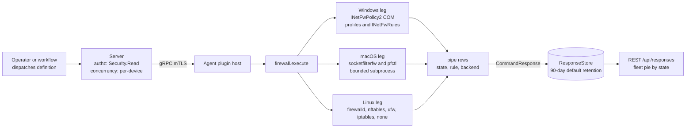
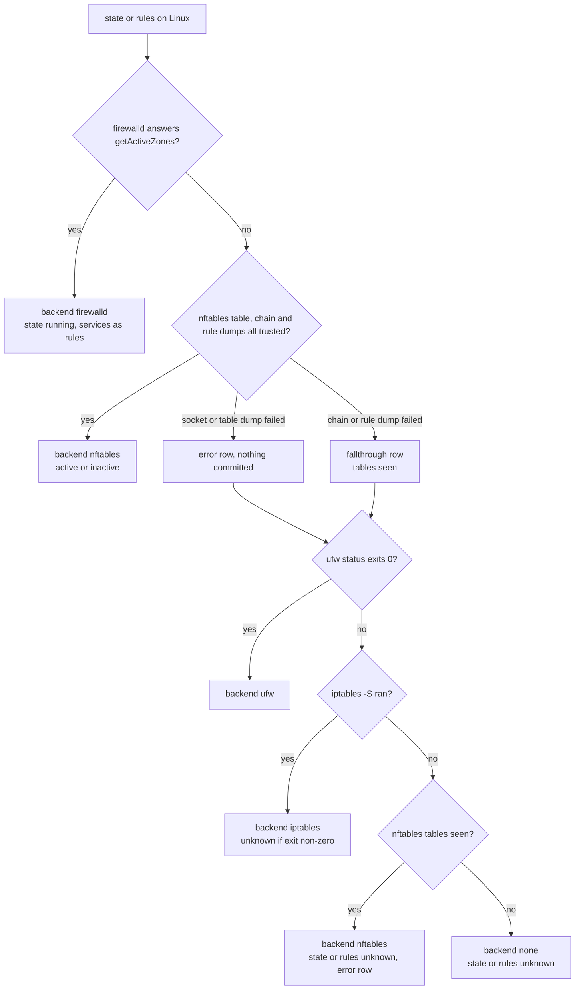
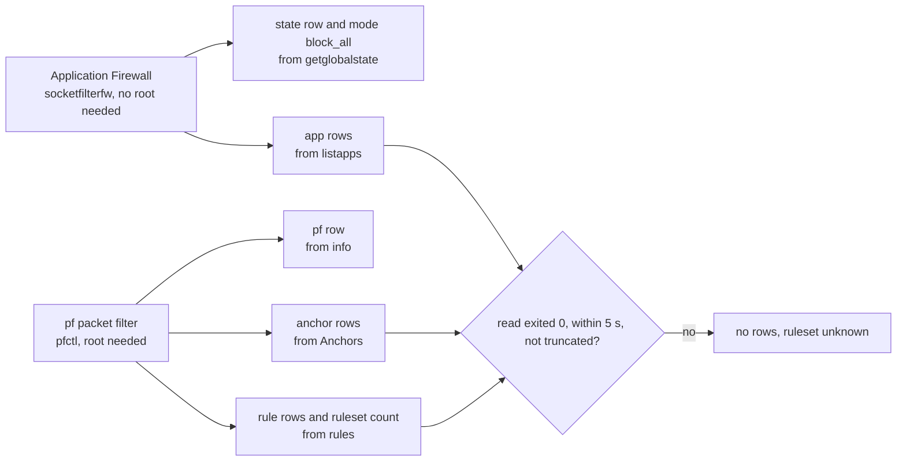

# firewall

<!-- BEGIN GENERATED: plugin-doc-gen header -->
| | |
|---|---|
| **What it does** | Firewall status and rule listing |
| **Version** | 0.6.0 |
| **Kind** | Collector · read-only · gathered (security.firewall.state, security.firewall.rules) |
| **Platforms** | Windows ✅ · macOS ✅ · Linux ✅ |
| **Actions** | `rules` (definition `security.firewall.rules`) · `state` (definition `security.firewall.state`) |
| **Security** | securable `Security` · operation Read · risk Low · dispatch ReadOnly · approval gate None |
| **Roles** | execute: endpoint-admin, endpoint-operator, security-admin · author: content-author |
<!-- END GENERATED -->

## How it works

Both actions are reads; the plugin has no rule-mutation surface despite its name. `state` answers "is the host firewall on, and which firewall answered"; `rules` lists what the same source exposes. Every parse is a pure function in `firewall_parsers.hpp`, and every subprocess runs through the bounded runner with a fixed 5 second deadline and no shell.

- **Windows.** The `INetFwPolicy2` COM interface is called in process. `state` asks each of the Domain, Private and Public profiles whether `FirewallEnabled` is set and adds the true total rule count (`INetFwRules` count). `rules` enumerates `INetFwRules` and stops after 100 rules with a `truncated|true` marker row.
- **macOS.** Two separate firewalls are read. The Application Firewall is primary, because it is the firewall a Mac administrator means: `socketfilterfw --getglobalstate` gives `state|`, plus `mode|block_all` when block-all is set, and `socketfilterfw --listapps` gives the per-app allow or block list. The pf packet filter, off by default and unrelated to the Application Firewall, is secondary: `pfctl -s info` gives the `pf|` row, and `pfctl -s Anchors` and `pfctl -s rules` give the anchor names, the raw pf rule lines and the rule count. The anchor, rule and rule-count reads are published only when the command exited zero, did not time out and was not truncated, so a refused read yields no anchor rows and `ruleset|unknown` rather than a partial answer presented as the whole. The `pf|` row is always written; it reads `unknown` when `pfctl -s info` is refused.
- **Linux.** A fixed ladder stops at the first source that answers: firewalld over sd-bus (only in builds with libsystemd; otherwise this rung is skipped), then nftables over `NETLINK_NETFILTER` dumps, then `ufw status numbered`, then `iptables -S`, else `backend|none`. The nftables leg checks that each dump reply came from the kernel (`nl_pid == 0`) and splits its 5 second deadline across three dumps (table, then chain, then rule, with cumulative cut-offs at 1, 2.5 and 5 seconds). A run that walks every rung takes about 20 seconds in the worst case.

The honest-status rule holds on every leg: empty, truncated or unrecognised output parses to `unknown` (state) or no rows (rules), never to a false-safe "disabled" or an invented rule. If nftables' table dump succeeds but a later chain or rule dump fails, the leg writes a `fallthrough|nftables:<dump>:<reason>` row and continues to `ufw` then `iptables`, with their verdicts clamped so a downstream "disabled" cannot contradict tables already seen.



### What you can decide with it

| Question | Action | Windows | macOS | Linux |
|---|---|---|---|---|
| Is the host firewall on? | `state` | Three `profile\|` rows, each `enabled`, `disabled` or `unknown`. Only Windows Firewall's own switches are read. | `state\|` is the Application Firewall only (`enabled`, `disabled`, `unknown`); pf is the separate `pf\|` row | `state\|` is `running` (firewalld), `active`/`inactive` (nftables, ufw, iptables) or `unknown` |
| Which firewall answered? | `state` or `rules` | Always Windows Firewall | `backend\|appfirewall` | `backend\|` names the first source that answered, which is not necessarily the tool an administrator uses (rules managed by another tool but held in nftables report `nftables`) |
| What is it enforcing? | `rules` | The first 100 rules: name, enabled, direction, allow or block, profile bitmask. No ports, programs or addresses. | `app\|` rows (per-app allow or block, no root needed); pf `rule\|` lines, anchors and a count (root only) | firewalld: services per active zone. nftables: base-chain hook and policy plus one handle row per rule. ufw: numbered rules. iptables: the `-S` entries. |
| Is a particular port open? | neither | No: rows omit ports, and the list is capped | No: pf lines are raw text and the per-app list is not port-based | Not reliably: firewalld lists services only, and nftables handle rows carry no match detail |

How to read the answers:

- `unknown` and `ruleset|unknown` mean the read did not complete (refused, timed out, truncated or unrecognised). They never mean "off" or "empty"; a cleanly read empty ruleset reports `ruleset|0`.
- `active` from nftables or iptables means there is at least one rule or a base-chain policy other than accept (for iptables, a user-defined chain also counts). A container runtime's own rules make a host `active`, so it is not evidence of a restrictive policy; `inactive` is reported only on a complete read.
- On Windows `enabled` says a profile's firewall switch is on, not what its default inbound action is, and on macOS an Application Firewall `enabled` does not imply pf is filtering.
- A fleet roll-up that counts `state` values should count `unknown` separately, since it hides both permission failures and absent tools.

### Diagrams



This is the whole Linux decision. A refused read does not stop the ladder early except at the last rung: `ufw` falls through on any failure, while a failed `iptables -S` is final and reports `backend|iptables` with `unknown`. `backend|none` appears when no nftables table was read and neither `/usr/sbin/ufw` (exit 0) nor `/usr/sbin/iptables` (ran) answered. A host with `iptables` therefore ends at `backend|iptables`, but a host with only `ufw` whose `ufw status` fails (for example when not run as root) ends at `none`.



The macOS plugin keeps the two firewalls apart: the Application Firewall answers without privilege, while every pf read opens `/dev/pf` and needs root, so a non-root run still returns the Application Firewall answer plus `pf|unknown` and `ruleset|unknown`. Each rows-publishing read is gated on a clean exit, so a partial read yields no rows rather than a partial list.

### Reading the Linux error and fallthrough rows

| Row | Meaning |
|---|---|
| `error\|nftables:socket:eperm` | The netlink socket could not be opened or bound, typically a hardened host denying `AF_NETLINK` through systemd `RestrictAddressFamilies=`, seccomp or AppArmor |
| `error\|nftables:<table or chain or rule>:eperm` | The socket opened but the kernel refused the dump; grant `CAP_NET_ADMIN` or use firewalld |
| `error\|nftables:<dump>:timeout` | A dump did not finish in its budget, usually a long nft transaction holding the table lock |
| `error\|nftables:<dump>:foreign_flood` | Another local process is writing to the same netlink family and drowning out the agent's replies |
| `error\|nftables:<dump>:errno:undecoded` | The kernel's error reply could not be decoded; treat as an undiagnosed refusal, not errno 0 |
| `error\|nftables:<dump>:truncated`, `oversized` or `io_error` | The dump exceeded the read buffer, exceeded the 4 MiB cap, or hit a socket failure; the ladder still falls through rather than report a clipped count |
| `error\|fd_exhausted` | `EMFILE` or `ENFILE` on the nftables socket |
| `fallthrough\|nftables:<dump>:torn` | The kernel flagged the dump as interrupted by a concurrent ruleset change; the ladder continues |

Which row kind carries a reason depends on the dump. A failed table dump (including `torn`) writes `error|nftables:table:<reason>`. A failed chain or rule dump, after the table dump succeeded, writes `fallthrough|nftables:chain:<reason>` or `fallthrough|nftables:rule:<reason>` with any of the reasons above, and the `error|nftables:chain|rule:<reason>` form appears only on the terminal `unknown` result.

An `error|nftables:table:<reason>` row can appear next to a later successful `backend|ufw` or `backend|iptables`, because it is written the moment the dump fails. Only a terminal `unknown` after it means no backend could answer.

## OS capability

<!-- BEGIN GENERATED: plugin-doc-gen capability -->
| Action | Windows | macOS | Linux |
|---|---|---|---|
| `rules` | ✅ supported · rung 1 · INetFwPolicy2 COM (INetFwRules enumeration) | ✅ supported · rung 2 · pfctl via run_bounded_subprocess | ✅ supported · rung 1 · firewalld sd-bus, else nftables NETLINK_NETFILTER (both rung 1), else ufw/iptables via run_bounded_subprocess (rung 2) |
| `state` | ✅ supported · rung 1 · INetFwPolicy2 COM (per-profile FirewallEnabled) | ✅ supported · rung 2 · socketfilterfw/pfctl via run_bounded_subprocess | ✅ supported · rung 1 · firewalld sd-bus, else nftables NETLINK_NETFILTER (both rung 1), else ufw/iptables via run_bounded_subprocess (rung 2) |
<!-- END GENERATED -->

## Privileges and prerequisites

| OS | Runs as | Extra grant needed | Measured | If the read is refused |
|---|---|---|---|---|
| Windows | agent service account (LocalSystem today, #1442) | None. `INetFwPolicy2` profile and rule reads need no elevation. | 2026-09-15, bare-metal, elevated interactive user: three profiles `enabled`, `ruleset\|717`, 100 `rule\|` rows plus the `truncated\|true` marker | `error\|com_init`, `error\|policy2_create:<hresult>` or `error\|rules_count:<hresult>` rows; a profile that cannot be read shows `unknown` or `error:<hresult>` |
| macOS | LaunchDaemon (root today) | None for the Application Firewall reads (`socketfilterfw --getglobalstate` and `--listapps` are unprivileged). The pf reads (`pfctl -s info`, `Anchors`, `rules`) open `/dev/pf` and need root; the plugin deliberately does not ride the quarantine plugin's `pfctl` sudoers grant. | 2026-09-15, bare-metal, unprivileged (`euid 501`): `--listapps` succeeds, while pf is refused, so `pf\|unknown`, no anchors and `ruleset\|unknown`. No capture has been taken as root. | `pf\|unknown` and `ruleset\|unknown`, no anchor or pf rule rows, never a false-safe value; `app\|` rows are unaffected |
| Linux | agent service account (unprivileged by design) | The firewalld read is a D-Bus method call and the plugin requests no grant for it. The nftables netlink dump conventionally needs `CAP_NET_ADMIN`; `ufw status` and `iptables -S` need root. No sudoers entry is granted for any of them. | 2026-09-06, container, `euid 0` with `CAP_NET_ADMIN` in the host network namespace: nftables answered. The no-capability path is reasoned from the code (sender-verified reads, EPERM and EMFILE decoding, the fall-through ladder), not measured on a live host. | A refused nftables read falls through to `ufw`, then `iptables`; when the table dump had succeeded and only a later dump failed, each is clamped so neither reports a false "disabled" over tables already seen; if neither answers, the run ends at `backend\|nftables` with `unknown` and an `error\|nftables:<dump>:<reason>` row. A refused `iptables -S` alone reports `backend\|iptables` with `unknown`. `backend\|none` only when neither `/usr/sbin/ufw` nor `/usr/sbin/iptables` ran. |

Subprocesses: `socketfilterfw`, `pfctl` (macOS), `ufw`, `iptables` (Linux), each as an argv vector through the bounded runner (rung 2), never a shell. Windows and the firewalld and nftables legs are native (rung 1). No network access.

## Data contract

### Inputs

<!-- BEGIN GENERATED: plugin-doc-gen inputs -->
Neither action takes parameters.
<!-- END GENERATED -->

### Outputs

Pipe-delimited key rows; the first field is the row kind. `state` emits `profile|<Domain|Private|Public>|<enabled|disabled|unknown|error:0x…>` plus `ruleset|<count>` on Windows, and `backend|<name>`, `state|<value>`, optional `mode|block_all`, `pf|<value>`, optional `anchor|<name>` and `ruleset|<count|unknown>` rows on macOS and Linux. `rules` emits `rule|<name>|<enabled|disabled>|<in|out|unknown>|<allow|block|unknown>|<profile mask>` on Windows (plus `truncated|true` after 100 rows and a trailing `ruleset|<count>` counting the rules actually emitted this call, capped at 100 — distinct from `state`'s `ruleset|<count>`, which is the true policy total from `INetFwRules::get_Count`), on macOS `app|<path>|<allow|block|unknown>` rows from `socketfilterfw --listapps`, `rule|<raw pf line>` rows, optional `anchor|<name>` rows and a trailing `ruleset|<count|unknown>`, and per backend on Linux: `rule|firewalld|<zone>|service|<service>`, `rule|nftables|<family>|<table>|<chain>|<hook>|<policy>` and `rule|nftables|<family>|<table>|<chain>|handle|<n>`, `rule|<index>|<to>|<action>|<from>` for ufw, and `rule|<policy|new_chain|append>|<chain>|<spec>` for iptables — so on Linux the field after `rule` is the backend name for firewalld and nftables, a numeric index for ufw and the entry kind for iptables. On macOS the `app|` row's third field is the per-app decision, `allow`, `block` or `unknown`, never dropped or coerced; `ruleset|unknown` on macOS means the backing `pfctl -s rules` read was refused or incomplete (typically a permissions denial), not that the ruleset is empty — a cleanly-read empty ruleset reports `ruleset|0`. A backend that answers `backend|<name>` but whose rule dump is refused emits `rules|unknown`. On Linux, a refused or fd-exhausted nftables read additionally emits an `error|nftables:<dump>:<reason>` or `error|fd_exhausted` row naming the failure, a handed-off-to-the-next-backend dump emits `fallthrough|nftables:<dump>:<reason>`, and the rule count follows the same `ruleset|<n>` / `ruleset|unknown` convention as macOS — never a fabricated `ruleset|0`. The server parses this plugin as key/value rows (`profile_or_backend`, `state`), so the value column carries the remainder of each row verbatim. Windows rules sharing a display name (one per profile, protocol or direction, e.g. six `ChatGPT` rows) are each real rules, not a capture defect. A run that reads nothing emits no `rule` rows and, for state, `unknown` values; it never fabricates a row.

<!-- BEGIN GENERATED: plugin-doc-gen outputs -->
**`security.firewall.rules` — `rule_name|enabled|direction|action|profiles`**

| Field | Type | Values | Available | Example | Description |
|---|---|---|---|---|---|
| `rule_name` | string | `rule` `app` `anchor` `ruleset` `truncated` | all | `Core Networking - DNS (UDP-Out)` | The row key, and the field after it for "rule" rows. Windows: "rule" rows with the rule's display name, plus a trailing "ruleset" row (the count of rules actually emitted this call, capped at 100) and "truncated" (present only past that cap). Linux: "rule" rows only — backend literal "firewalld" (then zone, "service", service name) or "nftables" (then family, table, chain, hook and policy — or "handle" and the handle number); the numbered index for ufw; the entry kind for iptables (policy, new_chain, append; then chain and rule spec). macOS: "rule" rows carry the raw pf rule line; "app" rows carry the per-app path and allow/block/unknown decision (unprivileged, from socketfilterfw --listapps); "anchor" rows carry one pf anchor name each; "ruleset" is the pf rule count, or unknown when the pf read was refused or incomplete — anchor and ruleset are both root-only. The server clamps the row to two fields, so the remainder lands in the value column. |
| `enabled` | string | `enabled` `disabled` | Windows | `enabled` | Windows only; enabled or disabled. |
| `direction` | string | `in` `out` `unknown` | Windows | `out` | Windows only; in, out or unknown. |
| `action` | string | `allow` `block` `unknown` | Windows | `allow` | Windows only; allow, block or unknown. |
| `profiles` | string | - | Windows | `2147483647` | Windows only; the NET_FW_PROFILE_TYPE2 bitmask as an integer (1 domain, 2 private, 4 public, 2147483647 all). |

**`security.firewall.state` — `profile_or_backend|state`**

| Field | Type | Values | Available | Example | Description |
|---|---|---|---|---|---|
| `profile_or_backend` | string | `profile` `backend` `state` `mode` `pf` `anchor` `error` `fallthrough` `ruleset` | all | `profile` | Row key. Windows: "profile" rows carry the profile name in the next field (Domain, Private, Public). Linux and macOS: "backend", "state", "mode" and "pf" rows, one key each. Linux additionally emits "error" rows (a refused or fd-exhausted backend read), "fallthrough" rows (the nftables leg handing off to the next backend after a dump failure), and "ruleset" rows (the rule count, or unknown when that count could not be trusted). macOS additionally emits "anchor" rows (one pf anchor name each, root-only) and its own "ruleset" row (the pf rule count, or unknown when the read was refused or incomplete). |
| `state` | string | - | all | `enabled` | The remainder of the row after the key (the server clamps this plugin to two fields). Windows "profile" rows: the profile name (Domain, Private, Public), then its state (enabled, disabled, unknown or error:<hresult>). Linux "state" rows: running (firewalld), active, inactive or unknown. macOS "state" rows: enabled, disabled or unknown; "pf" rows the same; "mode" row is block_all; "anchor" rows carry one pf anchor name each (root-only, omitted when the read is refused or incomplete). "backend" rows name the backend (appfirewall, firewalld, nftables, ufw, iptables, none). "ruleset" rows carry the rule count as an integer, or unknown whenever the backend's read was incomplete or refused rather than a fabricated 0 — on Linux this is the nftables/ufw/iptables rule count; on macOS it is the pf rule count (root-only). Linux "error" rows: nftables:<table\|chain\|rule>:<eperm\|timeout\|foreign_flood\|...> for a refused/failed dump, or fd_exhausted for EMFILE/ENFILE on the nftables socket. Linux "fallthrough" rows: nftables:<table\|chain\|rule>:<reason>, written when a dump fails and the leg hands off to the next backend. |
<!-- END GENERATED -->

### Result status

The plugin never sets a typed result status; every run reports `UNDECLARED / UNKNOWN`, as the samples show. Degradation is carried in the rows themselves (`unknown`, `error|...`, `fallthrough|...`, `backend|none`, `truncated|true`), so a consumer must read the rows, not the status, to tell a degraded read from a complete one.

| Status | Completeness | Provenance | When |
|---|---|---|---|
| `UNDECLARED` | UNKNOWN | (empty) | Every run on every OS, including degraded reads |
### Where the data goes

- **Instruction result only.** Rows land in the ResponseStore (90-day default retention), queryable at `/api/responses/{id}`; `security.firewall.state` aggregates by `state` and drives the fleet pie "Firewall profile state across the fleet" (profile rows, labelled by value).
- **Not consumed by** daily-sync inventory, the Echo warehouse, DEX, or metrics. Both definitions carry a gather TTL (120 s and 300 s) but no schedule; they run when dispatched.
- **Sensitivity.** `rules` rows name installed applications on the host (Windows rule display names are application names — an installed-software inventory by another route; macOS `rules` rows carry the same kind of disclosure via unprivileged per-app allow/block entries, `app|<path>|...`, naming installed executables by absolute path) and, on Linux, the host's network policy; on macOS, both `state` and `rules` rows may also carry pf anchor names, which can identify installed network/security software (VPN clients, security tools) or local pf policy structure — `state` is otherwise limited to the device id.
- **MCP / REST.** Discover: `discover_plugins` (summary) → `yuzu://plugin-docs` (this page as data) → `discover_instructions` / `get_definition("security.firewall.state")`. Run: `execute_instruction {definition_id, parameters}`. Read: `/api/responses/{id}`.
- **Siblings:** `quarantine` (mutates firewall state through its own sudoers-granted `pfctl` anchor and Windows firewall rules), `rdp_control` (toggles the Remote Desktop rule group through `INetFwPolicy2`), `network_config`.

## Sample output

<!-- BEGIN GENERATED: plugin-doc-gen samples -->
**Windows** — captured: windows Windows 10.0.26200 x86_64 · bare-metal · 2026-09-15 · interactive user (elevated) · leg-hash 8ef7b004fc8a

```
== action=state
profile|Domain|enabled
profile|Private|enabled
profile|Public|enabled
ruleset|717
[result_status] UNDECLARED / UNKNOWN

== action=rules
rule|HNS Container Networking - DNS (UDP-In) - 790E58B4-7939-4434-9358-89AE7DDBE87F - 0|enabled|in|allow|2147483647
rule|HNS Container Networking - ICS DNS (TCP-In) - 790E58B4-7939-4434-9358-89AE7DDBE87F - 0|enabled|in|allow|2147483647
rule|Logi Plugin Service|enabled|in|allow|2147483647
rule|Logi Options+ Updater|enabled|out|allow|2147483647
rule|Logi Options+ Updater|enabled|in|allow|2147483647
rule|Logi Options+ Voice|enabled|out|allow|2147483647
rule|Logi Options+ Voice|enabled|in|allow|2147483647
rule|Logi Options+ Agent|enabled|out|allow|2147483647
rule|Logi Options+ Agent|enabled|in|allow|2147483647
rule|WhatsApp|enabled|out|allow|7
rule|@{Microsoft.WindowsFeedbackHub_2.2608.301.0_x64__8wekyb3d8bbwe?ms-resource://Microsoft.WindowsFeedbackHub/Resources/AppStoreName}|enabled|out|allow|7
rule|Microsoft Store|enabled|in|allow|7
… 12 of 102 rows shown
[result_status] UNDECLARED / UNKNOWN
```

**macOS** — captured: macos macOS 26.6.2 arm64 · bare-metal · 2026-09-15 · euid 501 · leg-hash 8ef7b004fc8a

```
== action=state
backend|appfirewall
state|disabled
pf|unknown
ruleset|unknown
[result_status] UNDECLARED / UNKNOWN

== action=rules
app|/usr/local/libexec/remotepairingdeviced|allow
app|/usr/libexec/remoted|allow
app|/usr/bin/python3|allow
app|/usr/bin/ruby|allow
app|/usr/sbin/cupsd|allow
app|/usr/libexec/sharingd|allow
app|/usr/libexec/sshd-keygen-wrapper|allow
app|/usr/sbin/smbd|allow
ruleset|unknown
[result_status] UNDECLARED / UNKNOWN
```

**Linux** — captured: linux Debian GNU/Linux 13 (trixie) aarch64 · container · 2026-09-06 · euid 0 with CAP_NET_ADMIN in the host network namespace · leg-hash 8ef7b004fc8a

```
== action=state
backend|nftables
state|active
[result_status] UNDECLARED / UNKNOWN

== action=rules
backend|nftables
rule|nftables|ip|filter|OUTPUT|output|accept
rule|nftables|ip|filter|FORWARD|forward|accept
rule|nftables|ip6|filter|OUTPUT|output|accept
rule|nftables|ip6|filter|FORWARD|forward|accept
rule|nftables|ip|nat|PREROUTING|prerouting|accept
rule|nftables|ip|nat|OUTPUT|output|accept
rule|nftables|ip|nat|POSTROUTING|postrouting|accept
rule|nftables|ip6|nat|PREROUTING|prerouting|accept
rule|nftables|ip6|nat|OUTPUT|output|accept
rule|nftables|ip|raw|PREROUTING|prerouting|accept
rule|nftables|ip|filter|DOCKER-USER|handle|2
… 12 of 55 rows shown
[result_status] UNDECLARED / UNKNOWN
```
<!-- END GENERATED -->

## Caveats and known gaps

1. **Row shape is a key/value contract, not the YAML column list.** The server clamps this plugin to two fields, so a `profile|Domain|enabled` row reaches the dashboard as key `profile`, value `Domain|enabled`. Splitting the value into its own axes is tracked under #626.
2. **macOS pf reads need root, and no capture has used root.** Under the least-privilege model the `pf|` row and the pf rules degrade to unknown or empty on purpose, and the macOS sample shows exactly that at `euid 501`. The Application Firewall `state|` and `app|` rows are unaffected.
3. **Two Linux paths are unmeasured.** The firewalld leg has never been run against a live firewalld, and it lists services only (zone ports and rich rules are not queried), so a firewalld host can hold open ports this plugin does not show. The unprivileged nftables denial path is likewise reasoned from the code, not measured, and it depends on which of `ufw` and `iptables` are installed.
4. **Windows rules stop at 100 and omit what they match.** The `truncated|true` row is emitted only when a genuine 101st rule exists, so exactly 100 rules is not marked truncated; `state` reports the true total, so compare the two. Each rule row has no port, program or address, so the list cannot answer what a rule allows.
5. **A mixed fleet shows three macOS shapes.** Agents older than the Application Firewall change report pf as the sole state source (`backend|pf`); agents after that change but before the per-app list report `backend|appfirewall` plus a `pf|` row only; current agents add the `app|` list, `anchor|` rows and the `ruleset|` count or `unknown`.

## Source and tests

<!-- BEGIN GENERATED: plugin-doc-gen source -->
- Plugin: `agents/plugins/firewall/src/firewall_parsers.hpp` · `agents/plugins/firewall/src/firewall_plugin.cpp`
- Definitions: `content/definitions/firewall.yaml`
- Capability rows: `server/core/src/capability_decls/plugin_action_catalogue_c.hpp`
- Tests: `tests/unit/test_firewall_local_dispatcher.cpp` · `tests/unit/test_firewall_parsers.cpp`
- Privilege row: `docs/agent-privilege-model.md`
<!-- END GENERATED -->
