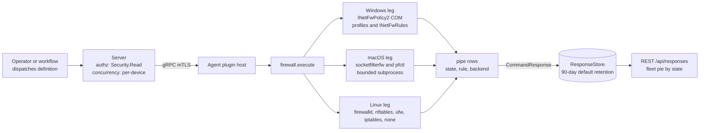
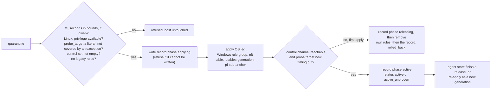
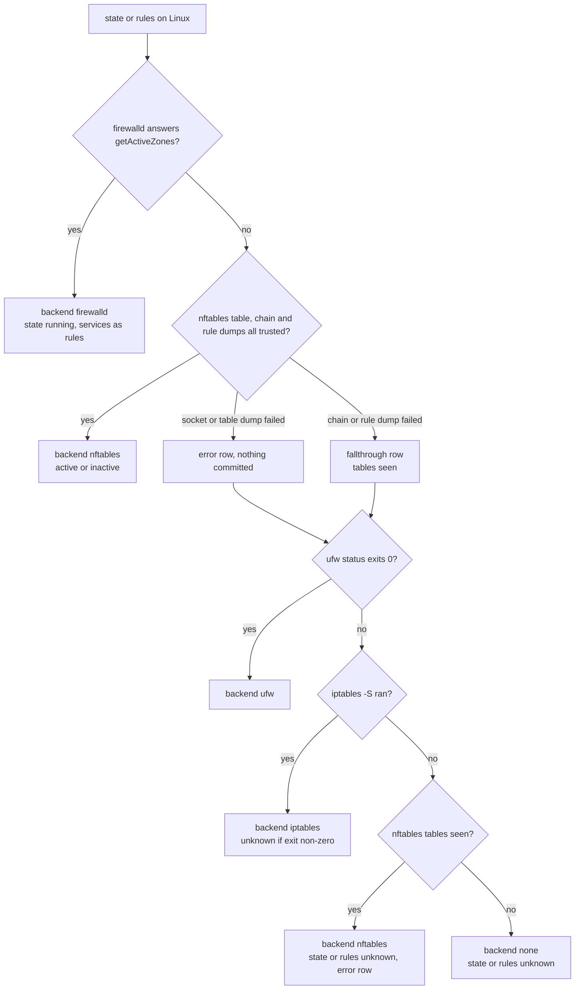
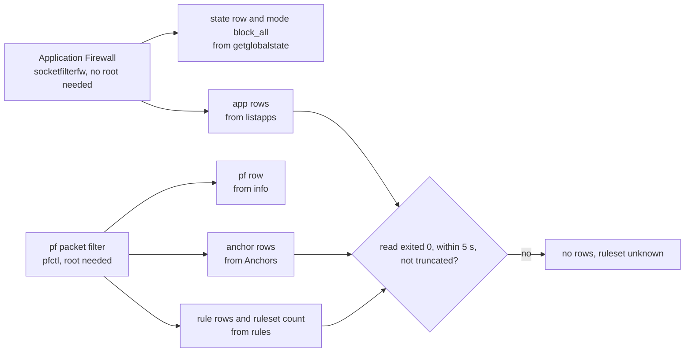

# firewall

<!-- BEGIN GENERATED: plugin-doc-gen header -->
| | |
|---|---|
| **What it does** | Firewall status, rule listing and device containment |
| **Version** | 1.0.0 |
| **Kind** | Action · mutating · gathered (security.firewall.state, security.firewall.rules) |
| **Platforms** | Windows ✅ · macOS ✅ · Linux ✅ |
| **Actions** | `quarantine` · `quarantine_allow` · `quarantine_status` · `release` · `rules` (definition `security.firewall.rules`) · `state` (definition `security.firewall.state`) |
| **Security** | `state`: securable `Security` · operation Read · risk Low · dispatch ReadOnly · approval gate None; `rules`: securable `Security` · operation Read · risk Low · dispatch ReadOnly · approval gate None; `quarantine`: securable `Security` · operation Execute · risk Critical · dispatch Destructive · approval gate AdminOrApproval; `release`: securable `Security` · operation Execute · risk High · dispatch Mutating · approval gate AdminOrApproval; `quarantine_status`: securable `Security` · operation Read · risk Low · dispatch ReadOnly · approval gate None; `quarantine_allow`: securable `Security` · operation Execute · risk High · dispatch Mutating · approval gate AdminOrApproval |
| **Roles** | execute: endpoint-admin, endpoint-operator, security-admin · author: content-author |
<!-- END GENERATED -->

## How it works

`state` and `rules` are reads. `state` answers "is the host firewall on, and which firewall answered"; `rules` lists what the same source exposes. Every parse is a pure function in `firewall_parsers.hpp`, and every subprocess runs through the bounded runner with a fixed 5 second deadline and no shell.

- **Windows.** The `INetFwPolicy2` COM interface is called in process. `state` asks each of the Domain, Private and Public profiles whether `FirewallEnabled` is set and adds the true total rule count (`INetFwRules` count). `rules` enumerates `INetFwRules` and stops after 100 rules with a `truncated|true` marker row.
- **macOS.** Two separate firewalls are read. The Application Firewall is primary, because it is the firewall a Mac administrator means: `socketfilterfw --getglobalstate` gives `state|`, plus `mode|block_all` when block-all is set, and `socketfilterfw --listapps` gives the per-app allow or block list. The pf packet filter, off by default and unrelated to the Application Firewall, is secondary: `pfctl -s info` gives the `pf|` row, and `pfctl -s Anchors` and `pfctl -s rules` give the anchor names, the raw pf rule lines and the rule count. The anchor, rule and rule-count reads are published only when the command exited zero, did not time out and was not truncated, so a refused read yields no anchor rows and `ruleset|unknown` rather than a partial answer presented as the whole. The `pf|` row is always written; it reads `unknown` when `pfctl -s info` is refused.
- **Linux.** A fixed ladder stops at the first source that answers: firewalld over sd-bus (only in builds with libsystemd; otherwise this rung is skipped), then nftables over `NETLINK_NETFILTER` dumps, then `ufw status numbered`, then `iptables -S`, else `backend|none`. The nftables leg checks that each dump reply came from the kernel (`nl_pid == 0`) and splits its 5 second deadline across three dumps (table, then chain, then rule, with cumulative cut-offs at 1, 2.5 and 5 seconds). A run that walks every rung takes about 20 seconds in the worst case.

The honest-status rule holds on every leg: empty, truncated or unrecognised output parses to `unknown` (state) or no rows (rules), never to a false-safe "disabled" or an invented rule. If nftables' table dump succeeds but a later chain or rule dump fails, the leg writes a `fallthrough|nftables:<dump>:<reason>` row and continues to `ufw` then `iptables`, with their verdicts clamped so a downstream "disabled" cannot contradict tables already seen.



### Device containment

Four more actions contain a host and lift the containment again: `quarantine`, `release`, `quarantine_status` and `quarantine_allow`. All of them run through one OS-neutral core (`firewall_quarantine_parsers.hpp`) that decides everything and is unit-tested on every host; the plugin only wires an OS mechanism to it. Windows, Linux and macOS are implemented; the macOS design is in `docs/quarantine-macos-pf-anchor-design.md`. Two limits are part of the contract. **Linux is constrained on the packaged systemd unit**: it runs as `yuzu-agent` with `NoNewPrivileges=true` and no sudoers grant, so `sudo` cannot elevate and every mutating action (`quarantine`, `release`, `quarantine_allow`) is refused up front, `refused|privilege_unavailable`, before any record is written; the privilege path is a later change. **A time limit (`ttl_seconds`) ends the containment unattended, with two limits of its own** (caveat 2): its expiry release is logged on the agent only (`firewall: release -> inactive ttl_expired=1`) and is not recorded on the server until the server-side change ships, so after a limit passes check `quarantine_status`; and it is measured on the host's wall clock while the quarantine blocks NTP, so a clock stepped back means it never fires and one stepped forward releases early.

- **What stays reachable.** Loopback, the agent's own control channel (the address the agent is connected through when the quarantine is applied, which the agent daemon publishes from the stream the server answered on, plus every address the server name resolved to at agent start on the server's port; the host being contained never chooses which address survives, and neither the plugin nor the host resolves a name at quarantine time), DHCP (UDP 67 and 68; on Windows scoped to the DHCP client service, as Windows' own DHCP rules are), DNS to the host's configured resolvers (at most eight, port 53), IPv6 neighbour discovery, and any operator exceptions. Nothing else is reachable and nothing that existed before is: Linux has no "established" accept, so a connection that predates the quarantine is cut unless an allowance matches it. DHCPv6 (UDP 546 and 547) and multicast listener discovery are not allowed on any OS, and Windows disables its built-in rules for both, so a host that depends on stateful DHCPv6 loses its address when the lease expires. The containment covers the host's own IP traffic and the traffic the host routes; **L2-bridged guests (without `br_netfilter`), macvlan and ipvlan containers and Hyper-V external-switch guests never reach the hooks it uses and are not contained.**
- **Windows.** A Windows Firewall rule group named `Yuzu Firewall Quarantine` holds one allowance rule per entry, and every profile's default action is set to block, inbound and outbound. An Allow rule beats a profile-default block, so every other enabled rule is disabled for the duration, its name written to the plugin's storage before the first one is touched, and re-enabled on release. The pre-quarantine default actions are captured once and restored. A rule the policy store refuses to disable (typically one delivered by Group Policy) is counted, and the result is `partial`, never `active`. A stock rule is remembered by name, direction and profile (Windows ships rules that share a name and differ by profile, one on and one off), so a release switches back on only what the quarantine switched off. A host whose firewall policy is Group Policy-managed (`LocalPolicyModifyState` `GP_OVERRIDE`) is contained by its rules only: a policy default beats the profile defaults the plugin writes, so the rules are applied anyway and the result is `partial|gpo_override`, never `active` and never refused. The fact is recorded on the state record like a rule that would not disable, so every later status repeats it, whether the policy was there at apply time or arrived mid-quarantine, and a later update or agent-start re-apply re-reads the policy and clears or sets it. The allowances are in force, the default block may not be, so a probe target the policy leaves reachable still rolls the first apply back (`rolled_back|probe_still_reachable`). A rule that Group Policy will not let release switch back on is its policy's, not the containment's: it is a `note|rules_not_reenabled=<n>` on a completed release. A profile whose firewall is switched off makes every rule and the default block inert, so the apply refuses (`refused|firewall_disabled:<Profile>`, or `firewall_state_unreadable:<Profile>` when the switch cannot be read) before anything is touched, and the status reads `degraded|firewall_disabled` with `note|firewall_profile=<Profile>` naming the profile; the plugin never switches a firewall on, because that switch is often policy-managed and is not the plugin's to undo. A previous generation's rule that would not delete during an update is a live allowance the record no longer lists, so it is counted, persisted and reported `partial|stale_rules_left` until a later update removes it.
- **Linux.** With `/usr/sbin/nft` present, the plugin loads its own `inet yuzu_quarantine` table with a single `nft -f` transaction: input, output and forward base chains at policy drop plus the allowances, replacing the previous generation atomically, so a failed load leaves the old table in force. The chains are stateless: a TCP allowance's reply path refuses a bare SYN (`tcp flags & (syn|ack) != syn`, two positive `--tcp-flags` rules on iptables), so a peer cannot open a new connection from its service port, but **a UDP allowance admits datagrams from the peer's service port to any local port**, because the design has no connection tracking on purpose. Release is one `delete table`, and a table is treated as already gone only when nft itself says so (`Error: ... No such file or directory`), never on the text of `sudo` or the dynamic loader. Without nft it builds a new `yuzu-fwq-<generation>` chain in iptables and ip6tables (INPUT, OUTPUT and FORWARD jump to it), inserts the new jumps, then removes the old generation, so both exist during the swap and an update only ever tightens; the status requires our jump to be the FIRST rule of INPUT, OUTPUT and FORWARD (a Docker restart re-inserts its own FORWARD jump ahead of ours, which reads `degraded|policy_not_blocking` until a retried `quarantine` repairs it). IPv6 is judged from two facts, the `ip6tables` binary and the host's IPv6 stack: a host with a stack (or one whose stack cannot be read) and no `ip6tables` is refused (`refused|ip6tables_missing`, `refused|ipv6_stack_unknown`) rather than contained over IPv4 only, and only a host that has IPv6 switched off is contained over IPv4 alone. The apply plan, including every exception on both address families, runs under a 60 second deadline and the verification gets 10 seconds more; the undo of a failed initial apply gets a fresh 60 seconds, so a failed apply takes up to about 130 seconds. A boot-time re-apply is bounded by the first two.
- **macOS.** The plugin never loads or rewrites the main pf ruleset. It loads its own sub-anchor `com.apple/000.yuzu_quarantine` with `pfctl -a ... -f`, which Apple's own `anchor "com.apple/*"` line already evaluates; the `000.` prefix makes it sort ahead of Apple's `200.AirDrop` and `250.ApplicationFirewall` anchors, because pf evaluates sub-anchors in name order and a `quick` pass in an earlier one would win. The anchor opts out of NAT and redirection (`no nat all`, `no rdr all`), passes loopback and the allowances, and ends in `block drop quick all`. The control channel is stateless in both directions, so the one `pfctl -F states` that follows the load (pf passes a packet that matches a state without looking at any rule, so established connections would otherwise survive) cannot disturb the stream the agent's reply travels on. pf is switched on with `pfctl -E`, which returns a reference token the plugin records at once; release empties its own anchor (`-F rules`, `-F nat`, never `-F all`) and releases that token. If another actor switches pf off (`pfctl -d`) the status reads `degraded|pf_disabled` and the next `quarantine` or agent start releases the dead token and takes a fresh one. Two further statuses mean a re-apply cannot help and say so: a main ruleset with no `anchor "com.apple/*" all` line (`anchor_not_referenced`, which also fails an apply before anything is loaded) and an anchor that sorts ahead of ours (`anchor_not_first`, `partial` on apply). An empty anchor (`policy_not_blocking`) is repaired by the next `quarantine`. The staged ruleset path may contain a space (the packaged data directory is `/Library/Application Support/Yuzu`) and is checked against the staging directory before `pfctl -E` takes a reference.
- **Verify after applying.** The agent connects to the live control address, the one the agent daemon is connected through right now (it must succeed; `note|control_proved=live`), or, at agent start when no Register has happened yet, to a listed control endpoint (`note|control_proved=listed`), and to the optional `probe_target`, an IP literal that answered before the change and must now time out; a probe target that an operator exception already admits is refused before anything changes (`refused|probe_target_covered_by_exception`). `active` means the proof STARTS with `verified`: any proof that failed (the control channel did not answer, the probe target was still reachable) reads `active_unproven` in every later status, a no-op update and the TTL tick. A refused connection after the change means the packet got through, so it counts as reachable. A failed initial apply writes the phase `releasing` first, then removes its own rules, then the record, and reports `rolled_back`, so a crash or a failed record delete at any point is finished by the next start and never re-applies the containment that just failed its check; with no probe target the result is `active_unproven`.
- **Generations and phases.** The record `quarantine.state` in the plugin's storage is written, with phase `applying`, before any change to the host, and the action refuses (`refused|state_not_persisted`) when it cannot be written. It then moves to `active`, or `releasing` during a release. A `quarantine_allow` update writes the next generation first, applies it as an update, and on failure puts the previous generation's record back (`update_failed|<reason>`); rollback to nothing exists only for the first apply. Two `update_failed` answers do NOT mean the previous generation is in force: `update_failed|revert_failed:<reason>` (the new generation failed verification and the revert failed too) leaves the NEW generation in force with its record `applying`, and `update_failed|commit_unknown` (a tool committed and then overran its five-second budget, so the kernel may hold either set) leaves the candidate record `applying`; in both the next retried `quarantine` or agent start converges the full set. A retried `quarantine` over an incomplete (`applying`) record takes the request's `probe_target` (proven reachable first) in place of the stored one. A `quarantine` retried on an active record never rewrites its stored allow set or expiry, and answers what `quarantine_status` would unless a re-apply can repair the gap (it then re-applies the stored set and adds `note|repaired=1`); a `ttl_seconds` it carries is answered with `note|ttl_unchanged_release_then_quarantine=1`.
- **At agent start.** `init()` finishes an interrupted release, and re-applies a stored containment the host no longer enforces (a reboot, a legacy release, pf switched off) as a generation update; a re-apply that fails puts the record back as it was, so for an `active` record `quarantine_status` reports what the host does, `degraded` with a reason such as `firewall_disabled`, `policy_not_blocking`, `pf_disabled`, `anchor_not_referenced` or `os_unreadable`. A record that was already `applying` stays so and reads `partial|operation_in_progress`, and `note|state_restore_failed=1` means the put-back itself could not be saved, so the record is left `applying` and reads the same way. A record whose initial apply never completed (no proof was ever recorded) is NOT promoted to `active` when the control channel does not answer at start: it stays `applying` (`note|control_unreachable_unproven=1`) until a retried `quarantine` converges and verifies it. It never rolls back and never releases because the server is unreachable. A host whose control set stopped matching the server (a re-addressed server, a wrong set) is lifted only by a `release` dispatch that reaches it or by the later break-glass; there is no local release in this release, a hand-removed rule is re-applied at the next start while the record is `active`, and the exit is **not** bounded by a time limit. A store that cannot answer (SQLite busy, a closed handle) reads as `degraded|state_unreadable` and changes nothing: it is never read as "no record". A time limit that lapsed while the agent was down is released at start (`note|ttl_expired=1`), not re-applied. A time limit is enforced by an interval trigger (`firewall.quarantine.ttl`, every 30 seconds) that runs `release` with `if_ttl_expired=1`: a no-op until the limit passes, deferred to a legacy containment that appeared underneath (`ttl_deferred_legacy=1`), and a trigger that cannot be registered is residue (`partial|ttl_unregistered`) until a later registration succeeds. An expiry release leaves one agent log line and nothing on the server.
- **Self-check.** While a record exists, an agent-local interval trigger (`firewall.quarantine.repair`, every 60 seconds) dispatches `quarantine` with `repair=1`, which the plugin routes to a repair path (a bare periodic `quarantine` would start a containment with no record and converge an in-progress one every minute). The trigger's dispatch carries `repair=1` and nothing else: the plugin cannot tell it from an operator's dispatch, so a `repair=1` that also names `ttl_seconds`, `exceptions` or `probe_target` is refused (`refused|repair_with_containment_parameters`, no record, no repair) instead of answering `inactive` to an operator who meant to contain. It takes the same mutation gate as every mutating action (`busy`, it never waits behind another), reads the host once (a COM enumeration on Windows, one `sudo nft list table` on Linux, a few `sudo pfctl -s` reads on macOS) and acts only on an `active` record whose live read says the host stopped enforcing it in a way a re-apply fixes (a flushed table, restored profile defaults, pf switched off): it re-applies the STORED allow set through the same converge a retried `quarantine` uses, adds `note|repaired=1`, and counts it on the record (`note|repairs=<n>` and `note|last_repair_at=<epoch>` on every later status). The count is every time the host was found no longer enforcing the stored set and re-applied, whichever dispatch found it: the self-check, or a retried `quarantine` that converged the same record. It never acts on a store that cannot answer (`degraded|state_unreadable`), never converges a record that is `applying` or `releasing` (`note|repair_skipped=1`), never re-applies what a re-apply cannot fix (a switched-off Windows profile, a dangling pf anchor, a Group Policy default: reported, not retried every minute), and defers without mutating to a legacy containment that appeared underneath (`partial|legacy_quarantine_active`, `note|repair_deferred_legacy=1`). Every repair, and every tick that finds the host degraded, is one line in the agent log (`firewall: repair -> active repair_tick=1 repaired=1 repairs=1`); a healthy tick and a gap the record already reports are silent. A repair trigger that cannot be registered is residue (`partial|repair_unregistered`) until a later registration succeeds. The tick's own reply is not sent to the server, and a repair that fails verification is retried at the next tick.
- **The retained `quarantine` plugin** is unchanged until it is removed. The new actions refuse (`refused|legacy_quarantine_active`) while its objects exist (Windows rules named `YuzuQuarantine_*`, the Linux chain `yuzu-quarantine`). The check runs on every Windows apply (an update or a boot re-apply answers `update_failed|legacy_quarantine_active` / `degraded|reapply_failed:legacy_quarantine_active`) but only on the FIRST apply on Linux, so a `quarantine_allow`, a repair or a boot re-apply there proceeds over a legacy chain. The reverse is not enforced here: a legacy release can put the Windows profile defaults back, which `quarantine_status` reports as `degraded|policy_not_blocking` and the next start repairs.

| Action | Parameters | Reply rows |
|---|---|---|
| `quarantine` | `probe_target` (`ip:port` or `[v6]:port`, a literal; optional), `ttl_seconds` (60 to 2,592,000, optional), `exceptions` (comma-separated, optional), `repair=1` (the self-check's own dispatch; it takes no other parameter, and one that also carries `ttl_seconds`, `exceptions` or `probe_target` is refused `repair_with_containment_parameters`) | `status\|<token>[\|<reason>]`, `verify\|control=<ok\|fail>\|probe=<blocked\|reachable\|refused\|unproven>`, `allow\|<kind>\|<value>`, `rolled_back\|<reason>`, `refused\|<reason>`, `note\|<k>=<v>` |
| `release` | `if_ttl_expired=1` (optional; the time-limit tick, a no-op until the TTL has passed) | the same rows |
| `quarantine_status` | none | the same rows, read from the record and the live host; never takes the mutation gate |
| `quarantine_allow` | `op` (`add` or `remove`), `exceptions` (required) | the same rows |

An exception is `addr[/prefix][:port][/tcp\|udp][/in\|out]`, with a v6 address bracketed when it carries a port. Without a protocol it covers TCP and UDP, without a direction it is outbound, without a port it covers every port; the port is the service port (the remote port outbound, the local port inbound). At most 64 exceptions exist across every add; a removal never removes loopback, the control channel, a resolver or DHCP. The mutating actions run one at a time (`status|busy` after two seconds).



### What you can decide with it

| Question | Action | Windows | macOS | Linux |
|---|---|---|---|---|
| Is the host firewall on? | `state` | Three `profile\|` rows, each `enabled`, `disabled` or `unknown`. Only Windows Firewall's own switches are read. | `state\|` is the Application Firewall only (`enabled`, `disabled`, `unknown`); pf is the separate `pf\|` row | `state\|` is `running` (firewalld), `active`/`inactive` (nftables, ufw, iptables) or `unknown` |
| Which firewall answered? | `state` or `rules` | Always Windows Firewall | `backend\|appfirewall` | `backend\|` names the first source that answered, which is not necessarily the tool an administrator uses (rules managed by another tool but held in nftables report `nftables`) |
| What is it enforcing? | `rules` | The first 100 rules: name, enabled, direction, allow or block, profile bitmask. No ports, programs or addresses. | `app\|` rows (per-app allow or block, no root needed); pf `rule\|` lines, anchors and a count (root only) | firewalld: services per active zone. nftables: base-chain hook and policy plus one handle row per rule. ufw: numbered rules. iptables: the `-S` entries. |
| Is a particular port open? | neither | No: rows omit ports, and the list is capped | No: pf lines are raw text and the per-app list is not port-based | Not reliably: firewalld lists services only, and nftables handle rows carry no match detail |

How to read the answers:

- `unknown` and `ruleset|unknown` mean the read did not complete (refused, timed out, truncated or unrecognised). They never mean "off" or "empty"; a cleanly read empty ruleset reports `ruleset|0`.
- `active` from nftables or iptables means there is at least one rule or a base-chain policy other than accept (for iptables, a user-defined chain also counts). A container runtime's own rules make a host `active`, so it is not evidence of a restrictive policy; `inactive` is reported only on a complete read.
- On Windows `enabled` says a profile's firewall switch is on, not what its default inbound action is, and on macOS an Application Firewall `enabled` does not imply pf is filtering.
- A fleet roll-up that counts `state` values should count `unknown` separately, since it hides both permission failures and absent tools.

### Diagrams



This is the whole Linux decision. A refused read does not stop the ladder early except at the last rung: `ufw` falls through on any failure, while a failed `iptables -S` is final and reports `backend|iptables` with `unknown`. `backend|none` appears when no nftables table was read and neither `/usr/sbin/ufw` (exit 0) nor `/usr/sbin/iptables` (ran) answered. A host with `iptables` therefore ends at `backend|iptables`, but a host with only `ufw` whose `ufw status` fails (for example when not run as root) ends at `none`.



The macOS plugin keeps the two firewalls apart: the Application Firewall answers without privilege, while every pf read opens `/dev/pf` and needs root, so a non-root run still returns the Application Firewall answer plus `pf|unknown` and `ruleset|unknown`. Each rows-publishing read is gated on a clean exit, so a partial read yields no rows rather than a partial list.

### Reading the Linux error and fallthrough rows

| Row | Meaning |
|---|---|
| `error\|nftables:socket:eperm` | The netlink socket could not be opened or bound, typically a hardened host denying `AF_NETLINK` through systemd `RestrictAddressFamilies=`, seccomp or AppArmor |
| `error\|nftables:<table or chain or rule>:eperm` | The socket opened but the kernel refused the dump; grant `CAP_NET_ADMIN` or use firewalld |
| `error\|nftables:<dump>:timeout` | A dump did not finish in its budget, usually a long nft transaction holding the table lock |
| `error\|nftables:<dump>:foreign_flood` | Another local process is writing to the same netlink family and drowning out the agent's replies |
| `error\|nftables:<dump>:errno:undecoded` | The kernel's error reply could not be decoded; treat as an undiagnosed refusal, not errno 0 |
| `error\|nftables:<dump>:truncated`, `oversized` or `io_error` | The dump exceeded the read buffer, exceeded the 4 MiB cap, or hit a socket failure; the ladder still falls through rather than report a clipped count |
| `error\|fd_exhausted` | `EMFILE` or `ENFILE` on the nftables socket |
| `fallthrough\|nftables:<dump>:torn` | The kernel flagged the dump as interrupted by a concurrent ruleset change; the ladder continues |

Which row kind carries a reason depends on the dump. A failed table dump (including `torn`) writes `error|nftables:table:<reason>`. A failed chain or rule dump, after the table dump succeeded, writes `fallthrough|nftables:chain:<reason>` or `fallthrough|nftables:rule:<reason>` with any of the reasons above, and the `error|nftables:chain|rule:<reason>` form appears only on the terminal `unknown` result.

An `error|nftables:table:<reason>` row can appear next to a later successful `backend|ufw` or `backend|iptables`, because it is written the moment the dump fails. Only a terminal `unknown` after it means no backend could answer.

## OS capability

<!-- BEGIN GENERATED: plugin-doc-gen capability -->
| Action | Windows | macOS | Linux |
|---|---|---|---|
| `quarantine` | ✅ supported · rung 1 · INetFwPolicy2 COM rule group + per-profile default-block; other enabled rules disabled for the duration | 🟡 constrained · rung 2 · sudo pfctl: own sub-anchor com.apple/000.yuzu_quarantine loaded with -a -f (the main ruleset is never loaded), a pf enable reference (-E), one global pf state flush (-F states) | 🟡 constrained · rung 2 · sudo nft -f of an own inet table applied as one transaction (policy-drop chains); iptables/ip6tables generation chain via run_bounded_subprocess when nft is absent |
| `quarantine_allow` | ✅ supported · rung 1 · INetFwPolicy2 COM: new generation's rules added first, stale ones removed last | 🟡 constrained · rung 2 · sudo pfctl: atomic reload of the own sub-anchor (-a -f), then a global pf state flush | 🟡 constrained · rung 2 · atomic nft reload / iptables build-then-swap of a new generation |
| `quarantine_status` | ✅ supported · rung 1 · INetFwPolicy2 COM rule group presence + per-profile default actions | ✅ supported · rung 2 · sudo pfctl reads: info, main-ruleset anchor reference, own anchor rules, sibling anchors under com.apple, enable references | 🟡 constrained · rung 1 · own nftables table over NETLINK_NETFILTER (rung 1), else sudo nft list table (rung 2); iptables chain jumps via argv |
| `release` | ✅ supported · rung 1 · INetFwPolicy2 COM rule-group removal, prior-policy restore, disabled rules re-enabled | ✅ supported · rung 2 · sudo pfctl: empty own anchor (-F rules, -F nat), release the enable token (-X) | 🟡 constrained · rung 2 · sudo nft delete table / iptables chain removal |
| `rules` | ✅ supported · rung 1 · INetFwPolicy2 COM (INetFwRules enumeration) | ✅ supported · rung 2 · pfctl via run_bounded_subprocess | ✅ supported · rung 1 · firewalld sd-bus, else nftables NETLINK_NETFILTER (both rung 1), else ufw/iptables via run_bounded_subprocess (rung 2) |
| `state` | ✅ supported · rung 1 · INetFwPolicy2 COM (per-profile FirewallEnabled) | ✅ supported · rung 2 · socketfilterfw/pfctl via run_bounded_subprocess | ✅ supported · rung 1 · firewalld sd-bus, else nftables NETLINK_NETFILTER (both rung 1), else ufw/iptables via run_bounded_subprocess (rung 2) |

**Declared limits per leg** (descriptor fallback text, verbatim):

- **`quarantine` / Windows** — rules the policy store refuses to disable (GPO) leave the result partial; a host whose firewall policy is Group Policy-managed (LocalPolicyModifyState GP_OVERRIDE) is contained by its rules only and reports partial|gpo_override (a Group Policy default action beats the profile default-block); contains the host's own IP traffic and traffic the host routes (Hyper-V external-switch guests are not contained); a ttl_seconds limit rides the host wall clock (NTP is blocked while contained) and its expiry release is logged on the agent only
- **`quarantine` / macOS** — needs Apple's anchor com.apple/* in the main ruleset and no sibling anchor sorting before 000.yuzu_quarantine, else the result is partial or degraded; the state flush cuts every pf connection once and release does not restore them; a ttl_seconds limit rides the host wall clock (NTP is blocked while contained) and its expiry release is logged on the agent only
- **`quarantine` / Linux** — the packaged systemd unit (NoNewPrivileges, no sudoers) refuses every containment action privilege_unavailable; needs the installer's sudoers grant on a unit without NoNewPrivileges; contains the host's own IP traffic and traffic the host routes (L2-bridged guests and macvlan/ipvlan containers are not contained); a ttl_seconds limit rides the host wall clock (NTP is blocked while contained) and its expiry release is logged on the agent only
- **`quarantine_allow` / macOS** — each update flushes every pf state once, so connections not covered by an allowance are cut and not restored
- **`quarantine_allow` / Linux** — the packaged systemd unit (NoNewPrivileges, no sudoers) refuses every containment action privilege_unavailable; needs the installer's sudoers grant on a unit without NoNewPrivileges
- **`quarantine_status` / macOS** — read-only; a disabled pf, a dangling anchor or an earlier sibling reads degraded
- **`quarantine_status` / Linux** — netlink needs CAP_NET_ADMIN, which the unprivileged agent lacks: the sudo read is the usual path, and on the packaged systemd unit (NoNewPrivileges, no sudoers) it fails, so a host with a stored record reads degraded; needs the installer's sudoers grant on a unit without NoNewPrivileges
- **`release` / macOS** — connections cut by the apply-time state flush are not restored; a token pf no longer knows is noted, not an error
- **`release` / Linux** — the packaged systemd unit (NoNewPrivileges, no sudoers) refuses every containment action privilege_unavailable; needs the installer's sudoers grant on a unit without NoNewPrivileges
<!-- END GENERATED -->

## Privileges and prerequisites

| OS | Runs as | Extra grant needed | Measured | If the read is refused |
|---|---|---|---|---|
| Windows | agent service account (LocalSystem today, #1442) | None for the reads: `INetFwPolicy2` profile and rule reads need no elevation. The containment actions write rules and profile defaults and need Administrator, which LocalSystem is. | 2026-09-15, bare-metal, elevated interactive user: three profiles `enabled`, `ruleset\|717`, 100 `rule\|` rows plus the `truncated\|true` marker | `error\|com_init`, `error\|policy2_create:<hresult>` or `error\|rules_count:<hresult>` rows; a profile that cannot be read shows `unknown` or `error:<hresult>` |
| macOS | LaunchDaemon (root today) | None for the Application Firewall reads (`socketfilterfw --getglobalstate` and `--listapps` are unprivileged). The pf reads (`pfctl -s info`, `Anchors`, `rules`) open `/dev/pf` and need root; the `state` and `rules` reads deliberately do not ride the quarantine plugin's `pfctl` sudoers grant. The containment actions run `sudo -n --` with exactly `/sbin/pfctl -E`, `-X *`, `-a com.apple/000.yuzu_quarantine -f *`, `-a com.apple/000.yuzu_quarantine -F rules`, `-a com.apple/000.yuzu_quarantine -F nat`, `-a com.apple/000.yuzu_quarantine -s rules`, `-a com.apple -s Anchors`, `-F states`, `-s info`, `-s rules` and `-s References`, beside the bare grant the `quarantine` plugin keeps until it is removed (that bare grant goes when the quarantine plugin is removed; until then the narrow lines are cosmetic next to it). The ruleset is staged in `<agent.data_dir>/firewall-staging`, a directory the agent creates 0700 and checks before every use; with no `agent.data_dir` the apply is refused (`refused\|staging_unavailable`), and the Linux `nft -f` leg shares this staging. | 2026-09-15, bare-metal, unprivileged (`euid 501`): `--listapps` succeeds, while pf is refused, so `pf\|unknown`, no anchors and `ruleset\|unknown`. No capture has been taken as root; the containment leg has not been run on a live pf host yet (the capture on a disposable macOS VM is recorded in the PR). | `pf\|unknown` and `ruleset\|unknown`, no anchor or pf rule rows, never a false-safe value; `app\|` rows are unaffected |
| Linux | agent service account (unprivileged by design) | The firewalld read is a D-Bus method call and the plugin requests no grant for it. The nftables netlink dump conventionally needs `CAP_NET_ADMIN`; `ufw status` and `iptables -S` need root. No sudoers entry is granted for the reads. The containment actions run `sudo -n --` with exactly `/usr/sbin/nft -f *`, `/usr/sbin/nft delete table inet yuzu_quarantine` and `/usr/sbin/nft list table inet yuzu_quarantine`, or the existing `iptables` and `ip6tables` grants. **The packaged systemd unit has none of this**: it runs as `yuzu-agent` with `NoNewPrivileges=true` (setuid `sudo` cannot elevate under it) and a bounding set of `CAP_DAC_READ_SEARCH`, and the deb and rpm packages ship no sudoers file, so every mutating action there is refused `privilege_unavailable` before any record is written and Linux is declared constrained; a host upgraded from an earlier agent keeps the old bare `nft` sudoers line until `install-agent-user.sh` is run again. | 2026-09-06, container, `euid 0` with `CAP_NET_ADMIN` in the host network namespace: nftables answered. The no-capability path is reasoned from the code (sender-verified reads, EPERM and EMFILE decoding, the fall-through ladder), not measured on a live host. | A refused nftables read falls through to `ufw`, then `iptables`; when the table dump had succeeded and only a later dump failed, each is clamped so neither reports a false "disabled" over tables already seen; if neither answers, the run ends at `backend\|nftables` with `unknown` and an `error\|nftables:<dump>:<reason>` row. A refused `iptables -S` alone reports `backend\|iptables` with `unknown`. `backend\|none` only when neither `/usr/sbin/ufw` nor `/usr/sbin/iptables` ran. |

Subprocesses: `socketfilterfw`, `pfctl` (macOS; the containment calls run under `sudo -n --`), `ufw`, `iptables`, `ip6tables` and `nft` (Linux), each as an argv vector through the bounded runner (rung 2), never a shell. Windows and the firewalld and nftables read legs are native (rung 1). Network access: the containment verify opens one TCP connection to a control endpoint and one to the optional probe target.

The sudoers lines above **narrow the argv shape; they do not confine `nft` or `pfctl`**. A sudo argument glob matches the concatenated arguments, and the file `nft -f` or `pfctl -f` loads is generated by the agent, so what the privileged process runs is agent-authored content. The confinement is the pure core: every token that reaches an argv or a ruleset line is built from a validated value and re-checked against a strict character set (no whitespace, `;`, quotes, `$`, backtick, `|`, `&`, `#`, backslash or newline in a token; a ruleset line adds only space, braces, `,`, the `;` between nft chain properties and one fixed TCP-flags clause; a staged ruleset path alone may contain a space, and must sit directly in the agent's own staging directory), and the only route into it is a server-dispatched, catalogue-gated action. The `-f *` grant also lets `nft` print the offending line of any file it is pointed at, which is a disclosure to an attacker who already runs as the agent; that is an accepted property of the grant.

## Data contract

### Inputs

<!-- BEGIN GENERATED: plugin-doc-gen inputs -->
No action takes parameters.
<!-- END GENERATED -->

### Outputs

The Inputs block above is generated from instruction definitions and so covers `state` and `rules` only: the four containment actions have no instruction definition yet (they are reached through raw dispatch, gated by the capability catalogue), and their parameters and reply rows are in the table under "Device containment". Pipe-delimited key rows; the first field is the row kind. `state` emits `profile|<Domain|Private|Public>|<enabled|disabled|unknown|error:0x…>` plus `ruleset|<count>` on Windows, and `backend|<name>`, `state|<value>`, optional `mode|block_all`, `pf|<value>`, optional `anchor|<name>` and `ruleset|<count|unknown>` rows on macOS and Linux. `rules` emits `rule|<name>|<enabled|disabled>|<in|out|unknown>|<allow|block|unknown>|<profile mask>` on Windows (plus `truncated|true` after 100 rows and a trailing `ruleset|<count>` counting the rules actually emitted this call, capped at 100 — distinct from `state`'s `ruleset|<count>`, which is the true policy total from `INetFwRules::get_Count`), on macOS `app|<path>|<allow|block|unknown>` rows from `socketfilterfw --listapps`, `rule|<raw pf line>` rows, optional `anchor|<name>` rows and a trailing `ruleset|<count|unknown>`, and per backend on Linux: `rule|firewalld|<zone>|service|<service>`, `rule|nftables|<family>|<table>|<chain>|<hook>|<policy>` and `rule|nftables|<family>|<table>|<chain>|handle|<n>`, `rule|<index>|<to>|<action>|<from>` for ufw, and `rule|<policy|new_chain|append>|<chain>|<spec>` for iptables — so on Linux the field after `rule` is the backend name for firewalld and nftables, a numeric index for ufw and the entry kind for iptables. On macOS the `app|` row's third field is the per-app decision, `allow`, `block` or `unknown`, never dropped or coerced; `ruleset|unknown` on macOS means the backing `pfctl -s rules` read was refused or incomplete (typically a permissions denial), not that the ruleset is empty — a cleanly-read empty ruleset reports `ruleset|0`. A backend that answers `backend|<name>` but whose rule dump is refused emits `rules|unknown`. On Linux, a refused or fd-exhausted nftables read additionally emits an `error|nftables:<dump>:<reason>` or `error|fd_exhausted` row naming the failure, a handed-off-to-the-next-backend dump emits `fallthrough|nftables:<dump>:<reason>`, and the rule count follows the same `ruleset|<n>` / `ruleset|unknown` convention as macOS — never a fabricated `ruleset|0`. The server parses this plugin as key/value rows (`profile_or_backend`, `state`), so the value column carries the remainder of each row verbatim. Windows rules sharing a display name (one per profile, protocol or direction, e.g. six `ChatGPT` rows) are each real rules, not a capture defect. A run that reads nothing emits no `rule` rows and, for state, `unknown` values; it never fabricates a row.

<!-- BEGIN GENERATED: plugin-doc-gen outputs -->
**`security.firewall.rules` — `rule_name|enabled|direction|action|profiles`**

| Field | Type | Values | Available | Example | Description |
|---|---|---|---|---|---|
| `rule_name` | string | `rule` `app` `anchor` `ruleset` `truncated` | all | `Core Networking - DNS (UDP-Out)` | The row key, and the field after it for "rule" rows. Windows: "rule" rows with the rule's display name, plus a trailing "ruleset" row (the count of rules actually emitted this call, capped at 100) and "truncated" (present only past that cap). Linux: "rule" rows only — backend literal "firewalld" (then zone, "service", service name) or "nftables" (then family, table, chain, hook and policy — or "handle" and the handle number); the numbered index for ufw; the entry kind for iptables (policy, new_chain, append; then chain and rule spec). macOS: "rule" rows carry the raw pf rule line; "app" rows carry the per-app path and allow/block/unknown decision (unprivileged, from socketfilterfw --listapps); "anchor" rows carry one pf anchor name each; "ruleset" is the pf rule count, or unknown when the pf read was refused or incomplete — anchor and ruleset are both root-only. The server clamps the row to two fields, so the remainder lands in the value column. |
| `enabled` | string | `enabled` `disabled` | Windows | `enabled` | Windows only; enabled or disabled. |
| `direction` | string | `in` `out` `unknown` | Windows | `out` | Windows only; in, out or unknown. |
| `action` | string | `allow` `block` `unknown` | Windows | `allow` | Windows only; allow, block or unknown. |
| `profiles` | string | - | Windows | `2147483647` | Windows only; the NET_FW_PROFILE_TYPE2 bitmask as an integer (1 domain, 2 private, 4 public, 2147483647 all). |

**`security.firewall.state` — `profile_or_backend|state`**

| Field | Type | Values | Available | Example | Description |
|---|---|---|---|---|---|
| `profile_or_backend` | string | `profile` `backend` `state` `mode` `pf` `anchor` `error` `fallthrough` `ruleset` | all | `profile` | Row key. Windows: "profile" rows carry the profile name in the next field (Domain, Private, Public). Linux and macOS: "backend", "state", "mode" and "pf" rows, one key each. Linux additionally emits "error" rows (a refused or fd-exhausted backend read), "fallthrough" rows (the nftables leg handing off to the next backend after a dump failure), and "ruleset" rows (the rule count, or unknown when that count could not be trusted). macOS additionally emits "anchor" rows (one pf anchor name each, root-only) and its own "ruleset" row (the pf rule count, or unknown when the read was refused or incomplete). |
| `state` | string | - | all | `enabled` | The remainder of the row after the key (the server clamps this plugin to two fields). Windows "profile" rows: the profile name (Domain, Private, Public), then its state (enabled, disabled, unknown or error:<hresult>). Linux "state" rows: running (firewalld), active, inactive or unknown. macOS "state" rows: enabled, disabled or unknown; "pf" rows the same; "mode" row is block_all; "anchor" rows carry one pf anchor name each (root-only, omitted when the read is refused or incomplete). "backend" rows name the backend (appfirewall, firewalld, nftables, ufw, iptables, none). "ruleset" rows carry the rule count as an integer, or unknown whenever the backend's read was incomplete or refused rather than a fabricated 0 — on Linux this is the nftables/ufw/iptables rule count; on macOS it is the pf rule count (root-only). Linux "error" rows: nftables:<table\|chain\|rule>:<eperm\|timeout\|foreign_flood\|...> for a refused/failed dump, or fd_exhausted for EMFILE/ENFILE on the nftables socket. Linux "fallthrough" rows: nftables:<table\|chain\|rule>:<reason>, written when a dump fails and the leg hands off to the next backend. |
<!-- END GENERATED -->

### Result status

`state` and `rules` never set a typed result status; every run reports `UNDECLARED / UNKNOWN`, as the samples show. The containment actions always set one, and the provenance names the status token the first row carries (`firewall:<token>`).

| Status | Completeness | Provenance | When |
|---|---|---|---|
| `UNDECLARED` | UNKNOWN | (empty) | `state` and `rules`, every run on every OS, including degraded reads |
| `OK` | FULL | `firewall:active`, `firewall:inactive` | A containment is in force and verified; or none is in force (after `release`, or `quarantine_status` on a clean host) |
| `OK` | PARTIAL | `firewall:active_unproven` | Contained, but the block was not proven: no `probe_target` was supplied, or a verification failed (the boot-time re-apply could not reach the server, or the probe target was still reachable) and every later read repeats it |
| `CONSTRAINED` | PARTIAL | `firewall:partial`, `firewall:degraded` | `partial`: contained but incomplete (reasons `gpo_override`, `rules_not_disabled`, `stale_rules_left`, `state_flush_failed`, `ttl_unregistered`, `repair_unregistered`, each recorded on the state record so every later status repeats it until a later apply clears it; also a record that could not be updated, an operation in progress, a time-limit release deferred to a legacy containment; `state_flush_failed` is a macOS update or boot-time re-apply whose connection flush failed: the new generation is in force and recorded). `degraded`: the record and the host disagree (policy not blocking, a Windows firewall profile switched off `firewall_disabled`, a live host state that cannot be read `os_unreadable`, rules present without a record, a record that cannot be read, a failed boot-time re-apply; `note\|state_restore_failed=1` adds that the record could not be put back, so it stays `applying` and reads `partial\|operation_in_progress`). `degraded\|exception`: the action threw after it may have changed the host (the record and the host may disagree, read `quarantine_status`), rc 1 |
| `UNAVAILABLE` | PARTIAL | `firewall:refused`, `firewall:rolled_back`, `firewall:update_failed`, `firewall:busy` | `refused`: nothing was changed (bad input, `ttl_out_of_bounds`, `privilege_unavailable` on a packaged Linux unit, a probe target an exception already admits, a legacy quarantine in force, no recovery record could be written, no private staging directory, a store fault `state_unreadable`, a Windows firewall profile switched off or unreadable `firewall_disabled:<Profile>` / `firewall_state_unreadable:<Profile>`, an iptables host with no way to contain IPv6 `ip6tables_missing` / `ipv6_stack_unknown`). `rolled_back`: an initial apply failed verification or loading and was removed (`note\|rollback_incomplete=1` or `state_not_erased=1` mean the record is left `releasing` for the next start to finish; with `note\|state_not_persisted=1` as well, the stored record could not be updated and the next start re-applies it). `update_failed`: a `quarantine_allow` update did not take; the previous generation is in force EXCEPT `update_failed\|revert_failed:<reason>` (the failed generation is in force, the record stays `applying`) and `update_failed\|commit_unknown` (the kernel may hold either set, the record stays `applying`). `busy`: another mutating action held the gate for two seconds |

### Reason and note tokens

The second field of `status|<token>|<reason>` and the `note|<k>=<v>` rows carry the cause. `<x>` stands for a value the plugin fills in (a leg's own reason, a profile, a count).

| Token | Status or row | Meaning |
|---|---|---|
| `privilege_unavailable` | `refused` | Linux, not root, `NoNewPrivileges` set: `sudo` cannot elevate (packaged unit) |
| `gpo_override` | `partial` | Windows: a Group Policy default action overrides the profile defaults the plugin writes; the rules are applied and the result is partial (residue on the record) |
| `control_set_empty`, `control_set_too_large`, `control_port_missing` | `refused` | The server address resolved at agent start gave no usable control endpoint |
| `exceptions_required`, `exceptions_too_long`, `exceptions_invalid:<detail>`, `empty_entry`, `exception_cap_exceeded`, `too_many_exceptions`, `mandatory_allowance` | `refused` | An exception list that is empty, over a cap, malformed, or that names a mandatory allowance for removal |
| `probe_target_not_literal`, `probe_target_bad_port`, `probe_target_loopback` | `refused` | The probe target is not an `ip:port` literal, has no valid port, or is loopback |
| `probe_target_covered_by_exception` | `refused` | An outbound TCP exception already admits the probe target, so the block could never be proven |
| `probe_unreachable_before_apply` | `refused`, `rolled_back` | The probe target did not answer before the change |
| `ttl_out_of_bounds` | `refused` | A `ttl_seconds` outside 60 to 2,592,000, or not a number |
| `repair_with_containment_parameters` | `refused` | A `quarantine` dispatch with `repair=1` that also carries `ttl_seconds`, `exceptions` or `probe_target`: `repair=1` is the self-check's own dispatch, so nothing was changed and no record was started |
| `op_invalid`, `not_active`, `unsupported_platform`, `no_firewall_tool` | `refused`, note | `op` is not `add` or `remove`; no active containment to change; no usable firewall tool on this host |
| `state_not_persisted`, `state_unreadable` | `refused`, `degraded`, note | The recovery record could not be written, or the store cannot answer or the record cannot be parsed |
| `release_in_progress` | `refused` | A release has not finished; retry `release` first |
| `staging_unavailable`, `stage_failed`, `unsafe_ruleset`, `unsafe_argv` | `refused`, `apply_failed:` | No private staging directory, the ruleset file could not be written, or a generated line or argument failed the character check |
| `legacy_quarantine_active` | `refused`, `update_failed`, `reapply_failed:`, `partial` | The retained `quarantine` plugin's objects exist (on a time-limit release: deferred, `ttl_deferred_legacy=1`) |
| `firewall_disabled:<Profile>`, `firewall_state_unreadable:<Profile>` | `refused`, `degraded` | A Windows profile's firewall is switched off, or its switch cannot be read |
| `ip6tables_missing`, `ipv6_stack_unknown` | `refused` | An iptables host with an IPv6 stack (or an unreadable one) and no `ip6tables` |
| `control_unreachable`, `probe_still_reachable` | `rolled_back`, `update_failed` | Verification failed: the control channel did not answer, or the probe target was still reachable |
| `apply_failed:<reason>` | `rolled_back` | A leg's apply failed; `<reason>` is one of the leg reasons below |
| `revert_failed:<reason>` | `update_failed` | The update failed verification and the revert failed too; the new generation is in force |
| `commit_unknown` | `update_failed`, `reapply_failed:` | A tool committed and overran its budget (`call_timed_out`); neither generation is known to be in force |
| `release_failed:<reason>` | `partial` | A release did not complete; `<reason>` is a leg reason below, and the record stays `releasing` |
| `reapply_failed:<reason>` | `degraded` | The boot-time re-apply failed; the record is put back |
| `nft_load_failed`, `nft_delete_failed`, `iptables_list_failed`, `iptables_command_failed`, `remove_incomplete`, `old_generation_left` | leg reason, note | A Linux tool call failed (the first line of its output follows as `detail=`), or a generation chain would not delete |
| `pf_enable_failed`, `pf_enable_no_token`, `pf_rules_unreadable`, `pf_load_failed`, `pf_anchor_flush_failed`, `anchor_not_referenced`, `boot_time_unreadable`, `state_flush_failed` | leg reason | A macOS `pfctl` step failed or returned nothing usable; `state_flush_failed` also persists as residue |
| `com_init`, `policy2_create:<hr>`, `rules_create:<hr>`, `rule_add_failed:<hr>`, `default_inbound_failed:<hr>`, `default_outbound_failed:<hr>`, `rule_enumeration_failed`, `too_many_rules` | leg reason | A Windows COM step failed (`<hr>` is the HRESULT) or the rule list is over its cap |
| `prior_policy_unreadable`, `prior_policy_unrestorable`, `prior_policy_not_persisted`, `disabled_list_unreadable`, `disabled_list_not_persisted`, `storage_unreadable` | leg reason, note | The Windows restore images cannot be read, trusted or stored, or the store could not answer |
| `release_incomplete` | leg reason, `partial` | A Windows release left a default action, a rule of ours or a stale image behind |
| `deadline_exceeded`, `call_timed_out` | leg reason | The operation deadline passed before a call; a call ran and did not finish in its budget |
| `operation_in_progress`, `release_incomplete`, `state_missing_rules_present`, `os_unreadable`, `policy_not_blocking` | `partial`, `degraded` | A record is `applying` or `releasing`; rules of ours exist with no record; the host cannot be read; the host does not block |
| `anchor_not_first`, `pf_disabled`, `pf_token_dead=1`, `pf_anchor_read_failed=1`, `pf_siblings_unreadable=1`, `pf_left_enabled_no_token=1`, `pf_token_release_failed=1`, `pf_references=<n>` | `partial`, `degraded`, note | macOS pf conditions: a sibling anchor sorts first, pf is off, a dead or unreleasable enable token, unreadable anchor or sibling lists, the live reference count |
| `gpo_override`, `rules_not_disabled`, `stale_rules_left`, `state_flush_failed`, `ttl_unregistered`, `repair_unregistered` | `partial` reason and `note\|<k>=<n or 1>` | Residue recorded on the state record, first in this order: a Group Policy default that overrides ours, rules the policy store would not disable, a stale generation's rules, a failed pf flush, an unregistered time-limit trigger, an unregistered repair trigger |
| `rules_not_reenabled=<n>`, `images_not_deleted=1`, `prior_policy_unavailable=1`, `rules_missing=1`, `legacy_quarantine_rules_present=1`, `firewall_profile=<Profile>` | note | Windows release and status facts: rules a GPO would not switch back on, an image or list that would not delete, no captured image, no rules of ours with block/block defaults, legacy rules present, the profile concerned |
| `already_active=1`, `repaired=1`, `incomplete_apply_converged=1`, `allow_set_unchanged_use_quarantine_allow=1`, `ttl_unchanged_release_then_quarantine=1`, `exceptions_unchanged=1`, `ttl_from_retry=1`, `probe_from_retry=1` | note | What a retried `quarantine` or a no-op `quarantine_allow` did or declined to do |
| `rollback_incomplete=1`, `state_not_erased=1`, `state_not_persisted=1`, `state_restore_failed=1`, `no_state_record=1`, `state_unreadable=1` | note | The state of the record after a rollback or release that could not finish cleanly |
| `reapplied=1`, `nothing_to_recover=1`, `init_recovery=<summary>`, `control_unreachable_unproven=1` | note | What agent start did; `init_recovery` is shown until the host is `inactive` |
| `ttl_not_expired=1`, `ttl_expired=1`, `ttl_trigger_unregistered=1`, `ttl_deferred_legacy=1`, `clock_before_apply=1` | note | The time-limit tick before expiry, the release that is the expiry (also the agent's one log line for it), a failed trigger registration, a release deferred to a legacy containment, a host clock behind the apply time (the limit will not fire until it catches up) |
| `control_proved=live`, `control_proved=listed`, `control_live_peer=<ip:port>`, `live_peer_invalid=1` | note | Which endpoint the verification's control check connected to (the live peer, or a listed one when none is known yet); the live peer the allow set admitted first; a published peer that did not parse and was dropped |
| `repair_tick=1`, `repaired=1`, `repairs=<n>`, `last_repair_at=<epoch>`, `repair_trigger_unregistered=1`, `repair_deferred_legacy=1`, `repair_skipped=1`, `nothing_to_repair=1` | note | The self-check: every tick says it ran; a re-apply it made, the running count and time of the latest re-apply on every status (a retried `quarantine` that found the host no longer enforcing the stored set and re-applied it counts too), a repair trigger that could not be registered, a repair deferred to a legacy containment or skipped over an operation in progress, no record to check |
| `resolvers_dropped=<n>`, `resolvers_invalid=<n>`, `control_ips_invalid=<n>` | note | Allow-set inputs dropped for the caps or for not being IP literals |
| `exception` | `degraded` | The action threw after it may have changed the host (rc 1); read `quarantine_status` |

### Where the data goes

- **Instruction result only.** Rows land in the ResponseStore (90-day default retention), queryable at `/api/responses/{id}`; `security.firewall.state` aggregates by `state` and drives the fleet pie "Firewall profile state across the fleet" (profile rows, labelled by value).
- **Not consumed by** daily-sync inventory, the Echo warehouse, DEX, or metrics. Both definitions carry a gather TTL (120 s and 300 s) but no schedule; they run when dispatched.
- **Sensitivity.** `rules` rows name installed applications on the host (Windows rule display names are application names — an installed-software inventory by another route; macOS `rules` rows carry the same kind of disclosure via unprivileged per-app allow/block entries, `app|<path>|...`, naming installed executables by absolute path) and, on Linux, the host's network policy; on macOS, both `state` and `rules` rows may also carry pf anchor names, which can identify installed network/security software (VPN clients, security tools) or local pf policy structure — `state` is otherwise limited to the device id.
- **MCP / REST.** Discover: `discover_plugins` (summary) → `yuzu://plugin-docs` (this page as data) → `discover_instructions` / `get_definition("security.firewall.state")`. Run: `execute_instruction {definition_id, parameters}`. Read: `/api/responses/{id}`.
- **Containment state.** `quarantine.state` (the phase, generation, allow set, probe target, TTL, the iptables generation, the counts of Windows rules the policy store would not disable or would not delete, the macOS flag for a failed pf state flush, the flags for a time-limit or repair trigger that could not be registered and for a Group Policy default that overrides ours, how many times and when the self-check re-applied the host, and on macOS the pf enable token with the boot it belongs to; a key a newer build wrote is skipped on read, so a downgrade still reads the record) lives in the plugin's SQLite key-value storage on the endpoint, as do the Windows restore images `win.prior_firewall_policy` and `win.disabled_rules` (the latter holds `name|direction|profiles` keys). The ruleset a privileged tool loads is staged for the length of that call in `<agent.data_dir>/firewall-staging` (0700, files 0600) and removed afterwards. None of it leaves the endpoint except as reply rows.
- **Containment sensitivity.** `allow|` and `note|` rows name the control-channel addresses, the host's DNS resolvers, the operator's exception addresses and the probe target, which together describe the network the device sits in. The Windows disabled-rule list holds rule display names (installed application names) but is kept on the endpoint and never echoed.
- **Siblings:** `quarantine` (the retained plugin that mutates firewall state through its own sudoers-granted `pfctl` anchor, `iptables` chain and Windows firewall rules until it is removed), `rdp_control` (toggles the Remote Desktop rule group through `INetFwPolicy2`), `network_config`.

## Sample output

<!-- BEGIN GENERATED: plugin-doc-gen samples -->
**Windows** — captured: windows Windows 10.0.26200 x86_64 · bare-metal · 2026-09-15 · interactive user (elevated) · leg-hash cbc89fa3247c

```
== action=state
profile|Domain|enabled
profile|Private|enabled
profile|Public|enabled
ruleset|717
[result_status] UNDECLARED / UNKNOWN

== action=rules
rule|HNS Container Networking - DNS (UDP-In) - 790E58B4-7939-4434-9358-89AE7DDBE87F - 0|enabled|in|allow|2147483647
rule|HNS Container Networking - ICS DNS (TCP-In) - 790E58B4-7939-4434-9358-89AE7DDBE87F - 0|enabled|in|allow|2147483647
rule|Logi Plugin Service|enabled|in|allow|2147483647
rule|Logi Options+ Updater|enabled|out|allow|2147483647
rule|Logi Options+ Updater|enabled|in|allow|2147483647
rule|Logi Options+ Voice|enabled|out|allow|2147483647
rule|Logi Options+ Voice|enabled|in|allow|2147483647
rule|Logi Options+ Agent|enabled|out|allow|2147483647
rule|Logi Options+ Agent|enabled|in|allow|2147483647
rule|WhatsApp|enabled|out|allow|7
rule|@{Microsoft.WindowsFeedbackHub_2.2608.301.0_x64__8wekyb3d8bbwe?ms-resource://Microsoft.WindowsFeedbackHub/Resources/AppStoreName}|enabled|out|allow|7
rule|Microsoft Store|enabled|in|allow|7
… 12 of 102 rows shown
[result_status] UNDECLARED / UNKNOWN

== action=quarantine
[not captured] Destructive/Reversible: not executed on a live host (it contains the host: every rule outside the quarantine group is disabled or blocked until release)

== action=release
[not captured] Mutating/Reversible: not executed on a live host (lifts a containment; needs one in force)

== action=quarantine_status
[not captured] agent-context: the containment record lives in the plugin KV store, which plugin-capture does not provide

== action=quarantine_allow
[not captured] Mutating/Reversible: not executed on a live host (changes the allow set of a containment in force)
```

**macOS** — captured: macos macOS 26.6.2 arm64 · bare-metal · 2026-11-09 · euid 501 · leg-hash cbc89fa3247c

```
== action=state
backend|appfirewall
state|disabled
pf|unknown
ruleset|unknown
[result_status] UNDECLARED / UNKNOWN

== action=rules
app|/usr/local/libexec/remotepairingdeviced|allow
app|/usr/libexec/remoted|allow
app|/usr/bin/python3|allow
app|/usr/bin/ruby|allow
app|/usr/sbin/cupsd|allow
app|/usr/libexec/sharingd|allow
app|/usr/libexec/sshd-keygen-wrapper|allow
app|/usr/sbin/smbd|allow
ruleset|unknown
[result_status] UNDECLARED / UNKNOWN

== action=quarantine
[not captured] Destructive/Reversible: not executed on a live host (it contains the host: pf's whole state table is flushed once and every connection the allow set does not cover is cut; run on a disposable macOS VM, see the PR)

== action=release
[not captured] Mutating/Reversible: not executed on a live host (lifts a containment; needs one in force)

== action=quarantine_status
[not captured] agent-context: the containment record lives in the plugin KV store, which plugin-capture does not provide

== action=quarantine_allow
[not captured] Mutating/Reversible: not executed on a live host (changes the allow set of a containment in force)
```

**Linux** — captured: linux Debian GNU/Linux 13 (trixie) aarch64 · container · 2026-09-06 · euid 0 with CAP_NET_ADMIN in the host network namespace · leg-hash cbc89fa3247c

```
== action=state
backend|nftables
state|active
[result_status] UNDECLARED / UNKNOWN

== action=rules
backend|nftables
rule|nftables|ip|filter|OUTPUT|output|accept
rule|nftables|ip|filter|FORWARD|forward|accept
rule|nftables|ip6|filter|OUTPUT|output|accept
rule|nftables|ip6|filter|FORWARD|forward|accept
rule|nftables|ip|nat|PREROUTING|prerouting|accept
rule|nftables|ip|nat|OUTPUT|output|accept
rule|nftables|ip|nat|POSTROUTING|postrouting|accept
rule|nftables|ip6|nat|PREROUTING|prerouting|accept
rule|nftables|ip6|nat|OUTPUT|output|accept
rule|nftables|ip|raw|PREROUTING|prerouting|accept
rule|nftables|ip|filter|DOCKER-USER|handle|2
… 12 of 55 rows shown
[result_status] UNDECLARED / UNKNOWN

== action=quarantine
[not captured] Destructive/Reversible: not executed on a live host (it contains the host: its own chains drop everything the allow set does not name until release)

== action=release
[not captured] Mutating/Reversible: not executed on a live host (lifts a containment; needs one in force)

== action=quarantine_status
[not captured] agent-context: the containment record lives in the plugin KV store, which plugin-capture does not provide

== action=quarantine_allow
[not captured] Mutating/Reversible: not executed on a live host (changes the allow set of a containment in force)
```
<!-- END GENERATED -->

## Caveats and known gaps

1. **The read actions' row shape and coverage are limited.** The server clamps `state` and `rules` to two fields, so a `profile|Domain|enabled` row reaches the dashboard as key `profile`, value `Domain|enabled` (#626). Windows `rules` stop at 100 (the `truncated|true` row appears only when a genuine 101st rule exists; `state` reports the true total) and omit ports, programs and addresses. macOS pf reads need root and no capture has used root; the Application Firewall `state|` and `app|` rows are unaffected. A mixed fleet shows three macOS shapes (`backend|pf` only, `backend|appfirewall` plus `pf|`, and the current form with `app|`, `anchor|` and `ruleset|`). The firewalld leg has never run against a live firewalld and lists services only, and the unprivileged nftables denial path is reasoned from the code, not measured.
2. **A containment is only as proven as its probe.** Without a `probe_target` the block is reported `active_unproven`: the agent can show the control channel works, not that anything else is blocked. The resolvers are read on the host being contained, at quarantine time (the same trust window #3429 closed for the server address), bounded to eight and to port 53, and listed in the reply (recorded in the stored response). The boot-time re-apply cannot roll back on an unreachable server, so an allow set that stopped matching the server's address strands the host until a `release` dispatch reaches it or the later break-glass lifts it. The control set follows the address the agent is connected through at quarantine time; a server re-addressed AFTER the containment still strands the host (its new address is blocked before the agent can learn it), and a `quarantine_allow` or a self-check re-apply then answers `update_failed|control_unreachable` while the live peer is outside the stored set. There is no local release. **A time limit rides the host wall clock while NTP is blocked**: a clock stepped back means it never fires (`note|clock_before_apply=1` on the status says so) and one stepped forward releases early. **An expiry release is logged on the agent only** (`firewall: release -> inactive ttl_expired=1`) **and is not recorded on the server until the server-side change ships**, so after a limit passes an operator must check `quarantine_status`. The resolvers are read once, at apply: a host whose DHCP or roaming changes them loses DNS until the next `quarantine_allow` or re-apply, and a server given as a hostname cannot re-resolve.
3. **Windows containment has known edges.** Rules the policy store refuses to disable (Group Policy) stay enabled, so on a hardened domain host the result may never read `active`. A Windows Firewall profile switched off refuses containment (`firewall_disabled:<Profile>`): enable it by policy first, the plugin does not switch it on. A stale-generation rule that will not delete leaves the result `partial|stale_rules_left`. Rule names are not unique in Windows Firewall, so a duplicate-named pair is re-enabled together on release. A host whose firewall policy is Group Policy-managed (`GP_OVERRIDE`) is contained by its rules only and reads `partial|gpo_override` on every status, never `active`: a policy default beats the defaults the plugin writes, so the default block may not be in force. A Group Policy refresh during the quarantine can re-enable rules; the status read does not detect it. COM calls cannot be cancelled from a plugin (#1391), so the enumeration, the disable loop, the release and the status read check the operation deadline between calls (every 256 rules, every 64 removals) and give up with `deadline_exceeded`; **a single COM call that never returns (a stopped firewall service) is not bounded.**
4. **Linux and macOS containment cut more than the agent's traffic, and every OS is open before the agent starts.** On Linux the input, output and forward chains are at policy drop and the rules are stateless, so established connections that no allowance matches are cut, and a router host loses its clients' traffic through the forward chain; guests that never traverse the IP hooks (L2-bridged VMs without `br_netfilter`, macvlan and ipvlan containers) are not contained at all, and neither are Hyper-V external-switch guests on Windows. IPv6 neighbour discovery is newly allowed so an IPv6 control channel can work. On an iptables-only host the IPv6 stack is read from `/proc/net/if_inet6` and `disable_ipv6`; a stack that cannot be read counts as unknown, never as absent, so a host that may route IPv6 and has no `ip6tables` is refused instead of contained over IPv4 only. Unprivileged agents have no `CAP_NET_ADMIN`, so `quarantine_status` normally reads the table through `sudo nft list table` rather than netlink. On macOS the apply flushes the whole pf state table once (and each `quarantine_allow` update again), so connections the allow set does not cover are cut and **release does not restore them**: `Reversible` in the capability catalogue means the rules and the enable state, not every connection, and the comparison that holds after a release is the main ruleset (`pfctl -s rules`), the `Status:` line and the reference count, not `pfctl -s info` as a whole. macOS DHCP leaves only to the broadcast address (a unicast lease renewal is not allowed; rebinding falls back to broadcast) and its inbound reply direction stays open. A sibling anchor inserted later that sorts ahead of ours, or a `pass quick` rule before the anchor line in a customer's `/etc/pf.conf`, defeats the macOS containment; the first reads `degraded|anchor_not_first`, the second is only caught by the probe. A crash between `pfctl -E` and the record write leaks one pf enable reference until reboot (visible as `note|pf_references=<n>`). macOS resolvers come from `/etc/resolv.conf`, so per-interface scoped resolvers are not read, and the `-s References` and `-a com.apple -s Anchors` output layouts are not yet confirmed on a live host (they only add notes or a degraded reason). Allowing DNS to the configured resolvers also allows DNS tunnelling through them, on every OS. Finally, nothing persists a containment at OS level: between boot and the agent's start the host is uncontained, and a host whose agent fails to start stays so (the retained plugin has the same gap).
5. **The retained `quarantine` plugin overlaps until it is removed.** The new actions refuse while its objects exist on Windows and Linux, but nothing can stop it being applied over a containment already in force; a legacy release can restore the Windows profile defaults (reported `degraded|policy_not_blocking`, re-applied by the self-check within a minute, or at the next start if the agent is down), and macOS has no legacy marker to refuse on (a legacy quarantine's single-call main-ruleset load leaves the anchor unreferenced, which an apply reports as `anchor_not_referenced`). The related netsh text parsing issue (#3488) stays open because the retained plugin still parses it. The four containment actions are also not in the protective set that no enablement gate may refuse: a kill switch, a per-OS withhold or a degraded plugin-config read refuses all four, and a degraded read of the dispatch gate fails closed, so a contained host cannot be released or repaired remotely until the switch clears. No server-side record of a firewall containment exists in this release, so the server's containment gate and reconciler do not see it.

## Source and tests

<!-- BEGIN GENERATED: plugin-doc-gen source -->
- Plugin: `agents/plugins/firewall/src/firewall_parsers.hpp` · `agents/plugins/firewall/src/firewall_plugin.cpp` · `agents/plugins/firewall/src/firewall_quarantine_parsers.hpp`
- Definitions: `content/definitions/firewall.yaml`
- Capability rows: `server/core/src/capability_decls/plugin_action_catalogue_c.hpp`
- Tests: `tests/test_firewall_privilege_refusal_wiring_lexical.py` · `tests/unit/test_firewall_local_dispatcher.cpp` · `tests/unit/test_firewall_parsers.cpp` · `tests/unit/test_firewall_quarantine_live.cpp` · `tests/unit/test_firewall_quarantine_parsers.cpp`
- Privilege row: `docs/agent-privilege-model.md`
- Changelog: `changelog.d/2026-11-09-firewall-containment-actions.added.md`
<!-- END GENERATED -->
