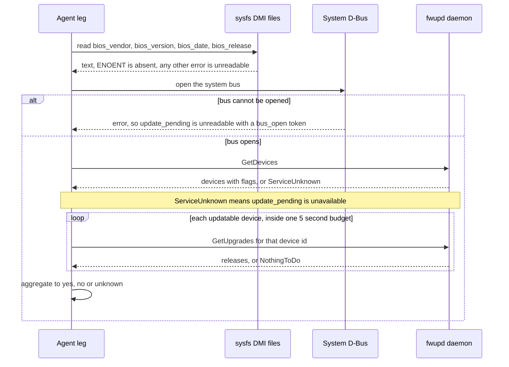
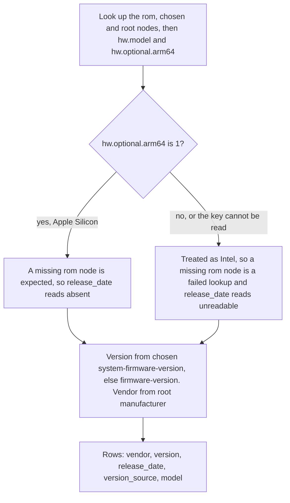

# firmware_posture

<!-- BEGIN GENERATED: plugin-doc-gen header -->
| | |
|---|---|
| **What it does** | Reports firmware/BIOS vendor, version, release date and update-pending posture |
| **Version** | 1.0.0 |
| **Kind** | Collector · read-only · gathered (crossplatform.firmware_posture.firmware) |
| **Platforms** | Windows ✅ · macOS 🟡 constrained · Linux 🟡 constrained |
| **Actions** | `firmware` (definition `crossplatform.firmware_posture.firmware`) |
| **Security** | securable `Security` · operation Read · risk Low · dispatch ReadOnly · approval gate None |
| **Roles** | execute: endpoint-admin, endpoint-operator, security-admin · author: content-author |
<!-- END GENERATED -->

## How it works

`firmware` reports what the host's own firmware says about itself and changes nothing: the vendor, version and release date of the BIOS or system firmware and, on Linux only, whether the fwupd service knows of a firmware update waiting for a device. The action takes no parameters and returns rows of the form `firmware|<field>|<value>|<source>`. Every leg is an in-process read (rung 1); no `wmic`, `dmidecode`, `fwupdmgr` or `ioreg` is ever run.

- **Windows** asks two sources and reports both, so a disagreement between them is visible. `wmi` is a bounded `Win32_BIOS` query for exactly `Manufacturer`, `SMBIOSBIOSVersion` and `ReleaseDate`. `smbios` reads the raw SMBIOS table with `GetSystemFirmwareTable('RSMB')` and parses its type-0 record: vendor, version, release date, ROM size, and the BIOS and embedded-controller release numbers. The WMI array column `BIOSVersion` is not read, so no `bios_version_list` row exists.
- **Linux** reads the four `/sys/class/dmi/id/bios_*` files (vendor, version, date, release), each once with a 4 KiB bound, then asks fwupd on the system D-Bus. It calls `GetDevices`, then `GetUpgrades` for each device flagged updatable, inside one 5 second budget for the whole fwupd read, and reports one `fwupd_device` row per device (at most 256) plus one aggregate `update_pending` row. sd-bus comes from the system package `libsystemd`, never from `vcpkg.json`; a build without it reports `update_pending` as `unreadable` with `fwupd:not_built`.
- **macOS** reads the IODeviceTree plane through IOKit. An Intel Mac has `/rom` (version, release date, vendor). An Apple Silicon Mac has no `/rom`, so the version is `/chosen` `system-firmware-version` (else `firmware-version`) and the vendor is the tree root `manufacturer`. The plugin also reads `hw.model`, and uses `hw.optional.arm64` to decide whether a missing `/rom` is expected. No `update_pending` row is produced, and Apple Silicon has no release date.

Every fact reads as exactly one of four things: a **value**; **`absent`** (the OS definitively reports nothing, such as no DMI in a container or a missing property); **`unavailable`** (`update_pending` only: the system bus answered and fwupd is not on it); or **`unreadable`** (the read failed). `absent` and `unavailable` are states, not failures: they add no reason token and the result stays `OK`. A failed read is never shown as `absent`; it is an `unreadable` row with a `<source>:<cause>` reason and a non-OK status. A non-OK status also makes the action return 1, which the agent core records as a command failure although the rows and the typed status still reach the server.

### What you can decide with it

| Question | Answer from | Windows | macOS | Linux |
|---|---|---|---|---|
| Which firmware version is this device on, and does it match the fleet baseline? | `version` | WMI and SMBIOS, two independent reads | `/rom` on Intel, an iBoot tag such as `mBoot-18000.161.10` on Apple Silicon | `bios_version` from DMI; `absent` in containers and some VMs |
| How old is the firmware? | `release_date` (`YYYY-MM-DD` when the source used a recognised date shape) | yes | Intel only; always `absent` on Apple Silicon | yes, when DMI exists |
| Who made it, and what model is it? | `vendor`, `model` | vendor only | vendor and `hw.model` | vendor only |
| Is a firmware update waiting? | `update_pending` | not reported | not reported | yes, when fwupd is present and reachable |
| Which components other than the BIOS carry updatable firmware? | `fwupd_device` rows | no | no | yes, one row per fwupd device |

`update_pending` is an aggregate over the devices fwupd flags as updatable, so read it with this table:

| Value | Meaning |
|---|---|
| `yes` | At least one updatable device has a release offered. |
| `no` | Every updatable device answered with no release, or fwupd lists no updatable device. |
| `unknown` | An updatable device could not be asked (the call failed or the 5 second budget ran out) and no other device said `yes`. |
| `unavailable` | The system bus answered and fwupd is not on it. |
| `unreadable` | The bus could not be opened, a call failed, or the build has no libsystemd. |

A device that is not updatable shows `update_pending=unknown` on its own `fwupd_device` row because it is never asked, and that does not change the aggregate. The verdict reflects whatever update metadata the fwupd daemon already holds; the plugin never asks fwupd to refresh it.

A clean result (`OK` with values) proves that the OS reported those strings. It does not prove the firmware is current, genuine or unmodified, and it says nothing about Secure Boot or the TPM (see `platform_security`). `absent` in a container or VM means the guest sees no DMI, not that the host has no firmware, so treat `absent` and `unreadable` as "unknown" when comparing against a baseline, never as "fine". On the shipped container agent image every run is recorded as a failure (see caveat 2), so target native agents for firmware questions.

### Diagrams

The Linux leg is the only multi-step one: a sysfs read, then a bounded exchange with fwupd.



The DMI files are read first and independently of fwupd, so a host with DMI but no usable D-Bus still reports its firmware version alongside an `unreadable` `update_pending`. The bus is opened once, devices are listed once, and `GetUpgrades` is asked only for devices flagged updatable; a refusal or an unexpected D-Bus error is recorded as a token rather than treated as "no update".

The macOS leg decides, from one architecture signal, whether a missing `/rom` is normal.



A missing `/chosen` or root node is never expected on any Mac, so it always reads `unreadable` with an `iokit:<path>:lookup_failed` token. `version_source` names the node and key that carried the version, so a consumer can tell an Intel `/rom` version from an Apple Silicon iBoot tag.

## OS capability

<!-- BEGIN GENERATED: plugin-doc-gen capability -->
| Action | Windows | macOS | Linux |
|---|---|---|---|
| `firmware` | ✅ supported · rung 1 · WMI Win32_BIOS via wmi_bounded run_bounded_wmi_query + GetSystemFirmwareTable('RSMB') SMBIOS type 0 | 🟡 constrained · rung 1 · IOKit IORegistryEntryFromPath IODeviceTree:/rom then IODeviceTree:/chosen, IORegistryEntryCreateCFProperty under ScopedIOObject/ScopedCFRef, plus sysctlbyname hw.model and hw.optional.arm64 (the Apple Silicon gate for the /rom lookup) | 🟡 constrained · rung 1 · /sys/class/dmi/id/{bios_vendor,bios_version,bios_date,bios_release} + fwupd org.freedesktop.fwupd GetDevices/GetUpgrades over the sd-bus system bus |

**Declared limits per leg** (descriptor fallback text, verbatim):

- **`firmware` / macOS** — verified on Apple Silicon only (Mac16,10, macOS 26.6.2): there IODeviceTree:/rom does not exist and the version is IODeviceTree:/chosen system-firmware-version (an iBoot tag such as mBoot-18000.161.10, not a BIOS date); the Intel /rom version/release-date/vendor keys are UNVERIFIED on hardware. release_date reads absent on Apple Silicon and update_pending is not reported
- **`firmware` / Linux** — the fwupd leg needs libsystemd at build time (a system dependency, never vcpkg); without it update_pending reads unreadable with the fwupd:not_built token and the sysfs rows remain. Hosts without DMI (containers, some VMs) report the DMI fields absent and a reachable system bus with no fwupd daemon reports update_pending unavailable: neither is a failure. A system bus that cannot be opened (a container without the bus socket) reads update_pending unreadable with fwupd:bus_open:<errno> and the action CONSTRAINED (or PERMISSION_DENIED when the connect is refused). The populated-DMI shape is not captured from a physical Linux host
<!-- END GENERATED -->

## Privileges and prerequisites

| OS | Runs as | Extra grant needed | Measured | If the read is refused |
|---|---|---|---|---|
| Windows | agent service account (LocalSystem today, #1442) | None documented for this plugin (`docs/agent-privilege-model.md`) | Captured as `NT AUTHORITY\SYSTEM` on a bare-metal host: `Win32_BIOS`, the `GetSystemFirmwareTable('RSMB')` size and the type-0 rows (`docs/samples/windows.txt`). Not measured: a non-SYSTEM identity. | `ERROR_ACCESS_DENIED` or a WBEM access-denied HRESULT reports the row `unreadable` and the action `PERMISSION_DENIED`/`PARTIAL`; any other failure reports `<source>:<cause>` (`smbios:win32_<n>`, `wmi:<token>`) |
| macOS | agent daemon, root today (the LaunchDaemon carries no `UserName` key, see `docs/agent-privilege-model.md`); the IODeviceTree plane is world-readable | None: no read needed a privilege | 2026-10-03, bare-metal Apple Silicon (Mac16,10, macOS 26.6.2), unprivileged (euid 501), real capture (`docs/samples/macos.txt`). No root run was captured, so root is the documented production default, not a measured one. The Intel `/rom` keys are unverified on hardware. | A key that exists but is not text reads `unreadable` on that field; a failed IOKit node lookup reads `unreadable` with an `iokit:<path>:lookup_failed` token, except `/rom` on Apple Silicon, which does not exist there and reads `absent` |
| Linux | agent daemon, dedicated unprivileged account, never root by design (`docs/agent-privilege-model.md`) | None for the `bios_*` DMI attributes (kernel mode 0444; not measured, the Docker VM used for capture has no `/sys/class/dmi`). The fwupd calls are read methods on the system bus. | fwupd 1.9.28 replies captured as root (euid 0) in a fedora:40 container and the no-daemon `ServiceUnknown` path in a debian:12 container (`tests/unit/fixtures/wave8/firmware_posture/linux/`); the built `.so` run against a no-DMI container with no system bus is captured (`docs/samples/linux.txt`). A non-root caller and a populated-DMI host are unverified. | `EACCES`/`EPERM` on a DMI file reports it `unreadable` with `dmi:<file>:eacces` and the action `PERMISSION_DENIED`; a D-Bus `AccessDenied` reports `fwupd:<call>:permission_denied`; an absent file or a daemon the bus reports as not installed is a state, never a failure; a bus that cannot be opened is a failure |

Binaries and subprocesses: none. Every leg is an in-process read (WMI and the firmware table API, sysfs and sd-bus, IOKit and `sysctlbyname`). Network: none; the fwupd call is a local D-Bus method call, and the daemon may itself reach a remote metadata service, which this plugin neither triggers nor observes.

## Data contract

### Inputs

<!-- BEGIN GENERATED: plugin-doc-gen inputs -->
The action takes no parameters.
<!-- END GENERATED -->

### Outputs

Pipe-delimited rows written via `write_output()`. The first field is the fixed tag `firmware` (or `constrained` for the single catch-all row `constrained|internal_error`, which has only a reason after the tag). Then `<field>`, `<value>` and `<source>`. Every field goes through the shared untrusted-output escaper. `vendor`, `version` and `release_date` are emitted on every source that ran AND read cleanly, as data or `absent`. A Windows source whose read itself failed (not merely absent) reports every field it can emit `unreadable` (one row per field, like Linux): `vendor`, `version` and `release_date` for `wmi`; those plus `rom_size_bytes`, `bios_release` and `ec_release` for `smbios`, one `<source>:<cause>` reason and a non-OK typed status. Linux `dmi` reads each of `vendor`, `version` and `release_date` from its own sysfs file, so a single file's failure marks only that field `unreadable`; the other two still report their own value or `absent`. `release_date` is normalised to `YYYY-MM-DD` when the source used a recognised date shape and otherwise passes through unchanged. Windows adds `rom_size_bytes`, `bios_release` and `ec_release` from SMBIOS when the table specifies them; a release pair with only one of its major/minor bytes specified reads `unreadable` with an `smbios:<field>:partial` token. Linux adds `bios_release` from DMI when well formed (a malformed one reads `unreadable` with `dmi:bios_release`), one `fwupd_device` row per fwupd device (`id=..;name=..;version=..;updatable=..;needs_reboot=..;update_pending=..;unmodelled=..`, where `unmodelled=yes` means a device flag bit the plugin does not name) and one `update_pending` row (`yes`, `no`, `unknown`, `unavailable` or `unreadable`). macOS adds `version_source` (the node and key that carried the version) and `model`. On Windows both `wmi` and `smbios` rows can appear for the same field. A host with several fwupd devices past the 256-device cap reports `fwupd:row_cap`.

<!-- BEGIN GENERATED: plugin-doc-gen outputs -->
**`crossplatform.firmware_posture.firmware` — `row_kind|field|value|source`**

| Field | Type | Values | Available | Example | Description |
|---|---|---|---|---|---|
| `row_kind` | string | `firmware` `constrained` | Windows, Linux, macOS | `firmware` | Fixed leading tag of the row: `firmware` for a data row; `constrained` only for the single catch-all `constrained\|internal_error` row emitted when the action hit an unexpected exception (the next column then carries the reason and the last two are empty). |
| `field` | string | `vendor` `version` `release_date` `rom_size_bytes` `bios_release` `ec_release` `update_pending` `fwupd_device` `version_source` `model` `internal_error` | Windows, Linux, macOS | `version` | The firmware fact. Every OS: vendor, version, release_date. Windows raw SMBIOS: rom_size_bytes, bios_release, ec_release (a row only when the table specifies the value; a half-specified release pair, or a failed SMBIOS read, reads `unreadable`). Linux: bios_release (DMI, when present; a malformed one reads `unreadable`), update_pending (the aggregate fwupd verdict), fwupd_device (one row per fwupd device). macOS: version_source (which device-tree node and key carried the version), model. For a `constrained` row: the reason (internal_error). |
| `value` | string | - | Windows, Linux, macOS | `A1.2.3` | The value. vendor, version, release_date: the text read, else `absent` (the OS reports nothing) or `unreadable` (the read failed). rom_size_bytes, bios_release, ec_release and version_source can also read `unreadable` (a failed SMBIOS read, a half-specified or malformed release, an unreadable device-tree version). release_date is `YYYY-MM-DD` when the source used a recognised date shape, otherwise the source text unchanged. update_pending: `yes`, `no` or `unknown` (aggregate over updatable fwupd devices), `unavailable` (the system bus answered and fwupd is not on it: a state, not a failure) or `unreadable` (the fwupd read failed, or this build has no libsystemd and reports the fwupd:not_built reason). fwupd_device: `id=<id>;name=<name>;version=<version>;updatable=<yes\|no>;needs_reboot=<yes\|no>;update_pending=<yes\|no\|unknown>;unmodelled=<yes\|no>`, where unmodelled=yes means a device flag bit above those the plugin names was set. Other fields: a decimal number, an `<major>.<minor>` release, a device-tree `<node>#<key>` reference or the hardware model. Empty on a `constrained` row. |
| `source` | string | `smbios` `wmi` `dmi` `fwupd` `iokit` `sysctl` | Windows, Linux, macOS | `dmi` | The mechanism that produced the row: smbios (Windows raw SMBIOS type 0), wmi (Windows Win32_BIOS), dmi (Linux sysfs), fwupd (Linux D-Bus), iokit (macOS device tree), sysctl (macOS hw.model). Empty on a `constrained` row. |
<!-- END GENERATED -->

### Result status

Any status other than `OK` makes the action return 1, which the agent core reports as a command FAILURE; the typed status still reaches the server with the rows. The per-failure reason tokens below are written to the agent log (`provenance=`), not sent on the wire. In a fwupd token, `<call>` is `bus_open`, `get_devices` or `get_upgrades`, `<errno>` is a lowercase errno name (`enoent`, `enotdir`, `eio`, ...) or `errno_<n>`, and a failed call that carried a D-Bus error name ends `dbus_<name>` instead (the last dot-segment of the name, lowercased, non-alphanumerics as `_`, at most 32 bytes, for example `fwupd:get_devices:dbus_noreply`).

| Status | Completeness | Provenance | When |
|---|---|---|---|
| `OK` | `FULL` | none | No failure token was recorded. Absent DMI or firmware properties, and a fwupd daemon the system bus reports as not installed, are states and do not lower the status; a system bus that cannot be opened is a failure (`fwupd:bus_open:<errno>`). |
| `CONSTRAINED` | `PARTIAL` | `smbios:truncated`, `smbios:malformed`, `smbios:no_type0`, `smbios:oversized`, `smbios:size_race`, `smbios:win32_<n>`, `wmi:<token>`, `wmi:row_cap`, `dmi:<file>:oversized`, `dmi:<file>:<errno>`, `dmi:bios_release`, `smbios:bios_release:partial`, `smbios:ec_release:partial`, `fwupd:<call>:<errno>`, `fwupd:<call>:dbus_<name>`, `fwupd:get_upgrades:<errno>`, `fwupd:get_upgrades:dbus_<name>`, `fwupd:shape`, `fwupd:row_cap`, `fwupd:budget`, `fwupd:not_built`, `iokit:<key>:undecodable`, `iokit:<path>:lookup_failed`, `sysctl:hw_model:unreadable`, `sysctl:hw_optional_arm64:unreadable` | At least one read failed for a reason other than a refusal; the status reason lists one `<source>:<cause>` token per failure and the matching row reads `unreadable` where it has one. `fwupd:not_built` means this agent build has no libsystemd (`-Dsystemd_guard=auto`): a build limitation, not a statement about the host. |
| `PERMISSION_DENIED` | `PARTIAL` | `dmi:<file>:eacces`, `dmi:<file>:eperm`, `fwupd:<call>:permission_denied`, `fwupd:get_upgrades:permission_denied`, `wmi:<token>`, `smbios:win32_5` | At least one read was refused (`EACCES`/`EPERM`, `ERROR_ACCESS_DENIED`, WBEM access denied, D-Bus `AccessDenied`); a refusal on any leg outranks other failures. |
| `CONSTRAINED` | `PARTIAL` | `internal_error` | An unexpected exception was caught by the action's single handler; the action returns 1 with the row `constrained\|internal_error`. |

### Where the data goes

- **Instruction result.** Rows travel over the agent's mTLS gRPC channel as the command response and land in the ResponseStore, queryable at `/api/responses/{id}`. `firmware` is also a gathered definition (`crossplatform.firmware_posture.firmware`, 300s TTL).
- **Not consumed by** daily-sync, TAR, DEX, or metrics.
- **Sensitivity.** Rows carry firmware vendor, version, release date, ROM size and, on Linux, fwupd device names and versions (for example a laptop's embedded controller or an NVMe drive firmware). No username, path or process name. Firmware versions identify a specific hardware model and revision, and an out-of-date one tells an attacker which known firmware flaw applies, so treat the rows like other `Security` posture data.
- **Siblings:** `hardware` (its `bios` action reads the same DMI and WMI fields as an inventory fact without the update-pending verdict) and `bitlocker` (disk encryption posture).

## Sample output

<!-- BEGIN GENERATED: plugin-doc-gen samples -->
**Windows** — captured: windows Windows 10.0.26200 x86_64 · bare-metal · 2026-09-21 · LocalSystem (elevated) · leg-hash 35cf8bb6e007

```
== action=firmware
firmware|vendor|American Megatrends Inc.|wmi
firmware|version|3801|wmi
firmware|release_date|2021-07-30|wmi
firmware|vendor|American Megatrends Inc.|smbios
firmware|version|3801|smbios
firmware|release_date|2021-07-30|smbios
firmware|rom_size_bytes|16777216|smbios
firmware|bios_release|5.17|smbios
[result_status] OK / FULL
```

**macOS** — captured: macos macOS 26.6.2 arm64 · bare-metal · 2026-10-03 · euid 501 · leg-hash 35cf8bb6e007

```
== action=firmware
firmware|vendor|Apple Inc.|iokit
firmware|version|mBoot-18000.161.10|iokit
firmware|release_date|absent|iokit
firmware|version_source|IODeviceTree:/chosen#system-firmware-version|iokit
firmware|model|Mac16,10|sysctl
[result_status] OK / FULL
```

**Linux** — captured: linux Debian GNU/Linux 13 (trixie) aarch64 · container · 2026-09-24 · euid 0 · leg-hash 35cf8bb6e007

```
== action=firmware
firmware|vendor|absent|dmi
firmware|version|absent|dmi
firmware|release_date|absent|dmi
firmware|update_pending|unreadable|fwupd
[result_status] CONSTRAINED / PARTIAL / fwupd:bus_open:enoent
[rc] 1
```
<!-- END GENERATED -->

## Caveats and known gaps

1. **Only Apple Silicon is verified on macOS.** The capture host has no `IODeviceTree:/rom`, so the Intel `version`, `release-date` and `vendor` keys are unverified on hardware. On Apple Silicon the version is an iBoot tag such as `mBoot-18000.161.10`, not a BIOS date, `release_date` reads `absent` and no `update_pending` row is reported.
2. **Update-pending is Linux-only and needs fwupd.** Windows and macOS report no update verdict, and on Linux the verdict covers only devices fwupd knows about and only their updatable ones. A host whose system bus cannot be opened reports `update_pending|unreadable` with `fwupd:bus_open:<errno>` (`enoent` when the socket is missing; a refused connect reads `permission_denied` and the action `PERMISSION_DENIED`), which is the normal result on the shipped container agent image because it has libsystemd but no D-Bus, so every run there is recorded as a command failure. To read update state in a container, mount the host's `/run/dbus/system_bus_socket` (a security decision that widens the container's authority) or target `firmware` at native agents by tag.
3. **Some failures cannot be told from an absence.** On macOS, `IORegistryEntryFromPath` and `IORegistryEntryCreateCFProperty` have no error channel, so a transient failure to look up `/rom` on Apple Silicon, or to read a property of a node that exists, reads `absent` (#4897). On Linux a sandbox that hides `/sys/class/dmi` from a host that has DMI looks the same as a host with none, and on Windows a missing `root\CIMV2` namespace or `Win32_BIOS` class reads `absent` (as does a damaged WMI repository that presents as one of those two answers, #4900), while any other WMI fault reads `unreadable` with a `wmi:<token>` token.
4. **The Linux sample shows the degenerate shape.** It is a real run in a container with no DMI and no system bus, so every DMI field is `absent` and `update_pending` is `unreadable` with `fwupd:bus_open:enoent`; no `fwupd_device` row and no populated-DMI shape has been captured from a physical host. The `unavailable` and device-row shapes are proven by unit fixtures only, not end to end.
5. **Read-only by design, and not boot integrity.** The plugin lists devices and upgrades and never installs, verifies or activates firmware, and it does not read Secure Boot state or the TPM. A version string is what the firmware reports about itself, so it is a fleet-comparison fact, not evidence that the firmware is genuine or unmodified.

## Source and tests

<!-- BEGIN GENERATED: plugin-doc-gen source -->
- Plugin: `agents/plugins/firmware_posture/src/firmware_posture_legs.hpp` · `agents/plugins/firmware_posture/src/firmware_posture_linux.cpp` · `agents/plugins/firmware_posture/src/firmware_posture_macos.cpp` · `agents/plugins/firmware_posture/src/firmware_posture_parsers.hpp` · `agents/plugins/firmware_posture/src/firmware_posture_plugin.cpp` · `agents/plugins/firmware_posture/src/firmware_posture_win.cpp`
- Definitions: `content/definitions/firmware_posture.yaml`
- Capability rows: `server/core/src/capability_decls/plugin_action_catalogue_firmware_posture.hpp`
- Tests: `tests/test_firmware_posture_definition.py` · `tests/unit/test_firmware_posture_local_dispatcher.cpp` · `tests/unit/test_firmware_posture_parsers.cpp`
- Privilege row: `docs/agent-privilege-model.md`
<!-- END GENERATED -->
