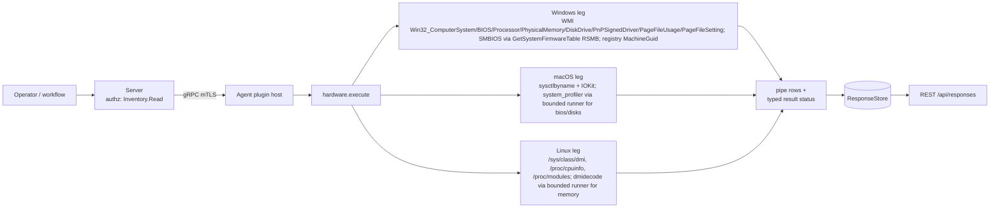

# hardware

<!-- BEGIN GENERATED: plugin-doc-gen header -->
| | |
|---|---|
| **What it does** | Reports hardware inventory: manufacturer, model, BIOS, CPU, memory, disks, drivers, chassis, baseboard, swap, machine id |
| **Version** | 1.0.0 |
| **Kind** | Collector · read-only · gathered (device.hardware.manufacturer, device.hardware.model, device.hardware.bios, device.hardware.processors, device.hardware.memory, device.hardware.disks, device.hardware.drivers, device.hardware.system) |
| **Platforms** | Windows ✅ · macOS ✅ · Linux ✅ |
| **Actions** | `baseboard` (definition `device.hardware.baseboard`) · `bios` (definition `device.hardware.bios`) · `chassis` (definition `device.hardware.chassis`) · `disks` (definition `device.hardware.disks`) · `drivers` (definition `device.hardware.drivers`) · `drivers_inventory` (definition `device.hardware.drivers_inventory`) · `machine_id` (definition `device.hardware.machine_id`) · `manufacturer` (definition `device.hardware.manufacturer`) · `memory` (definition `device.hardware.memory`) · `model` (definition `device.hardware.model`) · `processors` (definition `device.hardware.processors`) · `swap` (definition `device.hardware.swap`) · `system` (definition `device.hardware.system`) |
| **Security** | securable `Inventory` · operation Read · risk Low · dispatch ReadOnly · approval gate None |
| **Roles** | execute: endpoint-admin, endpoint-operator · author: content-author |
<!-- END GENERATED -->

## How it works

Thirteen independent actions, dispatched by action name (`HardwarePlugin::execute` and `dispatch` in `hardware_plugin.cpp`). `manufacturer`/`model`/`processors`/`system` are single native calls per OS (WMI, `sysctlbyname`/IOKit, or a `/sys`/`/proc` file read) with no subprocess. `bios` and `disks` need data no native API on macOS exposes, so those two legs shell out through the agent's bounded subprocess runner (`run_bounded_subprocess`, fixed deadline, no shell) to `system_profiler` and parse its output with a pure header-only parser (`hardware_macos_bios.hpp`, `hardware_disks_macos.hpp`). `memory` tries `dmidecode` on Linux (also via the bounded runner) and falls back to `/proc/meminfo`'s aggregate total when `dmidecode` is missing or fails. `drivers` enumerates `Win32_PnPSignedDriver` on Windows or reads `/proc/modules` on Linux; it is not implemented on macOS (no public per-driver/kext enumeration API). `drivers_inventory` is its stable-ordered, bounded sibling (the `drivers` action and its rows are unchanged): it adds signer, signed state, INF name and hardware id, sorts every row by (name, INF, hardware id, version), removes exact duplicates, and always leads with one `status|drivers_inventory|<supported|constrained|unsupported>|<tokens or ->` row followed by `driver_inv|<name>|<version>|<date>|<provider>|<class>|<signer>|<signed>|<inf>|<hwid>` rows, `-` standing in for any value that is absent. Windows runs one bounded WMI query on `Win32_PnPSignedDriver` (nine properties, `WHERE DeviceName IS NOT NULL`, a 4096-row cap rather than the 512-row cap the other actions use). Linux reads `/proc/modules` (bounded to 1 MiB, module names validated to `[A-Za-z0-9_-]{1,64}`) and, under one opened `/sys/module` directory descriptor, `<module>/version` and `<module>/taint` with 256-byte no-follow reads; no subprocess runs and no `.ko` file is opened. Ordering, de-duplication, escaping and the status row are one pure header (`hardware_drivers_inventory.hpp`) shared by both legs. The four newest actions (`chassis`, `baseboard`, `swap`, `machine_id`) are read on Windows by `hardware_estate_win.cpp`: `chassis` and `baseboard` decode the SMBIOS table (`GetSystemFirmwareTable('RSMB')` through the shared reader `agents/shared/win_rsmb.hpp` and the shared walker `agents/shared/smbios_parsers.hpp`), `machine_id` reads the registry `MachineGuid` and ships only an HMAC of it, and `swap` reads `Win32_PageFileUsage` (plus `Win32_PageFileSetting` for the configured maximum) through the bounded WMI helper. Every decision about a row (placeholder handling, the stable swap total, the outcome) is in the pure `hardware_estate_parsers.hpp`, unit-tested on every host. On Linux and macOS they still answer exactly one `status|<action>|unsupported|<os>:planned` row from the shared planned-leg reporter (`agents/shared/planned_leg.hpp`, called from the dispatch in `hardware_plugin.cpp`) until those legs land. On Windows `processors` and `memory` also fill their appended columns (`socket_designation`, `stepping`; `manufacturer`, `part_number`, `serial`) from the WMI classes their rows already come from.

Every action that can find nothing still emits one row carrying the literal `unknown` in place of an unread value (the `manufacturer|unknown`, `model|unknown` and `bios_*|unknown` rows in `do_manufacturer`, `do_model` and `do_bios` and equivalents) — never a silent zero-row output — so a consumer can tell "the probe ran and found nothing" from "this action produced no output for an unrelated reason." This plugin is deliberately not a live-monitoring feed: every action is a point-in-time read with no polling, no event stream, and (except `drivers` and `drivers_inventory`, whose WMI query can take several seconds) no expectation of taking more than a few milliseconds.



## OS capability

<!-- BEGIN GENERATED: plugin-doc-gen capability -->
| Action | Windows | macOS | Linux |
|---|---|---|---|
| `baseboard` | ✅ supported · rung 1 · GetSystemFirmwareTable('RSMB') SMBIOS type 2 via the shared SMBIOS walker | 🟡 planned · rung 1 · no public source on Apple hardware; a later change declares it unsupported | 🟡 planned · rung 1 · /sys/class/dmi/id/board_{vendor,name,serial} + SMBIOS type 2 |
| `bios` | ✅ supported · rung 1 · WMI Win32_BIOS | ✅ supported · rung 2 · run_bounded_subprocess(system_profiler SPHardwareDataType) + native parser (hardware_macos_bios.hpp) | ✅ supported · rung 1 · /sys/class/dmi/id/bios_vendor + bios_version + bios_date |
| `chassis` | ✅ supported · rung 1 · GetSystemFirmwareTable('RSMB') SMBIOS type 3 via the shared SMBIOS walker | 🟡 planned · rung 1 · no public source on Apple hardware; a later change declares it unsupported | 🟡 planned · rung 1 · /sys/class/dmi/id/chassis_{type,serial,asset_tag} + SMBIOS type 3 |
| `disks` | ✅ supported · rung 1 · WMI Win32_DiskDrive | ✅ supported · rung 2 · run_bounded_subprocess(system_profiler SPStorageDataType SPNVMeDataType SPSerialATADataType -json) + native parser (hardware_disks_macos.hpp) | ✅ supported · rung 1 · /sys/block/*/{size,device/model} native walk |
| `drivers` | ✅ supported · rung 1 · WMI Win32_PnPSignedDriver | ⛔ unsupported | ✅ supported · rung 1 · /proc/modules |
| `drivers_inventory` | ✅ supported · rung 1 · WMI Win32_PnPSignedDriver (DeviceName, DriverVersion, DriverDate, DriverProviderName, DeviceClass, Signer, IsSigned, InfName, HardWareID), bounded | ⛔ unsupported | ✅ supported · rung 1 · /proc/modules + /sys/module/<m>/{version,taint} bounded no-follow reads |
| `machine_id` | ✅ supported · rung 1 · HMAC-SHA256 (fixed public label) of the registry MachineGuid | 🟡 planned · rung 1 · no public source beyond the hardware UUID `system` already reports; a later change declares it unsupported | 🟡 planned · rung 1 · keyed hash of /etc/machine-id |
| `manufacturer` | ✅ supported · rung 1 · WMI Win32_ComputerSystem.Manufacturer | ✅ supported · rung 1 · sysctlbyname(hw.manufacturer) | ✅ supported · rung 1 · /sys/class/dmi/id/sys_vendor |
| `memory` | ✅ supported · rung 1 · WMI Win32_PhysicalMemory | 🟡 constrained · rung 1 · sysctlbyname(hw.memsize) | 🟡 constrained · rung 2 · run_bounded_subprocess(dmidecode -t memory) |
| `model` | ✅ supported · rung 1 · WMI Win32_ComputerSystem.Model | ✅ supported · rung 1 · sysctlbyname(hw.model) | ✅ supported · rung 1 · /sys/class/dmi/id/product_name |
| `processors` | ✅ supported · rung 1 · WMI Win32_Processor | ✅ supported · rung 1 · sysctlbyname(machdep.cpu.*, hw.*cpu*) | ✅ supported · rung 1 · /proc/cpuinfo |
| `swap` | ✅ supported · rung 1 · WMI Win32_PageFileUsage + Win32_PageFileSetting | 🟡 planned · rung 1 · sysctlbyname(vm.swapusage) | 🟡 planned · rung 1 · /proc/swaps |
| `system` | ✅ supported · rung 1 · WMI Win32_BIOS.SerialNumber + Win32_ComputerSystemProduct.UUID | ✅ supported · rung 1 · IOServiceGetMatchingService(IOPlatformExpertDevice) + IORegistryEntryCreateCFProperty(kIOPlatformSerialNumberKey/kIOPlatformUUIDKey) | ✅ supported · rung 1 · /sys/class/dmi/id/product_serial + product_uuid |

**Declared limits per leg** (descriptor fallback text, verbatim):

- **`baseboard` / macOS** — not read yet: one unsupported status row, macos:planned
- **`baseboard` / Linux** — not read yet: one unsupported status row, linux:planned
- **`chassis` / macOS** — not read yet: one unsupported status row, macos:planned
- **`chassis` / Linux** — not read yet: one unsupported status row, linux:planned
- **`drivers_inventory` / macOS** — no public kext/dext enumeration API
- **`drivers_inventory` / Linux** — signed state is derived from the per-module taint flag E only; signer, INF, hardware id and date have no Linux source
- **`machine_id` / macOS** — not read yet: one unsupported status row, macos:planned
- **`machine_id` / Linux** — not read yet: one unsupported status row, linux:planned
- **`memory` / macOS** — aggregate total only, no per-DIMM breakdown (macOS has no public per-DIMM API)
- **`memory` / Linux** — falls back to the aggregate MemTotal from /proc/meminfo (no per-DIMM detail) when dmidecode is unavailable or unprivileged
- **`swap` / macOS** — not read yet: one unsupported status row, macos:planned
- **`swap` / Linux** — not read yet: one unsupported status row, linux:planned
<!-- END GENERATED -->

## Privileges and prerequisites

| OS | Runs as | Extra grant needed | Measured | If the read is refused |
|---|---|---|---|---|
| Windows | agent service account (LocalSystem today, #1442) | None documented for this plugin (the `hardware.*` row of `docs/agent-privilege-model.md`) | 2026-11-03, bare-metal, `NT SERVICE` virtual service account, not an administrator (sample stamp; the capture author also confirmed the account is not an administrator with the admin-only `net session` command, which failed under it and succeeded for an administrator, a check recorded in the author's capture notes and not committed) | The pre-existing actions: a WMI query that returns `error` falls back to its `unknown` sentinel row (the `wmi_query` helper in `hardware_plugin.cpp`), except that `processors` and `memory` also declare a typed status when their WMI query itself failed. The four estate actions instead report a typed `permission_denied` (no rows, no sentinel) for a refused SMBIOS, registry or WMI read |
| macOS | agent daemon, default (no extra entitlement) | None (the `hardware.*` row of `docs/agent-privilege-model.md`) | 2026-11-03, bare-metal, euid 501 (unprivileged, sample stamp) | native call/subprocess fails, action emits `unknown`/sentinel row |
| Linux | agent daemon, default, except `system` needs `cap_dac_read_search` (the `hardware.system` row of `docs/agent-privilege-model.md`) | `system` reads `/sys/class/dmi/id/product_serial` + `product_uuid` (mode `0400`); the packaged systemd unit grants the agent `CAP_DAC_READ_SEARCH` as an ambient capability (bounding set limited to that one capability, `NoNewPrivileges` kept), and the dev install script sets `cap_dac_read_search+eip` on the binary instead (the capability comment in `do_system`, `hardware_plugin.cpp`). The agent clears its inheritable and ambient sets at start, so an exec'd child such as `dmidecode` does not inherit the capability (the in-process read is deliberate). Without the capability (opt-out, `--no-setcap`, or a manual launch) both fields read back `unknown`. The unit also keeps a root-made copy of the firmware tables under `/var/lib/yuzu-agent/dmi/`; this plugin does not read it. Not yet tested on systemd 239 (RHEL 8). `memory`'s `dmidecode` branch typically needs root and fails EPERM unprivileged, silently falling through to the `/proc/meminfo` total (the EPERM-fallback comment in `do_memory`, `hardware_plugin.cpp`). | 2026-11-03, bare-metal, euid 1000 (sample stamp — unprivileged, so the `cap_dac_read_search` gate is exercised: `system` reads `unknown`, while the world-readable DMI `manufacturer`/`model`/`bios` read real values) | file read fails, action emits `unknown` |

On Windows the four estate actions needed no grant on the captured host: SMBIOS (`RSMB`), the `MachineGuid` value and the `Win32_PageFile*` classes were all read by a non-administrator virtual service account in the 2026-11-03 capture (`docs/samples/windows.txt`), and a refusal on another host is reported `permission_denied`, never as an absent value. If hardening denies read access to `HKLM\SOFTWARE\Microsoft\Cryptography` (the `MachineGuid` value) or to the `root\cimv2` WMI namespace, only the sections that need that object report `permission_denied`; the others are unaffected. On Linux and macOS the four planned actions read nothing and need no grant.

Binaries/subprocesses: `/usr/sbin/system_profiler` (macOS `bios`, `disks`, via `run_bounded_subprocess`) and `dmidecode` (Linux `memory`, resolved via `probe_tool_path`, also via `run_bounded_subprocess`) — both bounded, no shell. No network access. Windows uses in-process WMI (COM), no child process.

## Data contract

### Inputs

<!-- BEGIN GENERATED: plugin-doc-gen inputs -->
No action takes parameters.
<!-- END GENERATED -->

### Outputs

Pipe-delimited rows, one per record via `write_output()`. Scalar actions (`manufacturer`, `model`) emit `key|value`; the rest emit one or more `key|field1|field2|...` rows. A field the underlying probe could not read is the literal string `unknown` rather than an omitted field or an empty row — this applies to every read action's identity/value fields (`manufacturer`, `model`, `bios`, `processors`, `memory`, `disks`, `system`); `processors` rows end in two appended columns (`socket_designation`, `stepping`) and `memory` rows in three (`manufacturer`, `part_number`, `serial`); Windows fills them, and each is the literal `-` where the firmware or module reports filler or nothing, and on Linux and macOS until those legs read them. The four estate actions emit one typed status row first (`status|<action>|<supported|constrained|unsupported>|<token or ->`) and then their data rows; on Linux and macOS today the status row is `status|<action>|unsupported|<os>:planned` and nothing else. In an estate data row `-` means *absent* (the firmware reports no value or OEM filler such as `To Be Filled By O.E.M.`), which leaves the section `supported`; a field that could not be read is never written as a value. `drivers` additionally emits `__truncated__` in the name field when the Windows WMI row cap (512, `agents/shared/wmi_bounded.hpp`) is hit (the `__truncated__` comment in `do_drivers`, `hardware_plugin.cpp`).

<!-- BEGIN GENERATED: plugin-doc-gen outputs -->
**`device.hardware.baseboard` — `row_kind|vendor|product|serial|source`**

| Field | Type | Values | Available | Example | Description |
|---|---|---|---|---|---|
| `row_kind` | string | `status` `baseboard` | Windows, Linux, macOS | `status` | Row shape discriminator (the wire row's leading tag). Values: status (exactly one per result, always first), baseboard (one per record read). |
| `vendor` | string | - | Windows, Linux, macOS | `ASUSTeK COMPUTER INC.` | Baseboard vendor, or "-" when absent. Status rows: the action name. |
| `product` | string | - | Windows, Linux, macOS | `PRIME B450M-A` | Baseboard product name, or "-" when absent. Status rows: the level (supported, constrained or unsupported). |
| `serial` | string | - | Windows, Linux, macOS | `-` | Baseboard serial number, or "-" when absent. Status rows: the reason token (<os>:planned until the leg lands, a failure token on a degraded read, or "-"). |
| `source` | string | - | Windows, Linux, macOS | `/sys/class/dmi/id` | Where the value was read from, or "-" when absent. Absent on status rows. |

**`device.hardware.bios` — `bios_vendor|bios_version|bios_date`**

| Field | Type | Values | Available | Example | Description |
|---|---|---|---|---|---|
| `bios_vendor` | string | - | Windows, Linux, macOS | `American Megatrends Inc.` | BIOS/firmware vendor name; the fixed literal "Apple" on macOS, or "unknown" when unread. Values: free text, the literal "Apple" (macOS only), or the sentinel "unknown". |
| `bios_version` | string | - | Windows, Linux, macOS | `3801` | BIOS/firmware version string, or "unknown" when unread. Values: free text, or the sentinel "unknown". |
| `bios_date` | string | - | Windows, Linux, macOS | `2021-07-30` | BIOS release date as YYYY-MM-DD on Windows/Linux; the fixed literal "N/A" on macOS (no BIOS date concept); "unknown" when unread. Values: YYYY-MM-DD format, the literal "N/A" (macOS only), or the sentinel "unknown". |

**`device.hardware.chassis` — `row_kind|type|serial|asset_tag|source`**

| Field | Type | Values | Available | Example | Description |
|---|---|---|---|---|---|
| `row_kind` | string | `status` `chassis` | Windows, Linux, macOS | `status` | Row shape discriminator (the wire row's leading tag). Values: status (exactly one per result, always first), chassis (one per record read). |
| `type` | string | - | Windows, Linux, macOS | `Desktop` | Chassis type (SMBIOS type 3), or "-" when absent. Status rows: the action name. |
| `serial` | string | - | Windows, Linux, macOS | `-` | Chassis serial number, or "-" when absent. Status rows: the level (supported, constrained or unsupported). |
| `asset_tag` | string | - | Windows, Linux, macOS | `-` | Chassis asset tag, or "-" when absent. Status rows: the reason token (<os>:planned until the leg lands, a failure token on a degraded read, or "-"). |
| `source` | string | - | Windows, Linux, macOS | `/sys/class/dmi/id` | Where the value was read from, or "-" when absent. Absent on status rows. |

**`device.hardware.disks` — `index|model|size_gb|media_type|interface`**

| Field | Type | Values | Available | Example | Description |
|---|---|---|---|---|---|
| `index` | int32 | - | Windows, Linux, macOS | `0` | Enumeration index (Windows Win32_DiskDrive.Index; macOS/Linux assigned during enumeration, not guaranteed stable across runs). Values: integer, 0-based. |
| `model` | string | - | Windows, Linux, macOS | `Samsung SSD 970 EVO Plus 1TB` | Disk model/device string, or "unknown" when nothing was found. Values: free text, or the sentinel "unknown". |
| `size_gb` | int64 | - | Windows, Linux, macOS | `931` | Disk capacity in GB, integer-divided from raw bytes (Windows/macOS) or 512-byte sectors (Linux). |
| `media_type` | string | - | Windows, Linux, macOS | `SSD` | Media classification. Windows matches the WMI MediaType string; macOS treats every NVMe device as SSD and looks up SATA media from SPStorageDataType; Linux reads the removable/rotational sysfs attributes. Values: SSD, HDD, Removable, or the sentinel "unknown". |
| `interface` | string | - | Windows, Linux, macOS | `SCSI` | Bus/interface label. Windows reports the WMI storage-stack InterfaceType (often "SCSI" even for NVMe/SATA disks, not the physical bus); macOS reports "NVMe"/"SATA"; Linux infers a transport from the /sys/block symlink target. Values: SCSI (Windows); NVMe or SATA (macOS); nvme, usb, virtio, mmc, sata, scsi, or unknown (Linux). |

**`device.hardware.drivers` — `index|name|version|date|provider|device_class`**

| Field | Type | Values | Available | Example | Description |
|---|---|---|---|---|---|
| `index` | int32 | - | Windows, Linux | `0` | Enumeration order; on the truncation-marker row (Windows only), carries the reached row count instead of an index. Values: integer, 0-based, or the reached count on a truncation-marker row. |
| `name` | string | - | Windows, Linux | `Realtek Audio Universal Service` | Driver/module display name; "unknown" when nothing was found; the literal "__truncated__" marks a Windows WMI row-cap hit (512 rows, agents/shared/wmi_bounded.hpp). Values: free text, the sentinel "unknown", or the literal "__truncated__". |
| `version` | string | - | Windows | `6.0.9977.1` | Driver version string (Windows only; Linux /proc/modules carries no version, always empty). Values: free text, or empty. |
| `date` | string | - | Windows | `2026-04-14` | Driver release date as YYYY-MM-DD, parsed from the WMI CIM datetime (Windows only; empty if malformed or on Linux). Values: YYYY-MM-DD format, or empty. |
| `provider` | string | - | Windows, Linux | `Realtek Semiconductor Corp.` | Driver publisher (Windows DriverProviderName; the fixed literal "kernel" on Linux). Values: free text, or the literal "kernel". |
| `device_class` | string | - | Windows, Linux | `MEDIA` | Windows DeviceClass (e.g. NET, SYSTEM, MEDIA); the fixed literal "module" on Linux. Values: free text WMI device class, or the literal "module". |

**`device.hardware.drivers_inventory` — `row_kind|name|version|date|provider|device_class|signer|signed|inf|hwid`**

| Field | Type | Values | Available | Example | Description |
|---|---|---|---|---|---|
| `row_kind` | string | `status` `driver_inv` | Windows, Linux | `driver_inv` | Row shape discriminator (the wire row's leading tag). Values: status (exactly one per result, always first), driver_inv (one per driver). |
| `name` | string | - | Windows, Linux | `AMD Audio CoProcessor` | Driver or module name: the Windows DeviceName, or the Linux kernel module name. Status rows: the action name. |
| `version` | string | - | Windows, Linux | `6.0.0.109` | Driver version (Windows DriverVersion; Linux /sys/module/<m>/version), or "-" when the host reports none. Status rows: the level (supported, constrained or unsupported). |
| `date` | string | - | Windows | `2025-03-26` | Driver date as YYYY-MM-DD (Windows only), or "-" when empty or in a form that cannot be read unambiguously. Status rows: the reason tokens, comma-separated, or "-" when there are none. |
| `provider` | string | - | Windows, Linux | `AMD` | Driver publisher (Windows DriverProviderName; the fixed literal "kernel" on Linux), or "-" when empty. |
| `device_class` | string | - | Windows, Linux | `SYSTEM` | Windows DeviceClass (e.g. SYSTEM, NET, MEDIA); the fixed literal "module" on Linux; "-" when empty. |
| `signer` | string | - | Windows | `Microsoft Windows Hardware Compatibility Publisher` | Windows signer of the driver package (Signer), or "-" when empty. No Linux source. |
| `signed` | string | `signed` `unsigned` `-` | Windows, Linux | `signed` | Signature state. Windows: IsSigned True/False. Linux: "unsigned" only when the module taint flags contain E; "-" otherwise, since no flag proves a module signed. Values: signed, unsigned, or "-" when unknown. |
| `inf` | string | - | Windows | `oem18.inf` | Windows INF name (InfName, e.g. oem18.inf), or "-" when empty. No Linux source. |
| `hwid` | string | - | Windows | `PCI/VEN_1022&DEV_15E2&SUBSYS_15E21022&REV_63` | Windows hardware id (HardWareID); a backslash is written as "/" by the row escaper. "-" when empty. No Linux source. |

**`device.hardware.machine_id` — `row_kind|hash_hex|algorithm|source`**

| Field | Type | Values | Available | Example | Description |
|---|---|---|---|---|---|
| `row_kind` | string | `status` `machine_id` | Windows, Linux, macOS | `status` | Row shape discriminator (the wire row's leading tag). Values: status (exactly one per result, always first), machine_id (one per record read). |
| `hash_hex` | string | - | Windows, Linux, macOS | `-` | Keyed hash of the machine identifier, hex, or "-" when absent. Status rows: the action name. |
| `algorithm` | string | - | Windows, Linux, macOS | `-` | Name of the keyed hash used, or "-" when absent. Status rows: the level (supported, constrained or unsupported). |
| `source` | string | - | Windows, Linux, macOS | `/etc/machine-id` | Where the identifier was read from, or "-" when absent. Status rows: the reason token (<os>:planned until the leg lands, a failure token on a degraded read, or "-"). |

**`device.hardware.manufacturer` — `manufacturer`**

| Field | Type | Values | Available | Example | Description |
|---|---|---|---|---|---|
| `manufacturer` | string | - | Windows, Linux, macOS | `PCSpecialist` | The system manufacturer string, or "unknown" when the probe could not read one. Values: free text, or the sentinel "unknown". |

**`device.hardware.memory` — `slot|size_mb|type|speed_mhz|manufacturer|part_number|serial`**

| Field | Type | Values | Available | Example | Description |
|---|---|---|---|---|---|
| `slot` | string | - | Windows, Linux | `DIMM_A2` | DIMM locator on Windows/Linux dmidecode, or the fixed literal "total" for an aggregate-only row (macOS always, Linux when dmidecode is unavailable or unprivileged). Values: free text locator, or the literal "total". |
| `size_mb` | int64 | - | Windows, Linux, macOS | `8192` | Module capacity in MB, or the aggregate total in MB on an aggregate-only row. Values: integer. |
| `type` | string | - | Windows, Linux | `DDR4` | Memory type (DDR2/DDR3/DDR4/DDR5); "unknown" on every aggregate-only row (macOS, and the Linux /proc/meminfo fallback carry no type). Values: DDR2, DDR3, DDR4, DDR5, or the sentinel "unknown". |
| `speed_mhz` | int32 | - | Windows, Linux | `3600` | Module speed in MHz; 0 on every aggregate-only row. Values: integer, or 0 on an aggregate-only row. |
| `manufacturer` | string | - | Windows, Linux | `Micron Technology` | DIMM manufacturer string as the module reports it; "-" when it reports filler or nothing, and on Linux until its leg reads it. Windows reads Win32_PhysicalMemory.Manufacturer. Values: free text, or "-". |
| `part_number` | string | - | Windows, Linux | `CT32G56C46S5.C8BA` | DIMM part number, right-trimmed; "-" when the module reports filler or nothing, and on Linux until its leg reads it. Windows reads Win32_PhysicalMemory.PartNumber. Values: free text, or "-". |
| `serial` | string | - | Windows, Linux | `0A1B2C3D` | DIMM serial number as the module reports it; "-" when it reports filler or nothing, and on Linux until its leg reads it. Windows reads Win32_PhysicalMemory.SerialNumber. Values: free text, or "-". |

**`device.hardware.model` — `model`**

| Field | Type | Values | Available | Example | Description |
|---|---|---|---|---|---|
| `model` | string | - | Windows, Linux, macOS | `Amd Am4 Gen3` | The system model or product name string, or "unknown" when the probe could not read one. Values: free text, or the sentinel "unknown". |

**`device.hardware.processors` — `index|model|cores|threads|clock_mhz|socket_designation|stepping`**

| Field | Type | Values | Available | Example | Description |
|---|---|---|---|---|---|
| `index` | int32 | - | Windows, Linux, macOS | `0` | Physical socket index (Linux DMI "physical id"; always 0 on macOS; enumeration order on Windows). Values: integer, 0-based. |
| `model` | string | - | Windows, Linux, macOS | `AMD Ryzen 9 5900X 12-Core Processor` | CPU brand/model string, or "unknown" when no CPU rows were found. Values: free text, or the sentinel "unknown". |
| `cores` | int32 | - | Windows, Linux, macOS | `12` | Physical core count for this socket. Values: integer. |
| `threads` | int32 | - | Windows, Linux, macOS | `24` | Logical thread count for this socket. Values: integer. |
| `clock_mhz` | int32 | - | Windows, Linux, macOS | `4200` | Reported/maximum clock speed in MHz; 0 when the OS exposes no frequency (e.g. Apple Silicon has no hw.cpufrequency). Values: integer, or 0 when unreadable. |
| `socket_designation` | string | - | Windows, Linux, macOS | `FP8` | Socket label as the firmware names it (e.g. "U3E1", "CPU 1"); "-" when the firmware reports filler or nothing, and on Linux and macOS until their legs read it. Windows reads Win32_Processor.SocketDesignation. Values: free text, or "-". |
| `stepping` | string | - | Windows, Linux, macOS | `10` | CPU stepping as a decimal number; "-" when it cannot be read, and on Linux and macOS until their legs read it. Windows derives it from the low nibble of CPUID EAX in Win32_Processor.ProcessorId on x86/x64, and falls back to the class Stepping value elsewhere. Values: a decimal number, or "-". |

**`device.hardware.swap` — `row_kind|device|total_mb|used_mb|source`**

| Field | Type | Values | Available | Example | Description |
|---|---|---|---|---|---|
| `row_kind` | string | `status` `swap` | Windows, Linux, macOS | `status` | Row shape discriminator (the wire row's leading tag). Values: status (exactly one per result, always first), swap (one per record read). |
| `device` | string | - | Windows, Linux, macOS | `/dev/sda3` | Swap device or page-file path, or "-" when absent. Backslashes are written as "/" (the plugin row escape), so C:\pagefile.sys reads C:/pagefile.sys. Status rows: the action name. |
| `total_mb` | string | - | Windows, Linux, macOS | `8192` | Total size in MB, or "-" when unread. Status rows: the level (supported, constrained or unsupported). |
| `used_mb` | string | - | Windows, Linux, macOS | `512` | Used size in MB, or "-" when unread. Status rows: the reason token (<os>:planned until the leg lands, a failure token on a degraded read, or "-"). |
| `source` | string | - | Windows, Linux, macOS | `/proc/swaps` | Where the value was read from, or "-" when absent. Absent on status rows. |

**`device.hardware.system` — `serial|system_uuid`**

| Field | Type | Values | Available | Example | Description |
|---|---|---|---|---|---|
| `serial` | string | - | Windows, Linux, macOS | `EXAMPLE0001` | Hardware serial number, or "unknown" when absent (e.g. a VM with no SMBIOS serial) or unreadable. Values: free text, or the sentinel "unknown". |
| `system_uuid` | string | - | Windows, Linux, macOS | `00000000-0000-0000-0000-000000000001` | SMBIOS/firmware system UUID, or "unknown" when absent or unreadable. Values: free text UUID, or the sentinel "unknown". |
<!-- END GENERATED -->

### Result status

On Windows the four estate actions declare a typed status and return 0 for every outcome: a degraded read is a typed result, never a non-zero return code, because a non-zero rc makes the daily record store the whole section as `agent:rc=<n>` unavailable and drop the reason. The one exception is a report that cannot be written at all: that returns 1, so the record stores the section as unavailable instead of a false `ok`. The failure token is the provenance and is also the fourth field of the leading `status` row. On Linux and macOS they answer the planned row. `drivers_inventory` declares one on every OS, matching its leading status row (second table below). Every other action leaves the status undeclared on a normal read (`processors` and `memory` on Windows declare one only when their WMI query failed); the agent records `UNDECLARED` and the sample shows `UNDECLARED / UNKNOWN /` for them on every OS.

| Status | Completeness | Provenance | When |
|---|---|---|---|
| `OK` | `FULL` | none | The read completed. Firmware filler and an empty value are written `-` and do not lower the status; no page file at all is a definitive answer, not a failure. |
| `CONSTRAINED` | `PARTIAL` | `smbios:truncated`, `smbios:malformed`, `smbios:chassis_malformed`, `smbios:baseboard_malformed`, `smbios:oversized`, `smbios:size_race`, `smbios:win32_<n>`, `windows:machine_guid:win32_<n>`, `wmi:<class>:<token>` (`<class>` is `processors`, `memory`, `pagefile_usage` or `pagefile_setting`), `wmi:pagefile_usage:row_cap`, `wmi:pagefile_setting:row_cap`, `windows:internal_error` | The read failed or came back partial: a truncated or malformed table or structure (including a table whose walk stopped on a framing fault after the chassis or baseboard structure had decoded: that row is kept, but the section is never reported complete), an oversized table, a size race, a Win32 or WMI fault, or a failed `Win32_PageFileSetting` query (rows are kept, the total may then be the allocation). |
| `PERMISSION_DENIED` | `PARTIAL` | `smbios:win32_5`, `windows:machine_guid:win32_5`, `wmi:<class>:<token>` | A read was refused (`ERROR_ACCESS_DENIED`, WBEM access denied). No rows. |
| `UNAVAILABLE` | `UNKNOWN` | `smbios:absent`, `windows:machine_guid:absent`, `windows:machine_guid:empty`, `windows:machine_guid:nil`, `wmi:<class>:absent`, `windows:unknown_kind`, `windows:planned`, `linux:planned`, `macos:planned` | The source does not exist on this host (no RSMB provider, no `MachineGuid` value, a missing WMI class), or the leg has not landed (`<os>:planned`: one unsupported status row). No rows. |

`drivers_inventory` status row level, typed status and reason tokens:

| Status row level | Typed status | When | Reason tokens (status row field 4, comma-joined) |
|---|---|---|---|
| `supported` | `OK` / `FULL` | the read completed | `-` |
| `constrained` | `CONSTRAINED` / `PARTIAL` | the read was cut short or partly refused; the rows that were read are still emitted | `linux:drivers_inventory:row_cap`, `windows:drivers_inventory:row_cap` (4096 rows reached), `linux:drivers_inventory:permission_denied` (EACCES/EPERM on `/proc/modules` or a `/sys/module` file), `linux:drivers_inventory:read_failed` (any other failed read, including a symlinked attribute), `linux:drivers_inventory:invalid_module_name` (a module name outside the kernel alphabet was skipped), `linux:drivers_inventory:proc_modules_oversized`, `windows:drivers_inventory:<wmi error token>` (the query failed; no rows) |
| `unsupported` | `UNAVAILABLE` / `PARTIAL` | macOS | `macos:no_enumeration_api` |

The provenance of a constrained `drivers_inventory` result is the same token list.

### Where the data goes

- **Instruction result, plus a daily-sync consumer for eleven of the thirteen actions.** Rows travel over the agent's mTLS gRPC channel as the command response and land in the ResponseStore, queryable at `/api/responses/{id}`. The `device_ci` daily-sync source (ADR-0016) additionally invokes `manufacturer`, `model`, `system`, `bios`, `processors`, `memory`, `disks`, `chassis`, `baseboard`, `machine_id` and `swap` in-process via `LocalDispatcher` and folds their output into its canonical CI record (`agents/core/src/sync_source_device_ci.hpp`), which the server reconstructs field-for-field (`server/core/src/device_ci_ingestion.cpp`). The four newest actions (`chassis`, `baseboard`, `swap`, `machine_id`) are optional sections of that record: each contributes its own status, the planned one included, and a failure in one never stops the report. `drivers` and `drivers_inventory` are not part of the record (`drivers_inventory` is an on-demand question with no gather block). the `device.hardware.system` description in `content/definitions/hardware.yaml` documents this for the `system` action specifically.
- **Not consumed by** Echo, DEX, or metrics. `manufacturer`/`model`/`bios`/`processors`/`memory`/`disks` gather on a 3600s TTL; `drivers` and `system` on an 86400s TTL (`content/definitions/hardware.yaml`); nothing polls continuously.
- **Sensitivity.** `system` rows carry the hardware serial number and SMBIOS/firmware UUID — direct, stable device identifiers; on Windows `chassis`, `baseboard` and `memory` rows now also carry the chassis, board and per-DIMM serial numbers and the asset tag, and `machine_id` carries a stable hash of the OS machine identifier. These identify a device, not a person: by owner ruling (2026-10-30) serial numbers and asset tags are device identifiers, not personal data, and the `machine_id` hash is an HMAC under a fixed public label, so anyone who already holds the raw identifier can recompute it. That ruling covered serial numbers and asset tags, not the hash: the `machine_id` hash is a permanent pseudonym for the device that links to any other data set holding the same `MachineGuid` (which any local user can read and other software collects), so treat it as a stable device identifier in a privacy review; `manufacturer`/`model`/`bios`/`disks` name the specific hardware but not a person; `drivers` and `drivers_inventory` rows name installed driver software (`name`/`provider`, plus `signer`, INF name and hardware id on `drivers_inventory`) — a software inventory by another route. No row carries a username or account name.
- **Siblings:** `device_identity` (domain/OU join state, same Wave 3 native-acquisition migration), `disk_actions` (SMART health and volume-to-drive mapping — `hardware.disks` reports the drive inventory, `disk_actions` reports its health and logical mounts).
- **MCP / REST.** Discover: `discover_plugins` (summary) → `yuzu://plugin-docs` (this page as data) → `discover_instructions` / `get_definition("device.hardware.system")`. Run: `execute_instruction {definition_id, parameters}`. Read: `/api/responses/{id}`.

## Sample output

<!-- BEGIN GENERATED: plugin-doc-gen samples -->
**Windows** — captured: windows Windows 10.0.26200 x86_64 · bare-metal · 2026-11-03 · NT SERVICE virtual service account (not an administrator); serial numbers, UUID and machine-id hash replaced with synthetic values; the drivers_inventory block was captured 2026-11-04 as an interactive user (elevated) with the computer-device GUID and peripheral BLE addresses redacted · leg-hash f7b5dcc7d853

```
== action=manufacturer
manufacturer|Micro Computer (HK) Tech Limited
[result_status] UNDECLARED / UNKNOWN

== action=model
model|AI Series
[result_status] UNDECLARED / UNKNOWN

== action=bios
bios_vendor|American Megatrends International, LLC.
bios_version|1.01
bios_date|2025-06-19
[result_status] UNDECLARED / UNKNOWN

== action=processors
cpu|0|Intel(R) Core(TM) Ultra 5 125H|14|18|1200|U3E1|4
[result_status] UNDECLARED / UNKNOWN

== action=memory
dimm|Controller1-ChannelA-DIMM0|32768|DDR5|5600|Micron Technology|CT32G56C46S5.C8BA|0A1B2C3D
[result_status] UNDECLARED / UNKNOWN

== action=disks
disk|0|KINGSTON OM8TAP41024K1-A00|953|HDD|SCSI
[result_status] UNDECLARED / UNKNOWN

== action=drivers
driver|0|Generic software device|10.0.26100.1|2006-06-21|Microsoft|SOFTWAREDEVICE
driver|1|Generic software device|10.0.26100.1|2006-06-21|Microsoft|SOFTWAREDEVICE
driver|2|Local Print Queue|10.0.26100.1|2006-06-21|Microsoft|PRINTQUEUE
driver|3|Local Print Queue|10.0.26100.1|2006-06-21|Microsoft|PRINTQUEUE
driver|4|Generic software device|10.0.26100.1|2006-06-21|Microsoft|SOFTWAREDEVICE
driver|5|Generic software device|10.0.26100.1|2006-06-21|Microsoft|SOFTWAREDEVICE
driver|6|Generic software device|10.0.26100.1|2006-06-21|Microsoft|SOFTWAREDEVICE
driver|7|Generic software device|10.0.26100.1|2006-06-21|Microsoft|SOFTWAREDEVICE
driver|8|Generic software device|10.0.26100.1|2006-06-21|Microsoft|SOFTWAREDEVICE
driver|9|Generic software device|10.0.26100.1|2006-06-21|Microsoft|SOFTWAREDEVICE
driver|10|Generic software device|10.0.26100.1|2006-06-21|Microsoft|SOFTWAREDEVICE
driver|11|Generic software device|10.0.26100.1|2006-06-21|Microsoft|SOFTWAREDEVICE
… 12 of 169 rows shown
[result_status] UNDECLARED / UNKNOWN

== action=drivers_inventory
status|drivers_inventory|supported|-
driver_inv|ACP HDA Node|-|-|-|-|-|-|-|ACP/DEVTYPE_0001&DEVREV_0000&VEN_1022&DEV_15E2&SUBSYS_102215E2&REV_63
driver_inv|ACPI Power Button|10.0.26100.1150|2006-06-21|Microsoft|SYSTEM|Microsoft Windows|signed|machine.inf|ACPI/VEN_PNP&DEV_0C0C
driver_inv|ACPI Processor Container Device|10.0.26100.1150|2006-06-21|Microsoft|SYSTEM|Microsoft Windows|signed|machine.inf|ACPI/VEN_ACPI&DEV_0010
driver_inv|ACPI Thermal Zone|10.0.26100.1150|2006-06-21|Microsoft|SYSTEM|Microsoft Windows|signed|machine.inf|ACPI/ThermalZone
driver_inv|ACPI x64-based PC|10.0.26100.1|2006-06-21|Microsoft|COMPUTER|Microsoft Windows|signed|hal.inf|acpiapic
driver_inv|AMD Audio CoProcessor|6.0.0.109|2025-03-26|AMD|SYSTEM|Microsoft Windows Hardware Compatibility Publisher|signed|oem18.inf|PCI/VEN_1022&DEV_15E2&SUBSYS_15E21022&REV_63
driver_inv|AMD Controller Emulation|24.20.0.10|2024-03-21|AMD|SYSTEM|Microsoft Windows Hardware Compatibility Publisher|signed|oem5.inf|ROOT/AMDXE
driver_inv|AMD Crash Defender|25.10.0.1|2025-01-27|Advanced Micro Devices, Inc.|SYSTEM|Microsoft Windows Hardware Compatibility Publisher|signed|oem7.inf|ROOT/AMDLOG
driver_inv|AMD GPIO Controller|2.2.0.130|2022-09-15|Advanced Micro Devices, Inc|SYSTEM|Microsoft Windows Hardware Compatibility Publisher|signed|oem0.inf|ACPI/VEN_AMDI&DEV_0030
driver_inv|AMD High Definition Audio Device|10.0.1.40|2025-03-17|Advanced Micro Devices|MEDIA|Microsoft Windows Hardware Compatibility Publisher|signed|oem13.inf|HDAUDIO/FUNC_01&VEN_1002&DEV_AA01&SUBSYS_00AA0100&REV_1008
driver_inv|AMD Micro PEP Device|1.0.42.0|2023-02-10|Advanced Micro Devices, Inc.|SYSTEM|Microsoft Windows Hardware Compatibility Publisher|signed|oem2.inf|ACPI/VEN_AMDI&DEV_0009
… 12 of 138 rows shown
[result_status] OK / FULL

== action=system
serial|1234567890
system_uuid|00000000-0000-0000-0000-000000000002
[result_status] UNDECLARED / UNKNOWN

== action=chassis
status|chassis|supported|-
chassis|Desktop|-|-|smbios
[result_status] OK / FULL

== action=baseboard
status|baseboard|supported|-
baseboard|Shenzhen Meigao Electronic Equipment Co.,Ltd|ARBSC|EXAMPLEBOARD0001|smbios
[result_status] OK / FULL

== action=swap
status|swap|supported|-
swap|C:/pagefile.sys|2432|0|wmi
[result_status] OK / FULL

== action=machine_id
status|machine_id|supported|-
machine_id|40ac51d528153ea3962cfd69f25d3a9d8c918da8e824fc223d5c96a1c1a2b51c|hmac-sha256-app-v1|registry
[result_status] OK / FULL
```

**macOS** — captured: macos macOS 27.0.1 arm64 · bare-metal · 2026-11-03 · euid 501; serial and UUID replaced with synthetic values · leg-hash f7b5dcc7d853

```
== action=manufacturer
manufacturer|Apple Inc.
[result_status] UNDECLARED / UNKNOWN

== action=model
model|Mac17,8
[result_status] UNDECLARED / UNKNOWN

== action=bios
bios_vendor|Apple
bios_version|20457.1.29
bios_date|N/A
[result_status] UNDECLARED / UNKNOWN

== action=processors
cpu|0|Apple M5 Pro|18|18|0|-|-
[result_status] UNDECLARED / UNKNOWN

== action=memory
dimm|total|24576|unknown|0|-|-|-
[result_status] UNDECLARED / UNKNOWN

== action=disks
disk|0|APPLE SSD AP1024Z|931|SSD|NVMe
[result_status] UNDECLARED / UNKNOWN

== action=drivers
driver|0|unknown||||
[result_status] UNDECLARED / UNKNOWN

== action=system
serial|EXAMPLE0001
system_uuid|00000000-0000-0000-0000-000000000001
[result_status] UNDECLARED / UNKNOWN

== action=chassis
status|chassis|unsupported|macos:planned
[result_status] UNAVAILABLE / UNKNOWN / macos:planned

== action=baseboard
status|baseboard|unsupported|macos:planned
[result_status] UNAVAILABLE / UNKNOWN / macos:planned

== action=swap
status|swap|unsupported|macos:planned
[result_status] UNAVAILABLE / UNKNOWN / macos:planned

== action=machine_id
status|machine_id|unsupported|macos:planned
[result_status] UNAVAILABLE / UNKNOWN / macos:planned

== action=drivers_inventory
status|drivers_inventory|unsupported|macos:no_enumeration_api
[result_status] UNAVAILABLE / PARTIAL / macos:no_enumeration_api
```

**Linux** — captured: linux Ubuntu 26.04.1 LTS x86_64 · bare-metal · 2026-11-03 · euid 1000; the drivers_inventory block was captured 2026-11-04 on a vm as euid 0 · leg-hash f7b5dcc7d853

```
== action=manufacturer
manufacturer|CORSAIR
[result_status] UNDECLARED / UNKNOWN

== action=model
model|CORSAIR AI WORKSTATION 300
[result_status] UNDECLARED / UNKNOWN

== action=bios
bios_vendor|American Megatrends International, LLC.
bios_version|AXB35-02 3.07
bios_date|10/16/2025
[result_status] UNDECLARED / UNKNOWN

== action=processors
cpu|0|AMD RYZEN AI MAX+ 395 w/ Radeon 8060S|16|32|2000|-|-
[result_status] UNDECLARED / UNKNOWN

== action=memory
dimm|total|125125|unknown|0|-|-|-
[result_status] UNDECLARED / UNKNOWN

== action=disks
disk|0|PCIe SSD|1907|SSD|nvme
disk|1|PCIe SSD|1907|SSD|nvme
[result_status] UNDECLARED / UNKNOWN

== action=drivers
driver|0|tcp_diag|||kernel|module
driver|1|inet_diag|||kernel|module
driver|2|xt_connmark|||kernel|module
driver|3|xt_mark|||kernel|module
driver|4|xt_nat|||kernel|module
driver|5|xt_tcpudp|||kernel|module
driver|6|nf_conntrack_netlink|||kernel|module
driver|7|veth|||kernel|module
driver|8|xt_conntrack|||kernel|module
driver|9|xt_MASQUERADE|||kernel|module
driver|10|bridge|||kernel|module
driver|11|stp|||kernel|module
… 12 of 141 rows shown
[result_status] UNDECLARED / UNKNOWN

== action=system
serial|unknown
system_uuid|unknown
[result_status] UNDECLARED / UNKNOWN

== action=chassis
status|chassis|unsupported|linux:planned
[result_status] UNAVAILABLE / UNKNOWN / linux:planned

== action=baseboard
status|baseboard|unsupported|linux:planned
[result_status] UNAVAILABLE / UNKNOWN / linux:planned

== action=swap
status|swap|unsupported|linux:planned
[result_status] UNAVAILABLE / UNKNOWN / linux:planned

== action=machine_id
status|machine_id|unsupported|linux:planned
[result_status] UNAVAILABLE / UNKNOWN / linux:planned

== action=drivers_inventory
status|drivers_inventory|supported|-
driver_inv|autofs4|-|-|kernel|module|-|-|-|-
driver_inv|br_netfilter|-|-|kernel|module|-|-|-|-
driver_inv|bridge|2.3|-|kernel|module|-|-|-|-
driver_inv|ip_set|-|-|kernel|module|-|-|-|-
driver_inv|ip_tables|-|-|kernel|module|-|-|-|-
driver_inv|llc|-|-|kernel|module|-|-|-|-
driver_inv|nf_conntrack_netlink|-|-|kernel|module|-|-|-|-
driver_inv|nft_compat|-|-|kernel|module|-|-|-|-
driver_inv|sch_fq_codel|-|-|kernel|module|-|-|-|-
driver_inv|stp|-|-|kernel|module|-|-|-|-
driver_inv|tun|-|-|kernel|module|-|-|-|-
… 12 of 19 rows shown
[result_status] OK / FULL
```
<!-- END GENERATED -->

## Caveats and known gaps

1. **The eight read actions do not set a typed result status on a normal read.** On Windows `processors` and `memory` declare one only when their WMI query itself FAILED (`unavailable`, `permission_denied` or `constrained`, with the cause), so a failed query is not mistaken for a host with no CPU or DIMM rows; a query that returned nothing stays undeclared. Every such sample line reads `UNDECLARED / UNKNOWN /` regardless of whether the underlying probe succeeded, partially failed, or hit an unsupported leg (e.g. Linux `system` reads `unknown` in the sample, because the capture ran unprivileged, and gets the same `UNDECLARED` status as a clean Windows read). A consumer must inspect the row content (`unknown` fields, the `drivers` action's `__truncated__` marker), not the status, to tell success from degradation. **A connected-but-empty WMI query now emits an explicit `unknown` row instead of silently emitting nothing** — a deliberate divergence from the plugin's pre-#3404 behavior, made so a consumer can distinguish "the probe ran and found nothing" from an unrelated dispatch failure (the `#3404 sentinel-row decision` comment above `wmi_query` in `hardware_plugin.cpp`). Do not revert this to match the old silent-gap behavior.
2. **Two legs are partial: `drivers` on macOS, `memory` on Linux and macOS.** `drivers` is not implemented on macOS. No public per-driver/kext enumeration API exists; the descriptor declares it `YUZU_SUPPORT_UNSUPPORTED` (the macOS `drivers` row of `kActionDescriptors` in `hardware_plugin.cpp`) and the macOS sample shows the house `unknown` row rather than a capture. `memory` is aggregate-only on Linux and macOS. Linux needs `dmidecode` (typically root) for per-DIMM detail and falls back to `/proc/meminfo`'s total when unavailable or unprivileged; the Linux sample (captured unprivileged, euid 1000, on bare metal) shows the aggregate `total` row because `dmidecode` exits non-zero without root. macOS has no public per-DIMM API at all and always reports the aggregate. **Some planned actions can never have a source.** On macOS there is no public source for `chassis`, `baseboard` or `machine_id` (the hardware UUID from `system` already identifies the machine), yet the Linux and macOS legs of all four new actions are advertised `planned`. The per-OS leg PRs move such legs to a typed `unsupported` with a reason; until then a consumer must read `<os>:planned` as "not read", never as "this host has no value". The appended `cpu`/`dimm` columns (`socket_designation`, `stepping`, `manufacturer`, `part_number`, `serial`) ride on every `cpu`/`dimm` row so downstream schemas are final; Windows fills them, and on Linux and macOS they are still always `-` because no leg reads them yet. **`drivers_inventory` on Linux derives its signed state from one flag, and only toward "unsigned".** `/sys/module/<module>/taint` holds the module's taint letters; `E` (an unsigned module was loaded) maps to `unsigned`. A module without `E` reads `-`, never `signed`: the kernel may not enforce signatures at all, so the absence of the flag proves nothing. Signer, INF name, hardware id and date have no Linux source and are always `-`; provider and class are the fixed literals `kernel` and `module`, as in `drivers`. A built-in module has no `version` file and reads `-`. A module unloaded between the `/proc/modules` read and its `/sys/module` read also reads `-` (a normal race, not recorded as a failure); a refused or failed `/sys` read is recorded as a status token. Windows: Hitting the cap sets `windows:drivers_inventory:row_cap` and a `constrained` status (the rows read are still emitted). Many `Win32_PnPSignedDriver` rows carry only a hardware id (a device with no driver bound, for example `ACP HDA Node` on the capture host): every other field of those rows is `-`. `DriverDate` is accepted only as a CIM datetime or an ISO date; the locale-formatted text a PowerShell session prints (`21/06/2006 01:00:00`) cannot be read unambiguously and gives `-`. The row escaper folds a backslash to `/`, so a hardware id is written `ACPI/VEN_PNP&DEV_0C0C`. The Windows leg was exercised on a real Windows 11 host (an MSVC build, its unit tests and the capture in the Windows sample), with the personal identifiers in that capture redacted.
3. **Windows `disks.interface` reports the WMI-layer bus (`SCSI`), not the physical bus** — both drives in the Windows sample are NVMe/SATA but report `SCSI`, because `Win32_DiskDrive.InterfaceType` reports the storage stack layer WMI actually asks, not the physical connector. `disk_actions.smart` decodes the true bus (`nvme`/`sata`/`usb`) via a lower-level IOCTL and is the more accurate source when that distinction matters.
4. **`machine_id` is a keyed hash, not a secret.** The hash is HMAC-SHA256 under the fixed, public, versioned label `yuzu.machine-id.v1` (`agents/shared/machine_id_hash.hpp`, algorithm token `hmac-sha256-app-v1`), the application-specific derivation `machine-id(5)` recommends. It is NOT byte-compatible with systemd's `sd_id128_get_machine_app_specific` (which keys on the machine-id and returns 128 bits), so a Linux leg must call `hash_machine_id`, never libsystemd. It keeps the raw `MachineGuid` from leaving the host and stays stable across an agent reinstall or state wipe; it does NOT protect against a party that already holds the raw identifier, who can recompute it. It is also only as unique as the identifier: devices cloned from an image that was not generalised share a `MachineGuid` and so a hash, an OS re-image regenerates it, and the nil GUID (WinPE, a broken sysprep) is reported `unavailable` (`windows:machine_guid:nil`) rather than hashed. Do not use it as a primary key. The label and token are a cross-OS contract pinned by `tests/unit/test_hmac_sha256.cpp`.
5. **The Windows estate reads are honest, not complete.** `swap.total_mb` is the configured `MaximumSize` when the page file has one, which is stable. A system-managed page file has none, so the total is `AllocatedBaseSize`, which the OS grows under memory pressure; on such a host the daily value can change between cycles and cause a full upload. It cannot be made stable without inventing a number. Two further flaps can occur: a transient fault on the optional `Win32_PageFileSetting` query on a fixed-maximum host flips the total to the allocation and the section to `constrained` for that cycle, and a temporary page file (`Win32_PageFileUsage.TempPageFile`) can appear and disappear as an extra row; neither is filtered. `used_mb` is in the on-demand row only; the daily record never carries it. A chassis or baseboard serial, an asset tag, a socket label or a DIMM string that is empty or a known OEM filler (`smbios_parsers.hpp` `kPlaceholders`, matched whole and case-insensitively) is written `-` and the section stays `supported`; marking it `constrained` would present most OEM machines as incomplete. A filler string not in the table is reported verbatim, and a vendor serial of `00000000` is not recognised as filler. A string made only of bytes that are not valid UTF-8 (a `0xFF`-filled serial, even one padded with blanks) is treated as filler too, so it does not ship as a shared `????`; a literal `?`-only value is treated the same way. A text field longer than 256 bytes is cut on a character boundary before escaping. `GetSystemFirmwareTable('RSMB')` has no deadline parameter. It copies the SMBIOS table the kernel already holds from boot, with no device I/O, so it cannot wedge the way the synchronous volume ioctls can (#3925); the size is capped at 1 MiB and the probe/fill retry at three attempts (`agents/shared/win_rsmb.hpp`). If a measurement ever shows it blocking, the fix is `bounded_wait.hpp` in that one place. Windows derives `stepping` from the low nibble of CPUID EAX in `Win32_Processor.ProcessorId`; on arm64 it uses the class `Stepping` value when it is a plain decimal, else `-`.

## Source and tests

<!-- BEGIN GENERATED: plugin-doc-gen source -->
- Plugin: `agents/plugins/hardware/src/hardware_disks_macos.hpp` · `agents/plugins/hardware/src/hardware_drivers_inventory.hpp` · `agents/plugins/hardware/src/hardware_estate_emit.hpp` · `agents/plugins/hardware/src/hardware_estate_legs.hpp` · `agents/plugins/hardware/src/hardware_estate_parsers.hpp` · `agents/plugins/hardware/src/hardware_estate_win.cpp` · `agents/plugins/hardware/src/hardware_estate_win.hpp` · `agents/plugins/hardware/src/hardware_linux_parsers.hpp` · `agents/plugins/hardware/src/hardware_macos_bios.hpp` · `agents/plugins/hardware/src/hardware_plugin.cpp` · `agents/plugins/hardware/src/hardware_wmi_rows.hpp`
- Definitions: `content/definitions/hardware.yaml`
- Capability rows: `server/core/src/capability_decls/plugin_action_catalogue_b.hpp`
- Tests: `tests/test_hardware_definition.py` · `tests/unit/server/test_hardware_list_model.cpp` · `tests/unit/server/test_hardware_routes.cpp` · `tests/unit/server/test_hardware_sync_routes.cpp` · `tests/unit/server/test_hardware_ui.cpp` · `tests/unit/test_hardware_device_identity_posix_actions.cpp` · `tests/unit/test_hardware_disks_macos.cpp` · `tests/unit/test_hardware_drivers_inventory.cpp` · `tests/unit/test_hardware_estate_parsers.cpp` · `tests/unit/test_hardware_linux_parsers.cpp` · `tests/unit/test_hardware_local_dispatcher.cpp` · `tests/unit/test_hardware_macos_bios.cpp`
- Privilege row: `docs/agent-privilege-model.md`
- Changelog: `changelog.d/2026-11-03-hardware-windows-estate.added.md`
<!-- END GENERATED -->
