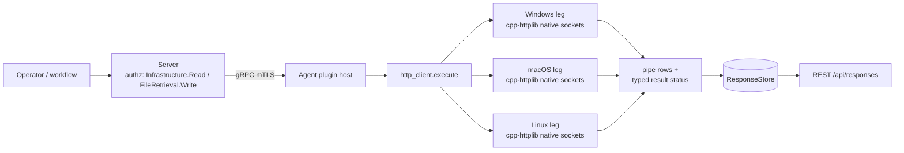

# http_client

<!-- BEGIN GENERATED: plugin-doc-gen header -->
| | |
|---|---|
| **What it does** | HTTP client — download files, GET/HEAD requests with hash verification (no shell-out) |
| **Version** | 1.1.0 |
| **Kind** | Action · mutating · on-demand |
| **Platforms** | Windows ✅ · macOS ✅ · Linux ✅ |
| **Actions** | `download` (definition `agent.http_client.download`) · `get` (definition `agent.http_client.get`) · `head` (definition `agent.http_client.head`) |
| **Security** | `download`: securable `FileRetrieval` · operation Write · risk High · dispatch Destructive · approval gate AdminOrApproval; `get`: securable `Infrastructure` · operation Read · risk Low · dispatch ReadOnly · approval gate None; `head`: securable `Infrastructure` · operation Read · risk Low · dispatch ReadOnly · approval gate None |
| **Roles** | execute: `download`: endpoint-admin; `get`: endpoint-admin, endpoint-operator; `head`: endpoint-admin, endpoint-operator · author: content-author |
<!-- END GENERATED -->

## How it works

All three actions parse the operator-supplied URL, reject anything but `http://`/`https://`, and vet the destination before opening a connection (`agents/shared/outbound_address_policy.hpp`): the host name is resolved **once**, every address the lookup returned must be a public address, and the connection goes to one of those vetted addresses (IPv4 first, then IPv6, each tried in turn) through cpp-httplib's hostname-to-address map, so the `Host` header and TLS name verification stay on the original name and a DNS answer that changes between the check and the connect cannot redirect it. Loopback, private (RFC 1918, carrier-grade NAT, unique-local), link-local and the cloud metadata addresses (`169.254.169.254`, `168.63.129.16`, the Alibaba Cloud metadata address, `fd00:ec2::254`), unspecified, multicast, reserved, documentation and other non-global blocks are refused, IPv4-mapped, NAT64 (`64:ff9b::/96`) and 6to4 forms are judged by the IPv4 address they embed, and a failed lookup blocks the request (fail closed). `get` and `head` then issue a single GET or HEAD under a 120 s total deadline and return the status plus body/headers as-is. `download` first refuses a destination on a network or device path (or whose resolved parent is one) and any path containing a `..` component, then fetches the body into memory (capped at 100 MiB, 600 s total deadline) accepting only a **2xx** status, requires the body to be **complete** (it matches `Content-Length`, or the framing is chunked, or an `expected_hash` is given to verify it; a body with none of these is refused because a cut-short close-delimited transfer cannot be told from a finished one), checks `expected_hash` (case-insensitive SHA-256) and only then replaces the destination in one atomic rename. A failed, non-2xx, over-cap, incomplete or unverified transfer writes nothing and leaves an existing destination as it was; the replacement is a new regular file, so a symlink or hard-linked destination is replaced rather than written through. Every request goes through cpp-httplib's native in-process socket client, no shell invocation on any platform. The plugin deliberately does not follow HTTP redirects, does not accept custom headers/methods/auth, and does not retry a failed request. It also never decodes a compressed response: every client turns httplib's response decompression off (`set_decompress(false)`), so `download` hashes and stores exactly the bytes the peer sent, and `get` and `head` ask for `identity` encoding and return whatever arrives undecoded. A host that answers both IPv4 and IPv6 is tried address by address (IPv4 first, at most four addresses, one total deadline for all attempts) and only a failure to connect moves on to the next address. `download` stores exactly the bytes it received (a gzip body is stored compressed and `expected_hash` is compared with those stored bytes), and a destination file name of about 235 characters or more fails because the atomic-replace temporary name needs room in the same directory.



## OS capability

<!-- BEGIN GENERATED: plugin-doc-gen capability -->
| Action | Windows | macOS | Linux |
|---|---|---|---|
| `download` | ✅ supported · rung 1 · cpp-httplib (native sockets) | ✅ supported · rung 1 · cpp-httplib (native sockets) | ✅ supported · rung 1 · cpp-httplib (native sockets) |
| `get` | ✅ supported · rung 1 · cpp-httplib (native sockets) | ✅ supported · rung 1 · cpp-httplib (native sockets) | ✅ supported · rung 1 · cpp-httplib (native sockets) |
| `head` | ✅ supported · rung 1 · cpp-httplib (native sockets) | ✅ supported · rung 1 · cpp-httplib (native sockets) | ✅ supported · rung 1 · cpp-httplib (native sockets) |
<!-- END GENERATED -->

## Privileges and prerequisites

| OS | Runs as | Extra grant needed | Measured | If the read is refused |
|---|---|---|---|---|
| Windows | agent service account (LocalSystem today, #1442) | None — outbound sockets and a write to an operator-chosen path need no elevated grant | 2026-09-07 as `SYSTEM` | `download`: `error\|failed to open destination file for writing` if the destination directory isn't writable |
| macOS | agent daemon | None | 2026-09-07 at euid 501 (jsmith, unprivileged) | same as above |
| Linux | agent daemon | None | 2026-09-06 at euid 0 (container) | same as above |

No subprocess execution on any platform — cpp-httplib's native socket client (`getaddrinfo`/`socket`/`connect`) runs in-process everywhere. Outbound network access to the operator-supplied URL's resolved address is required, subject to the SSRF filter above; on Windows, HTTPS additionally requires OpenSSL to have been found at build time (`CPPHTTPLIB_OPENSSL_SUPPORT`) — if it wasn't, every `https://` request on that build returns `status|0` / an `HTTPS not supported (OpenSSL not available)` message instead of connecting.

## Data contract

### Inputs

<!-- BEGIN GENERATED: plugin-doc-gen inputs -->
| Definition | Parameter | Type | Required | Default | Constraints | Description |
|---|---|---|---|---|---|---|
| `agent.http_client.download` | `url` | string | yes | - | - | HTTP or HTTPS URL to download. |
| `agent.http_client.download` | `path` | string | yes | - | - | Local file path to save the download. |
| `agent.http_client.download` | `expected_hash` | string | no | - | - | Optional SHA256 hash (hex, case-insensitive) the downloaded body must match before anything is written. Without it the response must declare its length (Content-Length, or chunked framing) so a truncated transfer is refused. |
| `agent.http_client.get` | `url` | string | yes | - | - | HTTP or HTTPS URL to request. |
| `agent.http_client.head` | `url` | string | yes | - | - | HTTP or HTTPS URL to request. |
<!-- END GENERATED -->

### Outputs

Rows are pipe-delimited `field|value` lines written one at a time via `ctx.write_output()`; there is no multi-row output for any of these three actions, and a validation or transport failure emits a single `error|<message>` line in place of the normal fields rather than a row with an error status. `download`'s four fields (`status|path|size|hash`) and `get`'s two fields (`status|body`) match their declared result columns exactly. `head`'s declared columns do **not** match what the code emits: the leg writes only `status` and a single `headers` field holding the full raw response header block (one `Name: value` pair per line, newline-joined, in the order the server sent them; before the cpp-httplib 0.59 bump the order was unspecified (hash order, differing by platform)) — `content_length` and `content_type` are declared in the definition YAML but never populated by `do_head`; see Caveats.

<!-- BEGIN GENERATED: plugin-doc-gen outputs -->
**`agent.http_client.download` — `status|path|size|hash`**

| Field | Type | Values | Available | Example | Description |
|---|---|---|---|---|---|
| `status` | string | - | Windows, Linux, macOS | `ok` | Literal "ok" on success; a failed download emits a separate error output instead of a non-ok status row. |
| `path` | string | - | Windows, Linux, macOS | `/tmp/yuzu_capture/yuzu_capture_download.html` | Absolute path the file was written to, after canonicalizing the parent directory and rejecting any ".." component. Values: absolute filesystem path. |
| `size` | int64 | - | Windows, Linux, macOS | `559` | Size in bytes of the downloaded body, which is the size of the file now at the destination (the body is held in memory, verified, then written in one atomic replace). Values: non-negative integer, bytes. |
| `hash` | string | - | Windows, Linux, macOS | `ff67a9d764d6a2367a187734e697f6a53217db9a21c101d410a113ca871a299d` | Lowercase hex SHA-256 digest of the downloaded body (the shared in-memory SHA-256, identical on every OS), the value compared with expected_hash before anything is written. Values: 64-character lowercase hex string. |

**`agent.http_client.get` — `status|body`**

| Field | Type | Values | Available | Example | Description |
|---|---|---|---|---|---|
| `status` | int32 | - | Windows, Linux, macOS | `200` | HTTP status code returned by the GET request, or 0 if the request could not be made (invalid URL, SSRF block, or connection failure). Values: HTTP status code, or 0 on request failure. |
| `body` | string | - | Windows, Linux, macOS | `<!doctype html><html lang="en"><head><title>Example Domain</title>...` | Response body text; a body over the 100 MiB cap is replaced with an error string, though the full response is already received over the wire before that check runs. Values: free text, or an error string on failure. |

**`agent.http_client.head` — `status|content_length|content_type`**

| Field | Type | Values | Available | Example | Description |
|---|---|---|---|---|---|
| `status` | int32 | - | Windows, Linux, macOS | `200` | HTTP status code returned by the HEAD request, or 0 if the request could not be made (invalid URL, SSRF block, or connection failure). Values: HTTP status code, or 0 on request failure. |
| `content_length` | int64 | - | all | `-` | Declared here but not populated by the current head leg, which writes one combined "headers" field (the full raw response header block) instead of parsed content_length/content_type fields — see the plugin README's Caveats section. Values: not emitted by current code. |
| `content_type` | string | - | all | `-` | Declared here but not populated by the current head leg, which writes one combined "headers" field (the full raw response header block) instead of parsed content_length/content_type fields — see the plugin README's Caveats section. Values: not emitted by current code. |
<!-- END GENERATED -->

### Result status

This plugin does not set a typed result status; the agent records `UNDECLARED` and the sample shows `UNDECLARED / UNKNOWN /` for every action on every OS.

### Where the data goes

- **Instruction result only.** Rows travel over the agent's mTLS gRPC channel as the command response and land in the ResponseStore (90-day default retention, `response_store.hpp:153`), queryable at `/api/responses/{id}`.
- **Not consumed by** daily-sync inventory, the Echo warehouse, DEX, or metrics — no server-side code references `agent.http_client.*` or `http_client` outside `agent_registry.cpp`'s instruction-catalogue description strings (`agent_registry.cpp:860-863`) and the capability declarations.
- **Sensitivity.** `get`/`download` rows carry the fetched URL's response body verbatim, and `head`'s `headers` field carries the full raw response header block — whatever the remote endpoint returns rides through unfiltered, so a URL pointed at an internal system could surface usernames, credentials, or other personal data in the body/headers; the `path`/`hash` fields otherwise carry nothing beyond the operator-chosen destination.
- **Siblings:** none — no other plugin performs outbound HTTP.
- **MCP / REST.** Discover: `discover_plugins` (summary) → `yuzu://plugin-docs` (this page as data) → `discover_instructions` / `get_definition("agent.http_client.get")`. Run: `execute_instruction {definition_id, parameters}`. Read: `/api/responses/{id}`.

## Sample output

<!-- BEGIN GENERATED: plugin-doc-gen samples -->
**Windows** — captured: windows Microsoft Windows NT 10.0.26200.0 x64 · bare-metal · 2026-09-07 · SYSTEM · leg-hash 6e02e2f89c34

```
== action=download url=https://www.example.com/ path=C:\WINDOWS\TEMP\yuzu_capture_87gld9cd/yuzu_capture_download.html
status|ok
path|C:\Windows\Temp\yuzu_capture_87gld9cd\yuzu_capture_download.html
size|559
hash|ff67a9d764d6a2367a187734e697f6a53217db9a21c101d410a113ca871a299d
[result_status] UNDECLARED / UNKNOWN

== action=get url=https://www.example.com/
status|200
body|<!doctype html><html lang="en"><head><title>Example Domain</title><link rel="icon" href="data:,"><meta name="viewport" content="width=device-width, initial-scale=1"><style>body{background:#eee;width:60vw;margin:15vh auto;font-family:system-ui,sans-serif}h1{font-size:1.5em}div{opacity:0.8}a:link,a:visited{color:#348}</style></head><body><div><h1>Example Domain</h1><p>This domain is for use in documentation examples without needing permission. Avoid use in operations.</p><p><a href="https://iana.org/domains/example">Learn more</a></p></div></body></html>
[result_status] UNDECLARED / UNKNOWN

== action=head url=https://www.example.com/
status|200
headers|Content-Type: text/html
Date: Mon, 07 Sep 2026 10:08:23 GMT
last-modified: Sun, 30 Aug 2026 04:11:49 GMT
Connection: close
cf-cache-status: HIT
Server: cloudflare
allow: GET, HEAD
Age: 4804
Content-Encoding: br
CF-RAY: a374e971bb806aad-MAN
[result_status] UNDECLARED / UNKNOWN
```

**macOS** — captured: macos macOS 26.6.2 arm64 · bare-metal · 2026-09-07 · euid 501 (jsmith) · leg-hash 6e02e2f89c34

```
== action=download url=https://www.example.com/ path=/var/folders/hq/lc3t_rsx2blfc8rhys6kzh4r0000gn/T/yuzu_capture_h8zzfku8/yuzu_capture_download.html
status|ok
path|/private/var/folders/hq/lc3t_rsx2blfc8rhys6kzh4r0000gn/T/yuzu_capture_h8zzfku8/yuzu_capture_download.html
size|559
hash|ff67a9d764d6a2367a187734e697f6a53217db9a21c101d410a113ca871a299d
[result_status] UNDECLARED / UNKNOWN

== action=get url=https://www.example.com/
status|200
body|<!doctype html><html lang="en"><head><title>Example Domain</title><link rel="icon" href="data:,"><meta name="viewport" content="width=device-width, initial-scale=1"><style>body{background:#eee;width:60vw;margin:15vh auto;font-family:system-ui,sans-serif}h1{font-size:1.5em}div{opacity:0.8}a:link,a:visited{color:#348}</style></head><body><div><h1>Example Domain</h1><p>This domain is for use in documentation examples without needing permission. Avoid use in operations.</p><p><a href="https://iana.org/domains/example">Learn more</a></p></div></body></html>
[result_status] UNDECLARED / UNKNOWN

== action=head url=https://www.example.com/
status|200
headers|CF-RAY: a374d6c43e292214-MAN
cf-cache-status: HIT
Age: 4039
Content-Encoding: br
last-modified: Sun, 30 Aug 2026 04:11:49 GMT
Server: cloudflare
Content-Type: text/html
Connection: close
allow: GET, HEAD
Date: Mon, 07 Sep 2026 09:55:38 GMT
[result_status] UNDECLARED / UNKNOWN
```

**Linux** — captured: linux Debian GNU/Linux 13 (trixie) aarch64 · container · 2026-09-06 · euid 0 · leg-hash 6e02e2f89c34

```
== action=download url=https://www.example.com/ path=/tmp/yuzu_capture/yuzu_capture_download.html
status|ok
path|/tmp/yuzu_capture/yuzu_capture_download.html
size|559
hash|ff67a9d764d6a2367a187734e697f6a53217db9a21c101d410a113ca871a299d
[result_status] UNDECLARED / UNKNOWN

== action=get url=https://www.example.com/
status|200
body|<!doctype html><html lang="en"><head><title>Example Domain</title><link rel="icon" href="data:,"><meta name="viewport" content="width=device-width, initial-scale=1"><style>body{background:#eee;width:60vw;margin:15vh auto;font-family:system-ui,sans-serif}h1{font-size:1.5em}div{opacity:0.8}a:link,a:visited{color:#348}</style></head><body><div><h1>Example Domain</h1><p>This domain is for use in documentation examples without needing permission. Avoid use in operations.</p><p><a href="https://iana.org/domains/example">Learn more</a></p></div></body></html>
[result_status] UNDECLARED / UNKNOWN

== action=head url=https://www.example.com/
status|200
headers|Content-Encoding: br
cf-cache-status: HIT
CF-RAY: a36fd1781c3488d3-MAN
Age: 8996
allow: GET, HEAD
last-modified: Sun, 30 Aug 2026 04:11:49 GMT
Server: cloudflare
Connection: close
Content-Type: text/html
Date: Sun, 06 Sep 2026 19:18:12 GMT
[result_status] UNDECLARED / UNKNOWN
```
<!-- END GENERATED -->

## Caveats and known gaps

1. **`head`'s declared result columns don't match what the code emits.** The definition YAML declares `status|content_length|content_type`; `do_head` actually writes `status|headers`, where `headers` is the full raw header block. A consumer parsing by the declared schema will not find `content_length`/`content_type`.
2. **`get`'s size cap doesn't stop the transfer.** `download` aborts mid-transfer past 100 MiB (its content receiver counts the buffered bytes). `get` calls `cli.Get(parsed.path)` with no content receiver, so the full body is already downloaded in memory before the `res->body.size() > kMaxDownloadSize` check replaces it with an error string — the cap limits what's returned, not what's fetched. `download` holds the whole body in memory (up to 100 MiB, reserved once from `Content-Length` when declared) before writing, and reports an allocation failure as `download aborted: out of memory`.
3. **No redirect following.** Neither `set_follow_location` nor any equivalent is called on any `httplib::Client`/`SSLClient` instance, so for `get` and `head` a 3xx response is returned as-is (status + whatever body/headers the redirect response itself carries), not followed; for `download` anything but a 2xx status is a failure (`download failed: HTTP <status>`) and writes nothing.
4. **HTTPS on Windows depends on a build-time OpenSSL find.** Windows OpenSSL discovery is `required: false` (`meson.build`); when it isn't found, `CPPHTTPLIB_OPENSSL_SUPPORT` is undefined and every `https://` call on that build returns `status|0` with an "HTTPS not supported" message instead of connecting (lines 283-287, 334-337, 378-381). Linux/macOS require OpenSSL at configure time and always have it.
5. **This plugin does not set a typed result status.** Every sample shows `UNDECLARED / UNKNOWN /` regardless of outcome — a caller must parse the `status`/`error` output fields, not the result-status envelope, to detect failure.

## Source and tests

<!-- BEGIN GENERATED: plugin-doc-gen source -->
- Plugin: `agents/plugins/http_client/src/http_client_download.hpp` · `agents/plugins/http_client/src/http_client_plugin.cpp`
- Definitions: `content/definitions/http_client.yaml`
- Capability rows: `server/core/src/capability_decls/plugin_action_catalogue_c.hpp`
- Tests: none found by name
- Privilege row: `docs/agent-privilege-model.md` (no row yet)
<!-- END GENERATED -->
