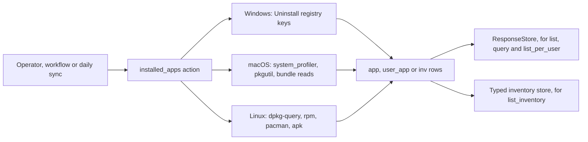
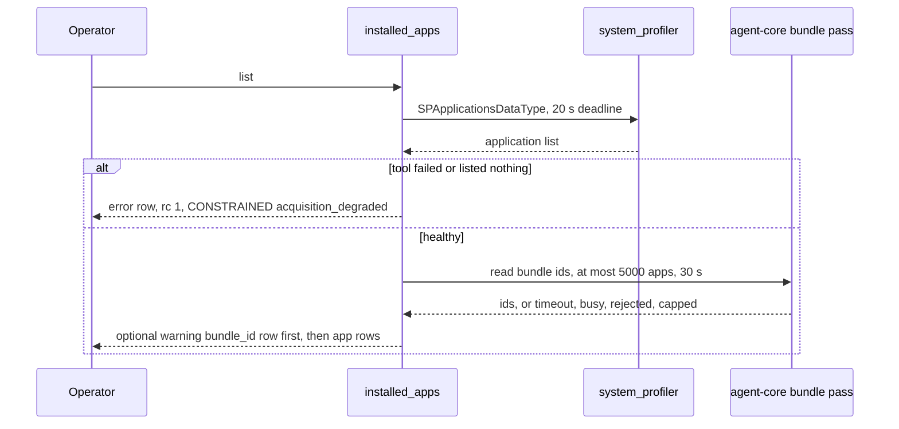
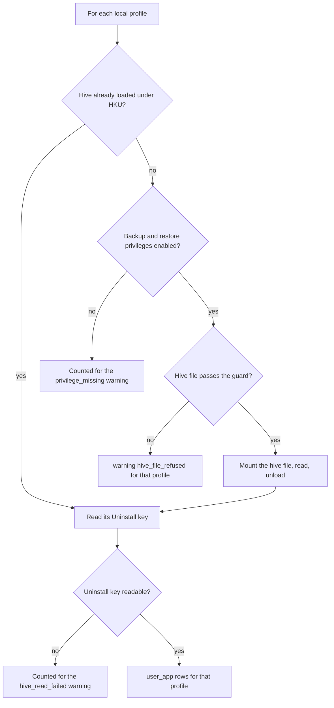

# installed_apps

<!-- BEGIN GENERATED: plugin-doc-gen header -->
| | |
|---|---|
| **What it does** | Inventories installed applications and queries by name |
| **Version** | 1.2.0 |
| **Kind** | Collector · read-only · gathered (crossplatform.software.inventory, crossplatform.software.query, crossplatform.software.per_user_inventory) |
| **Platforms** | Windows ✅ · macOS ✅ · Linux ✅ |
| **Actions** | `list` (definition `crossplatform.software.inventory`) · `list_inventory` · `list_per_user` (definition `crossplatform.software.per_user_inventory`) · `query` (definition `crossplatform.software.query`) |
| **Security** | `list`: securable `Inventory` · operation Read · risk Low · dispatch ReadOnly · approval gate None; `query`: securable `Inventory` · operation Read · risk Low · dispatch ReadOnly · approval gate None; `list_per_user`: securable `Inventory` · operation Read · risk Low · dispatch ReadOnly · approval gate AdminOrApproval; `list_inventory`: securable `Inventory` · operation Read · risk Low · dispatch ReadOnly · approval gate None |
| **Roles** | execute: `list`: endpoint-admin, endpoint-operator; `query`: endpoint-admin, endpoint-operator; `list_per_user`: endpoint-admin · author: content-author |
<!-- END GENERATED -->

## How it works

`installed_apps` answers "what software is on this device" from the operating system's own records and never installs, removes or verifies anything. Four actions share one set of OS readers. `list` returns one `app|` row per application: Windows reads the Uninstall registry keys (64-bit and 32-bit machine keys, plus the agent account's own user key); Linux uses the first package manager it finds (`dpkg-query`, else `rpm`, else `pacman`); macOS runs `system_profiler SPApplicationsDataType` for GUI applications and then reads each bundle's identifier in one bounded pass. `query` takes the same collection and returns the rows whose name contains the given text (case-insensitive), preceded by `found|true` or followed by only `found|false`. `list_per_user` is the per-person view: on Windows it walks every local profile's registry hive; on Linux and macOS it returns the same system-wide set tagged `system` (plus Homebrew formulae tagged `brew` on macOS). `list_inventory` is a separate, richer collector for the daily sync: it has no instruction definition, so it is not offered to operators; the agent's daily sync runs it.

If the OS reader fails part-way (a tool is killed, times out, exits non-zero or is truncated, or a Windows Uninstall key cannot be read to the end), `list`, `query` and `list_inventory` return an `error|` row (or nothing, for `list_inventory`) and rc 1 instead of a short list, so a partial result is never mistaken for a complete one. A genuinely empty `list` is a single `app|No applications found` row.



### What you can decide with it

| Question | Action | Notes |
|---|---|---|
| Is product X installed, and which version? | `query name=X` | Substring match on the display name. `found\|false` is trustworthy only when there is no `error|` row, because a failed read withholds the result instead of answering false. |
| What is installed on this device? | `list` | Windows: machine-wide installs (plus the agent account's own). Linux: every package of the detected manager; publisher is the maintainer (dpkg) or vendor (rpm), and `-` on pacman. macOS: GUI applications only, no installer receipts or Homebrew formulae. |
| What has each user installed for themselves? | `list_per_user` | Windows only gives real per-profile data (apps registered in each user's own hive, which `list` does not show). On Linux and macOS it repeats the system set, so do not read the `system` rows as per-user. |
| What feeds the central software inventory? | `list_inventory` | Not run by hand. The agent runs it every 24 hours and the server serves it fleet-wide at `GET /api/v1/inventory/software`. It adds package ecosystem, architecture, a signed or unsigned flag and (Linux) distribution identity, and on macOS also installer receipts. |

What a result does and does not prove:

- **Machine scope only, except `list_per_user`.** On Windows an app installed just for one user is not in `list`, `query` or `list_inventory`; it appears only in `list_per_user`, and only if that profile's hive could be read.
- **Names and versions are what the installer registered.** They are not verified against the files on disk, and a signature flag in `list_inventory` means a signature is present, not that it is valid.
- **Not a vulnerability or licence verdict.** Use `vuln_scan` for CVE matching and `license_scan` for licence state.

### Diagrams

#### macOS `list`



The application list comes from one `system_profiler` call. The bundle-identifier read runs once, with its own 30-second deadline and a 5,000-app limit, and any shortfall is reported by a leading `warning|bundle_id_*` row and a `CONSTRAINED` status while the rows it could not read carry `-`.

#### Windows `list_per_user` hive ladder



A logged-in user's loaded hive is read with no privilege. A logged-out profile needs an offline mount, which needs the backup and restore privileges and a hive file that passes the ownership and path guard. A profile that cannot be read adds a warning row and the others still return their rows.

## OS capability

<!-- BEGIN GENERATED: plugin-doc-gen capability -->
| Action | Windows | macOS | Linux |
|---|---|---|---|
| `list` | ✅ supported · rung 1 · Reg*W enumeration of the Uninstall key(s) | ✅ supported · rung 2 · system_profiler via bounded argv runner + native CFBundle enrichment | ✅ supported · rung 2 · dpkg-query/rpm/pacman via bounded argv runner |
| `list_inventory` | ✅ supported · rung 1 · Reg*W enumeration of the Uninstall key(s) | ✅ supported · rung 2 · system_profiler + pkgutil via bounded argv runner + native SecCode/CFBundle enrichment | ✅ supported · rung 2 · dpkg-query/rpm/pacman/apk via bounded argv runner |
| `list_per_user` | ✅ supported · rung 1 · Reg*W enumeration of HKU\\<SID>'s Uninstall key, mounting NTUSER.DAT via RegLoadKeyW when not already loaded | ✅ supported · rung 2 · system_profiler + brew via bounded argv runner | ✅ supported · rung 2 · dpkg-query/rpm/pacman via bounded argv runner |
| `query` | ✅ supported · rung 1 · Reg*W enumeration of the Uninstall key(s) | ✅ supported · rung 2 · system_profiler via bounded argv runner | ✅ supported · rung 2 · dpkg-query/rpm/pacman via bounded argv runner |
<!-- END GENERATED -->

## Privileges and prerequisites

| OS | Runs as | Extra grant needed | Measured | If the read is refused |
|---|---|---|---|---|
| Windows | Agent service account, LocalSystem today, not the intended virtual service account (`docs/agent-privilege-model.md` Correction). | **None** for `list`, `query` and `list_inventory`: `Reg*W` reads only. `list_per_user`'s offline `NTUSER.DAT` mount for a logged-out profile uses `SeBackupPrivilege` and `SeRestorePrivilege`, which the agent account already holds. | Bare-metal Windows (10.0.26200) as `LocalSystem`, 2026-09-21. The capture predates the typed hive-read status and the default-on hive-file guard, so neither shows in it. | `list_per_user` writes `warning\|privilege_missing: ...` naming how many logged-out profiles could not be read, `warning\|hive_file_refused` per refused hive and `warning\|hive_read_failed` for unreadable Uninstall keys; machine-scope actions are unaffected. An unreadable profile list is `error\|profile_list_unreadable` with rc 1. |
| macOS | Agent daemon, **root** today (the LaunchDaemon has no `UserName` key, `docs/agent-privilege-model.md`). | **None.** No keychain, TCC or Location Services grant is touched. A missing Security framework at build time turns the signature enrichment into a no-op (empty `publisher` and `signature_status`) rather than an error. | Bare-metal macOS 26.6.2 as an ordinary user (euid 501), 2026-09-21, not the daemon's root identity. In that capture `list_per_user` ended with rc 1 because `brew list --versions` exited non-zero for that account. | No privilege is required, so there is no refusal path; a failed tool is reported as a degraded acquisition (`error\|` row, rc 1). |
| Linux | Agent daemon, an unprivileged account by design. | **None.** The dpkg, rpm, pacman and apk databases are expected to be world-readable (inferred, not measured as the unprivileged account). | Debian 13 container, euid 0, 2026-09-21; not the intended unprivileged account. | No privilege is required. If no package manager binary is found at its fixed path the collection is empty (not degraded); a found tool that fails is a degraded acquisition. |

Subprocesses: Linux runs `dpkg-query`, `rpm`, `pacman` and (`list_inventory` only) `apk`, found at fixed absolute paths and run without a shell through the bounded runner (20 s deadline each). macOS runs `system_profiler`, `pkgutil` (`list_inventory`) and `brew` (`list_per_user` only) the same way. Windows spawns nothing. No network use on any OS.

## Data contract

### Inputs

<!-- BEGIN GENERATED: plugin-doc-gen inputs -->
| Definition | Parameter | Type | Required | Default | Constraints | Description |
|---|---|---|---|---|---|---|
| `crossplatform.software.query` | `name` | string | yes | - | minLength 1 · maxLength 256 | Case-insensitive substring to match against installed application names. All apps whose name contains this string are returned. |
<!-- END GENERATED -->

### Outputs

Pipe-delimited rows, one per application, written via `write_output()`. `list`/`query`/`list_per_user` emit the stable `app`/`app`/`user_app`-tagged wire format `content/definitions/installed_apps.yaml` documents; `-` marks a field the OS reported empty or one that does not apply on that OS (`install_location`/`bundle_id` on Linux, `bundle_id` on Windows). `list_inventory` emits a separate, extended `inv`-tagged 13-token row (blob contract v2, ADR-0016) where a field an ecosystem does not store stays *honestly empty* — never a `-` placeholder. Every `list` field is escape-aware (`format_app_row`): `\` folds to `/`, `|` becomes `\|`, CR/LF become a space, an interior NUL cuts the field, a field over 4 KiB is cut; `query`/`list_per_user` rows are raw but bounded: every registry-sourced field is cut at 4 KiB at read (Windows), so a hostile registry string cannot inflate them.

**Server rendering.** `installed_apps` is one of the server's key/value plugins (`kKeyValuePlugins`, `server/core/src/result_parsing.hpp`), so the dashboard results table, its detail drawer, sort and facets split every row at the first pipe only — `app` plus one remainder cell — whatever columns the definition declares; `install_location` and `bundle_id`, like `version`/`publisher`/`install_date` before them, are not separately rendered, sortable or filterable there. `GET /api/v1/responses/{id}` (and its export) and MCP `query_responses` return the raw seven-token row in `output`, which is where automation should read the columns. The server splits these rows at the first pipe only; a definition-aware splitter does not exist yet.

**Parsing `list` rows.** `app|name|version|publisher|install_date|install_location|bundle_id` — seven escape-aware tokens. Split `output` on newlines first (one response can carry many rows); split each line on `|` not preceded by `\`, then decode `\|` to `|`; `\` never otherwise appears (folded to `/`, which makes a UNC path `//srv/share` and is not reversible), CR/LF are folded to a space, and the raw value is cut at 4 KiB before escaping, so an emitted field can be up to 8 KiB. `-` means empty or not applicable. A macOS `list` may lead with a `warning|bundle_id_*` row; ignore lines whose first token is not `app`. Agents older than plugin 1.2.0 emit five tokens and do not escape `|`, so a row from one can split into any count: accept a row only when it has exactly 5 or exactly 7 tokens under the escape-aware split, reject any other count, and read the sixth/seventh columns only for agents known to be on plugin >= 1.2.0. REST and MCP return this text verbatim; only the dashboard decodes `\|`, inside its merged cell.

<!-- BEGIN GENERATED: plugin-doc-gen outputs -->
**`crossplatform.software.inventory` — `name|version|publisher|install_date|install_location|bundle_id`**

| Field | Type | Values | Available | Example | Description |
|---|---|---|---|---|---|
| `name` | string | - | Windows, Linux, macOS | `7-Zip 26.02 (x64)` | The application's display name as read from the OS-native registry or package database. Values: free text. |
| `version` | string | - | Windows, Linux, macOS | `26.02` | The installed version string, or "-" when the source reports none. Values: free text or "-". |
| `publisher` | string | - | Windows, Linux | `Igor Pavlov` | The vendor or maintainer name; always "-" on macOS, since system_profiler's mini detail carries no publisher field. Values: free text or "-". |
| `install_date` | string | - | Windows, macOS | `20260617` | Install date in the OS's native format (Windows registry InstallDate, rpm's formatted install time); "-" when the source reports none, which dpkg-based Linux hosts always do. Values: free text or "-". |
| `install_location` | string | - | Windows, macOS | `C:/Program Files/7-Zip/` | Where the application lives on disk, as the OS reports it. Windows: the Uninstall key's InstallLocation value, returned raw — a REG_EXPAND_SZ value such as %ProgramFiles%\Vendor is NOT expanded — or "-" when the value is absent (many MSI-registered products, SDK/runtime component packages and NSIS/portable installers write none — 182 of 241 rows on one developer workstation), longer than 64 KiB (the registry reader's bound; a value between 4 KiB and 64 KiB is cut to 4 KiB at a character boundary), or not a string type. Applications installed only into a logged-in user's own hive are not listed by this machine-scope action at all (use list_per_user); entries in the agent service account's own HKCU Uninstall key keep their InstallLocation. Where the same product is registered in more than one hive the smallest populated value wins. Unlike windows.software.msi.list, separators are "/": backslashes are emitted as "/" (a UNC path reads //srv/share; not reversible), so C:\Program Files\7-Zip\ reads C:/Program Files/7-Zip/. macOS: the location system_profiler reports, normally the .app bundle path and occasionally a non-bundle directory; this can lie under a user's home (/Users/<account>/...). Always "-" on Linux by design: a package installs files to many prefixes, so there is no single install location. Values: path or "-". The value is as reported by the OS: untrusted and non-canonical. |
| `bundle_id` | string | - | macOS | `com.apple.ActivityMonitor` | The macOS CFBundleIdentifier read in-process from the bundle at install_location (reverse-DNS form). Always "-" on Windows and Linux, which have no bundle identifier concept; "-" on macOS when the location is not a bundle or carries no identifier, and for rows the bounded bundle-id pass did not reach (30 s deadline, at most 5000 applications submitted, one pass in flight per agent process (one per device)) -- a cut-short or capped pass is reported by a leading warning\|bundle_id_* row and a CONSTRAINED / PARTIAL status, never silently. An identifier is cut at 4 KiB at read. The value is as reported by the OS: untrusted, as reported by the local bundle — a local user can plant a bundle whose identifier is any string. Values: bundle identifier or "-". |

**`crossplatform.software.per_user_inventory` — `username|name|version|publisher|install_date`**

| Field | Type | Values | Available | Example | Description |
|---|---|---|---|---|---|
| `username` | string | - | Windows, Linux, macOS | `jsmith` | The resolved local profile name on Windows (never the SID), the literal "system" for the machine-scope Linux/macOS leg, or "brew" for macOS per-user Homebrew formulae. Values: profile name, "system", "brew", or "-". |
| `name` | string | - | Windows, Linux, macOS | `Signal 8.18.0` | The application's display name. Values: free text. |
| `version` | string | - | Windows, Linux, macOS | `8.18.0` | The installed version string, or "-" when the source reports none. Values: free text or "-". |
| `publisher` | string | - | Windows, Linux | `Signal Messenger, LLC` | The vendor or maintainer name; always "-" on macOS and for Homebrew rows. Values: free text or "-". |
| `install_date` | string | - | Windows, macOS | `20260714` | Install date in the OS's native format; "-" when the source reports none, which dpkg-based Linux hosts and Homebrew rows always do. Values: free text or "-". |

**`crossplatform.software.query` — `found|name|version|publisher`**

| Field | Type | Values | Available | Example | Description |
|---|---|---|---|---|---|
| `found` | bool | - | Windows, Linux, macOS | `true` | Whether at least one installed application matched the search string. Values: true, false. |
| `name` | string | - | Windows, Linux, macOS | `Microsoft Edge` | The matching application's display name. Values: free text. |
| `version` | string | - | Windows, Linux, macOS | `152.0.4191.66` | The matching application's installed version string, or "-" when the source reports none. Values: free text or "-". |
| `publisher` | string | - | Windows, Linux | `Microsoft Corporation` | The vendor or maintainer name; always "-" on macOS, since system_profiler's mini detail carries no publisher field. Values: free text or "-". |
<!-- END GENERATED -->

**Empty-result convention.** `list` with nothing to report returns a single `app` row named `No applications found`. `list_inventory` drops a row outright if `name` is empty and has no sentinel row, so an empty collection is empty output at rc 0. A *degraded* collection instead returns rc 1 and the daily sync skips the whole cycle rather than committing a partial inventory as authoritative.

### Result status

| Status | Completeness | Provenance | When |
|---|---|---|---|
| `CONSTRAINED` | PARTIAL | `installed_apps:acquisition_degraded` | a degraded acquisition (Linux/macOS: a subprocess that failed to start, exited nonzero, was killed, timed out or was truncated; Windows: an Uninstall root that could not be opened or enumerated to the end, or an application subkey whose open failed): `list`, `query` and `list_inventory` return rc 1, and so does `list_per_user` on Linux and macOS |
| `CONSTRAINED` | PARTIAL | `installed_apps:acquisition_degraded` | Windows `list_per_user`: one or more profiles' Uninstall key could not be read (a trailing `warning\|hive_read_failed` row counts the profiles), or a profile's hive file was refused by the offline guard (a trailing `warning\|hive_file_refused` row names the SID and the guard's token); the rows already read stay, rc 0 |
| `CONSTRAINED` | PARTIAL | `installed_apps:bundle_id_timeout` | macOS `list`: the 30 s bundle-id pass deadline hit; a leading `warning\|bundle_id_timeout` row, unread rows carry `-`, rc 0 |
| `CONSTRAINED` | PARTIAL | `installed_apps:bundle_id_busy` | macOS `list`: another bundle-id pass is in flight on this device (a concurrent `list` or an earlier abandoned pass); all rows carry `-`, rc 0 |
| `CONSTRAINED` | PARTIAL | `installed_apps:bundle_id_rejected` | macOS `list`: the bounded-call ceiling refused the pass or its admission allocation failed; all rows carry `-`, rc 0 |
| `CONSTRAINED` | PARTIAL | `installed_apps:bundle_id_capped` | macOS `list`: more than 5000 located apps, only the first 5000 submitted; the rest carry `-`, rc 0; a timed-out, busy or rejected pass outranks this warning and status |
| `OK` | FULL | - | a complete macOS `list` |
| `UNDECLARED` | - | - | every other run, healthy or not: the wire stays `UNDECLARED` and the agent log derives `OK` from rc 0. This includes Windows `list_per_user` runs that end with only a `warning\|privilege_missing`, a profile-list truncation warning or a hive-unload warning (row text only, rc 0), and the `error\|profile_list_unreadable` failure (rc 1) |

Provenance and completeness are agent-log only (the wire carries the status enum, `agent.proto` `plugin_result_status`); the durable signals are the status and the in-band `warning|` and `error|` row text.

### Where the data goes

- **Instruction result.** `list`/`query`/`list_per_user` rows travel over the agent's mTLS gRPC channel as the command response and land in the ResponseStore (operator-configurable retention, 90-day default), queryable at `/api/v1/responses/{id}`.
- **Daily-sync typed store.** `list_inventory` is never dispatched through `execute_instruction` — it has no definition. The agent's own `SyncSource` (`make_installed_software_source` in `sync_source_installed_software.cpp`) runs it every 24 hours, canonicalizes the parsed rows into a hash-skip blob, and pushes it to the server's typed `SoftwareInventoryStore` (ADR-0016), served fleet-wide at `GET /api/v1/inventory/software` gated on `Inventory:Read`.
- **Not consumed by** TAR, DEX, or metrics — no reference to `installed_apps`/`crossplatform.software.*` was found in the TAR or DEX collector sources.
- **Sensitivity.** `list_per_user`/`list_inventory` rows carry per-account software names/versions/publishers, and `list_per_user`'s `username` field is a resolved local account name (not a raw SID) — a per-person installed-software inventory; `list`/`query`/`list_inventory` alone already name specific installed software (`name`/`version`/`publisher`) even at machine scope. `list`'s `install_location` names a user's home directory when an application is installed under it (`/Users/<account>/Applications/…`, `/Users/<account>/Library/…` — 4 of 323 rows in the macOS capture), or `C:/Users/<name>/...` on Windows; the macOS count is from an unprivileged capture — the root daemon may list every account's `~/Applications`; the committed sample redacts the account to `jsmith`.
- **Siblings:** `msi_packages.*` (Windows-only MSI package detail) and `license_scan.list` (software-licence/entitlement detection) — grouped alongside `installed_apps` in the privilege model's read-only row (`docs/agent-privilege-model.md`).
- **MCP / REST.** Discover: `discover_plugins` (summary) → `yuzu://plugin-docs` (this page as data) → `discover_instructions` / `get_definition("crossplatform.software.inventory")`. Run: `execute_instruction {definition_id, parameters}`. Read: `/api/v1/responses/{id}` for `list`/`query`/`list_per_user`; `list_inventory`'s daily-sync output instead lands at `GET /api/v1/inventory/software`, since it carries no definition and is never dispatched through `execute_instruction`.

## Sample output

<!-- BEGIN GENERATED: plugin-doc-gen samples -->
**Windows** — captured: windows Windows 10.0.26200 x86_64 · bare-metal · 2026-09-21 · LocalSystem (elevated; profile name redacted to jsmith) · leg-hash 3690edc65cda

```
== action=list
app|7-Zip 26.02 (x64)|26.02|Igor Pavlov|-|C:/Program Files/7-Zip/|-
app|Age of Empires II: Definitive Edition|-|Forgotten Empires|-|D:/SteamLibrary/steamapps/common/AoE2DE|-
app|Application Verifier x64 External Package (DesktopEditions)|10.1.26100.7705|Microsoft|20260617|-|-
app|Application Verifier x64 External Package (OnecoreUAP)|10.1.26100.7705|Microsoft|20260617|-|-
app|BCD and Boot|10.1.22621.5337|Microsoft|20260908|-|-
app|Baldur's Gate 3|-|Larian Studios|-|D:/SteamLibrary/steamapps/common/Baldurs Gate 3|-
app|Battle.net|-|Blizzard Entertainment|-|C:/Program Files (x86)/Battle.net|-
app|CCleaner 7|7.11.1522.1958|Piriform|-|C:/Program Files/Piriform/CCleaner 7|-
app|CMake|4.3.3|Kitware|20260617|C:/Program Files/CMake/|-
app|Cities: Skylines II|-|Colossal Order Ltd.|-|D:/SteamLibrary/steamapps/common/Cities Skylines II|-
app|Crusader Kings III|-|Paradox Development Studio|-|D:/SteamLibrary/steamapps/common/Crusader Kings III|-
app|DayZ|-|Bohemia Interactive|-|D:/SteamLibrary/steamapps/common/DayZ|-
… 12 of 241 rows shown
[result_status] UNDECLARED / UNKNOWN

== action=query name=Microsoft
found|true
app|Microsoft .NET Host - 6.0.11 (x64)|48.47.50420|Microsoft Corporation
app|Microsoft .NET Host - 6.0.20 (x86)|48.83.63169|Microsoft Corporation
app|Microsoft .NET Host - 8.0.28 (x64)|64.112.53549|Microsoft Corporation
app|Microsoft .NET Host - 8.0.28 (x86)|64.112.53549|Microsoft Corporation
app|Microsoft .NET Host FX Resolver - 6.0.11 (x64)|48.47.50420|Microsoft Corporation
app|Microsoft .NET Host FX Resolver - 6.0.20 (x86)|48.83.63169|Microsoft Corporation
app|Microsoft .NET Host FX Resolver - 8.0.28 (x64)|64.112.53549|Microsoft Corporation
app|Microsoft .NET Host FX Resolver - 8.0.28 (x86)|64.112.53549|Microsoft Corporation
app|Microsoft .NET Runtime - 6.0.11 (x64)|48.47.50420|Microsoft Corporation
app|Microsoft .NET Runtime - 6.0.20 (x86)|48.83.63169|Microsoft Corporation
app|Microsoft .NET Runtime - 8.0.28 (x64)|64.112.53549|Microsoft Corporation
… 12 of 57 rows shown
[result_status] UNDECLARED / UNKNOWN

== action=list_per_user
user_app|jsmith|Signal 8.18.0|8.18.0|Signal Messenger, LLC|-
user_app|jsmith|Discord|1.0.9255|Discord Inc.|20212118
user_app|jsmith|NordPass|7.9.5|NordPass Team|-
user_app|jsmith|Inno Setup version 6.7.3|6.7.3|jrsoftware.org|20260714
user_app|jsmith|ninja|1.13.2|ninja-build|20260617
user_app|jsmith|Node.js (LTS)|24.16.0|Node.js Foundation|20260617
user_app|jsmith|Microsoft Visual Studio Code (User)|1.128.1|Microsoft Corporation|20260715
user_app|jsmith|Python 3.12.10 (64-bit)|3.12.10150.0|Python Software Foundation|-
user_app|jsmith|MSYS2|20260611|The MSYS2 Developers|Wed Jun 17 17:28:18 2026
user_app|jsmith|Paradox Launcher v2|1.0.0.0|Paradox Interactive|-
[result_status] UNDECLARED / UNKNOWN

== action=list_inventory
inv|7-Zip 26.02 (x64)|26.02|Igor Pavlov||app|windows||||||
inv|Age of Empires II: Definitive Edition||Forgotten Empires||app|windows||||||
inv|Application Verifier x64 External Package (DesktopEditions)|10.1.26100.7705|Microsoft|20260617|app|windows||||||
inv|Application Verifier x64 External Package (OnecoreUAP)|10.1.26100.7705|Microsoft|20260617|app|windows||||||
inv|BCD and Boot|10.1.22621.5337|Microsoft|20260908|app|windows||||||
inv|Baldur's Gate 3||Larian Studios||app|windows||||||
inv|Battle.net||Blizzard Entertainment||app|windows||||||
inv|CCleaner 7|7.11.1522.1958|Piriform||app|windows||||||
inv|CMake|4.3.3|Kitware|20260617|app|windows||||||
inv|Cities: Skylines II||Colossal Order Ltd.||app|windows||||||
inv|Crusader Kings III||Paradox Development Studio||app|windows||||||
inv|DayZ||Bohemia Interactive||app|windows||||||
… 12 of 241 rows shown
[result_status] UNDECLARED / UNKNOWN
```

**macOS** — captured: macos macOS 26.6.2 arm64 · bare-metal · 2026-09-21 · euid 501 (account redacted to jsmith; user-profile paths redacted) · leg-hash 3690edc65cda

```
== action=list
app|50onPaletteServer|1.1.0|-|13/08/2026, 03:51|/System/Library/Input Methods/50onPaletteServer.app|com.apple.50onPaletteIM
app|ABAssistantService|14.0|-|13/08/2026, 03:51|/System/Library/Frameworks/AddressBook.framework/Versions/A/Helpers/ABAssistantService.app|com.apple.ABAssistantService
app|AMSEngagementViewService|1.0|-|13/08/2026, 03:51|/System/Library/PrivateFrameworks/AppleMediaServicesUI.framework/Versions/A/Resources/AMSEngagementViewService.app|com.apple.AMSEngagementViewService
app|AOSAlertManager|1.07|-|13/08/2026, 03:51|/System/Library/PrivateFrameworks/AOSKit.framework/Versions/A/Helpers/AOSAlertManager.app|com.apple.AOSAlertManager
app|AOSHeartbeat|1.07|-|13/08/2026, 03:51|/System/Library/PrivateFrameworks/AOSKit.framework/Versions/A/Helpers/AOSHeartbeat.app|com.apple.AOSHeartbeat
app|AOSPushRelay|1.07|-|13/08/2026, 03:51|/System/Library/PrivateFrameworks/AOSKit.framework/Versions/A/Helpers/AOSPushRelay.app|com.apple.AOSPushRelay
app|AOSUIPrefPaneLauncher|1.0|-|13/08/2026, 03:51|/System/Library/CoreServices/AOSUIPrefPaneLauncher.app|com.apple.AOSUIPrefPaneLauncher
app|ARDAgent|3.9.8|-|13/08/2026, 03:51|/System/Library/CoreServices/RemoteManagement/ARDAgent.app|com.apple.RemoteDesktopAgent
app|AVB Configuration|1440.7|-|13/08/2026, 03:51|/System/Library/CoreServices/AVB Configuration.app|com.apple.AVB-Audio-Configuration
app|AXVisualSupportAgent|1.0|-|13/08/2026, 03:51|/System/Library/PrivateFrameworks/UniversalAccess.framework/Versions/A/Resources/AXVisualSupportAgent.app|com.apple.accessibility.AXVisualSupportAgent
app|About This Mac|1.0|-|13/08/2026, 03:51|/System/Library/CoreServices/Applications/About This Mac.app|com.apple.AboutThisMacLauncher
app|Accessibility Reader|1.0|-|13/08/2026, 03:51|/System/Library/CoreServices/Accessibility Reader.app|com.apple.accessibility.AccessibilityReader
… 12 of 323 rows shown
[result_status] UNDECLARED / UNKNOWN

== action=query name=bash
found|false
[result_status] UNDECLARED / UNKNOWN

== action=list_per_user
user_app|system|50onPaletteServer|1.1.0|-|13/08/2026, 03:51
user_app|system|ABAssistantService|14.0|-|13/08/2026, 03:51
user_app|system|AMSEngagementViewService|1.0|-|13/08/2026, 03:51
user_app|system|AOSAlertManager|1.07|-|13/08/2026, 03:51
user_app|system|AOSHeartbeat|1.07|-|13/08/2026, 03:51
user_app|system|AOSPushRelay|1.07|-|13/08/2026, 03:51
user_app|system|AOSUIPrefPaneLauncher|1.0|-|13/08/2026, 03:51
user_app|system|ARDAgent|3.9.8|-|13/08/2026, 03:51
user_app|system|AVB Configuration|1440.7|-|13/08/2026, 03:51
user_app|system|AXVisualSupportAgent|1.0|-|13/08/2026, 03:51
user_app|system|About This Mac|1.0|-|13/08/2026, 03:51
user_app|system|Accessibility Reader|1.0|-|13/08/2026, 03:51
… 12 of 324 rows shown
[result_status] UNDECLARED / UNKNOWN
[rc] 1

== action=list_inventory
inv|Time Machine|1.3|macOS Software Signing|13/08/2026, 03:51|app|macos||||signed||
inv|Tips|26.6|macOS Software Signing|13/08/2026, 03:51|app|macos||||signed||
inv|Activity Monitor|10.14|macOS Software Signing|13/08/2026, 03:51|app|macos||||signed||
inv|AirPort Utility|6.3.9|macOS Software Signing|13/08/2026, 03:51|app|macos||||signed||
inv|Audio MIDI Setup|3.8|macOS Software Signing|13/08/2026, 03:51|app|macos||||signed||
inv|Bluetooth File Exchange|9.0|macOS Software Signing|13/08/2026, 03:51|app|macos||||signed||
inv|Boot Camp Assistant|6.1.0|macOS Software Signing|13/08/2026, 03:51|app|macos||||signed||
inv|ColorSync Utility|12.2.0|macOS Software Signing|13/08/2026, 03:51|app|macos||||signed||
inv|Console|1.1|macOS Software Signing|13/08/2026, 03:51|app|macos||||signed||
inv|Digital Colour Meter|6.11|macOS Software Signing|13/08/2026, 03:51|app|macos||||signed||
inv|Disk Utility|22.7|macOS Software Signing|13/08/2026, 03:51|app|macos||||signed||
inv|Grapher|2.8|macOS Software Signing|13/08/2026, 03:51|app|macos||||signed||
… 12 of 393 rows shown
[result_status] UNDECLARED / UNKNOWN
```

**Linux** — captured: linux Debian GNU/Linux 13 (trixie) aarch64 · container · 2026-09-21 · euid 0 · leg-hash 3690edc65cda

```
== action=list
app|apt|3.0.3|APT Development Team <deity@lists.debian.org>|-|-|-
app|autoconf|2.72-3.1|Alex Myczko <tar@debian.org>|-|-|-
app|automake|1:1.17-4|Eric Dorland <eric@debian.org>|-|-|-
app|autotools-dev|20240727.1|Henrique de Moraes Holschuh <hmh@debian.org>|-|-|-
app|base-files|13.8+deb13u6|Santiago Vila <sanvila@debian.org>|-|-|-
app|base-passwd|3.6.7|Shadow package maintainers <pkg-shadow-devel@lists.alioth.debian.org>|-|-|-
app|bash|5.2.37-2+b9|Matthias Klose <doko@debian.org>|-|-|-
app|binutils|2.44-3|Matthias Klose <doko@debian.org>|-|-|-
app|binutils-aarch64-linux-gnu|2.44-3|Matthias Klose <doko@debian.org>|-|-|-
app|binutils-common|2.44-3|Matthias Klose <doko@debian.org>|-|-|-
app|bison|2:3.8.2+dfsg-1+b2|Chuan-kai Lin <cklin@debian.org>|-|-|-
app|bsdutils|1:2.41.5-0+deb13u1|Chris Hofstaedtler <zeha@debian.org>|-|-|-
… 12 of 206 rows shown
[result_status] UNDECLARED / UNKNOWN

== action=query name=bash
found|true
app|bash|5.2.37-2+b9|Matthias Klose <doko@debian.org>
[result_status] UNDECLARED / UNKNOWN

== action=list_per_user
user_app|system|apt|3.0.3|APT Development Team <deity@lists.debian.org>|-
user_app|system|autoconf|2.72-3.1|Alex Myczko <tar@debian.org>|-
user_app|system|automake|1:1.17-4|Eric Dorland <eric@debian.org>|-
user_app|system|autotools-dev|20240727.1|Henrique de Moraes Holschuh <hmh@debian.org>|-
user_app|system|base-files|13.8+deb13u6|Santiago Vila <sanvila@debian.org>|-
user_app|system|base-passwd|3.6.7|Shadow package maintainers <pkg-shadow-devel@lists.alioth.debian.org>|-
user_app|system|bash|5.2.37-2+b9|Matthias Klose <doko@debian.org>|-
user_app|system|binutils|2.44-3|Matthias Klose <doko@debian.org>|-
user_app|system|binutils-aarch64-linux-gnu|2.44-3|Matthias Klose <doko@debian.org>|-
user_app|system|binutils-common|2.44-3|Matthias Klose <doko@debian.org>|-
user_app|system|bison|2:3.8.2+dfsg-1+b2|Chuan-kai Lin <cklin@debian.org>|-
user_app|system|bsdutils|1:2.41.5-0+deb13u1|Chris Hofstaedtler <zeha@debian.org>|-
… 12 of 206 rows shown
[result_status] UNDECLARED / UNKNOWN

== action=list_inventory
inv|apt|3.0.3|APT Development Team <deity@lists.debian.org>||package|deb|||arm64||debian|13
inv|autoconf|2.72|Alex Myczko <tar@debian.org>||package|deb||3.1|all||debian|13
inv|automake|1.17|Eric Dorland <eric@debian.org>||package|deb|1|4|all||debian|13
inv|autotools-dev|20240727.1|Henrique de Moraes Holschuh <hmh@debian.org>||package|deb|||all||debian|13
inv|base-files|13.8+deb13u6|Santiago Vila <sanvila@debian.org>||package|deb|||arm64||debian|13
inv|base-passwd|3.6.7|Shadow package maintainers <pkg-shadow-devel@lists.alioth.debian.org>||package|deb|||arm64||debian|13
inv|bash|5.2.37|Matthias Klose <doko@debian.org>||package|deb||2+b9|arm64||debian|13
inv|binutils|2.44|Matthias Klose <doko@debian.org>||package|deb||3|arm64||debian|13
inv|binutils-aarch64-linux-gnu|2.44|Matthias Klose <doko@debian.org>||package|deb||3|arm64||debian|13
inv|binutils-common|2.44|Matthias Klose <doko@debian.org>||package|deb||3|arm64||debian|13
inv|bison|3.8.2+dfsg|Chuan-kai Lin <cklin@debian.org>||package|deb|2|1+b2|arm64||debian|13
inv|bsdutils|2.41.5|Chris Hofstaedtler <zeha@debian.org>||package|deb|1|0+deb13u1|arm64||debian|13
… 12 of 206 rows shown
[result_status] UNDECLARED / UNKNOWN
```
<!-- END GENERATED -->

## Caveats and known gaps

1. **Per-user installs on Windows appear only in `list_per_user`.** `list`, `query` and `list_inventory` read the machine keys and the agent account's own user key, so an application installed for one user is not in them. In `list_per_user`, a missing privilege, a truncated profile list or a hive that fails to unload is reported by a warning row only, with the typed status still `UNDECLARED`, so check the rows and not just the status.
2. **Windows hive reads degrade loudly, with one benign exception.** A missing user or 32-bit Uninstall key is normal and ignored; any other open or enumeration failure, an over-long subkey name or an application key whose open fails marks the walk degraded while the apps already read are kept. A `DisplayName` that is not a string, or is over 64 KiB, is read as empty and that entry is skipped without a degraded mark, and a subkey deleted during enumeration can hide a sibling.
3. **macOS `signature_status` is presence, not validity.** The enrichment reads the code-signing information only and never checks the signature, so a bundle with its `_CodeSignature` removed or with bytes appended still reads `signed`, and `publisher` is then unverified attribution. Deep verification is deliberately not performed.
4. **A failed read is withheld, and macOS `list_inventory` is cached.** A killed, timed-out, truncated or non-zero-exit tool makes the action emit an `error|` row and return rc 1 rather than a partial list, and the daily sync then skips that cycle. macOS `list_inventory` reuses its `system_profiler` scan for 10 minutes unless the Applications or receipt directories change, and a degraded or empty scan is never cached.
5. **`install_location` and `bundle_id` are untrusted.** Both are as the local bundle or installer reports them, so a local user can plant a bundle whose identifier is any string, and `install_location` can sit under a user's home. On Windows a product registered in more than one hive keeps the first record's fields and the smallest populated `InstallLocation`; on Linux both columns are always `-`.

## Source and tests

<!-- BEGIN GENERATED: plugin-doc-gen source -->
- Plugin: `agents/plugins/installed_apps/src/installed_apps_bundle_ids.hpp` · `agents/plugins/installed_apps/src/installed_apps_inventory.hpp` · `agents/plugins/installed_apps/src/installed_apps_macos_enrich.hpp` · `agents/plugins/installed_apps/src/installed_apps_macos_receipts.hpp` · `agents/plugins/installed_apps/src/installed_apps_parsers.hpp` · `agents/plugins/installed_apps/src/installed_apps_plugin.cpp` · `agents/plugins/installed_apps/src/installed_apps_registry_utf8.hpp` · `agents/plugins/installed_apps/src/installed_apps_registry_walk.hpp`
- Definitions: `content/definitions/installed_apps.yaml`
- Capability rows: `server/core/src/capability_decls/plugin_action_catalogue_b.hpp`
- Tests: `tests/unit/test_installed_apps_actions.cpp` · `tests/unit/test_installed_apps_bundle_ids.cpp` · `tests/unit/test_installed_apps_inventory.cpp` · `tests/unit/test_installed_apps_macos_enrich.cpp` · `tests/unit/test_installed_apps_macos_receipts.cpp` · `tests/unit/test_installed_apps_parsers.cpp` · `tests/unit/test_installed_apps_registry_utf8.cpp` · `tests/unit/test_installed_apps_registry_walk.cpp` · `tests/unit/test_installed_apps_win_actions.cpp`
- Privilege row: `docs/agent-privilege-model.md`
<!-- END GENERATED -->
