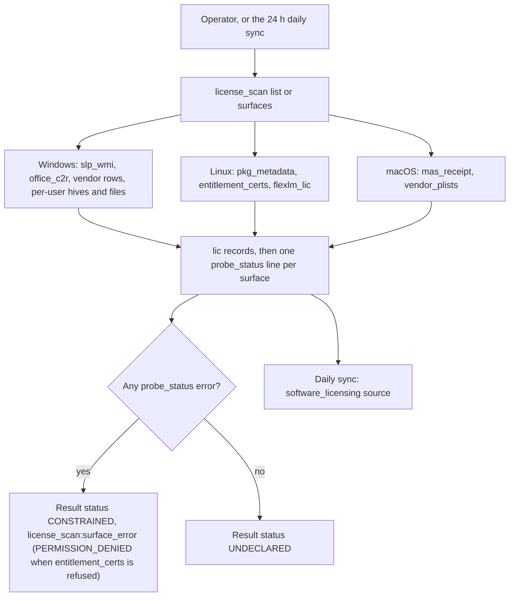
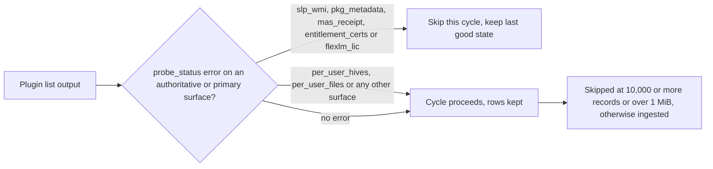

# license_scan

<!-- BEGIN GENERATED: plugin-doc-gen header -->
| | |
|---|---|
| **What it does** | Detects software licences across OS, vendor and per-user surfaces |
| **Version** | 1.0.0 |
| **Kind** | Collector · read-only · on-demand |
| **Platforms** | Windows ✅ · macOS ✅ · Linux 🟡 constrained |
| **Actions** | `list` · `surfaces` |
| **Security** | securable `SoftwareLicensing` · operation Read · risk Low · dispatch ReadOnly · approval gate None |
| **Roles** | execute:  · author: - |
<!-- END GENERATED -->

## How it works

`list` and `surfaces` run the same sweep of detection surfaces for the host's OS; they differ only in what they print. `list` prints every detected `lic|` licence record first and then one `probe_status|<surface>|ok|<rows>` (or `|error|<reason>`) line per surface it tried. `surfaces` prints only the `probe_status|` lines, so it answers "which surfaces could be read, and why not" without returning the licence inventory. Both always return rc 0: success means the sweep finished, not that every surface answered, so the `probe_status|` lines are the real health signal.

Surfaces run in a fixed order, listed below. The order is not strictly by authority: on Linux the package-metadata surface runs before the authoritative certificate and FlexLM surfaces.

- **Windows.** WMI `SoftwareLicensingProduct` (`slp_wmi`, the operating system's own licence state for Windows, Office and Microsoft server products); the Office Click-to-Run configuration (`office_c2r`); a table of vendor registry and file presence checks (SQL Server, Exchange, Visual Studio, Autodesk, Veeam, Acronis, antivirus suites, VMware Workstation, WinRAR, and a few open-source tools); then, for each local profile, per-user registry hives (`per_user_hives`) and per-user licence files (`per_user_files`, JetBrains keys and the Adobe Creative Cloud sign-in artefact).
- **Linux.** Package metadata (`pkg_metadata`, `rpm` or else `dpkg-query` plus the Debian copyright headers), Red Hat entitlement certificates (`entitlement_certs`, each certificate read and parsed in-process via libcrypto, with no subprocess), then FlexLM `.lic` files in seven conventional directories (`flexlm_lic`).
- **macOS.** Mac App Store receipts under `/Applications` (`mas_receipt`, taking the bundle name and version from each app's XML or binary `Info.plist`) and two vendor plists (`vendor_plists`: the Office volume licence and Parallels).

The plugin reads and reports; it changes nothing. It is deliberately not an entitlement tracker: FlexLM seat counts and KMS activation counts are not emitted. It is also not a licence validator: a macOS App Store receipt is detected but not verified, a binary (`bplist00`) `Info.plist` is read by a bounded, plugin-local decoder that returns only the display name, name and short version strings, and a plist it cannot decode falls back to the bundle name with an empty version, and a full licence key is never emitted, only the partial key Windows itself exposes or a short hash prefix.



### What you can decide with it

| Question | Windows | macOS | Linux |
|---|---|---|---|
| Is the operating system or Office activated, and how (KMS, MAK, OEM, retail)? | Yes, from `slp_wmi`: authoritative status, channel, evaluation end, grace expiry and the last five characters of the product key. | No. | No. |
| Is a subscription about to lapse? | Office subscription type only (from the Click-to-Run SKU, status `unknown`); the OS reports an evaluation end or grace expiry where it has one. | No. | Yes for Red Hat subscriptions (`entitlement_certs`, certificate expiry) and for FlexLM features that carry an expiry date. |
| Is a particular vendor product installed, and what licence class is it likely to be? | Presence of the listed vendor products with a type and confidence. A few interpreters go further: VMware Workstation reports `licensed` when a `Serial` registry value exists, and WinRAR reports `licensed` when a `rarreg.key` file sits beside the executable and `trial` when none is found (an absence, not an evaluation marker). These are at `probable` or `heuristic` confidence only. | Office volume licence plist and Parallels presence; App Store apps with a receipt. | Package-declared licence class (`open_source`, `freeware` or `unknown`): every installed package on rpm hosts, and on dpkg hosts only packages with a machine-readable (DEP-5) copyright header. |
| Is a user holding a personal licence on a shared machine? | Visual Studio and JetBrains keys and the Adobe sign-in artefact, tagged `user_scope=user`. | No. | No. |
| Which action? | `list` for the inventory; `surfaces` to see which sources answered. | Same. | Same. |

What a result does and does not prove:

- **`licensed` is only as strong as its `source` and `confidence`.** `os_licensing_api` and `entitlement_cert` with `authoritative` are the operating system's or the certificate's own word. A macOS record is `licensed` because an App Store receipt file exists (`probable`); the receipt is not validated.
- **No record is not "no licence".** Only the listed products and file locations are checked, and only some surfaces report a failed read in their `probe_status` line (`slp_wmi`, `pkg_metadata`, `entitlement_certs` and the per-user surfaces). On macOS, and for the registry, file-presence and FlexLM probes, an unreadable path reports `ok` with zero rows.
- **Package licence data is a classification, not compliance.** On Linux, every installed rpm package (and every dpkg package with a DEP-5 copyright header) yields a record with status `unknown`; there is no lapse detection.

### Diagrams

#### Which surfaces can block the daily sync



The daily sync reads the `probe_status|` text, not the typed result status. An error on one of five surfaces makes it skip the cycle rather than replace stored licences with an incomplete picture. A degraded per-user surface, or an error on a vendor presence row, never blocks the sync, and the typed result status of the live command is `CONSTRAINED` in both cases.

#### Confidence by surface

| Surface | OS | Confidence | What it can tell you |
|---|---|---|---|
| `slp_wmi` | Windows | authoritative | OS, Office and Microsoft server licence status and channel |
| `entitlement_certs` | Linux | authoritative | Red Hat subscription expiry |
| `flexlm_lic` | Linux | authoritative | FlexLM feature expiry |
| `office_c2r`, vendor registry rows | Windows | probable or heuristic | Product present, likely licence type |
| `per_user_hives`, `per_user_files` | Windows | heuristic; probable for a JetBrains key file | A per-user key or artefact is present |
| `pkg_metadata` | Linux | probable (rpm) or heuristic (dpkg) | Declared licence class of an installed package |
| `mas_receipt`, `vendor_plists` | macOS | probable or heuristic | App Store receipt present, vendor plist present |

## OS capability

<!-- BEGIN GENERATED: plugin-doc-gen capability -->
| Action | Windows | macOS | Linux |
|---|---|---|---|
| `list` | ✅ supported · rung 1 · wmi+win32_registry | ✅ supported · rung 1 · filesystem_probe(glob+plist, XML and bplist00) | 🟡 constrained · rung 2 · rpm/dpkg-query via bounded argv runner; in-process libcrypto X.509 |
| `surfaces` | ✅ supported · rung 1 · wmi+win32_registry | ✅ supported · rung 1 · filesystem_probe(glob+plist, XML and bplist00) | 🟡 constrained · rung 2 · rpm/dpkg-query via bounded argv runner; in-process libcrypto X.509 |

**Declared limits per leg** (descriptor fallback text, verbatim):

- **`list` / macOS** — vendor_plists rows are presence-only (status unknown); MAS receipt PKCS#7 is not validated
- **`list` / Linux** — pkg_metadata is declared-licence classification only (no lapse detection); entitlement cert readability on RHEL is unmeasured -- a refused directory or cert reports cert_permission_denied
- **`surfaces` / macOS** — vendor_plists rows are presence-only (status unknown); MAS receipt PKCS#7 is not validated
- **`surfaces` / Linux** — pkg_metadata is declared-licence classification only (no lapse detection); entitlement cert readability on RHEL is unmeasured -- a refused directory or cert reports cert_permission_denied
<!-- END GENERATED -->

## Privileges and prerequisites

| OS | Runs as | Extra grant needed | Measured | If the read is refused |
|---|---|---|---|---|
| Windows | Agent service account, LocalSystem today. | **None.** Machine-scope surfaces need only the account's existing registry-read access. The per-user offline-hive fallback uses `SeBackupPrivilege` and `SeRestorePrivilege`, which the agent account already holds (`docs/agent-privilege-model.md`). | Bare-metal Windows (NT 10.0.26200) as `SYSTEM`, 2026-09-07. That capture shows machine-scope records only (`user_scope` is `machine` on every row) and predates the default-on hive-file guard for the offline arm. | `slp_wmi` errors (a `wmi_*` token or `row_cap_exceeded`) block the daily sync. `per_user_hives` degrades to `privilege_missing`, `hive_file_refused`, `hive_unload_failed` or `profile_list_truncated` without blocking it; `hive_file_refused` is the aggregate reason when the offline hive-file guard refuses any profile's hive, and the per-profile SID and the guard's token go to the agent log at `warn`, never into a row. An unreadable profile list reports `profile_list_unreadable` on both per-user surfaces. |
| macOS | Agent LaunchDaemon, which runs as **root** today (no `UserName` key, `docs/agent-privilege-model.md`). | **None.** `mas_receipt` and `vendor_plists` are ordinary filesystem globs and plist reads. | Bare-metal macOS 26.6.2 as an ordinary user (euid 501), 2026-09-07. The binary-plist decoder was measured as euid 501 on 2026-10-26 and again as root on 2026-10-27 (the production LaunchDaemon identity), identical to `plutil` both ways, so the plugin is shown to need none of the daemon's root grant. | There is no coded refusal path: an unreadable file or an absent glob match reports a structural zero-row `ok`, never an error, and an `Info.plist` that is over 4 MiB, unreadable or cannot be decoded falls back to the bundle name with an empty version. |
| Linux | Agent daemon, an unprivileged account by design (`docs/agent-privilege-model.md`). | **None for `pkg_metadata` and FlexLM `.lic` files** (the package databases and the conventional `.lic` directories are world-readable). **The RHEL entitlement certificates under `/etc/pki/entitlement` are not assumed readable:** subscription-manager creates them root-owned, and the unprivileged account's access is **unmeasured** on a real RHEL host; the `-key.pem` files are skipped. | Debian 13 container, euid 0, 2026-09-06. Not representative of the unprivileged account, and the entitlement directory was absent there, so the RHEL grant is unmeasured. | `entitlement_certs` reports `cert_permission_denied` (result status `PERMISSION_DENIED`) when the directory cannot be listed or a certificate cannot be read, never `ok\|0`; `cert_parse_failed` or `cert_parse_partial` when an unparseable or oversized certificate falls short; and `cert_scan_budget_exhausted` for a truncated listing, more than 64 certificate files, more than 16 certificates in one file, or the 10 s start gate. `pkg_metadata` reports `dpkg_query_failed` or `output_truncated`. |

Subprocesses: Linux only, `rpm` and `dpkg-query` through the bounded argv runner (no shell, 20 s per call) for `pkg_metadata`. The entitlement certificates are read and parsed in-process via libcrypto: no `openssl` binary and no subprocess, under a 10 s start gate checked before each certificate read (a gate, not a deadline; see Caveats). Windows and macOS spawn nothing. No network use on any OS.

## Data contract

### Inputs

<!-- BEGIN GENERATED: plugin-doc-gen inputs -->
Neither action takes parameters.
<!-- END GENERATED -->

### Outputs

No definition YAML ships for this plugin, so these tables are derived from the plugin source and the sample captures rather than `spec.result.columns`. `list` emits two row shapes on one stream: `lic|` licence records followed by `probe_status|` diagnostics (one per surface attempted); `surfaces` emits only the diagnostics. A `lic` row has 14 pipe-separated fields, in this order: `lic`, `product`, `vendor`, `version`, `license_type`, `channel`, `status`, `expires_at`, `source`, `confidence`, `key_hint`, `exe_hints`, `user_scope`, `user_ref`. An empty field is empty, never a placeholder. Closed vocabularies: `license_type` is `perpetual`, `subscription`, `trial`, `volume`, `oem`, `retail`, `open_source`, `freeware` or `unknown`; `channel` is `kms`, `mak`, `oem`, `retail` or empty; `status` is `licensed`, `subscription_active`, `trial`, `grace`, `expired`, `unlicensed` or `unknown`; `source` is `os_licensing_api`, `entitlement_cert`, `registry_probe`, `license_file`, `package_metadata`, `app_receipt` or `heuristic`; `confidence` is `authoritative`, `probable` or `heuristic`; `user_scope` is `machine` or `user`. `expires_at` is a UTC epoch in seconds truncated to midnight, or empty for none or unknown, and a grace countdown is converted to an absolute date so the row does not change from day to day. `key_hint` is the OS-provided partial key or a 12-hex SHA-256 prefix, never a full key. `exe_hints` is a comma-separated list of executable names. `user_ref` is a local profile name or empty, never a SID. A `probe_status` row is `probe_status|<surface>|ok|<rows>` or `probe_status|<surface>|error|<reason>`. Every field has `|`, CR, LF and NUL removed and is cut at 1024 bytes.

<!-- BEGIN GENERATED: plugin-doc-gen outputs -->
No definition declares result columns.
<!-- END GENERATED -->

### Result status

| Status | Completeness | Provenance | When |
|---|---|---|---|
| `UNDECLARED` (never explicitly set) | UNKNOWN | - | every surface reported `ok`, as in all three sample captures |
| `PERMISSION_DENIED` | PARTIAL | `license_scan:permission_denied` | the `entitlement_certs` outcome is `cert_permission_denied` (the agent may not list `/etc/pki/entitlement` or read a certificate in it). It takes precedence over `CONSTRAINED`, is set identically after both `list` and `surfaces`, and keeps the rows already collected. |
| `CONSTRAINED` | PARTIAL | `license_scan:surface_error` | at least one `probe_status` line is an `error` and none is a permission refusal, for either action. The return code stays 0. Any surface counts here, including the per-user ones, so this status is wider than the set of errors that block the daily sync. |

The reason tokens that appear in a `probe_status|<surface>|error|<reason>` line are the useful detail:

- **`slp_wmi`.** `row_cap_exceeded`, or a bounded-WMI token from `wmi_bounded.hpp` (`wmi_connect_failed_*`, `wmi_query_failed_*`, `wmi_next_failed_*`, `wmi_deadline_exceeded`).
- **`per_user_hives`.** `privilege_missing`, `hive_file_refused`, `hive_unload_failed`, `profile_list_truncated` or `profile_list_unreadable` (the last also on `per_user_files`); this is the precedence order when several apply.
- **`pkg_metadata`.** `output_truncated` or `dpkg_query_failed`.
- **`entitlement_certs`.** `cert_permission_denied`, `cert_scan_budget_exhausted`, `cert_parse_failed` or `cert_parse_partial` (in that order of precedence when several apply).

### Where the data goes

- **Instruction result.** When dispatched directly (no instruction definition ships for this plugin, so use the generic command or MCP execute path), the rows travel over the agent's mTLS gRPC channel as the command response and land in the standard `ResponseStore`, kept 90 days by default and read through `GET /api/v1/responses/{id}`.
- **Daily sync (`software_licensing` source).** `list` output feeds a 24 h scheduled sync. An `error` on `slp_wmi`, `pkg_metadata`, `mas_receipt`, `entitlement_certs` (a refused directory included) or `flexlm_lic` makes it skip the cycle and keep the last good state; errors on any other surface do not. A cycle with 10,000 or more records, a blob over 1 MiB, or a raw capture over 2 MiB is skipped rather than sent truncated.
- **Server store.** The blob is parsed and ingested into `SoftwareLicensingStore`.
- **REST.** `GET /api/v1/sle/agents/{agent_id}` returns the device's detected licences (product, type, channel, state, expiry, confidence, `exe_hints` and the per-user `user_scope` and `user_ref`), gated `SoftwareLicensing:Read` scoped to the device and audited per open. `DELETE /api/v1/sle/agents/{agent_id}` is decommission erasure and needs the single `Decommission:Delete` permission, scoped to that device. A role holding only the per-store `SoftwareLicensing:Delete`, `Inventory:Delete` and `GuaranteedState:Delete` grants is refused with 403.
- **MCP.** The `query_software_licenses` tool, gated `SoftwareLicensing:Read` with confined scope, reads the same store, not a live dispatch.
- **Not consumed by** the TAR warehouse, DEX or metrics.
- **Sensitivity.** `lic` rows are an installed-software and licence inventory: `product`, `vendor` and `version` name specific installed software, `exe_hints` names executables, and `key_hint` carries a partial OS-provided key or a key-derived hash (never raw key material). `user_scope` and `user_ref` can carry a local profile name for a user-scoped licence; the daily sync can pseudonymise or drop `user_ref`. `probe_status` rows carry only a surface name and a count or reason.
- **Siblings:** none shipped. `ent|` entitlement records (FlexLM seat counts, KMS activation counts) are not emitted by this plugin.

## Sample output

<!-- BEGIN GENERATED: plugin-doc-gen samples -->
**Windows** — captured: windows Windows 10.0.26200 x86_64 · bare-metal · 2026-10-26 · LocalSystem (elevated) · leg-hash 0c437dc4008f

```
== action=list
lic|Windows(R), Professional edition|Microsoft||oem|oem|licensed||os_licensing_api|authoritative|2R4J2||machine|
lic|Microsoft Visual Studio|Microsoft||unknown||unknown||registry_probe|heuristic||devenv.exe|machine|
lic|7-Zip|Igor Pavlov||open_source||unknown||registry_probe|heuristic||7zfm.exe|machine|
lic|Git for Windows|The Git Development Community||open_source||unknown||registry_probe|heuristic||git.exe|machine|
probe_status|slp_wmi|ok|1
probe_status|office_c2r|ok|0
probe_status|sql_server|ok|0
probe_status|exchange|ok|0
probe_status|visual_studio|ok|1
probe_status|autodesk_adsklicensing|ok|0
probe_status|veeam|ok|0
probe_status|acronis|ok|0
… 12 of 18 rows shown
[result_status] UNDECLARED / UNKNOWN

== action=surfaces
probe_status|slp_wmi|ok|1
probe_status|office_c2r|ok|0
probe_status|sql_server|ok|0
probe_status|exchange|ok|0
probe_status|visual_studio|ok|1
probe_status|autodesk_adsklicensing|ok|0
probe_status|veeam|ok|0
probe_status|acronis|ok|0
probe_status|av_suites|ok|0
probe_status|vmware_workstation|ok|0
probe_status|winrar|ok|0
probe_status|open_source_classification|ok|2
… 12 of 14 rows shown
[result_status] UNDECLARED / UNKNOWN
```

**macOS** — captured: macos macOS 26.6.2 arm64 · bare-metal · 2026-10-26 · euid 501 · leg-hash 0c437dc4008f

```
== action=list
lic|Pages Creator Studio||15.1.1|retail||licensed||app_receipt|probable|||machine|
lic|OneDrive||26.168.0830|retail||licensed||app_receipt|probable|||machine|
lic|iMovie||10.4.4|retail||licensed||app_receipt|probable|||machine|
lic|Microsoft Word||16.114.1|retail||licensed||app_receipt|probable|||machine|
lic|Numbers Creator Studio||15.1|retail||licensed||app_receipt|probable|||machine|
lic|Microsoft Excel||16.114.1|retail||licensed||app_receipt|probable|||machine|
lic|Microsoft Outlook||16.113.2|retail||licensed||app_receipt|probable|||machine|
lic|Keynote Creator Studio||15.1.1|retail||licensed||app_receipt|probable|||machine|
lic|uBlock Origin Lite||2026.1018.2229|retail||licensed||app_receipt|probable|||machine|
lic|GarageBand||10.4.13|retail||licensed||app_receipt|probable|||machine|
lic|Microsoft PowerPoint||16.114.1|retail||licensed||app_receipt|probable|||machine|
lic|Hush||1.0.19|retail||licensed||app_receipt|probable|||machine|
… 12 of 14 rows shown
[result_status] UNDECLARED / UNKNOWN

== action=surfaces
probe_status|mas_receipt|ok|12
probe_status|vendor_plists|ok|0
[result_status] UNDECLARED / UNKNOWN
```

**Linux** — captured: linux Debian GNU/Linux 13 (trixie) aarch64 · container · 2026-09-06 · euid 0 · leg-hash 0c437dc4008f

```
== action=list
lic|apt||3.0.3|open_source||unknown||package_metadata|heuristic|||machine|
lic|autoconf||2.72-3.1|open_source||unknown||package_metadata|heuristic|||machine|
lic|automake||1:1.17-4|open_source||unknown||package_metadata|heuristic|||machine|
lic|base-files||13.8+deb13u6|open_source||unknown||package_metadata|heuristic|||machine|
lic|base-passwd||3.6.7|open_source||unknown||package_metadata|heuristic|||machine|
lic|bash||5.2.37-2+b9|open_source||unknown||package_metadata|heuristic|||machine|
lic|bison||2:3.8.2+dfsg-1+b2|open_source||unknown||package_metadata|heuristic|||machine|
lic|bsdutils||1:2.41.5-0+deb13u1|open_source||unknown||package_metadata|heuristic|||machine|
lic|ca-certificates||20250419|open_source||unknown||package_metadata|heuristic|||machine|
lic|cmake||3.31.6-2|open_source||unknown||package_metadata|heuristic|||machine|
lic|cmake-data||3.31.6-2|open_source||unknown||package_metadata|heuristic|||machine|
lic|coreutils||9.7-3|open_source||unknown||package_metadata|heuristic|||machine|
… 12 of 149 rows shown
[result_status] UNDECLARED / UNKNOWN

== action=surfaces
probe_status|pkg_metadata|ok|146
probe_status|entitlement_certs|ok|0
probe_status|flexlm_lic|ok|0
[result_status] UNDECLARED / UNKNOWN
```
<!-- END GENERATED -->

## Caveats and known gaps

1. **Linux and macOS are constrained by design, and a refused entitlement directory pauses the daily sync.** On Linux `pkg_metadata` is a declared-licence classification only (no lapse detection), and whether the agent's account can read `/etc/pki/entitlement` on a real RHEL host is unmeasured. A refused directory or certificate reports `cert_permission_denied` on an authoritative surface, so while it persists the daily sync skips every cycle and keeps the last good state, and that host's `pkg_metadata` rows do not land either; an unlistable directory is a refusal for exactly this reason, never an `ok|0` that would replace the stored entitlement records with nothing. On macOS the App Store receipt is not validated, `vendor_plists` rows are presence-only, and an `Info.plist` that is over 4 MiB, unreadable or undecodable (XML or binary) uses the bundle name with an empty version.
2. **Per-user Windows probes are never a primary surface.** A missing `SeBackup` or `SeRestore` privilege, a hive file refused by the default offline guard (aggregate reason `hive_file_refused`, details in the agent log), an unreadable profile list or a hive-unload failure degrades `per_user_hives` honestly, turns the live command status to `CONSTRAINED`, and never blocks `list` or the daily sync. Per-user licence state is additive, not authoritative.
3. **Seat counts and activation counts are out of scope.** FlexLM seat counts and KMS activation counts (`ent|` records) are not emitted, and this plugin cannot say how many seats are used or whether a volume agreement is compliant.
4. **A failing `rpm` falls through to `dpkg-query`.** A leftover `rpm` binary with an uninitialised database fails every query on a Debian-family host, so an `rpm` execution failure (not only its absence) tries `dpkg-query` next. A truncated `rpm` listing is the exception: it is reported as `output_truncated`, never merged with a second tool's partial result.
5. **The entitlement scan's 10 s budget is a start gate, not a deadline.** It is checked before each certificate read; the directory listing comes before it and a read has no deadline of its own, so a certificate reached through a followed link onto a dead network mount can hold the worker for that mount's timeout. There is no mount-table guard because `/etc/pki/entitlement` is a fixed root-owned path on the root filesystem by subscription-manager's contract (the same shape as `runtimes`, #4875).

## Source and tests

<!-- BEGIN GENERATED: plugin-doc-gen source -->
- Plugin: `agents/plugins/license_scan/src/license_scan_plugin.cpp` · `agents/plugins/license_scan/src/licensing_bplist.hpp` · `agents/plugins/license_scan/src/licensing_linux.cpp` · `agents/plugins/license_scan/src/licensing_macos.cpp` · `agents/plugins/license_scan/src/licensing_parsers.hpp` · `agents/plugins/license_scan/src/licensing_probes.cpp` · `agents/plugins/license_scan/src/licensing_probes.hpp` · `agents/plugins/license_scan/src/licensing_record.hpp` · `agents/plugins/license_scan/src/licensing_win.cpp` · `agents/plugins/license_scan/src/licensing_x509.hpp`
- Capability rows: `server/core/src/capability_decls/plugin_action_catalogue_a.hpp`
- Tests: `tests/unit/test_license_scan_actions.cpp` · `tests/unit/test_license_scan_probe_host_posix.cpp` · `tests/unit/test_license_scan_surfaces.cpp`
- Privilege row: `docs/agent-privilege-model.md`
<!-- END GENERATED -->
