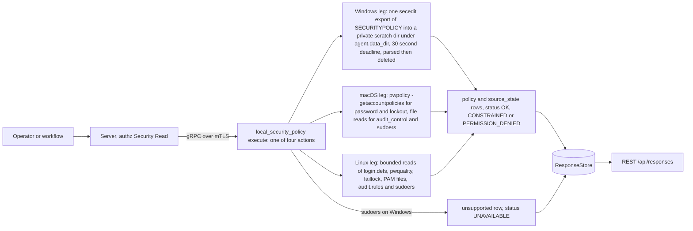
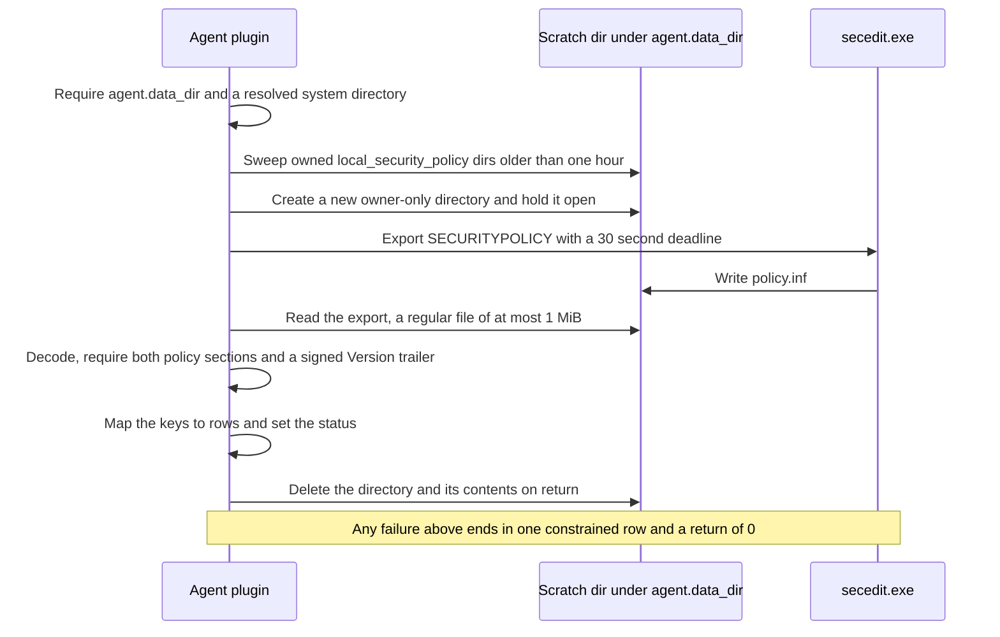
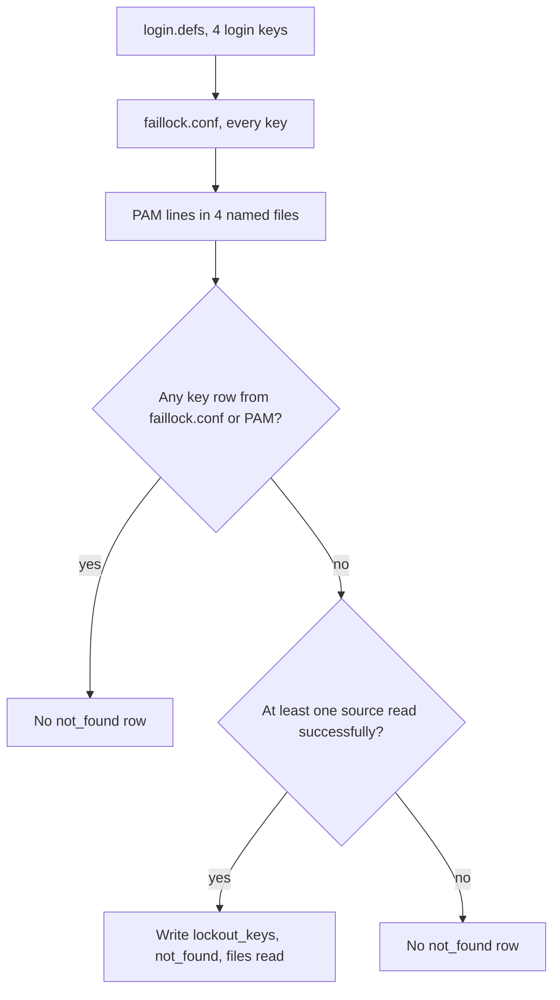
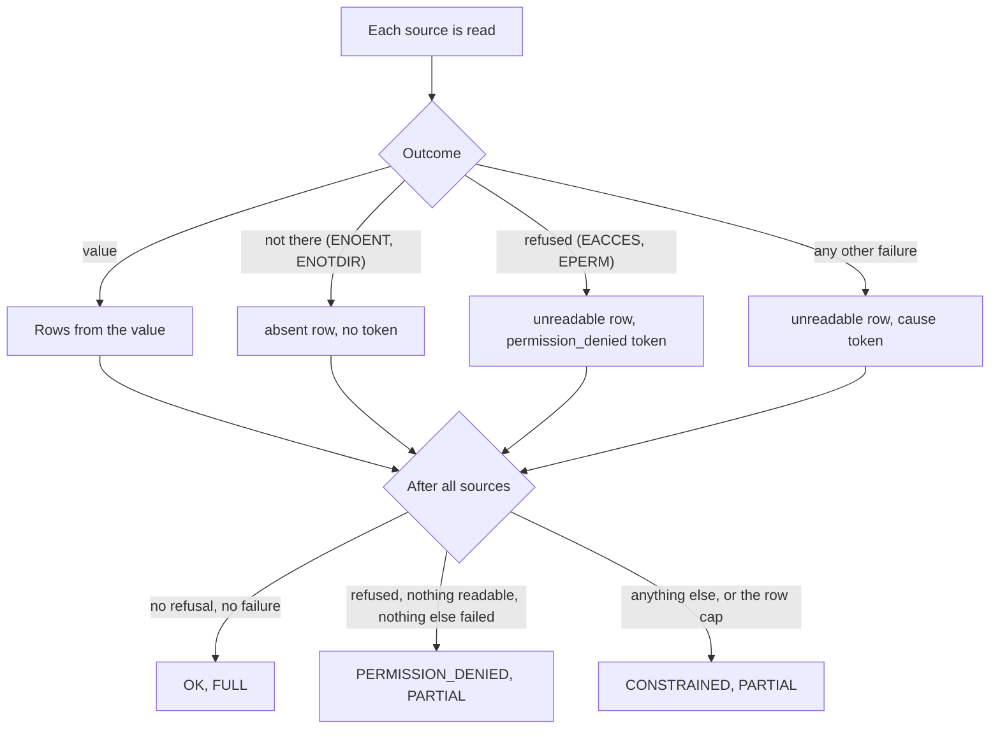

# local_security_policy

<!-- BEGIN GENERATED: plugin-doc-gen header -->
| | |
|---|---|
| **What it does** | Reports local password, lockout and audit policy posture and sudoers content |
| **Version** | 1.0.0 |
| **Kind** | Collector · read-only · gathered (crossplatform.local_security_policy.password_policy, crossplatform.local_security_policy.lockout_policy, crossplatform.local_security_policy.audit_policy, crossplatform.local_security_policy.sudoers) |
| **Platforms** | Windows 🟡 constrained · macOS 🟡 constrained · Linux 🟡 constrained |
| **Actions** | `audit_policy` (definition `crossplatform.local_security_policy.audit_policy`) · `lockout_policy` (definition `crossplatform.local_security_policy.lockout_policy`) · `password_policy` (definition `crossplatform.local_security_policy.password_policy`) · `sudoers` (definition `crossplatform.local_security_policy.sudoers`) |
| **Security** | `password_policy`: securable `Security` · operation Read · risk Low · dispatch ReadOnly · approval gate None; `lockout_policy`: securable `Security` · operation Read · risk Low · dispatch ReadOnly · approval gate None; `audit_policy`: securable `Security` · operation Read · risk Low · dispatch ReadOnly · approval gate None; `sudoers`: securable `Security` · operation Read · risk Medium · dispatch ReadOnly · approval gate None |
| **Roles** | execute: endpoint-admin, endpoint-operator, security-admin · author: content-author |
<!-- END GENERATED -->

## How it works

Four read-only actions report a host's local security configuration, one question each: `password_policy` (password rules), `lockout_policy` (account lockout), `audit_policy` (audit configuration) and `sudoers` (who may run commands as another user). None takes parameters, so no request text reaches a path or a command line, and no host policy is ever configured, imported or applied. Linux reads configuration files. macOS reads files for `audit_policy` and `sudoers` and runs `pwpolicy -getaccountpolicies` for password and lockout policy. Windows runs `secedit /export` once, stages the export in a private scratch directory under `agent.data_dir`, parses it and deletes it; `sudoers` does not exist on Windows. Every source reads as a **value**, as **`absent`** (the OS definitively says the file, key or directory is not there) or as **`unreadable`** (the read failed), and a failed read never looks like an absent one. The rows describe configuration as written, not the policy the OS evaluates.



### What is read, in what order

| Action | Linux (files, in read order) | macOS | Windows |
|---|---|---|---|
| `password_policy` | `/etc/login.defs` (7 keys: `PASS_MAX_DAYS`, `PASS_MIN_DAYS`, `PASS_MIN_LEN`, `PASS_WARN_AGE`, `ENCRYPT_METHOD`, `SHA_CRYPT_MIN_ROUNDS`, `SHA_CRYPT_MAX_ROUNDS`), then `/etc/security/pwquality.conf` (every key), then the `password` lines of `pam_pwquality`, `pam_pwhistory`, `pam_cracklib` and `pam_unix` in `/etc/pam.d/common-password`, `system-auth` and `password-auth` | `pwpolicy -getaccountpolicies`, parsed with `CFPropertyListCreateWithData`; password categories only | one `secedit /export`; the six `[System Access]` keys `MinimumPasswordAge`, `MaximumPasswordAge`, `MinimumPasswordLength`, `PasswordComplexity`, `PasswordHistorySize`, `ClearTextPassword` |
| `lockout_policy` | `/etc/login.defs` (4 login-prompt keys: `LOGIN_RETRIES`, `LOGIN_TIMEOUT`, `FAILLOG_ENAB`, `FAIL_DELAY`), then `/etc/security/faillock.conf` (every key), then the `auth` and `account` lines of `pam_faillock`, `pam_tally2` and `pam_tally` in `common-auth`, `common-account`, `system-auth` and `password-auth` | the same `pwpolicy` run; authentication categories only | the same export; `LockoutBadCount`, `ResetLockoutCount`, `LockoutDuration` |
| `audit_policy` | `/etc/audit/audit.rules`: counts of rules, watch rules, syscall rules, unmodelled lines and control lines, plus the `-e` state | `/etc/security/audit_control`, one row per `key:value` line (the file is absent by default) | the same export; one row per legacy `[Event Audit]` category the export carries |
| `sudoers` | `/etc/sudoers`, then each file in `/etc/sudoers.d` in name order (names containing a dot or ending in `~` are listed as `ignored`, as sudo skips them) | the same | not supported: one `unsupported` row |

**What is deliberately not read.**

- **Linux:** `pwquality.conf.d` fragments, `faillock.conf` drop-ins, PAM `@include` and substack targets, PAM services other than the named files (`sshd`, `login`), `/etc/audit/rules.d`, the live kernel audit rules (`auditctl -l`), IdM or SSSD policy, `fail2ban`, and sudoers `include` targets (listed, not followed).
- **macOS:** per-user policy (only the global account policy is read) and any policy delivered by a configuration profile; the capture was taken on an unmanaged Mac.
- **Windows:** Advanced Audit Policy subcategories (`auditpol`), the effective domain policy (the export is the local security database, without `/mergedpolicy`), and every part of the export beyond the keys above. The privilege-right assignments and registry values in the export are staged on disk but never reported.

### Reading rules

- **One token per failure.** Each failure adds one token, `<source>:<cause>`; the Windows scratch-directory tokens (`data_dir_unset`, `dest_dir_*`) keep the spelling used by the sibling `execution_artifacts` plugin. An `absent` source adds no token and does not lower the status.
- **Status.** `PERMISSION_DENIED` only when at least one read was refused, no source was readable and nothing else failed. A refusal next to any readable source, and every other failure, is `CONSTRAINED`. So a Linux `sudoers` refusal next to a readable `/etc/sudoers.d` file is `CONSTRAINED`.
- **Unrecognised values are named.** A value the tables cannot interpret is `unmodelled`, never dropped.
- **Silent by design.** These produce no row and no token: one absent PAM file while a sibling alternative exists (only all-absent is a `source_state|absent|/etc/pam.d` row); a file that was read but sets none of the reported keys (Debian's all-commented `faillock.conf`, a PAM file with no matching module line), apart from the Linux `lockout_policy` case below; a PAM line that is not `type control module`; `login.defs` keys outside the per-action list; `pwpolicy` element keys other than `policyIdentifier`, `policyContent` and `policyParameters`; and a Windows `[Event Audit]` category the export omits.
- **Not silent.** A `pwpolicy` element that carries none of the reportable keys is a `source_state|unreadable:missing_content` row.
- **macOS plist items.** Anything not in the documented shape is a `source_state|unreadable:<defect>` row with a `pwpolicy:<defect>` token, never dropped and never `policies|none`. A `policyAttribute*` parameter is its own key; any other scalar parameter (for example `autoEnableInSeconds`, the lockout duration) is `unmodelled_parameter` with the value `<name>=<value>`.
- **Linux `lockout_policy` with no key found.** Written as `lockout_policy|lockout_keys|not_found|<files>` when at least one source was read and no key row resulted. The decision is in the diagram below; `<files>` lists exactly the files read successfully, comma-separated, in read order.

### What you can decide with it

| Question | Action | What you get | When you get nothing useful |
|---|---|---|---|
| Is a minimum password length, complexity, history or maximum age set? | `password_policy` | Windows: the six `secedit` keys as raw numbers. macOS: Apple policy expressions as `policy_content` rows plus a derived `minimum_length`. Linux: `login.defs` aging keys, `pwquality.conf` keys such as `minlen`, and the PAM `password` lines | A key the Windows export lacks reads `absent`. An unmanaged Mac reports little (the captured sample shows only the FileVault policy). On Linux a setting held in an unread place is invisible |
| Is account lockout configured? | `lockout_policy` | Windows: `LockoutBadCount`, `ResetLockoutCount`, `LockoutDuration`. macOS: authentication policy rows, or `policies\|none`. Linux: `faillock.conf` keys (for example `deny`, `unlock_time`) and PAM `pam_faillock`, `pam_tally2` or `pam_tally` lines | Linux `lockout_keys\|not_found` and macOS `policies\|none` mean nothing was found in what was read, not that lockout is off |
| Is auditing configured? | `audit_policy` | Windows: legacy category settings (`none`, `success`, `failure`, `success_failure`). macOS: `audit_control` lines. Linux: rule counts and the `-e` state of the rules file (`enabled`, `disabled`, `immutable`, or `unset`) | Windows `none` means the legacy category is unset, not that the host is not auditing. macOS reports `absent` by default. Linux does not show live kernel rules |
| Who can become root, and without a password? | `sudoers` | `user_spec` rows with subject, run-as and a `nopasswd` flag; `defaults`, `alias`, `include` and `includedir` rows alongside | Windows has no sudoers. Read a `defaults` row with `!authenticate` together with `nopasswd`, because it also makes matching grants passwordless |

- **Read it per OS.** Keys keep each OS's own vocabulary (`MinimumPasswordLength`, `PASS_MIN_LEN` or `minlen`, `minimum_length`), so a fleet baseline branches per OS. The plugin reports settings; it does not score them against a benchmark.
- **A row proves a setting exists, not that it is enforced.** `deny = 0` and `silent` are rows too. A clean `OK` status means every source was read or definitively absent; it does not mean the host meets a standard.
- **Orientation, not a mapping.** Password, lockout and audit settings are the inputs to checks in standards such as CIS Benchmarks and PCI DSS; this plugin was not built to certify against either.

### Diagrams

#### Windows export lifecycle



The export is the whole security-policy area, so it is staged only in a directory the agent created, owns and holds open. The completeness check stops a truncated file from reporting the keys it lost as `absent`. A crash between the export and the delete leaves the directory until a later Windows dispatch sweeps it.

#### Linux lockout_policy: when `not_found` is written



The four `login.defs` keys are reported as rows but do not count, because they are login-prompt and faillog settings rather than lockout counters. An absent or unreadable source keeps its own `source_state` row and does not suppress `not_found`; any key row does.

#### Status for the file and tool legs



On Windows every failure is `CONSTRAINED` with a `constrained|<token>` row, except `secedit:access_denied`, which is `PERMISSION_DENIED`. On macOS a failed `pwpolicy` run is always `CONSTRAINED`.

## OS capability

<!-- BEGIN GENERATED: plugin-doc-gen capability -->
| Action | Windows | macOS | Linux |
|---|---|---|---|
| `audit_policy` | 🟡 constrained · rung 2 · secedit.exe (system directory via GetSystemDirectoryW) /export /areas SECURITYPOLICY into an agent.data_dir scratch file | 🟡 constrained · rung 1 · /etc/security/audit_control (bounded file read) | 🟡 constrained · rung 1 · /etc/audit/audit.rules (bounded file read) |
| `lockout_policy` | 🟡 constrained · rung 2 · secedit.exe (system directory via GetSystemDirectoryW) /export /areas SECURITYPOLICY into an agent.data_dir scratch file | 🟡 constrained · rung 2 · pwpolicy -getaccountpolicies (CFPropertyList) | 🟡 constrained · rung 1 · /etc/login.defs + /etc/security/faillock.conf + /etc/pam.d/{common-auth,common-account,system-auth,password-auth} (bounded file reads) |
| `password_policy` | 🟡 constrained · rung 2 · secedit.exe (system directory via GetSystemDirectoryW) /export /areas SECURITYPOLICY into an agent.data_dir scratch file | 🟡 constrained · rung 2 · pwpolicy -getaccountpolicies (CFPropertyList) | 🟡 constrained · rung 1 · /etc/login.defs + /etc/security/pwquality.conf + /etc/pam.d/{common-password,system-auth,password-auth} (bounded file reads) |
| `sudoers` | ⛔ unsupported | 🟡 constrained · rung 1 · /etc/sudoers + /etc/sudoers.d (bounded file reads) | 🟡 constrained · rung 1 · /etc/sudoers + /etc/sudoers.d (bounded file reads) |

**Declared limits per leg** (descriptor fallback text, verbatim):

- **`audit_policy` / Windows** — the LEGACY [Event Audit] categories only. Where Advanced Audit Policy subcategories are in force -- the Windows 10/11 default and the norm under GPO -- these are NOT the effective audit state: a category reading none means the legacy category is unset, not that the host is not auditing, and a legacy success_failure may be ignored by the OS when the "Force audit policy subcategory settings" override (SCENoApplyLegacyAuditPolicy) is set. auditpol subcategories are not read. It is the local security database (secedit /export without /mergedpolicy); domain-joined behaviour is unmeasured. The export (the whole SECURITYPOLICY area) is staged as agent.data_dir\\local_security_policy-{32 hex}\\policy.inf in an owner-only directory removed on return; each policy dispatch first sweeps such directories older than one hour, so a crash leaves one until a later dispatch. Measured only as LocalSystem, elevated, on a standalone host; see the Windows leg banner
- **`audit_policy` / macOS** — absent by default on current macOS (only audit_control.example ships), reported as absent; a present file is root-readable only
- **`audit_policy` / Linux** — rule counts and -e state of the rule file only, not the live kernel rules (auditctl -l) and not /etc/audit/rules.d; the file is 0640 root, so an unprivileged agent reports permission_denied; in a container (deploy/docker/Dockerfile.agent) these are the image's files, not the host's
- **`lockout_policy` / Windows** — argv leaf parsed from the exported UTF-16LE INI: the local security database (secedit /export without /mergedpolicy); domain-joined behaviour is unmeasured. The export (the whole SECURITYPOLICY area) is staged as agent.data_dir\\local_security_policy-{32 hex}\\policy.inf in an owner-only directory removed on return; each policy dispatch first sweeps such directories older than one hour, so a crash leaves one until a later dispatch. Measured only as LocalSystem, elevated, on a standalone host; see the Windows leg banner
- **`lockout_policy` / macOS** — global account policies only; no authentication policy reports policies|none (the default); a plist item not in the documented shape is an unreadable row and constrained. Measured on an UNMANAGED Mac, so on a managed device policies|none must not be read as 'no lockout enforced' -- profile-delivered policy is unverified here
- **`lockout_policy` / Linux** — reports configuration, not live lockout counters; faillock.conf drop-ins and PAM include/substack targets are not read; `lockout_keys|not_found` (read at least one source, found no key) must not be read as 'no lockout enforced' -- sshd and other PAM services, IdM/SSSD and fail2ban are not read; in a container (deploy/docker/Dockerfile.agent) these are the image's files, not the host's
- **`password_policy` / Windows** — argv leaf parsed from the exported UTF-16LE INI: the local security database (secedit /export without /mergedpolicy); domain-joined behaviour is unmeasured. The export (the whole SECURITYPOLICY area) is staged as agent.data_dir\\local_security_policy-{32 hex}\\policy.inf in an owner-only directory removed on return; each policy dispatch first sweeps such directories older than one hour, so a crash leaves one until a later dispatch. Measured only as LocalSystem, elevated, on a standalone host; see the Windows leg banner
- **`password_policy` / macOS** — global account policies only; rung 2 because no public OpenDirectory global-policy API exists; policy expressions are verbatim; a policyAttribute* parameter is its own key and any other is unmodelled_parameter <name>=<value>; a plist item not in the documented shape is an unreadable row and constrained. Measured on an UNMANAGED Mac: whether an MDM configuration-profile passcode payload surfaces here is unverified
- **`password_policy` / Linux** — reports what the config files state, not the live PAM decision; pwquality.conf.d fragments and PAM include/substack targets are not read; a missing file is reported as absent, an unreadable one as unreadable (permission_denied/constrained); in a container (deploy/docker/Dockerfile.agent) these are the image's files, not the host's
- **`sudoers` / Windows** — no sudoers on Windows
- **`sudoers` / macOS** — /etc/sudoers is root:wheel 0440: reading it needs root or group wheel, otherwise permission_denied (kind unreadable)
- **`sudoers` / Linux** — parsed content, not sudo's evaluation: include directives are listed, not followed; unrecognised lines are kind unmodelled; needs read access to the 0440 root files; in a container (deploy/docker/Dockerfile.agent) these are the image's files, not the host's
<!-- END GENERATED -->

## Privileges and prerequisites

| OS | Runs as | Extra grant needed | Measured | If the read is refused |
|---|---|---|---|---|
| Windows | agent service account (LocalSystem today, #1442) | `secedit /export` needs an elevated token. Which privilege is required, and whether the dedicated `NT SERVICE\YuzuAgent` account succeeds, are not measured. The one measured run had `SeSecurityPrivilege` present but in its default Disabled state | LocalSystem, elevated, on a bare-metal standalone (not domain-joined) Windows 11 Pro host: a real 12,828-byte UTF-16LE export, and the committed sample captured 2026-09-30 (`docs/samples/windows.txt`). No fixture of the export is committed | A refused `secedit` run is expected to exit non-zero and report `CONSTRAINED` with `secedit:exit_<n>` (not measured). `PERMISSION_DENIED` with `secedit:access_denied` is reported only when the agent cannot open its own export file (never observed). Either way the action returns 0 with the row `constrained\|<token>` |
| macOS | agent daemon, root today (LaunchDaemon carries no `UserName` key, `docs/agent-privilege-model.md` TL;DR) | None for `pwpolicy -getaccountpolicies`; `/etc/sudoers` is `root:wheel` `0440`, which the root daemon can read | Bare-metal Mac, unprivileged (euid 501), sample captured 2026-09-29 (`docs/samples/macos.txt`). No root-privileged run has been captured, so the refused `sudoers` shape in the sample is what a normal user sees | `EACCES` on `/etc/sudoers` reports the row kind `unreadable` with `permission_denied` and the action reports `PERMISSION_DENIED`/`PARTIAL`; a failed `pwpolicy` run reports `CONSTRAINED` with `pwpolicy:<cause>` |
| Linux | agent daemon, dedicated unprivileged account on the packaged unit (never root by design) | None for the world-readable config. `/etc/audit/audit.rules` (`0640`) and `/etc/sudoers` plus `/etc/sudoers.d/*` (`0440`) need root or a read-override capability. A file capability does not take effect under the packaged unit's `NoNewPrivileges=true` (verified for the sibling `remote_access_audit` plugin), so expect those files to read as refused unless read access is granted another way; not measured for this plugin | Only in a container: the sample (2026-09-30, `docs/samples/linux.txt`) is a run of the built `.so` as root in a Debian 13 container hardened for the capture (sudo with a `sudoers.d` drop-in, auditd rules, pwquality and faillock values), so it describes that container's `/etc`, not a host. No fixtures are committed and no bare-metal Linux host has been captured | `EACCES`/`EPERM` reports the source `unreadable` with `<path>:permission_denied`; the action reports `PERMISSION_DENIED` when nothing else was readable, otherwise `CONSTRAINED`; a missing file (`ENOENT`) reports `absent` with no token |

Binaries and subprocesses: Windows runs `<system directory>\secedit.exe /export /cfg <agent.data_dir>\local_security_policy-<32 hex>\policy.inf /areas SECURITYPOLICY /log <agent.data_dir>\local_security_policy-<32 hex>\secedit.log /quiet` (system directory from `GetSystemDirectoryW`, absolute path, no shell, no PowerShell, never `/configure`). The `/log` argument keeps any log output in the scratch directory instead of the default log under `%windir%\security\logs`, which the agent does not own; no such file was written in the measured run with or without it. macOS runs `/usr/bin/pwpolicy -getaccountpolicies` (absolute path, no shell, 15 second deadline); Linux runs nothing. Network: none.

**Scratch directory (Windows).** Each dispatch creates `<agent.data_dir>\local_security_policy-<32 hex>` itself (random 128-bit name, created with `CREATE_NEW` so an existing directory is never reused, and an owner-only access list so no other account can enter it), holds it open, checks it is the agent's own and removes it on every path the process survives. The export file `secedit` writes inside it carries the child's default DACL. With `agent.data_dir` unset the action reports `constrained|data_dir_unset`; there is no fallback location, and a shipped install always sets it. Each Windows policy dispatch first sweeps `local_security_policy-<32 hex>` directories older than one hour under `agent.data_dir`: ownership is verified (a same-named directory owned by another Windows account (security identifier, SID) is skipped), a non-flat directory is left intact, and a directory whose modification time is more than an hour in the future also counts as stale. The sweep result is logged at warn only when the pass did something (`scratch_sweep: removed <n> failed <n> fresh <n> not_ours <n> deferred <n>`); it is never a row or a token.

## Data contract

### Inputs

<!-- BEGIN GENERATED: plugin-doc-gen inputs -->
No action takes parameters.
<!-- END GENERATED -->

### Outputs

Pipe-delimited text rows, one per line of output. The first field is the fixed action name (`password_policy`, `lockout_policy`, `audit_policy` or `sudoers`), and every field passes through the shared untrusted-output escaper. A key present with no value reads `present`.

- **Settings rows.** `<action>|<key>|<value>|<source>`: the setting, its value and the file, `secedit` or `pwpolicy:<policy identifier>` it came from.
- **Source-state rows.** A missing or unreadable source is one `<action>|source_state|<state>|<source>` row, with state `absent` or `unreadable:<token>`. For `sudoers` the same fact is a row of kind `absent` (`commands` is `-`) or `unreadable` (`commands` is the bare token, for example `permission_denied`).
- **Windows.** `password_policy` and `lockout_policy` always emit their fixed key list, and a key the export lacks reads `absent`. `audit_policy` emits one row per `[Event Audit]` category the export carries (a real export has nine); an omitted category has no row. An export missing `[System Access]` or `[Event Audit]`, or not ending in the signed `[Version]` section, is `secedit:export_incomplete`. A section that is present but empty is `CONSTRAINED` with `secedit:section_missing_system_access` or `secedit:section_missing_event_audit`.
- **macOS.** `policies|none` is the default when no matching policy is set and no item was malformed. A plist item not in the documented shape is a `source_state|unreadable:<defect>` row whose source names the policy identifier or category (`pwpolicy` when neither is known).
- **Linux `lockout_policy`.** One `lockout_keys|not_found|<files>` row when sources were read and no key row resulted (see How it works).

**`sudoers` rows** are `sudoers|<file>|<kind>|<subject>|<runas>|<nopasswd>|<commands>`.

- **Splitting.** Each `:`-separated `Host_List = ...` clause of a user spec is its own row, and so is each change of run-as or `NOPASSWD` tag within a clause (`alice ALL = (root) NOPASSWD: /a, (bob) /b` is two rows). Option_Spec words (`CWD=`, `CHROOT=`, `TIMEOUT=`, `NOTBEFORE=`, `ROLE=`, `APPARMOR_PROFILE=` and so on) stay verbatim in `commands`, like every tag other than `NOPASSWD` and `PASSWD`.
- **Lexing.** Files are lexed as sudo 1.9.16 lexes them: a `:` inside a quoted value, an escape, an IPv6 host or a digest never splits a clause, and a `#` comment never continues onto the next line. The lexer was checked differentially against sudo 1.9.16; no test corpus or result is committed.
- **Fail-safe.** A line that still carries a `NOPASSWD:` or `PASSWD:` tag the parser could not decode is kind `unmodelled` plus the token `<file>:undecoded_passwd_tag` (`CONSTRAINED`).
- **Not covered.** `nopasswd` is the tag alone; aliases and includes are not resolved; another sudo version may lex differently; a line sudo itself rejects is reported best-effort.
- **Limits.** A `User_List`, `Host_List` or run-as over 4 KiB, or a line that would expand to more than 256 rows, is one `unmodelled` row with its raw text. Parsing stops at the row cap.
- **Escaping.** The shared escaper renders a literal backslash as `/` (`%domain\ admins` reads `%domain/ admins`); this is the platform's deliberately lossy output convention, not a sudoers rule.
- **NUL bytes.** A file holding a NUL byte is `unreadable:embedded_nul` as a whole (`<path>:embedded_nul`), because no value after it can be reported as the one in force. A Windows export holding one anywhere is `secedit:embedded_nul` with no rows.

**Row cap.** Every Linux and macOS action stops at 4096 rows per dispatch, or at 4 MiB of formatted output: 4095 data rows plus one marker row, and the status becomes `CONSTRAINED` with the token `row_cap`. The Windows leg has no row cap; its only bound is the 1 MiB export limit below.

- **Marker shapes.** File-backed Linux and macOS `audit_policy` sources write `<action>|source_state|unreadable:row_cap|<action>`; `sudoers` writes `sudoers|-|unreadable|-|-|-|row_cap`; the macOS `pwpolicy` path writes the four-field shape with the literal source `pwpolicy`.
- **Other bounds.** The `pwpolicy` path is also bounded by the tool's own output cap (`pwpolicy:output_truncated`), and a long policy identifier or category is cut to 256 bytes before it is repeated in each row's source field. The Windows export is bounded by the 1 MiB cap (`secedit:output_oversized`), which is the only bound on that leg's row count. The `/etc/sudoers.d` listing is capped at 256 entries (`sudoers.d:truncated`, row `sudoers|/etc/sudoers.d|unreadable|-|-|-|truncated`).

**Failure rows and return codes.**

- **No rows at all.** When a non-OK outcome produced no rows (today only a failed `pwpolicy` run: spawn error, deadline, cancelled, signalled or otherwise unexpected end, truncated output, non-zero exit, no plist or an unparseable one) the action writes one `<action>|status|constrained|<reason>` row, where the fourth field is the reason token. `status|permission_denied` exists only as a defensive branch that no current source reaches.
- **Return code 0.** File-backed and `pwpolicy` failures are data-level outcomes and return 0, as does every Windows failure (degradation is the typed status, not the return code). An unknown action name returns 1 with the single row `unknown action: <name>`.
- **Two-field `constrained` row.** Written by every Windows failure and by an exception contained on any OS (`constrained|internal_error`, return 1). On Windows it reads `constrained` even when the typed status is `PERMISSION_DENIED`; the status and the token (for example `secedit:access_denied`) carry the distinction.
- **`sudoers` on Windows.** Returns 1 with the row `sudoers|-|unsupported|-|-|-|windows_has_no_sudoers` and status `UNAVAILABLE`.

<!-- BEGIN GENERATED: plugin-doc-gen outputs -->
**`crossplatform.local_security_policy.audit_policy` — `row_kind|key|value|source`**

| Field | Type | Values | Available | Example | Description |
|---|---|---|---|---|---|
| `row_kind` | string | `audit_policy` `constrained` | Windows, Linux, macOS | `audit_policy` | Fixed row tag, always the action name. Two cases write a two-field constrained\|<reason> row instead, whose second field is the reason: every Windows-leg failure (scratch directory, secedit run or export), and an exception contained on any OS (constrained\|internal_error). Linux and macOS read failures stay in this four-field shape as source_state or status rows. |
| `key` | string | - | Windows, Linux, macOS | `watch_rules` | Setting name: rules, watch_rules, syscall_rules, unmodelled_lines, control_lines or enabled (Linux), an audit_control key (macOS), an [Event Audit] category name (Windows -- one row per category the export carries; a category the export omits has no row), or source_state when the source is absent or unreadable (and on the row-cap marker). |
| `value` | string | - | Windows, Linux, macOS | `12` | The setting value: a count (Linux -- rules is the RULE count, equal to watch_rules + syscall_rules + unmodelled_lines; control_lines counts the lines that configure auditd rather than add a rule, exactly -D, -b, -f, -r, -i, -c, -e, --backlog_wait_time and --loginuid-immutable), the audit_control value (macOS), none/success/failure/success_failure or unmodelled:<raw> (Windows), or, for the Linux enabled row, enabled/disabled/immutable for -e 1/0/2, unset with no -e line, or unmodelled:<raw> for any other -e value. For source_state, absent or unreadable:<reason> (unreadable:row_cap on the row-cap marker). |
| `source` | string | - | Windows, Linux, macOS | `/etc/audit/audit.rules` | Where the row was read: /etc/audit/audit.rules (Linux), /etc/security/audit_control (macOS) or secedit (Windows). The row-cap marker carries audit_policy. |

**`crossplatform.local_security_policy.lockout_policy` — `row_kind|key|value|source`**

| Field | Type | Values | Available | Example | Description |
|---|---|---|---|---|---|
| `row_kind` | string | `lockout_policy` `constrained` | Windows, Linux, macOS | `lockout_policy` | Fixed row tag, always the action name. Two cases write a two-field constrained\|<reason> row instead, whose second field is the reason: every Windows-leg failure (scratch directory, secedit run or export), and an exception contained on any OS (constrained\|internal_error). Linux and macOS read failures stay in this four-field shape as source_state or status rows. |
| `key` | string | - | Windows, Linux, macOS | `LOGIN_RETRIES` | Setting name: a login.defs / faillock.conf key or a pam.<type>.<module> stack line (Linux; the type is lower-cased and the module is shown by file name, its directory is not reported), a pwpolicy item (macOS: policy_content, a policyAttribute* name, unmodelled_category, unmodelled_parameter, policies), a secedit key (Windows), lockout_keys when at least one Linux source was read and no key row (a faillock.conf key or a pam.<type>.<module> line; the login.defs rows do not count) was produced, source_state when a whole source is absent or unreadable (also a macOS pwpolicy item not in the documented plist shape, and the row-cap marker), or status when a non-OK outcome produced no rows at all (only a failed macOS pwpolicy run). |
| `value` | string | - | Windows, Linux, macOS | `5` | The setting value; present when a key has no value; absent for a Windows key the export does not carry; for a pam.<type>.<module> row, the control followed by the module arguments; for unmodelled_parameter (macOS), <name>=<value>. For lockout_keys, not_found -- the default answer when sources were read and no lockout key was found; a statement about the files read, not that no lockout is enforced (faillock.conf drop-ins, PAM include/substack targets, PAM services other than the four named files, IdM/SSSD and fail2ban are not read). An absent login.defs or faillock.conf, an all-absent PAM directory or an unreadable file keeps its own source_state row and does not suppress it; any key row does (every faillock.conf key counts; the login.defs keys LOGIN_RETRIES, LOGIN_TIMEOUT, FAILLOG_ENAB and FAIL_DELAY are reported but do not count, because they are login-prompt and faillog settings, not account-lockout counters). An older agent never writes this row: it returns an empty result unless login.defs or faillock.conf is absent, every PAM file is absent or a file is unreadable, and then only the source_state rows for those, so an empty result from an older agent means not known. For source_state, absent or unreadable:<reason> (a macOS pwpolicy defect is unreadable:malformed_category, malformed_policy, malformed_identifier, malformed_content, malformed_parameters, malformed_parameter_value, non_string_key, unconvertible_key or missing_content; a file holding a NUL byte is unreadable:embedded_nul; the row-cap marker is unreadable:row_cap). For status, constrained -- the only state any leg reaches today. |
| `source` | string | - | Windows, Linux, macOS | `/etc/login.defs` | Where the row was read: a file path, or /etc/pam.d when every PAM file of the action is absent (Linux); pwpolicy:<policy identifier>, pwpolicy:<category> when the policy has no identifier, or pwpolicy (macOS); secedit (Windows). A lockout_keys row carries exactly the files the Linux read succeeded on, comma-separated with no spaces in read order (any of /etc/login.defs, /etc/security/faillock.conf and the four PAM files /etc/pam.d/common-auth, /etc/pam.d/common-account, /etc/pam.d/system-auth, /etc/pam.d/password-auth); never a file that was absent or unreadable. The row-cap marker carries the action name. On a status row this field carries the failure reason token instead, not a source. |

**`crossplatform.local_security_policy.password_policy` — `row_kind|key|value|source`**

| Field | Type | Values | Available | Example | Description |
|---|---|---|---|---|---|
| `row_kind` | string | `password_policy` `constrained` | Windows, Linux, macOS | `password_policy` | Fixed row tag, always the action name. Two cases write a two-field constrained\|<reason> row instead, whose second field is the reason: every Windows-leg failure (scratch directory, secedit run or export), and an exception contained on any OS (constrained\|internal_error). Linux and macOS read failures stay in this four-field shape as source_state or status rows. |
| `key` | string | - | Windows, Linux, macOS | `PASS_MAX_DAYS` | Setting name: a login.defs / pwquality key or a pam.<type>.<module> stack line (Linux; the type is lower-cased and the module is shown by file name, its directory is not reported), a pwpolicy item (macOS: policy_content, minimum_length, a policyAttribute* name, unmodelled_category, unmodelled_parameter, policies), a secedit key (Windows), source_state when a whole source is absent or unreadable (also a macOS pwpolicy item not in the documented plist shape, and the row-cap marker), or status when a non-OK outcome produced no rows at all (only a failed macOS pwpolicy run). |
| `value` | string | - | Windows, Linux, macOS | `99999` | The setting value; present when a key has no value; absent for a Windows key the export does not carry; for a pam.<type>.<module> row, the control followed by the module arguments; for unmodelled_parameter (macOS), <name>=<value>. For source_state, absent or unreadable:<reason> (a macOS pwpolicy defect is unreadable:malformed_category, malformed_policy, malformed_identifier, malformed_content, malformed_parameters, malformed_parameter_value, non_string_key, unconvertible_key or missing_content; a file holding a NUL byte is unreadable:embedded_nul; the row-cap marker is unreadable:row_cap). For status, constrained -- the only state any leg reaches today. |
| `source` | string | - | Windows, Linux, macOS | `/etc/login.defs` | Where the row was read: a file path, or /etc/pam.d when every PAM file of the action is absent (Linux); pwpolicy:<policy identifier>, pwpolicy:<category> when the policy has no identifier, or pwpolicy (macOS); secedit (Windows). The row-cap marker carries the action name. On a status row this field carries the failure reason token instead, not a source. |

**`crossplatform.local_security_policy.sudoers` — `row_kind|file|kind|subject|runas|nopasswd|commands`**

| Field | Type | Values | Available | Example | Description |
|---|---|---|---|---|---|
| `row_kind` | string | `sudoers` `constrained` | Linux, macOS | `sudoers` | Fixed row tag, always sudoers. Read failures stay in this seven-field shape (kind absent or unreadable); only an exception contained in the plugin writes a two-field constrained\|internal_error row instead. |
| `file` | string | - | Linux, macOS | `/etc/sudoers` | The file the entry was read from; /etc/sudoers.d on a row about the directory listing itself; a dash on the row-cap marker. |
| `kind` | string | `defaults` `alias` `include` `includedir` `user_spec` `unmodelled` `ignored` `absent` `unreadable` | Linux, macOS | `user_spec` | Entry kind. defaults, alias, include, includedir, user_spec: a recognised line. unmodelled: a line the parser has no interpretation for (raw line in commands); one that still carries a NOPASSWD: or PASSWD: tag the parser could not decode also adds the failure token <file>:undecoded_passwd_tag (CONSTRAINED). A user spec becomes one row per clause AND per change of run-as or NOPASSWD tag within a clause. Lines are lexed as sudo 1.9.16 lexes them (checked against sudo -ll), so a colon in a quoted value, an IPv6 host or a digest never splits a clause; the nopasswd column is the tag alone, and a line sudo itself rejects is best-effort. ignored: a sudoers.d file sudo skips by name (commands name_ignored_by_sudo). absent: the file or the /etc/sudoers.d directory does not exist. unreadable: the read failed (bare reason token in commands, e.g. permission_denied; truncated on the /etc/sudoers.d row when the listing hit its 256-entry cap; row_cap, with file -, on the marker row once output reaches 4096 rows). The plugin also emits kind unsupported on Windows (reason windows_has_no_sudoers in commands), which this definition cannot surface because it does not run there. |
| `subject` | string | - | Linux, macOS | `%sudo@ALL` | Who the entry applies to. A user spec carries <user>@<host> -- the user, group or alias joined to the host list the spec applies on; each colon-separated Host_List clause of one line is its own row. An alias row carries <Alias_Type>:<name>. A scoped Defaults line carries its scope (user:, host:, cmnd:, runas:). A dash when not applicable. |
| `runas` | string | - | Linux, macOS | `ALL` | Run-as user/group of a user spec; a dash when not applicable. |
| `nopasswd` | string | `true` `false` `-` | Linux, macOS | `false` | Whether a user spec carries the NOPASSWD tag: true or false; a dash on a row that is not a user spec. It reflects the tag only: a Defaults row with !authenticate (kind defaults) also makes matching grants passwordless and must be read alongside it. |
| `commands` | string | - | Linux, macOS | `ALL` | The command list of a user spec (any tag other than NOPASSWD/PASSWD, e.g. SETENV:, is kept in front of its command as TAG: , and any Option_Spec such as CWD=/tmp or TIMEOUT=5m verbatim), the Defaults or alias body, an include path, the raw text of an unmodelled line, the reason on an ignored or unreadable row, or a dash on an absent row. |
<!-- END GENERATED -->

### Result status

| Status | Completeness | Provenance | When |
|---|---|---|---|
| `OK` | `FULL` | - | Every source was read or definitively `absent`. An absent source adds no token, so a default macOS host with no `audit_control` reports `OK`. |
| `CONSTRAINED` | `PARTIAL` | `<path>:symlink_loop`, `<path>:io_error`, `<path>:oversized`, `<path>:not_regular`, `<path>:errno_<n>`, `<path>:embedded_nul`, `<path>:symlink_refused`, `<path>:insecure_owner_or_mode`, `<path>:dangling_symlink`, `<path>:permission_denied`, `<path>:undecoded_passwd_tag`, `sudoers.d:<cause>`, `sudoers.d:truncated`, `row_cap` | Linux and macOS file reads: at least one source failed for a reason other than a refusal, or a refusal while something else was readable; the reason lists one token per failure. `<path>` is the full path, including `/etc/sudoers.d/<name>` for a file in that directory; a failure to list the directory itself is `sudoers.d:<cause>` (the bare name `sudoers.d`, not the path). `dangling_symlink` is a path that is a symlink whose target does not exist or cannot be reached (for example an `authselect` PAM link mid-apply): it is a failed read, never the silent absent a missing PAM alternative gets. `symlink_refused` and `insecure_owner_or_mode` are the sudoers-only checks: those sources are opened without following links and must be owned by uid 0 and not group/other-writable (stricter than sudo, which allows a group-writable file owned by the sudoers group), so a planted link on a sudoers file never turns the action into a read of another file. Only the file itself is checked, not its parent directories. |
| `CONSTRAINED` | `PARTIAL` | `pwpolicy:spawn_error`, `pwpolicy:deadline`, `pwpolicy:cancelled`, `pwpolicy:signaled`, `pwpolicy:unexpected_termination`, `pwpolicy:output_truncated`, `pwpolicy:exit_<n>`, `pwpolicy:no_plist`, `pwpolicy:plist_unparseable` | macOS `password_policy` and `lockout_policy`: the `pwpolicy` run or its plist failed. |
| `CONSTRAINED` | `PARTIAL` | `pwpolicy:malformed_category`, `pwpolicy:malformed_policy`, `pwpolicy:malformed_parameters`, `pwpolicy:malformed_identifier`, `pwpolicy:malformed_content`, `pwpolicy:malformed_parameter_value`, `pwpolicy:non_string_key`, `pwpolicy:unconvertible_key`, `pwpolicy:missing_content` | macOS `password_policy` and `lockout_policy`: the plist parsed but an item was not in the documented shape; each is also a `source_state\|unreadable:<defect>` row, alongside every well-formed policy's rows. |
| `CONSTRAINED` | `PARTIAL` | `data_dir_unset`, `secedit:system_directory_unresolved`, `dest_dir_create_<n>`, `dest_dir_open_<n>`, `dest_dir_acl`, `secedit:spawn_error`, `secedit:deadline`, `secedit:cancelled`, `secedit:signaled`, `secedit:unexpected_termination`, `secedit:exit_<n>`, `secedit:output_missing`, `secedit:read_<n>`, `secedit:output_not_regular`, `secedit:output_oversized`, `secedit:output_short_read`, `secedit:decode_failed`, `secedit:export_incomplete`, `secedit:embedded_nul`, `secedit:section_missing_system_access`, `secedit:section_missing_event_audit`, `secedit:unsupported_action` | Windows: the scratch directory or the `secedit` run or export failed; the action returns 0 (degradation is carried by the typed status) with the row `constrained\|<token>`. |
| `CONSTRAINED` | `PARTIAL` | `internal_error` | Any leg: an unexpected exception was contained in `execute()`; the action returns 1 with the row `constrained\|internal_error`. |
| `PERMISSION_DENIED` | `PARTIAL` | `<path>:permission_denied`, `sudoers.d:permission_denied`, `secedit:access_denied` | File legs: at least one read was refused, no source was readable and nothing else failed. Windows: the agent could not open its own export file (`ERROR_ACCESS_DENIED`; never observed — a refused `secedit` run surfaces as `secedit:exit_<n>` instead). |
| `UNAVAILABLE` | `PARTIAL` | `windows_has_no_sudoers`, `unsupported_os` | `sudoers` dispatched on Windows; or any action on an OS with no leg (not a supported platform; row `constrained\|unsupported_os`). |

### Where the data goes

- **Instruction result.** Rows travel over the agent's mTLS gRPC channel as the command response and land in the ResponseStore, queryable at `/api/responses/{id}`. Each action is a gathered definition (`crossplatform.local_security_policy.<action>`, 300s TTL).
- **Not consumed by** daily-sync, Echo, DEX, or metrics.
- **Sensitivity.** Password, lockout and audit rows are a compliance baseline of the host (a short minimum length, no lockout, auditing off), which is useful to an attacker choosing a target. `sudoers` rows carry account and group names, run-as targets, `NOPASSWD` flags and command text verbatim (an argument can embed a secret), i.e. who may become root. The rows stay in the response store under its generic retention. With RBAC enforcement off, any authenticated session that can dispatch to the device can read them; the actions are `Security:Read`, not `UserManagement:Read`, because they sit with the other privilege-posture reads. Treat all four like other `Security` data.
- **Siblings:** `firewall`, `bitlocker` and `antivirus` (other `Security` posture plugins) and `users` (account and group membership; this plugin reports policy, not accounts).

## Sample output

<!-- BEGIN GENERATED: plugin-doc-gen samples -->
**Windows** — captured: windows Windows 10.0.26200 x86_64 · bare-metal · 2026-09-30 · LocalSystem (elevated) · leg-hash 0168e9d5ae05

```
== action=password_policy
password_policy|MinimumPasswordAge|0|secedit
password_policy|MaximumPasswordAge|42|secedit
password_policy|MinimumPasswordLength|0|secedit
password_policy|PasswordComplexity|0|secedit
password_policy|PasswordHistorySize|0|secedit
password_policy|ClearTextPassword|0|secedit
[result_status] OK / FULL

== action=lockout_policy
lockout_policy|LockoutBadCount|0|secedit
lockout_policy|ResetLockoutCount|absent|secedit
lockout_policy|LockoutDuration|absent|secedit
[result_status] OK / FULL

== action=audit_policy
audit_policy|AuditAccountLogon|none|secedit
audit_policy|AuditAccountManage|none|secedit
audit_policy|AuditDSAccess|none|secedit
audit_policy|AuditLogonEvents|none|secedit
audit_policy|AuditObjectAccess|none|secedit
audit_policy|AuditPolicyChange|none|secedit
audit_policy|AuditPrivilegeUse|none|secedit
audit_policy|AuditProcessTracking|none|secedit
audit_policy|AuditSystemEvents|none|secedit
[result_status] OK / FULL

== action=sudoers
sudoers|-|unsupported|-|-|-|windows_has_no_sudoers
[result_status] UNAVAILABLE / PARTIAL / windows_has_no_sudoers
[rc] 1
```

**macOS** — captured: macos macOS 26.6.2 arm64 · bare-metal · 2026-09-29 · euid 501 · leg-hash 0168e9d5ae05

```
== action=password_policy
password_policy|policy_content|policyAttributePassword matches '.{4,}+'|pwpolicy:com.apple.defaultpasswordpolicy.fde
password_policy|minimum_length|4|pwpolicy:com.apple.defaultpasswordpolicy.fde
[result_status] OK / FULL

== action=lockout_policy
lockout_policy|policies|none|pwpolicy
[result_status] OK / FULL

== action=audit_policy
audit_policy|source_state|absent|/etc/security/audit_control
[result_status] OK / FULL

== action=sudoers
sudoers|/etc/sudoers|unreadable|-|-|-|permission_denied
[result_status] PERMISSION_DENIED / PARTIAL / /etc/sudoers:permission_denied
```

**Linux** — captured: linux Debian GNU/Linux 13 (trixie) aarch64 · container · 2026-09-30 · euid 0 · leg-hash 0168e9d5ae05

```
== action=password_policy
password_policy|PASS_MAX_DAYS|99999|/etc/login.defs
password_policy|PASS_MIN_DAYS|0|/etc/login.defs
password_policy|PASS_WARN_AGE|7|/etc/login.defs
password_policy|ENCRYPT_METHOD|YESCRYPT|/etc/login.defs
password_policy|minlen|14|/etc/security/pwquality.conf
password_policy|dcredit|-1|/etc/security/pwquality.conf
password_policy|pam.password.pam_unix.so|[success=1 default=ignore] obscure yescrypt|/etc/pam.d/common-password
[result_status] OK / FULL

== action=lockout_policy
lockout_policy|LOGIN_RETRIES|5|/etc/login.defs
lockout_policy|LOGIN_TIMEOUT|60|/etc/login.defs
lockout_policy|deny|5|/etc/security/faillock.conf
lockout_policy|unlock_time|900|/etc/security/faillock.conf
[result_status] OK / FULL

== action=audit_policy
audit_policy|rules|2|/etc/audit/audit.rules
audit_policy|watch_rules|1|/etc/audit/audit.rules
audit_policy|syscall_rules|1|/etc/audit/audit.rules
audit_policy|unmodelled_lines|0|/etc/audit/audit.rules
audit_policy|control_lines|3|/etc/audit/audit.rules
audit_policy|enabled|immutable|/etc/audit/audit.rules
[result_status] OK / FULL

== action=sudoers
sudoers|/etc/sudoers|defaults|-|-|-|env_reset
sudoers|/etc/sudoers|defaults|-|-|-|mail_badpass
sudoers|/etc/sudoers|defaults|-|-|-|secure_path="/usr/local/sbin:/usr/local/bin:/usr/sbin:/usr/bin:/sbin:/bin"
sudoers|/etc/sudoers|defaults|-|-|-|use_pty
sudoers|/etc/sudoers|user_spec|root@ALL|ALL:ALL|false|ALL
sudoers|/etc/sudoers|user_spec|%sudo@ALL|ALL:ALL|false|ALL
sudoers|/etc/sudoers|includedir|-|-|-|/etc/sudoers.d
sudoers|/etc/sudoers.d/90-ops|user_spec|%ops@ALL|ALL|true|/usr/bin/systemctl
sudoers|/etc/sudoers.d/90-ops|defaults|user:ops|-|-|!authenticate
[result_status] OK / FULL
```
<!-- END GENERATED -->

## Caveats and known gaps

1. **Configuration as written, not the policy the OS evaluates.** Drop-ins, includes, other PAM services, sudoers includes and `/etc/audit/rules.d` are not followed, so a row shows that a setting exists, not that it is enforced. A PAM row shows the module by file name only, so a module loaded from a non-standard directory reads like the stock one. The macOS capture is a global policy from an unmanaged Mac, so on an MDM-managed device `policies|none` must not be read as "no lockout enforced".
2. **Windows `audit_policy` is the legacy categories only.** A `none` means the legacy `[Event Audit]` category is unset, not that the host is not auditing, because Advanced Audit Policy subcategories (the Windows 10/11 default and the norm under group policy) are not read and the OS may ignore a legacy value when "Force audit policy subcategory settings" is set. The export is the local security database without `/mergedpolicy`, so domain-joined behaviour is unmeasured.
3. **`lockout_keys|not_found` is not a verdict that lockout is off.** A host that enforces lockout through an unread place (an include, another PAM service, IdM or SSSD, `fail2ban`, or `faillog -m`, whose threshold lives in `/var/log/faillog`) still reports it. It is also written when no PAM file was read at all (a minimal image where only `login.defs` or `faillock.conf` is readable), so check the `source` list for which files were read; a PAM file saved with CRLF line endings is read with the carriage return trimmed, so a `pam_faillock` line that libpam would refuse to load can still read as configured.
4. **Windows is measured once and stages a full policy export on disk.** It was measured only as LocalSystem on a standalone host with the default `agent.data_dir`; the required privilege, the `NT SERVICE\YuzuAgent` account, domain-joined behaviour and a non-default data directory (an SMB share, a non-NTFS volume, a path over `MAX_PATH`, which may fail as `dest_dir_acl` or `secedit:exit_<n>`) are unmeasured. The staged copy holds the whole `SECURITYPOLICY` area and outlives a crash until a later Windows dispatch sweeps it, indefinitely if none follows, and an uninstall that keeps the data directory keeps it too.
5. **Root-only files read `unreadable` for an unprivileged agent, and a container reports its own `/etc`.** `sudoers`, `sudoers.d` and `audit.rules` need root or a read-override capability and are then an `unreadable` row, never an empty list. The sudoers sources are read without following symlinks and must be root-owned and not group/other-writable, so a symlinked `/etc/sudoers` (NixOS and some configuration-management layouts) reports `unreadable` with `symlink_refused`, while PAM files, which are legitimately symlinked (authselect), and the other sources are still followed. The shipped `Dockerfile.agent` image runs unprivileged with no host `/etc`, so it reports the image's files, as does the committed Linux sample.

## Source and tests

<!-- BEGIN GENERATED: plugin-doc-gen source -->
- Plugin: `agents/plugins/local_security_policy/src/local_security_policy_legs.hpp` · `agents/plugins/local_security_policy/src/local_security_policy_linux.cpp` · `agents/plugins/local_security_policy/src/local_security_policy_macos.cpp` · `agents/plugins/local_security_policy/src/local_security_policy_parsers.hpp` · `agents/plugins/local_security_policy/src/local_security_policy_plugin.cpp` · `agents/plugins/local_security_policy/src/local_security_policy_scratch_identity.hpp` · `agents/plugins/local_security_policy/src/local_security_policy_scratch_sweep.hpp` · `agents/plugins/local_security_policy/src/local_security_policy_win.cpp`
- Definitions: `content/definitions/local_security_policy.yaml`
- Capability rows: `server/core/src/capability_decls/plugin_action_catalogue_local_security_policy.hpp`
- Tests: `tests/unit/test_local_security_policy_local_dispatcher.cpp` · `tests/unit/test_local_security_policy_parsers.cpp`
- Privilege row: `docs/agent-privilege-model.md`
- Changelog: `changelog.d/2026-09-29-local_security_policy-windows-sudoers.added.md` · `changelog.d/5069-local_security_policy.added.md`
<!-- END GENERATED -->
