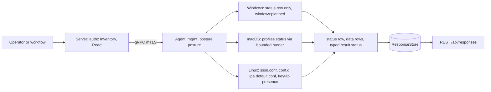
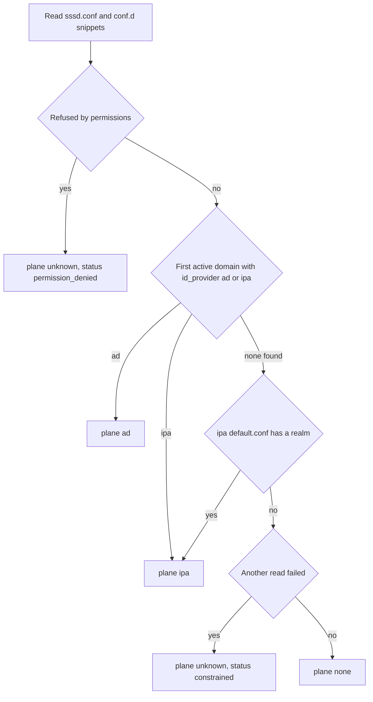
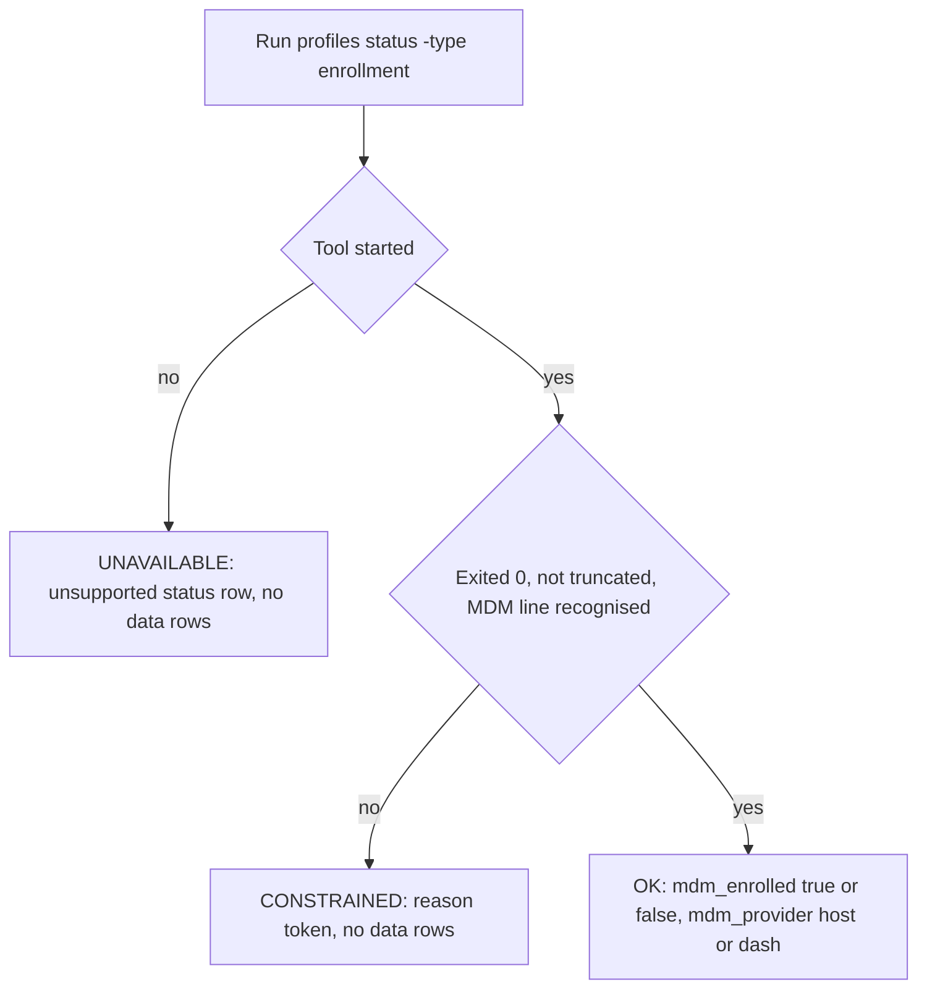

# mgmt_posture

<!-- BEGIN GENERATED: plugin-doc-gen header -->
| | |
|---|---|
| **What it does** | Management-plane posture: which plane controls the device (facts only) |
| **Version** | 1.0.0 |
| **Kind** | Collector · read-only · gathered (crossplatform.security.mgmt_posture) |
| **Platforms** | Windows 🟡 planned · macOS ✅ · Linux 🟡 constrained |
| **Actions** | `posture` (definition `crossplatform.security.mgmt_posture`) |
| **Security** | securable `Inventory` · operation Read · risk Low · dispatch ReadOnly · approval gate None |
| **Roles** | execute: endpoint-admin, endpoint-operator · author: content-author |
<!-- END GENERATED -->

## How it works

`posture` reports which management plane controls the device, as facts only. It changes nothing, and the first row is always a `status` row saying whether the read was complete; the data rows follow. The AD domain, OU and joined rows belong to `device_identity` and are never repeated here.

On Linux it reads `/etc/sssd/sssd.conf` and the `/etc/sssd/conf.d/*.conf` snippets (main file first, then snippets in byte order, parsed once so the last value wins as in SSSD). The plane comes from the first active SSSD domain whose `id_provider` is `ad` or `ipa`; failing that, a `/etc/ipa/default.conf` with a realm means `ipa`, and otherwise the plane is `none`. A domain is active when it is listed in `[sssd] domains` and not `enabled = false`, or is marked `enabled = true` (with no `domains` key only an `enabled = true` domain counts, as `sssd.conf(5)` specifies). `/etc/krb5.keytab` is checked for presence only and is never opened. Every read separates present, absent and refused: a refused `sssd.conf` yields plane `unknown`, never "not joined".

On macOS it runs `/usr/bin/profiles status -type enrollment` through the bounded runner (a subprocess runner with a time and output limit: no shell, 5 second deadline, 16 lines) and reports MDM enrolment and the host of the MDM server. A nonzero exit, truncated or unrecognised output, or a runner failure (timeout, cancel, signal, line cap) is `CONSTRAINED` with no data rows; a tool that could not be started is `UNAVAILABLE` with no data rows. Windows answers with one placeholder row (see Caveats).



### What you can decide with it

| Question | Linux | macOS | Windows |
|---|---|---|---|
| Is the device enrolled in MDM? | No: `mdm_enrolled` is always `-`. | Yes: `mdm_enrolled` is `true` or `false`. | No answer. |
| Which MDM server manages it? | No. | The host only, in `mdm_provider`, or `-` when `profiles` printed no MDM server line. | No answer. |
| Is it joined to AD or FreeIPA? | Yes, from SSSD or FreeIPA client configuration: `plane` is `ad`, `ipa`, `none` or `unknown`. | No: `plane` is `-`; AD binding is `device_identity`'s `domain`. | No answer. |
| Which cloud tenant? | No. | No. `tenant_id` is always `-`. | No answer. |

On Linux `plane` takes only the values `none`, `ad`, `ipa` and `unknown` today; macOS always writes `plane|-`. `workgroup`, `aad` and `hybrid` are in the vocabulary for the Windows leg and are never emitted. `plane|unknown` means a read was refused or failed, so the answer is not known; it never means "not managed". `plane|none` means no SSSD AD or IPA domain and no IPA realm were found in the files the agent could read; it does not prove the device is unmanaged (winbind without SSSD, or an `ldap` or `proxy` provider, also report `none`). `mdm_enrolled|false` means `profiles` reported no MDM enrolment; Jamf and other agents are not consulted.

On a Linux host the useful pairing is `posture` with `device_identity`: the latter reports the domain, and this plugin explains whether a root-only `sssd.conf` was readable at all. On Windows the plugin is not usable yet.

### Diagrams

#### How the Linux plane is decided



A refusal and a failure are never reported as "not joined". Missing files are the only silent case: with no `sssd.conf`, no snippets and no IPA realm the plane is `none`. A `constrained` status can still carry a real plane, for example when only the keytab probe failed.

#### macOS outcomes



The macOS leg has exactly three outcomes, and only the last one carries data rows. A `profiles` output that names only device enrolment (DEP) and no MDM line is not recognised and is reported as constrained.

## OS capability

<!-- BEGIN GENERATED: plugin-doc-gen capability -->
| Action | Windows | macOS | Linux |
|---|---|---|---|
| `posture` | 🟡 planned · rung 1 · NetGetJoinInformation + HKLM\\SOFTWARE\\Microsoft\\Enrollments and CloudDomainJoin\\JoinInfo registry reads | ✅ supported · rung 2 · subprocess_runner:/usr/bin/profiles status -type enrollment | 🟡 constrained · rung 1 · /etc/sssd/sssd.conf + /etc/sssd/conf.d/*.conf active domains, /etc/ipa/default.conf and /etc/krb5.keytab presence (bounded file reads) |

**Declared limits per leg** (descriptor fallback text, verbatim):

- **`posture` / Windows** — not read yet: one unsupported status row, windows:planned
- **`posture` / macOS** — MDM enrolment only; AD binding is device_identity.domain; Jamf not read
- **`posture` / Linux** — configuration as written, not the live join state; sssd.conf is root 0600, so an unprivileged agent reports permission_denied (plane unknown), never not-joined; a privileged agent reads it in full
<!-- END GENERATED -->

## Privileges and prerequisites

| OS | Runs as | Extra grant needed | Measured | If the read is refused |
|---|---|---|---|---|
| Windows | n/a - the leg reads nothing (caveat 3) | n/a | n/a | n/a - the placeholder reports `unsupported` with `windows:planned` |
| macOS | agent daemon (root under the shipped LaunchDaemon today, `docs/agent-privilege-model.md`) | None: `profiles status` reports enrolment to an unprivileged caller | The sample was captured as an unprivileged user (euid 501), not under the LaunchDaemon account | `CONSTRAINED` / partial with a `subprocess_runner:*` or `macos:mgmt_posture:profiles:*` token and no data rows; `UNAVAILABLE` / unknown with `subprocess_runner:spawn_error` when the tool could not be started |
| Linux | agent daemon, dedicated unprivileged account (`yuzu-agent` on the packaged unit), never root by design (`docs/agent-privilege-model.md`) | None to read in a root or capability-granted agent, but `/etc/sssd/sssd.conf` is root 0600 (SSSD requires that mode and it can hold a bind credential), so the default unprivileged account cannot read it. Loosening the file mode is not a remedy: it would break SSSD or expose the credential to every plugin. The options are an `AmbientCapabilities=CAP_DAC_READ_SEARCH` drop-in for the agent unit (a file capability on the binary does not take effect under the packaged unit's `NoNewPrivileges=true`; not measured for this plugin), or accepting `plane\|unknown` | Not measured on the service account: the sample is a root capture in a container, which bypasses permission bits | `PERMISSION_DENIED` / partial with `linux:mgmt_posture:sssd_conf:permission_denied` (or `...:sssd_conf_d:permission_denied`) and plane `unknown`; never reported as not joined |

No shell interpreter and no network use. The macOS leg runs one fixed absolute argv through the bounded runner (sink `mgmt_posture/run_macos#1`); the Linux leg is an in-process, bounded read of local files.

## Data contract

### Inputs

<!-- BEGIN GENERATED: plugin-doc-gen inputs -->
The action takes no parameters.
<!-- END GENERATED -->

### Outputs

Every row is pipe-delimited; field 0 is the row kind and the first row is always `status|posture|<supported\|constrained\|permission_denied\|unsupported>|<reason or ->`. The data kinds are `plane`, `mdm_enrolled`, `mdm_provider`, `tenant_id` and `krb5_keytab`, each `kind|value`; `-` is an absent value. Linux emits all five (`mdm_enrolled` and `mdm_provider` as `-`), macOS emits `plane|-` plus `mdm_enrolled`, `mdm_provider` and `tenant_id`, and neither reports a value for what the other measures. `tenant_id` is reserved and always `-` today. `plane` is `unknown` when a read was refused or the SSSD configuration could not be obtained because of a failed read. `krb5_keytab|-` means presence could not be determined (caveat 5). Free text is escaped for the server's pipe grammar (`safe_output_field`). `mgmt_posture` is not in the server's key/value plugin set, so rows are decoded as pipe-separated fields.

<!-- BEGIN GENERATED: plugin-doc-gen outputs -->
**`crossplatform.security.mgmt_posture` — `row_kind|field_1|field_2|field_3`**

| Field | Type | Values | Available | Example | Description |
|---|---|---|---|---|---|
| `row_kind` | string | `status` `plane` `mdm_enrolled` `mdm_provider` `tenant_id` `krb5_keytab` | Windows, Linux, macOS | `plane` | Row shape discriminator (field 0). Values: status, plane, mdm_enrolled, mdm_provider, tenant_id, krb5_keytab. |
| `field_1` | string | - | Windows, Linux, macOS | `none` | status: the literal "posture". plane: none, workgroup, ad, aad, hybrid, ipa or unknown (unknown when a read was refused, or the SSSD or IPA configuration could not be read because of a failed read; "-" on macOS). mdm_enrolled: true, false or "-". mdm_provider: the MDM server host, or "-". tenant_id: always "-" today. krb5_keytab: present, absent, or "-" when presence could not be determined. |
| `field_2` | string | `supported` `constrained` `permission_denied` `unsupported` | Windows, Linux, macOS | `supported` | status: supported, constrained, permission_denied or unsupported (Windows, a leg that threw, and a macOS tool that could not be started). Not used by the other kinds. |
| `field_3` | string | - | Windows, Linux, macOS | `-` | status: reason token(s) for a non-supported read, "-" when complete; tokens look like linux:mgmt_posture:sssd_conf:permission_denied, macos:mgmt_posture:profiles:exit_nonzero, subprocess_runner:deadline, windows:planned. Not used by the other kinds. |
<!-- END GENERATED -->

### Result status

`posture` sets `OK`/`FULL` when every read completed, including a host with no management plane (`plane|none`). A read that failed for a reason other than the file being absent makes the result `CONSTRAINED`/`PARTIAL` (or `PERMISSION_DENIED`/`PARTIAL` when `sssd.conf`, the `conf.d` directory or a snippet was refused; on macOS, `profiles` failing to start is `UNAVAILABLE`/`UNKNOWN` instead), with the same tokens in the leading `status` row. No exception crosses the plugin boundary: a leg that throws is reported as an `unsupported` status row and `UNAVAILABLE` (the last status row wins if the leg had already written one); a macOS `profiles` that cannot be started produces the same `unsupported` row.

| Status | Completeness | Provenance | When |
|---|---|---|---|
| `OK` | full | (empty) | every read completed; a host with no SSSD and no IPA is `plane\|none` |
| `CONSTRAINED` | partial | `linux:mgmt_posture:sssd_conf:<errno token>`, `linux:mgmt_posture:sssd_conf:no_domains_key`, `linux:mgmt_posture:sssd_conf:invalid_bytes`, `linux:mgmt_posture:ipa_default_conf:invalid_bytes`, `linux:mgmt_posture:sssd_conf_d:<errno token>`, `linux:mgmt_posture:sssd_conf_d:too_many`, `linux:mgmt_posture:ipa_default_conf:<errno token>`, `linux:mgmt_posture:krb5_keytab:<errno token>` | Linux: no `[sssd] domains` key in the merged `sssd.conf` and snippets (`no_domains_key`; SSSD enables a domain only if it is listed there or has `enabled = true`, so the plane is `none` unless a domain is marked `enabled = true` with `id_provider` `ad` or `ipa`, or `/etc/ipa/default.conf` carries a realm, which gives `ipa`), or a read failed other than by refusal of `sssd.conf` or `conf.d` or by absence (an IPA file refusal is only constrained, the realm is also visible in `sssd.conf`; `too_many`: more than 32 `.conf` snippets, or more than 4096 directory entries, in `/etc/sssd/conf.d`); the plane is classified from what was read, or `unknown` when nothing was found and a file read failed (so a failed read never reads as an unmanaged `none`; `too_many`, `invalid_bytes` and `no_domains_key` leave the plane `none` rather than `unknown`). `<errno token>` (the failure cause, such as `eio`) is one of `permission_denied`, `eio`, `eloop`, `enotdir`, `enametoolong`, `not_regular`, `oversized` or `errno_<n>` |
| `CONSTRAINED` | partial | `macos:mgmt_posture:profiles:exit_nonzero`, `macos:mgmt_posture:profiles:output_truncated`, `macos:mgmt_posture:profiles:unrecognised_output` | macOS: `profiles` exited nonzero, its output was truncated, or it printed no `MDM enrollment: Yes/No` line (a changed, empty or DEP-only output); no data rows |
| `CONSTRAINED` | partial | `subprocess_runner:deadline`, `subprocess_runner:cancelled`, `subprocess_runner:signaled`, `subprocess_runner:line_limit` | macOS: `/usr/bin/profiles` ran but the run timed out, was cancelled, was killed by a signal or hit the 16-line cap; no data rows |
| `PERMISSION_DENIED` | partial | `linux:mgmt_posture:sssd_conf:permission_denied`, `linux:mgmt_posture:sssd_conf_d:permission_denied` (each once; accumulated constrained tokens such as a keytab errno may follow, comma-joined) | Linux: `sssd.conf`, the `conf.d` directory or a snippet could not be read; plane is `unknown` |
| `UNAVAILABLE` | unknown | `windows:planned` | Windows: one `status\|posture\|unsupported\|windows:planned` row (caveat 3) |
| `UNAVAILABLE` | unknown | `subprocess_runner:spawn_error` | macOS: `/usr/bin/profiles` could not be started; one `status\|posture\|unsupported\|subprocess_runner:spawn_error` row and no data rows |
| `UNAVAILABLE` | unknown | `windows:leg:exception` / `linux:leg:exception` / `macos:leg:exception` | a leg threw: an `unsupported` status row (the last status row wins if the leg had already written one), reported instead of unwinding across the plugin boundary |

### Where the data goes

- **Instruction result.** Rows travel over the agent's mTLS gRPC channel as the command response and land in the ResponseStore, queryable at `/api/responses/{id}`. `posture` is also a gathered definition (`crossplatform.security.mgmt_posture`, 3600s TTL).
- **Not consumed by** daily-sync, TAR, DEX, or metrics.
- **Sensitivity.** The MDM server host and the management plane are organisation-level facts; no person is named. The SSSD domain name that decides the plane is used internally and is never emitted. Only the host of the MDM server URL is kept (no path or query, which can carry a token). Key material is never read: the keytab is a presence check only.
- **Siblings:** `device_identity` (owns the domain, OU and joined rows) and `local_security_policy` (local policy, not management plane).

## Sample output

<!-- BEGIN GENERATED: plugin-doc-gen samples -->
**macOS** — captured: macos macOS 26.6.2 arm64 · bare-metal · 2026-10-04 · euid 501 (jsmith) · leg-hash 39319322f1b1

```
== action=posture
status|posture|supported|-
plane|-
mdm_enrolled|false
mdm_provider|-
tenant_id|-
[result_status] OK / FULL
```

**Linux** — captured: linux Debian GNU/Linux 13 (trixie) aarch64 · container · 2026-10-04 · euid 0 · leg-hash 39319322f1b1

```
== action=posture
status|posture|supported|-
plane|none
mdm_enrolled|-
mdm_provider|-
tenant_id|-
krb5_keytab|absent
[result_status] OK / FULL
```
<!-- END GENERATED -->

## Caveats and known gaps

1. **Configuration, not live state.** Linux reports what the files say, not whether the join is healthy, and `plane|none` means no SSSD AD or IPA domain was found (winbind without SSSD, or `ldap`, `proxy` or `files` providers, also report `none`). Snippets are merged in byte order rather than SSSD's locale collation, and only `.conf` files are read (at most 32, 64 KiB each). A snippet SSSD would ignore is still read if the agent can open it, and a containerised agent reads the image's `/etc`, not the host's.
2. **An unprivileged Linux agent usually sees `plane|unknown`.** The default service account cannot read the root-only `sssd.conf`, so a stock install reports `PERMISSION_DENIED` and `unknown` on SSSD-managed hosts, which is the common case rather than an edge case. Granting the agent `CAP_DAC_READ_SEARCH` through an `AmbientCapabilities` drop-in is the option to get a real answer; it was not measured for this plugin, and a file capability on the binary does not take effect under the packaged unit.
3. **Windows is a placeholder and part of the plane vocabulary is reserved.** The Windows leg reads nothing and reports one `unsupported` row, `windows:planned`; the join and enrolment reads (`NetGetJoinInformation`, the Enrollments and CloudDomainJoin registry keys) are declared but not implemented. The `workgroup`, `aad` and `hybrid` values of `plane` exist for that leg and are not emitted on any OS today.
4. **Narrow scope.** macOS reports MDM enrolment only: Jamf is not read, the DEP line is parsed but not reported, `plane` is `-`, and there is no UPN or e-mail field. `tenant_id` is reserved and always `-`.
5. **Absent versus unknown.** `krb5_keytab|-` means presence could not be determined (a non-ENOENT `access()` failure, with a constrained token), not that the file is absent. The keytab is never opened.

## Source and tests

<!-- BEGIN GENERATED: plugin-doc-gen source -->
- Plugin: `agents/plugins/mgmt_posture/src/mgmt_posture_legs.hpp` · `agents/plugins/mgmt_posture/src/mgmt_posture_linux.cpp` · `agents/plugins/mgmt_posture/src/mgmt_posture_macos.cpp` · `agents/plugins/mgmt_posture/src/mgmt_posture_parsers.hpp` · `agents/plugins/mgmt_posture/src/mgmt_posture_plugin.cpp` · `agents/plugins/mgmt_posture/src/mgmt_posture_win.cpp`
- Definitions: `content/definitions/mgmt_posture.yaml`
- Capability rows: `server/core/src/capability_decls/plugin_action_catalogue_mgmt_posture.hpp`
- Tests: `tests/test_mgmt_posture_definition.py` · `tests/unit/test_mgmt_posture_legs.cpp` · `tests/unit/test_mgmt_posture_local_dispatcher.cpp` · `tests/unit/test_mgmt_posture_parsers.cpp`
- Privilege row: `docs/agent-privilege-model.md`
<!-- END GENERATED -->
