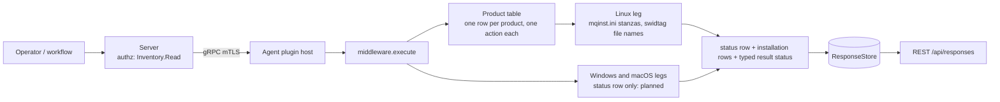

# middleware

<!-- BEGIN GENERATED: plugin-doc-gen header -->
| | |
|---|---|
| **What it does** | Installed middleware inventory from installer metadata (table-driven; IBM MQ) |
| **Version** | 1.0.0 |
| **Kind** | Collector · read-only · gathered (crossplatform.middleware.ibm_mq) |
| **Platforms** | Windows 🟡 planned · macOS 🟡 planned · Linux ✅ |
| **Actions** | `ibm_mq` (definition `crossplatform.middleware.ibm_mq`) |
| **Security** | securable `Inventory` · operation Read · risk Low · dispatch ReadOnly · approval gate None |
| **Roles** | execute: endpoint-admin, endpoint-operator · author: content-author |
<!-- END GENERATED -->

## How it works

`middleware` answers one question per product: which installations of that product are registered on this host, and at what version. It is table-driven. Each product is one row of a compile-time table (`agents/shared/middleware_products.hpp`) that names, per OS, the file that lists the product's installations and the files whose names carry the version; one generic runner turns a row into data rows, so adding a product adds a table row and one action, not new walking code. Today the table holds IBM MQ (`ibm_mq`). On Linux the runner parses the `Installation:` stanzas of `/etc/opt/mqm/mqinst.ini` (`Name` and `FilePath`, values trimmed because the real file pads `Description` with trailing spaces) and lists the file names in each installation's `<FilePath>/swidtag`. The version is read from a file NAME, never from file content: the product's own `ibm.com_IBM_MQ*-<v>.swidtag`, else exactly `IBM_MQ-<v>.mqtag`; the bundled component tags beside them (GSKit, JRE, Runtime, Messages) never name the product. The plugin never starts `dspmqver`, `dspmqinst` or any other process, opens every directory without following symlinks, and does not open a path on, under or containing a network mount that `/proc/self/mountinfo` listed when the action started. That guard is a snapshot: a network filesystem mounted after it is not seen, and if the table cannot be read in full the walk still runs, guarded only by the mounts that were read, and the answer is `constrained` with `linux:middleware:mountinfo:unreadable`. Each action writes one `status` row first, then zero or more installation rows, so an empty list is never inferred from silence. On Windows and macOS the action answers a single `unsupported` status row. The plugin is read-only, does no vulnerability matching (a row is presence plus the version string the installer recorded) and does not detect copies that were unpacked without being registered.



### What you can decide with it

| Question | Linux | Windows and macOS |
|---|---|---|
| Which IBM MQ installations are registered on this host, and at what version? (`ibm_mq`) | One row per registered installation with product title, installation name, version and install path | Nothing: one `unsupported` row, result status `UNAVAILABLE` |
| Is an out-of-support MQ version installed on this host? | Yes, by comparing the `version` column against your own support list; the plugin attaches no verdict | Not answerable |

What a result proves. A row proves the installation is registered in `mqinst.ini` under that name and path. When its `version` is not `-`, it also proves a product tag carrying that version was in the installation's `swidtag` directory; a `-` version means the directory was absent or unreadable or held no product tag (caveat 4), and the row then proves the registration only. Neither proves the product is running or intact. `supported` with zero rows means no registered installation was found at the places this plugin reads; it does not mean none is installed (caveat 1), and a `supported` answer can omit an installation whose `mqinst.ini` stanza was unusable, which only the agent's log records (caveat 3). `constrained` means a read failed or was refused, so the rows may be incomplete, and the IBM MQ rows are withheld from the installed-software sync for that cycle (caveat 5); read the reason tokens before trusting a negative. For the packaged-application view use `installed_apps`.

## OS capability

<!-- BEGIN GENERATED: plugin-doc-gen capability -->
| Action | Windows | macOS | Linux |
|---|---|---|---|
| `ibm_mq` | 🟡 planned · rung 1 · HKLM\\SOFTWARE\\IBM\\WebSphere MQ\\Installation\\<name> FilePath/VRMF in both registry views | 🟡 planned · rung 1 · installer-metadata read, not yet wired on macOS (every product) | ✅ supported · rung 1 · /etc/opt/mqm/mqinst.ini Installation: stanzas; version from the swidtag file name under each installation's FilePath; no dspmqver |

**Declared limits per leg** (descriptor fallback text, verbatim):

- **`ibm_mq` / Windows** — planned; the action answers a single unsupported status row on this OS
- **`ibm_mq` / macOS** — planned; the action answers a single unsupported status row on this OS
<!-- END GENERATED -->

## Privileges and prerequisites

| OS | Runs as | Extra grant needed | Measured | If the read is refused |
|---|---|---|---|---|
| Windows | n/a (the leg reads nothing, caveat 2) | n/a | n/a | n/a (the placeholder answers `status\|<action>\|unsupported\|windows:planned`, result status `UNAVAILABLE`) |
| macOS | n/a (the leg reads nothing, caveat 2) | n/a | n/a | n/a (the placeholder answers `status\|<action>\|unsupported\|macos:planned`, result status `UNAVAILABLE`) |
| Linux | agent daemon, dedicated unprivileged account (`yuzu-agent` on the packaged unit), never root by design (`docs/agent-privilege-model.md`) | `ibm_mq`: none expected, because `/etc/opt/mqm/mqinst.ini` is world-readable and `/opt/mqm/swidtag` is world-listable and readable | MEASURED on a registered IBM MQ Advanced for Developers 9.4.5.0 install (Ubuntu debs, `ubuntu:24.04` container): `/etc/opt/mqm` is 755 root:root, `mqinst.ini` is 644 root:root, `/opt/mqm/swidtag` is 555 mqm:mqm holding 444 files, and an unprivileged account with no extra groups read the file and listed the directory; the four IBM MQ developer images hold only 444 files in `/opt/mqm/swidtag` (`tests/unit/fixtures/middleware/linux/provenance.txt` and `swidtag.listing`); not measured as `yuzu-agent`, nor on another MQ version or distribution | `status\|ibm_mq\|constrained\|linux:middleware:mqinst_ini:permission_denied`; an unreadable `swidtag` directory only blanks that installation's version (`-`). Either way the installed-software sync withholds the IBM MQ rows for that cycle when the answer is `constrained` |

No external binaries, no subprocesses, no shell-out, no network use: the plugin opens directories and reads files only. The enumerator file read is size-capped, the number of installations and file names read per listing is capped, and one action's whole walk is bounded in rows, row text and directory entries visited (`walk:row_cap`). Every path, fixed or taken from file content, must be absolute and plain (no `.`, `..`, empty component or trailing slash) and is opened `O_NOFOLLOW` hop by hop, so a symlink at any hop is refused, never followed. There is no wall-clock deadline: the plugin sets none of its own, and the in-process dispatcher the installed-software sync runs it through (`LocalDispatcher::run`) calls an action synchronously on the calling thread with no timeout. The walk is bounded by counts, not time, and network mounts are skipped, so a slow or hung LOCAL filesystem is not time-bounded.

## Data contract

### Inputs

<!-- BEGIN GENERATED: plugin-doc-gen inputs -->
The action takes no parameters.
<!-- END GENERATED -->

### Outputs

Every row is pipe-delimited. The first row is always `status|<action>|<level>|<reason>` (`level` is `supported`, `constrained` or `unsupported`; `reason` is comma-joined tokens, or `-`). Installation rows follow as `<action>|<title>|<name>|<version>|<install_path>|<edition>`, one per registered installation; the first field is `row_kind` (`status`, or the action name) and is the first column below, and on a status row the next columns carry the action name, the level and the tokens. `supported` with zero rows means none was found at the places read (caveat 1); `constrained` means a read failed or was skipped and the rows may be incomplete, so failure never reads as absent. A field the host did not supply is `-` (the version of an installation whose swidtag directory names no product tag, caveat 4; the edition of every IBM MQ row, which the installer metadata does not carry). Free-text fields go through the shared escaper: a pipe is escaped, a backslash is folded to `/` and a line break to a space, so no value can shift the field count on the server's escape-aware decoder. `middleware` is not in the server's `kKeyValuePlugins` set (`server/core/src/result_parsing.hpp`), so its rows are not decoded as two-cell key and value rows.

<!-- BEGIN GENERATED: plugin-doc-gen outputs -->
**`crossplatform.middleware.ibm_mq` — `row_kind|title|name|version|install_path|edition`**

| Field | Type | Values | Available | Example | Description |
|---|---|---|---|---|---|
| `row_kind` | string | `status` `ibm_mq` | Linux | `ibm_mq` | Row shape discriminator (the wire row's leading tag). Values: status (exactly one per result, always first), ibm_mq (one per installation found). |
| `title` | string | - | Linux | `IBM MQ` | Product display name, fixed per action (IBM MQ). Status rows: the action name. |
| `name` | string | - | Linux | `Installation1` | Installation name: the mqinst.ini Name value, for example Installation1. Status rows: the level (supported, constrained or unsupported). |
| `version` | string | - | Linux | `9.4.5` | Installation version taken from the product tag file name (ibm.com_IBM_MQ*-<v>.swidtag, else IBM_MQ-<v>.mqtag; component tags such as GSKit or Runtime never name the product), or "-" when it cannot be read. VRM (version.release.modification): the fix-pack level is not carried, so a fix pack 9.3.5.1 reports 9.3.5. Status rows: the comma-joined failure tokens, or -. |
| `install_path` | string | - | Linux | `/opt/mqm` | Absolute path of the installation (the mqinst.ini FilePath value). |
| `edition` | string | - | Linux | `-` | Always "-" for ibm_mq: the installer metadata the agent reads carries no edition field. |
<!-- END GENERATED -->

### Result status

Every read sets a typed result status; a degraded read is `CONSTRAINED`, never an empty `OK`.

| Status | Completeness | Provenance | When |
|---|---|---|---|
| `OK` | full | (empty) | Linux: the read finished with no failure, populated, or none found at the places read (`status\|<action>\|supported\|-` with zero rows) |
| `CONSTRAINED` | partial | `<os>:middleware:<source>:<cause>` / `internal_error` | Linux: one or more enumeration reads failed, were refused or hit a cap, and the rows returned may be incomplete; the tokens are accumulated and comma-joined in the status row. `<source>` is the table's probe id of the failing read (`mqinst_ini`) or `walk` (the row, row-text or directory-entry budget) or `mountinfo` (the mount table could not be read in full); `<cause>` is one of the closed set `permission_denied`, `unreadable`, `oversized`, `symlink_refused`, `malformed`, `network_fs_skipped`, `row_cap` or `internal_error`. A failure confined to one item is logged and does not constrain the answer: an unreadable or absent swidtag directory, a refused path or no product tag leaves that row's version as `-`, and a stanza lacking `Name` or `FilePath` beside a usable one is skipped (the table after caveat 5 sets out the full mapping). A file with content but no `Installation:` line, or in which no stanza is usable, is `malformed` and constrains. The bare `internal_error` is a caught exception on any leg: it never crosses the plugin boundary and the command returns 1 (a failed command) |
| `UNAVAILABLE` | partial | `windows:planned` / `macos:planned` | Windows and macOS: the leg is not shipped; the action answers `status\|<action>\|unsupported\|<os>:planned` and nothing else |

### Where the data goes

- **Instruction result.** Every row is server instruction-result data, with the standard retention policy, served over REST `/api/responses`.
- **Installed software.** The action feeds the agent's daily installed-software sync (`middleware.ibm_mq`) as ecosystem `ibm_mq`, kind `app`, carrying name, version and publisher only; the install path and edition are not carried. A `constrained` answer withholds the source's rows for the cycle (caveat 5).
- **Not consumed by** TAR, DEX, or metrics.
- **Sensitivity.** Rows name installed IBM MQ installations with their version and install path, which is a software inventory for the device. The version is VRM (version.release.modification) read from a file name; the fix-pack level is not carried (a fix pack 9.3.5.1 reports 9.3.5). `name` and `install_path` echo `mqinst.ini` text as found, so a value planted in that file reaches a row after the UTF-8 and pipe scrub. `mqinst.ini` is trusted as written by root or the MQ installer: its owner and mode are not checked (measured 644 root:root in a 755 root:root directory), so someone who can already write `/etc/opt/mqm` can plant a name, path or version. That gains no authority: the version is digits and dots taken from a file name, and the name and path are inventory text.
- **Siblings:** none yet; each further product adds a table row, an action and a `crossplatform.middleware.<id>` definition.

## Sample output

<!-- BEGIN GENERATED: plugin-doc-gen samples -->
**Linux** — captured: linux Ubuntu 26.04.1 LTS x86_64 · container · 2026-10-29 · euid 2001 · leg-hash ca94f832e087

```
== action=ibm_mq
status|ibm_mq|supported|-
ibm_mq|IBM MQ|Installation1|9.4.5|/opt/mqm|-
[result_status] OK / FULL
```
<!-- END GENERATED -->

## Caveats and known gaps

1. **Only registered installations are listed.** IBM MQ comes from `mqinst.ini`, so an unpacked copy that was never registered with the operating system is not found, and `supported` with zero rows means none was found there. The directory the stanza points at is only read for its version.
2. **The Windows and macOS legs are planned.** Only the Linux leg ships; on Windows and macOS the action reads nothing and answers `status|ibm_mq|unsupported|<os>:planned`.
3. **The `mqinst.ini` form is confirmed on one version.** IBM documents the file's location and content but states its format is not fixed and reserves `dspmqinst` as the interface, which this plugin never runs. The `Installation:` header and the `Name`, `Description`, `Identifier` and `FilePath` spellings are confirmed on one registered 9.4.5.0 install (Ubuntu debs) only; no `Primary` key is read or required. A version or platform that spells them differently surfaces as `linux:middleware:mqinst_ini:malformed` (content but no `Installation:` line, or a file in which no stanza has both `Name` and `FilePath`), never as a silent empty inventory. A stanza that lacks one of them beside at least one usable stanza is a data fault of that stanza: it is skipped, the agent logs one line for it (`mqinst_ini: malformed (stanza <n>)`), and the usable stanzas are kept with the answer still `supported`. The table after caveat 5 sets out which faults constrain the answer and which are only logged.
4. **The version comes from the product tag only.** The name is `ibm.com_IBM_MQ*-<v>.swidtag`, else exactly `IBM_MQ-<v>.mqtag`. Bundled-component tags (GSKit, JRE, Runtime, Messages_*) carry their own versions and never name the product, so a directory holding only component tags yields a row with version `-` and a logged `missing`, not a token. The `.swidtag` form is matched by prefix and trailing version only, so a component tag in `.swidtag` form (for example `ibm.com_IBM_MQ_GSKit-8.0.55.swidtag`) would be taken for the product and its version reported. No capture holds one: the captured components are `.mqtag` files, each image holds one `.swidtag`, and only developer-edition installs were captured (no licensed server RPM or DEB), so a licensed install may differ.
5. **A constrained answer removes the IBM MQ rows for that cycle, and only running the action shows it.** The installed-software sync drops the source when it answers `constrained`, and because the server replaces the agent's whole inventory each cycle, previously stored IBM MQ rows DISAPPEAR until the source recovers (never stale rows). The server receives no signal for this: nothing it stores tells a withheld source from one with no installation, and the agent only logs one warning. To tell them apart, run the `ibm_mq` action on the device and read its status row and tokens.

What constrains the answer and what is only logged, by `mqinst.ini` read (a constrained answer carries the token and withholds the source, as above):

| Read | Answer | Token | Rows returned |
|---|---|---|---|
| File absent | `supported` | `-` | none (none found) |
| File denied, oversized, behind a symlink, on a network mount, refused or otherwise unreadable | `constrained` | `mqinst_ini:permission_denied`, `oversized`, `symlink_refused`, `network_fs_skipped` or `unreadable` | none |
| More than 256 stanzas | `constrained` | `mqinst_ini:row_cap` | the first 256 |
| Row, row-text or directory-entry budget out | `constrained` | `walk:row_cap` | those built before the cut |
| Mount table unreadable | `constrained` | `mountinfo:unreadable` | as usual, guarded by the mounts read |
| Content but no `Installation:` line | `constrained` | `mqinst_ini:malformed` | none |
| Non-empty file in which no stanza has both `Name` and `FilePath` | `constrained` | `mqinst_ini:malformed` | none |
| Some stanzas lack `Name` or `FilePath`, at least one is usable | `supported` | `-` (one log line per skipped stanza) | the usable stanzas |
| One installation's swidtag directory absent, refused, unreadable or without a product tag | `supported` | `-` (logged) | its row, version `-` |

## Source and tests

<!-- BEGIN GENERATED: plugin-doc-gen source -->
- Plugin: `agents/plugins/middleware/src/middleware_legs.hpp` · `agents/plugins/middleware/src/middleware_linux.cpp` · `agents/plugins/middleware/src/middleware_linux_parsers.hpp` · `agents/plugins/middleware/src/middleware_macos.cpp` · `agents/plugins/middleware/src/middleware_parsers.hpp` · `agents/plugins/middleware/src/middleware_plugin.cpp` · `agents/plugins/middleware/src/middleware_runner.hpp` · `agents/plugins/middleware/src/middleware_win.cpp`
- Definitions: `content/definitions/middleware.yaml`
- Capability rows: `server/core/src/capability_decls/plugin_action_catalogue_middleware.hpp`
- Tests: `tests/test_middleware_definition.py` · `tests/unit/test_middleware_linux_parsers.cpp` · `tests/unit/test_middleware_local_dispatcher.cpp` · `tests/unit/test_middleware_parsers.cpp`
- Privilege row: `docs/agent-privilege-model.md`
- Changelog: `changelog.d/2026-10-29-middleware-ibm-mq.added.md`
<!-- END GENERATED -->
