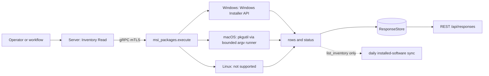
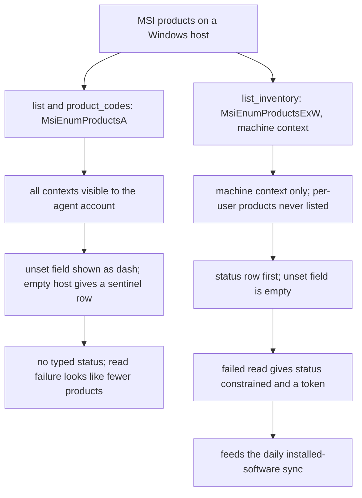
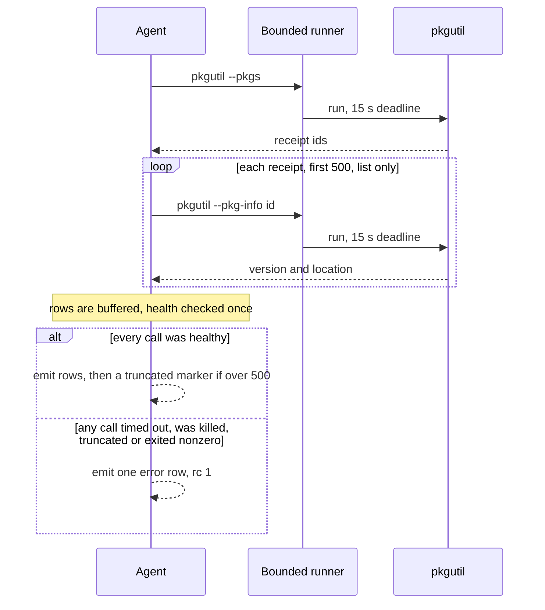

# msi_packages

<!-- BEGIN GENERATED: plugin-doc-gen header -->
| | |
|---|---|
| **What it does** | Enumerates installed packages and product codes (Windows MSI / macOS pkgutil) |
| **Version** | 1.0.0 |
| **Kind** | Collector · read-only · gathered (windows.software.msi.list, windows.software.msi.product_codes, windows.software.msi.list_inventory) |
| **Platforms** | Windows ✅ · macOS ✅ · Linux ⛔ unsupported |
| **Actions** | `list` (definition `windows.software.msi.list`) · `list_inventory` (definition `windows.software.msi.list_inventory`) · `product_codes` (definition `windows.software.msi.product_codes`) |
| **Security** | securable `Inventory` · operation Read · risk Low · dispatch ReadOnly · approval gate None |
| **Roles** | execute: endpoint-admin, endpoint-operator · author: content-author |
<!-- END GENERATED -->

## How it works

`msi_packages` lists installed packages the way each OS's own installer database records them: Windows Installer (MSI) products on Windows, `pkgutil` package receipts on macOS. Nothing is installed, repaired or removed, and nothing is read from the registry or the file system directly; it asks the installer API or tool and reports what comes back.

- `list` returns `product_code`, name, version and install location per package, and `product_codes` returns only the code and name. On Windows both walk `MsiEnumProductsA` across every install context the agent's account can see and read each property with `MsiGetProductInfoA`. On macOS `pkgutil --pkgs` supplies the receipt ids; `list` then runs one `pkgutil --pkg-info` per receipt (at most 500) while `product_codes` skips that step. A macOS receipt has no display name, so the name is the identifier's last dot-segment, and the "product code" is the reverse-domain receipt id, never an invented GUID.
- `list_inventory` is the version built for the daily installed-software sync. It walks `MsiEnumProductsExW` in the machine context only and reads name, version and publisher through the wide-character Ex APIs. Its first row is always a `status` row, a missing property is an empty field rather than `-`, and a failed read makes the status `constrained` instead of silently dropping a product. macOS and Linux answer `unsupported`.

On macOS every row is held back until the whole `pkgutil` run is known to be healthy, so a timeout, kill, truncation or nonzero exit produces one `error|...` row and rc 1 instead of a half list that reads as complete. One `try/catch` wraps every action so an exception becomes a fixed `msi_packages:exception` status, never an unwinding across the plugin ABI. It is deliberately narrow: it is the MSI and pkgutil view only, and the broader dpkg, rpm, Homebrew and registry inventory belongs to `installed_apps`.



### What you can decide with it

| Question | Action | Windows | macOS | Linux |
|---|---|---|---|---|
| What MSI products or package receipts are on this machine? | `list` | Every visible MSI product with code, name, version, location (`-` where empty). | Every `pkgutil` receipt (first 500), id, derived name, version, location. | Error row, rc 1. |
| Is this specific product installed (by code)? | `product_codes` | The product code GUID and name per product; the quickest membership test. | The receipt ids and derived names. | Error row, rc 1. |
| What does the fleet inventory record for MSI products? | `list_inventory` | Machine-context products with publisher, as the sync stores them. | `unsupported`; `installed_apps.list_inventory` carries the receipt roster. | `unsupported`. |

Pick by question: use `product_codes` or `list` for an interactive check, and `list_inventory` only to see exactly what the daily sync will ingest. On Windows the product code is the stable key for matching one product across hosts, patches and removals; names and versions are display text. `list` can include per-user installs the agent's account can see; `list_inventory` never does, so the two lists can differ on the same host. A macOS result is a list of installer receipts, not of applications: it does not say an application is present, only that a package was once installed, and drag-installed applications leave no receipt.

What a clean result proves: on Windows, an absent product code means Windows Installer has no such machine product registered (for `list_inventory`) or visible to the agent (for `list`). It says nothing about software installed another way, and an empty answer from `list` or `product_codes` cannot be told from an enumeration failure (see Caveats). On macOS a receipt list is complete only when rc is 0 and no `__truncated__` row is present.

### Diagrams

#### list and list_inventory compared



The two paths read the same installer database through different calls, which is why the same host can show different lists. `list` keeps its older behaviour deliberately; `list_inventory` is the one that can say it was incomplete, and the daily sync skips its whole cycle rather than store a partial roster.

#### macOS receipt walk



Nothing is written to the result until the whole walk has been judged, because the output channel can only append. A receipt id that begins with a dash is skipped, since `pkgutil` would read it as an option.

## OS capability

<!-- BEGIN GENERATED: plugin-doc-gen capability -->
| Action | Windows | macOS | Linux |
|---|---|---|---|
| `list` | ✅ supported · rung 1 · msi_api | ✅ supported · rung 2 · pkgutil via bounded argv runner | ⛔ unsupported |
| `list_inventory` | ✅ supported · rung 1 · msi_api (MsiEnumProductsExW machine context) | ⛔ unsupported | ⛔ unsupported |
| `product_codes` | ✅ supported · rung 1 · msi_api | ✅ supported · rung 2 · pkgutil via bounded argv runner | ⛔ unsupported |

**Declared limits per leg** (descriptor fallback text, verbatim):

- **`list_inventory` / Windows** — machine context only: per-user MSI products are never listed; measured as SYSTEM and as an admin user, non-elevated unmeasured
- **`list_inventory` / macOS** — installed_apps.list_inventory owns the pkgutil receipt roster (ecosystem macos_pkgutil)
- **`list_inventory` / Linux** — no Windows Installer on Linux
<!-- END GENERATED -->

## Privileges and prerequisites

| OS | Runs as | Extra grant needed | Measured | If the read is refused |
|---|---|---|---|---|
| Windows | agent service account (LocalSystem today, #1442) | None — `MsiEnumProductsA`/`MsiGetProductInfoA` (and `MsiEnumProductsExW`/`MsiGetProductInfoExW` for `list_inventory`) read the per-machine product registration table; the source requests no elevation. | `list`, `product_codes`: 2026-09-07 on bare metal as `SYSTEM`. `list_inventory`: 2026-10-17 on bare metal (Windows 11, build 26200) as `SYSTEM` and as an admin user, with identical machine lists; a non-elevated identity is unmeasured | No explicit permission-denied handling in the leg; an empty enumeration falls through to the honest "no packages" sentinel row (`msi\|No MSI packages found\|-\|-\|-` / `product_code\|none\|-`) rather than a typed error. `list_inventory` does report it: an enumeration that ends with anything other than `ERROR_NO_MORE_ITEMS` is `status\|list_inventory\|constrained\|windows:msi_enum:<code>`, and a refused or failed property read is `windows:msi_prop:<code>`, `CONSTRAINED`/`PARTIAL`, with the rows read so far still emitted. |
| macOS | agent daemon, root by default today (`docs/agent-privilege-model.md` TL;DR; narrowing tracked in #1455) | None — `pkgutil` reads local receipt databases that do not require root. The captured sample below was taken unprivileged. | 2026-09-07 on bare metal, unprivileged (euid 501) | A degraded pkgutil run (timeout, kill, spawn failure, truncation, or nonzero exit) emits one `error\|msi_packages: acquisition degraded (...)` row and rc=1 rather than a partial or empty list read as complete. |
| Linux | n/a | n/a — leg not implemented | 2026-09-06 in a container, euid 0 | `list` and `product_codes` unconditionally return `error\|platform not supported` and rc=1; `list_inventory` answers `status\|list_inventory\|unsupported\|linux:no_msi` and rc=0. |

Binaries/subprocesses: the macOS leg execs `/usr/sbin/pkgutil` directly through the bounded argv runner (`probe_tool_path`-resolved, no shell) — one `--pkgs` call plus up to `min(receipt count, 500)` `--pkg-info` calls per `list`, one `--pkgs` call per `product_codes`, each under a 15-second per-call deadline. Windows and Linux legs spawn nothing. No network access on any OS.

## Data contract

### Inputs

<!-- BEGIN GENERATED: plugin-doc-gen inputs -->
No action takes parameters.
<!-- END GENERATED -->

### Outputs

Pipe-delimited rows. `list` rows use the literal discriminator `msi`; `product_codes` rows use the literal discriminator `product_code`; `list_inventory` rows use `inv`, led by exactly one `status` row. Every dynamic macOS field is pipe/newline-escaped before being written, so an identifier, version, or path containing `|` or a newline can never shift columns or inject a row. On `list` and `product_codes`, `-` means the property was empty, absent, or (Windows) too long to read into the 511-byte buffer; a failed macOS acquisition is instead a single `error|...` row and a nonzero return code, never a placeholder data row.

<!-- BEGIN GENERATED: plugin-doc-gen outputs -->
**`windows.software.msi.list` — `product_code|name|version|install_location`**

| Field | Type | Values | Available | Example | Description |
|---|---|---|---|---|---|
| `product_code` | string | - | Windows, macOS | `{90160000-008C-0000-1000-0000000FF1CE}` | The package's unique identifier: an MSI product code GUID on Windows, or a reverse-domain pkgutil identifier on macOS. Values: Windows: `{GUID}`; macOS: reverse-domain string (e.g. `com.vendor.pkg.Name`). |
| `name` | string | - | Windows, macOS | `Office 16 Click-to-Run Extensibility Component` | The package's display name — the Windows MsiGetProductInfoA `InstalledProductName` property, or a name derived from the last dot-segment of the macOS pkgutil identifier. Values: free text, or `-` when the underlying property is empty. |
| `version` | string | - | Windows, macOS | `16.0.19822.20104` | The package's version string — the Windows MsiGetProductInfoA `VersionString` property, or the macOS pkgutil receipt's `version:` field. Values: free text version string, or `-` when unavailable. |
| `install_location` | string | - | Windows, macOS | `C:\Program Files (x86)\NordVPN network TAP\` | The package's install path — the Windows MsiGetProductInfoA `InstallLocation` property (frequently unset by the installer), or the macOS receipt's volume and location joined. Values: filesystem path, or `-` when the property is empty or absent. |

**`windows.software.msi.list_inventory` — `row_kind|product_code|name|version|publisher`**

| Field | Type | Values | Available | Example | Description |
|---|---|---|---|---|---|
| `row_kind` | string | `status` `inv` | Windows | `inv` | Row shape discriminator. Values: status (exactly one per result, always first), inv (one per machine-context MSI product). |
| `product_code` | string | - | Windows | `{23170F69-40C1-2702-2604-000001000000}` | Inventory rows: the MSI product code exactly as the product registers it (braces, and upper or lower case as registered). Status rows: the action name, always list_inventory. |
| `name` | string | - | Windows | `7-Zip 26.04 (x64 edition)` | Inventory rows: the InstalledProductName property, empty when the product has none. Status rows: the completeness level. Values: supported, constrained (the enumeration or a property read did not complete), unsupported (macOS, Linux). |
| `version` | string | - | Windows | `26.04.00.0` | Inventory rows: the VersionString property, empty when the product has none. Status rows: the failure token, or "-" when none. Tokens read <os>:<source>:<detail> (e.g. windows:msi_enum:1610, windows:msi_prop:1610 or windows:msi_prop:oversized), macos:owned_by_installed_apps, linux:no_msi or msi_packages:exception (the action threw). |
| `publisher` | string | - | Windows | `Igor Pavlov` | Inventory rows only: the Publisher property, empty when the product has none. |

**`windows.software.msi.product_codes` — `product_code|name`**

| Field | Type | Values | Available | Example | Description |
|---|---|---|---|---|---|
| `product_code` | string | - | Windows, macOS | `com.tailscale.ipn.macsys` | The package's unique identifier: an MSI product code GUID on Windows, or a reverse-domain pkgutil identifier on macOS. Values: Windows: `{GUID}`; macOS: reverse-domain string (e.g. `com.vendor.pkg.Name`). |
| `name` | string | - | Windows, macOS | `Tailscale` | The package's display name, matching the `list` action's `name` field (see `windows.software.msi.list`). Values: free text, or `-`. |
<!-- END GENERATED -->

`list_inventory` grammar (the daily sync reads it): row 0 is `status|list_inventory|<supported|constrained|unsupported>|<tokens or ->`, then one `inv|<product_code>|<name>|<version>|<publisher>` per machine-context product. Honest-empty: a property the product does not have is an EMPTY field, never `-`, a property read that fails makes the status row `constrained` (`windows:msi_prop:<winerror>`), and there is no sentinel row (zero products is the status row and nothing else). The `|`, tab, CR, LF and NUL characters are deleted from the dynamic fields (the collector splits on raw `|` and never unescapes, so an escaped pipe would shift the columns); a backslash is kept. `product_code` is carried exactly as the product registers it, with no case normalisation (a real machine registers some codes in lower case). `InstallLocation` and `UninstallString` are not emitted (the inventory's reserved slots 13-14, #5186), and `InstallSource` is not read. Status tokens: `windows:msi_enum:<winerror>`, `windows:msi_prop:<winerror>`, `windows:msi_prop:oversized`, `macos:owned_by_installed_apps`, `linux:no_msi`, `msi_packages:exception`.

Two additional macOS-only sentinel rows exist outside the schema above: `msi|__truncated__|<total_seen>|-|-` when a `list` receipt walk exceeds the 500-receipt cap (the tail is dropped, and this row states how many receipts were actually seen), and `msi|No packages found|-|-|-` / `product_code|none|-` when a clean walk finds zero receipts.

### Result status

| Status | Completeness | Provenance | When |
|---|---|---|---|
| `UNDECLARED` | `UNKNOWN` | — | `list` and `product_codes`: they never set a typed status (the sample blocks show `UNDECLARED / UNKNOWN /`). |
| `OK` | `FULL` | — | `list_inventory` on Windows: the enumeration ended with `ERROR_NO_MORE_ITEMS`. Zero products is a complete answer (the status row alone). A product that has no such property (for example an advertised product that is not installed) is also `OK`: it is listed with that field empty and no token. |
| `CONSTRAINED` | `PARTIAL` | `windows:msi_enum:<winerror>` | `list_inventory` on Windows: `MsiEnumProductsExW` returned a code other than success or `ERROR_NO_MORE_ITEMS` (for example `1610`). The walk stops there, the rows read so far follow the status row, and the daily sync skips its whole cycle. |
| `CONSTRAINED` | `PARTIAL` | `windows:msi_prop:<winerror>` or `windows:msi_prop:oversized` | `list_inventory` on Windows: `MsiGetProductInfoExW` failed for a reason other than the product not having the property (`ERROR_UNKNOWN_PRODUCT` and `ERROR_UNKNOWN_PROPERTY` read as an empty field), or returned a value longer than 4096 characters. The first such failure names the roster; every row still follows the status row and the daily sync skips its whole cycle, so a failed read is never reported as a missing product. |
| `UNAVAILABLE` | `PARTIAL` | `macos:owned_by_installed_apps` | `list_inventory` on macOS: unsupported by design; `installed_apps.list_inventory` owns the pkgutil receipt roster. |
| `UNAVAILABLE` | `PARTIAL` | `linux:no_msi` | `list_inventory` on Linux: there is no Windows Installer. |
| `UNAVAILABLE` | `PARTIAL` | `msi_packages:exception` | Any action, any OS: something threw. `execute()` catches it, writes `status\|<action>\|constrained\|msi_packages:exception` (the level is `constrained` while the typed status is `UNAVAILABLE`: the command failed, rc 1) with this fixed token, never the exception's own text, and never lets the exception cross the plugin ABI. |

### Where the data goes

- **Instruction result.** Rows travel over the agent's mTLS gRPC channel as the command response and land in the ResponseStore (default 90-day retention), queryable at `/api/responses/{id}`. `list` is additionally aggregatable by `name` with a `count` operation; `product_codes` carries no aggregation.
- **`list_inventory` feeds the daily installed-software sync** (ADR-0016): the agent collects it as `ecosystem` `msi`, `kind` `pkg`, `package_id` = the product code, `source` `msi_packages.list_inventory`. `list` and `product_codes` are not consumed by it, the TAR warehouse, DEX or metrics — nothing else runs on a schedule. The other production references to `msi_packages` are the server's capability catalogue and per-OS enablement rows, its action descriptions, and the dashboard and MCP display fallbacks.
- **Sensitivity.** `list`/`product_codes` rows are an installed-software inventory: `product_code`, `name`, and `version` name specific installed packages (e.g. `Office 16 Click-to-Run Extensibility Component`); `install_location` is a filesystem path that could occasionally embed a username under a user profile, though no row in the sample captures does. `list_inventory` rows carry only the product code, name, version and publisher (the same classes of data, machine-context products only) and are retained in the installed-software inventory store. No device id, MAC, or hostname is emitted.
- **Siblings:** `installed_apps.list` / `.query` (the broader dpkg/rpm/pacman/apk/Homebrew/registry software inventory this plugin deliberately does not duplicate) and `installed_apps.list_inventory` (the registry walk whose rows overlap `list_inventory`, see caveat 4).
- **MCP / REST.** Discover: `discover_plugins` (summary) → `yuzu://plugin-docs` (this page as data) → `discover_instructions` / `get_definition("windows.software.msi.list")`. Run: `execute_instruction {definition_id, parameters}`. Read: `/api/responses/{id}`.

## Sample output

<!-- BEGIN GENERATED: plugin-doc-gen samples -->
**Windows** — captured: windows Windows 10.0.26200 x86_64 · bare-metal · 2026-10-18 · LocalSystem (elevated) · leg-hash bfd1288728c5

```
== action=list
msi|{0B1B5000-3C0E-41C0-83C4-4C914420AE93}|Python Launcher|3.14.6150.0|-
msi|{49727420-70BA-4495-9405-31F8D711CB5A}|Microsoft Visual Studio Setup WMI Provider|3.12.2140.44225|-
msi|{B7526150-1C45-45B5-932D-A4CF5A23403C}|CMake|4.3.4|C:\Program Files\CMake\
msi|{FED10190-CF54-E72D-7A92-E3F9CA9B7950}|Windows Desktop Extension SDK|10.1.26100.7705|-
msi|{AA11F890-8A6F-D292-8A1D-D70710A87852}|Windows IoT Extension SDK Contracts|10.1.26100.7705|-
msi|{0A1B70B0-DD98-1BCC-6958-D5AD8BBAF2B2}|Windows SDK Desktop Headers arm64|10.1.26100.7705|-
msi|{B7BC83B0-1A94-0290-4309-820859276E72}|Windows App Certification Kit x64|10.1.26100.7705|-
msi|{43B0D101-A022-48F4-9D04-BA404CEB1D53}|Microsoft Visual C++ 2022 X64 Minimum Runtime - 14.44.35211|14.44.35211|-
msi|{80F76A51-EAF7-DA8E-C732-B26C591BCC23}|Windows SDK OnecoreUap Headers x64|10.1.26100.7705|-
msi|{20C01991-CCD1-2C06-7A9A-B10A9B4AF807}|Windows App Certification Kit Native Components|10.1.26100.7705|-
msi|{AF4ED0C1-A3D7-450B-A163-62CD3C7BBB27}|Python 3.14.6 Add to Path (64-bit)|3.14.6150.0|-
msi|{AA86DFC1-17A2-6133-1D55-92818B9D3082}|SDK ARM64 Redistributables|10.1.26100.7705|-
… 12 of 118 rows shown
[result_status] UNDECLARED / UNKNOWN

== action=product_codes
product_code|{0B1B5000-3C0E-41C0-83C4-4C914420AE93}|Python Launcher
product_code|{49727420-70BA-4495-9405-31F8D711CB5A}|Microsoft Visual Studio Setup WMI Provider
product_code|{B7526150-1C45-45B5-932D-A4CF5A23403C}|CMake
product_code|{FED10190-CF54-E72D-7A92-E3F9CA9B7950}|Windows Desktop Extension SDK
product_code|{AA11F890-8A6F-D292-8A1D-D70710A87852}|Windows IoT Extension SDK Contracts
product_code|{0A1B70B0-DD98-1BCC-6958-D5AD8BBAF2B2}|Windows SDK Desktop Headers arm64
product_code|{B7BC83B0-1A94-0290-4309-820859276E72}|Windows App Certification Kit x64
product_code|{43B0D101-A022-48F4-9D04-BA404CEB1D53}|Microsoft Visual C++ 2022 X64 Minimum Runtime - 14.44.35211
product_code|{80F76A51-EAF7-DA8E-C732-B26C591BCC23}|Windows SDK OnecoreUap Headers x64
product_code|{20C01991-CCD1-2C06-7A9A-B10A9B4AF807}|Windows App Certification Kit Native Components
product_code|{AF4ED0C1-A3D7-450B-A163-62CD3C7BBB27}|Python 3.14.6 Add to Path (64-bit)
product_code|{AA86DFC1-17A2-6133-1D55-92818B9D3082}|SDK ARM64 Redistributables
… 12 of 118 rows shown
[result_status] UNDECLARED / UNKNOWN

== action=list_inventory
status|list_inventory|supported|-
inv|{0B1B5000-3C0E-41C0-83C4-4C914420AE93}|Python Launcher|3.14.6150.0|Python Software Foundation
inv|{49727420-70BA-4495-9405-31F8D711CB5A}|Microsoft Visual Studio Setup WMI Provider|3.12.2140.44225|Microsoft Corporation
inv|{B7526150-1C45-45B5-932D-A4CF5A23403C}|CMake|4.3.4|Kitware
inv|{FED10190-CF54-E72D-7A92-E3F9CA9B7950}|Windows Desktop Extension SDK|10.1.26100.7705|Microsoft Corporation
inv|{AA11F890-8A6F-D292-8A1D-D70710A87852}|Windows IoT Extension SDK Contracts|10.1.26100.7705|Microsoft Corporation
inv|{0A1B70B0-DD98-1BCC-6958-D5AD8BBAF2B2}|Windows SDK Desktop Headers arm64|10.1.26100.7705|Microsoft Corporation
inv|{B7BC83B0-1A94-0290-4309-820859276E72}|Windows App Certification Kit x64|10.1.26100.7705|Microsoft Corporation
inv|{43B0D101-A022-48F4-9D04-BA404CEB1D53}|Microsoft Visual C++ 2022 X64 Minimum Runtime - 14.44.35211|14.44.35211|Microsoft Corporation
inv|{80F76A51-EAF7-DA8E-C732-B26C591BCC23}|Windows SDK OnecoreUap Headers x64|10.1.26100.7705|Microsoft Corporation
inv|{20C01991-CCD1-2C06-7A9A-B10A9B4AF807}|Windows App Certification Kit Native Components|10.1.26100.7705|Microsoft Corporation
inv|{AF4ED0C1-A3D7-450B-A163-62CD3C7BBB27}|Python 3.14.6 Add to Path (64-bit)|3.14.6150.0|Python Software Foundation
… 12 of 119 rows shown
[result_status] OK / FULL
```

**macOS** — captured: macos macOS 26.6.2 arm64 · bare-metal · 2026-09-07 · euid 501 (jsmith) · leg-hash bfd1288728c5

```
== action=list
msi|com.apple.pkg.CLTools_SDK_macOS13|CLTools_SDK_macOS13|26.6.0.0.1781586384|/
msi|com.apple.pkg.CLTools_SDK_macOS12|CLTools_SDK_macOS12|26.6.0.0.1781586378|/
msi|com.apple.pkg.MAContent10_AssetPack_0637_AppleLoopsDrummerKyle|MAContent10_AssetPack_0637_AppleLoopsDrummerKyle|3.1.0.0.1.1601920555|/
msi|com.apple.pkg.MAContent10_AssetPack_0593_DrummerSoCalGBLogic|MAContent10_AssetPack_0593_DrummerSoCalGBLogic|2.0.0.0.1.1602002531|/
msi|com.apple.pkg.CLTools_Executables|CLTools_Executables|26.6.0.0.1781586589|/
msi|com.apple.files.data-template|data-template|26.6.2|/
msi|com.apple.pkg.CLTools_SDK_macOS_LMOS|CLTools_SDK_macOS_LMOS|26.6.0.0.1781586411|/
msi|com.apple.pkg.GatekeeperCompatibilityData.16U1906|16U1906|8.0.1.1570042755|/
msi|com.apple.pkg.MobileAssets|MobileAssets|1.0.0.0.1645860813|/
msi|com.apple.pkg.MAContent10_AssetPack_0317_AppleLoopsModernRnB1|MAContent10_AssetPack_0317_AppleLoopsModernRnB1|2.0.0.0.1.1601920555|/
msi|com.apple.pkg.MAContent10_AssetPack_0537_DrummerShaker|MAContent10_AssetPack_0537_DrummerShaker|2.0.0.0.1.1602002531|/
msi|com.apple.pkg.MAContent10_AssetPack_0482_EXS_OrchWoodwindAltoSax|MAContent10_AssetPack_0482_EXS_OrchWoodwindAltoSax|2.0.0.0.1.1602004766|/
… 12 of 68 rows shown
[result_status] UNDECLARED / UNKNOWN

== action=product_codes
product_code|com.apple.pkg.CLTools_SDK_macOS13|CLTools_SDK_macOS13
product_code|com.apple.pkg.CLTools_SDK_macOS12|CLTools_SDK_macOS12
product_code|com.apple.pkg.MAContent10_AssetPack_0637_AppleLoopsDrummerKyle|MAContent10_AssetPack_0637_AppleLoopsDrummerKyle
product_code|com.apple.pkg.MAContent10_AssetPack_0593_DrummerSoCalGBLogic|MAContent10_AssetPack_0593_DrummerSoCalGBLogic
product_code|com.apple.pkg.CLTools_Executables|CLTools_Executables
product_code|com.apple.files.data-template|data-template
product_code|com.apple.pkg.CLTools_SDK_macOS_LMOS|CLTools_SDK_macOS_LMOS
product_code|com.apple.pkg.GatekeeperCompatibilityData.16U1906|16U1906
product_code|com.apple.pkg.MobileAssets|MobileAssets
product_code|com.apple.pkg.MAContent10_AssetPack_0317_AppleLoopsModernRnB1|MAContent10_AssetPack_0317_AppleLoopsModernRnB1
product_code|com.apple.pkg.MAContent10_AssetPack_0537_DrummerShaker|MAContent10_AssetPack_0537_DrummerShaker
product_code|com.apple.pkg.MAContent10_AssetPack_0482_EXS_OrchWoodwindAltoSax|MAContent10_AssetPack_0482_EXS_OrchWoodwindAltoSax
… 12 of 68 rows shown
[result_status] UNDECLARED / UNKNOWN
```

**Linux** — captured: linux Debian GNU/Linux 13 (trixie) aarch64 · container · 2026-09-06 · euid 0 · leg-hash bfd1288728c5

```
== action=list
error|platform not supported
[result_status] UNDECLARED / UNKNOWN
[rc] 1

== action=product_codes
error|platform not supported
[result_status] UNDECLARED / UNKNOWN
[rc] 1
```
<!-- END GENERATED -->

## Caveats and known gaps

1. **Windows `list` and `product_codes` cannot report a failure.** An enumeration error looks the same as a host with no products (both end in the "no packages" sentinel), and a property longer than 511 bytes, or a name outside the system code page, reads as `-` or `?`. Only `list_inventory` reports a failed enumeration or property read, as a `constrained` status with a token; all three actions turn an exception into a `constrained` status row and rc 1.
2. **macOS lists receipts, not applications, and `list` stops at 500.** A killed, timed-out, truncated or nonzero-exit `pkgutil` run, checked across every call, yields one `error|msi_packages: acquisition degraded (...)` row and rc 1 rather than a partial list. A receipt store above 500 entries ends with `msi|__truncated__|<total_seen>|-|-`, and a receipt id that starts with a dash is skipped without a row.
3. **Linux has no leg, and Windows install locations are mostly empty.** `list` and `product_codes` return `error|platform not supported` with rc 1, and `list_inventory` answers `unsupported` with `linux:no_msi` and rc 0. MSI's `InstallLocation` is often left unset by installers (111 of 118 products in the Windows capture), so `-` there reflects the source data.
4. **`list_inventory` overlaps `installed_apps` and drops nameless products.** An advertised-but-not-installed product is listed with an empty name and the daily-sync collector discards it, and per-user products are never listed. The same MSI product normally also appears in `installed_apps` from its registry walk, so a host carries two rows per product.
5. **One bad enumeration skips the whole installed-software cycle.** If `MsiEnumProductsExW` returns anything but success or `ERROR_NO_MORE_ITEMS` (for example `1610`), or a property read fails, the daily sync skips that cycle for the whole installed-software report, `installed_apps` rows included. Nothing is deleted, but `last_seen` stops advancing and the skip repeats until the host's Windows Installer registration is repaired.

## Source and tests

<!-- BEGIN GENERATED: plugin-doc-gen source -->
- Plugin: `agents/plugins/msi_packages/src/msi_packages_inventory.hpp` · `agents/plugins/msi_packages/src/msi_packages_macos.hpp` · `agents/plugins/msi_packages/src/msi_packages_plugin.cpp`
- Definitions: `content/definitions/msi_packages.yaml`
- Capability rows: `server/core/src/capability_decls/plugin_action_catalogue_d.hpp`
- Tests: `tests/unit/test_msi_packages_actions.cpp` · `tests/unit/test_msi_packages_inventory.cpp`
- Privilege row: `docs/agent-privilege-model.md`
<!-- END GENERATED -->
