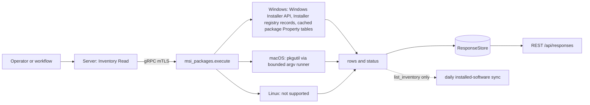
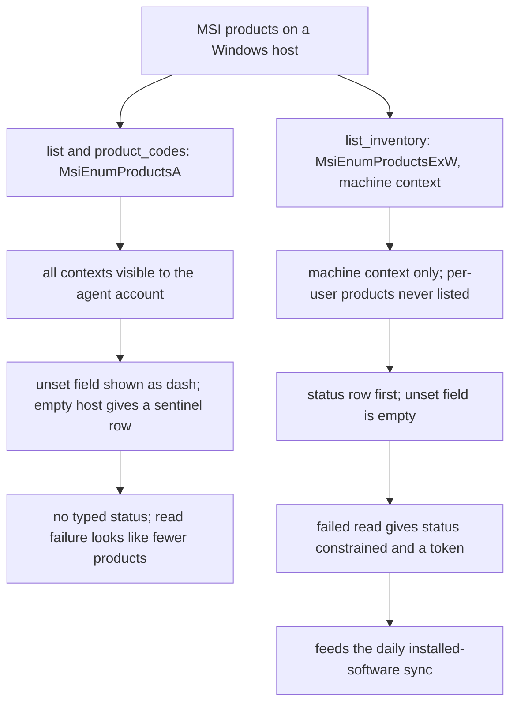
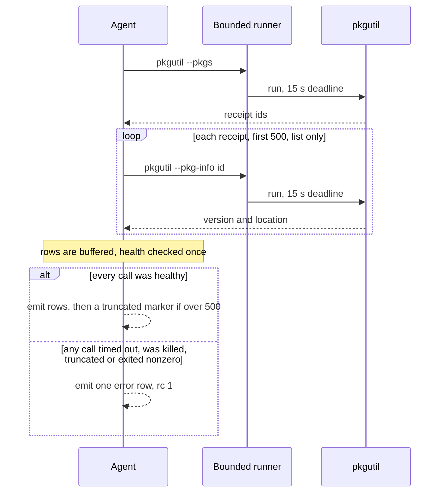

# msi_packages

<!-- BEGIN GENERATED: plugin-doc-gen header -->
| | |
|---|---|
| **What it does** | Enumerates installed packages and product codes (Windows MSI / macOS pkgutil) |
| **Version** | 1.0.0 |
| **Kind** | Collector · read-only · gathered (windows.software.msi.list, windows.software.msi.product_codes, windows.software.msi.list_inventory, windows.software.msi.installer_records) |
| **Platforms** | Windows ✅ · macOS ✅ · Linux ⛔ unsupported |
| **Actions** | `installer_records` (definition `windows.software.msi.installer_records`) · `list` (definition `windows.software.msi.list`) · `list_inventory` (definition `windows.software.msi.list_inventory`) · `product_codes` (definition `windows.software.msi.product_codes`) |
| **Security** | securable `Inventory` · operation Read · risk Low · dispatch ReadOnly · approval gate None |
| **Roles** | execute: endpoint-admin, endpoint-operator · author: content-author |
<!-- END GENERATED -->

## How it works

`msi_packages` lists installed packages the way each OS's own installer database records them: Windows Installer (MSI) products on Windows, `pkgutil` package receipts on macOS. Nothing is installed, repaired or removed. `list`, `product_codes` and `list_inventory` ask the installer API or tool and report what comes back (`list_inventory` also reads the Installer's `UpgradeCodes` registry map for its sixth token); `installer_records` (Windows only) reads the Installer's own registry records and the cached package files, and calls nothing that could change a product.

- `list` returns `product_code`, name, version and install location per package, and `product_codes` returns only the code and name. On Windows both walk `MsiEnumProductsA` across every install context the agent's account can see and read each property with `MsiGetProductInfoA`. On macOS `pkgutil --pkgs` supplies the receipt ids; `list` then runs one `pkgutil --pkg-info` per receipt (at most 500) while `product_codes` skips that step. A macOS receipt has no display name, so the name is the identifier's last dot-segment, and the "product code" is the reverse-domain receipt id, never an invented GUID.
- `list_inventory` is the version built for the daily installed-software sync. It walks `MsiEnumProductsExW` in the machine context only and reads name, version and publisher through the wide-character Ex APIs. Its first row is always a `status` row, a missing property is an empty field rather than `-`, and a failed read makes the status `constrained` instead of silently dropping a product. Its sixth token, `upgrade_code`, is the product's UpgradeCode from the Installer's registry map (`HKLM\SOFTWARE\Classes\Installer\UpgradeCodes`), read once per dispatch with the wide registry APIs: no file is opened and no worker is started for it, so the token is the same every day for the same installed set. macOS and Linux answer `unsupported`.
- `installer_records` (Windows only) reports what Windows Installer itself recorded for each machine-context product. It enumerates the subkeys of `HKLM\SOFTWARE\Microsoft\Windows\CurrentVersion\Installer\UserData\S-1-5-18\Products` in the 64-bit view with the wide registry APIs, unpacks each key name into the product code, and reads the product's `InstallProperties` values (display name, version, publisher, install date, install location, install source and the cached package path). It then reads the Property table of the cached package named by `LocalPackage` (`ProductCode`, `UpgradeCode`, `ProductVersion`, `Manufacturer`, `ProductName`) through a read-only Installer database open. Nothing is executed: no product is opened, repaired, installed or configured. The package path must be `<windows directory>\Installer\<name>.msi` (compared case-insensitively, and not a reserved device name such as `CON` or `COM1`) on a local fixed drive; the plugin opens that file itself with no reparse point followed and holds the handle while the database is read, but the Installer API then opens the path on its own (caveat 5). The database read runs in agent-core on one detached worker, with at most one such worker in the whole process, 5 seconds per package and 45 seconds of package reads per dispatch, and a read asked for while an earlier one is still running answers busy without starting a thread. At most 5,000 products and 20 MB of row text are reported. A missing, refused or corrupt package is that row's reason and does not constrain the status; a failed registry read or a bound that cut the read short does.

On macOS every row is held back until the whole `pkgutil` run is known to be healthy, so a timeout, kill, truncation or nonzero exit produces one `error|...` row and rc 1 instead of a half list that reads as complete. One `try/catch` wraps every action so an exception becomes a fixed `msi_packages:exception` status, never an unwinding across the plugin ABI. It is deliberately narrow: it is the MSI and pkgutil view only, and the broader dpkg, rpm, Homebrew and registry inventory belongs to `installed_apps`.



### What you can decide with it

| Question | Action | Windows | macOS | Linux |
|---|---|---|---|---|
| What MSI products or package receipts are on this machine? | `list` | Every visible MSI product with code, name, version, location (`-` where empty). | Every `pkgutil` receipt (first 500), id, derived name, version, location. | Error row, rc 1. |
| Is this specific product installed (by code)? | `product_codes` | The product code GUID and name per product; the quickest membership test. | The receipt ids and derived names. | Error row, rc 1. |
| What does the fleet inventory record for MSI products? | `list_inventory` | Machine-context products with publisher and upgrade code, as the sync stores them. | `unsupported`; `installed_apps.list_inventory` carries the receipt roster. | `unsupported`. |
| What did Windows Installer itself record for each product, and what do its cached packages say? | `installer_records` | Per machine product: the Installer's registry values, the cached package's ProductCode, UpgradeCode, version, manufacturer and name, and a reason when the package is missing, refused or corrupt. | `unsupported`. | `unsupported`. |

Pick by question: use `product_codes` or `list` for an interactive check, and `list_inventory` only to see exactly what the daily sync will ingest. Use `installer_records` to see what the Installer recorded for a product (its cached package, that package's UpgradeCode, whether the package still exists), not to list software: it reads the Installer cache, so it costs more than `list_inventory` and is bounded (see Caveats). On Windows the product code is the stable key for matching one product across hosts, patches and removals; names and versions are display text. `list` can include per-user installs the agent's account can see; `list_inventory` never does, so the two lists can differ on the same host. A macOS result is a list of installer receipts, not of applications: it does not say an application is present, only that a package was once installed, and drag-installed applications leave no receipt.

What a clean result proves: on Windows, an absent product code means Windows Installer has no such machine product registered (for `list_inventory`) or visible to the agent (for `list`). It says nothing about software installed another way, and an empty answer from `list` or `product_codes` cannot be told from an enumeration failure (see Caveats). A clean `installer_records` answer says which products the Installer's machine UserData lists and what their cached packages carry; a row whose package is missing or refused carries only the registry values, and it says nothing about per-user installs. On macOS a receipt list is complete only when rc is 0 and no `__truncated__` row is present.

### Diagrams

#### list and list_inventory compared



The two paths read the same installer database through different calls, which is why the same host can show different lists. `list` keeps its older behaviour deliberately; `list_inventory` is the one that can say it was incomplete, and the daily sync sends a status-only section for it rather than a partial roster.

#### macOS receipt walk



Nothing is written to the result until the whole walk has been judged, because the output channel can only append. A receipt id that begins with a dash is skipped, since `pkgutil` would read it as an option.

## OS capability

<!-- BEGIN GENERATED: plugin-doc-gen capability -->
| Action | Windows | macOS | Linux |
|---|---|---|---|
| `installer_records` | ✅ supported · rung 1 · registry (Installer UserData, Reg*W) + bounded read-only MsiOpenDatabaseW of the cached package | ⛔ unsupported | ⛔ unsupported |
| `list` | ✅ supported · rung 1 · msi_api | ✅ supported · rung 2 · pkgutil via bounded argv runner | ⛔ unsupported |
| `list_inventory` | ✅ supported · rung 1 · msi_api (MsiEnumProductsExW machine context) | ⛔ unsupported | ⛔ unsupported |
| `product_codes` | ✅ supported · rung 1 · msi_api | ✅ supported · rung 2 · pkgutil via bounded argv runner | ⛔ unsupported |

**Declared limits per leg** (descriptor fallback text, verbatim):

- **`installer_records` / Windows** — machine context only; nothing is executed; 5000 records, 5 s per package, 45 s of package reads per dispatch; measured as SYSTEM and as an admin user on one host, other identities unmeasured
- **`installer_records` / macOS** — Windows Installer records exist only on Windows
- **`installer_records` / Linux** — no Windows Installer on Linux
- **`list_inventory` / Windows** — machine context only: per-user MSI products are never listed; measured as SYSTEM and as an admin user, non-elevated unmeasured
- **`list_inventory` / macOS** — installed_apps.list_inventory owns the pkgutil receipt roster (ecosystem macos_pkgutil)
- **`list_inventory` / Linux** — no Windows Installer on Linux
<!-- END GENERATED -->

## Privileges and prerequisites

| OS | Runs as | Extra grant needed | Measured | If the read is refused |
|---|---|---|---|---|
| Windows | agent service account (LocalSystem today, #1442) | None — `MsiEnumProductsA`/`MsiGetProductInfoA` (and `MsiEnumProductsExW`/`MsiGetProductInfoExW` for `list_inventory`) read the per-machine product registration table; the source requests no elevation. `installer_records` reads the `S-1-5-18` UserData tree and opens the Installer cache read-only; the tree was read as `SYSTEM` and as an admin user on one host (the same records), other identities are unmeasured, and an identity it refuses gets `windows:installer_records:access_denied`. | `list`, `product_codes`: 2026-09-07 on bare metal as `SYSTEM`. `list_inventory`: 2026-10-17 on bare metal (Windows 11, build 26200) as `SYSTEM` and as an admin user, with identical machine lists; a non-elevated identity is unmeasured. `installer_records`: 2026-11-23 on bare metal (Windows 11, build 26200) as `SYSTEM`, 137 products read, 136 database upgrade codes all equal to `list_inventory`'s sixth token (its fixture is that capture, redacted of user profile paths) | No explicit permission-denied handling in the leg; an empty enumeration falls through to the honest "no packages" sentinel row (`msi\|No MSI packages found\|-\|-\|-` / `product_code\|none\|-`) rather than a typed error. `list_inventory` does report it: an enumeration that ends with anything other than `ERROR_NO_MORE_ITEMS` is `status\|list_inventory\|constrained\|windows:msi_enum:<code>`, and a refused or failed property read is `windows:msi_prop:<code>`, `CONSTRAINED`/`PARTIAL`, with the rows read so far still emitted. `installer_records` reports a refused registry read as `windows:installer_records:access_denied` (`CONSTRAINED`/`PARTIAL`); a refused or missing package is only the row's `package_path_refused` or `package_missing`. |
| macOS | agent daemon, root by default today (`docs/agent-privilege-model.md` TL;DR; narrowing tracked in #1455) | None — `pkgutil` reads local receipt databases that do not require root. The captured sample below was taken unprivileged. | 2026-09-07 on bare metal, unprivileged (euid 501) | A degraded pkgutil run (timeout, kill, spawn failure, truncation, or nonzero exit) emits one `error\|msi_packages: acquisition degraded (...)` row and rc=1 rather than a partial or empty list read as complete. `installer_records` answers `status\|installer_records\|unsupported\|macos:no_windows_installer` and rc=0. |
| Linux | n/a | n/a — leg not implemented | 2026-09-06 in a container, euid 0 | `list` and `product_codes` unconditionally return `error\|platform not supported` and rc=1; `list_inventory` answers `status\|list_inventory\|unsupported\|linux:no_msi` and rc=0, and `installer_records` answers `status\|installer_records\|unsupported\|linux:no_msi` and rc=0. |

Binaries/subprocesses: the macOS leg execs `/usr/sbin/pkgutil` directly through the bounded argv runner (`probe_tool_path`-resolved, no shell) — one `--pkgs` call plus up to `min(receipt count, 500)` `--pkg-info` calls per `list`, one `--pkgs` call per `product_codes`, each under a 15-second per-call deadline. No leg spawns a process on Windows or Linux; Windows `installer_records` runs one worker thread in agent-core for each package read (see How it works). No network access on any OS.

## Data contract

### Inputs

<!-- BEGIN GENERATED: plugin-doc-gen inputs -->
No action takes parameters.
<!-- END GENERATED -->

### Outputs

Pipe-delimited rows. `list` rows use the literal discriminator `msi`; `product_codes` rows use the literal discriminator `product_code`; `list_inventory` rows use `inv`, and `installer_records` rows use `rec`, each led by exactly one `status` row. Every dynamic macOS field is pipe/newline-escaped before being written, so an identifier, version, or path containing `|` or a newline can never shift columns or inject a row. On `list` and `product_codes`, `-` means the property was empty, absent, or (Windows) too long to read into the 511-byte buffer; a failed macOS acquisition is instead a single `error|...` row and a nonzero return code, never a placeholder data row.

<!-- BEGIN GENERATED: plugin-doc-gen outputs -->
**`windows.software.msi.installer_records` — `row_kind|product_code|name|version|publisher|install_date|install_location|install_source|local_package|upgrade_code|db_product_code|db_version|db_manufacturer|db_name|reason`**

| Field | Type | Values | Available | Example | Description |
|---|---|---|---|---|---|
| `row_kind` | string | `status` `rec` | Windows | `rec` | Row shape discriminator. Values: status (exactly one per result, always first), rec (one per machine-context product). |
| `product_code` | string | - | Windows | `{23170F69-40C1-2702-2604-000001000000}` | Record rows: the product code, unpacked from the registry key name (braced, upper case). Status rows: the action name, always installer_records. |
| `name` | string | - | Windows | `7-Zip 26.04 (x64 edition)` | Record rows: the InstallProperties DisplayName value, empty when unset. Status rows: the completeness level. Values: supported, constrained (a registry read failed or a bound cut the read short), unsupported (macOS, Linux). |
| `version` | string | - | Windows | `26.04.00.0` | Record rows: the DisplayVersion value, empty when unset. Status rows: the failure tokens, comma-joined, or "-" when none. Tokens read <os>:installer_records:<detail> (enum:<code>, row_cap, access_denied, profile_list_incomplete, msi_db:deadline, msi_db:busy), macos:no_windows_installer, linux:no_msi or msi_packages:exception (the action threw). |
| `publisher` | string | - | Windows | `Igor Pavlov` | Record rows only: the Publisher value, empty when unset. |
| `install_date` | string | - | Windows | `20261017` | Record rows only: the InstallDate value as recorded (normally YYYYMMDD), empty when unset. |
| `install_location` | string | - | Windows | `C:\Program Files\7-Zip\` | Record rows only: the InstallLocation value, empty when unset. `withheld:user_path` when it is under the user profiles directory or a registered user profile folder, `withheld:profile_list_incomplete` when the user-profile list could not be read in full. |
| `install_source` | string | - | Windows | `C:\ProgramData\Package Cache\` | Record rows only: the InstallSource value, empty when unset. `withheld:user_path` when it is under the user profiles directory or a registered user profile folder, `withheld:profile_list_incomplete` when the user-profile list could not be read in full; a UNC source is reported as recorded. |
| `local_package` | string | - | Windows | `C:\WINDOWS\Installer\1a2b3c.msi` | Record rows only: the LocalPackage value, the cached package the Installer keeps for the product (normally under the Windows Installer directory), empty when unset; `withheld:user_path` or `withheld:profile_list_incomplete` as for the install location. |
| `upgrade_code` | string | - | Windows | `{23170F69-40C1-2702-2604-000000000000}` | Record rows only: the UpgradeCode Property of the cached package, braced and upper case. Empty when the package was not read or has none. |
| `db_product_code` | string | - | Windows | `{23170F69-40C1-2702-2604-000001000000}` | Record rows only: the ProductCode Property of the cached package, braced and upper case. Empty when the package was not read. A value that differs from product_code carries the `product_code_mismatch` reason. |
| `db_version` | string | - | Windows | `26.04.00.0` | Record rows only: the ProductVersion Property of the cached package, empty when the package was not read. |
| `db_manufacturer` | string | - | Windows | `Igor Pavlov` | Record rows only: the Manufacturer Property of the cached package, empty when the package was not read. |
| `db_name` | string | - | Windows | `7-Zip 26.04 (x64 edition)` | Record rows only: the ProductName Property of the cached package, empty when the package was not read. |
| `reason` | string | - | Windows | `-` | Record rows only: why the row is incomplete, or "-". Values: package_missing, package_path_refused, package_unreadable:<code>, deadline_skipped, no_install_properties, install_properties_unreadable, no_local_package, product_code_mismatch. |

**`windows.software.msi.list` — `product_code|name|version|install_location`**

| Field | Type | Values | Available | Example | Description |
|---|---|---|---|---|---|
| `product_code` | string | - | Windows, macOS | `{90160000-008C-0000-1000-0000000FF1CE}` | The package's unique identifier: an MSI product code GUID on Windows, or a reverse-domain pkgutil identifier on macOS. Values: Windows: `{GUID}`; macOS: reverse-domain string (e.g. `com.vendor.pkg.Name`). |
| `name` | string | - | Windows, macOS | `Office 16 Click-to-Run Extensibility Component` | The package's display name — the Windows MsiGetProductInfoA `InstalledProductName` property, or a name derived from the last dot-segment of the macOS pkgutil identifier. Values: free text, or `-` when the underlying property is empty. |
| `version` | string | - | Windows, macOS | `16.0.19822.20104` | The package's version string — the Windows MsiGetProductInfoA `VersionString` property, or the macOS pkgutil receipt's `version:` field. Values: free text version string, or `-` when unavailable. |
| `install_location` | string | - | Windows, macOS | `C:\Program Files (x86)\NordVPN network TAP\` | The package's install path — the Windows MsiGetProductInfoA `InstallLocation` property (frequently unset by the installer), or the macOS receipt's volume and location joined. Values: filesystem path, or `-` when the property is empty or absent. |

**`windows.software.msi.list_inventory` — `row_kind|product_code|name|version|publisher|upgrade_code`**

| Field | Type | Values | Available | Example | Description |
|---|---|---|---|---|---|
| `row_kind` | string | `status` `inv` | Windows | `inv` | Row shape discriminator. Values: status (exactly one per result, always first), inv (one per machine-context MSI product). |
| `product_code` | string | - | Windows | `{23170F69-40C1-2702-2604-000001000000}` | Inventory rows: the MSI product code exactly as the product registers it (braces, and upper or lower case as registered). Status rows: the action name, always list_inventory. |
| `name` | string | - | Windows | `7-Zip 26.04 (x64 edition)` | Inventory rows: the InstalledProductName property, empty when the product has none. Status rows: the completeness level. Values: supported, constrained (the enumeration or a property read did not complete), unsupported (macOS, Linux). |
| `version` | string | - | Windows | `26.04.00.0` | Inventory rows: the VersionString property, empty when the product has none. Status rows: the failure token, or "-" when none. Tokens read <os>:<source>:<detail> (e.g. windows:msi_enum:1610, windows:msi_prop:1610, windows:msi_prop:oversized, windows:msi_upgrade_map:<winerror> or windows:msi_upgrade_map:over_cap), macos:owned_by_installed_apps, linux:no_msi or msi_packages:exception (the action threw). |
| `publisher` | string | - | Windows | `Igor Pavlov` | Inventory rows only: the Publisher property, empty when the product has none. |
| `upgrade_code` | string | - | Windows | `{23170F69-40C1-2702-2604-000000000000}` | Inventory rows only: the product's UpgradeCode as the Windows Installer registry map (HKLM\SOFTWARE\Classes\Installer\UpgradeCodes) records it, braced and upper case. Empty when no upgrade code names the product, when more than one does, or when the map is absent. A failed read of the map, or a read cut short by one of its bounds, makes the status row `constrained` with a `windows:msi_upgrade_map:<code>` or `windows:msi_upgrade_map:over_cap` token instead. |

**`windows.software.msi.product_codes` — `product_code|name`**

| Field | Type | Values | Available | Example | Description |
|---|---|---|---|---|---|
| `product_code` | string | - | Windows, macOS | `com.tailscale.ipn.macsys` | The package's unique identifier: an MSI product code GUID on Windows, or a reverse-domain pkgutil identifier on macOS. Values: Windows: `{GUID}`; macOS: reverse-domain string (e.g. `com.vendor.pkg.Name`). |
| `name` | string | - | Windows, macOS | `Tailscale` | The package's display name, matching the `list` action's `name` field (see `windows.software.msi.list`). Values: free text, or `-`. |
<!-- END GENERATED -->

`list_inventory` grammar (the daily sync reads it): row 0 is `status|list_inventory|<supported|constrained|unsupported>|<tokens or ->`, then one `inv|<product_code>|<name>|<version>|<publisher>|<upgrade_code>` per machine-context product. Honest-empty: a property the product does not have is an EMPTY field, never `-`, a property read that fails makes the status row `constrained` (`windows:msi_prop:<winerror>`), and there is no sentinel row (zero products is the status row and nothing else). The `|`, tab, CR, LF and NUL characters are deleted from the dynamic fields (the collector splits on raw `|` and never unescapes, so an escaped pipe would shift the columns); a backslash is kept. `product_code` is carried exactly as the product registers it, with no case normalisation (a real machine registers some codes in lower case). `InstallLocation` and `UninstallString` are not emitted by this action, and `InstallSource` is not read; which fields of a row the daily sync stores is described in `docs/user-manual/inventory.md`, not by this grammar. `upgrade_code` is the braced, upper-case code the registry map records for the product; it is EMPTY when no upgrade code names the product, when more than one does, or when the map is absent; a failed read of the map is `windows:msi_upgrade_map:<winerror>`, and a map over its caps (20,000 subkeys, 256 value names under one, or 20,000 value names in all) is `windows:msi_upgrade_map:over_cap`; either makes the status `constrained` so that no row carries a token a fault or a bound emptied. The collector accepts a fifth or a sixth token; a sixth token that is a braced GUID is stored as the row's `upgrade_code` attribute (slot 14, upper-cased) and any other sixth token is ignored. Status tokens: `windows:msi_enum:<winerror>`, `windows:msi_prop:<winerror>`, `windows:msi_prop:oversized`, `windows:msi_upgrade_map:<winerror>`, `windows:msi_upgrade_map:over_cap`, `macos:owned_by_installed_apps`, `linux:no_msi`, `msi_packages:exception`.

`installer_records` grammar: row 0 is `status|installer_records|<supported|constrained|unsupported>|<tokens or ->` (several tokens are comma-joined), then one `rec|<product_code>|<name>|<version>|<publisher>|<install_date>|<install_location>|<install_source>|<local_package>|<upgrade_code>|<db_product_code>|<db_version>|<db_manufacturer>|<db_name>|<reason or ->` per product. The columns up to `local_package` are registry values; `upgrade_code` through `db_name` are the cached package's Property rows (`UpgradeCode`, `ProductCode`, `ProductVersion`, `Manufacturer`, `ProductName`), braced codes in upper case, empty when the package was not read. An absent value is an EMPTY field, never `-`; only `reason` is `-` when there is none. Row reasons never constrain the status: `package_missing`, `package_path_refused`, `package_unreadable:<code>` (the Installer's open or read code, `exception` or `api_unavailable`), `deadline_skipped`, `no_install_properties`, `install_properties_unreadable`, `no_local_package` and `product_code_mismatch` (the package's ProductCode differs from the registry key's; both codes are kept). Status tokens constrain it: `windows:installer_records:enum:<winerror>`, `windows:installer_records:access_denied`, `windows:installer_records:row_cap`, `windows:installer_records:profile_list_incomplete` (the user-profile list could not be read in full, so every non-empty install location, install source and cached-package path is emitted as `withheld:profile_list_incomplete`), `windows:installer_records:msi_db:deadline` (a package read timed out or the 45-second budget ran out; that row and every later one is `deadline_skipped`) and `windows:installer_records:msi_db:busy` (an earlier read was still running, or the process-wide bounded-call limit refused a worker). A registry value of type `REG_EXPAND_SZ` (the Installer writes `REG_SZ`) fails that product's read like any other non-string value (the row is `install_properties_unreadable` and the status carries `windows:installer_records:enum:13`), because an unexpanded `%VAR%` path cannot be compared with a literal one. That the Installer always writes `REG_SZ` is not shown by anything in this repo (the committed capture records values, not their types), so this refusal is an accepted limit: it is fail closed, and it is open to measurement on a Windows host (count the `REG_EXPAND_SZ` InstallProperties values). A registry value over 4,096 characters fails that product's read (the row is `install_properties_unreadable` and the status carries a registry token) rather than being truncated. In a package, a value over 4,096 characters in one of the five Property rows read, or more than 4,096 Property rows, fails that package's read (`package_unreadable:<code>`); a long value in any other Property row is never read. Privacy: an install location, install source or cached-package path under the user profiles directory, or under the folder of a user profile registered outside it, is emitted as `withheld:user_path`; the LocalSystem, LocalService and NetworkService profile folders are not user profiles for this rule. Both the path and each root are normalised before they are compared: either separator, repeated separators collapsed, `.` and `..` segments resolved, trailing dots and spaces dropped from every segment, and a `\\?\`, `\\.\` or `\??\` prefix ignored; ASCII letters are folded and every other byte is compared exactly. These forms are NOT handled, and a path in one of them that is under a profile is EMITTED in clear, not withheld, unless the profile list is incomplete (below): 8.3 short names, junctions and symbolic links (such as `Documents and Settings`), the loopback UNC admin-share form (`\\localhost\C$\...`), and a non-ASCII profile folder recorded with different letter case in the profile list and in the Installer value. Nothing in the repo shows that the two spellings agree in case. The profile list is read from ProfileList. The gate fails closed and withholds every non-empty path-bearing field, with the status `constrained`, when that read is incomplete: ProfileList could not be opened or enumerated, a profile's key or path could not be read, there are more than 512 profiles, `ProfilesDirectory` is unreadable, or a root still contains `%` after environment expansion (an undefined variable stays in place, and a failed expansion returns the text unchanged), or is empty. The `|`, tab, CR, LF and NUL characters are deleted from every field.

Two additional macOS-only sentinel rows exist outside the schema above: `msi|__truncated__|<total_seen>|-|-` when a `list` receipt walk exceeds the 500-receipt cap (the tail is dropped, and this row states how many receipts were actually seen), and `msi|No packages found|-|-|-` / `product_code|none|-` when a clean walk finds zero receipts.

### Result status

| Status | Completeness | Provenance | When |
|---|---|---|---|
| `UNDECLARED` | `UNKNOWN` | — | `list` and `product_codes`: they never set a typed status (the sample blocks show `UNDECLARED / UNKNOWN /`). |
| `OK` | `FULL` | — | `installer_records` on Windows: every Products key was read. A missing, refused or corrupt package is a row reason and the status stays `OK`. |
| `OK` | `FULL` | — | `list_inventory` on Windows: the enumeration ended with `ERROR_NO_MORE_ITEMS`. Zero products is a complete answer (the status row alone). A product that has no such property (for example an advertised product that is not installed) is also `OK`: it is listed with that field empty and no token. |
| `CONSTRAINED` | `PARTIAL` | `windows:msi_enum:<winerror>` | `list_inventory` on Windows: `MsiEnumProductsExW` returned a code other than success or `ERROR_NO_MORE_ITEMS` (for example `1610`). The walk stops there, the rows read so far follow the status row, and the daily sync reports a status-only section for this source and ignores those rows. |
| `CONSTRAINED` | `PARTIAL` | `windows:msi_prop:<winerror>` or `windows:msi_prop:oversized` | `list_inventory` on Windows: `MsiGetProductInfoExW` failed for a reason other than the product not having the property (`ERROR_UNKNOWN_PRODUCT` and `ERROR_UNKNOWN_PROPERTY` read as an empty field), or returned a value longer than 4096 characters. The first such failure names the roster; every row still follows the status row and the daily sync reports a status-only section for this source and ignores those rows, so a failed read is never reported as a missing product. |
| `CONSTRAINED` | `PARTIAL` | `windows:msi_upgrade_map:<winerror>` or `windows:msi_upgrade_map:over_cap` | `list_inventory` on Windows: reading the UpgradeCodes registry map failed, or one of its bounds (20,000 subkeys, 256 value names under one, 20,000 value names in all) cut the read short (an absent key is an empty map, not a failure). Every row still follows the status row, and the daily sync reports a status-only section for this source. |
| `CONSTRAINED` | `PARTIAL` | `windows:installer_records:enum:<winerror>` or `windows:installer_records:access_denied` | `installer_records` on Windows: a registry read failed (access denied, the identity being refused the S-1-5-18 UserData tree, has its own token). The rows read so far follow the status row; a product whose InstallProperties could not be read has the row reason `install_properties_unreadable`. |
| `CONSTRAINED` | `PARTIAL` | `windows:installer_records:row_cap` | `installer_records` on Windows: more than 5,000 products, more than 20,000 Products subkeys, or more than 20 MB of row text in all. The walk stops and the rows read so far (5,000 at most) follow the status row. |
| `CONSTRAINED` | `PARTIAL` | `windows:installer_records:profile_list_incomplete` | `installer_records` on Windows: the user-profile list could not be read in full (ProfileList or `ProfilesDirectory` unreadable, a profile's key or path unreadable, or more than 512 profiles), so every non-empty install location, install source and cached-package path is `withheld:profile_list_incomplete`. The rows follow the status row. |
| `CONSTRAINED` | `PARTIAL` | `windows:installer_records:msi_db:deadline` or `windows:installer_records:msi_db:busy` | `installer_records` on Windows: a package read timed out, the 45-second budget ran out, or an earlier read still held the single reader. No further package is opened; the remaining rows carry the registry values and the reason `deadline_skipped`. |
| `UNAVAILABLE` | `PARTIAL` | `macos:no_windows_installer` | `installer_records` on macOS: Windows Installer records exist only on Windows. |
| `UNAVAILABLE` | `PARTIAL` | `macos:owned_by_installed_apps` | `list_inventory` on macOS: unsupported by design; `installed_apps.list_inventory` owns the pkgutil receipt roster. |
| `UNAVAILABLE` | `PARTIAL` | `linux:no_msi` | `list_inventory` and `installer_records` on Linux: there is no Windows Installer. |
| `UNAVAILABLE` | `PARTIAL` | `msi_packages:exception` | Any action, any OS: something threw. `execute()` catches it, writes `status\|<action>\|constrained\|msi_packages:exception` (the level is `constrained` while the typed status is `UNAVAILABLE`: the command failed, rc 1) with this fixed token, never the exception's own text, and never lets the exception cross the plugin ABI. |

### Where the data goes

- **Instruction result.** Rows travel over the agent's mTLS gRPC channel as the command response and land in the ResponseStore (default 90-day retention), queryable at `/api/responses/{id}`. `list` is additionally aggregatable by `name` with a `count` operation; `product_codes` carries no aggregation.
- **`list_inventory` feeds the daily installed-software sync** (ADR-0016): the agent collects it as `ecosystem` `msi`, `kind` `pkg`, `package_id` = the product code, `source` `msi_packages.list_inventory`. `list`, `product_codes` and `installer_records` are not consumed by it, the Echo warehouse, DEX or metrics — nothing else runs on a schedule. The collector stores the sixth `upgrade_code` token of `list_inventory` as the row's `upgrade_code` attribute (slot 14) when it is a braced GUID. The other production references to `msi_packages` are the server's capability catalogue and per-OS enablement rows, its action descriptions, and the dashboard and MCP display fallbacks.
- **Sensitivity.** `list`/`product_codes` rows are an installed-software inventory: `product_code`, `name`, and `version` name specific installed packages (e.g. `Office 16 Click-to-Run Extensibility Component`); `install_location` is a filesystem path that could occasionally embed a username under a user profile, though no row in the sample captures does. `list_inventory` rows carry only the product code, name, version and publisher (the same classes of data, machine-context products only) and are retained in the installed-software inventory store. `installer_records` rows add the install location, install source and cached package path the Installer recorded: a path under the user profiles directory, or under the folder of a user profile registered outside it, is replaced by `withheld:user_path`, but an install source that is a UNC path can carry a user or share name outside those folders and is emitted as recorded. No device id, MAC, or hostname is emitted.
- **Siblings:** `installed_apps.list` / `.query` (the broader dpkg/rpm/pacman/apk/Homebrew/registry software inventory this plugin deliberately does not duplicate) and `installed_apps.list_inventory` (the registry walk whose rows overlap `list_inventory`, see caveat 4).
- **MCP / REST.** Discover: `discover_plugins` (summary) → `yuzu://plugin-docs` (this page as data) → `discover_instructions` / `get_definition("windows.software.msi.list")`. Run: `execute_instruction {definition_id, parameters}`. Read: `/api/responses/{id}`.

## Sample output

<!-- BEGIN GENERATED: plugin-doc-gen samples -->
**Windows** — captured: windows Windows 10.0.26200 x86_64 · bare-metal · 2026-11-24 · LocalSystem (elevated) · leg-hash 61524db6b2fc

```
== action=list
msi|{0B1B5000-3C0E-41C0-83C4-4C914420AE93}|Python Launcher|3.14.6150.0|-
msi|{49727420-70BA-4495-9405-31F8D711CB5A}|Microsoft Visual Studio Setup WMI Provider|3.12.2140.44225|-
msi|{52B54330-F546-418F-9991-BFE30BF4BF37}|Microsoft .NET Host FX Resolver - 8.0.33 (x86)|64.132.61667|-
msi|{B7526150-1C45-45B5-932D-A4CF5A23403C}|CMake|4.3.4|C:\Program Files\CMake\
msi|{FED10190-CF54-E72D-7A92-E3F9CA9B7950}|Windows Desktop Extension SDK|10.1.26100.7705|-
msi|{AA11F890-8A6F-D292-8A1D-D70710A87852}|Windows IoT Extension SDK Contracts|10.1.26100.7705|-
msi|{0A1B70B0-DD98-1BCC-6958-D5AD8BBAF2B2}|Windows SDK Desktop Headers arm64|10.1.26100.7705|-
msi|{B7BC83B0-1A94-0290-4309-820859276E72}|Windows App Certification Kit x64|10.1.26100.7705|-
msi|{931A2CF0-2404-45EA-82F5-345735AE6A90}|Microsoft Visual C++ 2022 X64 Minimum Runtime - 14.51.36247|14.51.36247|-
msi|{80F76A51-EAF7-DA8E-C732-B26C591BCC23}|Windows SDK OnecoreUap Headers x64|10.1.26100.7705|-
msi|{20C01991-CCD1-2C06-7A9A-B10A9B4AF807}|Windows App Certification Kit Native Components|10.1.26100.7705|-
msi|{AF4ED0C1-A3D7-450B-A163-62CD3C7BBB27}|Python 3.14.6 Add to Path (64-bit)|3.14.6150.0|-
… 12 of 136 rows shown
[result_status] UNDECLARED / UNKNOWN

== action=product_codes
product_code|{0B1B5000-3C0E-41C0-83C4-4C914420AE93}|Python Launcher
product_code|{49727420-70BA-4495-9405-31F8D711CB5A}|Microsoft Visual Studio Setup WMI Provider
product_code|{52B54330-F546-418F-9991-BFE30BF4BF37}|Microsoft .NET Host FX Resolver - 8.0.33 (x86)
product_code|{B7526150-1C45-45B5-932D-A4CF5A23403C}|CMake
product_code|{FED10190-CF54-E72D-7A92-E3F9CA9B7950}|Windows Desktop Extension SDK
product_code|{AA11F890-8A6F-D292-8A1D-D70710A87852}|Windows IoT Extension SDK Contracts
product_code|{0A1B70B0-DD98-1BCC-6958-D5AD8BBAF2B2}|Windows SDK Desktop Headers arm64
product_code|{B7BC83B0-1A94-0290-4309-820859276E72}|Windows App Certification Kit x64
product_code|{931A2CF0-2404-45EA-82F5-345735AE6A90}|Microsoft Visual C++ 2022 X64 Minimum Runtime - 14.51.36247
product_code|{80F76A51-EAF7-DA8E-C732-B26C591BCC23}|Windows SDK OnecoreUap Headers x64
product_code|{20C01991-CCD1-2C06-7A9A-B10A9B4AF807}|Windows App Certification Kit Native Components
product_code|{AF4ED0C1-A3D7-450B-A163-62CD3C7BBB27}|Python 3.14.6 Add to Path (64-bit)
… 12 of 136 rows shown
[result_status] UNDECLARED / UNKNOWN

== action=list_inventory
status|list_inventory|supported|-
inv|{0B1B5000-3C0E-41C0-83C4-4C914420AE93}|Python Launcher|3.14.6150.0|Python Software Foundation|{1B68A0EC-4DD3-5134-840E-73854B0863F1}
inv|{49727420-70BA-4495-9405-31F8D711CB5A}|Microsoft Visual Studio Setup WMI Provider|3.12.2140.44225|Microsoft Corporation|{0A671536-ACC6-4075-BCDF-2F1FA4C794EA}
inv|{52B54330-F546-418F-9991-BFE30BF4BF37}|Microsoft .NET Host FX Resolver - 8.0.33 (x86)|64.132.61667|Microsoft Corporation|{D52CB518-58E7-5391-B28C-BED4F2BAF204}
inv|{B7526150-1C45-45B5-932D-A4CF5A23403C}|CMake|4.3.4|Kitware|{8FFD1D72-B7F1-11E2-8EE5-00238BCA4991}
inv|{FED10190-CF54-E72D-7A92-E3F9CA9B7950}|Windows Desktop Extension SDK|10.1.26100.7705|Microsoft Corporation|{EC0E61F5-6C33-1AAE-61C1-ED23BE5B60AF}
inv|{AA11F890-8A6F-D292-8A1D-D70710A87852}|Windows IoT Extension SDK Contracts|10.1.26100.7705|Microsoft Corporation|{DA54E0F6-E3F1-153B-D081-57F57D9FF48E}
inv|{0A1B70B0-DD98-1BCC-6958-D5AD8BBAF2B2}|Windows SDK Desktop Headers arm64|10.1.26100.7705|Microsoft Corporation|{7F031EB7-41B9-F83A-8DC1-174BE68AB11C}
inv|{B7BC83B0-1A94-0290-4309-820859276E72}|Windows App Certification Kit x64|10.1.26100.7705|Microsoft Corporation|{A43D9F71-8069-869D-5689-6FDC76071B8E}
inv|{931A2CF0-2404-45EA-82F5-345735AE6A90}|Microsoft Visual C++ 2022 X64 Minimum Runtime - 14.51.36247|14.51.36247|Microsoft Corporation|{36F68A90-239C-34DF-B58C-64B30153CE35}
inv|{80F76A51-EAF7-DA8E-C732-B26C591BCC23}|Windows SDK OnecoreUap Headers x64|10.1.26100.7705|Microsoft Corporation|{1EF02066-8B0C-AE04-CAD0-93F7E4164DC8}
inv|{20C01991-CCD1-2C06-7A9A-B10A9B4AF807}|Windows App Certification Kit Native Components|10.1.26100.7705|Microsoft Corporation|{71F94612-0CE4-423D-3769-AC3BAB695E7C}
… 12 of 137 rows shown
[result_status] OK / FULL

== action=installer_records
status|installer_records|supported|-
rec|{0B1B5000-3C0E-41C0-83C4-4C914420AE93}|Python Launcher|3.14.6150.0|Python Software Foundation|20261012||C:\ProgramData\Package Cache\{0B1B5000-3C0E-41C0-83C4-4C914420AE93}v3.14.6150.0\|C:\Windows\Installer\db826.msi|{1B68A0EC-4DD3-5134-840E-73854B0863F1}|{0B1B5000-3C0E-41C0-83C4-4C914420AE93}|3.14.6150.0|Python Software Foundation|Python Launcher|-
rec|{49727420-70BA-4495-9405-31F8D711CB5A}|Microsoft Visual Studio Setup WMI Provider|3.12.2140.44225|Microsoft Corporation|20261012||C:\ProgramData\Microsoft\VisualStudio\Packages\Microsoft.VisualStudio.Setup.WMIProvider,version=3.12.2140.44225\|C:\Windows\Installer\da414.msi|{0A671536-ACC6-4075-BCDF-2F1FA4C794EA}|{49727420-70BA-4495-9405-31F8D711CB5A}|3.12.2140.44225|Microsoft Corporation|Microsoft Visual Studio Setup WMI Provider|-
rec|{52B54330-F546-418F-9991-BFE30BF4BF37}|Microsoft .NET Host FX Resolver - 8.0.33 (x86)|64.132.61667|Microsoft Corporation|20261103||C:\ProgramData\Package Cache\{52B54330-F546-418F-9991-BFE30BF4BF37}v64.132.61667\|C:\Windows\Installer\6bd0266d.msi|{D52CB518-58E7-5391-B28C-BED4F2BAF204}|{52B54330-F546-418F-9991-BFE30BF4BF37}|64.132.61667|Microsoft Corporation|Microsoft .NET Host FX Resolver - 8.0.33 (x86)|-
rec|{B7526150-1C45-45B5-932D-A4CF5A23403C}|CMake|4.3.4|Kitware|20261012|C:\Program Files\CMake\|withheld:user_path|C:\Windows\Installer\db832.msi|{8FFD1D72-B7F1-11E2-8EE5-00238BCA4991}|{B7526150-1C45-45B5-932D-A4CF5A23403C}|4.3.4|Kitware|CMake|-
rec|{FED10190-CF54-E72D-7A92-E3F9CA9B7950}|Windows Desktop Extension SDK|10.1.26100.7705|Microsoft Corporation|20261012||C:\ProgramData\Package Cache\{FED10190-CF54-E72D-7A92-E3F9CA9B7950}v10.1.26100.7705\Installers\|C:\Windows\Installer\da4bf.msi|{EC0E61F5-6C33-1AAE-61C1-ED23BE5B60AF}|{FED10190-CF54-E72D-7A92-E3F9CA9B7950}|10.1.26100.7705|Microsoft Corporation|Windows Desktop Extension SDK|-
rec|{AA11F890-8A6F-D292-8A1D-D70710A87852}|Windows IoT Extension SDK Contracts|10.1.26100.7705|Microsoft Corporation|20261012||C:\ProgramData\Package Cache\{AA11F890-8A6F-D292-8A1D-D70710A87852}v10.1.26100.7705\Installers\|C:\Windows\Installer\da4c3.msi|{DA54E0F6-E3F1-153B-D081-57F57D9FF48E}|{AA11F890-8A6F-D292-8A1D-D70710A87852}|10.1.26100.7705|Microsoft Corporation|Windows IoT Extension SDK Contracts|-
rec|{0A1B70B0-DD98-1BCC-6958-D5AD8BBAF2B2}|Windows SDK Desktop Headers arm64|10.1.26100.7705|Microsoft Corporation|20261012||C:\ProgramData\Package Cache\{0A1B70B0-DD98-1BCC-6958-D5AD8BBAF2B2}v10.1.26100.7705\Installers\|C:\Windows\Installer\da565.msi|{7F031EB7-41B9-F83A-8DC1-174BE68AB11C}|{0A1B70B0-DD98-1BCC-6958-D5AD8BBAF2B2}|10.1.26100.7705|Microsoft Corporation|Windows SDK Desktop Headers arm64|-
rec|{B7BC83B0-1A94-0290-4309-820859276E72}|Windows App Certification Kit x64|10.1.26100.7705|Microsoft Corporation|20261012||C:\ProgramData\Package Cache\{B7BC83B0-1A94-0290-4309-820859276E72}v10.1.26100.7705\Installers\|C:\Windows\Installer\da47f.msi|{A43D9F71-8069-869D-5689-6FDC76071B8E}|{B7BC83B0-1A94-0290-4309-820859276E72}|10.1.26100.7705|Microsoft Corporation|Windows App Certification Kit x64|-
rec|{931A2CF0-2404-45EA-82F5-345735AE6A90}|Microsoft Visual C++ 2022 X64 Minimum Runtime - 14.51.36247|14.51.36247|Microsoft Corporation|20261103||C:\ProgramData\Package Cache\{931A2CF0-2404-45EA-82F5-345735AE6A90}v14.51.36247\packages\vcRuntimeMinimum_amd64\|C:\Windows\Installer\6bd02645.msi|{36F68A90-239C-34DF-B58C-64B30153CE35}|{931A2CF0-2404-45EA-82F5-345735AE6A90}|14.51.36247|Microsoft Corporation|Microsoft Visual C++ 2022 X64 Minimum Runtime - 14.51.36247|-
rec|{80F76A51-EAF7-DA8E-C732-B26C591BCC23}|Windows SDK OnecoreUap Headers x64|10.1.26100.7705|Microsoft Corporation|20261012||C:\ProgramData\Package Cache\{80F76A51-EAF7-DA8E-C732-B26C591BCC23}v10.1.26100.7705\Installers\|C:\Windows\Installer\da55d.msi|{1EF02066-8B0C-AE04-CAD0-93F7E4164DC8}|{80F76A51-EAF7-DA8E-C732-B26C591BCC23}|10.1.26100.7705|Microsoft Corporation|Windows SDK OnecoreUap Headers x64|-
rec|{20C01991-CCD1-2C06-7A9A-B10A9B4AF807}|Windows App Certification Kit Native Components|10.1.26100.7705|Microsoft Corporation|20261012||C:\ProgramData\Package Cache\{20C01991-CCD1-2C06-7A9A-B10A9B4AF807}v10.1.26100.7705\Installers\|C:\Windows\Installer\da487.msi|{71F94612-0CE4-423D-3769-AC3BAB695E7C}|{20C01991-CCD1-2C06-7A9A-B10A9B4AF807}|10.1.26100.7705|Microsoft Corporation|Windows App Certification Kit Native Components|-
… 12 of 138 rows shown
[result_status] OK / FULL
```

**macOS** — captured: macos macOS 26.6.2 arm64 · bare-metal · 2026-11-24 · euid 501 (interactive user) · leg-hash 61524db6b2fc

```
== action=list
msi|com.apple.pkg.CLTools_SDK_macOS13|CLTools_SDK_macOS13|26.6.0.0.1781586384|/
msi|com.apple.pkg.CLTools_SDK_macOS12|CLTools_SDK_macOS12|26.6.0.0.1781586378|/
msi|com.apple.pkg.MAContent10_AssetPack_0637_AppleLoopsDrummerKyle|MAContent10_AssetPack_0637_AppleLoopsDrummerKyle|3.1.0.0.1.1601920555|/
msi|com.apple.pkg.MAContent10_AssetPack_0593_DrummerSoCalGBLogic|MAContent10_AssetPack_0593_DrummerSoCalGBLogic|2.0.0.0.1.1602002531|/
msi|com.apple.pkg.CLTools_Executables|CLTools_Executables|26.6.0.0.1781586589|/
msi|com.apple.files.data-template|data-template|26.6.2|/
msi|com.apple.pkg.CLTools_SDK_macOS_LMOS|CLTools_SDK_macOS_LMOS|26.6.0.0.1781586411|/
msi|com.apple.pkg.GatekeeperCompatibilityData.16U1906|16U1906|8.0.1.1570042755|/
msi|com.apple.pkg.MobileAssets|MobileAssets|1.0.0.0.1645860813|/
msi|com.apple.pkg.MAContent10_AssetPack_0317_AppleLoopsModernRnB1|MAContent10_AssetPack_0317_AppleLoopsModernRnB1|2.0.0.0.1.1601920555|/
msi|com.apple.pkg.MAContent10_AssetPack_0537_DrummerShaker|MAContent10_AssetPack_0537_DrummerShaker|2.0.0.0.1.1602002531|/
msi|com.apple.pkg.MAContent10_AssetPack_0482_EXS_OrchWoodwindAltoSax|MAContent10_AssetPack_0482_EXS_OrchWoodwindAltoSax|2.0.0.0.1.1602004766|/
… 12 of 84 rows shown
[result_status] UNDECLARED / UNKNOWN

== action=product_codes
product_code|com.apple.pkg.CLTools_SDK_macOS13|CLTools_SDK_macOS13
product_code|com.apple.pkg.CLTools_SDK_macOS12|CLTools_SDK_macOS12
product_code|com.apple.pkg.MAContent10_AssetPack_0637_AppleLoopsDrummerKyle|MAContent10_AssetPack_0637_AppleLoopsDrummerKyle
product_code|com.apple.pkg.MAContent10_AssetPack_0593_DrummerSoCalGBLogic|MAContent10_AssetPack_0593_DrummerSoCalGBLogic
product_code|com.apple.pkg.CLTools_Executables|CLTools_Executables
product_code|com.apple.files.data-template|data-template
product_code|com.apple.pkg.CLTools_SDK_macOS_LMOS|CLTools_SDK_macOS_LMOS
product_code|com.apple.pkg.GatekeeperCompatibilityData.16U1906|16U1906
product_code|com.apple.pkg.MobileAssets|MobileAssets
product_code|com.apple.pkg.MAContent10_AssetPack_0317_AppleLoopsModernRnB1|MAContent10_AssetPack_0317_AppleLoopsModernRnB1
product_code|com.apple.pkg.MAContent10_AssetPack_0537_DrummerShaker|MAContent10_AssetPack_0537_DrummerShaker
product_code|com.apple.pkg.MAContent10_AssetPack_0482_EXS_OrchWoodwindAltoSax|MAContent10_AssetPack_0482_EXS_OrchWoodwindAltoSax
… 12 of 84 rows shown
[result_status] UNDECLARED / UNKNOWN

== action=list_inventory
status|list_inventory|unsupported|macos:owned_by_installed_apps
[result_status] UNAVAILABLE / PARTIAL / macos:owned_by_installed_apps

== action=installer_records
status|installer_records|unsupported|macos:no_windows_installer
[result_status] UNAVAILABLE / PARTIAL / macos:no_windows_installer
```

**Linux** — captured: linux Ubuntu 26.04.1 LTS x86_64 · vm · 2026-11-24 · euid 0 · leg-hash 61524db6b2fc

```
== action=list
error|platform not supported
[result_status] UNDECLARED / UNKNOWN
[rc] 1

== action=product_codes
error|platform not supported
[result_status] UNDECLARED / UNKNOWN
[rc] 1

== action=list_inventory
status|list_inventory|unsupported|linux:no_msi
[result_status] UNAVAILABLE / PARTIAL / linux:no_msi

== action=installer_records
status|installer_records|unsupported|linux:no_msi
[result_status] UNAVAILABLE / PARTIAL / linux:no_msi
```
<!-- END GENERATED -->

## Caveats and known gaps

1. **Windows `list` and `product_codes` cannot report a failure.** An enumeration error looks the same as a host with no products (both end in the "no packages" sentinel), and a property longer than 511 bytes, or a name outside the system code page, reads as `-` or `?`. Only `list_inventory` and `installer_records` report a failed read, as a `constrained` status with a token; every action turns an exception into a `constrained` status row and rc 1.
2. **macOS lists receipts, not applications, and `list` stops at 500.** A killed, timed-out, truncated or nonzero-exit `pkgutil` run, checked across every call, yields one `error|msi_packages: acquisition degraded (...)` row and rc 1 rather than a partial list. A receipt store above 500 entries ends with `msi|__truncated__|<total_seen>|-|-`, and a receipt id that starts with a dash is skipped without a row.
3. **Linux has no leg, and Windows install locations are mostly empty.** `list` and `product_codes` return `error|platform not supported` with rc 1, and `list_inventory` and `installer_records` answer `unsupported` with `linux:no_msi` and rc 0 (`installer_records` on macOS: `macos:no_windows_installer`). MSI's `InstallLocation` is often left unset by installers (123 of the 136 products with an InstallProperties key in the Windows capture), so `-` there reflects the source data.
4. **`list_inventory` overlaps `installed_apps`, drops nameless products, and one bad read costs only its section.** An advertised-but-not-installed product is listed with an empty name and the daily-sync collector discards it, and per-user products are never listed. The same MSI product normally also appears in `installed_apps` from its registry walk, so a host carries two rows per product. If `MsiEnumProductsExW` returns anything but success or `ERROR_NO_MORE_ITEMS` (for example `1610`), or a property read or the UpgradeCodes map read fails or is cut short by a bound, the answer is `constrained` and the daily sync reports a status-only section for `msi_packages.list_inventory`, carrying the status row's tokens and no rows. Every other source, `installed_apps` included, is still sent, and nothing is deleted: the server keeps the stored MSI rows and shows them as unconfirmed until the host's Windows Installer registration is repaired.
5. **`installer_records` has stated limits.** Its Windows leg is `supported`: the committed fixture is a real SYSTEM capture of the Installer UserData tree (`provenance.txt` beside it), the two live cases in the Windows test files read the cached packages on that host, and the read was measured as SYSTEM and as an admin user on one host. One item is unmeasured: the effect of the share-read hold on a concurrent Installer operation on the same package (#8712). The cached package is opened by the Installer API itself from the path that was checked, so a writer who could change `<windows directory>\Installer` (on a default Windows install SYSTEM and administrators only; not measured here) could swap the file between the check and the open; the held no-reparse handle (share read only, so the file cannot be renamed, deleted or rewritten while it is open) and the fixed parent directory bound that window and do not close it. A package that hangs the Installer API pins one detached worker (never more than one in the process) until it returns, and a dispatch made meanwhile gets `msi_db:busy`. If that worker never returns, every later `installer_records` dispatch answers `msi_db:busy` until the agent is restarted, and restarting the agent is the recovery. The read runs inside the agent process under a C++ `try/catch` only, so a fault inside `msi.dll` while it parses a hostile package (an access violation, which is not a C++ exception) takes the agent process down: beyond the path gate and the bounds there is no isolation. The registry map behind `upgrade_code` and the cached packages' own UpgradeCode can disagree; the live cross-check case in `test_msi_packages_actions.cpp` is where that would show, and no fallback from one to the other exists.

## Source and tests

<!-- BEGIN GENERATED: plugin-doc-gen source -->
- Plugin: `agents/plugins/msi_packages/src/msi_installer_records.hpp` · `agents/plugins/msi_packages/src/msi_packages_inventory.hpp` · `agents/plugins/msi_packages/src/msi_packages_macos.hpp` · `agents/plugins/msi_packages/src/msi_packages_plugin.cpp`
- Definitions: `content/definitions/msi_packages.yaml`
- Capability rows: `server/core/src/capability_decls/plugin_action_catalogue_d.hpp`
- Tests: `tests/unit/test_msi_packages_actions.cpp` · `tests/unit/test_msi_packages_inventory.cpp`
- Privilege row: `docs/agent-privilege-model.md`
<!-- END GENERATED -->
