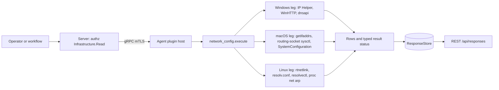
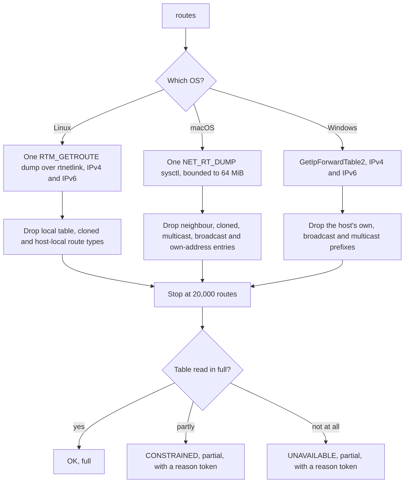

# network_config

<!-- BEGIN GENERATED: plugin-doc-gen header -->
| | |
|---|---|
| **What it does** | Reports network adapter configuration, IP addresses, DNS servers, proxy settings, and the routing table |
| **Version** | 1.0.0 |
| **Kind** | Collector · read-only · gathered (device.network_config.adapters, device.network_config.ip_addresses, device.network_config.dns_servers, device.network_config.proxy, device.network_config.dns_cache, device.network_config.arp, device.network_config.routes) |
| **Platforms** | Windows ✅ · macOS ✅ · Linux ✅ |
| **Actions** | `adapters` (definition `device.network_config.adapters`) · `arp` (definition `device.network_config.arp`) · `dns_cache` (definition `device.network_config.dns_cache`) · `dns_servers` (definition `device.network_config.dns_servers`) · `ip_addresses` (definition `device.network_config.ip_addresses`) · `proxy` (definition `device.network_config.proxy`) · `routes` (definition `device.network_config.routes`) |
| **Security** | securable `Infrastructure` · operation Read · risk Low · dispatch ReadOnly · approval gate None |
| **Roles** | execute: endpoint-admin, endpoint-operator · author: content-author |
<!-- END GENERATED -->

## How it works

The plugin reports how a device is attached to its network: its adapters, addresses, resolvers, proxy, resolver cache, neighbour (ARP) table and routing table. Every action is one local read with no state, no network traffic and no background collection; the definitions' `gather.ttlSeconds` (30 to 120 seconds) is the time the agent has to answer, not a cache. Each OS answers through its own native interface rather than by parsing command output, with one exception: the Linux resolver cache runs `resolvectl`. Nothing here captures packets or tests connectivity: the plugin says what the host is configured to do, not what the network does.

| Action | Windows | macOS | Linux |
|---|---|---|---|
| `adapters` | `GetAdaptersAddresses`; loopback and tunnel-type adapters are left out | `getifaddrs` and `SIOCGIFMEDIA`; `lo0` is listed | rtnetlink link dump; `lo` is left out |
| `ip_addresses` | `GetAdaptersAddresses`; each adapter's own first gateway | `getifaddrs` plus the routing-socket default route; one host-wide gateway | rtnetlink address and route dump; one host-wide default gateway |
| `dns_servers` | each adapter's DNS list | SystemConfiguration dynamic store | `nameserver` lines of `/etc/resolv.conf` |
| `proxy` | WinHTTP Internet Explorer settings of the agent account | SystemConfiguration proxy settings (HTTP and PAC only) | `*_proxy` variables in the agent's own environment |
| `dns_cache` | `DnsGetCacheDataTable` | not supported (returns an `unsupported` row) | `resolvectl cache`, else `systemd-resolve --statistics` |
| `arp` | `GetIpNetTable2` | routing-socket neighbour dump | `/proc/net/arp` (IPv4 only) |
| `routes` | `GetIpForwardTable2` | routing-socket `NET_RT_DUMP` | rtnetlink `RTM_GETROUTE` for IPv4 and IPv6 |

`arp` and `routes` each stop at 20,000 rows so a very large or forged table cannot grow a response without bound. `routes` reports the configured table (IPv4 and IPv6 together, with destination prefix, gateway, interface, metric, table, route type and origin), not the host's own addresses, and only after per-OS filtering described under Caveat 5. A read that fails or is cut short is reported through the result status, never as an empty success.



### What you can decide with it

| Question | Action | How to read it, and what it cannot tell you |
|---|---|---|
| Is this device sending all its traffic through a VPN? | `routes` | Look at the default routes (`prefix_len` 0, destination `0.0.0.0` or `::`) and at the split-default pair `0.0.0.0/1` and `128.0.0.0/1` (IPv6 `::/1` and `8000::/1`) that many VPN clients install. A default or split-default route whose `interface` is the VPN adapter means a full tunnel; routes for specific networks via the VPN with a different default means a split tunnel. The table lists routes, it does not work out which route wins for a destination, and on Linux the policy rules that steer traffic between tables are not read. |
| Is there an unexpected default route (a second gateway, a hijacked path)? | `routes` | Count the rows with `prefix_len` 0 per `family` and compare `gateway`, `interface` and `metric`. Windows and Linux give a metric; macOS has none and lists interface-scoped defaults (such as one per VPN tunnel) as ordinary rows. |
| Which networks go via which gateway? | `routes` | Non-default rows with a `gateway` are routed hops; a `gateway` of `-` is directly attached. `origin` says who installed the route, with a different vocabulary per OS (Caveat 5). |
| What are this device's addresses, MACs and link state? | `adapters`, `ip_addresses` | Per adapter. Tunnel-type adapters and loopback are skipped on Windows; see Caveat 2. |
| Which resolvers does it use? | `dns_servers` | Windows: per adapter. macOS: the dynamic store. Linux: only what `/etc/resolv.conf` lists, which on a host that runs a local resolver stub is the stub address, not the upstream servers. |
| Does it use a proxy? | `proxy` | Windows reports the agent account's settings (LocalSystem today), macOS reports HTTP and PAC only, Linux reports only variables the agent process inherited. A result of `none` is not a statement about any user's browser. |
| Who is on the local subnet? | `arp` | A cache of recently seen neighbours, not a scan. Linux shows IPv4 only; macOS rows have no interface name. |
| What names has the host resolved lately? | `dns_cache` | Windows and Linux only. An empty cache is not the same as "no lookups". |

### Diagrams

#### routes, by OS



The three OS legs end in the same decision. A table that was read but cut short or reduced (row cap, a malformed record, a multipath route shown by its first hop only) is `CONSTRAINED`; a table that could not be read, or whose dump failed before any route was decoded, is `UNAVAILABLE`; only a complete read is `OK`, and then zero rows is a genuinely empty table. An exception inside a leg is reported with return code 1.

#### Gateway meaning in `ip_addresses`

| OS | Where `gateway` comes from | Consequence |
|---|---|---|
| Windows | each adapter's own first gateway | a multi-homed host can show a different gateway on each adapter |
| macOS | one system default gateway, resolved once | the same value is repeated on every row |
| Linux | one main-table default gateway, resolved once | the same value is repeated on every row |

On macOS and Linux a host with several default routes still shows a single gateway here; `routes` is the action that shows all of them.

## OS capability

<!-- BEGIN GENERATED: plugin-doc-gen capability -->
| Action | Windows | macOS | Linux |
|---|---|---|---|
| `adapters` | ✅ supported · rung 1 · GetAdaptersAddresses | ✅ supported · rung 1 · getifaddrs + SIOCGIFMEDIA | ✅ supported · rung 1 · rtnetlink (RTM_GETLINK) |
| `arp` | ✅ supported · rung 1 · GetIpNetTable2 | 🟡 constrained · rung 1 · PF_ROUTE sysctl RTF_LLINFO | 🟡 constrained · rung 1 · /proc/net/arp |
| `dns_cache` | ✅ supported · rung 1 · DnsGetCacheDataTable (dnsapi.dll) | ⛔ unsupported | 🟡 constrained · rung 2 · resolvectl via direct-argv runner |
| `dns_servers` | ✅ supported · rung 1 · GetAdaptersAddresses | ✅ supported · rung 1 · SCDynamicStore | ✅ supported · rung 1 · /etc/resolv.conf read |
| `ip_addresses` | ✅ supported · rung 1 · GetAdaptersAddresses | ✅ supported · rung 1 · getifaddrs + PF_ROUTE sysctl | ✅ supported · rung 1 · rtnetlink (RTM_GETADDR/RTM_GETROUTE) |
| `proxy` | ✅ supported · rung 1 · WinHttpGetIEProxyConfigForCurrentUser | 🟡 constrained · rung 1 · SCDynamicStoreCopyProxies | 🟡 constrained · rung 1 · environment variables |
| `routes` | 🟡 constrained · rung 1 · GetIpForwardTable2 | 🟡 constrained · rung 1 · PF_ROUTE sysctl NET_RT_DUMP | 🟡 constrained · rung 1 · rtnetlink RTM_GETROUTE (AF_UNSPEC) |

**Declared limits per leg** (descriptor fallback text, verbatim):

- **`arp` / macOS** — ip and mac only; the interface name and static/dynamic type are not carried by the RTF_LLINFO dump and are emitted as '-'
- **`arp` / Linux** — IPv4 ARP entries only; /proc/net/arp carries no IPv6 neighbours (they live in the RTM_GETNEIGH table), and non-Ethernet or incomplete entries are not reported
- **`dns_cache` / Linux** — falls back to systemd-resolve statistics, or reports unavailable, when resolvectl is absent
- **`proxy` / macOS** — reports the HTTP proxy and PAC URL, checking the primary network service first and then each scoped per-interface service; HTTPS/SOCKS/FTP proxies are not reported, so a host configured with only those reads as none
- **`proxy` / Linux** — reads the *_proxy variables from the agent process's own environment only; a system-wide, desktop-session or package-manager proxy the agent did not inherit is not reported
- **`routes` / Windows** — IPv4 and IPv6; the host's own and broadcast addresses (Protocol Local, full-length prefix) and the multicast prefixes are not reported, connected-subnet routes are; the metric is the route metric alone, without the interface metric
- **`routes` / macOS** — IPv4 and IPv6; macOS has no route metric or table id, so those fields are '-', and the origin is only the RTF_STATIC bit (static, which also covers connected-interface routes), else RTF_DYNAMIC/RTF_MODIFIED (dynamic), else other; entries flagged as neighbour (RTF_LLINFO), cloned, multicast, broadcast or own-address (RTF_LOCAL) are not reported (the limited-broadcast 255.255.255.255/32 route carries none of those flags and is); interface-scoped routes (RTF_IFSCOPE) are listed like any other
- **`routes` / Linux** — main and custom routing tables, IPv4 and IPv6; the local table, cloned entries and host-local route types are not reported; a multipath route reports its first nexthop only and an `ip nexthop` object route carries no resolved gateway (both flagged in the result status)
<!-- END GENERATED -->

## Privileges and prerequisites

| OS | Runs as | Extra grant needed | Measured | If the read is refused |
|---|---|---|---|---|
| Windows | agent service account (LocalSystem today, #1442) | **None.** Every leg is a native Win32 read API; none requires elevation. | 2026-09-07 on bare metal as `SYSTEM`; `routes` 2026-10-03 on bare metal as `SYSTEM` | no dedicated `PERMISSION_DENIED` path: a failed API call returns `rc=1` with an in-band error row (adapters, ip_addresses, dns_servers) or `GetIpNetTable2 failed (rc=N)` (arp); `routes` instead returns `rc=0` with `UNAVAILABLE`/`PARTIAL` `network_config:routes_table_unavailable` |
| macOS | agent daemon, root (no `_yuzu` account yet, #1455) | **None.** `getifaddrs`, `ioctl(SIOCGIFMEDIA)`, routing-socket sysctl reads and `SCDynamicStore` reads all work unprivileged. | 2026-09-07 as an unprivileged user (euid 501), below the agent's actual root runtime; `routes` 2026-10-03, also euid 501 | `UNAVAILABLE`/`PARTIAL` with a named provenance (for example `network_config:getifaddrs_failed`, `network_config:pf_route_arp_sysctl_failed`, `network_config:pf_route_dump_failed`) |
| Linux | agent's own unprivileged account (`yuzu-agent` on the packaged unit) | **None** for adapters, ip_addresses, dns_servers, proxy, arp and routes (native reads only). `dns_cache` runs `resolvectl` or `systemd-resolve` through the bounded direct-argv runner (no elevation needed, but the tool must be present). | 2026-09-06 in a container as euid 0 (root), more privileged than the agent's real runtime; `routes` 2026-10-03, also euid 0 (an `RTM_GETROUTE` dump is an unprivileged read by design, but it was not measured below root) | `UNAVAILABLE`/`PARTIAL` with a named provenance (for example `network_config:resolv_conf_unreadable`, `network_config:proc_net_arp_unreadable`, `network_config:rtnetlink_routes_dump_incomplete`) |

Binaries and subprocesses: only the Linux `dns_cache` leg spawns a process, `resolvectl cache` falling back to `systemd-resolve --statistics`, both through the bounded direct-argv runner with no `/bin/sh` (`do_dns_cache`). No other action on any OS spawns a process, `routes` included. Sockets used: a raw `AF_NETLINK` socket (Linux adapters, ip_addresses, routes), a throwaway `AF_INET` datagram socket for `ioctl(SIOCGIFMEDIA)` and a routing-socket sysctl (macOS adapters, ip_addresses, arp, routes). No outbound network traffic on any leg; every read is local to the host.

## Data contract

### Inputs

<!-- BEGIN GENERATED: plugin-doc-gen inputs -->
No action takes parameters.
<!-- END GENERATED -->

### Outputs

Pipe-delimited rows via `write_output()`. `adapters`/`ip_addresses`/`dns_servers`/`arp`/`routes` each emit one
row per record under a single literal-prefix discriminator. `proxy` and `dns_cache` do **not** — see
their own notes below the field tables. `-` marks a value the leg could not resolve; it never means
zero, and it is not used as a "no rows" sentinel (a leg that finds nothing on `adapters`/
`ip_addresses`/`dns_servers`/`arp`/`routes` simply emits zero rows, which is itself a legitimate host state
distinguished from failure by the typed result status).

<!-- BEGIN GENERATED: plugin-doc-gen outputs -->
**`device.network_config.adapters` — `name|mac|speed_mbps|status`**

| Field | Type | Values | Available | Example | Description |
|---|---|---|---|---|---|
| `name` | string | - | Windows, Linux, macOS | `en0` | Adapter's OS-reported display name (Windows friendly name; Linux/macOS kernel interface name). Values: free text. |
| `mac` | string | - | Windows, Linux, macOS | `00:00:5e:00:53:04` | Adapter's MAC address, colon-separated hex, or '-' when the leg could not resolve one (loopback, tunnel/utun interfaces). |
| `speed_mbps` | int64 | - | Windows, Linux, macOS | `1000` | Link speed reported by the OS, in megabits per second; 0 when unknown, inactive, or not applicable (loopback/tunnel). Values: integer Mbps, 0 for unknown/inactive (Linux/macOS); Windows emits the unclamped TransmitLinkSpeed sentinel (18446744073709) instead of 0 when the adapter reports no known speed — see Caveats. |
| `status` | string | - | Windows, Linux, macOS | `up` | Adapter link state. Windows/Linux report the OS's OPERATIONAL state (IfOperStatus / IFLA_OPERSTATE); macOS reports the ADMINISTRATIVE IFF_UP flag instead, so a cable-unplugged Mac NIC can read 'up' where Windows/Linux would read 'down'. Values: up, down (Windows, macOS); up, down, unknown (Linux, when the kernel omits IFLA_OPERSTATE). |

**`device.network_config.arp` — `interface|ip_address|mac_address|entry_type`**

| Field | Type | Values | Available | Example | Description |
|---|---|---|---|---|---|
| `interface` | string | - | Windows, Linux, macOS | `Ethernet` | Owning network interface name; always '-' on macOS, where the PF_ROUTE RTF_LLINFO dump carries no interface field. Values: interface name, or '-' (macOS, always). |
| `ip_address` | string | - | Windows, Linux, macOS | `203.0.113.61` | Neighbour's IPv4 or IPv6 address. Values: IPv4 or IPv6 literal. |
| `mac_address` | string | - | Windows, Linux, macOS | `00:00:5e:00:53:0f` | Neighbour's MAC address, colon-separated hex; '-' for a Windows entry with no resolved hardware address yet (incomplete). Linux drops all-zero-MAC rows rather than emitting '-'. Values: colon-separated hex, or '-' (Windows incomplete entries only). |
| `entry_type` | string | - | Windows, Linux, macOS | `dynamic` | Static/dynamic/incomplete classification; always '-' on macOS, where the PF_ROUTE RTF_LLINFO dump carries no such distinction. Values: static, dynamic, incomplete (Windows only); static, dynamic (Linux); '-' (macOS, always). |

**`device.network_config.dns_cache` — `name|record_type|ttl`**

| Field | Type | Values | Available | Example | Description |
|---|---|---|---|---|---|
| `name` | string | - | Windows | `windowsupdate.microsoft.com` | Resolved DNS name of the cached entry. Populated only on Windows — Linux emits opaque, unparsed resolvectl/systemd-resolve text under a different row shape, and macOS never populates this action at all. See Caveats. Values: free text (FQDN or reverse-lookup name). |
| `record_type` | string | - | Windows | `PTR` | DNS resource-record type of the cached entry, decoded from DnsGetCacheDataTable's wType. Populated only on Windows; an unrecognised wType value reports 'unknown'. Values: A, AAAA, CNAME, PTR, MX, SRV, unknown. |
| `ttl` | int32 | - | Windows | `0` | Always the literal 0 — the Windows leg does not decode a real time-to-live from DnsGetCacheDataTable's cache entry structure, so this is not a measured value. |

**`device.network_config.dns_servers` — `adapter|server|type`**

| Field | Type | Values | Available | Example | Description |
|---|---|---|---|---|---|
| `adapter` | string | - | Windows, Linux, macOS | `system` | Adapter owning this resolver on Windows; Linux and macOS report the system-wide resolver list under the literal value 'system' (resolv.conf and SCDynamicStore are not per-adapter). Values: adapter name (Windows), or the literal 'system' (Linux, macOS). |
| `server` | string | - | Windows, Linux, macOS | `192.0.2.100` | Configured DNS server address. Values: IPv4 or IPv6 literal. |
| `type` | string | - | Windows, Linux, macOS | `IPv4` | Address family of the server value. Values: IPv4, IPv6. |

**`device.network_config.ip_addresses` — `adapter|address|prefix_length|gateway`**

| Field | Type | Values | Available | Example | Description |
|---|---|---|---|---|---|
| `adapter` | string | - | Windows, Linux, macOS | `en0` | Adapter name the address belongs to (same name as the adapters action's name field). Values: free text. |
| `address` | string | - | Windows, Linux, macOS | `203.0.113.131` | IPv4 or IPv6 unicast address assigned to the adapter; an IPv6 link-local zone suffix ('%ifname') is stripped on macOS. Values: IPv4 or IPv6 literal. |
| `prefix_length` | int32 | - | Windows, Linux, macOS | `24` | CIDR prefix length of the address's subnet. Values: integer, 0-32 (IPv4) or 0-128 (IPv6). |
| `gateway` | string | - | Windows, Linux, macOS | `203.0.113.1` | Default gateway address for this row. Windows resolves it per-adapter (FirstGatewayAddress); Linux/macOS resolve a single system-wide default gateway and repeat it on every row. Values: IPv4 literal, or '-' when none or unresolved. |

**`device.network_config.proxy` — `proxy_type|proxy_address|bypass`**

| Field | Type | Values | Available | Example | Description |
|---|---|---|---|---|---|
| `proxy_type` | string | - | Windows, Linux, macOS | `auto_detect` | Proxy mode. Windows and macOS emit a normalized type; Linux instead emits the literal environment-variable name it read (e.g. 'http_proxy', 'HTTPS_PROXY'), and can emit several proxy_type/proxy_address row pairs in one response if more than one variable is set — see Caveats. Values: none, http, pac, auto_detect (Windows); none, http, pac (macOS); none, or a literal *_proxy/ALL_PROXY variable name (Linux). |
| `proxy_address` | string | - | Windows, Linux, macOS | `not observed in the captured samples — omitted whenever proxy_type is none or auto_detect` | The proxy host:port (http), the PAC URL (pac), or the raw environment-variable value (Linux). Row is omitted entirely when proxy_type is none/auto_detect. Values: 'host:port', a URL, or a raw environment-variable value. |
| `bypass` | string | - | Windows, Linux, macOS | `*.local,169.254/16` | Comma-separated proxy-exception/bypass list; the row is omitted entirely when the list is empty. Values: comma-separated free text. |

**`device.network_config.routes` — `family|destination|prefix_len|gateway|interface|metric|table|route_type|origin`**

| Field | Type | Values | Available | Example | Description |
|---|---|---|---|---|---|
| `family` | string | - | Windows, Linux, macOS | `ipv4` | Address family of the route. Values: ipv4, ipv6. |
| `destination` | string | - | Windows, Linux, macOS | `192.0.2.0` | Destination network address; the default route is 0.0.0.0 or ::. Values: IPv4 or IPv6 literal. |
| `prefix_len` | int32 | - | Windows, Linux, macOS | `24` | Destination prefix length in bits; 0 is the default route, 32 or 128 a host route. Values: 0-32 (ipv4), 0-128 (ipv6). |
| `gateway` | string | - | Windows, Linux, macOS | `192.0.2.1` | Next-hop address; '-' when the route is on-link (directly attached). Linux reports 'nhid:<n>' for a route that references an `ip nexthop` object whose gateway is not resolved, and the first nexthop's gateway for a multipath route. Values: IPv4 or IPv6 literal, 'nhid:<n>' (Linux only), or '-'. |
| `interface` | string | - | Windows, Linux, macOS | `eth0` | Outgoing interface name; '-' when the interface index no longer resolves on Linux and macOS (or, for a Linux blackhole/unreachable/prohibit/throw route or an `ip nexthop` object route, when the route carries none); Windows renders `if<index>` when the alias lookup fails. Values: interface name, `if<index>` (Windows), or '-'. |
| `metric` | string | - | Windows, Linux, macOS | `100` | Route metric (the Linux priority; the Windows route metric, without the interface metric); '-' on macOS, which has no route metric. Values: decimal integer, or '-' (macOS, always). |
| `table` | string | - | Windows, Linux, macOS | `main` | Linux routing table; '-' on Windows and macOS, which have a single table. Values: main, default, or a decimal table id (Linux); '-' (Windows, macOS). |
| `route_type` | string | - | Windows, Linux, macOS | `unicast` | Kind of route. Values: unicast, blackhole, unreachable, prohibit, throw, nat, xresolve, or type<N> for an unknown Linux rtm_type (Linux); unicast, blackhole, reject (macOS); unicast (Windows, always). |
| `origin` | string | - | Windows, Linux, macOS | `kernel` | Who installed the route. Linux: the rtm_protocol name (kernel, boot, static, dhcp, ra, bgp, ospf, ...) or proto<N>. Windows: the NL_ROUTE_PROTOCOL name (local, netmgmt, dhcp, ...) or proto<N>. macOS: static when the kernel set RTF_STATIC (the kernel sets it on connected-interface routes too, which Linux calls kernel and Windows calls local), dynamic for RTF_DYNAMIC or RTF_MODIFIED, else other (the routing socket carries no protocol field). Values: protocol name, or proto<N>. |
<!-- END GENERATED -->

**`proxy` — not one row per record.** Each configured value is its own row: `proxy_type|<value>`,
`proxy_address|<value>` (omitted when there is no proxy), and `bypass|<value>` (omitted when the
list is empty). Windows/macOS emit at most one `proxy_type`/`proxy_address` pair; Linux can emit
several — see Caveats.

| Field | Type | Values | Available | Example |
|---|---|---|---|---|
| `proxy_type` | string | `none` `http` `pac` `auto_detect` (W); `none` `http` `pac` (M); `none`, or a literal `*_proxy`/`ALL_PROXY` variable name (L) | W, M, L | `auto_detect` |
| `proxy_address` | string | `host:port`, a PAC URL, or the raw env-var value (L) | W, M, L | not observed in the captured samples — omitted whenever `proxy_type` is `none`/`auto_detect` |
| `bypass` | string | comma-separated free text | W, M, L | `*.local,169.254/16` |

**`dns_cache` — no shared row shape across platforms.** Windows: `cache_entry|name|record_type|0|` (the literal `0` is a hardcoded placeholder, not a real TTL, and the trailing field is always empty; `do_dns_cache`). Linux (`resolvectl` path): `cache_entry|<raw resolvectl line>`, one opaque field, not split into name, type and TTL. Linux (`systemd-resolve` fallback): `dns_stats|<raw statistics line>`, a different discriminator entirely. Every platform also has sentinel rows: `dns_cache|empty` (Windows, zero entries), `dns_cache|not_available|<reason>` (Windows and Linux, tool missing or query failed), `dns_cache|unsupported|<reason>` (macOS, always). The three schema-mapped fields below apply to the Windows structured row only.

| Field | Type | Values | Available | Example |
|---|---|---|---|---|
| `name` | string | free text (FQDN or reverse-lookup name) | W only | `windowsupdate.microsoft.com` |
| `record_type` | enum | `A` `AAAA` `CNAME` `PTR` `MX` `SRV` `unknown` | W only | `PTR` |
| `ttl` | int | literal `0` | W only | `0` |

### Result status

Read the table by its first column. `OK` means the read was complete, and then zero rows is a real empty answer. `CONSTRAINED` means rows were returned but the read was cut short or reduced, with the reason in the provenance column. `UNAVAILABLE` means the source could not be read at all. Every non-`OK` status here is `PARTIAL`, and only actions that set a status appear below.

| Status | Completeness | Provenance | When |
|---|---|---|---|
| `OK` (derived from `UNDECLARED`) | — | — | clean read on any action/OS not listed below |
| `CONSTRAINED` / `PARTIAL` | partial | `network_config:rtnetlink_link_dump_incomplete` | Linux `adapters`, rtnetlink dump incomplete |
| `UNAVAILABLE` / `PARTIAL` | partial | `network_config:getifaddrs_failed` | macOS `adapters`/`ip_addresses`, `getifaddrs()` failed |
| `CONSTRAINED` / `PARTIAL` | partial | `network_config:rtnetlink_dump_incomplete` / `network_config:default_gateway_unresolved_nexthop` | Linux `ip_addresses`, link/addr/route dump incomplete, or a main-table default route in an unresolvable nexthop form |
| `CONSTRAINED` / `PARTIAL` | partial | `network_config:pf_route_default_dump_incomplete` | macOS `ip_addresses`, PF_ROUTE default-route sysctl truncated or failed |
| `UNAVAILABLE` / `PARTIAL` | partial | `network_config:resolv_conf_unreadable` | Linux `dns_servers`, `/etc/resolv.conf` unreadable |
| `UNAVAILABLE` / `PARTIAL` | partial | `network_config:dynamic_store_unavailable` / `network_config:no_systemconfiguration` | macOS `dns_servers`, SCDynamicStore session failed, or built without the SystemConfiguration framework |
| `UNAVAILABLE` / `PARTIAL` | partial | `network_config:proxy_copy_failed` / `network_config:no_systemconfiguration` | macOS `proxy`, `SCDynamicStoreCopyProxies` failed, or built without SystemConfiguration |
| `UNAVAILABLE` / `PARTIAL` | partial | `network_config:no_resolver_cache_tool` | Linux `dns_cache`, neither `resolvectl` nor `systemd-resolve` available/usable |
| — (forwarded) | — | — | Linux `dns_cache`, a `resolvectl`/`systemd-resolve` subprocess failure is forwarded via `yuzu::agent::forward_runner_failure` (its own CONSTRAINED/UNAVAILABLE classification; not independently verified here — see Caveats) |
| `CONSTRAINED`/`UNAVAILABLE` / `PARTIAL` | partial | `network_config:arp_row_cap_reached`, `network_config:proc_net_arp_unreadable`, `network_config:proc_net_arp_read_error` | Linux `arp`, 20k-row cap hit, or `/proc/net/arp` unreadable/errored |
| `CONSTRAINED`/`UNAVAILABLE` / `PARTIAL` | partial | `network_config:pf_route_arp_sysctl_failed`, `network_config:pf_route_arp_truncated`, `network_config:arp_row_cap_reached` | macOS `arp`, PF_ROUTE ARP sysctl failed/truncated, or 20k-row cap hit |
| `CONSTRAINED` / `PARTIAL` | partial | `network_config:arp_row_cap_reached` | Windows `arp`, 20k-row cap hit |
| `CONSTRAINED` / `PARTIAL` | partial | `network_config:routes_row_cap_reached` | `routes` on any OS, the 20k-row cap was hit; the first 20,000 routes are reported, the table is longer |
| `CONSTRAINED` / `PARTIAL` | partial | `network_config:rtnetlink_routes_dump_incomplete` | Linux `routes`, the RTM_GETROUTE dump did not complete (error, truncation, foreign-datagram flood, timeout, the kernel aborting it with an errno in the closing NLMSG_DONE, or the kernel flagging that the table changed during the read — NLM_F_DUMP_INTR, so rows may repeat or be missing); the rows decoded so far are reported |
| `UNAVAILABLE` / `PARTIAL` | partial | `network_config:rtnetlink_routes_dump_incomplete` | Linux `routes`, the dump failed before any route was decoded — no rows, never an empty table |
| `CONSTRAINED` / `PARTIAL` | partial | `network_config:routes_multipath_first_nexthop_only` / `network_config:routes_nexthop_object_unresolved` | Linux `routes`, at least one multipath route reported only its first nexthop, or an `ip nexthop` object route has no resolved gateway (reported as `nhid:<n>`) |
| `UNAVAILABLE` / `PARTIAL` | partial | `network_config:pf_route_dump_failed` / `network_config:pf_route_dump_too_large` | macOS `routes`, the NET_RT_DUMP sysctl failed, or the table exceeded the 64 MiB read bound |
| `CONSTRAINED` / `PARTIAL` | partial | `network_config:pf_route_dump_truncated` | macOS `routes`, a record header was malformed (the parse stops there, later routes are not reported) or a record had a non-contiguous netmask or an undecodable address (that route is skipped, the rest are reported) |
| `UNAVAILABLE` / `PARTIAL` | partial | `network_config:routes_table_unavailable` | Windows `routes`, `GetIpForwardTable2` failed |
| `CONSTRAINED` / `PARTIAL` | partial | `network_config:routes_row_unformattable` | Windows `routes`, a route's destination could not be rendered and was left out |
| `CONSTRAINED` / `PARTIAL` (rc 1) | partial | `network_config:routes_internal_error` | `routes` on any OS, an exception escaped a leg (e.g. an allocation failure); an `error\|routes: internal error` row is written |
| `UNAVAILABLE` / `PARTIAL` | partial | `subprocess_runner:spawn_error` | Linux `dns_cache`, the `resolvectl`/`systemd-resolve` child process could not be spawned at all |
| `CONSTRAINED` / `PARTIAL` | partial | `subprocess_runner:deadline` | Linux `dns_cache`, the runner's deadline elapsed while `resolvectl`/`systemd-resolve` was still running, and it was killed |
| `CONSTRAINED` / `PARTIAL` | partial | `subprocess_runner:cancelled` | Linux `dns_cache`, the `resolvectl`/`systemd-resolve` run was cancelled before it finished |
| `CONSTRAINED` / `PARTIAL` | partial | `subprocess_runner:signaled` | Linux `dns_cache`, the `resolvectl`/`systemd-resolve` child was killed by a signal rather than exiting cleanly |
| `OK` / `PARTIAL` | partial | `subprocess_runner:line_limit` | Linux `dns_cache`, the runner capped `resolvectl`/`systemd-resolve` output at its line limit and killed the still-producing child — a deliberate bounded stop, not a failure |

Windows never sets a typed status on `adapters`, `ip_addresses`, `dns_servers`, `proxy` or `dns_cache`: a failed API call there returns `rc=1` with an in-band error row (see Privileges above). `arp` and `routes` are the Windows actions that do set one (`arp`: row-cap `CONSTRAINED`; `routes`: row cap, an unavailable table, an unformattable row). No action on any OS sets `PERMISSION_DENIED`: a refused read surfaces as `UNAVAILABLE` or `CONSTRAINED` with a named reason, or as an in-band error row.

### Where the data goes

- **Instruction result.** Rows travel over the agent's mTLS gRPC channel as the command response and land in the ResponseStore, queryable at `/api/responses/{id}`.
- **Device page "Get live info".** `ip_addresses`, `arp` and `dns_cache` back three of the device page's live-snapshot cards (`device.live.netconfig` "Adapters & IP", `device.live.arp` "ARP", `device.live.dns_cache` "DNS cache"), dispatched through the shared "Get live info" chokepoint. This dispatch is deliberately untracked (no ExecutionTracker row, not in the executions drawer) because it fires one query per card on every click.
- **Daily-sync device_ci source (ADR-0016).** `adapters` is one of the four plugin reads (`hardware`, `device_identity`, `os_info`, `network_config`) the `device_ci` daily-sync source invokes in process to build the device's configuration-item record; its MAC addresses are deduped and sorted, and the first becomes the record's primary MAC. A MAC address is device-identifying data, so this source is in the GDPR personal-data and behavioural-PII tier of the daily-sync routed concern. A failed `adapters` read aborts the whole sync cycle rather than syncing a partial record.
- **Not consumed by** Echo, DEX or Prometheus metrics.
- **Sensitivity.** `adapters` rows carry the host's own MAC addresses, and `arp` rows carry the MAC and IP address of every other device currently seen on the local subnet: device-identifying data by another route. `routes` rows carry the host's routing topology (internal networks, and the next-hop addresses and interface names of VPN and internal gateways), which is infrastructure detail rather than personal data. `ip_addresses` and `dns_servers` rows carry only this host's own address and resolver configuration. `dns_cache` entries can include hostnames of other devices the host has contacted (for example the names of phones or workstations on the LAN), which is potentially device-identifying. `proxy` rows carry network configuration only.
- **Siblings:** `echo` has its own ARP collector that enumerates Windows ARP independently for the Echo capture surface; it is not a consumer of this plugin's `arp` action. `network_diag` covers listening ports and active connections, a distinct surface from this plugin's adapter, address, DNS and ARP inventory.
- **MCP / REST.** Discover: `discover_plugins` (summary), then `yuzu://plugin-docs` (this page as data), then `discover_instructions` or `get_definition("device.network_config.arp")`. Run: `execute_instruction {definition_id, parameters}`. Read: `/api/responses/{id}`, or the device page's "Get live info" snapshot for `ip_addresses`, `arp` and `dns_cache`.

## Sample output

<!-- BEGIN GENERATED: plugin-doc-gen samples -->
**Windows** — captured: windows Windows 10.0.26200 x86_64 · bare-metal · 2026-10-03 · LocalSystem (elevated; addresses redacted) · leg-hash 440c7ee170cd

```
== action=adapters
adapter|Tailscale|-|100000|up
adapter|Ethernet|00:00:5e:00:53:01|1000|up
adapter|VPN Adapter|-|1000|down
adapter|Local Area Connection|00:00:5e:00:53:02|1000|down
adapter|WiFi|00:00:5e:00:53:03|18446744073709|down
adapter|Local Area Connection* 1|00:00:5e:00:53:04|18446744073709|down
adapter|Local Area Connection* 2|00:00:5e:00:53:05|18446744073709|down
adapter|Bluetooth Network Connection|00:00:5e:00:53:06|3|down
adapter|Ethernet 2|00:00:5e:00:53:07|0|down
[result_status] UNDECLARED / UNKNOWN

== action=ip_addresses
ip|Tailscale|fd7a:115c:a1e0::77|128|-
ip|Tailscale|fe80::200:5eff:fe00:5381|64|-
ip|Tailscale|198.51.100.121|32|-
ip|Ethernet|fe80::200:5eff:fe00:5382|64|203.0.113.1
ip|Ethernet|203.0.113.131|24|203.0.113.1
ip|VPN Adapter|fe80::200:5eff:fe00:5381|64|-
ip|VPN Adapter|169.254.133.126|16|-
ip|Local Area Connection|fe80::200:5eff:fe00:5383|64|-
ip|Local Area Connection|169.254.70.46|16|-
ip|WiFi|fe80::200:5eff:fe00:5384|64|-
ip|WiFi|169.254.225.27|16|-
ip|Local Area Connection* 1|fe80::200:5eff:fe00:5385|64|-
… 12 of 19 rows shown
[result_status] UNDECLARED / UNKNOWN

== action=dns_servers
dns|Tailscale|fec0:0:0:ffff::1|IPv6
dns|Tailscale|fec0:0:0:ffff::2|IPv6
dns|Tailscale|fec0:0:0:ffff::3|IPv6
dns|Ethernet|192.0.2.100|IPv4
dns|Ethernet|192.0.2.101|IPv4
dns|VPN Adapter|fec0:0:0:ffff::1|IPv6
dns|VPN Adapter|fec0:0:0:ffff::2|IPv6
dns|VPN Adapter|fec0:0:0:ffff::3|IPv6
dns|Local Area Connection|fec0:0:0:ffff::1|IPv6
dns|Local Area Connection|fec0:0:0:ffff::2|IPv6
dns|Local Area Connection|fec0:0:0:ffff::3|IPv6
dns|WiFi|192.0.2.100|IPv4
… 12 of 24 rows shown
[result_status] UNDECLARED / UNKNOWN

== action=proxy
proxy_type|auto_detect
[result_status] UNDECLARED / UNKNOWN

== action=dns_cache
dns_cache|not_available|query failed
[result_status] UNDECLARED / UNKNOWN

== action=arp
arp|Loopback Pseudo-Interface 1|224.0.0.22|-|static
arp|Loopback Pseudo-Interface 1|224.0.0.252|-|static
arp|Loopback Pseudo-Interface 1|239.255.255.250|-|static
arp|VPN Adapter|224.0.0.22|-|static
arp|VPN Adapter|224.0.0.252|-|static
arp|WiFi|224.0.0.22|01:00:5e:00:00:16|static
arp|WiFi|224.0.0.252|01:00:5e:00:00:fc|static
arp|Local Area Connection|224.0.0.22|01:00:5e:00:00:16|static
arp|Local Area Connection|224.0.0.252|01:00:5e:00:00:fc|static
arp|Tailscale|100.100.100.100|-|incomplete
arp|Tailscale|198.51.100.77|-|dynamic
arp|Tailscale|224.0.0.22|-|static
… 12 of 101 rows shown
[result_status] UNDECLARED / UNKNOWN

== action=routes
route|ipv4|0.0.0.0|0|203.0.113.1|Ethernet|0|-|unicast|netmgmt
route|ipv4|198.51.100.98|32|-|Tailscale|0|-|unicast|netmgmt
route|ipv4|100.100.100.100|32|-|Tailscale|0|-|unicast|netmgmt
route|ipv4|198.51.100.77|32|-|Tailscale|0|-|unicast|netmgmt
route|ipv4|198.51.100.37|32|-|Tailscale|0|-|unicast|netmgmt
route|ipv4|127.0.0.0|8|-|Loopback Pseudo-Interface 1|256|-|unicast|local
route|ipv4|203.0.113.0|24|-|Ethernet|256|-|unicast|local
route|ipv6|fd7a:115c:a1e0::|48|fd7a:115c:a1e0::53|Tailscale|0|-|unicast|netmgmt
route|ipv6|fd7a:115c:a1e0::53|128|-|Tailscale|0|-|unicast|netmgmt
route|ipv6|fe80::|64|-|VPN Adapter|256|-|unicast|local
route|ipv6|fe80::|64|-|Local Area Connection|256|-|unicast|local
route|ipv6|fe80::|64|-|Ethernet 2|256|-|unicast|local
… 12 of 17 rows shown
[result_status] OK / FULL
```

**macOS** — captured: macos macOS 26.6.2 arm64 · bare-metal · 2026-10-03 · euid 501 (addresses redacted) · leg-hash 440c7ee170cd

```
== action=adapters
adapter|lo0|-|0|up
adapter|gif0|-|0|down
adapter|stf0|-|0|down
adapter|anpi0|00:00:5e:00:53:01|0|up
adapter|anpi1|00:00:5e:00:53:02|0|up
adapter|anpi3|00:00:5e:00:53:03|0|up
adapter|en0|00:00:5e:00:53:04|1000|up
adapter|en5|00:00:5e:00:53:05|0|up
adapter|en6|00:00:5e:00:53:06|0|up
adapter|en7|00:00:5e:00:53:07|0|up
adapter|en2|00:00:5e:00:53:08|0|up
adapter|en3|00:00:5e:00:53:09|0|up
… 12 of 25 rows shown
[result_status] UNDECLARED / UNKNOWN

== action=ip_addresses
ip|en0|fe80::200:5eff:fe00:5381|64|203.0.113.1
ip|en0|203.0.113.66|24|203.0.113.1
ip|llw0|fe80::200:5eff:fe00:5382|64|203.0.113.1
ip|utun0|fe80::200:5eff:fe00:5383|64|203.0.113.1
ip|utun1|fe80::200:5eff:fe00:5384|64|203.0.113.1
ip|utun2|fe80::200:5eff:fe00:5385|64|203.0.113.1
ip|utun3|fe80::200:5eff:fe00:5386|64|203.0.113.1
ip|utun4|fe80::200:5eff:fe00:5387|64|203.0.113.1
ip|utun5|fe80::200:5eff:fe00:5388|64|203.0.113.1
ip|utun6|fe80::200:5eff:fe00:5389|64|203.0.113.1
ip|utun6|198.51.100.77|32|203.0.113.1
ip|utun6|fd7a:115c:a1e0::77|48|203.0.113.1
[result_status] UNDECLARED / UNKNOWN

== action=dns_servers
dns|system|100.100.100.100|IPv4
dns|system|fd7a:115c:a1e0::53|IPv6
dns|system|192.0.2.100|IPv4
dns|system|192.0.2.101|IPv4
[result_status] UNDECLARED / UNKNOWN

== action=proxy
bypass|*.local,169.254/16
proxy_type|none
[result_status] UNDECLARED / UNKNOWN

== action=dns_cache
dns_cache|unsupported|macOS does not expose DNS resolver cache contents
[result_status] UNDECLARED / UNKNOWN

== action=arp
arp|-|203.0.113.1|00:00:5e:00:53:0e|-
arp|-|203.0.113.30|00:00:5e:00:53:0f|-
arp|-|203.0.113.60|00:00:5e:00:53:10|-
arp|-|203.0.113.61|00:00:5e:00:53:11|-
arp|-|203.0.113.66|00:00:5e:00:53:04|-
arp|-|203.0.113.71|00:00:5e:00:53:12|-
arp|-|203.0.113.131|00:00:5e:00:53:13|-
arp|-|203.0.113.140|00:00:5e:00:53:14|-
arp|-|203.0.113.197|00:00:5e:00:53:15|-
arp|-|203.0.113.210|00:00:5e:00:53:16|-
arp|-|203.0.113.237|00:00:5e:00:53:17|-
arp|-|203.0.113.238|00:00:5e:00:53:18|-
… 12 of 16 rows shown
[result_status] UNDECLARED / UNKNOWN

== action=routes
route|ipv4|0.0.0.0|0|203.0.113.1|en0|-|-|unicast|static
route|ipv4|0.0.0.0|0|-|utun6|-|-|unicast|static
route|ipv4|100.64.0.0|10|-|utun6|-|-|unicast|static
route|ipv4|100.100.100.100|32|-|utun6|-|-|unicast|static
route|ipv4|127.0.0.0|8|127.0.0.1|lo0|-|-|unicast|static
route|ipv4|169.254.0.0|16|-|en0|-|-|unicast|static
route|ipv4|203.0.113.0|24|-|en0|-|-|unicast|static
route|ipv4|203.0.113.1|32|-|en0|-|-|unicast|static
route|ipv4|203.0.113.66|32|-|en0|-|-|unicast|static
route|ipv4|255.255.255.255|32|-|en0|-|-|unicast|static
route|ipv4|255.255.255.255|32|-|utun6|-|-|unicast|static
route|ipv6|::|0|fe80::|utun0|-|-|unicast|other
… 12 of 29 rows shown
[result_status] OK / FULL
```

**Linux** — captured: linux Debian GNU/Linux 13 (trixie) aarch64 · container · 2026-10-03 · euid 0 · leg-hash 440c7ee170cd

```
== action=adapters
adapter|tunl0|-|0|down
adapter|gre0|-|0|down
adapter|gretap0|00:00:00:00:00:00|0|down
adapter|erspan0|00:00:00:00:00:00|0|down
adapter|ip_vti0|-|0|down
adapter|ip6_vti0|-|0|down
adapter|sit0|-|0|down
adapter|ip6tnl0|-|0|down
adapter|ip6gre0|-|0|down
adapter|eth0|00:00:5e:00:53:01|10000|up
[result_status] UNDECLARED / UNKNOWN

== action=ip_addresses
ip|eth0|172.17.0.3|16|172.17.0.1
[result_status] UNDECLARED / UNKNOWN

== action=dns_servers
dns|system|192.168.65.7|IPv4
[result_status] UNDECLARED / UNKNOWN

== action=proxy
proxy_type|none
[result_status] UNDECLARED / UNKNOWN

== action=dns_cache
dns_cache|not_available|no systemd-resolved
[result_status] UNAVAILABLE / PARTIAL / network_config:no_resolver_cache_tool

== action=arp
[result_status] UNDECLARED / UNKNOWN

== action=routes
route|ipv4|0.0.0.0|0|172.17.0.1|eth0|0|main|unicast|boot
route|ipv4|172.17.0.0|16|-|eth0|0|main|unicast|kernel
[result_status] OK / FULL
```
<!-- END GENERATED -->

The Linux `arp` block shows zero rows with no `[not captured]` or `[rc]` marker: a genuinely empty `/proc/net/arp` table on this container host, not a capture failure.

## Caveats and known gaps

1. **Windows `speed_mbps` is not clamped for an unknown-speed adapter.** `TransmitLinkSpeed` is divided by 1,000,000 with no sentinel check (`do_adapters`); when the API reports its "unknown speed" value (`ULONG64_MAX`) the row shows `18446744073709` instead of `0`, as on three of the nine adapters in the Windows sample (`WiFi`, `Local Area Connection* 1`, `Local Area Connection* 2`). Any consumer treating `speed_mbps` as a real figure must guard against that value.
2. **Each action sees less than its name suggests.** On Windows `adapters`, `ip_addresses` and `dns_servers` skip loopback and tunnel-type adapters (other VPN adapter types, such as the Tailscale adapter in the sample, are listed), and `proxy` returns the agent account's settings, not a signed-in user's. On Linux `dns_servers` reads only `/etc/resolv.conf` and `proxy` only the agent's inherited environment, so a resolver or proxy managed elsewhere is not reported.
3. **Some row shapes differ by platform and are not normalised.** `dns_cache` has no shared shape (a structured `name|type|0|` row on Windows, one raw line under `cache_entry|` or a `dns_stats|` line on Linux, an `unsupported` row on macOS), so a consumer that parses `cache_entry|` as name, type and TTL everywhere will misparse Linux. Linux `proxy_type` is the raw environment-variable name (`http_proxy`, `HTTPS_PROXY`, ...) and can appear several times in one response, where Windows and macOS emit `none`, `http`, `pac` or `auto_detect` once. `ip_addresses.gateway` is per adapter on Windows but one host-wide value repeated on every row on macOS and Linux.
4. **The `adapters` loopback asymmetry is deliberate; do not "align" it.** Linux leaves out `lo`, while macOS reports `lo0` as a real adapter. Changing either side silently alters what the fleet reports.
5. **`routes` is the configured table, filtered differently on each OS.** Linux reports the main and custom tables but drops the local table, cloned entries and local, broadcast, anycast and multicast route types, shows only the first nexthop of a multipath route, and shows an `ip nexthop`-object route's gateway as `nhid:<n>` (the last two are flagged in the result status). macOS has no metric or table id (both `-`), calls a route `static` whenever the kernel sets `RTF_STATIC` (which includes connected-interface routes that Linux calls `kernel` and Windows `local`), lists interface-scoped routes like any other, and drops the entries the kernel flags as neighbour, cloned, multicast, broadcast or own-address (the filter is flag-based, so an ordinary host route such as `255.255.255.255/32` can still appear). Windows reports the route metric alone (the interface metric Windows adds when ranking routes is not shown) and drops the host's own, broadcast and multicast prefixes while keeping connected-subnet routes, so a cross-OS comparison must not assume the same filter or the same `origin` vocabulary.

## Source and tests

<!-- BEGIN GENERATED: plugin-doc-gen source -->
- Plugin: `agents/plugins/network_config/src/network_config_netlink.hpp` · `agents/plugins/network_config/src/network_config_parsers.hpp` · `agents/plugins/network_config/src/network_config_plugin.cpp` · `agents/plugins/network_config/src/network_config_routes_ifname.hpp` · `agents/plugins/network_config/src/network_config_routes_legs.hpp` · `agents/plugins/network_config/src/network_config_routes_linux.cpp` · `agents/plugins/network_config/src/network_config_routes_macos.cpp` · `agents/plugins/network_config/src/network_config_routes_parsers.hpp` · `agents/plugins/network_config/src/network_config_routes_win.cpp`
- Definitions: `content/definitions/network_config.yaml`
- Capability rows: `server/core/src/capability_decls/plugin_action_catalogue_c.hpp`
- Tests: `tests/test_network_config_routes_definition.py` · `tests/unit/test_network_config_local_dispatcher.cpp` · `tests/unit/test_network_config_parsers.cpp` · `tests/unit/test_network_config_routes.cpp`
- Privilege row: `docs/agent-privilege-model.md`
- Changelog: `changelog.d/2026-10-04-network_config-routes.added.md`
<!-- END GENERATED -->
