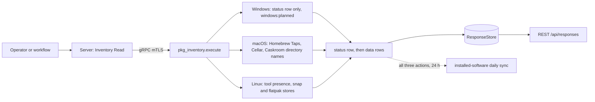
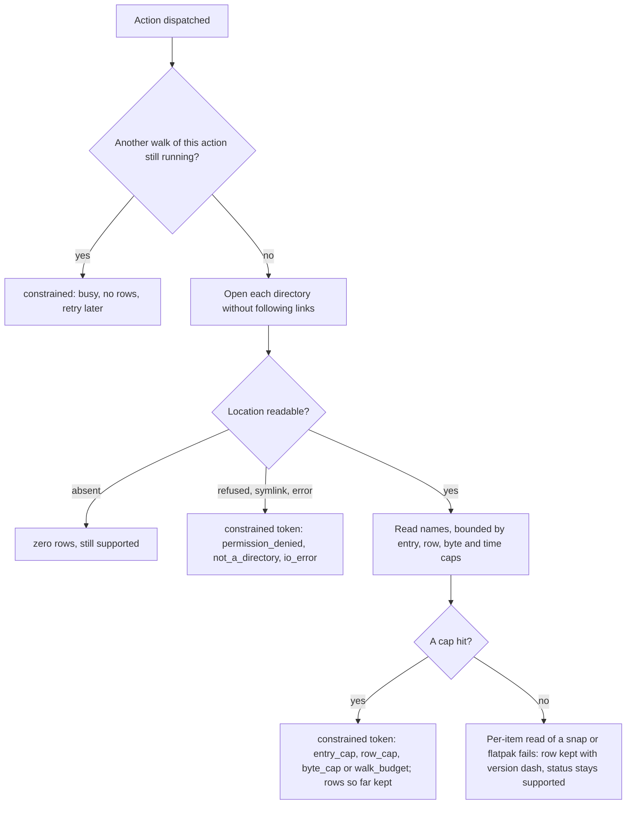
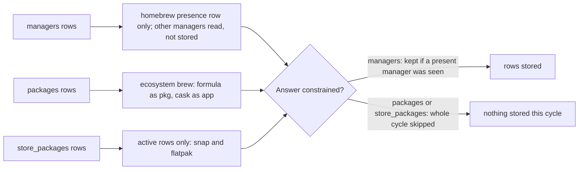

# pkg_inventory

<!-- BEGIN GENERATED: plugin-doc-gen header -->
| | |
|---|---|
| **What it does** | Machine-scope package-manager inventory (managers, packages and store_packages); per-user package stores are out of scope, deferred to the user-session helper |
| **Version** | 1.0.0 |
| **Kind** | Collector · read-only · gathered (crossplatform.software.package_managers, crossplatform.software.package_manager_packages, crossplatform.software.store_packages) |
| **Platforms** | Windows 🟡 planned · macOS ✅ · Linux ✅ |
| **Actions** | `managers` (definition `crossplatform.software.package_managers`) · `packages` (definition `crossplatform.software.package_manager_packages`) · `store_packages` (definition `crossplatform.software.store_packages`) |
| **Security** | securable `Inventory` · operation Read · risk Low · dispatch ReadOnly · approval gate None |
| **Roles** | execute: endpoint-admin, endpoint-operator · author: content-author |
<!-- END GENERATED -->

## How it works

`pkg_inventory` reports which third-party package managers a machine has and what they installed, by reading their directories on disk. No package-manager command is ever run (no `brew`, `dpkg`, `rpm`, `pacman`, `apk`, `snap`, `flatpak` or `winget`), so it cannot change anything and cannot be fooled by a broken tool. Every action writes a `status` row first and then data rows.

- `managers` says which managers are present. On macOS it looks at the two Homebrew prefixes (`/opt/homebrew` on Apple silicon, `/usr/local` on Intel) and counts taps, formulae and casks from directory names. On Linux it checks for eight tools (dpkg, apt, rpm, dnf, pacman, apk, snap, flatpak) under `/usr/bin`, `/usr/sbin`, `/bin` and `/sbin`, and adds the counts it can read without running anything: apt source files, snap files, flatpak apps and runtimes.
- `packages` lists Homebrew formulae and casks on macOS, one row per version directory in `Cellar` and `Caskroom`.
- `store_packages` lists snaps and flatpaks on Linux. A snap is joined from its `.snap` file, its `/snap/<name>/current` link and one bounded read of `snap.yaml`; a flatpak comes from the `app` and `runtime` trees, with the `active` link giving the commit.
- On Windows all three actions report only `status|<action>|unsupported|windows:planned`. Linux distro packages (dpkg, rpm and the rest) and the macOS application list are deliberately not here: `installed_apps` owns them.

The final component of every directory path is opened without following a link (parent directories such as `/var/lib` are trusted) and every walk is bounded in names, rows, bytes, entries and time, so a hostile or huge tree degrades to a clearly marked partial answer rather than hanging the agent. An absent manager or store is a complete, empty answer; a location that exists but cannot be read makes the answer `constrained` with a token that names it. Each walk takes an injected root (production passes `/`) so the unit suite runs it over a committed fixture tree.



### What you can decide with it

| Action | Windows | macOS | Linux | Question it answers |
|---|---|---|---|---|
| `managers` | `unsupported` (planned) | Is Homebrew installed, under which prefix, and with how many taps, formulae and casks? | Which of the eight package tools exist, and how many apt sources, snap files, flatpak apps and runtimes? | "Which package ecosystems can software arrive through on this host?" |
| `packages` | `unsupported` (planned) | Every Homebrew formula and cask with its version directory. | `unsupported`: `installed_apps` owns distro packages. | "Which Homebrew software is present, at what version?" |
| `store_packages` | `unsupported` (planned) | `unsupported`: `installed_apps` owns applications. | Every snap revision and flatpak branch, with active or inactive state. | "Which snaps and flatpaks are installed, and which revision is live?" |

A clean answer proves the listed locations were read as asked; it does not prove nothing else is installed. Software installed outside these directories (a Homebrew in a custom prefix, per-user installs, tarballs, language-level packages such as pip or npm) is invisible. Manager versions are never reported (they are always `-`), because reading one would mean running the tool, and flatpak versions are `-` because a branch is a ref, not a version. For "what is installed on this Linux host overall" use `installed_apps`; use this plugin for the snap and flatpak stores and for knowing which managers exist.

### Diagrams

#### Inside one bounded walk



Constrained means the list itself may be incomplete, and that is the only thing a token is used for. A single snap or flatpak whose own metadata cannot be read still appears, with `-` or `unknown` fields, and does not constrain the action; that choice keeps one odd package from stopping the whole daily inventory.

#### What the daily sync takes



A partial roster would delete stored rows, so a constrained `packages` or `store_packages` answer makes the sync skip the cycle instead of sending a short list.

## OS capability

<!-- BEGIN GENERATED: plugin-doc-gen capability -->
| Action | Windows | macOS | Linux |
|---|---|---|---|
| `managers` | 🟡 planned · rung 1 · ProgramData\\chocolatey lib/ walk + Program Files\\WindowsApps DesktopAppInstaller folder presence for winget; follows as its own PR | ✅ supported · rung 1 · Homebrew prefix layout: Library/Taps, Cellar, Caskroom | ✅ supported · rung 1 · tool presence by fstatat(AT_SYMLINK_NOFOLLOW) under /usr/bin, /usr/sbin, /bin, /sbin; facts: /etc/apt/sources.list.d *.list/*.sources count, /var/lib/snapd/snaps file count, /var/lib/flatpak/{app,runtime} counts |
| `packages` | 🟡 planned · rung 1 · chocolatey lib/<id>/<id>.nuspec via libxml2; follows as its own PR | ✅ supported · rung 1 · Cellar/<formula>/<version>, Caskroom/<cask>/<version> directory names | ⛔ unsupported |
| `store_packages` | 🟡 planned · rung 1 · HKLM AppxAllUserStore + WindowsApps single-level + one AppxManifest.xml read; follows as its own PR | ⛔ unsupported | ✅ supported · rung 1 · /var/lib/snapd/snaps/<name>_<rev>.snap + /snap/<name>/current readlink + <rev>/meta/snap.yaml; /var/lib/flatpak/{app,runtime}/<id>/<arch>/<branch> + active readlink |

**Declared limits per leg** (descriptor fallback text, verbatim):

- **`managers` / macOS** — cask rows, non-zero tap counts and the Intel prefix are exercised by synthetic in-code layouts only, never a real capture
- **`packages` / macOS** — cask rows and the Intel prefix are exercised by synthetic in-code layouts only, never a real capture
- **`packages` / Linux** — installed_apps.list_inventory owns the Linux package roster
- **`store_packages` / macOS** — installed_apps owns the macOS application list
<!-- END GENERATED -->

The capability-matrix rows for this plugin in `docs/os-capability-matrix.md` are rendered from the plugin's own `kActionDescriptors` (`pkg_inventory_plugin.cpp`); the Windows legs are declared `planned`, not `supported`, and a leg that is unsupported by design (Linux `packages`, macOS `store_packages`) is declared rung 0 with no mechanism.

## Privileges and prerequisites

| OS | Runs as | Extra grant needed | Measured | If the read is refused |
|---|---|---|---|---|
| Windows | agent service account (LocalSystem today, #1442) | None — the leg reads nothing | Not measured — the leg emits only a status row (caveat 5) | n/a — no read is attempted; every action reports `status\|<action>\|unsupported\|windows:planned` |
| macOS | agent daemon, root today (LaunchDaemon carries no `UserName` key — `docs/agent-privilege-model.md` TL;DR); this plugin's own reads need no elevation beyond that default | None documented — Homebrew's `Cellar`, `Caskroom` and `Library/Taps` are ordinary directories | Measured unprivileged (euid 501) on an Apple-silicon Mac, 2026-10-14 (`docs/samples/macos.txt`; the walk tests use a real formulae-only capture, `tests/unit/fixtures/wave10/pkg_inventory/macos/provenance.txt`); not yet measured under the root LaunchDaemon identity | A location that exists but cannot be opened or listed makes the status row `constrained` with `macos:<source>:permission_denied` (or another detail token); a missing prefix is zero rows and `supported`, never a failure |
| Linux | agent daemon, default (the packaged unit runs as the unprivileged `yuzu-agent` user, `docs/agent-privilege-model.md`) | None documented — `/usr/bin`, `/etc/apt/sources.list.d`, `/var/lib/snapd/snaps`, `/snap/<name>/current` and `/var/lib/flatpak/{app,runtime}` are expected to be world-readable under snapd's and flatpak's default install modes (0755), as are snap's squashfs mounts (inferred, not measured); not measured as the unprivileged user on a live snapd or flatpak host | Measured as euid 0 AND as uid 1000 in a Debian container, 2026-10-14 (`docs/samples/linux.txt`; that container has neither snapd nor flatpak, so the real snap and flatpak rows are proven by the committed capture tree from a WSL2 Ubuntu 26.04.1 host, `tests/unit/fixtures/wave10/pkg_inventory/linux/provenance.txt`). An unprivileged read of a squashfuse-mounted `/snap/<name>/<rev>` under LXD is UNMEASURED | A directory that exists but cannot be opened or listed makes `store_packages` `constrained` with `linux:<source>:permission_denied`; a snap or flatpak whose own metadata cannot be read (an unreadable `snap.yaml`, a mount the agent cannot enter) is still reported, with version `-` and kind or state `unknown`, and the status stays `supported` (caveat 3). `packages` reports `status\|packages\|unsupported\|linux:owned_by_installed_apps` |

Binaries/subprocesses: none — every read is an in-process filesystem read. Network: none.

## Data contract

### Inputs

<!-- BEGIN GENERATED: plugin-doc-gen inputs -->
No action takes parameters.
<!-- END GENERATED -->

### Outputs

Pipe-delimited rows written via `write_output()`, two shapes per stream discriminated by field 0: exactly one `status|<action>|<supported\|constrained\|unsupported>|<failure tokens or ->` row first, then zero or more data rows — `manager|<name>|<present\|unavailable>|<version or ->|<root_path or ->|<facts k=v;... or ->|<reason or ->` for `managers`, `package|homebrew|<id>|<version>|<formula\|cask>` for `packages`, and the nine-column `package|<snap\|flatpak>|<id>|<version or ->|<kind>|<revision or ->|<arch or ->|<branch or ->|<active\|inactive\|unknown>` for `store_packages`. A genuinely absent manager, prefix or store is `supported` with zero data rows; an unreadable location is `constrained` with a token, never an empty success. `root_path` is the logical path (`/opt/homebrew`, `/usr/local`, `/etc/apt`, `/var/lib/snapd`, `/var/lib/flatpak`), never an injected test root; a manager row's `version` is always `-` in this release (no `brew --version` or `dpkg --version` is run), while a Homebrew package row's `version` is the real version directory name. A snap row carries the `snap.yaml` `version` (or `-`), the `type` as a closed kind token (`app`, `gadget`, `kernel`, `base`, `snapd`, `os`; `other` for anything else, `unknown` when `snap.yaml` could not be read) and the revision; a flatpak row carries the ref id, kind `app` or `runtime`, the commit as its revision, the architecture and the branch, and always a `-` version (the branch is a ref, not a version, and `metadata` is not read). Linux never reports a manager as `unavailable`: presence is the binary, and a fact whose source could not be read is omitted with its token. A formula or cask present under both Homebrew prefixes yields one `package|` row per prefix; the package row carries no prefix column — the manager rows say which prefixes exist. Every OS-supplied field goes through the shared escaper `yuzu::util::safe_output_field`; directory names that are dot-prefixed, over 255 bytes, or contain a pipe, backslash, control or non-ASCII character are skipped without a token (Homebrew and flatpak never create them), so they never reach a row. This plugin is not in the server's `kKeyValuePlugins` set, so the server does not decode its rows as two-cell `key|rest`; the columns below are the definition's own.

<!-- BEGIN GENERATED: plugin-doc-gen outputs -->
**`crossplatform.software.package_manager_packages` — `row_kind|manager|id|version|kind`**

| Field | Type | Values | Available | Example | Description |
|---|---|---|---|---|---|
| `row_kind` | string | `status` `package` | Windows, Linux, macOS | `package` | Row shape discriminator. Values: status (exactly one per result, always first), package (one per installed formula or cask version directory). |
| `manager` | string | - | Windows, Linux, macOS | `homebrew` | Package rows: the owning package manager, always homebrew in this release. Status rows: the action name, always packages. |
| `id` | string | - | Windows, Linux, macOS | `openssl@3` | Package rows: the formula or cask directory name (e.g. openssl@3). Status rows: the completeness level. Values: supported, constrained (at least one read failed or the row cap or walk budget was hit), unsupported (Linux by design, Windows planned). |
| `version` | string | - | Windows, Linux, macOS | `3.4.1` | Package rows: the version directory name under the formula or cask (cask versions may carry commas or colons). Status rows: the comma-joined failure tokens, or "-" when none. Tokens read <os>:<source>:<detail> (e.g. macos:homebrew_cellar:row_cap, macos:homebrew_cellar:byte_cap, macos:homebrew_caskroom:walk_budget or macos:packages:busy), linux:owned_by_installed_apps, windows:planned or pkg_inventory:exception (a leg threw). |
| `kind` | string | `formula` `cask` | macOS | `formula` | Package rows only: whether the directory came from the Cellar or the Caskroom. Values: formula, cask. |

**`crossplatform.software.package_managers` — `row_kind|name|state|version|root_path|facts|reason`**

| Field | Type | Values | Available | Example | Description |
|---|---|---|---|---|---|
| `row_kind` | string | `status` `manager` | Windows, Linux, macOS | `manager` | Row shape discriminator. Values: status (exactly one per result, always first), manager (one per package manager detected). |
| `name` | string | - | Windows, Linux, macOS | `homebrew` | Manager rows: the package manager. Values: dpkg, apt, rpm, dnf, pacman, apk, homebrew, snap, flatpak. Linux emits one row per tool found; macOS emits homebrew. Status rows: the action name, always managers. |
| `state` | string | `present` `unavailable` `supported` `constrained` `unsupported` | Windows, Linux, macOS | `present` | Manager rows: present means at least one Homebrew marker directory (Library/Taps, Cellar, Caskroom) under the prefix was readable; unavailable means a marker exists but none could be read (see reason); a prefix root that cannot be opened counts as Homebrew only for /opt/homebrew, since /usr/local exists on every Mac and there the status tokens appear with no manager row. Status rows: the completeness level. Values: supported, constrained (at least one read failed), unsupported (the planned Windows leg). |
| `version` | string | - | Windows, Linux, macOS | `-` | Manager rows: the manager version, or "-" (versions are not read in this release, so always "-"). Status rows: the comma-joined failure tokens, or "-" when none. Tokens read <os>:<source>:<detail> (e.g. macos:homebrew_cellar:permission_denied, macos:homebrew_taps:walk_budget, macos:managers:busy, linux:apt_sources_d:permission_denied, linux:tool_dir:permission_denied or linux:managers:busy), windows:planned or pkg_inventory:exception (a leg threw). |
| `root_path` | string | - | Linux, macOS | `/opt/homebrew` | Manager rows only: the logical root the facts were read from (e.g. /opt/homebrew, /usr/local, /etc/apt, /var/lib/snapd, /var/lib/flatpak), never an injected test root; "-" when the manager has no single root (Linux dpkg, rpm, dnf, pacman, apk). |
| `facts` | string | - | Linux, macOS | `taps=0;formulae=66;casks=0` | Manager rows only: semicolon-separated key=value manager-level facts, or "-". Keys by manager: apt sources_d_files (the *.list and *.sources files under /etc/apt/sources.list.d); snap snap_files; flatpak apps, runtimes; homebrew taps, formulae, casks. dpkg, rpm, dnf, pacman and apk carry no facts in this release. A key is omitted when its source could not be read completely (unreadable, truncated at the entry cap, or out of walk budget). |
| `reason` | string | - | macOS | `-` | Manager rows only: failure tokens for an unavailable manager (macOS only; Linux never reports unavailable), or "-". |

**`crossplatform.software.store_packages` — `row_kind|manager|id|version|kind|revision|arch|branch|state`**

| Field | Type | Values | Available | Example | Description |
|---|---|---|---|---|---|
| `row_kind` | string | `status` `package` | Windows, Linux, macOS | `package` | Row shape discriminator. Values: status (exactly one per result, always first), package (one per installed snap revision or flatpak branch). |
| `manager` | string | `snap` `flatpak` `store_packages` | Windows, Linux, macOS | `snap` | Package rows: the store, snap or flatpak. Status rows: the action name, always store_packages. |
| `id` | string | - | Windows, Linux, macOS | `btop` | Package rows: the snap name (the /snap mount directory name, including a parallel-instance key) or the flatpak ref id (e.g. org.gnome.Platform). Status rows: the completeness level. Values: supported, constrained (the list may be incomplete), unsupported (macOS by design, Windows planned). |
| `version` | string | - | Windows, Linux, macOS | `1.4.7` | Snap rows: the snap.yaml `version`, or "-" when the revision is not mounted or readable or the value is not a plain one-line scalar that passes snapd's version grammar. Flatpak rows: always "-" (the appdata version is not read; the branch is a ref, not a version). Status rows: the comma-joined failure tokens, or "-" when none. Tokens read <os>:<source>:<detail>: linux:snapd_snaps:*, linux:flatpak_app:* and linux:flatpak_runtime:* (an unlistable directory, entry_cap or walk_budget), linux:store_packages:row_cap, linux:store_packages:byte_cap, linux:store_packages:busy, macos:owned_by_installed_apps, windows:planned or pkg_inventory:exception (a leg threw). |
| `kind` | string | `app` `gadget` `kernel` `base` `snapd` `os` `other` `unknown` `runtime` | Linux | `app` | Package rows only. Snap: the snap.yaml `type` (app is the default when absent; application reads as app), or unknown when snap.yaml could not be read, or other for an unrecognised type. Flatpak: app or runtime. Status rows: "-". |
| `revision` | string | - | Linux | `1073` | Package rows only: the snap revision, or the flatpak commit (64 hex digits); "-" when a flatpak branch has no readable `active` link. |
| `arch` | string | - | Linux | `x86_64` | Package rows only: the flatpak architecture (e.g. x86_64); "-" for snaps. |
| `branch` | string | - | Linux | `stable` | Package rows only: the flatpak ref branch (e.g. stable, 51, 26.08-extra); "-" for snaps. A branch is a ref, not a version. |
| `state` | string | `active` `inactive` `unknown` | Linux | `active` | Package rows only: active (the snap `current` link or the flatpak `active` link points at this revision), inactive (present but not current), unknown (the link could not be read). Status rows: "-". |
<!-- END GENERATED -->

### Result status

| Status | Completeness | Provenance | When |
|---|---|---|---|
| `OK` | `FULL` | — | The read completed: managers, packages or store packages were found, or none were (an absent manager, prefix or store is a complete answer, not a degradation). A per-item degradation (below) is also `OK`. |
| `CONSTRAINED` | `PARTIAL` | `<os>:<source>:<detail>` | At least one location could not be read completely, so the LIST may be incomplete. `<os>` is `macos` or `linux`; `<source>` names the location (`homebrew_taps`, `homebrew_cellar`, `homebrew_caskroom`; Linux `tool_dir`, `<tool>_bin`, `apt_sources_d`, `snapd_snaps`, `flatpak_app`, `flatpak_runtime`, and `store_packages` for the row caps); `<detail>` is `permission_denied`, `not_a_directory` (also what a symlink reads as: the kernel answers ENOTDIR to a no-follow directory open of a link), `symlink_refused` (a symlink loop in the path), `io_error`, `entry_cap` (4,096 names per directory) or `enumeration_error` (directory listing truncated or errored: its count fact is omitted, never reported as a lower bound), `row_cap` (20,000 rows), `byte_cap` (1 MiB of rows) or `walk_budget` (200,000 entries or 10 s per action; the locations not yet read are skipped and the rows already found are kept). The wall clock is cooperative: it is checked per directory and per listed entry and cannot interrupt a filesystem call that blocks on a stalled mount inside the tree (a very large listing of non-directory entries can overshoot it by the cost of its stat calls), so `<os>:<source>:busy` (source is the action name) means another dispatch of this action is still walking: nothing was read, there are no rows, retry later (at most one walk per action runs at a time). A symlinked Homebrew prefix, marker directory or store directory is refused, never followed. Several tokens are comma-joined. |
| `OK` | `FULL` | — | **Per-item degradation is not a constraint.** On Linux `store_packages`, a single snap or flatpak whose own fields cannot be read is still emitted: an unreadable, oversized, symlinked or non-regular `snap.yaml`, a missing or unmounted revision, a `version:` that is not a plain one-line scalar passing snapd's version grammar, a broken `current` or `active` link, or an absent or unopenable `/snap` mount directory give version `-`, kind `unknown` or state `unknown` or `inactive` on the data row, and no token. The status stays `supported` because the list is complete, and the installed-software collector fails any constrained `store_packages` answer (a partial roster would delete stored rows), so a persistent per-item anomaly must never constrain the action. `linux:*` tokens therefore mean list incompleteness only. |
| `UNAVAILABLE` | `PARTIAL` | `linux:owned_by_installed_apps` | Linux `packages`: unsupported by design; `installed_apps.list_inventory` owns the Linux package roster. |
| `UNAVAILABLE` | `PARTIAL` | `macos:owned_by_installed_apps` | macOS `store_packages`: unsupported by design; `installed_apps` owns the macOS application list. |
| `UNAVAILABLE` | `PARTIAL` | `windows:planned` | Windows, any action: the leg reads nothing and emits only `status\|<action>\|unsupported\|windows:planned` (caveat 5). |
| `UNAVAILABLE` | `PARTIAL` | `pkg_inventory:exception` | Any action, any OS: a leg threw during a read. `execute()` catches it, writes `status\|<action>\|constrained\|pkg_inventory:exception` (the one row whose level is `constrained` while the typed status is UNAVAILABLE: the command failed, rc 1) with this fixed token, never the exception's own text, and never lets the exception cross the plugin ABI. |

### Where the data goes

- **Instruction result AND daily-sync inventory.** Rows travel over the agent's mTLS gRPC channel as the command response and land in the ResponseStore, queryable at `/api/responses/{id}`. The three actions are gathered definitions (`crossplatform.software.package_managers`, `crossplatform.software.package_manager_packages` and `crossplatform.software.store_packages`, 300s TTL).
- **Also consumed by** the `installed_software` daily-sync source (`agents/core/src/sync_source_installed_software.cpp`), which calls all three actions in-process on the agent's 24 h schedule: `packages` rows become `pkg` (formula) / `app` (cask) rows with ecosystem `brew`; `managers` becomes one `homebrew` presence row (every other manager name, including the Linux ones, is read but not mapped); `store_packages` maps ACTIVE rows only, to ecosystem `snap` (kind `app` when the snap type is app, else `pkg`; version from `snap.yaml`; release = the revision) and ecosystem `flatpak` (kind `app` for apps, `pkg` for runtimes; version EMPTY because the branch is a ref and not a version; release = the commit; arch). An inactive or unknown revision is on the wire but is not installed software and never reaches the catalogue. A constrained `managers` answer keeps the cycle iff at least one PRESENT manager row was seen, mapped or not; a constrained `packages` or `store_packages` answer skips the cycle. Not consumed by TAR, DEX, or metrics.
- **Sensitivity.** Rows name installed software (Homebrew formula and cask names and versions, snap and flatpak ids, versions, revisions and commits) and the package managers and Homebrew prefixes present on the host with their counts — a software inventory by another route. No row carries a username, account name or user-profile path.
- **Siblings:** `installed_apps` (owns the Linux distro-package roster and the macOS application list, and its `list_per_user` also lists Homebrew formulae per user — see caveat 4 for both overlaps) and `software_actions` (installs and removes software; this plugin only reads).

## Sample output

<!-- BEGIN GENERATED: plugin-doc-gen samples -->
**macOS** — captured: macos macOS 26.6.2 arm64 · bare-metal · 2026-10-14 · euid 501 · leg-hash 5e3ad4e08431

```
== action=managers
status|managers|supported|-
manager|homebrew|present|-|/opt/homebrew|taps=0;formulae=69;casks=0|-
[result_status] OK / FULL

== action=packages
status|packages|supported|-
package|homebrew|actionlint|1.7.12|formula
package|homebrew|ada-url|4.0.0|formula
package|homebrew|autoconf|2.73|formula
package|homebrew|automake|1.18.1_1|formula
package|homebrew|bash|5.3.15|formula
package|homebrew|blake3|1.8.7|formula
package|homebrew|brotli|1.2.0|formula
package|homebrew|c-ares|1.34.8|formula
package|homebrew|ca-certificates|2026-08-13|formula
package|homebrew|ccache|4.13.6_1|formula
package|homebrew|cmake|4.4.2|formula
… 12 of 71 rows shown
[result_status] OK / FULL

== action=store_packages
status|store_packages|unsupported|macos:owned_by_installed_apps
[result_status] UNAVAILABLE / PARTIAL / macos:owned_by_installed_apps
```

**Linux** — captured: linux Debian GNU/Linux 13 (trixie) aarch64 · container · 2026-10-14 · euid 0 · leg-hash 5e3ad4e08431

```
== action=managers
status|managers|supported|-
manager|dpkg|present|-|-|-|-
manager|apt|present|-|/etc/apt|sources_d_files=1|-
[result_status] OK / FULL

== action=packages
status|packages|unsupported|linux:owned_by_installed_apps
[result_status] UNAVAILABLE / PARTIAL / linux:owned_by_installed_apps

== action=store_packages
status|store_packages|supported|-
[result_status] OK / FULL
```
<!-- END GENERATED -->

## Caveats and known gaps

1. **Machine scope, default prefixes, point in time.** Per-user package stores (per-user Homebrew, pip user installs, npm and cargo) are out of scope and deferred to the user-session helper (ADR-3003). Only the two default Homebrew prefixes are probed, so a Homebrew in a custom or symlinked prefix reads as absent or refused rather than installed, and an entry removed during a walk is skipped rather than reported.
2. **A stalled mount can pin a worker, and the sync waits behind it.** The walk deadline is cooperative: it cannot interrupt a filesystem call blocked on a dead mount, so that dispatch holds one agent worker and later dispatches of the action report `busy`; on Linux it also holds the sequential daily-sync source loop, so every later sync source waits. A persistent SELinux or AppArmor denial on `/var/lib/snapd/snaps` or `/var/lib/flatpak/{app,runtime}` makes `store_packages` constrained and skips the daily installed-software cycle until the agent's domain is granted read access.
3. **Linux reports presence and counts, and a per-item failure stays `supported`.** Manager versions and the dpkg, rpm, dnf, pacman and apk facts are not read. A snap with an unmounted, unreadable or hostile `snap.yaml` is still a row with version `-` and kind `unknown`, a `snap disable`d snap is `inactive`, and `.Locale` and `.Debug` flatpak runtimes appear although `flatpak list` hides them; only the system flatpak installation and the default snap roots are read, and the Linux sample comes from a container with neither store, so real rows are proven by a WSL2 capture tree only.
4. **Homebrew rows overlap `installed_apps` on macOS, and cask and tap rows are unexercised against real data.** Casks install `.app` bundles that `installed_apps` also reports, and its `list_per_user` also lists Homebrew formulae per user, so this is a machine-scope, no-subprocess view of the same store and not a disjoint one. The real-capture host had a populated `Cellar` only, so tap, cask and Intel-prefix paths are covered by synthetic layouts built from Homebrew's own scripts, not by a real capture.
5. **Windows legs planned.** All three Windows actions report `status|<action>|unsupported|windows:planned` and no data rows. The Chocolatey `lib\` walk with `.nuspec` metadata, winget presence and the Appx store roster are not built.

## Source and tests

<!-- BEGIN GENERATED: plugin-doc-gen source -->
- Plugin: `agents/plugins/pkg_inventory/src/pkg_inventory_legs.hpp` · `agents/plugins/pkg_inventory/src/pkg_inventory_linux.cpp` · `agents/plugins/pkg_inventory/src/pkg_inventory_linux_parsers.hpp` · `agents/plugins/pkg_inventory/src/pkg_inventory_macos.cpp` · `agents/plugins/pkg_inventory/src/pkg_inventory_macos_parsers.hpp` · `agents/plugins/pkg_inventory/src/pkg_inventory_parsers.hpp` · `agents/plugins/pkg_inventory/src/pkg_inventory_plugin.cpp` · `agents/plugins/pkg_inventory/src/pkg_inventory_win.cpp`
- Definitions: `content/definitions/pkg_inventory.yaml`
- Capability rows: `server/core/src/capability_decls/plugin_action_catalogue_pkg_inventory.hpp`
- Tests: `tests/unit/test_pkg_inventory_linux_parsers.cpp` · `tests/unit/test_pkg_inventory_local_dispatcher.cpp` · `tests/unit/test_pkg_inventory_macos_parsers.cpp` · `tests/unit/test_pkg_inventory_parsers.cpp`
- Privilege row: `docs/agent-privilege-model.md`
<!-- END GENERATED -->
