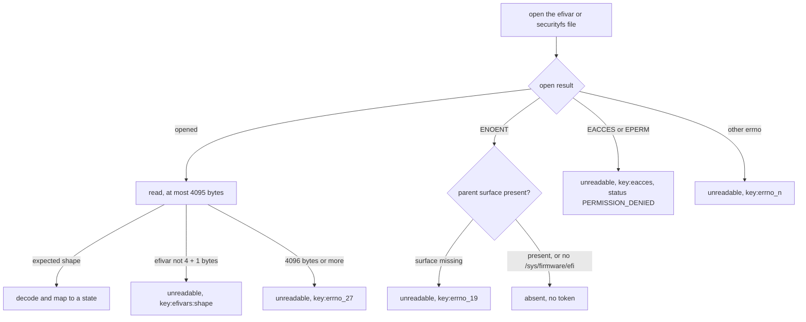
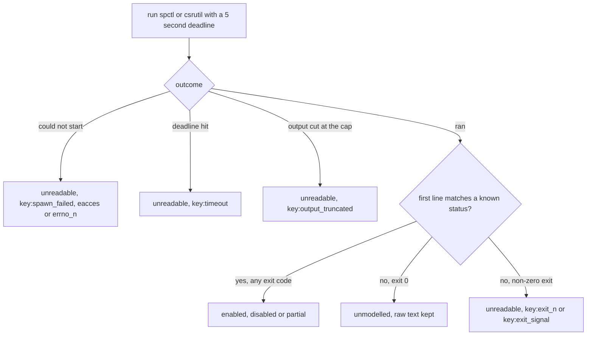

# platform_security

<!-- BEGIN GENERATED: plugin-doc-gen header -->
| | |
|---|---|
| **What it does** | Secure Boot and code-integrity enforcement posture (read-only) |
| **Version** | 1.0.0 |
| **Kind** | Collector · read-only · gathered (crossplatform.platform_security.secure_boot, crossplatform.platform_security.code_integrity) |
| **Platforms** | Windows ✅ · macOS ✅ · Linux ✅ |
| **Actions** | `code_integrity` (definition `crossplatform.platform_security.code_integrity`) · `secure_boot` (definition `crossplatform.platform_security.secure_boot`) |
| **Security** | securable `Security` · operation Read · risk Low · dispatch ReadOnly · approval gate None |
| **Roles** | execute: endpoint-admin, endpoint-operator, security-admin · author: content-author |
<!-- END GENERATED -->

## How it works

Two read-only actions report whether boot-time and code-signing protections are configured on: `secure_boot` (is Secure Boot enforced) and `code_integrity` (is the OS restricting what code may run). Each writes rows of the form `<action>|<os>|<key>|<raw>|<state>`. Neither takes parameters, so no request text reaches a path, a registry name or a command line. Linux reads a few efivarfs and securityfs files; Windows reads registry values; macOS reports `secure_boot` as unsupported and runs `spctl --status` and `csrutil status` for `code_integrity`. Every read is a **value** with a state, **`absent`** (the OS definitively says it is not there) or **`unreadable`** (the read failed), and a failed read never reads as absent. `enabled`, `disabled` and `partial` describe the protection, not the raw number. The Windows rows report configured policy, not proof of what is running.

### What is read

- **Linux** (`open` and `read`, errno classified, no process started). `secure_boot` reads the efivarfs `SecureBoot-*` and `SetupMode-*` variables (a 4-byte attribute word plus one data byte). `code_integrity` reads `/sys/kernel/security/lsm` (the active LSM list) and `/sys/kernel/security/lockdown` (the bracketed active mode).
- **macOS.** `secure_boot` writes one `unsupported` row (there is no public API; SIP is reported under `code_integrity`). `code_integrity` runs `/usr/sbin/spctl --status` (Gatekeeper) and `/usr/bin/csrutil status` (SIP) as rung-2 argv leaves through the bounded runner: an absolute literal argv, no shell, a 5 second deadline and an output cap. Neither state has a library API.
- **Windows** (`RegQueryValueExW`, 64-bit view, under `HKLM\SYSTEM\CurrentControlSet\Control`). `SecureBoot\State` (`UEFISecureBootEnabled`); `CI\Policy` (every value, names enumerated first, then one read each); `DeviceGuard` (`EnableVirtualizationBasedSecurity`, `RequirePlatformSecurityFeatures`, `HypervisorEnforcedCodeIntegrity`); `DeviceGuard\Scenarios\HypervisorEnforcedCodeIntegrity` (`Enabled`); and `Lsa` (`LsaCfgFlags`). `LsaCfgFlags` is the Credential Guard setting and lives under `Control\Lsa`, not `Control\DeviceGuard`: `1` is enabled with a UEFI lock (`enabled_locked`), `2` is enabled without one.

### How absence is decided

A BIOS or CSM boot has no efivars, many kernels have no lockdown LSM and a default Windows install has no DeviceGuard values. Each of these is an `absent` row that adds no reason token and leaves the status `OK`. The rule differs by OS, because a not-found can also mean the surface itself was never exposed.

- **Linux.** A leaf `ENOENT` is `absent` only when the parent pseudo-filesystem is confirmed present. For `code_integrity`, `/sys/kernel/security` must be mounted as securityfs (checked by the `statfs` magic number); if it is not, the `ENOENT` becomes `ENODEV` and the row reads `unreadable` with `<key>:errno_19`. For `secure_boot`, `/sys/firmware/efi/efivars` must be efivarfs whenever `/sys/firmware/efi` exists; if `/sys/firmware/efi` does not exist at all the host is treated as non-UEFI and the variables read `absent`. A refusal (`EACCES`, `EPERM`) is `unreadable` with `<key>:eacces`, and a file of 4096 bytes or more is `unreadable` with `<key>:errno_27`.
- **macOS.** `spctl` and `csrutil` are sealed-system-volume binaries with no legitimate "not there" case, so a tool that cannot be started (including a missing binary) reads `unreadable`, never `absent`. Text that parses is trusted whatever the exit status.
- **Windows.** The decision is made per key. `SecureBoot\State`, `CI\Policy` and both `DeviceGuard` keys can genuinely be missing on a real host and read `absent`. `Lsa` is foundational NT infrastructure with no evidenced not-found case, so a missing `Lsa` key reads `unreadable` with `lsa:key_missing`; a `LsaCfgFlags` value missing from an opened `Lsa` key is still legitimately `absent`.

### What you can decide with it

| Question | Action and key | Windows | macOS | Linux |
|---|---|---|---|---|
| Is Secure Boot enforced? | `secure_boot` | `UEFISecureBootEnabled`: `1` `enabled`, `0` `disabled`; `absent` on a BIOS or CSM boot | not available (`unsupported`) | `secure_boot` row: efivar data byte `1` `enabled`, `0` `disabled` |
| Is a Platform Key enrolled, or can any image load? | `secure_boot`, key `setup_mode` | not read | not available | `enabled` means User Mode (a Platform Key is enrolled); `disabled` means Setup Mode |
| Is the OS restricting kernel or code changes? | `code_integrity` | `lsa.LsaCfgFlags` (Credential Guard), `deviceguard.*` (virtualization-based security, HVCI) | `gatekeeper` and `sip` | `lockdown`: `none` `disabled`, `integrity` `partial`, `confidentiality` `enabled`; `lsm` `enabled` when SELinux, AppArmor, Smack or TOMOYO is in the active list |
| Is Smart App Control on? | `code_integrity` | `ci_policy.VerifiedAndReputablePolicyState`: `0` `disabled`, `1` `enabled`, `2` `evaluation` | not available | not available |

- **What the Windows states mean.** `deviceguard.EnableVirtualizationBasedSecurity`, `deviceguard.HypervisorEnforcedCodeIntegrity` and `deviceguard.hvci_scenario_enabled` read `0` `disabled`, `1` `enabled`. `deviceguard.RequirePlatformSecurityFeatures` reads `0` `disabled` and `1` or `3` (Secure Boot, plus DMA protection) `enabled`. `lsa.LsaCfgFlags` reads `0` `disabled`, `1` `enabled_locked`, `2` `enabled`. Any other value is `unmodelled` and the raw value is kept. Every other value found under `CI\Policy` is listed by name as `unmodelled`.
- **What the macOS states mean.** `gatekeeper` is `enabled` for `assessments enabled` and `disabled` for `assessments disabled`. `sip` is `enabled` or `disabled` for the exact status line, and `partial` for `enabled (Custom Configuration).`. Any other text is `unmodelled`.
- **Absent is an answer, not a pass.** On Linux, `absent` on `secure_boot` means no efivars were visible to the agent; inside a container it does not tell you the host's firmware mode (caveat 1). On Windows, `absent` for a `deviceguard.*` row means the feature is not configured, not that it is running.
- **Not covered.** Whether a Windows feature is actually running, macOS boot-security policy on Apple silicon, and TPM or measured-boot state.
- **Per OS.** Keys and states differ by OS, so a fleet check branches on the `<os>` column. `OK` means every key was read or definitively absent; it is not a compliance verdict.

### Diagrams

#### Linux read of one variable or file



"Surface missing" means securityfs is not mounted at `/sys/kernel/security`, or `/sys/firmware/efi` exists but `/sys/firmware/efi/efivars` is not efivarfs. A host with no `/sys/firmware/efi` takes the `absent` branch, and a container that hides that directory is indistinguishable from a BIOS boot, which is why caveat 1 exists.

#### macOS tool outcome



## OS capability

<!-- BEGIN GENERATED: plugin-doc-gen capability -->
| Action | Windows | macOS | Linux |
|---|---|---|---|
| `code_integrity` | ✅ supported · rung 1 · HKLM\\SYSTEM\\CurrentControlSet\\Control\\CI\\Policy, Control\\DeviceGuard and Control\\Lsa\\LsaCfgFlags registry values | ✅ supported · rung 2 · spctl --status + csrutil status via run_bounded_subprocess | ✅ supported · rung 1 · securityfs reads of /sys/kernel/security/lsm and /sys/kernel/security/lockdown (errno-classified absent/unreadable) |
| `secure_boot` | ✅ supported · rung 1 · HKLM\\SYSTEM\\CurrentControlSet\\Control\\SecureBoot\\State registry (UEFISecureBootEnabled) | ⛔ unsupported | ✅ supported · rung 1 · efivarfs reads of /sys/firmware/efi/efivars/SecureBoot-* and SetupMode-* (4-byte attributes + 1 data byte; errno-classified absent/unreadable) |

**Declared limits per leg** (descriptor fallback text, verbatim):

- **`secure_boot` / macOS** — no public API; SIP reported under code_integrity
<!-- END GENERATED -->

## Privileges and prerequisites

| OS | Runs as | Extra grant needed | Measured | If the read is refused |
|---|---|---|---|---|
| Windows | agent service account (LocalSystem today, #1442) | None documented for this plugin (`docs/agent-privilege-model.md`); HKLM `Control` reads are not expected to need elevation | `NT AUTHORITY\SYSTEM` on a bare-metal Windows 11 Pro lab host (10.0.26200), 2026-09-21: the per-key probe results are recorded in the `platform_security_win.cpp` banner (`docs/samples/windows.txt`) | For a per-VALUE read, `ERROR_FILE_NOT_FOUND`/`ERROR_PATH_NOT_FOUND` reports the row `absent` with no token. For a KEY OPEN, the same two codes report `absent` only for `SecureBoot\State`, `CI\Policy`, `DeviceGuard` and its HVCI scenario subkey; `Lsa` has no evidenced not-found case, so the identical codes there report `unreadable` with `lsa:key_missing`. `ERROR_ACCESS_DENIED` reports `unreadable` with `<name>:access_denied` and the action reports `PERMISSION_DENIED`/`PARTIAL`; any other Win32 error reports `unreadable` with `<name>:win32_<n>` |
| macOS | agent daemon, root today (LaunchDaemon carries no `UserName` key, see the `docs/agent-privilege-model.md` TL;DR); both tools need no elevation to report | None; `spctl --status` and `csrutil status` are unprivileged | Bare-metal Mac, unprivileged (euid 501), 2026-09-21: real capture (`docs/samples/macos.txt`); no root-privileged run has been captured | A tool that cannot be started reports `unreadable` with `<key>:spawn_failed` (no errno) or `<key>:eacces` / `<key>:errno_<n>` (from the spawn errno, including a missing binary as `errno_2`); the other failures are `<key>:timeout`, `<key>:output_truncated`, `<key>:exit_<n>` and `<key>:exit_signal` |
| Linux | agent daemon, dedicated unprivileged account (the agent never runs as root on Linux) | None documented for this plugin (`docs/agent-privilege-model.md`) | Container (Docker VM on a Mac host), root, 2026-09-23: real capture of the built `.so` (`docs/samples/linux.txt`). The container has no `/sys/firmware/efi` and no securityfs, so `secure_boot` reads `absent` (the gap in caveat 1) and `code_integrity` reads `unreadable` with `errno_19`; no real Secure Boot value or lockdown mode has been captured | `EACCES`/`EPERM` reports the row `unreadable` with `<key>:eacces` and the action reports `PERMISSION_DENIED`/`PARTIAL`. `ENOENT` reports `absent` with no token only when the parent surface is confirmed present (securityfs mounted; for efivars, `/sys/firmware/efi` absent or efivarfs mounted); otherwise it is remapped to `ENODEV` and reports `unreadable` with `<key>:errno_19`. Any other errno reports `unreadable` with `<key>:errno_<n>` |

Binaries and subprocesses: macOS `code_integrity` runs exactly two, `/usr/sbin/spctl --status` and `/usr/bin/csrutil status` (sink-manifest sites `platform_security/do_code_integrity#1` and `#2`, rung 2); every other leg is an in-process read and spawns nothing. Network: none.

## Data contract

### Inputs

<!-- BEGIN GENERATED: plugin-doc-gen inputs -->
Neither action takes parameters.
<!-- END GENERATED -->

### Outputs

Pipe-delimited rows written via `write_output()`, in read order. The first field is the fixed action literal (`secure_boot` or `code_integrity`), then `<os>`, `<key>`, `<raw>` and `<state>`. `<raw>` is `-` when nothing was read (`absent`, `unreadable`, `unsupported`); a raw value that was read passes through the shared untrusted-output escaper, which turns a backslash into `/` and escapes a pipe.

- **Row order.** Linux `secure_boot` writes `secure_boot` then `setup_mode`; Linux `code_integrity` writes `lsm` then `lockdown`; macOS writes `gatekeeper` then `sip`.
- **Windows row count.** Rows can outnumber the named values, because every `CI\Policy` value is listed, sorted by name, with the one modelled value mapped and the rest `unmodelled`.
- **Return codes.** The action returns 0 for every data-level outcome; only an internal exception returns 1, with the single two-field row `constrained|internal_error`.

<!-- BEGIN GENERATED: plugin-doc-gen outputs -->
**`crossplatform.platform_security.code_integrity` — `row_kind|os|key|raw|state`**

| Field | Type | Values | Available | Example | Description |
|---|---|---|---|---|---|
| `row_kind` | string | `code_integrity` `constrained` | Windows, Linux, macOS | `code_integrity` | Row family: `code_integrity` (one per key read) or `constrained` (an internal-error row: the two-field row `constrained\|internal_error`, which carries no os, key, raw or state). |
| `os` | string | `linux` `macos` `windows` | Windows, Linux, macOS | `linux` | The leg that produced the row. |
| `key` | string | - | Windows, Linux, macOS | `lsm` | Value read: lsm and lockdown (Linux); gatekeeper and sip (macOS); ci_policy.<value name> for every value under CI\Policy, deviceguard.EnableVirtualizationBasedSecurity, deviceguard.RequirePlatformSecurityFeatures, deviceguard.HypervisorEnforcedCodeIntegrity, deviceguard.hvci_scenario_enabled and lsa.LsaCfgFlags (Windows; LsaCfgFlags lives under Control\Lsa, not DeviceGuard). |
| `raw` | string | - | Windows, Linux, macOS | `capability,landlock,yama,apparmor` | The raw text or number read (the LSM list, the lockdown line with its bracketed active mode, the first line of tool output, or the registry value); "-" when nothing was read (absent or unreadable). |
| `state` | string | `enabled` `disabled` `partial` `evaluation` `enabled_locked` `unmodelled` `absent` `unreadable` | Windows, Linux, macOS | `enabled` | enabled, disabled and partial describe the PROTECTION, not the raw value (Linux lockdown integrity is partial, confidentiality is enabled; macOS SIP with a custom configuration is partial). evaluation (Smart App Control in evaluation mode) and enabled_locked (Credential Guard with a UEFI lock) are Windows-only. unmodelled = a value was read that this table has no interpretation for (raw keeps it). absent = the OS definitively says it is not there (no lockdown LSM, no DeviceGuard values on a default Windows install), a normal answer and not a failure. unreadable = the read failed. |

**`crossplatform.platform_security.secure_boot` — `row_kind|os|key|raw|state`**

| Field | Type | Values | Available | Example | Description |
|---|---|---|---|---|---|
| `row_kind` | string | `secure_boot` `constrained` | Windows, Linux, macOS | `secure_boot` | Row family: `secure_boot` (one per key read) or `constrained` (an internal-error row: the two-field row `constrained\|internal_error`, which carries no os, key, raw or state). |
| `os` | string | `linux` `macos` `windows` | Windows, Linux, macOS | `linux` | The leg that produced the row. |
| `key` | string | - | Windows, Linux, macOS | `secure_boot` | Value read: secure_boot and setup_mode (Linux efivars), secure_boot (macOS, unsupported row), UEFISecureBootEnabled (Windows). |
| `raw` | string | - | Windows, Linux, macOS | `1` | The raw value read (the efivar data byte, or the registry DWORD as a number); "-" when nothing was read (absent, unreadable or unsupported). |
| `state` | string | `enabled` `disabled` `unmodelled` `absent` `unreadable` `unsupported` | Windows, Linux, macOS | `enabled` | enabled = Secure Boot enforcing (for setup_mode: User Mode, a Platform Key is enrolled); disabled = Secure Boot off (for setup_mode: Setup Mode, no Platform Key, any image may load). The state describes the protection, not the raw number. unmodelled = a value was read that this table has no interpretation for (raw keeps it). absent = the OS definitively says it is not there (a BIOS/CSM boot has no efivars or SecureBoot\State), a normal answer and not a failure. unreadable = the read failed. unsupported = no mechanism on this OS (macOS). |
<!-- END GENERATED -->

### Result status

| Status | Completeness | Provenance | When |
|---|---|---|---|
| `OK` | `FULL` | — | No row was `unreadable`: every key was either read or `absent`. An `absent` row adds no reason token, so a BIOS host, a kernel without lockdown or a default Windows install still reports `OK`. |
| `UNAVAILABLE` | `FULL` | `no public API; SIP reported under code_integrity` | macOS `secure_boot`: the leg is unsupported by design and reports its `unsupported` row. |
| `CONSTRAINED` | `PARTIAL` | `<key>:errno_<n>`, `<key>:efivars:shape`, `<key>:timeout`, `<key>:output_truncated`, `<key>:spawn_failed`, `<key>:exit_<n>`, `<key>:exit_signal`, `<name>:win32_<n>`, `<name>:type_<n>`, `<name>:size_<n>`, `<name>:oversized`, `ci_policy:enumeration_incomplete`, `lsa:key_missing` | At least one row was `unreadable` and none was refused; one `<key>:<cause>` token per unreadable row, and `<key>:efivars:shape` is an efivar that is not 4 + 1 bytes. An `absent` row never appears here. |
| `CONSTRAINED` | `PARTIAL` | `internal_error` | Any leg: an unexpected exception was contained in `execute()`; the action returns 1 with the row `constrained\|internal_error`. |
| `PERMISSION_DENIED` | `PARTIAL` | `<key>:eacces`, `<name>:access_denied` | Any leg: a read was refused, `EACCES`/`EPERM` on Linux and for a macOS spawn, `ERROR_ACCESS_DENIED` on Windows. A refusal outranks every other unreadable cause in the same run; the reason still lists every unreadable row's token. |

### Where the data goes

- **Instruction result.** Rows travel over the agent's mTLS gRPC channel as the command response and land in the ResponseStore, queryable at `/api/responses/{id}`. Both actions are gathered definitions (`crossplatform.platform_security.secure_boot`, `crossplatform.platform_security.code_integrity`, 300s TTL).
- **Not consumed by** daily-sync, TAR, DEX, or metrics.
- **Sensitivity.** Rows carry boot-integrity and code-signing settings only: no username, path, process name or installed-software name. The values are a security-posture baseline of the host (for example Secure Boot off, Gatekeeper off, lockdown none), which tells an attacker where enforcement is weak, so the rows warrant the same handling as other `Security` data.
- **Siblings:** `vuln_scan` (its configuration checks run `spctl --status` and `csrutil status` through `popen` as pass/fail findings; this plugin reports the raw text and a state over the bounded runner) and `bitlocker` (disk encryption posture).

## Sample output

<!-- BEGIN GENERATED: plugin-doc-gen samples -->
**Windows** — captured: windows Windows 10.0.26200 x86_64 · bare-metal · 2026-09-21 · LocalSystem (elevated) · leg-hash 9cf003de2f97

```
== action=secure_boot
secure_boot|windows|UEFISecureBootEnabled|1|enabled
[result_status] OK / FULL

== action=code_integrity
code_integrity|windows|ci_policy.EmodePolicyRequired|0|unmodelled
code_integrity|windows|ci_policy.SAC_PreviousState|4294967295|unmodelled
code_integrity|windows|ci_policy.SkuPolicyRequired|0|unmodelled
code_integrity|windows|ci_policy.VerifiedAndReputablePolicyState|0|disabled
code_integrity|windows|deviceguard.EnableVirtualizationBasedSecurity|-|absent
code_integrity|windows|deviceguard.HypervisorEnforcedCodeIntegrity|-|absent
code_integrity|windows|deviceguard.RequirePlatformSecurityFeatures|-|absent
code_integrity|windows|deviceguard.hvci_scenario_enabled|-|absent
code_integrity|windows|lsa.LsaCfgFlags|-|absent
[result_status] OK / FULL
```

**macOS** — captured: macos macOS 26.6.2 arm64 · bare-metal · 2026-09-21 · euid 501 · leg-hash 9cf003de2f97

```
== action=secure_boot
secure_boot|macos|secure_boot|-|unsupported
[result_status] UNAVAILABLE / FULL / no public API; SIP reported under code_integrity

== action=code_integrity
code_integrity|macos|gatekeeper|assessments enabled|enabled
code_integrity|macos|sip|System Integrity Protection status: enabled.|enabled
[result_status] OK / FULL
```

**Linux** — captured: linux Debian GNU/Linux 13 (trixie) aarch64 · container · 2026-09-23 · euid 0 · leg-hash 9cf003de2f97

```
== action=secure_boot
secure_boot|linux|secure_boot|-|absent
secure_boot|linux|setup_mode|-|absent
[result_status] OK / FULL

== action=code_integrity
code_integrity|linux|lsm|-|unreadable
code_integrity|linux|lockdown|-|unreadable
[result_status] CONSTRAINED / PARTIAL / lsm:errno_19,lockdown:errno_19
```
<!-- END GENERATED -->

## Caveats and known gaps

1. **A container without `/sys/firmware/efi` reads Secure Boot as `absent`, even on a Secure Boot host.** The mount check separates "mounted, but this value is absent" from "the surface is not mounted" for the securityfs reads, but not for efivarfs: a default container's `/sys` tree omits `/sys/firmware/efi` whatever the host's firmware, and neither `deploy/docker/Dockerfile.agent` nor the repository's compose files bind-mount it. Closing this needs a deploy-side change (bind-mounting `/sys/firmware/efi` read-only into the agent container), and the Linux sample, a container capture, shows exactly this on its two `secure_boot` rows.
2. **Configured policy, not runtime proof.** The Windows rows read registry values, which say what is configured. Whether Device Guard, HVCI or Credential Guard is actually running is a separate runtime fact (`Win32_DeviceGuard`) that this plugin does not query, and it does not call WLDP.
3. **macOS `secure_boot` is unsupported, and `code_integrity` parses tool text.** There is no public API for the boot-security policy and `bputil` is a recovery-environment tool that is not run, so `secure_boot` always reports `UNAVAILABLE` on a Mac. Gatekeeper and SIP have no library API either, so both are read from a tool's text: the parsers match an exact line and report anything else as `unmodelled`. Security.framework `SecStaticCode*` is not used, because every call in that family validates one named code object's own signature, not a machine-wide enforcement setting.
4. **Fixed reads, no discovery.** The plugin reads only the keys named above; it does not walk securityfs or the registry (apart from listing the value names under `CI\Policy`), and it does not report TPM or measured-boot state.
5. **Windows `CI\Policy` is listed whole but modelled for one value.** Every value under the key appears as a row, but only `VerifiedAndReputablePolicyState` has a state mapping; the others (for example `SkuPolicyRequired`) read `unmodelled` with the raw number, which says the value exists, not what it means.

## Source and tests

<!-- BEGIN GENERATED: plugin-doc-gen source -->
- Plugin: `agents/plugins/platform_security/src/platform_security_legs.hpp` · `agents/plugins/platform_security/src/platform_security_linux.cpp` · `agents/plugins/platform_security/src/platform_security_macos.cpp` · `agents/plugins/platform_security/src/platform_security_parsers.hpp` · `agents/plugins/platform_security/src/platform_security_plugin.cpp` · `agents/plugins/platform_security/src/platform_security_win.cpp` · `agents/plugins/platform_security/src/platform_security_win_parsers.hpp`
- Definitions: `content/definitions/platform_security.yaml`
- Capability rows: `server/core/src/capability_decls/plugin_action_catalogue_platform_security.hpp`
- Tests: `tests/unit/test_platform_security_local_dispatcher.cpp` · `tests/unit/test_platform_security_parsers.cpp` · `tests/unit/test_platform_security_win_parsers.cpp`
- Privilege row: `docs/agent-privilege-model.md`
<!-- END GENERATED -->
