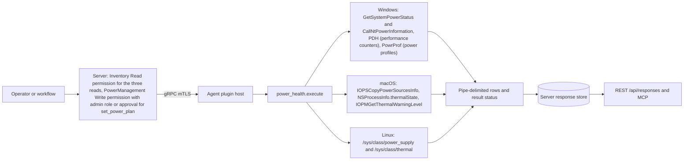
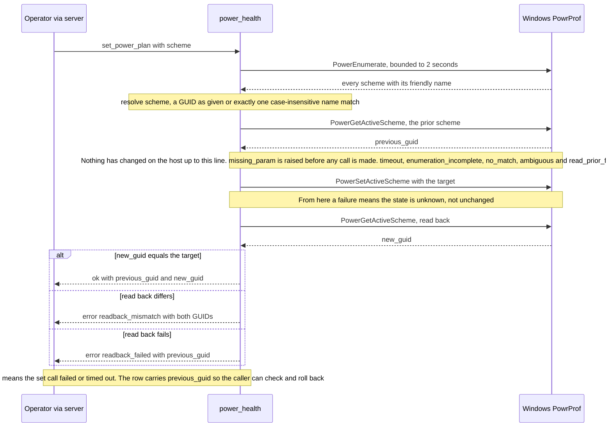
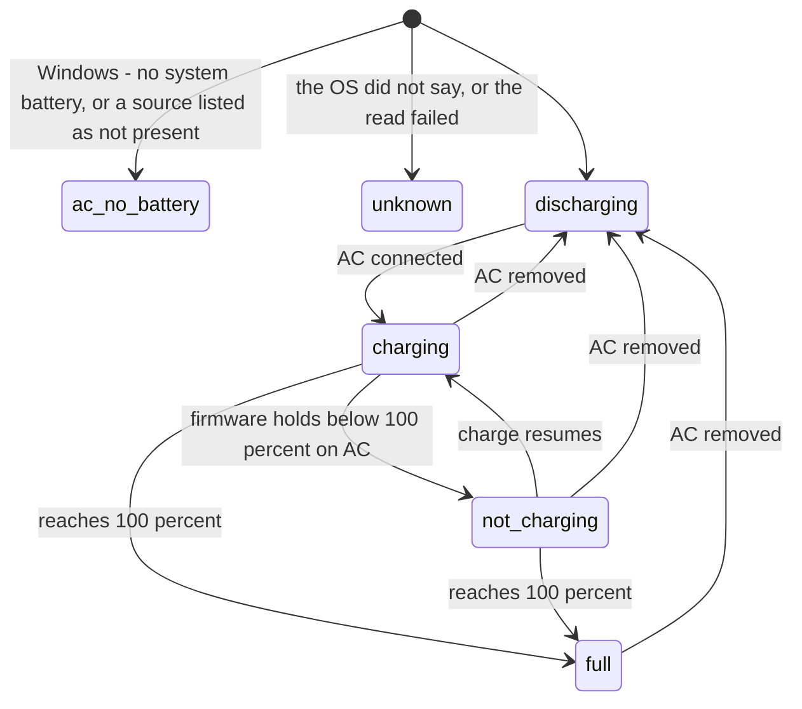
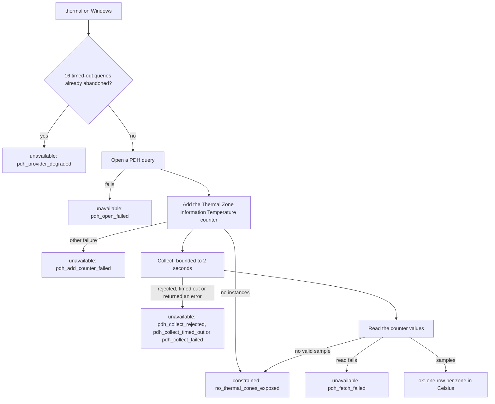

# power_health

<!-- BEGIN GENERATED: plugin-doc-gen header -->
| | |
|---|---|
| **What it does** | Battery, thermal, and power-plan inventory, plus a gated power-plan switch |
| **Version** | 1.0.0 |
| **Kind** | Action · mutating · gathered (crossplatform.power.battery, crossplatform.power.thermal, crossplatform.power.power_plan, crossplatform.power.set_power_plan) |
| **Platforms** | Windows ✅ · macOS ✅ · Linux 🟡 constrained |
| **Actions** | `battery` (definition `crossplatform.power.battery`) · `power_plan` (definition `crossplatform.power.power_plan`) · `set_power_plan` (definition `crossplatform.power.set_power_plan`) · `thermal` (definition `crossplatform.power.thermal`) |
| **Security** | `battery`: securable `Inventory` · operation Read · risk Low · dispatch ReadOnly · approval gate None; `thermal`: securable `Inventory` · operation Read · risk Low · dispatch ReadOnly · approval gate None; `power_plan`: securable `Inventory` · operation Read · risk Low · dispatch ReadOnly · approval gate None; `set_power_plan`: securable `PowerManagement` · operation Write · risk Medium · dispatch Destructive · approval gate AdminOrApproval |
| **Roles** | execute: `battery`: endpoint-admin, endpoint-operator; `thermal`: endpoint-admin, endpoint-operator; `power_plan`: endpoint-admin, endpoint-operator; `set_power_plan`: endpoint-admin · author: content-author |
<!-- END GENERATED -->

## How it works

`battery` reads the host's power sources and reports one row each: whether a battery is present, one of six states (`charging`, `discharging`, `full`, `not_charging`, `ac_no_battery`, `unknown`), charge percent and minutes to empty, with `-1` wherever the operating system gives no honest value. `thermal` reads per-zone temperatures in Celsius on Windows (Performance Data Helper, PDH, the Windows performance-counter interface) and Linux (`/sys/class/thermal`); on macOS it reports Apple's four-level thermal-pressure setting, never a temperature. `power_plan` lists the named Windows power schemes and marks the active one; macOS has no named schemes and Linux support is declared but not implemented. `set_power_plan` is the plugin's only mutating action, Windows only: it matches a friendly name exactly (ignoring case) to exactly one live scheme, or passes a GUID-shaped value to Windows as given, then reads the scheme that is active now, switches, reads the active scheme back and reports `ok` only when the read-back matches. It never edits a scheme's settings, never runs `powercfg`, and every call into PowrProf (the Windows power-profile API) and the PDH collect call is bounded to 2 seconds.

Deliberately not: the macOS battery leg never reads the `AppleSmartBattery` registry node, which exists even on a battery-less Mac mini and would report a phantom battery; Windows uses no WMI, no `powercfg` and no COM for any action; and a failed read is reported as a failure, never as an empty or zero reading, on Windows and Linux (through a failure row or a result status). Two exceptions: on macOS a failed power-source query returns an empty list, which looks the same as a host with no power source (`present` 0, `unknown`), and on Linux a supply whose `uevent` file cannot be opened is skipped without a trace.



### What you can decide with it

| Question | Action | Windows | macOS | Linux |
|---|---|---|---|---|
| Does this host have a battery, and is it charging, draining or held? | `battery` | Desktop: `present` 0 with `ac_no_battery`. Laptop: state, percent, minutes to empty (`-1` when Windows has no estimate) | Mac with a battery: state, percent, minutes to empty. Mac mini: `present` 0 with `unknown` (no power source listed) | One row per battery supply. No battery supply: `present` 0 with `unknown` |
| Is a docked laptop holding its charge below 100 percent? | `battery` | `not_charging` with `present` 1 | `not_charging` | `not_charging` (the kernel's own "Not charging") |
| How worn is the battery? | `battery` | Not answerable: `cycle_count` and `health_percent` are always `-1` | Not answerable: always `-1` | `cycle_count` and `health_percent` when the driver exposes them, otherwise `-1` |
| Is the machine hot? | `thermal` | Per-zone Celsius when the host exposes thermal zones; a host without them (often a desktop) gets a row saying why (see the thermal diagram) | `nominal`, `fair`, `serious` or `critical`, or `unknown` for a level this build does not recognise; a `,iopm_warning=<n>` suffix is added when macOS also reports a thermal warning level above zero; no temperature | Per-zone Celsius from sysfs; `constrained` when no zone is readable |
| Which power plans exist and which is active? | `power_plan` | Every scheme with GUID and name; `active` 1 on one row | Nothing: `unsupported_on_macos` | Nothing: `planned_not_implemented` |
| Switch the host to another plan | `set_power_plan` | Yes, with admin role or approval | No, never mutates | No, never mutates |

What a "clean" answer means. A battery row is a reading taken now, not a history: it cannot show wear on Windows or macOS, a trend, or whether the user unplugged a minute later. `present` 0 with `unknown` on macOS or Linux means the host listed no power source at all; `present` 1 with `unknown` means a battery exists but the OS declined to say what it is doing. A thermal row of `constrained` or `unavailable` is absence of data, not evidence the machine is cool. An `ok` from `set_power_plan` proves the active scheme was the target at the moment of the read-back; it does not prove the scheme stays active.

Safe workflow for `set_power_plan` (Windows only):

1. Run `power_plan` and copy the GUID of the scheme you want. A friendly name works only when it matches exactly one scheme, ignoring case; scheme names that contain non-ASCII characters can fail to match, so prefer the GUID.
2. Run `set_power_plan` with `scheme` set to that GUID. The action needs the `endpoint-admin` role or an approval.
3. Read the row: `set_power_plan|ok|-|<previous_guid>|<new_guid>` means the switch took.
4. To undo, run `set_power_plan` with `previous_guid` from step 3.

The plugin does not check a GUID-shaped value against the scheme list; Windows decides, and a GUID it rejects comes back as `set_failed`, an outcome that means the state is unknown, not unchanged (see Caveats).

Reading the support marks. The header shows, per OS, the best mark any single action reaches there, which is why macOS reads supported (because `battery` is) and Linux constrained. `docs/os-capability-matrix.md` grades the plugin as a delivered whole instead: Windows is the only OS where all four actions do something, so macOS and Linux are marked constrained there because they have no power-plan control and a thermal leg that is constrained. Use the per-action table under OS capability for a specific question.

### Diagrams

#### Plan switch: `set_power_plan`



The first half is read-only, so every refusal before the set call leaves the host exactly as it was. After the set call the plugin never claims "unchanged": a timed-out or unconfirmed switch may have landed, and every such row carries `previous_guid`, the value to feed back into `set_power_plan` to roll back.

#### Battery states



On macOS and Linux a host with no power source at all does not take the `ac_no_battery` arrow: it reports `unknown` with `present` 0. Only a source the OS lists but marks as not present reports `ac_no_battery` there.

The plugin keeps no state between runs; each run derives one of these readings afresh from the operating system, and the arrows only show how a real battery moves between them. `not_charging` is a reported reading, not a failure: a present battery on AC that is neither charging nor discharging and below 100 percent, typically held at a firmware charge threshold, which is the ordinary state of a docked laptop. `unknown` is reserved for a read that told the plugin nothing (on Windows, when both the status flag and the NT battery query are unreadable it also reports `present` 1 rather than claim the battery is absent).

#### Windows thermal read



Two different rows mean "no usable temperature". `constrained` with `no_thermal_zones_exposed` is the positive statement that the counter has no instances or no valid sample. `unavailable` with a `pdh_` token is a read that did not complete. The Windows capture, a bare-metal host with no battery, returned `unavailable` with `pdh_collect_failed`: the counter was added, and the collect call then returned an error, so it never reached the zero-instance branch. The row does not carry the PDH status code, so the exact cause is not recoverable from the result. A collect that times out leaves its query handle open on purpose (closing it could race the still-running call); after 16 such abandoned queries in one agent process the action stops trying and answers `pdh_provider_degraded` until the agent restarts.

## OS capability

<!-- BEGIN GENERATED: plugin-doc-gen capability -->
| Action | Windows | macOS | Linux |
|---|---|---|---|
| `battery` | ✅ supported · rung 1 · GetSystemPowerStatus + CallNtPowerInformation(SystemBatteryState) | ✅ supported · rung 1 · IOPSCopyPowerSourcesInfo/IOPSCopyPowerSourcesList | 🟡 constrained · rung 1 · /sys/class/power_supply uevent parsing |
| `power_plan` | ✅ supported · rung 1 · PowrProf PowerEnumerate + PowerReadFriendlyName + PowerGetActiveScheme | ⛔ unsupported | 🟡 planned · rung 1 · platform_profile |
| `set_power_plan` | ✅ supported · rung 1 · PowrProf PowerSetActiveScheme | ⛔ unsupported | 🟡 planned · rung 1 · platform_profile |
| `thermal` | 🟡 constrained · rung 1 · PDH \\Thermal Zone Information(*)\\Temperature | 🟡 constrained · rung 1 · NSProcessInfo.thermalState + IOPMGetThermalWarningLevel | 🟡 constrained · rung 1 · /sys/class/thermal zone parsing |

**Declared limits per leg** (descriptor fallback text, verbatim):

- **`battery` / Windows** — no-system-battery path measured live on the-rig (BatteryFlag=128); the battery-PRESENT path is now verified on real hardware (HP ZBook Firefly, PR #4009 review), which is what caught the AC-resting state being reported as unknown rather than not_charging
- **`battery` / macOS** — IOPS is used deliberately over the AppleSmartBattery IORegistry node, which is present, matched and active even on a battery-less Mac mini and would report a phantom battery; the battery-PRESENT path is fixture-tested and UNVERIFIED on real Mac battery hardware — the run host was a desktop
- **`battery` / Linux** — fixture-verified; no live Linux venue in this run
- **`power_plan` / Windows** — 4 schemes verified live on the-rig, 2026-09-04 (agrees with powercfg /list)
- **`power_plan` / macOS** — macOS has no named power schemes; IOPMSetPMPreferences is SPI — not adopted
- **`power_plan` / Linux** — declared only; not implemented in this package
- **`set_power_plan` / macOS** — macOS has no named power schemes; IOPMSetPMPreferences is SPI — not adopted
- **`set_power_plan` / Linux** — declared only; not implemented in this package
- **`thermal` / Windows** — zero live counter instances is the measured normal case on desktop hardware (the-rig, 2026-09-04); reports no_thermal_zones_exposed as an explicit success, never an error or a fabricated zero
- **`thermal` / macOS** — reports a 4-level thermal-pressure enum, never a temperature reading
- **`thermal` / Linux** — fixture-verified; no live Linux venue in this run
<!-- END GENERATED -->

## Privileges and prerequisites

| OS | Runs as | Extra grant needed | Measured | If the read is refused |
|---|---|---|---|---|
| Windows | Agent service account: LocalSystem (the built-in all-powerful Windows service account) today, not yet the intended virtual service account (`docs/agent-privilege-model.md`) | None known for the reads: they were measured only as `SYSTEM`, so the least OS right they need is not established. The OS right needed for `set_power_plan`'s `PowerSetActiveScheme` call was not tested. `set_power_plan` is also gated by the application-level `PowerManagement` Write permission (admin role or approval), which is a server rule and not an OS privilege | 2026-09-07 as `SYSTEM` (`docs/samples/windows.txt`); the plan switch itself was not run on the capture host | `battery`: result status `UNAVAILABLE`, "GetSystemPowerStatus failed". `thermal` failures are typed in the row (`unavailable` plus a `pdh_` token) and leave the result status undeclared |
| macOS | Agent daemon as root: the shipped LaunchDaemon has no `UserName` key (`docs/agent-privilege-model.md`). The plugin does not drop privilege | None: `IOPSCopyPowerSourcesInfo`, `NSProcessInfo.thermalState` and `IOPMGetThermalWarningLevel` are public interfaces that answer an unprivileged caller | 2026-09-07 as an ordinary non-root user (`docs/samples/macos.txt`), below the production identity | `battery`: an empty power-source list gives an empty row (`present` 0, `unknown`), never a permission error; a failed power-source query gives the same row. `thermal` has no refusal path |
| Linux | Agent daemon, dedicated unprivileged account (`yuzu-agent` on the packaged unit), never root by design (`docs/agent-privilege-model.md`) | None: `/sys/class/power_supply` and `/sys/class/thermal` are normally world-readable | 2026-09-06 in a container as root (`euid 0`), a more privileged identity than production (`docs/samples/linux.txt`) | `battery`: result status `CONSTRAINED`, "/sys/class/power_supply not readable". `thermal`: row `unavailable` with `sys_class_thermal_not_readable`, result status undeclared |

No external binaries, no subprocesses, no network access: the plugin makes only in-process OS API calls and file reads.

## Data contract

### Inputs

<!-- BEGIN GENERATED: plugin-doc-gen inputs -->
| Definition | Parameter | Type | Required | Default | Constraints | Description |
|---|---|---|---|---|---|---|
| `crossplatform.power.set_power_plan` | `scheme` | string | yes | - | - | Target power scheme — a GUID, or a friendly name that must match exactly one live scheme (case-insensitive). |
<!-- END GENERATED -->

### Outputs

Pipe-delimited rows via `write_output()`, one line per record. `thermal`'s field count varies by row (see below); every other action's row has a fixed field count. `-` marks an absent field, never an empty one.

<!-- BEGIN GENERATED: plugin-doc-gen outputs -->
**`crossplatform.power.battery` — `present|state|percent|time_to_empty_min|cycle_count|health_percent`**

| Field | Type | Values | Available | Example | Description |
|---|---|---|---|---|---|
| `present` | boolean | - | Windows, Linux, macOS | `0` | Whether a power source was found by the platform mechanism. Values: 1 (battery present), 0 (none) — a digit, never true/false. |
| `state` | string | - | Windows, Linux, macOS | `ac_no_battery` | Reported battery state. Values: charging, discharging, full, not_charging, ac_no_battery, unknown. |
| `percent` | int64 | - | Windows, Linux, macOS | `-1` | Battery charge percentage. Values: 0-100, or -1 (unknown). |
| `time_to_empty_min` | int64 | - | Windows, Linux, macOS | `-1` | Estimated minutes until empty. Values: non-negative integer, or -1 (unknown). |
| `cycle_count` | int64 | - | Linux | `-1` | Battery charge-cycle count. Neither GetSystemPowerStatus/ CallNtPowerInformation (Windows) nor IOPSKeys.h (macOS) expose a cycle counter, so this is structurally -1 on those two platforms; only the Linux leg has a real source (POWER_SUPPLY_CYCLE_COUNT). Values: non-negative integer, or -1 (unknown / not exposed by the platform mechanism). |
| `health_percent` | int64 | - | Linux | `-1` | Battery health as current-full-charge/design-capacity, derived only when the Linux kernel driver exposes both CHARGE_FULL and CHARGE_FULL_DESIGN. Windows and macOS have no equivalent source and are structurally -1. Values: 0-100, or -1 (unknown / not exposed by the platform mechanism). |

**`crossplatform.power.power_plan` — `guid|friendly_name|active|status`**

| Field | Type | Values | Available | Example | Description |
|---|---|---|---|---|---|
| `guid` | string | - | Windows | `381b4222-f694-41f0-9685-ff5bb260df2e` | Power scheme GUID, or "-" when no scheme rows were produced. Values: GUID string, or -. |
| `friendly_name` | string | - | Windows | `Balanced` | Operator-visible scheme name (Windows PowerReadFriendlyName; operator-settable via powercfg -changename, so it is untrusted input to the pipe-delimited grammar), or "-". Values: free text, or -. |
| `active` | string | - | Windows, Linux, macOS | `1` | Tri-state: "1" active, "0" not active/inapplicable, "-" only when every scheme WAS enumerated but the active-scheme read itself failed (status=active_unknown). Values: "0", "1", "-". |
| `status` | string | - | Windows, Linux, macOS | `ok` | Row outcome: ok (a real enumerated scheme), timeout, enumeration_incomplete, no_schemes_enumerated, active_unknown, unsupported_on_macos, or planned_not_implemented. Values: ok, timeout, enumeration_incomplete, no_schemes_enumerated, active_unknown, unsupported_on_macos, planned_not_implemented. |

**`crossplatform.power.set_power_plan` — `status|reason|previous_guid|new_guid`**

| Field | Type | Values | Available | Example | Description |
|---|---|---|---|---|---|
| `status` | string | - | Windows, Linux, macOS | `error` | Mutation outcome. Values: ok, error. |
| `reason` | string | - | Windows, Linux, macOS | `missing_param` | Failure token, or "-" on a success row. missing_param, timeout, enumeration_incomplete, ambiguous, no_match, read_prior_failed, set_failed, readback_failed, and readback_mismatch are Windows failure branches; unsupported_on_macos and planned_not_implemented are the permanent macOS/Linux postures. Values: missing_param, timeout, enumeration_incomplete, ambiguous, no_match, read_prior_failed, set_failed, readback_failed, readback_mismatch, unsupported_on_macos, planned_not_implemented, or -. |
| `previous_guid` | string | - | Windows | `-` | The scheme GUID active before the mutation attempt (read before any mutation runs), or "-" when not reached or not applicable. Values: GUID string, or -. |
| `new_guid` | string | - | Windows | `-` | The scheme GUID observed by the post-set read-back, or "-" when not reached. Values: GUID string, or -. |

**`crossplatform.power.thermal` — `status|zone_or_detail|celsius`**

| Field | Type | Values | Available | Example | Description |
|---|---|---|---|---|---|
| `status` | string | - | Windows, Linux, macOS | `ok` | Thermal read outcome. constrained is a positive claim of no sensors; unavailable means the read itself failed. Values: ok, constrained, unavailable. |
| `zone_or_detail` | string | - | Windows, Linux, macOS | `nominal` | The zone/sensor name on a Windows or Linux status=ok row, the macOS thermal-pressure level (nominal/fair/serious/critical) on a macOS status=ok row, or a failure/constrained token (no_thermal_zones_exposed, pdh_open_failed, pdh_add_counter_failed, pdh_collect_rejected, pdh_collect_timed_out, pdh_collect_failed, pdh_fetch_failed, pdh_provider_degraded, sys_class_thermal_not_readable) otherwise. Values: free text (zone name), nominal \| fair \| serious \| critical (macOS), or a fixed failure/constrained token. |
| `celsius` | number | - | Windows, Linux | `-` | Sensor temperature in Celsius. Present only on a status=ok row that carries a real per-zone reading (Windows/Linux); the field is omitted entirely (not "-") on every macOS row and on any non-ok row, which is why this column's field count varies by row — see the plugin README's Outputs section. Values: decimal degrees Celsius, or the field is absent. |
<!-- END GENERATED -->

### Result status

Most outcomes are carried in the row itself, not in the result status. `thermal` never sets a result status on any platform or branch. `battery` sets one only on two failure branches (Windows `GetSystemPowerStatus` failure, Linux unreadable `/sys/class/power_supply`); a clean read and a genuinely empty result both leave it unset. When a plugin sets no result status, the agent records the result as `UNDECLARED` / `UNKNOWN`, meaning the plugin made no claim about whether the data is complete; every sample shows this.

| Status | Completeness | Provenance | When |
|---|---|---|---|
| `OK` | full | (empty) | Windows `set_power_plan`: the switch was applied and the read-back matched the target |
| `UNAVAILABLE` | partial | "GetSystemPowerStatus failed" | Windows `battery`: the Win32 call itself failed |
| `CONSTRAINED` | partial | "/sys/class/power_supply not readable" | Linux `battery`: the sysfs directory could not be opened |
| `CONSTRAINED` | partial | "bounded_call timed out enumerating power schemes" / "PowerEnumerate ended on a non-terminal error; inventory is incomplete" / "failed to read the active scheme; active flag is unknown for every row" | Windows `power_plan`: enumeration timeout, incomplete enumeration, or active-scheme read failure |
| `UNAVAILABLE` | partial | "macOS has no named power schemes; IOPMSetPMPreferences is SPI, not adopted" / "power_plan is PLANNED (platform_profile) — not implemented in this package" | macOS and Linux `power_plan`: always |
| `CONSTRAINED` | partial | "bounded_call timed out enumerating power schemes; no mutation attempted" | Windows `set_power_plan`: the scheme enumeration timed out (row reason `timeout`) |
| `UNAVAILABLE` | partial | "missing required param 'scheme'" / "PowerEnumerate ended on a non-terminal error; refusing to resolve a scheme name against an incomplete inventory; no mutation attempted" / "scheme name matched more than one scheme; no mutation attempted" / "no scheme matched the given name/GUID; no mutation attempted" / "failed to read the prior active scheme; no mutation attempted" | Windows `set_power_plan`: every refusal before the set call (reasons `missing_param`, `enumeration_incomplete`, `ambiguous`, `no_match`, `read_prior_failed`) |
| `UNAVAILABLE` | partial | "PowerSetActiveScheme failed or timed out; the mutation was NOT confirmed and, on a timeout, may still have been applied — final state is unknown; previous_guid is reported for manual verification/revert" / "post-set read-back failed; the mutation may already be applied and final state is unknown — previous_guid is reported for manual verification/revert" / "post-set read-back scheme does not match the target; final state is uncertain" | Windows `set_power_plan`: failures at or after the set call (reasons `set_failed`, `readback_failed`, `readback_mismatch`); the final state is unknown |
| `UNAVAILABLE` | partial | "macOS has no named power schemes; no mutation attempted" / "power_plan mutation is PLANNED on Linux, not implemented; no mutation attempted" | macOS and Linux `set_power_plan`: always (exit code 1) |
| `UNDECLARED` | — | — | `thermal` everywhere; `battery` on every branch except the two failures above; Windows `power_plan` when enumeration and the active-scheme read both succeed |

### Where the data goes

- **Instruction result only.** Rows travel over the agent's mTLS gRPC channel as the command response and land in the server's response store, queryable at `/api/responses/{id}`. The device page's live Battery and Thermal cards dispatch `battery` and `thermal` on demand and render the same rows. `gather.ttlSeconds` (300 seconds for the reads, 60 for `set_power_plan`) is the window the agent has to respond, not a cache lifetime or a schedule.
- **Not consumed by** daily-sync inventory, the TAR warehouse, DEX (Digital Employee Experience) or metrics: the server references the plugin only in the capability catalogue (`server/core/src/capability_fragments.hpp` pulls in its capability declarations), the table of per-OS switchable units (`server/core/src/enablement_units.hpp`), the `PowerManagement` permission category seeded for role-based access control, and the device page's live cards, with no sync-source or TAR consumer. The switchable-unit table lists `battery` and `thermal` for Windows, Linux and macOS, and `power_plan` and `set_power_plan` for Windows and Linux; the Linux entries follow the "planned" declaration, so those two actions only return a `planned_not_implemented` row there.
- **Sensitivity.** Rows carry no device, person or software identifiers: `battery` and `thermal` report charge and thermal state, and `power_plan`'s `friendly_name` is an operator-settable scheme label (`Balanced`, `High performance`), never a serial number, hostname or account name; nothing here goes beyond the device id.
- **Siblings:** none for battery, thermal or power-plan state. TAR (the agent's forensic history recorder) has a power source that records sleep/wake and AC/battery transitions only.
- **MCP / REST.** Discover: `discover_plugins` (summary), then `yuzu://plugin-docs` (this page as data), then `discover_instructions` / `get_definition("crossplatform.power.battery")`. Run: `execute_instruction {definition_id, parameters}`. Read: `/api/responses/{id}`.

## Sample output

<!-- BEGIN GENERATED: plugin-doc-gen samples -->
**Windows** — captured: windows Microsoft Windows NT 10.0.26200.0 x64 · bare-metal · 2026-09-07 · SYSTEM · leg-hash 082db96f6e05

```
== action=battery
battery|0|ac_no_battery|-1|-1|-1|-1
[result_status] UNDECLARED / UNKNOWN

== action=thermal
thermal|unavailable|pdh_collect_failed
[result_status] UNDECLARED / UNKNOWN

== action=power_plan
power_plan|381b4222-f694-41f0-9685-ff5bb260df2e|Balanced|1|ok
power_plan|8c5e7fda-e8bf-4a96-9a85-a6e23a8c635c|High performance|0|ok
power_plan|a1841308-3541-4fab-bc81-f71556f20b4a|Power saver|0|ok
power_plan|b1000fa2-4bc5-4da1-b3b1-27c753763a67|AMD Ryzen™ Balanced|0|ok
[result_status] UNDECLARED / UNKNOWN

== action=set_power_plan
set_power_plan|error|missing_param|-|-
[result_status] UNAVAILABLE / PARTIAL / missing required param 'scheme'
[rc] 1
```

**macOS** — captured: macos macOS 26.6.2 arm64 · bare-metal · 2026-09-07 · euid 501 (jsmith) · leg-hash 082db96f6e05

```
== action=battery
battery|0|unknown|-1|-1|-1|-1
[result_status] UNDECLARED / UNKNOWN

== action=thermal
thermal|ok|nominal
[result_status] UNDECLARED / UNKNOWN

== action=power_plan
power_plan|-|-|0|unsupported_on_macos
[result_status] UNAVAILABLE / PARTIAL / macOS has no named power schemes; IOPMSetPMPreferences is SPI, not adopted

== action=set_power_plan
set_power_plan|error|unsupported_on_macos|-|-
[result_status] UNAVAILABLE / PARTIAL / macOS has no named power schemes; no mutation attempted
[rc] 1
```

**Linux** — captured: linux Debian GNU/Linux 13 (trixie) aarch64 · container · 2026-09-06 · euid 0 · leg-hash 082db96f6e05

```
== action=battery
battery|0|unknown|-1|-1|-1|-1
[result_status] UNDECLARED / UNKNOWN

== action=thermal
thermal|unavailable|sys_class_thermal_not_readable
[result_status] UNDECLARED / UNKNOWN

== action=power_plan
power_plan|-|-|0|planned_not_implemented
[result_status] UNAVAILABLE / PARTIAL / power_plan is PLANNED (platform_profile) — not implemented in this package

== action=set_power_plan
set_power_plan|error|planned_not_implemented|-|-
[result_status] UNAVAILABLE / PARTIAL / power_plan mutation is PLANNED on Linux, not implemented; no mutation attempted
[rc] 1
```
<!-- END GENERATED -->

## Caveats and known gaps

1. **Result status is mostly undeclared; read the row.** `thermal` never sets a result status and `battery` sets one only when the read itself fails, so a clean read, an empty result and a "no sensors" answer all show `UNDECLARED`. Key on the row's own `status` and `state` fields, and treat `UNDECLARED` as "no completeness claim", not as success.
2. **Windows thermal often returns no temperature, by two different routes.** A host with no thermal-zone instances gets `constrained` with `no_thermal_zones_exposed`, but the Windows capture host got `unavailable` with `pdh_collect_failed`, because the collect call returned an error rather than an empty set. The row does not record the PDH status code, so the two cannot be told apart from the result, and neither means the machine is cool.
3. **Battery coverage is uneven.** The Windows battery-present path was checked on one laptop model, and that run found the AC-resting case that is now `not_charging`; the macOS battery-present path and the whole Linux battery leg are fixture-tested only, with no capture on real battery hardware. Windows and macOS never report `cycle_count` or `health_percent`; only Linux does, when the kernel driver exposes them.
4. **A failed or unconfirmed `set_power_plan` leaves the state unknown.** Refusals before the set call (`missing_param`, `timeout`, `enumeration_incomplete`, `ambiguous`, `no_match`, `read_prior_failed`) change nothing, but `set_failed`, `readback_failed` and `readback_mismatch` do not claim "unchanged" because the switch may have landed; each carries `previous_guid` for checking and rollback. The capture host never ran a successful switch (the sample shows only the missing-parameter refusal), so the `ok` path is covered by the sequencing tests, not by a live capture.
5. **Power plans are Windows only.** macOS has no named power schemes and `IOPMSetPMPreferences` is private API that is deliberately not used; Linux `power_plan` and `set_power_plan` are declared against `platform_profile` and not implemented. Both return a typed `unsupported_on_macos` or `planned_not_implemented` row and never mutate.

## Source and tests

<!-- BEGIN GENERATED: plugin-doc-gen source -->
- Plugin: `agents/plugins/power_health/src/power_health_macos.mm` · `agents/plugins/power_health/src/power_health_parsers.hpp` · `agents/plugins/power_health/src/power_health_plugin.cpp`
- Definitions: `content/definitions/power_health.yaml`
- Capability rows: `server/core/src/capability_decls/plugin_action_catalogue_power_health.hpp`
- Tests: `tests/unit/test_power_health_local_dispatcher.cpp` · `tests/unit/test_power_health_parsers.cpp`
- Privilege row: `docs/agent-privilege-model.md` (no row yet)
<!-- END GENERATED -->
