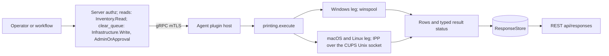
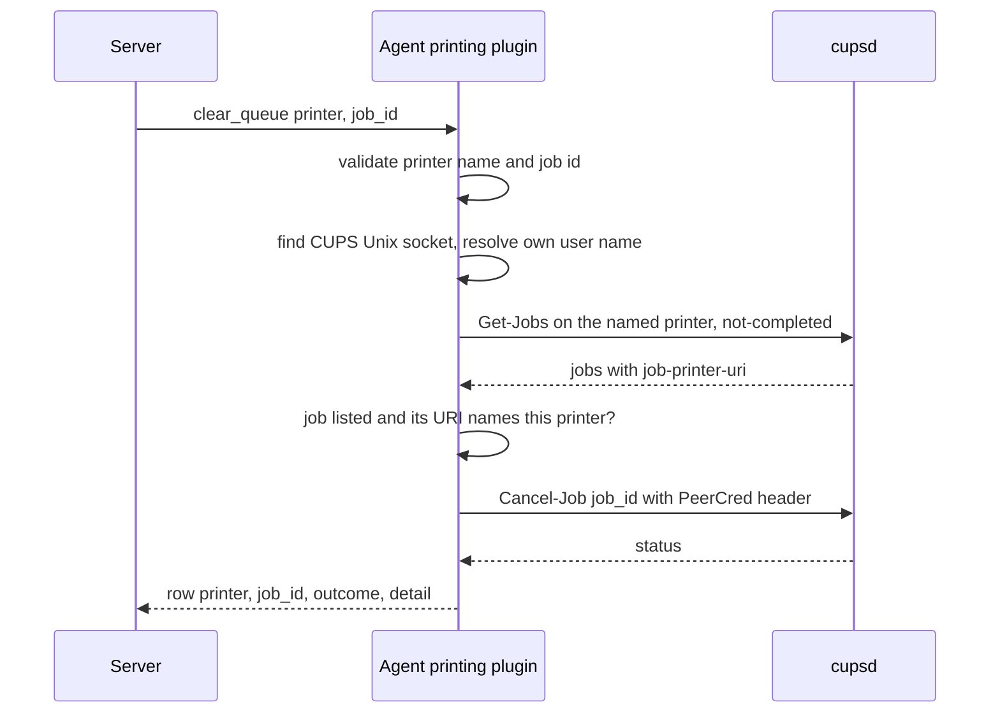
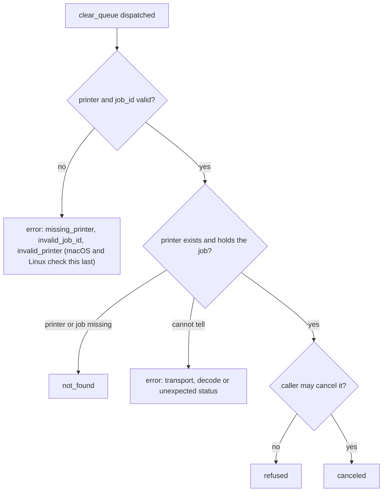

# printing

<!-- BEGIN GENERATED: plugin-doc-gen header -->
| | |
|---|---|
| **What it does** | Printer/job inventory plus a single narrowly-scoped clear_queue cancellation |
| **Version** | 1.0.0 |
| **Kind** | Action · mutating · gathered (crossplatform.printing.printers, crossplatform.printing.jobs, crossplatform.printing.clear_queue) |
| **Platforms** | Windows ✅ · macOS ✅ · Linux ✅ |
| **Actions** | `clear_queue` (definition `crossplatform.printing.clear_queue`) · `jobs` (definition `crossplatform.printing.jobs`) · `printers` (definition `crossplatform.printing.printers`) |
| **Security** | `printers`: securable `Inventory` · operation Read · risk Low · dispatch ReadOnly · approval gate None; `jobs`: securable `Inventory` · operation Read · risk Low · dispatch ReadOnly · approval gate None; `clear_queue`: securable `Infrastructure` · operation Write · risk Medium · dispatch Destructive · approval gate AdminOrApproval |
| **Roles** | execute: `printers`: endpoint-admin, endpoint-operator; `jobs`: endpoint-admin, endpoint-operator; `clear_queue`: endpoint-admin · author: content-author |
<!-- END GENERATED -->

## How it works

`printers` lists the print queues on the device and `jobs` lists the jobs that have not finished; both only read. `clear_queue` is the one action that changes anything: it cancels exactly one job, named by printer and job id, and never purges a queue. The plugin keeps no history, so a job that has finished, failed or been cancelled drops out of `jobs` and cannot be looked up again.

On macOS and Linux the plugin speaks IPP (RFC 8010, a small built-in encoder and decoder, no libcups) to the local CUPS daemon over its Unix socket. Reads fall back to `localhost:631` over TCP when no socket exists; `clear_queue` never does and is refused instead. On Windows the same reads call winspool (`EnumPrintersW`, `EnumJobsW`) in process.

`clear_queue` insists that the named printer really holds the job. On Windows the spooler looks the job up on the opened printer. On macOS and Linux cupsd's `Cancel-Job` looks a job up by id alone and ignores the printer, so the agent first asks for that printer's not-completed jobs and sends `Cancel-Job` only for an id that is listed there with a job printer URI naming that printer (compared case-insensitively). A job that is listed but carries no printer URI to confirm it is reported as an error and left alone. The check and the cancel are two requests, so a job moved to another queue between them is still cancelled by id. Cancelling cannot be undone from Yuzu: no action re-queues a job, so the way back is the user printing the document again from their own application.



The diagram shows the path every action takes. Reads need only the Inventory read permission; `clear_queue` needs write on the Infrastructure securable, is classed Destructive and Irreversible, and is gated on an administrator or an approval. The server records the audit row for the dispatch; the plugin writes none.

### What you can decide with it

| Question | Action | Windows | macOS | Linux |
|---|---|---|---|---|
| Which printers does this device have, which is the default, and are they stopped? | `printers` | Name, state, default flag, driver and port, queued job count. No printer-state reasons (winspool has none). | Name, state, reasons, default flag, make and model, URI, queued job count from CUPS. | Same as macOS. |
| What is waiting to print, for whom? | `jobs` (optionally one `printer`) | Jobs per printer with owner, document title, status, submit time and size. | The same from CUPS `Get-Jobs` with `which-jobs=not-completed`. | Same as macOS. |
| Is a queue stuck? | `jobs`, then `printers` | A job that stays `pending`, `held` or `stopped` across two reads, on a printer whose `state` is `stopped`. | Same. | Same. |
| Remove one stuck job | `clear_queue` | Cancels if the agent identity may cancel that job. | Same, subject to the cupsd policy below. | Reliable only for a job the agent's own account owns; another user's job is usually refused. |

Safe workflow for `clear_queue`: run `jobs` to read the exact `printer` and `job_id`, dispatch `clear_queue` to that one device with those two values, then run `jobs` again. `canceled` means the spooler or cupsd accepted the request, not that the job has left the queue; an actively printing job can take a moment. There is no preview and no undo. Each dispatch carries exactly one job id. Because a job id names a different document on every device, the server refuses a scope or broadcast dispatch of this action, and requires an explicit list of device ids, on these routes: REST `/api/command`, REST `/api/instructions/{id}/execute`, REST `/api/workflows/{id}/execute`, MCP `execute_instruction` and the dashboard command console. Schedules have no such targeting check, and a schedule with an empty scope fires at the whole fleet; there, the administrator-or-approval gate is the only control.

What a result does and does not prove:

- An empty `printer|none` or `job|none` with status `OK` means the spooler answered and listed nothing. It is not a failure; failures are `unavailable` rows with `CONSTRAINED` status.
- The plugin sees only what the local spooler holds. A job already handed to a network printer, a direct-IP printer, or a print server elsewhere is not on this device's queue.
- There is no job history, no page counts and no cost data, so it cannot answer "what was printed last week".
- `jobs.document` is the user's document title and is user content (see Sensitivity).

### Diagrams

`clear_queue` on macOS and Linux is a two-request sequence with a binding check in front of the cancel:



Nothing is sent to cupsd until the name and id validate and a socket and local identity exist. On macOS and Linux the checks run in this order: missing printer, invalid job id, no CUPS socket (`refused`), no local identity (`no_identity`), and only then an invalid printer name (`invalid_printer`), so a bad printer name with no socket is reported as `socket_unavailable`. If the listing does not hold the job on that printer, the sequence ends after the first request with `not_found` and no cancel is sent. The agent sends `Authorization: PeerCred <user name>` with each request. On Linux, a container capture showed cupsd authorising from the socket's kernel peer credentials whether or not the header was present. On macOS the plugin's own notes record that cupsd consults the peer credentials only when the header is sent, and the authorisation outcome for a job the caller does not own is unmeasured.

The outcome of a dispatch, on every OS, reduces to four values:



Use this tree to read the table below: `canceled` is the only success, `not_found` and `refused` are definite answers, and `error` means the plugin could not reach an answer (nothing is known about the job).

| Outcome | Result status | Completeness | Detail token | What to do |
|---|---|---|---|---|
| `canceled` | `OK` | full | `-` | Confirm with `jobs`. |
| `not_found` | `UNAVAILABLE` | full | `<os>:cups:not_found`, or `windows:winspool:printer_not_found` for a plain local name | The printer does not exist, or the job is not on it (finished, already cancelled, or on another queue). Re-read `jobs`. |
| `not_found` | `UNAVAILABLE` | partial | `windows:winspool:job_not_found`, or `windows:winspool:printer_not_found` for a name with a path separator or colon | Windows reported no such job, or a remote-looking name that may only be an unreachable server. Not definitive. |
| `refused` | `PERMISSION_DENIED` | full | `<os>:cups:access_denied`, `windows:winspool:access_denied`, or `<os>:cups:socket_unavailable` | The agent's identity is not allowed to cancel this job, or no CUPS socket exists. Nothing was cancelled. |
| `error` | `UNAVAILABLE` | partial | `missing_printer`, `invalid_job_id`, `invalid_printer`, `<os>:cups:connect_failed`, `decode_failed`, `no_identity`, `unexpected_status`, `windows:winspool:open_printer_failed`, `set_job_failed` | The request was malformed or the spooler did not give a usable answer. The job state is unknown; read `jobs` before retrying. |

## OS capability

<!-- BEGIN GENERATED: plugin-doc-gen capability -->
| Action | Windows | macOS | Linux |
|---|---|---|---|
| `clear_queue` | ✅ supported · rung 1 · winspool SetJobW JOB_CONTROL_CANCEL on one job id | 🟡 constrained · rung 1 · IPP Cancel-Job on one job id over the CUPS Unix socket with Authorization: PeerCred | 🟡 constrained · rung 1 · IPP Cancel-Job on one job id over the CUPS Unix socket with Authorization: PeerCred |
| `jobs` | ✅ supported · rung 1 · winspool EnumJobsW level 2 | ✅ supported · rung 1 · IPP Get-Jobs (which-jobs=not-completed) over the CUPS Unix socket | ✅ supported · rung 1 · IPP Get-Jobs (which-jobs=not-completed) over the CUPS Unix socket |
| `printers` | ✅ supported · rung 1 · winspool EnumPrintersW level 2 | ✅ supported · rung 1 · IPP CUPS-Get-Printers over the CUPS Unix socket (cpp-httplib) | ✅ supported · rung 1 · IPP CUPS-Get-Printers over the CUPS Unix socket (cpp-httplib) |

**Declared limits per leg** (descriptor fallback text, verbatim):

- **`clear_queue` / Windows** — cancel measured only under Administrators and SYSTEM (SYSTEM is today's agent identity, #1442); a least-privileged identity cancelling any job (its own or another user's) is unmeasured, and that a PRINTER_ACCESS_USE handle suffices for it is an extrapolation - see docs/agent-privilege-model.md
- **`clear_queue` / macOS** — PROVISIONAL — cupsd.conf Cancel-Job policy requires @OWNER/@AUTHKEY(system.print.operator)/@admin/@lpadmin (no @SYSTEM); header accepted by cupsd, authorisation outcome for a non-owned job UNMEASURED
- **`clear_queue` / Linux** — measured in a Debian/Ubuntu cupsd container: container root/@SYSTEM (SystemGroup root lpadmin) cancelling another user's job succeeds (status 0x0000, I93-7) — but the production Linux agent runs unprivileged (docs/agent-privilege-model.md), never root or @SYSTEM, so an ordinary non-owning cancel is correctly refused (403) before Cancel-Job is ever reached; reliable only for a job the agent's own identity owns
- **`jobs` / macOS** — localhost:631 fallback for reads when no socket is found
- **`jobs` / Linux** — localhost:631 fallback for reads when no socket is found
- **`printers` / macOS** — localhost:631 fallback for reads when no socket is found
- **`printers` / Linux** — localhost:631 fallback for reads when no socket is found
<!-- END GENERATED -->

## Privileges and prerequisites

| OS | Runs as | Extra grant needed | Measured | If the read is refused |
|---|---|---|---|---|
| Windows | agent service account (SYSTEM today) | None for reads: `EnumPrintersW`, `EnumJobsW` and `OpenPrinterW` need no elevated right. `clear_queue` opens the printer with `PRINTER_ACCESS_USE`; cancel was measured only under Administrators and `SYSTEM`, so a least-privileged identity cancelling any job, its own or another user's, is unmeasured (`docs/agent-privilege-model.md`). `EnumPrintersW`, the one call that can block on an unreachable network print server, is bounded to 5 seconds. The per-printer `OpenPrinterW` and `EnumJobsW` pair is deliberately not bounded, because abandoning a call that holds a live handle would race the close; `EnumJobsW` instead stops at 5000 rows per printer, and a per-printer RPC to an unreachable server can still hang | `SYSTEM` and an administrator session, reads and `clear_queue` cancel; see Sample output | n/a for reads, which do not fail closed: a Win32 failure or timeout on `EnumPrintersW` reports `CONSTRAINED`. For `clear_queue`, `ERROR_ACCESS_DENIED` from `OpenPrinterW` or `SetJobW` reports `PERMISSION_DENIED` (`refused`) |
| macOS | agent daemon, root (the LaunchDaemon has no `UserName` key; the dedicated-account model is not yet applied on macOS, see `docs/agent-privilege-model.md`) | None to read. `clear_queue` sends `Authorization: PeerCred` with the agent's own user name, and the plugin's notes record that on macOS cupsd reads the socket's peer credentials only when that header is present; the cupsd policy for cancelling a job the caller does not own is unmeasured for a root caller | Reads on a Mac with no printers configured; see Sample output | n/a for reads, which do not fail closed. `clear_queue` with no CUPS socket is `PERMISSION_DENIED` (`refused`); a 401/403 or IPP forbidden from cupsd is the same |
| Linux | agent daemon, dedicated unprivileged account, never root by design (`docs/agent-privilege-model.md`) | None to read. `clear_queue` reliably cancels only a job the agent's own account owns: measured in a cupsd container, container root (a `SystemGroup` member) cancelled another user's job, but an unprivileged non-owning caller is refused with HTTP 403 before `Cancel-Job` is reached | Reads and cancel in a Debian cupsd container as root; the unprivileged refusal is from cupsd policy, see Sample output | n/a for reads, which do not fail closed. A refused cancel is `PERMISSION_DENIED` (`refused`) |

No external binaries, no subprocesses and no shell-out. The IPP codec talks to cupsd's Unix socket (or `localhost:631` over TCP, reads only) through cpp-httplib directly; Windows uses in-process winspool calls. No network use beyond that local socket and loopback traffic, and the CUPS socket carries no TLS because it is local IPC.

## Data contract

### Inputs

<!-- BEGIN GENERATED: plugin-doc-gen inputs -->
| Definition | Parameter | Type | Required | Default | Constraints | Description |
|---|---|---|---|---|---|---|
| `crossplatform.printing.clear_queue` | `printer` | string | yes | - | minLength 1 · maxLength 256 | The printer's name, as shown by `printers`. The job must be on this printer: a job id that belongs to a different printer, or a printer that does not exist, is reported as not_found and nothing is cancelled. On macOS/Linux the destination URI that `jobs` prints (`ipp://localhost:631/printers/NAME`) is also accepted, a job submitted to a printer class is addressed by the class name, and a name over 127 bytes, containing control characters, or not valid UTF-8 (for example a pasted `%FF`) is refused (invalid_printer), as is, on Windows, a name containing a comma, a control character or invalid UTF-8. macOS/Linux match the name case-insensitively, as cupsd does. |
| `crossplatform.printing.clear_queue` | `job_id` | string | yes | - | pattern: ^[1-9][0-9]{0,8}$ | The job identifier to cancel, from the jobs action's job_id column. |
| `crossplatform.printing.jobs` | `printer` | string | no | - | maxLength 256 | Optional printer name to filter to. When omitted, jobs across every printer are listed. |
<!-- END GENERATED -->

### Outputs

Every row is pipe-delimited, one row per printer/job. `printers`/`jobs` report `<kind>|none` when the read succeeded but nothing was found (an honest empty result, never conflated with a read failure); a read that could not be made at all is a `<kind>|unavailable|<token>` row, with the token as in the status table below. A field the platform mechanism did not report is `-` for a string field or `-1` for a count/size the mechanism could not determine.

<!-- BEGIN GENERATED: plugin-doc-gen outputs -->
**`crossplatform.printing.clear_queue` — `printer|job_id|outcome|detail`**

| Field | Type | Values | Available | Example | Description |
|---|---|---|---|---|---|
| `printer` | string | - | Windows, Linux, macOS | `Office-LaserJet` | The printer the target job was on (its name; on macOS/Linux a pasted destination URI is reduced to the name), or "-" when the param itself was missing or invalid. |
| `job_id` | int64 | - | Windows, Linux, macOS | `42` | The job id targeted, or 0 when the param itself was missing/invalid. |
| `outcome` | string | - | Windows, Linux, macOS | `canceled` | Values: canceled, not_found, refused, error. `canceled` means the spooler/cupsd ACCEPTED the cancel request, not that the job has already left the queue: an actively printing job can take a moment to clear, so confirm with `jobs`. |
| `detail` | string | - | Windows, Linux, macOS | `-` | "-" on a successful cancel; otherwise a <os>:<source>:<detail> failure token, or missing_printer/invalid_job_id/invalid_printer for a parameter validation failure. |

**`crossplatform.printing.jobs` — `printer|job_id|owner|document|status|submitted_at|size_bytes`**

| Field | Type | Values | Available | Example | Description |
|---|---|---|---|---|---|
| `printer` | string | - | Windows, Linux, macOS | `ipp://localhost/printers/Office-LaserJet` | The printer this job is queued on (URI on the IPP leg, printer name on Windows), or "-" when unavailable. |
| `job_id` | int64 | - | Windows, Linux, macOS | `42` | Job identifier — the value clear_queue's job_id parameter targets. Values: 1 or greater. |
| `owner` | string | - | Windows, Linux, macOS | `jsmith` | The submitting user, or "-" when unavailable. |
| `document` | string | - | Windows, Linux, macOS | `hosts` | The job's document name/title, or "-" when unavailable. User content — see this definition's retention note above. |
| `status` | string | - | Windows, Linux, macOS | `processing` | Job status. Values: pending, held, processing, stopped, canceled, aborted, completed, unknown. |
| `submitted_at` | string | - | Windows, Linux, macOS | `2026-09-08T12:00:00Z` | ISO-8601 UTC submission timestamp, or "-" when unavailable. |
| `size_bytes` | int64 | - | Windows, Linux, macOS | `1024` | Job size in bytes, or -1 (unknown). |

**`crossplatform.printing.printers` — `name|state|state_reasons|is_default|make_model|uri|queued_jobs`**

| Field | Type | Values | Available | Example | Description |
|---|---|---|---|---|---|
| `name` | string | - | Windows, Linux, macOS | `Office-LaserJet` | Printer name/identifier as reported by the platform mechanism. |
| `state` | string | - | Windows, Linux, macOS | `idle` | Reported printer state. Values: idle, processing, stopped, unknown. |
| `state_reasons` | string | - | Windows, Linux, macOS | `-` | Comma-joined printer-state-reasons keywords, or "-" when none reported. winspool has no equivalent vocabulary and always reports "-". |
| `is_default` | boolean | - | Windows, Linux, macOS | `1` | Whether this is the system default printer. Values: 1, 0 — a digit, never true/false. |
| `make_model` | string | - | Windows, Linux, macOS | `Local Raw Printer` | Make/model string (IPP printer-make-and-model, or the winspool driver name), or "-" when unavailable. |
| `uri` | string | - | Windows, Linux, macOS | `ipp://localhost/printers/Office-LaserJet` | Printer URI (IPP printer-uri-supported, or the winspool port name), or "-" when unavailable. |
| `queued_jobs` | int64 | - | Windows, Linux, macOS | `0` | Number of jobs currently queued on this printer. Values: 0 or greater, or -1 (unknown — the mechanism did not report a count). |
<!-- END GENERATED -->

### Result status

`printers` and `jobs` report `OK` / full on every successful read, including a genuinely empty result (`printer|none`, `job|none`). Windows reports success or failure from the Win32 calls themselves; macOS and Linux also check the IPP response's own status code before treating zero rows as empty, so a request CUPS refuses (for example an unrecognised printer URI) is `CONSTRAINED`, never an empty queue. `clear_queue` sets an explicit status on every exit path: parameter validation, transport, authorization and the final cancel outcome. The outcome table under Diagrams maps these onto the four `clear_queue` outcomes. The Windows sample under Sample output shows `UNDECLARED` for `printers` and `jobs` because it was captured before the Windows leg declared a status; the source sets one on every path, and a fresh capture reports it.

| Status | Completeness | Provenance | When |
|---|---|---|---|
| `OK` | full | (empty) | every platform: a successful read, or `clear_queue` cancelling the job |
| `CONSTRAINED` | partial | `windows:winspool:enum_printers_failed` / `windows:winspool:open_printer_failed` / `windows:winspool:enum_jobs_failed` — `"CUPS-Get-Printers: transport failed"` / `linux:cups:connect_failed` / `macos:cups:connect_failed` — `"CUPS-Get-Printers: response did not decode"` / `linux:cups:decode_failed` / `macos:cups:decode_failed` — `"Get-Jobs: transport failed"` / `"Get-Jobs: response did not decode"` — `"CUPS-Get-Printers: unexpected status 0x⟨hex⟩"` / `"Get-Jobs: unexpected status 0x⟨hex⟩"` / `"Get-Jobs: printer name too long"` (`invalid_printer`) / `linux:cups:unexpected_status` / `macos:cups:unexpected_status` | Windows `printers`: `EnumPrintersW` failed or timed out (a bounded call — see Privileges and prerequisites). Windows `jobs`: the same `EnumPrintersW` failure, OR a specific printer's queue could not be opened (`OpenPrinterW` denied — NOT a bounded call), or its `EnumJobsW` read failed or was truncated at the row cap (also NOT a bounded call — see Privileges and prerequisites for why) — each is a per-printer skip, surfaced as `CONSTRAINED`/`PARTIAL` alongside whatever rows did succeed, never silently. macOS/Linux `printers`/`jobs`: the IPP round trip failed at the transport/decode step, or cupsd returned a status outside the successful range (RFC 8010 `0x0000`–`0x00FF`) — e.g. an unrecognised printer-uri, never silently read as zero rows. macOS/Linux `jobs` given a `printer` too long to encode into a request (the definition caps it at 256 bytes; only a dispatch that skipped that validation can exceed the IPP length limit of about 64 KiB) sends nothing and reports `job\|unavailable\|invalid_printer` |
| `UNAVAILABLE` | partial | `missing_printer` / `invalid_job_id` / `invalid_printer` — `windows:winspool:open_printer_failed` / `windows:winspool:printer_not_found` (names with a path separator or colon) / `windows:winspool:job_not_found` / `windows:winspool:set_job_failed` — `linux:cups:connect_failed` / `macos:cups:connect_failed` — `linux:cups:decode_failed` / `macos:cups:decode_failed` — `linux:cups:no_identity` / `macos:cups:no_identity` — `"Get-Jobs: unexpected status 0x⟨hex⟩"` / `"Cancel-Job: unexpected status 0x⟨hex⟩"` / `linux:cups:unexpected_status` / `macos:cups:unexpected_status` | `clear_queue` parameter validation failed (`printer` empty — `missing_printer`; `job_id` unparseable — `invalid_job_id`; or `printer` not usable — `invalid_printer`, shown as `-`: on macOS/Linux over 127 bytes, containing a control character, or not valid UTF-8 (for example a pasted `%FF`); on Windows containing a comma, a control character or invalid UTF-8 — a fully-refused request: nothing is sent to cupsd or the spooler), or the cancel itself could not complete: Windows `OpenPrinterW` failed for a reason other than not-found or access-denied (spooler stopped, RPC unavailable — the Win32 error is in the status detail, which the agent records in its log rather than sending on the wire); Windows reported a nonexistent job (`GetJobW`, or `SetJobW` if the job finished in between — `ERROR_INVALID_PARAMETER`), which is `PARTIAL` rather than `FULL` because that code was measured only under elevated identities; Windows `OpenPrinterW` returned `ERROR_INVALID_PRINTER_NAME` for a name containing a path separator or colon (`\\server\queue`, the `//server/queue` form the `printers`/`jobs` rows render, `http://…`), which the OS also returns for an unreachable server, so it is reported as `printer_not_found` but not as definitive; macOS/Linux could not resolve the agent's effective-user identity (an `error`, not a denial: the request is not sent and cupsd is never asked); or `SetJobW` failed for a reason other than access-denied or a vanished job (the Win32 error is in the status detail, which the agent records in its log rather than sending on the wire); macOS/Linux the pre-cancel `Get-Jobs` or the `Cancel-Job` round trip failed at the transport/decode step, or cupsd returned a status this plugin doesn't otherwise classify for either request, or the pre-cancel `Get-Jobs` lists the job without a printer URI that confirms which printer it is on (reported with `unexpected_status`; nothing is cancelled) |
| `UNAVAILABLE` | full | `windows:winspool:printer_not_found` (plain local names) — `linux:cups:not_found` / `macos:cups:not_found` | `clear_queue`: the target printer does not exist, or the job is not on it — Windows `OpenPrinterW` (`ERROR_INVALID_PRINTER_NAME`) for a plain local printer name (no path separator or colon); macOS/Linux: the named printer does not exist (cupsd answers the pre-cancel `Get-Jobs` with `client-error-not-found`, IPP `0x0406`), or the job is not on that printer's not-completed queue (including a job that was already cancelled or completed), or cupsd's own `0x0406` from `Cancel-Job` |
| `PERMISSION_DENIED` | full | `linux:cups:socket_unavailable` / `macos:cups:socket_unavailable` — `windows:winspool:access_denied` — `linux:cups:access_denied` / `macos:cups:access_denied` | `clear_queue` refused before or after attempting the cancel: macOS/Linux found no CUPS Unix socket at all (refuses outright rather than falling back to the `localhost:631` TCP path `printers`/`jobs` use for reads — a mutating action never takes that fallback); or the cancel (or, on macOS/Linux, the pre-cancel `Get-Jobs`) was refused for lack of authorization — Windows `OpenPrinterW` or `SetJobW` returned `ERROR_ACCESS_DENIED`, macOS/Linux cupsd's HTTP layer (401/403) or IPP response (`client-error-forbidden`/`not-authenticated`/`not-authorized`, `0x0401`/`0x0402`/`0x0403`) refused the caller. A `client-error-bad-request` (`0x0400`) is a protocol fault, not an authorization decision, and surfaces as `unexpected_status` — see Privileges and prerequisites for who is actually authorized to cancel whose job on each platform |

### Where the data goes

- **Instruction result.** Every row is server instruction-result data — the standard retention policy, served over REST `/api/responses`. Nothing here is a durable server-side table of its own.
- **Not consumed by** daily-sync, TAR, DEX, or metrics — the plugin never runs on a schedule outside an explicit instruction dispatch, and there is no agent daily-sync source for print queues.
- **Sensitivity.** `jobs.document` is the job's user-supplied document title or file name: user content, kept with instruction-result retention only and never forwarded to daily-sync, TAR or DEX. `jobs.owner` is a local account name on the device. A printer's `make_model` and `uri` can name an internal print server.
- **Siblings:** `crossplatform.printing.printers`, `crossplatform.printing.jobs`.

## Sample output

<!-- BEGIN GENERATED: plugin-doc-gen samples -->
**Windows** — captured: windows Windows 10.0.26200 x86_64 · bare-metal · 2026-09-08 · LocalSystem (elevated) · leg-hash a6ac30dd4945

```
== action=printers
printer|OneNote (Desktop)|idle|-|0|Send to Microsoft OneNote 16 Driver|nul:|0
printer|Microsoft XPS Document Writer|idle|-|0|Microsoft XPS Document Writer v4|PORTPROMPT:|0
printer|Microsoft Print to PDF|idle|-|1|Microsoft Print To PDF|PORTPROMPT:|0
printer|Fax|idle|-|0|Microsoft Shared Fax Driver|SHRFAX:|0
[result_status] UNDECLARED / UNKNOWN

== action=jobs
job|none
[result_status] UNDECLARED / UNKNOWN

== action=clear_queue
[not captured] Destructive/Irreversible: mutating action, not executed in a docs capture
```

**macOS** — captured: macos macOS 26.6.2 arm64 · bare-metal · 2026-09-14 · euid 501 · leg-hash a6ac30dd4945

```
== action=printers
printer|none
[result_status] OK / FULL

== action=jobs
job|none
[result_status] OK / FULL

== action=clear_queue
[not captured] Destructive/Irreversible: mutating action, not executed in a docs capture
```

**Linux** — captured: linux Debian GNU/Linux 13 (trixie) aarch64 · container · 2026-09-14 · euid 0 · leg-hash a6ac30dd4945

```
== action=printers
printer|yuzu_test|stopped|paused|0|Local Raw Printer|ipp://localhost:631/printers/yuzu_test|1
[result_status] OK / FULL

== action=jobs
job|ipp://localhost:631/printers/yuzu_test|1|-|-|pending|2026-09-14T17:27:40Z|1024
[result_status] OK / FULL

== action=clear_queue
[not captured] Destructive/Irreversible: mutating action, not executed in a docs capture
```
<!-- END GENERATED -->

## Caveats and known gaps

1. **`jobs` shows only not-completed jobs and only the local spooler.** A finished, failed or cancelled job stops appearing and cannot be looked up, and a job already handed to a network or direct-IP printer is not on this device's queue.
2. **Linux cancel is reliable only for the agent's own jobs.** The Linux agent runs unprivileged, so cupsd refuses a cancel of another user's job (HTTP 403) before `Cancel-Job` is reached; the leg is therefore declared constrained. The macOS cancel outcome for a job the caller does not own is unmeasured, and on Windows only Administrators and `SYSTEM` were measured.
3. **Cancel is two requests on macOS and Linux.** The listing check and `Cancel-Job` are separate round trips, so a job moved to another queue in between is still cancelled by id. The result `canceled` means the request was accepted; an actively printing job can take a moment to leave the queue.

## Source and tests

<!-- BEGIN GENERATED: plugin-doc-gen source -->
- Plugin: `agents/plugins/printing/src/printing_ipp.hpp` · `agents/plugins/printing/src/printing_parsers.hpp` · `agents/plugins/printing/src/printing_plugin.cpp`
- Definitions: `content/definitions/printing.yaml`
- Capability rows: `server/core/src/capability_decls/plugin_action_catalogue_printing.hpp`
- Tests: `tests/unit/server/test_printing_clear_queue_gate.cpp` · `tests/unit/test_printing_local_dispatcher.cpp` · `tests/unit/test_printing_parsers.cpp`
- Privilege row: `docs/agent-privilege-model.md`
<!-- END GENERATED -->
