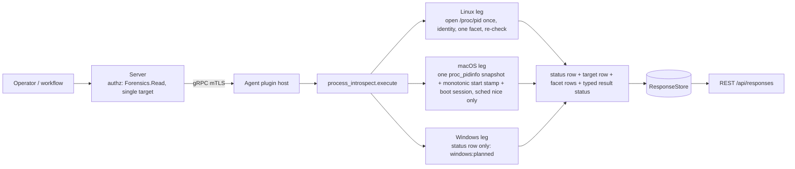

# process_introspect

<!-- BEGIN GENERATED: plugin-doc-gen header -->
| | |
|---|---|
| **What it does** | Per-process introspection of one pid, one facet per request: resource limits, signal masks, capabilities, seccomp, OOM and scheduling; numbers and masks only |
| **Version** | 1.0.0 |
| **Kind** | Collector · read-only · gathered (crossplatform.process_introspect.inspect) |
| **Platforms** | Windows 🟡 planned · macOS 🟡 constrained · Linux 🟡 constrained |
| **Actions** | `inspect` (definition `crossplatform.process_introspect.inspect`) |
| **Security** | securable `Forensics` · operation Read · risk High · dispatch ReadOnly · approval gate AdminOrApproval |
| **Roles** | execute: admin · author: content-author |
<!-- END GENERATED -->

## How it works

`inspect` answers one question about one process on this host: what is its security posture on one axis. A request names a numeric `pid` and one closed-enum `facet` (`resource_limits`, `sigmasks`, `caps`, `seccomp`, `oom` or `sched`); there is no `all` and no list, and names are never matched. Every emitted field is a validated number, a 16-digit hex mask, a validated CPU list or a token from a fixed table. The process name, command line, environment, memory, open files and sockets are not read, and a row can never carry them.

On Linux the leg opens `/proc/<pid>` once as a directory descriptor, without following a link, and reads every per-process file relative to that descriptor, so a recycled pid cannot be read through a stale path. The only reads by absolute path are the host-wide `boot_id` and, on the not-found path only, the mount table. It reads identity first: `stat` gives the process start time and `boot_id` the machine boot, and together they form the token `<boot_id first 8 hex>.<start time>`. If the request carries a `start_time` that differs, the answer is `pid_reused` and nothing else is read. Then the one facet's sources are read and parsed by pure functions, and `stat` is read again: a process that has gone, or a pid now owned by another process, discards every row (`torn_read`). The status row is written first, then the `target` row, then the facet rows.

A pid that is not found is not proof that the process is gone. On a `/proc` mounted with `hidepid=2` or above, the unprivileged agent gets the same not-found answer for another account's live process, so on that path only the leg reads `/proc/self/mountinfo` once; unless the `/proc` mount is shown without hiding, the answer is `no_such_process_or_hidden`, never a bare `no_such_process`. Windows reads nothing and answers one `unsupported` status row (`windows:planned`) through the shared leg reporter. No subprocess, ptrace, `/proc/<pid>/mem`, task port or write is used.

On macOS the leg uses libproc only and never requests a task port (`task_for_pid` and every `mach_vm_*` call are banned and pinned by `tests/test_process_introspect_no_task_port_lexical.py`). One `proc_pidinfo(PROC_PIDTBSDINFO)` call yields the wall-clock start time and the nice value, one `proc_pid_rusage(RUSAGE_INFO_V0)` call in the same bounded worker yields the monotonic start stamp (mach absolute time, which a wall-clock step cannot move), and the `kern.bootsessionuuid` sysctl yields the boot identity. The token keeps the same shape, `<first 8 hex of the boot session id, lower case>.<1 to 20 digits>`, where the digits are one 64-bit FNV-1a fold of the wall-clock start (seconds * 1000000 + microseconds) and the monotonic stamp, in decimal (an opaque number, not a time). Both stamps are fixed at fork and survive an exec (measured: unchanged across one `sh` to `sleep` exec on one host), and no other field of `proc_bsdinfo` qualifies: `ppid`, `uid`/`gid` and their real and saved forms, `flags`, `status`, the process group and the tty can all change legitimately in one process's life and would refuse a live process as `pid_reused`, and the process name is never read. Identity and the nice value come from one dispatch, there is no re-read and the macOS leg never answers `torn_read`. A supplied `start_time` that differs answers `pid_reused` and nothing else is emitted (the nice value arrives in the same snapshot and is discarded). Only the nice value of `sched` is read; the other five facets are decided before any read and answer one `unsupported` status row, so they cannot be used to probe whether a pid exists, and a `start_time` is not checked for them. These three macOS answers (`sched:nice_only`, `not_exposed_by_libproc`, `no_os_equivalent`) are permanent, not a degraded read: do not retry or alert on them. They are permanent in this plugin: libproc exposes no such read, or macOS has no such concept. The process name in the kernel's struct is never copied.

| Facet | Source (Linux) | Rows | Disclosed | Bounds | macOS answer |
|---|---|---|---|---|---|
| `resource_limits` | `limits` | `limit` per kernel limit, 16 names | soft and hard limit as a number or `unlimited`, unit from a fixed table | 8,192 bytes read | `unsupported`, `not_exposed_by_libproc` |
| `sigmasks` | `status` | `sigmask` x5 | pending, shared pending, blocked, ignored and caught signal masks, 16 hex digits (which thread's: caveat 3) | 16,384 bytes read | `unsupported`, `not_exposed_by_libproc` |
| `caps` | `status` | `cap` x5 | inheritable, permitted, effective, bounding and ambient capability sets, 16 hex digits | 16,384 bytes read | `unsupported`, `no_os_equivalent` |
| `seccomp` | `status` | `seccomp` | mode (`disabled`, `strict`, `filter`), installed filter count and `NoNewPrivs` when the kernel reports them | 16,384 bytes read | `unsupported`, `no_os_equivalent` |
| `oom` | `oom_score`, `oom_score_adj` | `oom` | the two integers | 64 bytes each | `unsupported`, `not_exposed_by_libproc` |
| `sched` | `stat`, `status` | `sched` | policy token, nice value, realtime priority, allowed-CPU list | 4,096 and 16,384 bytes; CPU list at most 4,096 characters | `constrained`, `sched:nice_only`: the nice value only, `sched\|-\|<nice>\|-\|-` |

macOS exposes no per-process resource-limit or signal-mask read through libproc (`libproc.h` and `sys/proc_info.h` carry none, and `proc_pid_rusage` returns usage, not limits), and has no capability sets, seccomp or OOM score. The policy libproc reports for a task is a kernel constant, so it is not emitted. The leg reports no realtime priority, because the Linux 0 to 99 range has no counterpart in what libproc reports for the process, and no CPU list, because macOS has no CPU affinity list.

On Linux the mount table is read only when the pid is not found, up to 1 MiB; a table over that size reads as unknown and gives the weaker answer.



## OS capability

<!-- BEGIN GENERATED: plugin-doc-gen capability -->
| Action | Windows | macOS | Linux |
|---|---|---|---|
| `inspect` | 🟡 planned · rung 1 · NtQueryInformationProcess and toolhelp snapshots | 🟡 constrained · rung 1 · libproc proc_pidinfo(PROC_PIDTBSDINFO) and the kern.bootsessionuuid sysctl; no task port | 🟡 constrained · rung 1 · bounded reads of /proc/<pid>/{stat,status,limits,oom_score,oom_score_adj} through one directory descriptor opened once per dispatch |

**Declared limits per leg** (descriptor fallback text, verbatim):

- **`inspect` / Windows** — not read yet: one unsupported status row, windows:planned
- **`inspect` / macOS** — constrained: of the six facets only sched is read, and of it only the nice value (policy, realtime priority and CPU list read as a dash); resource_limits, sigmasks and oom are not exposed by libproc and caps and seccomp have no macOS equivalent, so each answers one unsupported status row and reads nothing; these answers and the constrained sched status are permanent, not a degraded read: do not retry or alert on them; a process of another account answers permission_denied unless the agent runs as root (root not measured); for sched, a supplied start_time that no longer matches is refused as pid_reused (the other five facets are answered before any read and never check it); the libproc call has a 5 second deadline: no answer reads deadline_exceeded, and while that call is still blocked in the kernel the next dispatch reads abandoned_call_pending instead of starting another; the token folds the wall-clock start with the monotonic start stamp (one more libproc call, proc_pid_rusage(RUSAGE_INFO_V0)), so a pid recycled after a wall-clock step still reads pid_reused; the start time survives an exec, so the token does not tell a program from the one it exec'd into
- **`inspect` / Linux** — constrained: six facets (resource_limits, sigmasks, caps, seccomp, oom, sched), one facet per dispatch; numbers, masks and fixed tokens only; a supplied start_time that no longer matches is refused as pid_reused and a process that changed during the read as torn_read; on a /proc mounted with hidepid 2 or above another account's process answers no_such_process_or_hidden (the mount table is read only when the pid is not found); a thread id reads that thread; an exec during the read is not detected
<!-- END GENERATED -->

## Privileges and prerequisites

| OS | Runs as | Extra grant needed | Measured | If the read is refused |
|---|---|---|---|---|
| Windows | n/a: the leg reads nothing (caveat 5) | None | n/a | `status\|inspect\|unsupported\|windows:planned`, result `UNAVAILABLE` |
| macOS | agent daemon; the shipped LaunchDaemon runs as root (`docs/agent-privilege-model.md`), but root was not measured | None: libproc `proc_pidinfo` of a process of the same account needs no grant, and neither does the sysctl. SIP and TCC do not gate this read; the kernel's same-account check does, so another account's process answers `permission_denied` unless the agent runs as root | Measured 2026-11-22 on one host, macOS 26.6.2 arm64, SIP enabled, as uid 501 (an ordinary account, not root; root and a negative nice value were not measured). Against a same-account process: `constrained`, `sched:nice_only` with the nice value (a throwaway `sleep` at nice 5, and a same-account Apple platform daemon at nice 0). Against pid 1 (root-owned): `permission_denied`. For `caps` on the sleeper: `unsupported`, `caps:no_os_equivalent`. A pid that does not exist answers `no_such_process`. The nice value read through libproc was checked against `ps` for the throwaway process | `status\|inspect\|permission_denied\|macos:process_introspect:permission_denied`, result `PERMISSION_DENIED` / partial; only a real EPERM or EACCES from the kernel produces it, never a refusal made up by the plugin |
| Linux | agent daemon, dedicated unprivileged account (`yuzu-agent` on the packaged unit), never root by design (`docs/agent-privilege-model.md`) | None: the five per-process files, `boot_id` and the mount table are world-readable. `CAP_DAC_READ_SEARCH`, which the packaged unit grants, does not lift `hidepid`. Under `hidepid=1` another account's process answers `permission_denied`; under `hidepid=2` or above it answers `no_such_process_or_hidden`. An operator can tell by looking for `hidepid=` on the `/proc` line of `/proc/self/mountinfo` | Measured 2026-11-17 on one disposable test host, Ubuntu 26.04.1 LTS under WSL2, kernel 6.18.58.1-microsoft-standard-WSL2 x86_64, in a private pid and mount namespace; none of this was measured on another kernel or distribution. The committed sample ran as euid 0 (see Sample output). As uid 65534 against a root-owned sleeper, with `hidepid` off, all six facets answered `supported`. In throwaway pid and mount namespaces on the same host, as uid 65534 against a root-owned sleeper: `hidepid=2` answered `no_such_process_or_hidden`, and `hidepid=1` answered `permission_denied`, so the `/proc/<pid>` open is refused rather than reported as not found; as uid 65534 with `boot_id` masked by a mode-000 bind mount, `permission_denied`. As euid 0, a `tmpfs` over `/proc` answered `no_such_process_or_hidden` and a `/proc` mounted `subset=pid` (no `boot_id`) answered `identity_unreadable`. The `yuzu-agent` account itself was not measured | `status\|inspect\|permission_denied\|linux:process_introspect:permission_denied`, result `PERMISSION_DENIED` / partial; a facet source refused after the target opened is `linux:process_introspect:<facet>:permission_denied` and the answer is `constrained` (or `permission_denied` when no facet row was produced) |

No external binaries, no subprocesses, no network use. On Linux the plugin opens one directory and makes at most five bounded reads (`stat` twice, `boot_id`, and the facet's one or two sources); when the `/proc/<pid>` open is not found it reads only the mount table. On macOS it makes one `proc_pidinfo` call and one `proc_pid_rusage` call (both on the one bounded worker) and one `kern.bootsessionuuid` sysctl read.

## Data contract

### Inputs

<!-- BEGIN GENERATED: plugin-doc-gen inputs -->
| Definition | Parameter | Type | Required | Default | Constraints | Description |
|---|---|---|---|---|---|---|
| `crossplatform.process_introspect.inspect` | `pid` | string | yes | - | pattern: ^([1-9][0-9]{0,8}\|1[0-9]{9}\|20[0-9]{8}\|21[0-3][0-9]{7}\|214[0-6][0-9]{6}\|2147[0-3][0-9]{5}\|21474[0-7][0-9]{4}\|214748[0-2][0-9]{3}\|2147483[0-5][0-9]{2}\|21474836[0-3][0-9]\|214748364[0-7])$ | The numeric process id to inspect, 1 to 2147483647 with no leading zero (e.g. 4242). One process per request; names are never matched. |
| `crossplatform.process_introspect.inspect` | `facet` | string | yes | - | enum: resource_limits, sigmasks, caps, seccomp, oom, sched | Which part of the process to read: resource_limits, sigmasks, caps, seccomp, oom or sched. One facet per request. |
| `crossplatform.process_introspect.inspect` | `start_time` | string | no | - | pattern: ^([0-9a-f]{8}\.[0-9]{1,20})?$ | Optional identity guard. The token is field 2 of the `target` row of an earlier inspect of the same pid; no other plugin or action emits it, so the first inspect of a pid is always unguarded and the guard only links one inspect to the next. If the pid now belongs to a different process the request is refused as pid_reused (on macOS for sched only; the other five facets answer unsupported without checking it). Leave empty for no guard. |
<!-- END GENERATED -->

### Outputs

The first row is always `status|inspect|<state>|<reason or ->`. A completed read then writes one `target|<pid>|<start_time token>|<facet>` row and the facet's rows; a refusal writes the status row alone. Row grammars by `row_kind`: `limit|<name>|<soft>|<hard>|<unit>`, `sigmask|<which>|<hex16>`, `cap|<which>|<hex16>`, `seccomp|<mode>|<filters>|<no_new_privs>`, `oom|<score>|<score_adj>` and `sched|<policy>|<nice>|<rt_priority>|<cpus>`. A `-` marks a value the kernel did not report or that could not be validated; on macOS the `sched` row is always `sched|-|<nice>|-|-`, the policy, realtime priority and CPU list being dashes by design. Field 2 of the `target` row is the only source of a `start_time` token: no other plugin or action emits it, so the first inspect of a pid is always unguarded and the token only links one inspect to the next. The Linux sample shows the `caps` facet and the macOS sample shows the `sched` facet; the other facets emit the row grammars above and are covered by the unit fixtures, not by the samples.

<!-- BEGIN GENERATED: plugin-doc-gen outputs -->
**`crossplatform.process_introspect.inspect` — `row_kind|field_1|field_2|field_3|field_4`**

| Field | Type | Values | Available | Example | Description |
|---|---|---|---|---|---|
| `row_kind` | string | `status` `target` `limit` `sigmask` `cap` `seccomp` `oom` `sched` | Windows, Linux, macOS | `sigmask` | Row shape discriminator (field 0). Values: status, target, limit, sigmask, cap, seccomp, oom, sched. |
| `field_1` | string | - | Windows, Linux, macOS | `blocked` | status: the literal "inspect". target: the pid inspected. limit: the limit name (cpu_time, file_size, data_size, stack_size, core_file_size, resident_set, processes, open_files, locked_memory, address_space, file_locks, pending_signals, msgqueue_size, nice_priority, realtime_priority, realtime_timeout). sigmask: pending, shared_pending, blocked, ignored or caught. cap: inheritable, permitted, effective, bounding or ambient. seccomp: the mode (disabled, strict, filter) or "-". oom: the OOM score, or "-". sched: the scheduling policy (other, fifo, rr, batch, idle, deadline, ext, unknown), or "-" on macOS. |
| `field_2` | string | - | Windows, Linux, macOS | `0000000000000000` | status: supported, constrained, permission_denied, unavailable or unsupported (the Windows planned leg, the permanent macOS facet answers, and a leg that threw). target: the start-time token, <8 hex of the boot id>.<process start time>, to pass back as start_time. limit: the soft limit, a number or unlimited. sigmask and cap: the 16-digit hex mask. seccomp: the number of installed filters, or "-". oom: the OOM score adjustment, or "-". sched: the nice value (on macOS the only value read). |
| `field_3` | string | - | Windows, Linux, macOS | `unlimited` | status: reason token(s) for a non-supported read, "-" when complete; tokens look like linux:process_introspect:pid_reused or macos:process_introspect:sched:nice_only. target: the facet inspected. limit: the hard limit, a number or unlimited. seccomp: NoNewPrivs, 0 or 1, or "-". sched: the realtime priority, 0 to 99, or "-" on macOS. |
| `field_4` | string | - | Linux, macOS | `bytes` | limit: the unit (seconds, bytes, count, microseconds, none). sched: the allowed-CPU list such as 0-7 or 0,2,4, or "-" when it could not be read. On macOS always "-". Not used by the other kinds. |
<!-- END GENERATED -->

### Result status

Every read sets a typed result status; a degraded read is `CONSTRAINED`, never an empty `OK`.

| Status | Completeness | Provenance | When |
|---|---|---|---|
| `OK` | full | (empty) | The target was read, identity held across the read, and every source the facet needs was read and parsed, so at least one facet row was produced |
| `CONSTRAINED` | partial | `macos:process_introspect:sched:nice_only` (permanent on macOS: a completed `sched` read answers `CONSTRAINED` with this token, never `OK`) / `macos:process_introspect:sched:malformed` (a nice value outside -20 to 20, with the `target` row only) / `linux:process_introspect:<facet>:permission_denied` / `linux:process_introspect:<facet>:read_failed` / `linux:process_introspect:<facet>:malformed` / `linux:process_introspect:<facet>:oversized` / `linux:process_introspect:resource_limits:unknown_row` | A source of the requested facet was refused, failed, was over its byte cap, or was missing a required key or had an invalid value; the rows that were produced are returned. A required key (every `Sig*`, every `Cap*`, `Seccomp`, `Cpus_allowed_list`, both OOM values, the limits header) that is absent or invalid reads `<facet>:malformed`, so no facet answers `OK` with nothing in it. `resource_limits:unknown_row` means a limits line this plugin does not know was counted and not shown |
| `PERMISSION_DENIED` | partial | `linux:process_introspect:permission_denied` / `linux:process_introspect:<facet>:permission_denied` / `macos:process_introspect:permission_denied` | The `/proc/<pid>` open or the identity read was refused (macOS: the kernel refused `proc_pidinfo` or the boot-session sysctl with EPERM or EACCES), or every source of the facet was refused and no facet row was produced |
| `UNAVAILABLE` | unknown | `process_introspect:invalid_pid` / `process_introspect:invalid_facet` / `process_introspect:invalid_start_time` | The request failed validation on the agent (the command also returns 1); nothing was read |
| `UNAVAILABLE` | unknown | `linux:process_introspect:no_such_process` / `linux:process_introspect:no_such_process_or_hidden` / `linux:process_introspect:identity_unreadable` / `linux:process_introspect:pid_reused` / `linux:process_introspect:torn_read` (and the `macos:process_introspect:` forms of `no_such_process`, `identity_unreadable` and `pid_reused`; macOS never answers `torn_read`) | No such process (or, with `_or_hidden`, not visible to this account); identity could not be read; the pid now belongs to another process than the supplied `start_time`; or the process exited or was replaced during the read and every row was discarded |
| `UNAVAILABLE` | unknown | `macos:process_introspect:<facet>:not_exposed_by_libproc` (`resource_limits`, `sigmasks`, `oom`) / `macos:process_introspect:<facet>:no_os_equivalent` (`caps`, `seccomp`) | Permanent, not a degraded read: do not retry or alert on them. One `status\|inspect\|unsupported\|<token>` row and nothing else; nothing was read, even when a `start_time` was supplied |
| `UNAVAILABLE` | unknown | `macos:process_introspect:deadline_exceeded` / `macos:process_introspect:abandoned_call_pending` | The libproc call did not answer within its 5 second deadline (`deadline_exceeded`), or an earlier call is still blocked in the kernel and none was started (`abandoned_call_pending`). Nothing was read and no row is emitted; never an empty success |
| `UNAVAILABLE` | unknown | `windows:planned` / `linux:planned` | The leg reads nothing (caveat 5): the action answers `status\|inspect\|unsupported\|windows:planned` and nothing else. `linux:planned` and `macos:planned` are the shared reporter's tokens and are not emitted by this plugin's Linux or macOS legs |
| `UNAVAILABLE` | unknown | `linux:leg:exception` / `macos:leg:exception` / `windows:leg:exception` | The leg threw: one `status\|inspect\|unsupported\|<os>:leg:exception` row and the command returns 0 |

### What to do about a token

| Token | Terminal or retryable | Action |
|---|---|---|
| `no_such_process` | Terminal for that pid | The process exited, or never existed; list processes again. On macOS a zombie also answers this (measured on macOS 26.6.2, uid 501) |
| `no_such_process_or_hidden` | Terminal on this host | A hidden process and a missing one cannot be told apart under `hidepid=2` or above; `gid=` and `CAP_SYS_PTRACE` exemptions are not evaluated |
| `pid_reused` | Terminal for that token | The pid was recycled; inspect again without `start_time` |
| `torn_read` | Retryable (Linux only) | The process changed during the read; run again. macOS never answers it |
| `permission_denied`, `<facet>:permission_denied` | Retryable after a mount or policy change | `hidepid=1` hides other accounts' processes from an unprivileged agent. On macOS: a process of another account, refused by the kernel; a retry does not help unless the agent runs as root |
| `<facet>:read_failed` | Usually terminal for that kernel; retry once | The read failed. A descriptor or memory shortage or an I/O error also lands here and may clear, so retry once before treating it as permanent. A source file that is absent after identity was read answers `torn_read` instead |
| `<facet>:malformed` | Terminal for that kernel | A required key is missing or has an unexpected value on this kernel. On macOS only `sched:malformed` exists: the nice value is outside -20 to 20, the answer is `CONSTRAINED` with the `target` row only, and a retry reads the same value |
| `<facet>:oversized` | Terminal for that process on the status-backed facets | The source is over its byte cap. For `sigmasks`, `caps`, `seccomp` and `sched` the size follows the process's `Groups` line (caveat 4), so another process may read fine |
| `identity_unreadable` | Retryable once; if it repeats for every pid, a host condition | `stat` or `boot_id` could not be read or parsed, or the `/proc/<pid>` open failed for a reason other than not found or refused. Repeated for every pid it means a restricted `/proc` or an unreadable `boot_id`. On macOS: `proc_pidinfo` failed with an errno other than ESRCH, EPERM or EACCES, the start stamp was unusable, or the boot-session sysctl failed or was not a hex id |
| `deadline_exceeded`, `abandoned_call_pending` | Retryable later; `abandoned_call_pending` clears by itself | macOS only. `deadline_exceeded`: the libproc call did not answer in 5 seconds (the target is stuck in the kernel exec step, caveat 3) and its worker was abandoned. `abandoned_call_pending`: that worker has not returned yet, so no new call was started, for any pid. Retry after a while; if it never clears, the agent thread is held until the kernel releases it (caveat 3) |
| `resource_limits:unknown_row` | Terminal for that kernel | The kernel's limits file holds a row this plugin does not know; the known rows are returned and the unknown ones are not shown |
| `process_introspect:invalid_pid`, `process_introspect:invalid_facet`, `process_introspect:invalid_start_time` | Terminal for that request | The request failed validation on the agent and nothing was read; fix the parameter and send again |
| `sched:nice_only` (macOS) | Permanent, not a degraded read | A completed `sched` read on macOS answers `CONSTRAINED` with this token because libproc exposes only the nice value; do not retry or alert on it |
| `<facet>:not_exposed_by_libproc`, `<facet>:no_os_equivalent` (macOS) | Permanent, not a degraded read | libproc has no such read (`resource_limits`, `sigmasks`, `oom`) or macOS has no such concept (`caps`, `seccomp`); a later run answers the same: do not retry or alert on them |
| `windows:planned` | Terminal on that OS | The leg reads nothing today (caveat 5) |
| `<os>:leg:exception` | Retryable once | The leg threw. Ignore any rows earlier in that response: a leg that threw part-way can leave rows it had already written. The command returns 0 |

### Where the data goes

- **Instruction result.** Every row is server instruction-result data under the Forensics tier: stored under the standard response retention, served over REST `/api/responses` and MCP only to a caller who also holds `Forensics:Read`.
- **Not consumed by** the daily sync, Echo, DEX or metrics: the action runs on demand only, against one named device.
- **Default off, and how to turn it on.** The plugin is Forensics-class and ships off: the server seeds a default-off kill switch at boot, so nothing dispatches until an operator runs `PUT /api/v1/plugin-config/process_introspect/kill-switch {"enabled":true}` (`PluginConfig:Write`, audited as `plugin_config.kill_switch.set`; the MCP twin is `set_plugin_kill_switch`). After that, dispatch is gated at `Forensics:Read` with `AdminOrApproval` (Administrator by default; a non-admin needs a delegated `Forensics:Read` grant plus an approval) and names exactly one device per request (scheduled runs excepted, see `docs/authz-model.md`). The switch is one all-OS row: enabling it makes `inspect` dispatchable on Linux and macOS agents alike. To exclude one OS, add an off row for it (`?os=darwin` with `{"enabled":false}`); a per-OS row can narrow the all-OS row but never widen it. While the switch is off, every surface refuses the dispatch as a permission-class denial and sends nothing: REST `/api/command` answers 403 "permission denied: Forensics:Read" even to an Administrator (the one refusal that does not name the switch), the dashboard execute console answers "Not permitted: kill_switched", and MCP `execute_instruction` and instruction execute (REST and MCP) answer "dispatch denied: the per-action kill switch is OFF for process_introspect.inspect" (reason `kill_switched`, REST 403). The switch is checked when a command is dispatched: disabling stops new dispatches, a run already in flight completes, and a delayed or staggered command already sent still runs (up to 10 minutes).
- **Sensitivity.** Rows give the security posture of one named process on one named machine (its capability sets, seccomp state and signal handling), which is reconnaissance material. The `start_time` token embeds 8 hex digits of the per-boot random id of the machine (on macOS, of `kern.bootsessionuuid`). The committed samples were taken on a disposable Linux test host and on a macOS development Mac (bare metal, an ordinary account). On macOS the second half of the token is a one-way fold of the process's wall-clock and monotonic creation stamps (not a readable time), and the rows carry only a nice value, that token and whether the pid exists; under the shipped root LaunchDaemon that read is expected not to be limited to one account's processes (root was not measured, only an ordinary account), and the capability-set, seccomp and signal-handling content described above is Linux only. No process name, path, command-line argument, environment value or content appears in any row.
- **Siblings:** `crossplatform.process.list` (the process list, and the source of a `pid`) and the other Forensics-tier plugins (`remote_access_audit`, `privacy_permissions`, `execution_artifacts`, `browser_inventory`, `app_usage`, and `file_search`, whose stored rows are in the Forensics read tier while its dispatch stays on `FileRetrieval`).

## Sample output

<!-- BEGIN GENERATED: plugin-doc-gen samples -->
**macOS** — captured: macos macOS 26.6.2 arm64 · bare-metal · 2026-11-24 · euid 501 · leg-hash f46b598757de

```
== action=inspect pid=2743 facet=sched
status|inspect|constrained|macos:process_introspect:sched:nice_only
target|2743|ef25df78.17348789716386304698|sched
sched|-|10|-|-
[result_status] CONSTRAINED / PARTIAL / macos:process_introspect:sched:nice_only
```

**Linux** — captured: linux Ubuntu 26.04.1 LTS x86_64 · vm · 2026-11-17 · euid 0 · leg-hash f46b598757de

```
== action=inspect pid=75 facet=caps
status|inspect|supported|-
target|75|2664b550.15539926|caps
cap|inheritable|0000000000000000
cap|permitted|000001ffffffffff
cap|effective|000001ffffffffff
cap|bounding|000001ffffffffff
cap|ambient|0000000000000000
[result_status] OK / FULL
```
<!-- END GENERATED -->

## Caveats and known gaps

1. **One switch and one permission cover every facet.** The plugin has a single kill switch and a single `Forensics:Read` catalogue row. File or memory contents, environment values, socket payloads and command-line arguments are a new action with its own row, never a new facet.
2. **A hidden process reads as not found (Linux); macOS refuses by account.** On a `/proc` mounted `hidepid=2` or above, a not-found pid answers `no_such_process_or_hidden` because the two cannot be told apart. `gid=` and `CAP_SYS_PTRACE` exemptions are not evaluated, and a mount table over 1 MiB reads as unknown, so those hosts get the weaker, still true answer. On macOS SIP and TCC do not gate this read: on the measured host a same-account Apple platform process read normally, and only another account's process (pid 1) was refused, by the kernel's same-account check (`permission_denied`). The macOS leg reports what the kernel answers and never refuses on its own; root, which is what the shipped macOS agent runs as, and negative nice values were not measured (a nice value is read as the signed 32-bit value the SDK declares and accepted from -20 to 20). A bare numeric pid addresses the agent's own `/proc` and pid namespace, so a pid that exists only in a sibling pid namespace is not found there and answers `no_such_process` (`no_such_process_or_hidden` under `hidepid=2` or above).
3. **Torn reads are detected on exit only (Linux), and an exec is not detected.** A process that exits during the read gives `torn_read`. An exec keeps the pid and start time, so values may straddle it and that is not detected. On macOS the start time is the kernel's wall-clock creation stamp at microsecond resolution and survives an exec (measured as unchanged across three execs of one same-account process on one host, macOS 26.6.2, uid 501; a setuid or translated exec was not measured), so, as on Linux, the token does not tell a program from the one it exec'd into. A wall-clock step cannot make two processes share a token: the token also folds the monotonic start stamp (`ri_proc_start_abstime`, from the public `proc_pid_rusage`), which strictly increases within a boot session, so a recycled pid reads `pid_reused` even when the wall clock was stepped back and the new wall-clock start equals the old one to the microsecond. What remains, stated exactly: two distinct processes with the same pid, the same wall-clock start to the microsecond, the same monotonic stamp (impossible within one boot session for processes started at different times; across a reboot it also needs the first 8 hex digits of the boot session id to match), or an accidental collision of the 64-bit fold (about 2^-64; FNV-1a is not a cryptographic hash, but neither stamp is attacker-chosen); plus one race, a pid recycled in the microseconds between the `proc_pidinfo` and `proc_pid_rusage` calls, which yields a token that matches neither process (a supplied token then reads `pid_reused`, an unguarded inspect carries the first process's nice value under a token that names neither). The monotonic stamp was measured on one host only (macOS 26.6.2, uid 501) and, like `proc_pidinfo`, answers EPERM for another account's process, so the permission behaviour is unchanged. A zombie answers `no_such_process` (measured on macOS 26.6.2, uid 501). A thread id is accepted by `/proc` and reads that thread. The pending and blocked signal masks, the capability sets, the seccomp state and the scheduling values (policy, nice, realtime priority and allowed CPUs) belong to the thread the id names, which is the main thread for a process id; the shared pending, ignored and caught masks, the limits and the OOM values are process-wide. On macOS the libproc call is bounded: the kernel makes `proc_pidinfo` wait, uninterruptibly, while the target pid is inside its exec step, and it stalls only if another thread that holds a reference on that pid is itself blocked (read from the public kernel source, not reproduced). The call runs on one worker owned by agent-core with a 5 second deadline. At the deadline the dispatch answers `deadline_exceeded` (`UNAVAILABLE`, never an empty success) and the worker is abandoned, because a blocked kernel call cannot be cancelled: it holds one agent thread (not a command worker) until the kernel releases it, and while it does, every further dispatch to any pid answers `abandoned_call_pending` instead of starting a second blocked thread. When the worker returns, dispatches read normally again with no restart. The bounded call lives in agent-core because a detached thread in a plugin that can be unloaded would be a use-after-unload; the general bound for every other plugin's calls remains #3925.
4. **Linux masks are 16 hex digits, and one status read is capped.** A platform with 128 signals would report `sigmasks:malformed` and no mask rows, never `OK`. A process with more than about a thousand supplementary groups can push `status` past the 16,384-byte cap, so `sigmasks`, `caps` and `seccomp` answer `<facet>:oversized` with the `target` row only and `sched` keeps its `stat`-derived row with the CPU list `-` (measured 2026-11-17 as euid 0 against a process with 5000 groups, a 25,293-byte file, on one Ubuntu 26.04.1 LTS WSL2 host, kernel 6.18.58.1-microsoft-standard-WSL2: `oom` was unaffected and other processes on the host read fine; not measured on another kernel).
5. **Other Linux facets and the Windows leg are planned; five macOS facets are permanently unsupported.** Listing facets for Linux and a Windows leg are later changes; today Windows answers one `unsupported` status row. On macOS this plugin reads only the nice value of `sched` and the other five facets are permanent `unsupported` answers (see the facet table); a mechanism that reads more (code-signing flags, sandbox state, jetsam band, per-thread scheduling) needs its own ruling and design note (#8580): the macOS SDK declares a per-thread scheduling read (another libproc flavour) and a code-signing status read (the Security framework), neither measured here and both outside this plugin's libproc allow-list.

## Source and tests

<!-- BEGIN GENERATED: plugin-doc-gen source -->
- Plugin: `agents/plugins/process_introspect/src/process_introspect_legs.hpp` · `agents/plugins/process_introspect/src/process_introspect_linux.cpp` · `agents/plugins/process_introspect/src/process_introspect_macos.cpp` · `agents/plugins/process_introspect/src/process_introspect_parsers.hpp` · `agents/plugins/process_introspect/src/process_introspect_plugin.cpp`
- Definitions: `content/definitions/process_introspect.yaml`
- Capability rows: `server/core/src/capability_decls/plugin_action_catalogue_process_introspect.hpp`
- Tests: `tests/test_process_introspect_definition.py` · `tests/test_process_introspect_no_task_port_lexical.py` · `tests/unit/test_process_introspect_legs.cpp` · `tests/unit/test_process_introspect_local_dispatcher.cpp` · `tests/unit/test_process_introspect_parsers.cpp`
- Privilege row: `docs/agent-privilege-model.md`
- Changelog: `changelog.d/2026-11-16-process_introspect-inspect.added.md` · `changelog.d/8070-process_introspect-macos-leg.added.md`
<!-- END GENERATED -->
