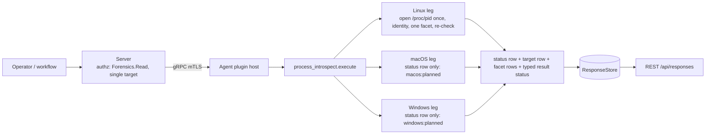

# process_introspect

<!-- BEGIN GENERATED: plugin-doc-gen header -->
| | |
|---|---|
| **What it does** | Per-process introspection of one pid, one facet per request: resource limits, signal masks, capabilities, seccomp, OOM and scheduling; numbers and masks only |
| **Version** | 1.0.0 |
| **Kind** | Collector · read-only · gathered (crossplatform.process_introspect.inspect) |
| **Platforms** | Windows 🟡 planned · macOS 🟡 planned · Linux 🟡 constrained |
| **Actions** | `inspect` (definition `crossplatform.process_introspect.inspect`) |
| **Security** | securable `Forensics` · operation Read · risk High · dispatch ReadOnly · approval gate AdminOrApproval |
| **Roles** | execute: admin · author: content-author |
<!-- END GENERATED -->

## How it works

`inspect` answers one question about one process on this host: what is its security posture on one axis. A request names a numeric `pid` and one closed-enum `facet` (`resource_limits`, `sigmasks`, `caps`, `seccomp`, `oom` or `sched`); there is no `all` and no list, and names are never matched. Every emitted field is a validated number, a 16-digit hex mask, a validated CPU list or a token from a fixed table. The process name, command line, environment, memory, open files and sockets are not read, and a row can never carry them.

On Linux the leg opens `/proc/<pid>` once as a directory descriptor, without following a link, and reads every per-process file relative to that descriptor, so a recycled pid cannot be read through a stale path. The only reads by absolute path are the host-wide `boot_id` and, on the not-found path only, the mount table. It reads identity first: `stat` gives the process start time and `boot_id` the machine boot, and together they form the token `<boot_id first 8 hex>.<start time>`. If the request carries a `start_time` that differs, the answer is `pid_reused` and nothing else is read. Then the one facet's sources are read and parsed by pure functions, and `stat` is read again: a process that has gone, or a pid now owned by another process, discards every row (`torn_read`). The status row is written first, then the `target` row, then the facet rows.

A pid that is not found is not proof that the process is gone. On a `/proc` mounted with `hidepid=2` or above, the unprivileged agent gets the same not-found answer for another account's live process, so on that path only the leg reads `/proc/self/mountinfo` once; unless the `/proc` mount is shown without hiding, the answer is `no_such_process_or_hidden`, never a bare `no_such_process`. macOS and Windows read nothing and answer one `unsupported` status row (`macos:planned`, `windows:planned`) through the shared leg reporter. No subprocess, ptrace, `/proc/<pid>/mem`, task port or write is used.

| Facet | Source (Linux) | Rows | Disclosed | Bounds |
|---|---|---|---|---|
| `resource_limits` | `limits` | `limit` per kernel limit, 16 names | soft and hard limit as a number or `unlimited`, unit from a fixed table | 8,192 bytes read |
| `sigmasks` | `status` | `sigmask` x5 | pending, shared pending, blocked, ignored and caught signal masks, 16 hex digits (which thread's: caveat 3) | 16,384 bytes read |
| `caps` | `status` | `cap` x5 | inheritable, permitted, effective, bounding and ambient capability sets, 16 hex digits | 16,384 bytes read |
| `seccomp` | `status` | `seccomp` | mode (`disabled`, `strict`, `filter`), installed filter count and `NoNewPrivs` when the kernel reports them | 16,384 bytes read |
| `oom` | `oom_score`, `oom_score_adj` | `oom` | the two integers | 64 bytes each |
| `sched` | `stat`, `status` | `sched` | policy token, nice value, realtime priority, allowed-CPU list | 4,096 and 16,384 bytes; CPU list at most 4,096 characters |

The mount table is read only when the pid is not found, up to 1 MiB; a table over that size reads as unknown and gives the weaker answer.



## OS capability

<!-- BEGIN GENERATED: plugin-doc-gen capability -->
| Action | Windows | macOS | Linux |
|---|---|---|---|
| `inspect` | 🟡 planned · rung 1 · NtQueryInformationProcess and toolhelp snapshots | 🟡 planned · rung 1 · libproc proc_pidinfo, no task port | 🟡 constrained · rung 1 · bounded reads of /proc/<pid>/{stat,status,limits,oom_score,oom_score_adj} through one directory descriptor opened once per dispatch |

**Declared limits per leg** (descriptor fallback text, verbatim):

- **`inspect` / Windows** — not read yet: one unsupported status row, windows:planned
- **`inspect` / macOS** — not read yet: one unsupported status row, macos:planned
- **`inspect` / Linux** — constrained: six facets (resource_limits, sigmasks, caps, seccomp, oom, sched), one facet per dispatch; numbers, masks and fixed tokens only; a supplied start_time that no longer matches is refused as pid_reused and a process that changed during the read as torn_read; on a /proc mounted with hidepid 2 or above another account's process answers no_such_process_or_hidden (the mount table is read only when the pid is not found); a thread id reads that thread; an exec during the read is not detected
<!-- END GENERATED -->

## Privileges and prerequisites

| OS | Runs as | Extra grant needed | Measured | If the read is refused |
|---|---|---|---|---|
| Windows | n/a: the leg reads nothing (caveat 5) | None | n/a | `status\|inspect\|unsupported\|windows:planned`, result `UNAVAILABLE` |
| macOS | n/a: the leg reads nothing (caveat 5) | None | n/a | `status\|inspect\|unsupported\|macos:planned`, result `UNAVAILABLE` |
| Linux | agent daemon, dedicated unprivileged account (`yuzu-agent` on the packaged unit), never root by design (`docs/agent-privilege-model.md`) | None: the five per-process files, `boot_id` and the mount table are world-readable. `CAP_DAC_READ_SEARCH`, which the packaged unit grants, does not lift `hidepid`. Under `hidepid=1` another account's process answers `permission_denied`; under `hidepid=2` or above it answers `no_such_process_or_hidden`. An operator can tell by looking for `hidepid=` on the `/proc` line of `/proc/self/mountinfo` | Measured 2026-11-17 on one lane, Ubuntu 26.04.1 LTS under WSL2, kernel 6.18.58.1-microsoft-standard-WSL2 x86_64, in a private pid and mount namespace; none of this was measured on another kernel or distribution. The committed sample ran as euid 0 (see Sample output). As uid 65534 against a root-owned sleeper, with `hidepid` off, all six facets answered `supported`. In throwaway pid and mount namespaces on the same lane, as uid 65534 against a root-owned sleeper: `hidepid=2` answered `no_such_process_or_hidden`, and `hidepid=1` answered `permission_denied`, so the `/proc/<pid>` open is refused rather than reported as not found; as uid 65534 with `boot_id` masked by a mode-000 bind mount, `permission_denied`. As euid 0, a `tmpfs` over `/proc` answered `no_such_process_or_hidden` and a `/proc` mounted `subset=pid` (no `boot_id`) answered `identity_unreadable`. The `yuzu-agent` account itself was not measured | `status\|inspect\|permission_denied\|linux:process_introspect:permission_denied`, result `PERMISSION_DENIED` / partial; a facet source refused after the target opened is `linux:process_introspect:<facet>:permission_denied` and the answer is `constrained` (or `permission_denied` when no facet row was produced) |

No external binaries, no subprocesses, no network use: the plugin opens one directory and makes at most five bounded reads (`stat` twice, `boot_id`, and the facet's one or two sources); when the `/proc/<pid>` open is not found it reads only the mount table.

## Data contract

### Inputs

<!-- BEGIN GENERATED: plugin-doc-gen inputs -->
| Definition | Parameter | Type | Required | Default | Constraints | Description |
|---|---|---|---|---|---|---|
| `crossplatform.process_introspect.inspect` | `pid` | string | yes | - | pattern: ^([1-9][0-9]{0,8}\|1[0-9]{9}\|20[0-9]{8}\|21[0-3][0-9]{7}\|214[0-6][0-9]{6}\|2147[0-3][0-9]{5}\|21474[0-7][0-9]{4}\|214748[0-2][0-9]{3}\|2147483[0-5][0-9]{2}\|21474836[0-3][0-9]\|214748364[0-7])$ | The numeric process id to inspect, 1 to 2147483647 with no leading zero (e.g. 4242). One process per request; names are never matched. |
| `crossplatform.process_introspect.inspect` | `facet` | string | yes | - | enum: resource_limits, sigmasks, caps, seccomp, oom, sched | Which part of the process to read: resource_limits, sigmasks, caps, seccomp, oom or sched. One facet per request. |
| `crossplatform.process_introspect.inspect` | `start_time` | string | no | - | pattern: ^([0-9a-f]{8}\.[0-9]{1,20})?$ | Optional identity guard. The token is field 2 of the `target` row of an earlier inspect of the same pid; no other plugin or action emits it, so the first inspect of a pid is always unguarded and the guard only links one inspect to the next. If the pid now belongs to a different process the request is refused as pid_reused. Leave empty for no guard. |
<!-- END GENERATED -->

### Outputs

The first row is always `status|inspect|<state>|<reason or ->`. A completed read then writes one `target|<pid>|<start_time token>|<facet>` row and the facet's rows; a refusal writes the status row alone. Row grammars by `row_kind`: `limit|<name>|<soft>|<hard>|<unit>`, `sigmask|<which>|<hex16>`, `cap|<which>|<hex16>`, `seccomp|<mode>|<filters>|<no_new_privs>`, `oom|<score>|<score_adj>` and `sched|<policy>|<nice>|<rt_priority>|<cpus>`. A `-` marks a value the kernel did not report or that could not be validated. Field 2 of the `target` row is the only source of a `start_time` token: no other plugin or action emits it, so the first inspect of a pid is always unguarded and the token only links one inspect to the next. The committed sample shows the `caps` facet only; the other five facets emit the row grammars above and are covered by the unit fixtures, not by the sample.

<!-- BEGIN GENERATED: plugin-doc-gen outputs -->
**`crossplatform.process_introspect.inspect` — `row_kind|field_1|field_2|field_3|field_4`**

| Field | Type | Values | Available | Example | Description |
|---|---|---|---|---|---|
| `row_kind` | string | `status` `target` `limit` `sigmask` `cap` `seccomp` `oom` `sched` | Windows, Linux, macOS | `sigmask` | Row shape discriminator (field 0). Values: status, target, limit, sigmask, cap, seccomp, oom, sched. |
| `field_1` | string | - | Windows, Linux, macOS | `blocked` | status: the literal "inspect". target: the pid inspected. limit: the limit name (cpu_time, file_size, data_size, stack_size, core_file_size, resident_set, processes, open_files, locked_memory, address_space, file_locks, pending_signals, msgqueue_size, nice_priority, realtime_priority, realtime_timeout). sigmask: pending, shared_pending, blocked, ignored or caught. cap: inheritable, permitted, effective, bounding or ambient. seccomp: the mode (disabled, strict, filter) or "-". oom: the OOM score, or "-". sched: the scheduling policy (other, fifo, rr, batch, idle, deadline, ext, unknown). |
| `field_2` | string | - | Windows, Linux, macOS | `0000000000000000` | status: supported, constrained, permission_denied, unavailable or unsupported (the planned legs, and a leg that threw). target: the start-time token, <8 hex of the boot id>.<process start time>, to pass back as start_time. limit: the soft limit, a number or unlimited. sigmask and cap: the 16-digit hex mask. seccomp: the number of installed filters, or "-". oom: the OOM score adjustment, or "-". sched: the nice value. |
| `field_3` | string | - | Windows, Linux, macOS | `unlimited` | status: reason token(s) for a non-supported read, "-" when complete; tokens look like linux:process_introspect:pid_reused or macos:planned. target: the facet inspected. limit: the hard limit, a number or unlimited. seccomp: NoNewPrivs, 0 or 1, or "-". sched: the realtime priority, 0 to 99. |
| `field_4` | string | - | Linux | `bytes` | limit: the unit (seconds, bytes, count, microseconds, none). sched: the allowed-CPU list such as 0-7 or 0,2,4, or "-" when it could not be read. Not used by the other kinds. |
<!-- END GENERATED -->

### Result status

Every read sets a typed result status; a degraded read is `CONSTRAINED`, never an empty `OK`.

| Status | Completeness | Provenance | When |
|---|---|---|---|
| `OK` | full | (empty) | The target was read, identity held across the read, and every source the facet needs was read and parsed, so at least one facet row was produced |
| `CONSTRAINED` | partial | `linux:process_introspect:<facet>:permission_denied` / `linux:process_introspect:<facet>:read_failed` / `linux:process_introspect:<facet>:malformed` / `linux:process_introspect:<facet>:oversized` / `linux:process_introspect:resource_limits:unknown_row` | A source of the requested facet was refused, failed, was over its byte cap, or was missing a required key or had an invalid value; the rows that were produced are returned. A required key (every `Sig*`, every `Cap*`, `Seccomp`, `Cpus_allowed_list`, both OOM values, the limits header) that is absent or invalid reads `<facet>:malformed`, so no facet answers `OK` with nothing in it. `resource_limits:unknown_row` means a limits line this plugin does not know was counted and not shown |
| `PERMISSION_DENIED` | partial | `linux:process_introspect:permission_denied` / `linux:process_introspect:<facet>:permission_denied` | The `/proc/<pid>` open or the identity read was refused, or every source of the facet was refused and no facet row was produced |
| `UNAVAILABLE` | unknown | `process_introspect:invalid_pid` / `process_introspect:invalid_facet` / `process_introspect:invalid_start_time` | The request failed validation on the agent (the command also returns 1); nothing was read |
| `UNAVAILABLE` | unknown | `linux:process_introspect:no_such_process` / `linux:process_introspect:no_such_process_or_hidden` / `linux:process_introspect:identity_unreadable` / `linux:process_introspect:pid_reused` / `linux:process_introspect:torn_read` | No such process (or, with `_or_hidden`, not visible to this account); identity could not be read; the pid now belongs to another process than the supplied `start_time`; or the process exited or was replaced during the read and every row was discarded |
| `UNAVAILABLE` | unknown | `windows:planned` / `macos:planned` / `linux:planned` | The leg reads nothing (caveat 5): the action answers `status\|inspect\|unsupported\|<os>:planned` and nothing else. `linux:planned` is the shared reporter's token and is not emitted by this plugin's Linux leg |
| `UNAVAILABLE` | unknown | `linux:leg:exception` / `macos:leg:exception` / `windows:leg:exception` | The leg threw: one `status\|inspect\|unsupported\|<os>:leg:exception` row and the command returns 0 |

### What to do about a token

| Token | Terminal or retryable | Action |
|---|---|---|
| `no_such_process` | Terminal for that pid | The process exited, or never existed; list processes again |
| `no_such_process_or_hidden` | Terminal on this host | A hidden process and a missing one cannot be told apart under `hidepid=2` or above; `gid=` and `CAP_SYS_PTRACE` exemptions are not evaluated |
| `pid_reused` | Terminal for that token | The pid was recycled; inspect again without `start_time` |
| `torn_read` | Retryable | The process changed during the read; run again |
| `permission_denied`, `<facet>:permission_denied` | Retryable after a mount or policy change | `hidepid=1` hides other accounts' processes from an unprivileged agent |
| `<facet>:read_failed` | Usually terminal for that kernel; retry once | The read failed. A descriptor or memory shortage or an I/O error also lands here and may clear, so retry once before treating it as permanent. A source file that is absent after identity was read answers `torn_read` instead |
| `<facet>:malformed` | Terminal for that kernel | A required key is missing or has an unexpected value on this kernel |
| `<facet>:oversized` | Terminal for that process on the status-backed facets | The source is over its byte cap. For `sigmasks`, `caps`, `seccomp` and `sched` the size follows the process's `Groups` line (caveat 4), so another process may read fine |
| `identity_unreadable` | Retryable once; if it repeats for every pid, a host condition | `stat` or `boot_id` could not be read or parsed, or the `/proc/<pid>` open failed for a reason other than not found or refused. Repeated for every pid it means a restricted `/proc` or an unreadable `boot_id` |
| `resource_limits:unknown_row` | Terminal for that kernel | The kernel's limits file holds a row this plugin does not know; the known rows are returned and the unknown ones are not shown |
| `process_introspect:invalid_pid`, `process_introspect:invalid_facet`, `process_introspect:invalid_start_time` | Terminal for that request | The request failed validation on the agent and nothing was read; fix the parameter and send again |
| `<os>:planned` | Terminal on that OS | The leg reads nothing today (caveat 5) |
| `<os>:leg:exception` | Retryable once | The leg threw. Ignore any rows earlier in that response: a leg that threw part-way can leave rows it had already written. The command returns 0 |

### Where the data goes

- **Instruction result.** Every row is server instruction-result data under the Forensics tier: stored under the standard response retention, served over REST `/api/responses` and MCP only to a caller who also holds `Forensics:Read`.
- **Not consumed by** the daily sync, Echo, DEX or metrics: the action runs on demand only, against one named device.
- **Default off, and how to turn it on.** The plugin is Forensics-class and ships off: the server seeds a default-off kill switch at boot, so nothing dispatches until an operator runs `PUT /api/v1/plugin-config/process_introspect/kill-switch {"enabled":true}` (`PluginConfig:Write`, audited as `plugin_config.kill_switch.set`; the MCP twin is `set_plugin_kill_switch`). After that, dispatch is gated at `Forensics:Read` with `AdminOrApproval` (Administrator by default; a non-admin needs a delegated `Forensics:Read` grant plus an approval) and names exactly one device per request (scheduled runs excepted, see `docs/authz-model.md`). While the switch is off, every surface refuses the dispatch as a permission-class denial and sends nothing: REST `/api/command` answers 403 "permission denied: Forensics:Read" even to an Administrator (the one refusal that does not name the switch), the dashboard execute console answers "Not permitted: kill_switched", and MCP `execute_instruction` and instruction execute (REST and MCP) answer "dispatch denied: the per-action kill switch is OFF for process_introspect.inspect" (reason `kill_switched`, REST 403). The switch is checked when a command is dispatched: disabling stops new dispatches, a run already in flight completes, and a delayed or staggered command already sent still runs (up to 10 minutes).
- **Sensitivity.** Rows give the security posture of one named process on one named machine (its capability sets, seccomp state and signal handling), which is reconnaissance material. The `start_time` token embeds 8 hex digits of the per-boot random id of the machine. The committed sample was taken on a throwaway lane. No process name, path, command-line argument, environment value or content appears in any row.
- **Siblings:** `crossplatform.process.list` (the process list, and the source of a `pid`) and the other Forensics-tier plugins (`remote_access_audit`, `privacy_permissions`, `execution_artifacts`, `browser_inventory`, `app_usage`).

## Sample output

<!-- BEGIN GENERATED: plugin-doc-gen samples -->
**Linux** — captured: linux Ubuntu 26.04.1 LTS x86_64 · vm · 2026-11-17 · euid 0 · leg-hash 054f810948b5

```
== action=inspect pid=75 facet=caps
status|inspect|supported|-
target|75|2664b550.15539926|caps
cap|inheritable|0000000000000000
cap|permitted|000001ffffffffff
cap|effective|000001ffffffffff
cap|bounding|000001ffffffffff
cap|ambient|0000000000000000
[result_status] OK / FULL
```
<!-- END GENERATED -->

## Caveats and known gaps

1. **One switch and one permission cover every facet.** The plugin has a single kill switch and a single `Forensics:Read` catalogue row. File or memory contents, environment values, socket payloads and command-line arguments are a new action with its own row, never a new facet.
2. **A hidden process reads as not found.** On a `/proc` mounted `hidepid=2` or above, a not-found pid answers `no_such_process_or_hidden` because the two cannot be told apart. `gid=` and `CAP_SYS_PTRACE` exemptions are not evaluated, and a mount table over 1 MiB reads as unknown, so those hosts get the weaker, still true answer. A bare numeric pid addresses the agent's own `/proc` and pid namespace, so a pid that exists only in a sibling pid namespace is not found there and answers `no_such_process` (`no_such_process_or_hidden` under `hidepid=2` or above).
3. **Torn reads are detected on exit only.** A process that exits during the read gives `torn_read`. An exec keeps the pid and start time, so values may straddle it and that is not detected. A thread id is accepted by `/proc` and reads that thread. The pending and blocked signal masks, the capability sets, the seccomp state and the scheduling values (policy, nice, realtime priority and allowed CPUs) belong to the thread the id names, which is the main thread for a process id; the shared pending, ignored and caught masks, the limits and the OOM values are process-wide.
4. **Linux masks are 16 hex digits, and one status read is capped.** A platform with 128 signals would report `sigmasks:malformed` and no mask rows, never `OK`. The kernel prints every supplementary group id on the `Groups` line of `status`, so a process with a very large group list (on the order of a thousand or more ids, depending on their digits) can push that file past the 16,384-byte cap. `sigmasks`, `caps` and `seccomp` then answer `<facet>:oversized` with the `target` row only, and `sched` keeps its `stat`-derived row with the CPU list `-`; another process on the same host may still read fine. Measured 2026-11-17 on the WSL2 lane (kernel 6.18.58.1-microsoft-standard-WSL2, Ubuntu 26.04.1 LTS) with a process holding 5000 supplementary groups: `sigmasks`, `caps`, `seccomp` and `sched` each answered `constrained` with `<facet>:oversized` (`sched` is `oversized`, not `malformed`, because it reads the same `status` file) and `oom` was unaffected; not measured on another kernel.
5. **Other facets and operating systems are planned.** Listing facets for Linux, then a macOS leg and a Windows leg, are later changes; today macOS and Windows answer one `unsupported` status row.

## Source and tests

<!-- BEGIN GENERATED: plugin-doc-gen source -->
- Plugin: `agents/plugins/process_introspect/src/process_introspect_legs.hpp` · `agents/plugins/process_introspect/src/process_introspect_linux.cpp` · `agents/plugins/process_introspect/src/process_introspect_parsers.hpp` · `agents/plugins/process_introspect/src/process_introspect_plugin.cpp`
- Definitions: `content/definitions/process_introspect.yaml`
- Capability rows: `server/core/src/capability_decls/plugin_action_catalogue_process_introspect.hpp`
- Tests: `tests/test_process_introspect_definition.py` · `tests/unit/test_process_introspect_legs.cpp` · `tests/unit/test_process_introspect_local_dispatcher.cpp` · `tests/unit/test_process_introspect_parsers.cpp`
- Privilege row: `docs/agent-privilege-model.md`
- Changelog: `changelog.d/2026-11-16-process_introspect-inspect.added.md`
<!-- END GENERATED -->
