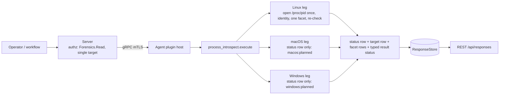

# process_introspect

<!-- BEGIN GENERATED: plugin-doc-gen header -->
<!-- END GENERATED -->

## How it works

`inspect` answers one question about one process on this host: what is its security posture on one axis. A request names a numeric `pid` and one closed-enum `facet` (`resource_limits`, `sigmasks`, `caps`, `seccomp`, `oom` or `sched`); there is no `all` and no list, and names are never matched. Every emitted field is a validated number, a 16-digit hex mask, a validated CPU list or a token from a fixed table. The process name, command line, environment, memory, open files and sockets are not read, and a row can never carry them.

On Linux the leg opens `/proc/<pid>` once as a directory descriptor, without following a link, and reads every file relative to that descriptor, so a recycled pid cannot be read through a stale path. It reads identity first: `stat` gives the process start time and `boot_id` the machine boot, and together they form the token `<boot_id first 8 hex>.<start time>`. If the request carries a `start_time` that differs, the answer is `pid_reused` and nothing else is read. Then the one facet's sources are read and parsed by pure functions, and `stat` is read again: a process that has gone, or a pid now owned by another process, discards every row (`torn_read`). The status row is written first, then the `target` row, then the facet rows.

A pid that is not found is not proof that the process is gone. On a `/proc` mounted with `hidepid=2` or above, the unprivileged agent gets the same not-found answer for another account's live process, so on that path only the leg reads `/proc/self/mountinfo` once; unless the `/proc` mount is shown without hiding, the answer is `no_such_process_or_hidden`, never a bare `no_such_process`. macOS and Windows read nothing and answer one `unsupported` status row (`macos:planned`, `windows:planned`) through the shared leg reporter. No subprocess, ptrace, `/proc/<pid>/mem`, task port or write is used.

| Facet | Source (Linux) | Rows | Disclosed | Bounds |
|---|---|---|---|---|
| `resource_limits` | `limits` | `limit` per kernel limit, 16 names | soft and hard limit as a number or `unlimited`, unit from a fixed table | 8,192 bytes read |
| `sigmasks` | `status` | `sigmask` x5 | pending, shared pending, blocked, ignored and caught signal masks, 16 hex digits (which thread's: caveat 3) | 16,384 bytes read |
| `caps` | `status` | `cap` x5 | inheritable, permitted, effective, bounding and ambient capability sets, 16 hex digits | 16,384 bytes read |
| `seccomp` | `status` | `seccomp` | mode (`disabled`, `strict`, `filter`), installed filter count and `NoNewPrivs` when the kernel reports them | 16,384 bytes read |
| `oom` | `oom_score`, `oom_score_adj` | `oom` | the two integers | 64 bytes each |
| `sched` | `stat`, `status` | `sched` | policy token, nice value, realtime priority, allowed-CPU list | 4,096 and 16,384 bytes; CPU list at most 4,096 characters |

The mount table is read only when the pid is not found, up to 1 MiB; a table over that size reads as unknown and gives the weaker answer.

## OS capability

<!-- BEGIN GENERATED: plugin-doc-gen capability -->
<!-- END GENERATED -->

## Privileges and prerequisites

| OS | Runs as | Extra grant needed | Measured | If the read is refused |
|---|---|---|---|---|
| Windows | n/a: the leg reads nothing (caveat 5) | None | n/a | `status\|inspect\|unsupported\|windows:planned`, result `UNAVAILABLE` |
| macOS | n/a: the leg reads nothing (caveat 5) | None | n/a | `status\|inspect\|unsupported\|macos:planned`, result `UNAVAILABLE` |
| Linux | agent daemon, dedicated unprivileged account (`yuzu-agent` on the packaged unit), never root by design (`docs/agent-privilege-model.md`) | None: the five files are world-readable. `CAP_DAC_READ_SEARCH`, which the packaged unit grants, does not lift `hidepid`. Under `hidepid=1` another account's process answers `permission_denied`; under `hidepid=2` or above it answers `no_such_process_or_hidden`. An operator can tell by looking for `hidepid=` on the `/proc` line of `/proc/self/mountinfo` | The committed sample ran as euid 0 on a throwaway VM (see Sample output). LANE-PENDING: the uid 65534 cross-account result and the `hidepid=2` result, exactly as observed on the lane. The `yuzu-agent` account itself was not measured | `status\|inspect\|permission_denied\|linux:process_introspect:permission_denied`, result `PERMISSION_DENIED` / partial; a facet source refused after the target opened is `linux:process_introspect:<facet>:permission_denied` and the answer is `constrained` (or `permission_denied` when no facet row was produced) |

No external binaries, no subprocesses, no network use: the plugin opens one directory and reads at most five small files and, on the not-found path, the mount table.

## Data contract

### Inputs

<!-- BEGIN GENERATED: plugin-doc-gen inputs -->
<!-- END GENERATED -->

### Outputs

The first row is always `status|inspect|<state>|<reason or ->`. A completed read then writes one `target|<pid>|<start_time token>|<facet>` row and the facet's rows; a refusal writes the status row alone. Row grammars by `row_kind`: `limit|<name>|<soft>|<hard>|<unit>`, `sigmask|<which>|<hex16>`, `cap|<which>|<hex16>`, `seccomp|<mode>|<filters>|<no_new_privs>`, `oom|<score>|<score_adj>` and `sched|<policy>|<nice>|<rt_priority>|<cpus>`. A `-` marks a value the kernel did not report or that could not be validated. Field 2 of the `target` row is the only source of a `start_time` token: no other plugin or action emits it, so the first inspect of a pid is always unguarded and the token only links one inspect to the next. The committed sample shows the `caps` facet only; the other five facets emit the row grammars above and are covered by the unit fixtures, not by the sample.

<!-- BEGIN GENERATED: plugin-doc-gen outputs -->
<!-- END GENERATED -->

### Result status

Every read sets a typed result status; a degraded read is `CONSTRAINED`, never an empty `OK`.

| Status | Completeness | Provenance | When |
|---|---|---|---|
| `OK` | full | (empty) | The target was read, identity held across the read, and every source the facet needs was read and parsed, so at least one facet row was produced |
| `CONSTRAINED` | partial | `linux:process_introspect:<facet>:permission_denied` / `linux:process_introspect:<facet>:read_failed` / `linux:process_introspect:<facet>:malformed` / `linux:process_introspect:<facet>:oversized` / `linux:process_introspect:resource_limits:unknown_row` | A source of the requested facet was refused, failed, was over its byte cap, or was missing a required key or had an invalid value; the rows that were produced are returned. A required key (every `Sig*`, every `Cap*`, `Seccomp`, `Cpus_allowed_list`, both OOM values, the limits header) that is absent or invalid reads `<facet>:malformed`, so no facet answers `OK` with nothing in it. `resource_limits:unknown_row` means a limits line this plugin does not know was counted and not shown |
| `PERMISSION_DENIED` | partial | `linux:process_introspect:permission_denied` / `linux:process_introspect:<facet>:permission_denied` | The `/proc/<pid>` open or the identity read was refused, or every source of the facet was refused and no facet row was produced |
| `UNAVAILABLE` | unknown | `process_introspect:invalid_pid` / `process_introspect:invalid_facet` / `process_introspect:invalid_start_time` | The request failed validation on the agent (the command also returns 1); nothing was read |
| `UNAVAILABLE` | unknown | `linux:process_introspect:no_such_process` / `linux:process_introspect:no_such_process_or_hidden` / `linux:process_introspect:identity_unreadable` / `linux:process_introspect:pid_reused` / `linux:process_introspect:torn_read` | No such process (or, with `_or_hidden`, not visible to this account); identity could not be read; the pid now belongs to another process than the supplied `start_time`; or the process exited or was replaced during the read and every row was discarded |
| `UNAVAILABLE` | unknown | `windows:planned` / `macos:planned` / `linux:planned` | The leg reads nothing (caveat 5): the action answers `status\|inspect\|unsupported\|<os>:planned` and nothing else. `linux:planned` is the shared reporter's token and is not emitted by this plugin's Linux leg |
| `UNAVAILABLE` | unknown | `linux:leg:exception` / `macos:leg:exception` / `windows:leg:exception` | The leg threw: one `status\|inspect\|unsupported\|<os>:leg:exception` row and the command returns 0 |

### What to do about a token

| Token | Terminal or retryable | Action |
|---|---|---|
| `no_such_process` | Terminal for that pid | The process exited, or never existed; list processes again |
| `no_such_process_or_hidden` | Terminal on this host | A hidden process and a missing one cannot be told apart under `hidepid=2` or above; `gid=` and `CAP_SYS_PTRACE` exemptions are not evaluated |
| `pid_reused` | Terminal for that token | The pid was recycled; inspect again without `start_time` |
| `torn_read` | Retryable | The process changed during the read; run again |
| `permission_denied`, `<facet>:permission_denied` | Retryable after a mount or policy change | `hidepid=1` hides other accounts' processes from an unprivileged agent |
| `<facet>:read_failed`, `<facet>:malformed`, `<facet>:oversized` | Terminal for that kernel | The facet's source is missing, unexpected or too large on this kernel |

### Where the data goes

- **Instruction result.** Every row is server instruction-result data under the Forensics tier: stored under the standard response retention, served over REST `/api/responses` and MCP only to a caller who also holds `Forensics:Read`.
- **Not consumed by** the daily sync, Echo, DEX or metrics: the action runs on demand only, against one named device.
- **Sensitivity.** Rows give the security posture of one named process on one named machine (its capability sets, seccomp state and signal handling), which is reconnaissance material. The `start_time` token embeds 8 hex digits of the per-boot random id of the machine. The committed sample was taken on a throwaway lane. No process name, path, command-line argument, environment value or content appears in any row.
- **Siblings:** `crossplatform.processes.list` (the process list) and the other Forensics-tier plugins (`remote_access_audit`, `privacy_permissions`, `execution_artifacts`, `browser_inventory`, `app_usage`).

## Sample output

<!-- BEGIN GENERATED: plugin-doc-gen samples -->
<!-- END GENERATED -->

## Caveats and known gaps

1. **One switch and one permission cover every facet.** The plugin has a single kill switch and a single `Forensics:Read` catalogue row. File or memory contents, environment values, socket payloads and command-line arguments are a new action with its own row, never a new facet.
2. **A hidden process reads as not found.** On a `/proc` mounted `hidepid=2` or above, a not-found pid answers `no_such_process_or_hidden` because the two cannot be told apart. `gid=` and `CAP_SYS_PTRACE` exemptions are not evaluated, and a mount table over 1 MiB reads as unknown, so those hosts get the weaker, still true answer.
3. **Torn reads are detected on exit only.** A process that exits during the read gives `torn_read`. An exec keeps the pid and start time, so values may straddle it and that is not detected. A thread id is accepted by `/proc` and reads that thread. The pending and blocked signal masks, the capability sets, the seccomp state and the scheduling values (policy, nice, realtime priority and allowed CPUs) belong to the thread the id names, which is the main thread for a process id; the shared pending, ignored and caught masks, the limits and the OOM values are process-wide.
4. **Linux masks are 16 hex digits.** A platform with 128 signals would report `sigmasks:malformed` and no mask rows, never `OK`.
5. **Other facets and operating systems are planned.** Listing facets for Linux, then a macOS leg and a Windows leg, are later changes; today macOS and Windows answer one `unsupported` status row.

## Source and tests

<!-- BEGIN GENERATED: plugin-doc-gen source -->
<!-- END GENERATED -->
