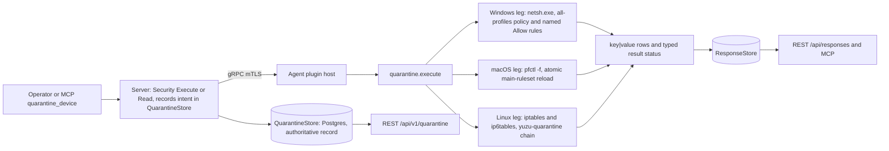
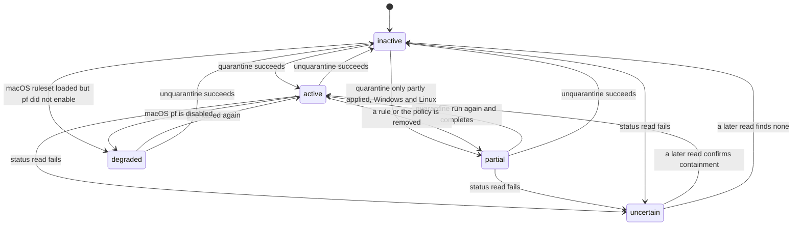
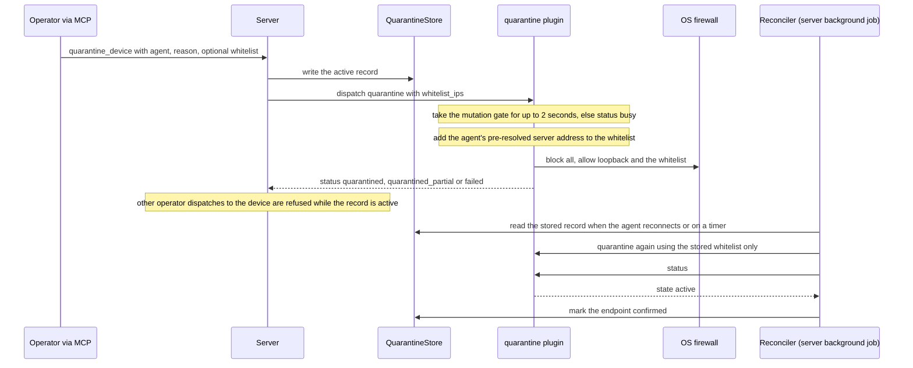

# quarantine

<!-- BEGIN GENERATED: plugin-doc-gen header -->
| | |
|---|---|
| **What it does** | Device network isolation (quarantine) with per-IP whitelisting |
| **Version** | 1.0.0 |
| **Kind** | Action · mutating · gathered (security.quarantine.isolate, security.quarantine.release, security.quarantine.status, security.quarantine.whitelist) |
| **Platforms** | Windows ✅ · macOS ✅ · Linux ✅ |
| **Actions** | `quarantine` (definition `security.quarantine.isolate`) · `status` (definition `security.quarantine.status`) · `unquarantine` (definition `security.quarantine.release`) · `whitelist` (definition `security.quarantine.whitelist`) |
| **Security** | `quarantine`: securable `Security` · operation Execute · risk Critical · dispatch Destructive · approval gate AdminOrApproval; `unquarantine`: securable `Security` · operation Execute · risk High · dispatch Mutating · approval gate AdminOrApproval; `status`: securable `Security` · operation Read · risk Low · dispatch ReadOnly · approval gate None; `whitelist`: securable `Security` · operation Execute · risk High · dispatch Mutating · approval gate AdminOrApproval |
| **Roles** | execute: `quarantine`: endpoint-admin, security-admin; `unquarantine`: endpoint-admin, security-admin; `status`: endpoint-admin, endpoint-operator, security-admin; `whitelist`: endpoint-admin, security-admin · author: content-author |
<!-- END GENERATED -->

## How it works

`quarantine` isolates an endpoint from the network by programming the host firewall so that everything is blocked except an allow-list: loopback, the address the agent itself connects to, and any `whitelist_ips` the operator supplies. The agent's own server address is read from a value resolved once at agent startup, never at isolation time, so a host that is already compromised cannot steer its own DNS to decide what survives. On Windows it sets the all-profiles firewall policy to block inbound and outbound and adds named `YuzuQuarantine_` Allow rules (IPv4 and IPv6); on Linux it builds a `yuzu-quarantine` chain and jumps to it first in the INPUT and OUTPUT chains of `iptables`, mirrored to `ip6tables` only when the host has an IPv6 stack and the `ip6tables` binary is installed; on macOS it writes a complete pf main ruleset ending in `block all` and loads it atomically with `pfctl -f`, then enables pf and re-reads `pfctl -s info` to confirm. `unquarantine` reverses it. `status` re-reads the live firewall and reports `active`, `partial`, `degraded`, `uncertain` or `inactive`, plus the current whitelist when the state is `active` or `partial` (not for `inactive`, `uncertain` or `degraded`). `whitelist` adds or removes IPs on a device that is already isolated. Every mutating action takes one process-wide gate first, and a caller that cannot get in within 2 seconds gets `status|busy`; `status` never takes the gate. Every firewall command runs without a shell under a 15-second deadline (10 seconds for reads).

Deliberately not: a state-preserving undo on macOS. `unquarantine` reloads the OS default `/etc/pf.conf`, so any other pf rules the host had are gone, which is why the capability catalogue classifies `quarantine` Irreversible on every OS even though Windows and Linux restore their own prior state. The plugin also does not decide who is quarantined: the server does, and the plugin only applies what it is told.



### What you can decide with it

| Question | Action | What you get |
|---|---|---|
| Is this device isolated right now? | `status` | `state`: `active` (fully contained), `partial` (some expected rules or policy are missing, Windows and Linux), `degraded` (macOS only: the blocking ruleset is loaded but pf is disabled, so nothing is blocked), `uncertain` (the read failed or returned nothing recognisable, so containment is neither confirmed nor ruled out) or `inactive` (no containment found). |
| What can the isolated device still reach? | `status`, `whitelist` row | The allowed IPs read back from the firewall, present when the state is `active` or `partial`, and absent for `inactive`, `uncertain` and `degraded`. |
| Isolate it | `quarantine` | `quarantined`, `quarantined_partial` (on Windows and Linux: contained, but a loopback or whitelist exception, the IPv6 mirror or a chain flush failed; on macOS: the ruleset loaded but pf did not enable, so traffic may not be blocked), `failed` or `busy`. On macOS a failed ruleset load returns an `error\|pfctl load failed...` line instead of `failed`. |
| Let the device reach one more address, or stop | `whitelist` with `add` or `remove` | `updated` or `update_uncertain`, with the whitelist read back. |
| Restore its network | `unquarantine` | `released` or `release_uncertain` (the device may still be firewalled). |

What a "clean" answer means: `quarantined` and `active` show the plugin's own rules and policy are in place, not that nothing else on the host can talk out. `inactive` means the plugin found none of its own containment; on Windows a host whose own policy already blocks both directions reads `inactive` with a note, because no `YuzuQuarantine_` rule exists. Treat `uncertain` and `degraded` as not contained.

| | Windows | macOS | Linux |
|---|---|---|---|
| What is blocked | Everything on all firewall profiles except loopback and the whitelist, both directions | Everything except loopback (`set skip on lo0`) and the whitelist, both directions | Everything entering or leaving the host through `iptables` (and `ip6tables`) INPUT and OUTPUT except loopback and the whitelist |
| What is not covered | Only what the Windows firewall policy governs; other security products are not inspected | Only what pf governs; other pf anchors are replaced, not preserved | Forwarded traffic (FORWARD is never touched), and anything done by nftables rules the plugin does not manage |
| On release | Deletes the named Allow rules, then replays the firewall policy captured at quarantine time (the Windows default if none was captured) | Reloads `/etc/pf.conf`; if that fails, disables pf. Prior runtime pf rules are not restored | Removes the chain jumps, then flushes and deletes the chain (and the `ip6tables` mirror if one was applied) |
| Reachable after isolation | Loopback, the agent's server address, `whitelist_ips` | Same | Same |

### Diagrams

#### Containment state



These are the five answers `status` can give. `uncertain` is a statement about the read, not about the firewall: it is what you get when the firewall query or `pfctl` read fails or cannot be parsed, and it is never reported as `active` or `inactive`. `degraded` only exists on macOS, where pf can hold the blocking ruleset while pf itself is switched off.

#### Isolate, then re-apply on reconnect



The server records the intent first, then dispatches. If the device was offline or restarted, the reconciler (a server background job that re-applies stored containment) re-applies from the stored record alone (never a caller-supplied value) and counts the device as confirmed only when a follow-up `status` reports `active`; a device it had already confirmed is re-checked with `status` first after a session change. The REST `POST /api/v1/quarantine` route only records the intent and relies on the reconciler to apply it; MCP `quarantine_device` dispatches immediately. The four quarantine actions are exempt from the dispatch gate so a contained device can still be released.

## OS capability

<!-- BEGIN GENERATED: plugin-doc-gen capability -->
| Action | Windows | macOS | Linux |
|---|---|---|---|
| `quarantine` | ✅ supported · rung 2 · netsh via bounded runner argv (service-account privilege, no sudo) | ✅ supported · rung 2 · sudo-governed pfctl via bounded runner argv | ✅ supported · rung 2 · sudo-governed iptables via bounded runner argv |
| `status` | ✅ supported · rung 2 · netsh via bounded runner argv (service-account privilege, no sudo) | ✅ supported · rung 2 · sudo-governed pfctl via bounded runner argv | ✅ supported · rung 2 · sudo-governed iptables via bounded runner argv |
| `unquarantine` | ✅ supported · rung 2 · netsh via bounded runner argv (service-account privilege, no sudo) | ✅ supported · rung 2 · sudo-governed pfctl via bounded runner argv | ✅ supported · rung 2 · sudo-governed iptables via bounded runner argv |
| `whitelist` | ✅ supported · rung 2 · netsh via bounded runner argv (service-account privilege, no sudo) | ✅ supported · rung 2 · sudo-governed pfctl via bounded runner argv | ✅ supported · rung 2 · sudo-governed iptables via bounded runner argv |
<!-- END GENERATED -->

## Privileges and prerequisites

| OS | Runs as | Extra grant needed | Measured | If the read is refused |
|---|---|---|---|---|
| Windows | Agent service account: LocalSystem today, not yet the intended `NT SERVICE\YuzuAgent` (`docs/agent-privilege-model.md`). Runs `netsh.exe`, resolved from the system directory, never a PowerShell cmdlet | **None today**, since LocalSystem already holds firewall-policy privilege. Under the intended least-privilege model it needs Administrators-group membership or an equivalent firewall-policy privilege (`docs/agent-privilege-model.md`, row for `quarantine.*`) | 2026-09-07, bare-metal, as `SYSTEM` | `state\|uncertain`, note "firewall query failed - containment state could not be determined", result status `UNAVAILABLE` / `PARTIAL` |
| macOS | Agent daemon as root: the shipped LaunchDaemon has no `UserName` key (`docs/agent-privilege-model.md`). As root the plugin runs `/sbin/pfctl` directly, without sudo | **None while the agent is root.** If the agent ever runs as a non-root account, each `pfctl` call is wrapped in `sudo -n --` and needs a NOPASSWD entry for `/sbin/pfctl` in `/etc/sudoers.d/yuzu-agent`, checked with `scripts/install-agent-user.sh --check` | 2026-09-07, bare-metal, euid 501 (a non-root user), deliberately below the production identity | The capture's own `status` run: `state\|uncertain`, note "pf state could not be read -- containment can be neither confirmed nor ruled out", `[result_status] UNAVAILABLE / PARTIAL / quarantine:macos_is_quarantined pf status unreadable`, `[rc] 1` (`docs/samples/macos.txt`) |
| Linux | Agent daemon, unprivileged account (`yuzu-agent` on the packaged unit). Each `iptables` and `ip6tables` call is prefixed `sudo -n --` unless the agent is already euid 0 | Sudoers NOPASSWD entries for `/usr/sbin/iptables` and `/usr/sbin/ip6tables`. Under the packaged unit's `NoNewPrivileges=true`, `sudo` cannot escalate, so these grants take effect only on a unit without that setting. The dev installer script (`scripts/install-agent-user.sh`) also grants the `-save` and `-restore` helpers and a bare `/usr/sbin/nft`, which the plugin never calls (an over-grant, not a plugin dependency) | 2026-09-06, container, as root (euid 0), so the sudo layer was a pass-through and not exercised as a real escalation | A failed listing reads `state\|uncertain`, with the runner's status forwarded. In the capture the first `iptables` read failed to spawn (the binary is missing in that container), and the note separately records that `ip6tables` is not installed: `state\|uncertain`, note "ipv6_unavailable - IPv6 stack is up but ip6tables is not installed", `[result_status] UNAVAILABLE / PARTIAL / subprocess_runner:spawn_error`, `[rc] 1` (`docs/samples/linux.txt`) |

Binaries: `netsh.exe` (Windows), `/usr/sbin/iptables` and `/usr/sbin/ip6tables` (Linux), `/sbin/pfctl` (macOS). Every call goes through `yuzu::agent::run_bounded_subprocess` with a 15-second deadline for mutating calls and 10 seconds for reads, never a shell. There is no network access beyond the agent's existing gRPC channel.

## Data contract

### Inputs

<!-- BEGIN GENERATED: plugin-doc-gen inputs -->
| Definition | Parameter | Type | Required | Default | Constraints | Description |
|---|---|---|---|---|---|---|
| `security.quarantine.isolate` | `server_ip` | string | no | - | - | IP address of the Yuzu management server. This IP is always whitelisted to maintain the agent connection during quarantine. |
| `security.quarantine.isolate` | `whitelist_ips` | string | no | - | - | Comma-separated list of additional IP addresses to allow through the quarantine firewall (e.g. DNS server, SIEM collector). |
| `security.quarantine.whitelist` | `action` | string | yes | - | enum: add, remove | Whether to add or remove the specified IPs from the quarantine whitelist. |
| `security.quarantine.whitelist` | `ips` | string | yes | - | - | Comma-separated list of IP addresses to add to or remove from the quarantine whitelist. |
<!-- END GENERATED -->

### Outputs

Every action writes pipe-delimited `key|value` pairs via `ctx.write_output` — not a fixed-position row like the collector plugins' `field0|field1|…` schema, so a caller reads by key name, never by column offset. A hard failure before any mutation is attempted (a missing/invalid parameter, a failed macOS whitelist-read prerequisite) emits `error|<message>` instead of the action's normal `status`/`state` row. Several outcomes also carry extra keys the declared schema below does not enumerate — `prior_policy`, `rules_attempted` and `note` on `quarantine`; `note` on `unquarantine`, `status` and `whitelist`.

<!-- BEGIN GENERATED: plugin-doc-gen outputs -->
**`security.quarantine.isolate` — `status|rules_applied`**

| Field | Type | Values | Available | Example | Description |
|---|---|---|---|---|---|
| `status` | string | `quarantined` `quarantined_partial` `failed` `busy` | Windows, Linux, macOS | `not observed — quarantine was never executed for these samples` | The quarantine action's outcome: quarantined (full containment applied), quarantined_partial (containment applied but at least one loopback/whitelist exception or v6 mirror failed), failed (no containment applied), or busy (another mutating quarantine action was already in flight). An aborted run before any mutation instead emits an error field with no status field. |
| `rules_applied` | int32 | - | Windows, Linux, macOS | `4` | Count of firewall rules the action attempted-and-applied this call (Windows/Linux: the mutation tally's succeeded count; macOS: the pf ruleset line count), reported alongside status. Values: integer >= 0. |

**`security.quarantine.release` — `status`**

| Field | Type | Values | Available | Example | Description |
|---|---|---|---|---|---|
| `status` | string | `released` `release_uncertain` | Windows, Linux, macOS | `not observed — unquarantine was never executed for these samples` | The unquarantine action's outcome: released (teardown/policy restore confirmed) or release_uncertain (a genuine runner failure, or a clean rule-delete/policy-restore failure, means the device may still be firewalled). A Windows released result additionally appends a note field when no captured pre-quarantine policy existed to replay; a macOS failure before either restore path succeeds emits an error field instead. |

**`security.quarantine.status` — `state|whitelist`**

| Field | Type | Values | Available | Example | Description |
|---|---|---|---|---|---|
| `state` | string | `active` `partial` `degraded` `uncertain` `inactive` | Windows, Linux, macOS | `uncertain` | Current containment verdict from a live re-read of the OS firewall state: active (fully contained), partial (some but not all expected rules/policy present), degraded (macOS only - the pf ruleset is loaded but pf itself is disabled, so nothing is actually blocked), uncertain (the read itself failed or returned nothing recognisable), or inactive (no containment present). |
| `whitelist` | string | - | Windows, Linux, macOS | - | Comma-separated whitelist of currently-allowed IPs, read fresh from the firewall. Reported only when state is not inactive, and empty when the device is contained with no additional whitelist entries. Values: free text - comma-separated IP list, or empty. |

**`security.quarantine.whitelist` — `status|whitelist`**

| Field | Type | Values | Available | Example | Description |
|---|---|---|---|---|---|
| `status` | string | `updated` `update_uncertain` | Windows, Linux, macOS | `updated` | The whitelist action's outcome: updated (every add/remove mutation succeeded) or update_uncertain (a genuine runner failure, or a clean per-IP mutation failure, means the whitelist may be partially applied). Missing/invalid parameters instead return an error field before any mutation is attempted. |
| `whitelist` | string | - | Windows, Linux, macOS | - | Comma-separated whitelist after the add/remove, read fresh from the firewall (on macOS this is the full pf ruleset whitelist, since add/remove rebuilds the entire main ruleset there). Values: free text - comma-separated IP list, or empty. |
<!-- END GENERATED -->

### Result status

Surfaced as `plugin_result_status` on the command response, set via `ctx.set_result_status` or forwarded from a runner failure via `yuzu::agent::forward_runner_failure`.

| Status | Completeness | Provenance | When |
|---|---|---|---|
| `UNDECLARED` (agent default) | — | — | No `set_result_status` call fires on this path: a clean `active`/`inactive` `status` read, or a `whitelist`/`quarantine`/`unquarantine` rejected before any mutation for a missing/invalid parameter. Matches every sample's `[result_status] UNDECLARED / UNKNOWN /` line. |
| `UNAVAILABLE` | `PARTIAL` | `subprocess_runner:spawn_error` | A genuine runner failure — the child process could not be spawned at all — on any read or mutation, forwarded via `forward_runner_failure` before the action's own status call runs — matches the Linux sample, where the first `iptables` read failed to spawn. |
| `CONSTRAINED` | `PARTIAL` | `subprocess_runner:deadline` | The runner's deadline elapsed (15s mutating / 10s read) and the still-running child was killed, forwarded via `forward_runner_failure` on any read or mutation. |
| `CONSTRAINED` | `PARTIAL` | `subprocess_runner:cancelled` | The run was cancelled before it finished, forwarded via `forward_runner_failure` on any read or mutation. |
| `CONSTRAINED` | `PARTIAL` | `subprocess_runner:signaled` | The child (`netsh`/`iptables`/`ip6tables`/`pfctl`) was killed by a signal rather than exiting cleanly, forwarded via `forward_runner_failure` on any read or mutation. |
| `OK` | `PARTIAL` | `subprocess_runner:line_limit` | A deliberate bounded stop: the runner capped output at its line limit and killed a still-producing child — not a failure, but incomplete. |
| `UNAVAILABLE` | `PARTIAL` | `quarantine:do_whitelist macOS whitelist read failed before add` / `…before remove` | `whitelist` on macOS, both `add` and `remove`: the prerequisite `macos_get_whitelist` read failed, so the ruleset rebuild is aborted rather than rewritten from an unproven/empty set. |
| `UNAVAILABLE` | `PARTIAL` | `quarantine:linux_unquarantine chain flush/delete failed` | `unquarantine` on Linux: a genuine runner failure, or a clean failure to flush/delete the `yuzu-quarantine` chain (and its ip6tables mirror), reported as `release_uncertain` rather than `released`. |
| `UNAVAILABLE` | `PARTIAL` | `quarantine:win_quarantine …firewall policy not applied` | `quarantine` on Windows, when the all-profiles policy set itself fails. |
| `OK` | `PARTIAL` | `quarantine:win_quarantine contained, but …exceptions failed to apply` | `quarantine` on Windows, containment holds but a loopback/whitelist exception failed. |
| `OK` | `PARTIAL` | `quarantine:win_unquarantine restored the Windows default policy — no captured pre-quarantine policy…` | `unquarantine` on Windows, release succeeded but no prior policy was available to replay. |
| `UNAVAILABLE` | `PARTIAL` | `quarantine:linux_quarantine containment incomplete` | `quarantine` on Linux, any non-full-success token. |
| `UNAVAILABLE` | `PARTIAL` | `quarantine:macos_load_ruleset pfctl exited non-zero` / `…pf is not actually enabled` | `quarantine`/`whitelist` on macOS, the ruleset load or the post-enable verification fails. |
| `UNAVAILABLE` | `PARTIAL` | `quarantine:macos_unquarantine restore and disable both failed` | `unquarantine` on macOS, both `/etc/pf.conf` reload and `pfctl -d` fail. |
| `UNAVAILABLE` | `PARTIAL` | `quarantine:macos_is_quarantined pf ruleset loaded but pf is disabled` (`state=degraded`) | `status` on macOS, pf holds the blocking ruleset but is itself disabled. |
| `UNAVAILABLE` | `PARTIAL` | `quarantine:macos_is_quarantined pf status unreadable` (`state=uncertain`) | `status` on macOS, the pf status read fails or is unparseable — matches this build's macOS sample exactly. |
| `UNAVAILABLE` | `PARTIAL` | `quarantine: another mutating quarantine action is in progress` | Any mutating action refused `status\|busy` by the plugin's single mutation lock (`MutationGate`). |
| `OK` | `PARTIAL` | `quarantine:win_quarantine contained, but the pre-quarantine firewall policy could not be captured/stored…` | `quarantine` on Windows, containment succeeded but the restore image failed to persist. |
| `OK` | `PARTIAL` | `quarantine:linux_quarantine contained, but the ip6tables-applied marker could not be stored…` | `quarantine` on Linux, containment succeeded but the v6-applied marker failed to persist. |
| `OK` / `UNAVAILABLE` | `PARTIAL` | `quarantine:do_status containment is incomplete` / `…containment state could not be determined` | `status`, `state=partial` (OK/PARTIAL) or `state=uncertain`/`degraded` (UNAVAILABLE/PARTIAL). |

### Where the data goes

- **Instruction result.** Every action's output rows and result status travel over the agent's mTLS gRPC channel as the command response and land in the ResponseStore, queryable at `/api/responses/{id}`, like any other plugin dispatch.
- **QuarantineStore (Postgres, authoritative).** MCP `quarantine_device` writes the containment intent through `QuarantineStore::quarantine_device` before it dispatches this plugin's `quarantine` action. The store holds at most one active record per agent and is not expendable telemetry: it persists until an administrator lifts it, with no clock-guarded retention. `QuarantineContainmentReconciler` re-drives containment from that stored record alone, never a fresh or caller-supplied value, when the agent reconnects, through the shared `redispatch_stored_containment` chokepoint.
- **Not consumed by** daily-sync inventory, the Echo warehouse, DEX or metrics. Nothing runs on a schedule inside the plugin; it executes only when an operator, MCP `quarantine_device` or the reconciler dispatches one of its four definitions.
- **Sensitivity.** `whitelist` rows, emitted by `status` (when the state is `active` or `partial`) and by `whitelist`, carry the quarantine allow-list as raw IP addresses, network identifiers that can pinpoint a specific device or server. The other fields (`status`, `state`, `rules_applied`, `note`) are counts, enums and free-text failure descriptions; none names a person or installed software.
- **Siblings:** `rdp_control.set_state` shares the same Administrators-group-or-equivalent grant shape on Windows and cites it rather than declaring a new right (`docs/agent-privilege-model.md`, row for `rdp_control.set_state`).
- **MCP / REST.** Discover: `discover_plugins` (summary) then `yuzu://plugin-docs` (this page as data) then `discover_instructions` / `get_definition("security.quarantine.isolate")`. Run: `execute_instruction {definition_id, parameters}`, or MCP `quarantine_device` for the record plus live isolation. Read: `/api/responses/{id}` for the instruction result; `/api/v1/quarantine` for the QuarantineStore-backed record.

## Sample output

<!-- BEGIN GENERATED: plugin-doc-gen samples -->
**Windows** — captured: windows Microsoft Windows NT 10.0.26200.0 x64 · bare-metal · 2026-09-07 · SYSTEM · leg-hash f4d514eecc28

```
== action=quarantine
[not captured] Destructive/Irreversible: not executed on a live host

== action=unquarantine
[not captured] Mutating/Reversible: not executed on a live host

== action=status
state|inactive
[result_status] UNDECLARED / UNKNOWN

== action=whitelist
error|missing required parameter: action (add/remove)
[result_status] UNDECLARED / UNKNOWN
[rc] 1
```

**macOS** — captured: macos macOS 26.6.2 arm64 · bare-metal · 2026-09-07 · euid 501 (jsmith) · leg-hash f4d514eecc28

```
== action=quarantine
[not captured] Destructive/Irreversible: not executed on a live host

== action=unquarantine
[not captured] Mutating/Reversible: not executed on a live host

== action=status
state|uncertain|note|pf state could not be read -- containment can be neither confirmed nor ruled out
[result_status] UNAVAILABLE / PARTIAL / quarantine:macos_is_quarantined pf status unreadable
[rc] 1

== action=whitelist
error|missing required parameter: action (add/remove)
[result_status] UNDECLARED / UNKNOWN
[rc] 1
```

**Linux** — captured: linux Debian GNU/Linux 13 (trixie) aarch64 · container · 2026-09-06 · euid 0 · leg-hash f4d514eecc28

```
== action=quarantine
[not captured] Destructive/Irreversible: not executed on a live host

== action=unquarantine
[not captured] Mutating/Reversible: not executed on a live host

== action=status
state|uncertain|note|ipv6_unavailable — IPv6 stack is up but ip6tables is not installed
[result_status] UNAVAILABLE / PARTIAL / subprocess_runner:spawn_error
[rc] 1

== action=whitelist
error|missing required parameter: action (add/remove)
[result_status] UNDECLARED / UNKNOWN
[rc] 1
```
<!-- END GENERATED -->

## Caveats and known gaps

1. **macOS release is not a genuine undo.** `unquarantine` reloads `/etc/pf.conf`, never the endpoint's prior ruleset, so any runtime pf rules present before quarantine are permanently lost; if the reload itself fails it disables pf, which is more permissive than the host started. This is why the capability catalogue classifies `quarantine` Irreversible on every platform.
2. **`whitelist` can isolate a clean macOS device.** pf has no per-rule granularity, so `add` and `remove` rebuild and reload the whole main ruleset, which always ends in `block all` and enables pf, whatever the device's current state. Running `whitelist` against a device that is not yet quarantined therefore quarantines it.
3. **Releasing the server record does not lift the firewall.** REST `DELETE /api/v1/quarantine/{agent_id}` and the console release end only the QuarantineStore record and stop the reconciler re-applying; the device stays isolated until the `unquarantine` action runs on it. REST `POST /api/v1/quarantine` is the mirror image and only records the intent, leaving the reconciler to apply it.
4. **Linux coverage is INPUT and OUTPUT only.** The chain is jumped to first from those two chains, so forwarded traffic and rules the plugin does not manage are untouched, and the plugin never calls `nft`. A host with an IPv6 stack but no `ip6tables` binary reports `quarantined_partial` because the IPv4 side is contained and the IPv6 side is not.
5. **Release replays state captured at the first quarantine.** The Windows pre-quarantine firewall policy and the Linux "ip6tables applied" marker are kept in agent storage, written once until a clean release clears them, so a repeat quarantine never overwrites a good restore image and a failed release keeps them for the retry. If no Windows policy was captured, release restores the Windows default (`blockinbound,allowoutbound`) and says so in a `note`.

## Source and tests

<!-- BEGIN GENERATED: plugin-doc-gen source -->
- Plugin: `agents/plugins/quarantine/src/quarantine_parsers.hpp` · `agents/plugins/quarantine/src/quarantine_plugin.cpp` · `agents/plugins/quarantine/src/quarantine_serialization.hpp`
- Definitions: `content/definitions/quarantine.yaml`
- Capability rows: `server/core/src/capability_decls/plugin_action_catalogue_c.hpp`
- Tests: `tests/unit/server/test_quarantine_containment_reconciler.cpp` · `tests/unit/server/test_quarantine_dispatch_decision.cpp` · `tests/unit/server/test_quarantine_dispatch_gate.cpp` · `tests/unit/server/test_quarantine_read_model.cpp` · `tests/unit/server/test_quarantine_reapply.cpp` · `tests/unit/server/test_quarantine_store.cpp` · `tests/unit/test_quarantine_argv.cpp` · `tests/unit/test_quarantine_parsers.cpp` · `tests/unit/test_quarantine_serialization.cpp`
- Privilege row: `docs/agent-privilege-model.md`
- Changelog: `changelog.d/20261014-quarantine-routes-audit-before-change.changed.md`
<!-- END GENERATED -->
