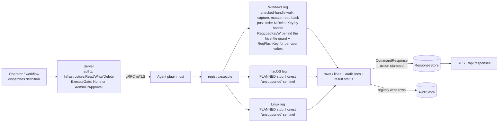

# registry

<!-- BEGIN GENERATED: plugin-doc-gen header -->
| | |
|---|---|
| **What it does** | Windows Registry -- get, set (six types, verified), delete, recursive key delete, per-user hive writes, bulk apply with undo |
| **Version** | 2.0.0 |
| **Kind** | Action · mutating · on-demand |
| **Platforms** | Windows ✅ · macOS 🟡 planned · Linux 🟡 planned |
| **Actions** | `apply` (definition `windows.registry.apply`) · `delete_key` (definition `windows.registry.delete_key`) · `delete_user_value` (definition `windows.registry.delete_user_value`) · `delete_value` (definition `windows.registry.delete_value`) · `enumerate_keys` (definition `windows.registry.enumerate_keys`) · `enumerate_values` (definition `windows.registry.enumerate_values`) · `get_user_value` (definition `windows.registry.get_user_value`) · `get_value` (definition `windows.registry.get_value`) · `key_exists` (definition `windows.registry.key_exists`) · `list_profiles` (definition `windows.registry.list_profiles`) · `set_user_value` (definition `windows.registry.set_user_value`) · `set_value` (definition `windows.registry.set_value`) |
| **Security** | `get_value`: securable `Infrastructure` · operation Read · risk Low · dispatch ReadOnly · approval gate None; `set_value`: securable `Infrastructure` · operation Write · risk Medium · dispatch Mutating · approval gate AdminOrApproval; `delete_value`: securable `Infrastructure` · operation Delete · risk High · dispatch Destructive · approval gate AdminOrApproval; `delete_key`: securable `Infrastructure` · operation Delete · risk Critical · dispatch Destructive · approval gate AdminOrApproval; `key_exists`: securable `Infrastructure` · operation Read · risk Low · dispatch ReadOnly · approval gate None; `enumerate_keys`: securable `Infrastructure` · operation Read · risk Low · dispatch ReadOnly · approval gate None; `enumerate_values`: securable `Infrastructure` · operation Read · risk Low · dispatch ReadOnly · approval gate None; `get_user_value`: securable `Infrastructure` · operation Read · risk Medium · dispatch ReadOnly · approval gate AdminOrApproval; `list_profiles`: securable `Infrastructure` · operation Read · risk Low · dispatch ReadOnly · approval gate None; `set_user_value`: securable `Infrastructure` · operation Write · risk High · dispatch Mutating · approval gate AdminOrApproval; `delete_user_value`: securable `Infrastructure` · operation Delete · risk High · dispatch Destructive · approval gate AdminOrApproval; `apply`: securable `Infrastructure` · operation Delete · risk Critical · dispatch Destructive · approval gate AdminOrApproval |
| **Roles** | execute: `get_value`: endpoint-admin, endpoint-operator; `get_user_value`: endpoint-admin; `list_profiles`: endpoint-admin, endpoint-operator; `set_value`: endpoint-admin; `enumerate_keys`: endpoint-admin, endpoint-operator; `delete_value`: endpoint-admin; `delete_key`: endpoint-admin; `key_exists`: endpoint-admin, endpoint-operator; `enumerate_values`: endpoint-admin, endpoint-operator; `set_user_value`: endpoint-admin; `delete_user_value`: endpoint-admin; `apply`: endpoint-admin · author: content-author |
<!-- END GENERATED -->

## How it works

All twelve actions are direct, synchronous Win32 registry calls: there is no scheduled gather. The six read actions (`get_value`, `key_exists`, `enumerate_keys`, `enumerate_values`, `get_user_value`, `list_profiles`) open a key read-only and read or list it; every registry-controlled string they render passes through `sanitize_field` (`|`, CR and LF become `_`), so no read output can contain a line that starts with `audit|`. `get_user_value` resolves the target profile through the same `ProfileList` walk `list_profiles` exposes, reads the live `HKEY_USERS\<SID>` hive if the user is logged in, and falls back to an offline `RegLoadKeyW` mount of `NTUSER.DAT` (under `SeBackup`/`SeRestore` and a process-wide mutex serialising the whole offline arm) only when the user is logged out. The seven `hive`+`key` actions validate through one `parse_target` helper, which also logs (never blocks) access to a few sensitive `HKLM` subtrees via `spdlog::info`.

The six mutating actions (`set_value`, `delete_value`, `delete_key`, `set_user_value`, `delete_user_value`, `apply`) share one core (`registry_core.hpp`, over an injected registry; `registry_win.cpp` binds it to `Reg*W`). `open_checked` walks the key path component by component from the hive root, opening each component from the previous HANDLE with `REG_OPTION_OPEN_LINK` and probing it for `SymbolicLinkValue`: a registry link is refused (`key_is_link`), never followed. That includes `HKLM\SYSTEM\CurrentControlSet`, itself a link to the active control set: write under `HKLM\SYSTEM\ControlSet001` (or the numbered set `Select\Current` names); registry 1.0.0 followed it, reads still do. The leaf is opened with the mutation's own access mask and every step after that -- the previous-value capture, `RegSetValueExW`, the verifying read-back, `RegDeleteValueW`, `NtDeleteKey(h)` -- runs on that checked handle; nothing re-resolves the path by name. A missing component is created component-wise from the checked parent, and a create that finds the key already there (the walk saw it absent a moment earlier) refuses `concurrent_change`. A creating action never creates a key directly beneath the hive root: when the path's FIRST component is missing it is refused `root_level_create` before anything is opened for writing, so a dry run and a real run give the same answer (a non-creating action reports the same missing key as `key_not_found`). `set_value` writes any of the six types (`REG_SZ`, `REG_EXPAND_SZ`, `REG_BINARY`, `REG_DWORD`, `REG_MULTI_SZ`, `REG_QWORD`) from text or exact `data_hex` bytes, reads the value back on the same handle and compares type and bytes; a mismatch fails the action (`verify_mismatch`). `delete_key` refuses a key that has subkeys unless `recursive=true`; `dry_run=true` counts what a real run would remove and deletes nothing. The key itself is removed by `NtDeleteKey` on the checked handle (resolved from ntdll with `GetProcAddress`, fail-closed when missing), so a leaf swapped for a link between the check and the delete cannot redirect the delete; deleting the key AT a link path removes the link object and never its target. The recursive walk is bounded (10,000 keys and values, 600 levels): a dry run past the bound reports a lower bound (`capped|1`), and a REAL recursive delete of a tree the walk could not finish is refused `tree_too_large` with nothing deleted, so no unvetted tail is ever deleted; delete a larger tree in parts. The recursive delete removes the tree key by key, deepest first, each by `NtDeleteKey` on its own handle, and never calls `RegDeleteTreeW`, which FOLLOWS a registry link found inside the tree (measured 2026-10-19: it emptied the link's target). Every key is opened with `REG_OPTION_OPEN_LINK` and probed again at delete time, so a link planted after the vet stops the delete as `key_is_link` and a tree that outgrew the vet as `concurrent_change`, with what was already removed counted.

`set_user_value`/`delete_user_value` run the same core on the root of the target user's hive through the unchanged `with_user_hive` ladder (live `HKEY_USERS\<SID>` first, else an offline `NTUSER.DAT` mount serialised by the process-wide offline-hive mutex). The offline arm supplies the shared hive-FILE guard (`agents/shared/win_hive_file_guard.hpp`, whose header banner lists its checks), which refuses an unsafe `NTUSER.DAT` before the load and re-verifies the file's identity after it. The written key is flushed (`RegFlushKey`) before the mount unloads, because `RegUnLoadKeyW` does not itself modify the file; a post-unload probe of `HKEY_USERS\<SID>` reports `warning|hive_loaded_after_offline_write` when the hive has been loaded since.

`apply` takes ONE string parameter, `plan`: a JSON array of up to 256 flat objects (`op` = `set_value`, `delete_value`, `create_key` or `delete_key`; `hive` is `HKLM` only; the other fields are in the Inputs table). The plan is refused whole as `invalid_plan:<why>` for any shape error and as `dependent_items:<i>:<j>` when two value ops name the same value or a key op names a key equal to, above or below another item's key, so every accepted plan has no item whose verdict depends on an earlier one: one verdict function over facts captured per item gives the same verdict item for item in a dry run and a real run (`would_apply`/`applied`, or `refused`; a refusal's cause token can differ when an earlier item created the key, e.g. `key_not_found` in a dry run and `value_not_found` in the real run), and a dry run opens each existing key with the real mutation's own access mask, so it sees the same denials. Where a real run would create a missing key, the dry run probes create access on the deepest existing key (it re-opens that key onto itself with `KEY_CREATE_SUB_KEY`; the access check happens at open and nothing is created), so a create the real run would refuse `access_denied` is refused in the dry run too; an item whose first key component is missing directly beneath the hive root is refused `root_level_create` in both modes (the root is a predefined handle, so there is no create access to probe). `delete_key` in `apply` is non-recursive and refuses a registry-link leaf as `key_is_link` (the manifest has no op that recreates a link, so deleting one could not be undone; the standalone `delete_key` still removes a link object by handle). `dry_run` defaults to **true**. Each item captures its previous value (and, for `delete_key`, every value of the leaf) before it changes anything; an item whose previous value cannot be written back (a type outside the six, an unterminated string) is refused `unsupported_old_type` before it mutates; for `delete_key` that check and the `unrepresentable_name` check on the leaf's value names cover the captured prefix only (256 values per deleted key): a value beyond the cap is neither captured nor type-checked, and `undo_complete=0` marks the manifest incomplete. The run is not transactional: with `continue_on_error=false` the first refused or failed item stops it and the rest are `skipped`; the exit code is 1 whenever any item was refused or failed, with the `summary` row and an `error|partial_failure` line still emitted.

**Undo coverage, per op.** The response is the undo manifest; nothing is persisted on the endpoint. `data_hex` is the exact previous value, so a reverse plan restores it byte for byte.

| Op | Rows that carry the previous state | Reverse |
|---|---|---|
| `set_value` | `item`: `old_state`, `old_type`, `old_hex`; `created=<n>` (key components this item created) | present: `set_value` with `type`=`old_type`, `data_hex`=`old_hex`; absent: `delete_value`; `created=n`: `delete_key` of each created component, deepest first |
| `delete_value` | `item`: the old row | `set_value` with `type`=`old_type`, `data_hex`=`old_hex` |
| `create_key` | `item`: `created=<n>`; `verify` is `-` (the leaf handle is the evidence: an existing key opened and link-probed, or a created one whose `REG_CREATED_NEW_KEY` disposition was checked) | `delete_key` of each created component, deepest first |
| `delete_key` | `item` plus one `undo` row per value captured from the leaf before it was destroyed; a registry-link leaf is refused `key_is_link` | `set_value` per `undo` row (recreating the key), or `create_key` when there are no `undo` rows; the key's ACL and timestamps are not captured |

The parser's `dependent_items` rule applies to the reverse plan too, so it is applied as several plans: values and recreated keys first, then one plan per depth of created keys, deepest first. **Undoing an apply:** fetch the stored response (`/api/responses/{id}`: the ResponseStore keeps it 90 days; the audit rows last 365 days but their hex stops at 256 bytes, so they are not a manifest), build the reverse plan from its `item` and `undo` rows as the table says, dry-run it, then apply the waves in order. Capture runs at every dispatch, so re-running a plan that already applied records the NEW value as `old`, the original survives only in the first run's response, and a converged re-run refuses its `delete_value` items and exits 1 (`error|partial_failure`). `summary`'s `undo_complete` is `0` whenever any capture hit a cap (4 KiB per value, 512 KiB per plan, 256 values per deleted key), or a creating item failed after creating some but not all of its missing key components, which the response cannot identify.

Code anchors (file and function; line numbers move with every edit): the checked walk `open_checked` and its link probe `probe_link`, the guarded value read `query_value_bounded`, the verifying write `write_value_on`, the by-handle delete `delete_key_on` with its post-order walk `delete_subtree`, and the counts in `delete_key_tree`, the apply verdict `refusal_reason` and executor `run_apply`, the per-user output `render_user_write` (all in `registry_core.hpp`); the encoders `encode_value`, `validate_key_path`, `render_audit_line` and `parse_plan` (`registry_parsers.hpp`); the `NtDeleteKey` binding `Win32Registry::delete_key_by_handle` and `do_user_write` (`registry_win.cpp`); the server-side binding `registry_audit_events_for_frame` (`server/core/src/plugin_result_audit.hpp`).



## OS capability

<!-- BEGIN GENERATED: plugin-doc-gen capability -->
| Action | Windows | macOS | Linux |
|---|---|---|---|
| `apply` | ✅ supported · rung 1 · win32_registry | 🟡 planned · rung 1 · defaults/CFPreferences (per-domain plist) | 🟡 planned · rung 2 · dconf/gsettings |
| `delete_key` | ✅ supported · rung 1 · win32_registry | 🟡 planned · rung 1 · defaults/CFPreferences (per-domain plist) | 🟡 planned · rung 2 · dconf/gsettings |
| `delete_user_value` | ✅ supported · rung 1 · win32_registry+hive_mount | 🟡 planned · rung 1 · defaults/CFPreferences (per-domain plist) | 🟡 planned · rung 2 · dconf/gsettings |
| `delete_value` | ✅ supported · rung 1 · win32_registry | 🟡 planned · rung 1 · defaults/CFPreferences (per-domain plist) | 🟡 planned · rung 2 · dconf/gsettings |
| `enumerate_keys` | ✅ supported · rung 1 · win32_registry | 🟡 planned · rung 1 · defaults/CFPreferences (per-domain plist) | 🟡 planned · rung 2 · dconf/gsettings |
| `enumerate_values` | ✅ supported · rung 1 · win32_registry | 🟡 planned · rung 1 · defaults/CFPreferences (per-domain plist) | 🟡 planned · rung 2 · dconf/gsettings |
| `get_user_value` | ✅ supported · rung 1 · win32_registry+hive_mount | 🟡 planned · rung 1 · defaults/CFPreferences (per-domain plist) | 🟡 planned · rung 2 · dconf/gsettings |
| `get_value` | ✅ supported · rung 1 · win32_registry | 🟡 planned · rung 1 · defaults/CFPreferences (per-domain plist) | 🟡 planned · rung 2 · dconf/gsettings |
| `key_exists` | ✅ supported · rung 1 · win32_registry | 🟡 planned · rung 1 · defaults/CFPreferences (per-domain plist) | 🟡 planned · rung 2 · dconf/gsettings |
| `list_profiles` | ✅ supported · rung 1 · win32_registry | 🟡 planned · rung 1 · defaults/CFPreferences (per-domain plist) | 🟡 planned · rung 2 · dconf/gsettings |
| `set_user_value` | ✅ supported · rung 1 · win32_registry+hive_mount | 🟡 planned · rung 1 · defaults/CFPreferences (per-domain plist) | 🟡 planned · rung 2 · dconf/gsettings |
| `set_value` | ✅ supported · rung 1 · win32_registry | 🟡 planned · rung 1 · defaults/CFPreferences (per-domain plist) | 🟡 planned · rung 2 · dconf/gsettings |

**Declared limits per leg** (descriptor fallback text, verbatim):

- **`apply` / macOS** — planned stub: not implemented, the action answers registry|unsupported|...
- **`apply` / Linux** — planned stub: not implemented, the action answers registry|unsupported|...
- **`delete_key` / macOS** — planned stub: not implemented, the action answers registry|unsupported|...
- **`delete_key` / Linux** — planned stub: not implemented, the action answers registry|unsupported|...
- **`delete_user_value` / macOS** — planned stub: not implemented, the action answers registry|unsupported|...
- **`delete_user_value` / Linux** — planned stub: not implemented, the action answers registry|unsupported|...
- **`delete_value` / macOS** — planned stub: not implemented, the action answers registry|unsupported|...
- **`delete_value` / Linux** — planned stub: not implemented, the action answers registry|unsupported|...
- **`enumerate_keys` / macOS** — planned stub: not implemented, the action answers registry|unsupported|...
- **`enumerate_keys` / Linux** — planned stub: not implemented, the action answers registry|unsupported|...
- **`enumerate_values` / macOS** — planned stub: not implemented, the action answers registry|unsupported|...
- **`enumerate_values` / Linux** — planned stub: not implemented, the action answers registry|unsupported|...
- **`get_user_value` / macOS** — planned stub: not implemented, the action answers registry|unsupported|...
- **`get_user_value` / Linux** — planned stub: not implemented, the action answers registry|unsupported|...
- **`get_value` / macOS** — planned stub: not implemented, the action answers registry|unsupported|...
- **`get_value` / Linux** — planned stub: not implemented, the action answers registry|unsupported|...
- **`key_exists` / macOS** — planned stub: not implemented, the action answers registry|unsupported|...
- **`key_exists` / Linux** — planned stub: not implemented, the action answers registry|unsupported|...
- **`list_profiles` / macOS** — planned stub: not implemented, the action answers registry|unsupported|...
- **`list_profiles` / Linux** — planned stub: not implemented, the action answers registry|unsupported|...
- **`set_user_value` / macOS** — planned stub: not implemented, the action answers registry|unsupported|...
- **`set_user_value` / Linux** — planned stub: not implemented, the action answers registry|unsupported|...
- **`set_value` / macOS** — planned stub: not implemented, the action answers registry|unsupported|...
- **`set_value` / Linux** — planned stub: not implemented, the action answers registry|unsupported|...
<!-- END GENERATED -->

## Privileges and prerequisites

| OS | Runs as | Extra grant needed | Measured | If the read is refused |
|---|---|---|---|---|
| Windows | agent service account (LocalSystem today, #1442) | Writes against `HKLM\*` need the service account in `Administrators`; `HKCU\*` needs no elevation. `get_user_value`, `set_user_value` and `delete_user_value` use the offline-hive fallback only when the target user is logged out: it needs `SeBackupPrivilege`+`SeRestorePrivilege`, already granted to the service account, so there is no new grant; the live-hive path, the machine-hive writes, `apply` and `list_profiles` need no elevated privilege beyond the key's own ACL. `NtDeleteKey` (ntdll) needs no privilege beyond `DELETE` on the key. | 2026-10-17, bare-metal, elevated interactive user: all twelve actions captured (`docs/samples/windows.txt`); the write arms also run in `tests/unit/test_registry_write_local_dispatcher.cpp` on elevated Windows runs | `error\|key not found` / `error\|value not found` (reads); the mutating actions name the cause: `error\|access_denied`, `key_not_found`, `value_not_found`, `key_is_link`, `key_has_subkeys`, `tree_too_large`, `concurrent_change`, `root_level_create`, `unsupported_old_type`, `unrepresentable_name`, `dependent_items`, `verify_mismatch`, `invalid_key_path`, `invalid_value_name`, `invalid_type`, `invalid_data`, `value_overflow`, `hive_mount_failed`, a hive-file guard token (`hive_path_reparse_ancestor`, `hive_owner_unexpected`, ...) or `win32:<code>` |
| macOS | n/a: plugin loads but every action is the honest `unsupported` stub (plist support is PLANNED) | n/a | 2026-10-17, bare-metal, euid 501 | always `registry\|unsupported\|Windows registry has no macOS equivalent; use defaults/plists`, rc 0 (reads) / rc 1 (mutators) |
| Linux | n/a: plugin loads but every action is the honest `unsupported` stub (dconf support is PLANNED) | n/a | 2026-10-17, container, euid 0 | always `registry\|unsupported\|Windows registry is not available on this platform`, rc 0 (reads) / rc 1 (mutators) |

No external binaries, no subprocesses, no network access: every call is an in-process Win32 `Reg*W`/`AdjustTokenPrivileges`/`NtDeleteKey` call (`registry_win.cpp`, `agents/shared/win_profiles.hpp`, `agents/shared/win_reg_handle.hpp`, `agents/shared/win_hive_file_probe.hpp`).

**`HKCU` is a per-process alias, not a real hive.** `parse_hive` maps `"HKCU"` straight to the predefined handle `HKEY_CURRENT_USER`, which Win32 resolves against the calling process's own token rather than any hive path the plugin names. The agent runs as `SYSTEM`/LocalSystem with no interactively logged-on user context, so every `hive=HKCU` call in this plugin resolves to `HKEY_USERS\.DEFAULT`. An operator who needs a specific user's hive must use `get_user_value`/`set_user_value`/`delete_user_value` (or `list_profiles` + an explicit `sid`), never `hive=HKCU`. `apply` accepts `HKLM` only. Writes use the 64-bit registry view only (no `KEY_WOW64_*` flag, x64 agent: reach `WOW6432Node` by its name); an `HKCR` write lands in the merged view's backing hive while its audit row says `HKCR`, and `HKCR` and `HKU` writes are unmeasured.

**Controlling the write actions.** There is no built-in key policy (no protected-key denylist, by owner decision): the controls are the `endpoint-admin` role with approval (`AdminOrApproval`) on every mutating definition, the `registry.write` audit row, and the per-action kill switch (`PUT /api/v1/plugin-config/registry/kill-switch`, add `?action=apply` for one action; `PluginConfig:Write`; no row means allowed). A scheduled execution can fan an approved write out to many devices.

## Data contract

### Inputs

<!-- BEGIN GENERATED: plugin-doc-gen inputs -->
| Definition | Parameter | Type | Required | Default | Constraints | Description |
|---|---|---|---|---|---|---|
| `windows.registry.apply` | `plan` | string | yes | - | maxLength 65536 | A JSON array of up to 256 flat objects. Fields (all strings): `op` (set_value, delete_value, create_key or delete_key), `hive` (HKLM, the default), `key`, `name`, `type`, `value`, `data_hex`. set_value takes type (default REG_SZ) and value or data_hex, exactly as the set_value action; a present but empty `data_hex` is the zero-byte form (REG_BINARY only), which lets a captured empty value round-trip. delete_value takes key and name; create_key and delete_key take key only. A set_value or create_key item whose first key component does not already exist directly under the hive is refused root_level_create, in a dry run and a real run alike. An agent still on registry 1.x answers `error\|unknown action`. |
| `windows.registry.apply` | `dry_run` | boolean | no | true | - | Report every item's verdict and change nothing. Default true. |
| `windows.registry.apply` | `continue_on_error` | boolean | no | false | - | Keep applying later items after a refused or failed one. Default false: the run stops and the remaining items are reported skipped. |
| `windows.registry.delete_key` | `hive` | string | yes | - | enum: HKLM, HKCU, HKCR, HKU | Registry hive containing the key, e.g. "HKCU". |
| `windows.registry.delete_key` | `key` | string | yes | - | - | Registry key path to delete, relative to the hive root. |
| `windows.registry.delete_key` | `recursive` | boolean | no | false | - | Delete every value and subkey beneath the key as well. Default false: a key that has subkeys is refused. Ignored by registry 1.x agents. |
| `windows.registry.delete_key` | `dry_run` | boolean | no | false | - | Count what would be removed and delete nothing. Default false. Ignored by registry 1.x agents, which delete. |
| `windows.registry.delete_user_value` | `username` | string | no | - | maxLength 256 | Windows profile folder name to resolve via ProfileList (see list_profiles), matched case-insensitively. Either username or sid is required; sid takes precedence if both are given. |
| `windows.registry.delete_user_value` | `sid` | string | no | - | maxLength 256 | Windows security identifier of the target profile, as an alternative to username. Must match one of the profiles list_profiles would report. |
| `windows.registry.delete_user_value` | `key` | string | yes | - | maxLength 255 | Registry key path relative to the resolved user's hive root (at most 255 bytes and 32 components). |
| `windows.registry.delete_user_value` | `name` | string | yes | - | maxLength 256 | The registry value name to delete. |
| `windows.registry.delete_value` | `hive` | string | yes | - | enum: HKLM, HKCU, HKCR, HKU | Registry hive containing the value, e.g. "HKCU". |
| `windows.registry.delete_value` | `key` | string | yes | - | - | Registry key path containing the value, relative to the hive root. |
| `windows.registry.delete_value` | `name` | string | yes | - | - | The value name to delete. |
| `windows.registry.enumerate_keys` | `hive` | string | yes | - | enum: HKLM, HKCU, HKCR, HKU | Registry hive to enumerate, e.g. "HKLM". |
| `windows.registry.enumerate_keys` | `key` | string | yes | - | - | Registry key path relative to the hive root, e.g. "SOFTWARE\\Microsoft\\Windows NT\\CurrentVersion". |
| `windows.registry.enumerate_values` | `hive` | string | yes | - | enum: HKLM, HKCU, HKCR, HKU | Registry hive to enumerate, e.g. "HKLM". |
| `windows.registry.enumerate_values` | `key` | string | yes | - | - | Registry key path relative to the hive root. |
| `windows.registry.get_user_value` | `username` | string | no | - | maxLength 256 | Windows profile folder name to resolve via ProfileList (see list_profiles), matched case-insensitively. This is not always the same as the account name (renamed accounts, domain profiles). Either username or sid is required; sid takes precedence if both are given. |
| `windows.registry.get_user_value` | `sid` | string | no | - | maxLength 256 | Windows security identifier (e.g., "S-1-5-21-...-1001") of the target profile, as an alternative to username. Must match one of the profiles list_profiles would report; a sid not found there is rejected. Either username or sid is required. |
| `windows.registry.get_user_value` | `key` | string | yes | - | maxLength 1024 | Registry key path relative to the resolved user's hive root (e.g., "Software\\Microsoft\\Windows\\CurrentVersion\\Explorer"). |
| `windows.registry.get_user_value` | `name` | string | no | - | maxLength 256 | The registry value name to read. |
| `windows.registry.get_value` | `hive` | string | yes | - | enum: HKLM, HKCU, HKCR, HKU | Registry hive to read from, e.g. "HKLM". |
| `windows.registry.get_value` | `key` | string | yes | - | - | Registry key path relative to the hive root, e.g. "SOFTWARE\\Microsoft\\Windows NT\\CurrentVersion". |
| `windows.registry.get_value` | `name` | string | yes | - | - | The value name to read, e.g. "ProductName". |
| `windows.registry.key_exists` | `hive` | string | yes | - | enum: HKLM, HKCU, HKCR, HKU | Registry hive to check, e.g. "HKLM". |
| `windows.registry.key_exists` | `key` | string | yes | - | - | Registry key path relative to the hive root. |
| `windows.registry.set_user_value` | `username` | string | no | - | maxLength 256 | Windows profile folder name to resolve via ProfileList (see list_profiles), matched case-insensitively. Either username or sid is required; sid takes precedence if both are given. |
| `windows.registry.set_user_value` | `sid` | string | no | - | maxLength 256 | Windows security identifier of the target profile, as an alternative to username. Must match one of the profiles list_profiles would report; a sid not found there is rejected. |
| `windows.registry.set_user_value` | `key` | string | yes | - | maxLength 255 | Registry key path relative to the resolved user's hive root (e.g., "Software\\MyApp"); created if it does not exist beneath an existing top-level key. At most 255 bytes and 32 components, as set_value. |
| `windows.registry.set_user_value` | `name` | string | yes | - | maxLength 256 | The registry value name to write. Empty writes the key's default value. |
| `windows.registry.set_user_value` | `value` | string | no | - | - | The value data as text, interpreted per `type` exactly as in set_value. Leave empty when `data_hex` is given. |
| `windows.registry.set_user_value` | `data_hex` | string | no | - | maxLength 2097152 | The exact bytes to write, as hex, instead of `value` (both non-empty is refused as invalid_data). |
| `windows.registry.set_user_value` | `type` | string | no | - | enum: REG_SZ, REG_EXPAND_SZ, REG_BINARY, REG_DWORD, REG_MULTI_SZ, REG_QWORD | Registry value type to write. Defaults to REG_SZ when omitted. |
| `windows.registry.set_value` | `hive` | string | yes | - | enum: HKLM, HKCU, HKCR, HKU | Registry hive to write to, e.g. "HKCU". |
| `windows.registry.set_value` | `key` | string | yes | - | - | Registry key path relative to the hive root; created if it does not already exist beneath an existing top-level key, e.g. "Software\\MyApp". At most 255 bytes and 32 components; a hive alias, an empty, "." or ".." component and control characters are refused. |
| `windows.registry.set_value` | `name` | string | yes | - | - | The value name to write, e.g. "InstallPath". Empty writes the key's default value. At most 16,383 bytes. |
| `windows.registry.set_value` | `value` | string | yes | - | - | The value data to write, as text; interpreted per `type`: decimal digits for REG_DWORD / REG_QWORD, literal text for REG_SZ / REG_EXPAND_SZ, LF-separated records for REG_MULTI_SZ (empty text is the empty list), hex digits for REG_BINARY (empty is zero bytes). Leave empty when `data_hex` is given. |
| `windows.registry.set_value` | `data_hex` | string | no | - | maxLength 2097152 | The exact bytes to write, as hex, for any type; give it INSTEAD of `value` (both non-empty is refused as invalid_data). Shape is checked per type: 4 bytes for REG_DWORD, 8 for REG_QWORD, a terminating NUL for the string types, a trailing double NUL for REG_MULTI_SZ. Use it to restore a value captured by an earlier write. An empty `data_hex` is the same as omitting it here. At most 1 MiB of data. Needs registry 2.0.0 on the agent: registry 1.x ignores it and writes an EMPTY REG_SZ over the value, answering `status\|ok`. |
| `windows.registry.set_value` | `type` | string | no | - | enum: REG_SZ, REG_EXPAND_SZ, REG_BINARY, REG_DWORD, REG_MULTI_SZ, REG_QWORD | Registry value type to write. Defaults to REG_SZ when omitted. |
<!-- END GENERATED -->

### Outputs

This plugin does not emit a uniform pipe-joined "row"; each action has its own shape. `get_value`, `get_user_value` and `key_exists` write one self-describing `field_name|value` line per field on success; a failure writes an `error|...` line and returns rc 1, so `-` is never used as an absence placeholder in the read actions. Every mutating action that resolves its target writes ONE `audit|op=...|hive=|key=|name=|type=|len=|result=ok\|refused\|failed|reason=|verify=|dry_run=|counted_keys=|counted_values=|capped=|sid=|old_state=|old_type=|old=|new=` line first (`-` is "not applicable" inside it; `apply` writes one per executed or refused item), then `status|ok` or `error|<token>`; a missing hive, key, sid or plan, an unparseable hive, a profile that is not found or an invalid plan is a bare `error|...` line with nothing opened and no audit line, while a key or value name that fails shape validation after the hive (or, for the per-user actions, the profile) resolved is audited as `result=refused`; the dashboard shows the `audit` line as one more row. `delete_key` appends four `key|value` rows after `status|ok`: `counted_keys`, `counted_values`, `dry_run`, `capped` (a REAL recursive run reports what its delete walk removed: exact on `ok`, the partial total when it stopped on `key_is_link`, `concurrent_change` or an error; a dry run, a refusal and a non-recursive delete report what the vetting walk counted, a lower bound with `capped|1`, which a dry run reports, as does a real NON-recursive delete of a key holding more than 10,000 values (it removes only that one key's values), because a real recursive run past the walk bound is refused `tree_too_large`; point in time, since a writer racing the delete can add keys or values the counts never saw). `set_user_value`/`delete_user_value` may write `warning|hive_unload_failed: ...`, `warning|hive_loaded_after_offline_write` and `warning|hive_post_unload_probe_failed:win32_<n>` (the post-unload probe itself failed) lines before the audit line, and answer `error|flush_failed:<token>` when the write was verified but could not be flushed to the hive file. `apply` writes `item|...`, `audit|...`, then `undo|...` and a closing `summary|...` (generic `field_1`..`field_13` columns discriminated by `row_kind`; an `audit` row has 18 fields, and `sid`, `old_state`, `old_type`, `old` and `new` after the 13th are not declared columns); `error|partial_failure` follows the summary whenever any item was refused or failed, and a whole-plan refusal is a single `error|invalid_plan:<why>` (`<why>` is `plan_too_large`, `not_flat`, `not_json`, `not_array`, `empty`, `too_many_items`, or `item_not_object`, `unknown_key`, `field_type`, `invalid_op` followed by `:<item index>`) or `error|dependent_items:<i>:<j>` line; an item whose `hive` is not `HKLM` is refused `invalid_hive`. A failed per-user write writes TWO error lines, the hive's own sentence and then the token; `profile_list_unreadable` means the `ProfileList` walk failed, and the hive-file guard tokens (`hive_path_reparse_ancestor`, `hive_owner_unexpected`, ..., or `hive_file_refused` when none is named) are listed in `privacy_permissions`' README. The Result status lists in the definitions are not exhaustive. `enumerate_keys` writes one `subkey|<name>` line per subkey; a genuinely empty key emits zero lines with rc 0. `enumerate_values` writes one line per value shaped `value|<name>|<type>` -- the leading `value` is a fixed literal tag, not one of the two documented columns (`name`, `type`); see Caveats. `list_profiles` writes one true pipe-joined row per profile (`<sid>|<name>|<path>|<state>`, no discriminator prefix) and zero rows is a structural success.

<!-- BEGIN GENERATED: plugin-doc-gen outputs -->
**`windows.registry.apply` — `row_kind|field_1|field_2|field_3|field_4|field_5|field_6|field_7|field_8|field_9|field_10|field_11|field_12|field_13`**

| Field | Type | Values | Available | Example | Description |
|---|---|---|---|---|---|
| `row_kind` | string | `item` `undo` `audit` `summary` | Windows | `item` | Row shape discriminator (field 0). Values: item, undo, audit, summary. A closing `error\|partial_failure` line, which has no row_kind, follows the summary whenever any item was refused or failed. |
| `field_1` | string | - | Windows | `0` | item and undo: the plan item index (0-based). audit: op=apply.<op>. summary: the item count. |
| `field_2` | string | - | Windows | `set_value` | item: the op (set_value, delete_value, create_key, delete_key). undo: the value name ("-" for the default value). audit: hive=. summary: items applied (or that would apply in a dry run). |
| `field_3` | string | - | Windows | `HKLM` | item: the hive. undo: the value type. audit: key= (capped at 256 bytes). summary: items refused. |
| `field_4` | string | - | Windows | `SOFTWARE\Acme` | item: the key path. undo: the value data as hex (kept bytes, then ~<total> when the capture was cut at 4 KiB). audit: name= (capped). summary: items failed. |
| `field_5` | string | - | Windows | `Mode` | item: the value name ("-" for none or the default). undo: 1 when the capture was truncated, else 0. audit: type=. summary: items skipped after a stop. |
| `field_6` | string | - | Windows | `applied` | item: the verdict (would_apply in a dry run, applied, refused, failed, skipped). audit: len=. summary: 1 for a dry run, 0 for a real run. |
| `field_7` | string | - | Windows | `-` | item: the refusal or failure token (key_not_found, value_not_found, key_has_subkeys, key_is_link, access_denied, root_level_create, unsupported_old_type, unrepresentable_name, verify_mismatch, invalid_* ...) or "-". audit: result= (ok, refused, failed). summary: 1 when the undo manifest is complete, 0 when any capture hit a cap or a creating item failed part-way. |
| `field_8` | string | - | Windows | `ok` | item: the read-back verification (ok, mismatch, "-"). audit: reason=. |
| `field_9` | string | - | Windows | `0` | item: the number of key components this item created (reverse: delete_key of each, deepest first), predicted in a dry run. audit: verify=. |
| `field_10` | string | - | Windows | `present` | item: the previous value state (absent, present, unreadable) for value ops. audit: dry_run=. |
| `field_11` | string | - | Windows | `REG_SZ` | item: the previous value type. audit: counted_keys=. |
| `field_12` | string | - | Windows | `6f006c006400` | item: the previous value as hex (cut at 4 KiB with ~<total>); restore it with data_hex. audit: counted_values=. |
| `field_13` | string | - | Windows | `8` | item: the new value length in bytes, or "-". audit: capped=. |

**`windows.registry.delete_key` — `status|counted_keys|counted_values|dry_run|capped`**

| Field | Type | Values | Available | Example | Description |
|---|---|---|---|---|---|
| `status` | string | - | Windows | `ok` | Confirms the run succeeded (a dry run too); only ever emitted on success — a failure is reported as an `error\|<token>` line (not exhaustive: key_not_found, key_has_subkeys, tree_too_large, key_is_link, access_denied, verify_mismatch, concurrent_change, invalid_key_path or win32:<code>) and a non-zero exit instead of this column. Values: ok. |
| `counted_keys` | int32 | - | Windows | `4` | Keys in the subtree, the target included: what a real run REMOVED (exact when it succeeds, the partial total when it stopped), or what the vetting walk counted on a dry run or a refusal (a lower bound with capped 1: a dry run, or a real non-recursive delete of a key holding more than 10,000 values; a real recursive delete past the cap is refused tree_too_large). Values: a non-negative integer. |
| `counted_values` | int32 | - | Windows | `5` | Values across those keys, with the same rule as counted_keys (removed on a real run, counted on a dry run or a refusal; a lower bound whenever capped is 1). Point in time: a writer racing the delete can add values this count never saw. Values: a non-negative integer. |
| `dry_run` | bool | - | Windows | `0` | Whether this was a dry run that deleted nothing. Values: 1 (dry run), 0 (real run) — a digit, never true/false. |
| `capped` | bool | - | Windows | `0` | Whether the bounded pre-walk stopped at its 10,000-node cap, making the counts a lower bound; reported as 1 by a dry run, or by a real non-recursive delete of a key holding more than 10,000 values (it removes only the values of that one key, so no unvetted subtree is touched), never by a real recursive delete, which past the cap is refused tree_too_large. Values: 1 (capped), 0 (complete) — a digit, never true/false. |

**`windows.registry.delete_user_value` — `status`**

| Field | Type | Values | Available | Example | Description |
|---|---|---|---|---|---|
| `status` | string | - | Windows | `ok` | Confirms the delete was verified and flushed; only ever emitted on success — a failure is an `error\|<token>` line (not exhaustive: value_not_found, key_not_found, hive_not_found, privilege_missing, hive_mount_failed, profile_list_unreadable, a hive-file guard token, access_denied or win32:<code>), preceded by the hive's own error sentence, and a non-zero exit. A delete that could not be flushed is `error\|flush_failed:<token>`, and the same warnings as set_user_value may precede the audit row. A run whose profile resolves also emits one `audit\|op=delete_user_value\|...` row; a missing sid, username or key, or a profile that is not found, is a bare `error\|...` line with nothing opened and no audit row, while a key path or value name that fails shape validation after the profile resolved is audited as result=refused. Values: ok. |

**`windows.registry.delete_value` — `status`**

| Field | Type | Values | Available | Example | Description |
|---|---|---|---|---|---|
| `status` | string | - | Windows | `ok` | Confirms the delete succeeded; only ever emitted on success — a failure is reported as an `error\|` line and a non-zero exit instead of this column. Values: ok. |

**`windows.registry.enumerate_keys` — `subkey`**

| Field | Type | Values | Available | Example | Description |
|---|---|---|---|---|---|
| `subkey` | string | - | Windows | `ProfileList` | One immediate subkey name under the given key; zero rows means the key has no subkeys. Values: free text. |

**`windows.registry.enumerate_values` — `name|type`**

| Field | Type | Values | Available | Example | Description |
|---|---|---|---|---|---|
| `name` | string | - | Windows | `ProductName` | The value's name; zero rows means the key has no values. Values: free text. |
| `type` | string | - | Windows | `REG_SZ` | The value's registry type, named via the shared type table shared with get_value and get_user_value. Values: REG_SZ, REG_EXPAND_SZ, REG_DWORD, REG_QWORD, REG_BINARY, REG_MULTI_SZ, REG_NONE, REG_LINK, REG_DWORD_BIG_ENDIAN, REG_UNKNOWN. |

**`windows.registry.get_user_value` — `username|value|type`**

| Field | Type | Values | Available | Example | Description |
|---|---|---|---|---|---|
| `username` | string | - | Windows | `jsmith` | The resolved profile display name the value was read from — falls back to the caller's own username/sid input, then the resolved sid, but is never fabricated and never empty (ADR-0024 D11). Values: free text. |
| `value` | string | - | Windows | `1` | The value's data, decoded the same way get_value decodes it, plus REG_MULTI_SZ (records semicolon-joined) and REG_LINK (target string) — the two types get_value leaves hex-encoded — both sanitised against '\|'/CR/LF so a value cannot forge a column or row. Values: free text. |
| `type` | string | - | Windows | `REG_DWORD` | The registry value type, named via the shared type table. Values: REG_SZ, REG_EXPAND_SZ, REG_DWORD, REG_QWORD, REG_BINARY, REG_MULTI_SZ, REG_NONE, REG_LINK, REG_DWORD_BIG_ENDIAN, REG_UNKNOWN. |

**`windows.registry.get_value` — `value|type`**

| Field | Type | Values | Available | Example | Description |
|---|---|---|---|---|---|
| `value` | string | - | Windows | `Windows 10 Pro` | The value's data, decoded to a display string. Never truncated or fabricated; a value over the registry's own limits fails the action rather than returning a partial string. Values: free text. |
| `type` | string | - | Windows | `REG_SZ` | The registry value type, named via the shared type table shared with get_user_value and enumerate_values. Values: REG_SZ, REG_EXPAND_SZ, REG_DWORD, REG_QWORD, REG_BINARY, REG_MULTI_SZ, REG_NONE, REG_LINK, REG_DWORD_BIG_ENDIAN, REG_UNKNOWN. |

**`windows.registry.key_exists` — `exists`**

| Field | Type | Values | Available | Example | Description |
|---|---|---|---|---|---|
| `exists` | bool | - | Windows | `true` | Whether the key could be opened for read. Values: true, false. |

**`windows.registry.list_profiles` — `sid|profile_name|profile_path|hive_state`**

| Field | Type | Values | Available | Example | Description |
|---|---|---|---|---|---|
| `sid` | string | - | Windows | `S-1-5-21-1111111111-2222222222-3333333333-1001` | The profile's Windows security identifier. Values: free text (a Windows SID string). |
| `profile_name` | string | - | Windows | `jsmith` | The resolved profile folder name (the last path component of ProfileImagePath); rendered "-" when it cannot be resolved — never falls back to the sid (ADR-0024 D11). Values: free text or "-". |
| `profile_path` | string | - | Windows | `C:\Users\jsmith` | The profile's ProfileImagePath, environment-expanded; rendered "-" when it is absent or unreadable. Values: free text or "-". |
| `hive_state` | string | - | Windows | `loaded` | Whether the profile's registry hive is reachable right now. Values: loaded, loaded_classes_only, not_loaded. |

**`windows.registry.set_user_value` — `status`**

| Field | Type | Values | Available | Example | Description |
|---|---|---|---|---|---|
| `status` | string | - | Windows | `ok` | Confirms the write was verified and flushed; only ever emitted on success — a failure is an `error\|<token>` line (not exhaustive: hive_not_found, privilege_missing, hive_mount_failed, profile_list_unreadable, a hive-file guard token such as hive_path_reparse_ancestor, or any set_value token), preceded by the hive's own error sentence, and a non-zero exit. A write that could not be flushed is `error\|flush_failed:<token>`. A `warning\|hive_unload_failed: ...`, `warning\|hive_loaded_after_offline_write` or `warning\|hive_post_unload_probe_failed:win32_<n>` line may precede the audit row. A run whose profile resolves also emits one `audit\|op=set_user_value\|...` row; a missing sid, username or key, or a profile that is not found, is a bare `error\|...` line with nothing opened and no audit row, while a key path or value name that fails shape validation after the profile resolved is audited as result=refused. Values: ok. |

**`windows.registry.set_value` — `status`**

| Field | Type | Values | Available | Example | Description |
|---|---|---|---|---|---|
| `status` | string | - | Windows | `ok` | Confirms the write succeeded and read back identical; only ever emitted on success — a failure is reported as an `error\|<token>` line (not exhaustive: access_denied, key_not_found, root_level_create, key_is_link, concurrent_change, invalid_type, invalid_data, value_overflow, invalid_key_path, invalid_value_name, verify_mismatch or win32:<code>) and a non-zero exit instead of this column. A run that resolves its hive and key, success or not, also emits one `audit\|op=set_value\|...` row carrying the previous and new values (hex, capped); a missing hive or key, or an unparseable hive, is a bare `error\|...` line with nothing opened and no audit row, while a key path or value name that fails shape validation after the hive resolved (invalid_key_path, invalid_value_name) is audited as result=refused. Values: ok. |
<!-- END GENERATED -->

### Result status

This plugin does not set a typed result status; the agent records `UNDECLARED` and every sample shows `UNDECLARED / UNKNOWN /`.

### Where the data goes

- **Instruction result.** Rows/lines travel over the agent's mTLS gRPC channel as the command response and land in the ResponseStore (90 days), queryable at `/api/responses/{id}`.
- **Audit log.** The server records a `registry.write` row only for a `registry` command whose agent-stamped `CommandResponse.action` is one of the six mutating actions; an agent older than this plugin stamps none and produces no rows. Principal, result, retention and the join to the operator's row: `docs/user-manual/audit-log.md`.
- **Not consumed by** daily-sync inventory, the TAR warehouse, DEX, or metrics: nothing here runs on a schedule; the plugin executes only when an operator or workflow dispatches one of its twelve definitions.
- **Sensitivity.** The audit rows and `apply`/`set_*` responses carry registry data OLD and NEW (hex of the raw bytes, 256 bytes at most per value in an audit row, 4 KiB per value in the `apply` manifest) and key paths, so they can hold secrets that live in the registry (a service account's autologon password, a product key, an agent token); an `apply` response is the largest such record. `get_value`/`enumerate_values`/`get_user_value` can return arbitrary registry data, among it `RegisteredOwner`/`DigitalProductId` (a person's name and a device-specific product-key hash); `get_user_value`'s `username` and `list_profiles`' `profile_name`/`profile_path` (e.g. `jsmith`/`C:\Users\jsmith`) directly identify a person and their home directory, and the per-user write rows name the profile SID. The readers are wider than the writers: `AuditLog:Read` and `Response:Read` (the Operator, PlatformEngineer and ITServiceOwner roles hold both; `Response:Read` is not floored while RBAC is off), the legacy `/events` stream (any authenticated session) and MCP `query_audit_log`; the write parameters (`value`, `data_hex`, `plan`) are stored unredacted in `executions.parameter_values`, and `delete_value`/`delete_user_value` return the old value in their responses too. Read-time redaction is not built.
- **Siblings:** none. Guardian's own real-time registry-key watch (`guard_type: "registry"`) is an unrelated detection mechanism; this plugin is on-demand only, with no watch/trigger surface.
- **MCP / REST.** Discover: `discover_plugins` (summary) -> `yuzu://plugin-docs` (this page as data) -> `discover_instructions` / `get_definition("windows.registry.get_value")`. Run: `execute_instruction {definition_id, parameters}`. Read: `/api/responses/{id}`; the audit rows: the audit log API filtered on `registry.write`.

## Sample output

<!-- BEGIN GENERATED: plugin-doc-gen samples -->
**Windows** — captured: windows Windows 10.0.26200 x86_64 · bare-metal · 2026-10-17 · interactive user (elevated; username, SID and profile path anonymised) · leg-hash 2db0b6e73233

```
== action=get_value hive=HKLM key="SOFTWARE\Microsoft\Windows NT\CurrentVersion" name=ProductName
value|Windows 10 Pro
type|REG_SZ
[result_status] UNDECLARED / UNKNOWN

== action=set_value hive=HKCU key=Software\YuzuCaptureTmp name=probe value=1
audit|op=set_value|hive=HKCU|key=Software\YuzuCaptureTmp|name=probe|type=REG_SZ|len=4|result=ok|reason=-|verify=ok|dry_run=-|counted_keys=-|counted_values=-|capped=-|sid=-|old_state=absent|old_type=-|old=-|new=31000000
status|ok
[result_status] UNDECLARED / UNKNOWN

== action=delete_value hive=HKCU key=Software\YuzuCaptureTmp name=probe
audit|op=delete_value|hive=HKCU|key=Software\YuzuCaptureTmp|name=probe|type=-|len=-|result=ok|reason=-|verify=ok|dry_run=-|counted_keys=-|counted_values=-|capped=-|sid=-|old_state=present|old_type=REG_SZ|old=31000000|new=-
status|ok
[result_status] UNDECLARED / UNKNOWN

== action=delete_key hive=HKCU key=Software\YuzuCaptureTmp
audit|op=delete_key|hive=HKCU|key=Software\YuzuCaptureTmp|name=-|type=-|len=-|result=ok|reason=-|verify=ok|dry_run=0|counted_keys=1|counted_values=0|capped=0|sid=-|old_state=-|old_type=-|old=-|new=-
status|ok
counted_keys|1
counted_values|0
dry_run|0
capped|0
[result_status] UNDECLARED / UNKNOWN

== action=key_exists hive=HKLM key="SOFTWARE\Microsoft\Windows NT\CurrentVersion"
exists|true
[result_status] UNDECLARED / UNKNOWN

== action=enumerate_keys hive=HKLM key="SOFTWARE\Microsoft\Windows NT\CurrentVersion"
subkey|Accessibility
subkey|AdaptiveDisplayBrightness
subkey|AeDebug
subkey|AppCompatFlags
subkey|ASR
subkey|Audit
subkey|BackgroundModel
subkey|ClipSVC
subkey|Compatibility32
subkey|Console
subkey|Containers
subkey|CorruptedFileRecovery
… 12 of 101 rows shown
[result_status] UNDECLARED / UNKNOWN

== action=enumerate_values hive=HKLM key="SOFTWARE\Microsoft\Windows NT\CurrentVersion"
value|SystemRoot|REG_SZ
value|BaseBuildRevisionNumber|REG_DWORD
value|BuildBranch|REG_SZ
value|BuildGUID|REG_SZ
value|BuildLab|REG_SZ
value|BuildLabEx|REG_SZ
value|CompositionEditionID|REG_SZ
value|CurrentBuild|REG_SZ
value|CurrentBuildNumber|REG_SZ
value|CurrentMajorVersionNumber|REG_DWORD
value|CurrentMinorVersionNumber|REG_DWORD
value|CurrentType|REG_SZ
… 12 of 32 rows shown
[result_status] UNDECLARED / UNKNOWN

== action=get_user_value username=jsmith key=Software\Microsoft\Windows\CurrentVersion\Explorer\Advanced name=Hidden
username|jsmith
value|2
type|REG_DWORD
[result_status] UNDECLARED / UNKNOWN

== action=list_profiles
S-1-5-21-1111111111-2222222222-3333333333-1001|jsmith|C:\Users\jsmith|loaded
[result_status] UNDECLARED / UNKNOWN

== action=set_user_value username=jsmith key=Software\YuzuCaptureTmp name=probe value=1
audit|op=set_user_value|hive=HKU|key=Software\YuzuCaptureTmp|name=probe|type=REG_SZ|len=4|result=ok|reason=-|verify=ok|dry_run=-|counted_keys=-|counted_values=-|capped=-|sid=S-1-5-21-1111111111-2222222222-3333333333-1001|old_state=absent|old_type=-|old=-|new=31000000
status|ok
[result_status] UNDECLARED / UNKNOWN

== action=delete_user_value username=jsmith key=Software\YuzuCaptureTmp name=probe
audit|op=delete_user_value|hive=HKU|key=Software\YuzuCaptureTmp|name=probe|type=-|len=-|result=ok|reason=-|verify=ok|dry_run=-|counted_keys=-|counted_values=-|capped=-|sid=S-1-5-21-1111111111-2222222222-3333333333-1001|old_state=present|old_type=REG_SZ|old=31000000|new=-
status|ok
[result_status] UNDECLARED / UNKNOWN

== action=apply plan=[{"op":"create_key","key":"SOFTWARE\\YuzuCaptureTmp"}]
item|0|create_key|HKLM|SOFTWARE\YuzuCaptureTmp|-|would_apply|-|-|1|-|-|-|-
audit|op=apply.create_key|hive=HKLM|key=SOFTWARE\YuzuCaptureTmp|name=-|type=-|len=-|result=ok|reason=-|verify=-|dry_run=1|counted_keys=-|counted_values=-|capped=-|sid=-|old_state=-|old_type=-|old=-|new=-
summary|1|1|0|0|0|1|1
[result_status] UNDECLARED / UNKNOWN
```

**macOS** — captured: macos macOS 26.6.2 arm64 · bare-metal · 2026-10-17 · euid 501 · leg-hash 2db0b6e73233

```
== action=get_value hive=HKLM key="SOFTWARE\Microsoft\Windows NT\CurrentVersion" name=ProductName
registry|unsupported|Windows registry has no macOS equivalent; use defaults/plists
[result_status] UNDECLARED / UNKNOWN

== action=set_value hive=HKCU key=Software\YuzuCaptureTmp name=probe value=1
registry|unsupported|Windows registry has no macOS equivalent; use defaults/plists
[result_status] UNDECLARED / UNKNOWN
[rc] 1

== action=delete_value hive=HKCU key=Software\YuzuCaptureTmp name=probe
registry|unsupported|Windows registry has no macOS equivalent; use defaults/plists
[result_status] UNDECLARED / UNKNOWN
[rc] 1

== action=delete_key hive=HKCU key=Software\YuzuCaptureTmp
registry|unsupported|Windows registry has no macOS equivalent; use defaults/plists
[result_status] UNDECLARED / UNKNOWN
[rc] 1

== action=key_exists hive=HKLM key="SOFTWARE\Microsoft\Windows NT\CurrentVersion"
registry|unsupported|Windows registry has no macOS equivalent; use defaults/plists
[result_status] UNDECLARED / UNKNOWN

== action=enumerate_keys hive=HKLM key="SOFTWARE\Microsoft\Windows NT\CurrentVersion"
registry|unsupported|Windows registry has no macOS equivalent; use defaults/plists
[result_status] UNDECLARED / UNKNOWN

== action=enumerate_values hive=HKLM key="SOFTWARE\Microsoft\Windows NT\CurrentVersion"
registry|unsupported|Windows registry has no macOS equivalent; use defaults/plists
[result_status] UNDECLARED / UNKNOWN

== action=get_user_value username=jsmith key=Software\Microsoft\Windows\CurrentVersion\Explorer\Advanced name=Hidden
registry|unsupported|Windows registry has no macOS equivalent; use defaults/plists
[result_status] UNDECLARED / UNKNOWN

== action=list_profiles
registry|unsupported|Windows registry has no macOS equivalent; use defaults/plists
[result_status] UNDECLARED / UNKNOWN

== action=set_user_value username=jsmith key=Software\YuzuCaptureTmp name=probe value=1
registry|unsupported|Windows registry has no macOS equivalent; use defaults/plists
[result_status] UNDECLARED / UNKNOWN
[rc] 1

== action=delete_user_value username=jsmith key=Software\YuzuCaptureTmp name=probe
registry|unsupported|Windows registry has no macOS equivalent; use defaults/plists
[result_status] UNDECLARED / UNKNOWN
[rc] 1

== action=apply plan=[{"op":"create_key","key":"SOFTWARE\\YuzuCaptureTmp"}]
registry|unsupported|Windows registry has no macOS equivalent; use defaults/plists
[result_status] UNDECLARED / UNKNOWN
[rc] 1
```

**Linux** — captured: linux Debian GNU/Linux 13 (trixie) aarch64 · container · 2026-10-17 · euid 0 · leg-hash 2db0b6e73233

```
== action=get_value hive=HKLM key="SOFTWARE\Microsoft\Windows NT\CurrentVersion" name=ProductName
registry|unsupported|Windows registry is not available on this platform
[result_status] UNDECLARED / UNKNOWN

== action=set_value hive=HKCU key=Software\YuzuCaptureTmp name=probe value=1
registry|unsupported|Windows registry is not available on this platform
[result_status] UNDECLARED / UNKNOWN
[rc] 1

== action=delete_value hive=HKCU key=Software\YuzuCaptureTmp name=probe
registry|unsupported|Windows registry is not available on this platform
[result_status] UNDECLARED / UNKNOWN
[rc] 1

== action=delete_key hive=HKCU key=Software\YuzuCaptureTmp
registry|unsupported|Windows registry is not available on this platform
[result_status] UNDECLARED / UNKNOWN
[rc] 1

== action=key_exists hive=HKLM key="SOFTWARE\Microsoft\Windows NT\CurrentVersion"
registry|unsupported|Windows registry is not available on this platform
[result_status] UNDECLARED / UNKNOWN

== action=enumerate_keys hive=HKLM key="SOFTWARE\Microsoft\Windows NT\CurrentVersion"
registry|unsupported|Windows registry is not available on this platform
[result_status] UNDECLARED / UNKNOWN

== action=enumerate_values hive=HKLM key="SOFTWARE\Microsoft\Windows NT\CurrentVersion"
registry|unsupported|Windows registry is not available on this platform
[result_status] UNDECLARED / UNKNOWN

== action=get_user_value username=jsmith key=Software\Microsoft\Windows\CurrentVersion\Explorer\Advanced name=Hidden
registry|unsupported|Windows registry is not available on this platform
[result_status] UNDECLARED / UNKNOWN

== action=list_profiles
registry|unsupported|Windows registry is not available on this platform
[result_status] UNDECLARED / UNKNOWN

== action=set_user_value username=jsmith key=Software\YuzuCaptureTmp name=probe value=1
registry|unsupported|Windows registry is not available on this platform
[result_status] UNDECLARED / UNKNOWN
[rc] 1

== action=delete_user_value username=jsmith key=Software\YuzuCaptureTmp name=probe
registry|unsupported|Windows registry is not available on this platform
[result_status] UNDECLARED / UNKNOWN
[rc] 1

== action=apply plan=[{"op":"create_key","key":"SOFTWARE\\YuzuCaptureTmp"}]
registry|unsupported|Windows registry is not available on this platform
[result_status] UNDECLARED / UNKNOWN
[rc] 1
```
<!-- END GENERATED -->

## Caveats and known gaps

1. **Nothing here is transactional, and the undo has limits.** A failure part-way leaves the earlier items applied (`error|partial_failure`), and a failed write may leave the empty keys it had already created (`created=<n>` says how many, and `undo_complete=0` marks a run that failed part-way, when it cannot say which). The manifest restores values byte for byte but not a deleted key's ACL or timestamps, and `undo_complete=0` means a capture hit one of its caps (see Undo coverage above). A dropped stream after a mutation loses the audit rows and the undo rows of every frame not yet delivered (nothing is persisted on the endpoint): keep plans small and dry-run first. A link planted into a tree being deleted is caught by the per-key check (see How it works), but any writer can still add keys or values behind the walk. `dependent_items` compares keys and value names ASCII-case-insensitively only; two items whose keys or names differ only in non-ASCII case, which Windows treats as one, are accepted as independent, so a later item's captured previous value can differ between a dry run and a real run.
2. **The audit trail is lossy by design.** Key and value names go through `yuzu::log_token` (space, `=`, `,`, control bytes and `|` become `_`; over 256 bytes they are cut with `~<length>`) and old/new data is hex capped at 256 raw bytes, so an audit row identifies the change but cannot always reproduce it (there is no digest of a value cut at 256 bytes, and a `delete_key` row carries counts, not values: `old=-|new=-`); `old=` and the delete counts are point in time, so a stale `old=` can make an undo overwrite a concurrent writer; filter dry runs with `detail LIKE '%dry_run=1%'` (a dry run records `result=success`); the response row carries the exact value (the `apply` rows replace `|`, CR and LF too, which is why `apply` refuses a key or value name containing `|`, and a value name that is exactly `-` (the manifest's spelling of the default value), as `unrepresentable_name`; the single actions accept a value named `-`, whose audit line renders `name=-` exactly like the default value). Rows exist only for agents that stamp `CommandResponse.action`; a pre-PR11.7 agent writes registry values but produces no `registry.write` rows, and a read action never does. An exception inside a mutating action answers a bare `error|exception` (rc 1) with no audit line and, for a per-user write, without the unload warning; the server's `command.dispatch` row and the stored response keep the attempt attributable to the command.
3. **The per-user write arm has residuals.** A logon that failed while the hive was mounted leaves no trace here: the post-unload probe only detects a hive loaded after the write returned (`warning|hive_loaded_after_offline_write`). A failed unload (`warning|hive_unload_failed`) leaves a system-wide mount that locks the profile's `NTUSER.DAT` until it is unloaded; the write itself is verified and flushed. The write targets the LOCAL cached `NTUSER.DAT` named by `ProfileImagePath`: a mandatory or roaming profile may discard or overwrite it at the next logon while the write reported `status|ok` and `verify=ok`, and the guard refuses (never follows) FSLogix junctions, 8.3 names and paths past `MAX_PATH`. Offline writers queue on the process-wide offline-hive mutex with no deadline, each pinning one command-pool worker (#5292 bounded wait, #4875 no execution deadline): keep per-user write fan-out small. The hive-file guard stays opt-in per `with_user_hive` caller (#5291 tracks making it the default). The hive guard's own residuals (the kernel parses whatever the path resolves to in the load window; a sidecar swapped after its check; the 15 s deadline is cooperative) are listed in `privacy_permissions`' README.
4. **Behaviour changes from 1.0.** The changes to existing actions are listed in the 2.0.0 changelog entry (`changelog.d/2026-10-17-registry-major-update.changed.md`); the key-path limits are in the Inputs table. **Mixed fleets:** an agent still running registry 1.0.0 answers `set_user_value`, `delete_user_value` and `apply` with `error|unknown action`, writes an EMPTY `REG_SZ` over the value for a `data_hex`-only `set_value` (it reads only `name`, `value` and `type`), stores `REG_QWORD`, `REG_MULTI_SZ`, `REG_EXPAND_SZ` and `REG_BINARY` values as `REG_SZ` text (it only ever wrote `REG_DWORD` as such), reports `status|ok` for all of those, and it ignores `delete_key`'s `recursive` and `dry_run` (`delete_key dry_run=true` deletes a key that has no subkeys and answers `status|ok`); nothing on the server gates dispatch on a plugin version (the definitions' `minAgentVersion` is stored and shown, not compared), so upgrade the agents before using the new types, `recursive` or `dry_run`.
5. **The read-side gaps are unchanged.** `enumerate_values` writes `value|<name>|<type>` (the leading `value` is a literal tag, not a third column), `get_value`/`enumerate_values` leave `REG_MULTI_SZ`/`REG_LINK` values hex-encoded where `get_user_value` decodes them (changing that changes `get_value`'s output for existing callers), and `PrivilegeScope`'s `AdjustTokenPrivileges` call must keep its `ReturnLength` argument (without it the offline fallback silently never enabled the privileges until #2771: `agents/shared/win_profiles.hpp`, `changelog.d/2771-privilegescope-token-adjust-bug.fixed.md`). The `get_user_value` capture exercised the live-hive path, not the offline mount.

## Source and tests

<!-- BEGIN GENERATED: plugin-doc-gen source -->
- Plugin: `agents/plugins/registry/src/registry_core.hpp` · `agents/plugins/registry/src/registry_parsers.hpp` · `agents/plugins/registry/src/registry_plugin.cpp` · `agents/plugins/registry/src/registry_win.cpp`
- Definitions: `content/definitions/registry.yaml`
- Capability rows: `server/core/src/capability_decls/plugin_action_catalogue_a.hpp`
- Tests: `tests/test_registry_definition.py` · `tests/unit/test_registry_core.cpp` · `tests/unit/test_registry_local_dispatcher.cpp` · `tests/unit/test_registry_parsers.cpp` · `tests/unit/test_registry_win_internals.cpp` · `tests/unit/test_registry_write_local_dispatcher.cpp`
- Privilege row: `docs/agent-privilege-model.md`
- Changelog: `changelog.d/2026-10-17-registry-major-update.added.md` · `changelog.d/2026-10-17-registry-major-update.changed.md`
<!-- END GENERATED -->
