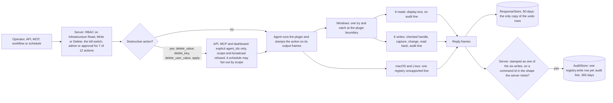
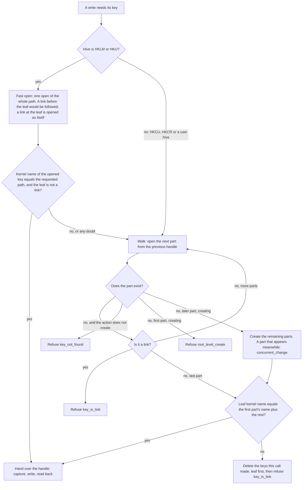
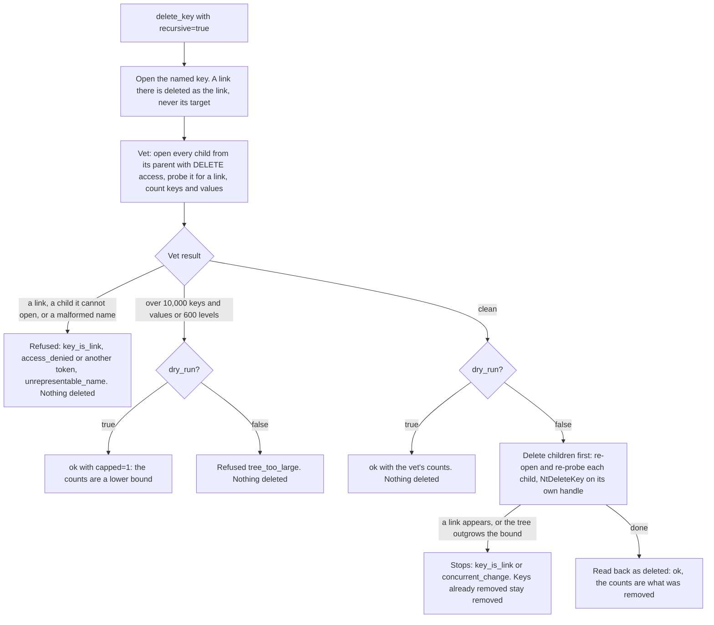
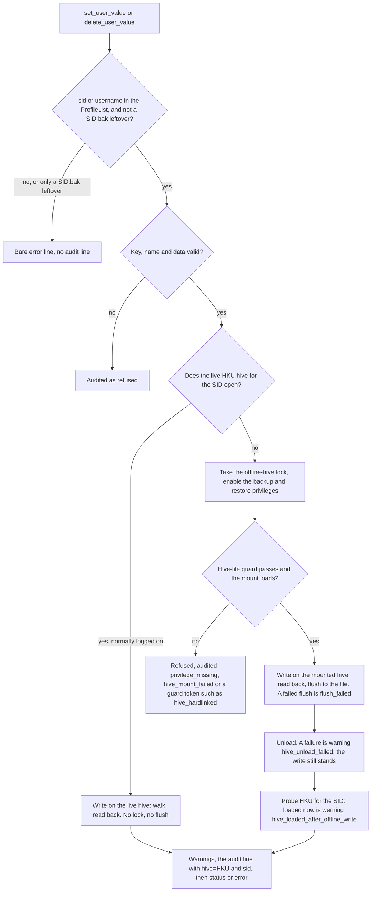
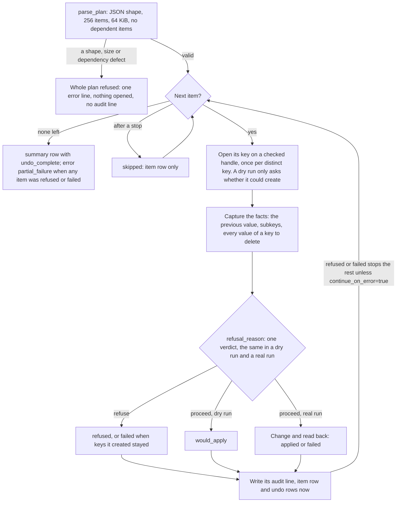

# registry

<!-- BEGIN GENERATED: plugin-doc-gen header -->
| | |
|---|---|
| **What it does** | Windows Registry -- get, set (six types, verified), delete value, delete key (optionally recursive), enumerate, per-user reads and writes, bulk apply with an undo manifest |
| **Version** | 2.1.0 |
| **Kind** | Action · mutating · on-demand |
| **Platforms** | Windows ✅ · macOS 🟡 planned · Linux 🟡 planned |
| **Actions** | `apply` (definition `windows.registry.apply`) · `delete_key` (definition `windows.registry.delete_key`) · `delete_user_value` (definition `windows.registry.delete_user_value`) · `delete_value` (definition `windows.registry.delete_value`) · `enumerate_keys` (definition `windows.registry.enumerate_keys`) · `enumerate_values` (definition `windows.registry.enumerate_values`) · `get_user_value` (definition `windows.registry.get_user_value`) · `get_value` (definition `windows.registry.get_value`) · `key_exists` (definition `windows.registry.key_exists`) · `list_profiles` (definition `windows.registry.list_profiles`) · `set_user_value` (definition `windows.registry.set_user_value`) · `set_value` (definition `windows.registry.set_value`) |
| **Security** | `get_value`: securable `Infrastructure` · operation Read · risk Low · dispatch ReadOnly · approval gate None; `set_value`: securable `Infrastructure` · operation Write · risk Medium · dispatch Mutating · approval gate AdminOrApproval; `delete_value`: securable `Infrastructure` · operation Delete · risk High · dispatch Destructive · approval gate AdminOrApproval; `delete_key`: securable `Infrastructure` · operation Delete · risk Critical · dispatch Destructive · approval gate AdminOrApproval; `key_exists`: securable `Infrastructure` · operation Read · risk Low · dispatch ReadOnly · approval gate None; `enumerate_keys`: securable `Infrastructure` · operation Read · risk Low · dispatch ReadOnly · approval gate None; `enumerate_values`: securable `Infrastructure` · operation Read · risk Low · dispatch ReadOnly · approval gate None; `get_user_value`: securable `Infrastructure` · operation Read · risk Medium · dispatch ReadOnly · approval gate AdminOrApproval; `list_profiles`: securable `Infrastructure` · operation Read · risk Low · dispatch ReadOnly · approval gate None; `set_user_value`: securable `Infrastructure` · operation Write · risk High · dispatch Mutating · approval gate AdminOrApproval; `delete_user_value`: securable `Infrastructure` · operation Delete · risk High · dispatch Destructive · approval gate AdminOrApproval; `apply`: securable `Infrastructure` · operation Delete · risk Critical · dispatch Destructive · approval gate AdminOrApproval |
| **Roles** | execute: `get_value`: endpoint-admin, endpoint-operator; `get_user_value`: endpoint-admin; `list_profiles`: endpoint-admin, endpoint-operator; `set_value`: endpoint-admin; `enumerate_keys`: endpoint-admin, endpoint-operator; `delete_value`: endpoint-admin; `delete_key`: endpoint-admin; `key_exists`: endpoint-admin, endpoint-operator; `enumerate_values`: endpoint-admin, endpoint-operator; `set_user_value`: endpoint-admin; `delete_user_value`: endpoint-admin; `apply`: endpoint-admin · author: content-author |
<!-- END GENERATED -->

## How it works

> **Read this first: four facts that decide what a registry write does.**
>
> 1. **`HKCU` is the agent's own hive, not the logged-on user's.** The agent runs as LocalSystem, so `hive=HKCU` reaches `HKU\.DEFAULT`, LocalSystem's own profile hive. To read or change a person's settings use `get_user_value`, `set_user_value` or `delete_user_value` with their `sid` or `username` (`list_profiles` lists them), or `hive=HKU` with their SID as the first key component while their hive is loaded.
> 2. **Only `apply` previews by default.** `apply` is a dry run unless you send `dry_run=false`. `delete_key` deletes unless you send `dry_run=true`. `set_value`, `delete_value`, `set_user_value` and `delete_user_value` have no preview at all: they act at once.
> 3. **The undo manifest exists only in the reply.** Nothing is kept on the endpoint. Save the reply of every write to the change record when it arrives; the stored response is deleted after 90 days by default.
> 4. **Destructive actions need explicit targets.** `delete_value`, `delete_key`, `delete_user_value` and `apply` take explicit `agent_ids` on `POST /api/command`, MCP `execute_instruction`, the REST instruction routes and the dashboard console; a scope or a broadcast is refused there, for a dry run too. A schedule can still fan an approved Destructive write out by scope. Every write, and `get_user_value`, also needs an administrator or an approval.

The plugin reads and changes the Windows registry on demand, in-process, with no scheduled collection. Six actions only read: `get_value`, `key_exists`, `enumerate_keys` and `enumerate_values` open one key of `HKLM`, `HKCU`, `HKCR` or `HKU`; `list_profiles` lists the machine's user profiles; `get_user_value` reads one value from a user's hive. Six actions change it: `set_value` and `delete_value` write or delete one value, `delete_key` deletes one key (with `recursive=true`, a whole tree), `set_user_value` and `delete_user_value` change one value in a user's hive, and `apply` runs a plan of up to 256 `HKLM` items with an undo manifest. Every change runs on a checked handle (the key is proven to be the one you named, never one reached through a registry link), is read back before it reports success (an `apply` `create_key` item is the exception: the checked handle is its evidence and `verify` is `-`), and writes one `audit|` line that the server turns into a `registry.write` audit row. A user's hive is the live `HKEY_USERS\<SID>` hive when it is loaded, otherwise the profile's `NTUSER.DAT`, mounted for the one call behind the hive-file guard and flushed before it is unloaded. The plugin keeps nothing on the endpoint and has no key policy of its own: the role, the approval, the per-action kill switch and the audit row are the controls. On macOS and Linux every action answers one `registry|unsupported|...` line.

### What you can do with it

| Action | What it changes | Safeguards | What comes back | How to undo |
|---|---|---|---|---|
| `get_value`, `key_exists`, `enumerate_keys`, `enumerate_values` | nothing | no approval; output folded to display text (caveat 5); `get_value` reads at most 1 MiB | the value and its type; `true` or `false`; one line per subkey or value | nothing to undo |
| `list_profiles` | nothing | no approval | one row per profile: SID, profile folder name, profile path, whether its hive is loaded | nothing to undo |
| `get_user_value` | nothing | administrator or approval; an offline mount goes through the hive-file guard | the profile name, the value and its type | nothing to undo |
| `set_value` | one value, any of six types; missing keys below an existing top-level key are created | administrator or approval; checked handle; read back; keys it created are removed again if it fails (best effort); no dry run | the audit line with the old and new value as hex (256 bytes at most), then `status\|ok` or the error | `set_value` with the old type and the old hex as `data_hex` (only when `old` is not cut and fits its type: "Undoing a change"), or `delete_value` when the old state was `absent`; delete keys it created (`created` above 0) |
| `delete_value` | one value | Destructive: explicit `agent_ids`; administrator or approval; no dry run | the audit line with the old value as hex | `set_value` from the audit line's `old_type` and `old` (only when `old` is not cut and fits its type: "Undoing a change") |
| `delete_key` | one key with no subkeys, with its values; with `recursive=true`, the whole tree | Destructive; `dry_run=true` counts and deletes nothing; a recursive delete is vetted first (10,000 keys and values, 600 levels, no links) | the audit line, then `counted_keys`, `counted_values`, `dry_run`, `capped` | none: the values are not recorded; to delete a leaf key with an undo use an `apply` `delete_key` item |
| `set_user_value` | one value in a user's hive | administrator or approval; live hive, or an offline mount behind the hive-file guard, flushed; no dry run | hive warnings, the audit line with `hive=HKU` and `sid=<SID>`, then the status | as `set_value`, with `set_user_value` or `delete_user_value`; keys it created (`created` above 0) can be removed only with `delete_key` `hive=HKU` `key=<SID>\...` while the user's hive is loaded |
| `delete_user_value` | one value in a user's hive | Destructive; as `set_user_value` | as `set_user_value` | `set_user_value` from the audit line's `old_type` and `old` (only when `old` is not cut and fits its type: "Undoing a change") |
| `apply` | up to 256 `HKLM` items: `set_value`, `delete_value`, `create_key`, non-recursive `delete_key` | Destructive; dry run by default; one verdict in both modes; refuses an item it could not undo; not transactional | per item an audit line, an `item` row and, for a deleted key, `undo` rows; then a `summary` row | replay the manifest in reverse ("Undoing a plan" under Data contract) |

**I want to ...**

- **change a setting for one person:** `list_profiles`, then `set_user_value` with the `sid`. `hive=HKCU` would change the agent's own hive.
- **change several machine settings and keep an undo:** `apply` as a dry run, then the same plan with `dry_run=false`; save both replies.
- **delete a whole branch:** `delete_key` with `recursive=true` and `dry_run=true`, read the counts, then run it with `dry_run=false`. There is no undo.
- **delete a leaf key and be able to put it back:** an `apply` plan with one `delete_key` item: its `undo` rows hold every value of the key.
- **reach a 32-bit application's key:** name `WOW6432Node` in the path.

**What it deliberately does not do.** It has no 32-bit registry view flag (the x64 agent uses the 64-bit view only, with no `KEY_WOW64_*` flag), no protected-key list (an owner decision), no watch or trigger, and no transactions: `apply` is `HKLM` only and not transactional, and its undo restores values, not a deleted key's owner, permissions, class or volatility. It never follows a registry link, so a write under `HKLM\SYSTEM\CurrentControlSet` (itself a link) is refused: write under `HKLM\SYSTEM\ControlSet001`, or the numbered set `Select\Current` names. A creating write never creates a key directly under a hive root (`root_level_create`).

### The words used in this document

| Term | What it means for you |
|---|---|
| Checked handle | Before changing anything the plugin proves that the key it opened is the key you named, not one reached through a registry link, and then does every step on that same open key. Nothing is looked up by name again, so a key swapped mid-change cannot redirect the write. |
| Fast open | The quick way to a checked handle on `HKLM` and `HKU`: one open of the whole path, accepted only when the kernel's own name for the opened key equals the path you named. Anything doubtful falls back to the walk. |
| Walk | The thorough way: the path is opened one part at a time and every part is checked for a link. It is the only way that creates keys or gives a refusal reason. |
| Vet | The read-only pre-scan of a recursive `delete_key`: it counts the tree, checks every key for a link and for the agent's right to delete it, and refuses the call before anything is deleted. It bounds the size and sweeps for links; it is not a list of the keys to delete. |
| Dry run | A run that does every check and changes nothing (`dry_run=true`, the default only for `apply`). It needs the same targets and approval as a real run and is audited, with `dry_run=1`. |
| Undo manifest | The previous values in an `apply` reply: the `old_*` cells of each `item` row and one `undo` row per value of a deleted key. It exists only in the reply. |
| Hive guard | The hive-file guard, run before a user's `NTUSER.DAT` is mounted: it refuses a file that has a second hard link, sits behind a redirected folder or a network path, or is otherwise not the plain file the profile names, so a write cannot land in another file. |
| Offline hive | A user's `NTUSER.DAT` that the agent mounts for one call because the user's live hive cannot be opened (normally: the user is not logged on). The change is flushed to the file and the hive unloaded before the call answers. |
| Verify (read-back) | After every change the plugin reads the value back, or checks the key is gone, on the same handle (an `apply` `create_key` item is not read back: its `verify` is `-`). `status\|ok` means it matched; `verify_mismatch` means it did not. |
| `created` | The number of keys this call created that still exist. On a failure it names keys a call made and could not remove again. |

### A safe workflow

1. **Target.** Name the devices with explicit `agent_ids`, verified at registry 2.1.0 ("Before you roll out").
2. **Read first.** Record the current state with `get_value`, `get_user_value`, `enumerate_values` or `key_exists`. For `set_value`, `delete_value` and the per-user writes this is the only preview.
3. **Preview.** Run `apply` as it defaults, or `delete_key` with `dry_run=true`. Every `item` row should say `would_apply` and the `summary` row `undo_complete` 1; a `delete_key` preview gives `counted_keys`, `counted_values` and `capped`.
4. **Change, and save the reply.** Run with `dry_run=false`, or run the single action. Save the reply to the change record when it arrives: it holds the only undo manifest.
5. **Verify.** `status|ok` already means the plugin read the change back on its own handle; read it again with the read actions to see what the next reader sees.
6. **Undo if needed.** Follow "Undoing a change" under Data contract. Worked recipes are in `docs/user-manual/cookbook.md`, section 1.7: preview, apply and undo a plan; change one value in a user's hive; remove a registry branch safely.

### Before you roll out

Read the two `registry` sections of `docs/user-manual/upgrading.md` first. The server does not compare a plugin version at dispatch (the definitions' `minAgentVersion` is declared and exported, not enforced; #6484), so which agents receive a write is the operator's responsibility.

- **The hazard.** A registry 1.x or 2.0.x agent (every agent released before 2.1.0, v0.14.1 included) reads neither `dry_run` nor `recursive`: a `delete_key` sent to it with `dry_run=true` DELETES the key when it has no subkeys. A bare `status|ok` (1.x) or a `dry_run|0` row (2.0.x) in answer to `dry_run=true` means the key was deleted. The three 2.1.0 actions answer `error|unknown action` there.
- **The order.** Upgrade the server replicas, then the agents. Aim previews and writes only at devices verified at 2.1.0: mark them with a tag (`ostype == "windows" AND tag:<key> == "<value>"`), use that scope in schedules, workflows, policies and bundles as well as scripts, and resolve it to the explicit `agent_ids` a Destructive action needs on the API, MCP and dashboard routes. Until the fleet is upgraded, switch `delete_key` off: `PUT /api/v1/plugin-config/registry/kill-switch?action=delete_key` with the body `{"enabled": false, "reason": "registry 1.x/2.0.x agents still in the fleet"}` (`enabled` is required; `PluginConfig:Write`).
- **Registry 1.x writes.** A 1.x agent writes an EMPTY `REG_SZ` for a `data_hex`-only `set_value`, stores `REG_QWORD`, `REG_MULTI_SZ`, `REG_EXPAND_SZ` and `REG_BINARY` values as `REG_SZ` text, follows a write under `HKLM\SYSTEM\CurrentControlSet`, and answers `status|ok` with no `audit|` line. A `status|ok` with no `audit|` line before it came from a 1.x agent (a 2.x agent also answers a request refused before anything opened with a bare `error|` line): read the value back with `get_value`.
- **Stored definitions.** Bundled definitions are inserted only when absent, so an existing server keeps its stored `windows.registry.*` text and parameters until they are exported, deleted and re-imported (`docs/user-manual/instructions.md`, "Replacing a stored parameter schema"). Re-import `delete_key` 1.2.0 only after every targeted agent is verified at 2.1.0: the stored schema without `dry_run` is what keeps the instruction route from sending it.
- **Audit rows and NULs.** Only agents from the release that contains #6294 stamp the action the server needs to mint `registry.write` rows. A NUL inside a parameter sent through `POST /api/command` cuts the value at the NUL on every agent version; the instruction and MCP routes refuse control bytes.

### Diagrams

#### End-to-end request path



The server decides who may run which action before anything reaches an agent, and on the API, MCP and dashboard routes a Destructive action also needs explicit device ids (a schedule can still fan an approved one out by scope). The agent stamps each reply frame with the action it ran; the server, not the plugin, mints a `registry.write` row, and only for the six writes on a command id in the shape the server mints for a registry command (`registry-` plus 16 or 32 hex digits). It checks that shape and the stamped action, not a dispatch record, so a read action's output never mints a row; the rows are asserted by the agent. The reply goes to the ResponseStore, the one place an `apply` undo manifest is kept.

#### Opening a key: the checked handle



The fast open only ever accepts: a link anywhere before the leaf makes the kernel open the link's target, whose name cannot match, so any doubt falls back to the walk. The walk reads the kernel name of the first part as soon as it opens it and compares the leaf's name with it at the end, so a link finished after its check, or a part renamed mid-walk, is refused rather than followed. A `delete_key` leaf is opened as a possible link and deleted as the link object, never its target.

#### Recursive delete_key



The plugin never uses `RegDeleteTreeW`, which follows a link met inside a tree. The vet refuses a tree it cannot delete whole before anything is removed; the real delete checks every key again as it reaches it, so a key added since the vet is deleted and counted, and a link added since stops the run (`failed` once anything was removed, otherwise `refused`). The counts of a real run are what it removed, which can exceed a dry run's.

#### Per-user write



A write never targets a `<SID>.bak` leftover in the ProfileList: its folder may hold the user's real hive and its name could shadow the live profile's. A `sid` naming a leftover, or a `username` that only a leftover carries, is answered as a profile that is not found; a `username` that a live profile also carries resolves to the live profile (`get_user_value` and `list_profiles` still see the leftover). The live hive is tried first; the offline mount runs whenever it cannot be opened, normally because the user is not logged on (a profile with no path answers `hive_not_found`). The flush matters because unloading a hive does not itself write the file; a failed flush fails the write and removes any keys it created. The post-unload probe reports a hive that a logon loaded after the write returned.

#### The apply plan



The parser refuses a plan whose items depend on each other, so a dry run gives the same verdicts a real run would. Each item's rows go out as the item ends, before the next item opens anything, so a later failure cannot take them back. The plan is not transactional: items already applied stay applied when a later one stops it.

### Design notes for reviewers

<details>
<summary>Mechanism detail, races and code anchors</summary>

- **Fast open.** One `RegOpenKeyExW` of the whole path with `REG_OPTION_OPEN_LINK`, then `NtQueryKey(KeyNameInformation)` names the object the handle is bound to. It is accepted only when that name equals `<root kernel name>\<requested path>` (every byte exact except A-Z folding, so a non-ASCII case difference, a name over the 4 KiB buffer and a failed query all decline) and the leaf has no `SymbolicLinkValue`. A `set_value` on an existing key is 7 calls across the plugin's registry seam at every depth (`open_path`, `final_name`, the link probe, capture, set, read-back, close; the cached root-name lookup is an eighth); the walk costs about 3 more per component plus two name queries. If the kernel name of `HKLM` or `HKU` cannot be read the first time it is needed, the fast open stays off for that root until the agent restarts.
- **Walk.** Each component is opened from the previous handle with `REG_OPTION_OPEN_LINK` and probed for `SymbolicLinkValue`. The first component's kernel name is read right after its open (before its probe) and must end in the requested name; the leaf is handed over only when its kernel name equals that name plus the remaining components (A-Z fold), else `key_is_link`. A name that cannot be read refuses with its Win32 token (a NUL or a lone surrogate is `win32:13`). `HKCU` and `HKCR` have no single kernel name to compare with, so they always walk.
- **Rollback of created keys.** The keys a creating walk makes stay owned by the operation (`Opened::made`) until its verified write is over; a walk that does not hand its leaf over, and an exception before the write ends, delete them by their own handles, leaf first, after removing the value the write set. It is best effort: a key that holds a value or subkey when the rollback checks it is kept, so is one whose delete fails, and each is counted in `created` (`result=failed`). Windows has no delete-if-empty call, so a value another writer adds between that check and the delete, or writes over our own same-named value before the rollback deletes it, is lost. After an exception whose rollback step also fails, the value and keys can stay while the fixed exception line says `created=-`.
- **Deletes.** Keys are deleted by handle with `NtDeleteKey`, never `RegDeleteKeyW(parent, name)` or `RegDeleteTreeW`. A subkey created between a non-recursive `delete_key`'s check and its delete makes `NtDeleteKey` refuse, answered `access_denied` or `win32:<code>` with the key in place. The recursive delete walk does not repeat the kernel-name check per child (one `NtQueryKey` each); it relies on a link key enumerating no children, so a link finished after its probe is still deleted only as the link object. A security product that allows the vet's open and refuses only the delete stops a real run part-way.
- **Profile resolution.** The per-user writes resolve the profile as `get_user_value` does (`resolve_profile`), except that the write path drops the `<SID>.bak` leftovers from the list first (`remove_backup_entries`, `agents/shared/user_profile_model.hpp`), so a leftover is never the write's target, by `sid` or by `username`; the reads keep the unfiltered list, where the first profile carrying a `username` wins.
- **Offline arm.** It runs under the process-wide `offline_hive_mutex` for the whole span, behind the default-on hive-file guard (no custom check, so no deadline), with the privileges enabled on the process token for the span of the mount (`with_user_hive`). The written key is flushed with `RegFlushKey` before the unload because `RegUnLoadKeyW` does not modify the file; a creating write whose flush fails is rolled back, an overwrite keeps its value in the mounted hive. A user hive's root has no kernel name for the fast open, so per-user writes walk. `render_user_write` emits the `hive_unload_failed` warning, then the terminal hive error, then the race warning, then the audit line and the status.
- **`apply`.** `run_apply` opens each distinct key once (the first item on it does the open) and reuses the handle; a failed open is never cached, so a `delete_value` on a missing key followed by a `set_value` on it still creates the key. The dry run opens with the mutation's own access mask and, where a real run would create, re-opens the deepest existing key with `KEY_CREATE_SUB_KEY` (nothing is created): it proves create access on that parent, not the ACL a new key will inherit. `parse_plan` refuses two value ops on one key and name, a key op over another item's equal, ancestor or descendant key (ASCII case-insensitive), and two value ops on one key when either name holds a non-ASCII character, because Windows folds value names with a Unicode table the parser cannot reproduce. Keys get the same conservative treatment: two valid items of any op are `dependent_items` when the first path component at which their keys differ under the ASCII fold still agrees once each run of non-ASCII bytes is collapsed to one placeholder (`fold_skeleton`, `ambiguous_shared_prefix`), because the kernel may fold the two spellings to one key and `run_apply`'s handle map does not; the real run would refuse the second spelling `key_is_link` where the dry run predicted `would_apply`. A refused item is not charged to the undo budget, and a refused value item keeps no bytes on its row (`old_hex` is at most `~<total>`). A `delete_key` item streams every value of the leaf (`vet_leaf_values`, up to the 10,000-node bound) and refuses `unsupported_old_type` or `unrepresentable_name` before deleting. Each item's audit line opens its own output unit (`LineSink::put_audit`): if the channel fails on that line itself (the item may already have changed the registry), the failure reaches the seam, which tries to leave the fixed `op=apply` failed line; if it fails on a later line of the item, the plan stops with `error|exception` only, so the server never gets a success row and a failure row for one mutation. Either way nothing after that item is opened and no `summary` row follows.
- **Reads.** Every registry-controlled string a read renders passes through `sanitize_field`. `parse_target` logs (never blocks) access to a few sensitive `HKLM` subtrees with `spdlog::info`.
- **Code anchors** (file and function; line numbers move): `open_fast`, `open_checked`, `leaf_name_check`, `probe_link`, `query_value_bounded`, `write_value_on`, `delete_key_on`, `count_tree`, `delete_subtree`, `delete_key_tree`, `flush_on`, `render_user_write`, `refusal_reason`, `vet_leaf_values`, `run_apply` (`registry_core.hpp`); `parse_plan`, `representable`, `row_field` (`registry_plan.hpp`); `encode_value`, `validate_key_path`, `render_audit_line`, `restorable`, `classify_offline_write_race` (`registry_parsers.hpp`); `Win32Registry::open_path`, `final_name`, `root_name`, `delete_key_by_handle`, `flush_key`, `do_user_write`, `execute_guarded` (`registry_win.cpp`); `registry_audit_events_for_frame` (`server/core/src/plugin_result_audit.hpp`).

</details>

## OS capability

<!-- BEGIN GENERATED: plugin-doc-gen capability -->
| Action | Windows | macOS | Linux |
|---|---|---|---|
| `apply` | ✅ supported · rung 1 · win32_registry | 🟡 planned · rung 1 · defaults/CFPreferences (per-domain plist) | 🟡 planned · rung 2 · dconf/gsettings |
| `delete_key` | ✅ supported · rung 1 · win32_registry | 🟡 planned · rung 1 · defaults/CFPreferences (per-domain plist) | 🟡 planned · rung 2 · dconf/gsettings |
| `delete_user_value` | ✅ supported · rung 1 · win32_registry+hive_mount | 🟡 planned · rung 1 · defaults/CFPreferences (per-domain plist) | 🟡 planned · rung 2 · dconf/gsettings |
| `delete_value` | ✅ supported · rung 1 · win32_registry | 🟡 planned · rung 1 · defaults/CFPreferences (per-domain plist) | 🟡 planned · rung 2 · dconf/gsettings |
| `enumerate_keys` | ✅ supported · rung 1 · win32_registry | 🟡 planned · rung 1 · defaults/CFPreferences (per-domain plist) | 🟡 planned · rung 2 · dconf/gsettings |
| `enumerate_values` | ✅ supported · rung 1 · win32_registry | 🟡 planned · rung 1 · defaults/CFPreferences (per-domain plist) | 🟡 planned · rung 2 · dconf/gsettings |
| `get_user_value` | ✅ supported · rung 1 · win32_registry+hive_mount | 🟡 planned · rung 1 · defaults/CFPreferences (per-domain plist) | 🟡 planned · rung 2 · dconf/gsettings |
| `get_value` | ✅ supported · rung 1 · win32_registry | 🟡 planned · rung 1 · defaults/CFPreferences (per-domain plist) | 🟡 planned · rung 2 · dconf/gsettings |
| `key_exists` | ✅ supported · rung 1 · win32_registry | 🟡 planned · rung 1 · defaults/CFPreferences (per-domain plist) | 🟡 planned · rung 2 · dconf/gsettings |
| `list_profiles` | ✅ supported · rung 1 · win32_registry | 🟡 planned · rung 1 · defaults/CFPreferences (per-domain plist) | 🟡 planned · rung 2 · dconf/gsettings |
| `set_user_value` | ✅ supported · rung 1 · win32_registry+hive_mount | 🟡 planned · rung 1 · defaults/CFPreferences (per-domain plist) | 🟡 planned · rung 2 · dconf/gsettings |
| `set_value` | ✅ supported · rung 1 · win32_registry | 🟡 planned · rung 1 · defaults/CFPreferences (per-domain plist) | 🟡 planned · rung 2 · dconf/gsettings |

**Declared limits per leg** (descriptor fallback text, verbatim):

- **`apply` / macOS** — planned stub: not implemented, the action answers registry|unsupported|...
- **`apply` / Linux** — planned stub: not implemented, the action answers registry|unsupported|...
- **`delete_key` / macOS** — planned stub: not implemented, the action answers registry|unsupported|...
- **`delete_key` / Linux** — planned stub: not implemented, the action answers registry|unsupported|...
- **`delete_user_value` / macOS** — planned stub: not implemented, the action answers registry|unsupported|...
- **`delete_user_value` / Linux** — planned stub: not implemented, the action answers registry|unsupported|...
- **`delete_value` / macOS** — planned stub: not implemented, the action answers registry|unsupported|...
- **`delete_value` / Linux** — planned stub: not implemented, the action answers registry|unsupported|...
- **`enumerate_keys` / macOS** — planned stub: not implemented, the action answers registry|unsupported|...
- **`enumerate_keys` / Linux** — planned stub: not implemented, the action answers registry|unsupported|...
- **`enumerate_values` / macOS** — planned stub: not implemented, the action answers registry|unsupported|...
- **`enumerate_values` / Linux** — planned stub: not implemented, the action answers registry|unsupported|...
- **`get_user_value` / macOS** — planned stub: not implemented, the action answers registry|unsupported|...
- **`get_user_value` / Linux** — planned stub: not implemented, the action answers registry|unsupported|...
- **`get_value` / macOS** — planned stub: not implemented, the action answers registry|unsupported|...
- **`get_value` / Linux** — planned stub: not implemented, the action answers registry|unsupported|...
- **`key_exists` / macOS** — planned stub: not implemented, the action answers registry|unsupported|...
- **`key_exists` / Linux** — planned stub: not implemented, the action answers registry|unsupported|...
- **`list_profiles` / macOS** — planned stub: not implemented, the action answers registry|unsupported|...
- **`list_profiles` / Linux** — planned stub: not implemented, the action answers registry|unsupported|...
- **`set_user_value` / macOS** — planned stub: not implemented, the action answers registry|unsupported|...
- **`set_user_value` / Linux** — planned stub: not implemented, the action answers registry|unsupported|...
- **`set_value` / macOS** — planned stub: not implemented, the action answers registry|unsupported|...
- **`set_value` / Linux** — planned stub: not implemented, the action answers registry|unsupported|...
<!-- END GENERATED -->

## Privileges and prerequisites

| OS | Runs as | Extra grant needed | Measured | If the read is refused |
|---|---|---|---|---|
| Windows | agent service account (LocalSystem today, #1442) | `HKLM` writes (`apply` included) need the service account in `Administrators`, which LocalSystem is. `HKCU` is the service account's own hive (`HKU\.DEFAULT` under LocalSystem) and needs no elevation; it is not a logged-on user's hive. The per-user actions use a loaded `HKU\<SID>` hive with no extra privilege; when it cannot be opened (normally: the user is not logged on) they mount the profile's `NTUSER.DAT`, which needs `SeBackupPrivilege` and `SeRestorePrivilege`, already granted to the service account and enabled on the process token only for the span of the mount. `list_profiles` needs no elevated privilege. `NtDeleteKey` and `NtQueryKey` (ntdll) need only `DELETE` on the key and a handle the caller already holds. | 2026-10-23, bare-metal, elevated interactive user: the nine registry 2.0.1 actions captured (`docs/samples/windows.txt`); the three 2.1.0 actions are `[not captured]` there. The write arms, the recursive delete, the per-user writes and `apply` run in `tests/unit/test_registry_write_local_dispatcher.cpp` and `tests/unit/test_registry_win_internals.cpp` on elevated Windows runs | reads: `error\|key not found`, `error\|value not found`, `error\|value exceeds 1 MiB limit`, `error\|value changed while reading ...` or `error\|win32:<code>`; writes: the audit line, then `error\|<token>` naming the cause (`access_denied` among them; every token is in the token table under "Reference for integrators: error tokens"); the per-user actions add `hive_not_found`, `privilege_missing`, `hive_mount_failed` or a hive-file guard token |
| macOS | n/a: plugin loads but every action is the honest `unsupported` stub (plist support is PLANNED) | n/a | 2026-10-26, bare-metal, euid 501 | always `registry\|unsupported\|Windows registry has no macOS equivalent; use defaults/plists`, rc 0 (reads) / rc 1 (mutators) |
| Linux | n/a: plugin loads but every action is the honest `unsupported` stub (dconf support is PLANNED) | n/a | 2026-10-26, vm (WSL2 Ubuntu 26.04), euid 0, all twelve actions captured with the built `plugin-capture` | always `registry\|unsupported\|Windows registry is not available on this platform`, rc 0 (reads) / rc 1 (mutators) |

No external binaries, no subprocesses, no network access: every call is an in-process Win32 `Reg*W`/`AdjustTokenPrivileges`/`NtDeleteKey`/`NtQueryKey` call (`registry_win.cpp`, `agents/shared/win_profiles.hpp`, `agents/shared/win_reg_handle.hpp`).

**Controlling the write actions.** There is no built-in key policy (no protected-key denylist, by owner decision): the controls are the `endpoint-admin` role with approval (`AdminOrApproval`) on every mutating definition, the explicit-target rule for the Destructive ones, the `registry.write` audit row, and the per-action kill switch (`PUT /api/v1/plugin-config/registry/kill-switch`, add `?action=set_value` for one action; `PluginConfig:Write`; no row means allowed). A scheduled execution can fan an approved write out to many devices.

## Data contract

### Inputs

<!-- BEGIN GENERATED: plugin-doc-gen inputs -->
| Definition | Parameter | Type | Required | Default | Constraints | Description |
|---|---|---|---|---|---|---|
| `windows.registry.apply` | `plan` | string | yes | - | maxLength 65536 | A JSON array of up to 256 flat objects (64 KiB at most). Fields (all strings): `op` (set_value, delete_value, create_key or delete_key), `hive` (HKLM, the default and the only one), `key`, `name`, `type`, `value`, `data_hex`. set_value takes type (default REG_SZ) and value or data_hex, exactly as the set_value action; a present but empty `data_hex` is the zero-byte form (REG_BINARY only), which lets a captured empty value round-trip. delete_value takes key and name; create_key and delete_key take key only (delete_key is NOT recursive and refuses a link). A set_value or create_key item whose first key component does not already exist directly under the hive is refused root_level_create, in a dry run and a real run alike. An agent still on registry 1.x or 2.0.x answers `error\|unknown action`. |
| `windows.registry.apply` | `dry_run` | string | no | true | enum: true, false | "true" (the default) reports every item's verdict and changes nothing; "false" applies the plan. Any other spelling is refused as invalid_data (the direct command route, which has no enum, also accepts 1 and 0). |
| `windows.registry.apply` | `continue_on_error` | string | no | false | enum: true, false | "true" keeps applying later items after a refused or failed one; "false" (the default) stops and reports the remaining items skipped. |
| `windows.registry.delete_key` | `hive` | string | yes | - | enum: HKLM, HKCU, HKCR, HKU | Registry hive containing the key, e.g. "HKCU". |
| `windows.registry.delete_key` | `key` | string | yes | - | - | Registry key path to delete, relative to the hive root. |
| `windows.registry.delete_key` | `recursive` | string | no | false | enum: true, false | "true" deletes every subkey and value beneath the key as well; "false" (the default) refuses a key that has subkeys. The tree is vetted first (at most 10,000 keys and values and 600 levels, else tree_too_large with nothing deleted; a registry link inside it is refused as key_is_link), and the counts of a dry run are a snapshot. Any other spelling is refused as invalid_data (the direct command route, which has no enum, also accepts 1 and 0). Needs registry 2.1.0 on the agent: registry 1.x and 2.0.x ignore it. |
| `windows.registry.delete_key` | `dry_run` | string | no | false | enum: true, false | "true" counts what a real run would remove (with `recursive`, the vetted tree) and deletes nothing; "false" (the default) deletes. Any other spelling is refused as invalid_data (the direct command route also accepts 1 and 0). Needs registry 2.1.0 on the agent: an agent at registry 1.x or 2.0.x ignores this flag and DELETES a key that has no subkeys, so upgrade agents first (docs/user-manual/upgrading.md). |
| `windows.registry.delete_user_value` | `username` | string | no | - | maxLength 256 | Windows profile folder name to resolve via ProfileList (see list_profiles), matched case-insensitively. Either username or sid is required; sid takes precedence if both are given. |
| `windows.registry.delete_user_value` | `sid` | string | no | - | maxLength 256 | Windows security identifier of the target profile, as an alternative to username. Must match one of the profiles list_profiles would report, except that a `<SID>.bak` leftover is never a write target (its folder may hold the user's real hive). |
| `windows.registry.delete_user_value` | `key` | string | yes | - | maxLength 255 | Registry key path relative to the resolved user's hive root (at most 255 bytes and 32 components). |
| `windows.registry.delete_user_value` | `name` | string | yes | - | maxLength 16383 | The registry value name to delete. Empty deletes the key's default value. |
| `windows.registry.delete_value` | `hive` | string | yes | - | enum: HKLM, HKCU, HKCR, HKU | Registry hive containing the value, e.g. "HKCU". |
| `windows.registry.delete_value` | `key` | string | yes | - | - | Registry key path containing the value, relative to the hive root. |
| `windows.registry.delete_value` | `name` | string | yes | - | - | The value name to delete. |
| `windows.registry.enumerate_keys` | `hive` | string | yes | - | enum: HKLM, HKCU, HKCR, HKU | Registry hive to enumerate, e.g. "HKLM". |
| `windows.registry.enumerate_keys` | `key` | string | yes | - | - | Registry key path relative to the hive root, e.g. "SOFTWARE\\Microsoft\\Windows NT\\CurrentVersion". |
| `windows.registry.enumerate_values` | `hive` | string | yes | - | enum: HKLM, HKCU, HKCR, HKU | Registry hive to enumerate, e.g. "HKLM". |
| `windows.registry.enumerate_values` | `key` | string | yes | - | - | Registry key path relative to the hive root. |
| `windows.registry.get_user_value` | `username` | string | no | - | maxLength 256 | Windows profile folder name to resolve via ProfileList (see list_profiles), matched case-insensitively. This is not always the same as the account name (renamed accounts, domain profiles). Either username or sid is required; sid takes precedence if both are given. |
| `windows.registry.get_user_value` | `sid` | string | no | - | maxLength 256 | Windows security identifier (e.g., "S-1-5-21-...-1001") of the target profile, as an alternative to username. Must match one of the profiles list_profiles would report; a sid not found there is rejected. Either username or sid is required. |
| `windows.registry.get_user_value` | `key` | string | yes | - | maxLength 1024 | Registry key path relative to the resolved user's hive root (e.g., "Software\\Microsoft\\Windows\\CurrentVersion\\Explorer"). |
| `windows.registry.get_user_value` | `name` | string | no | - | maxLength 256 | The registry value name to read. |
| `windows.registry.get_value` | `hive` | string | yes | - | enum: HKLM, HKCU, HKCR, HKU | Registry hive to read from, e.g. "HKLM". |
| `windows.registry.get_value` | `key` | string | yes | - | - | Registry key path relative to the hive root, e.g. "SOFTWARE\\Microsoft\\Windows NT\\CurrentVersion". |
| `windows.registry.get_value` | `name` | string | yes | - | - | The value name to read, e.g. "ProductName". |
| `windows.registry.key_exists` | `hive` | string | yes | - | enum: HKLM, HKCU, HKCR, HKU | Registry hive to check, e.g. "HKLM". |
| `windows.registry.key_exists` | `key` | string | yes | - | - | Registry key path relative to the hive root. |
| `windows.registry.set_user_value` | `username` | string | no | - | maxLength 256 | Windows profile folder name to resolve via ProfileList (see list_profiles), matched case-insensitively. Either username or sid is required; sid takes precedence if both are given. |
| `windows.registry.set_user_value` | `sid` | string | no | - | maxLength 256 | Windows security identifier of the target profile, as an alternative to username. Must match one of the profiles list_profiles would report, except that a `<SID>.bak` leftover is never a write target (its folder may hold the user's real hive); a sid not found there is rejected. |
| `windows.registry.set_user_value` | `key` | string | yes | - | maxLength 255 | Registry key path relative to the resolved user's hive root (e.g., "Software\\MyApp"); created if it does not exist beneath an existing top-level key. At most 255 bytes and 32 components, as set_value. |
| `windows.registry.set_user_value` | `name` | string | yes | - | maxLength 16383 | The registry value name to write. Empty writes the key's default value. At most 16,383 bytes. |
| `windows.registry.set_user_value` | `value` | string | no | - | - | The value data to write, as text; interpreted per `type` exactly as in set_value. Send exactly one of `value` and `data_hex`; a missing or empty one writes an empty value of the type. |
| `windows.registry.set_user_value` | `data_hex` | string | no | - | maxLength 2097152 | The exact bytes to write, as hex, for any type; give it INSTEAD of `value` (both non-empty is refused as invalid_data). Shape is checked per type, as in set_value. |
| `windows.registry.set_user_value` | `type` | string | no | - | enum: REG_SZ, REG_EXPAND_SZ, REG_BINARY, REG_DWORD, REG_MULTI_SZ, REG_QWORD | Registry value type to write. Defaults to REG_SZ when omitted. |
| `windows.registry.set_value` | `hive` | string | yes | - | enum: HKLM, HKCU, HKCR, HKU | Registry hive to write to, e.g. "HKCU". |
| `windows.registry.set_value` | `key` | string | yes | - | - | Registry key path relative to the hive root; created if it does not already exist beneath an existing top-level key, e.g. "Software\\MyApp". At most 255 bytes and 32 components; a hive alias, an empty, "." or ".." component and control characters are refused on the instruction and MCP routes; POST /api/command passes an embedded NUL to the plugin as a C string, so the value is cut at it. |
| `windows.registry.set_value` | `name` | string | yes | - | - | The value name to write, e.g. "InstallPath". Empty writes the key's default value. At most 16,383 bytes. |
| `windows.registry.set_value` | `value` | string | no | - | - | The value data to write, as text; interpreted per `type`: decimal digits for REG_DWORD / REG_QWORD, literal text for REG_SZ / REG_EXPAND_SZ, LF-separated non-empty records for REG_MULTI_SZ (split on LF only, so a CR stays inside its record; an empty record or a trailing LF is refused as invalid_data; empty text is the empty list), hex digits for REG_BINARY (empty is zero bytes). Send exactly one of `value` and `data_hex`. When neither is sent, or the one sent is empty, the write stores an empty value of the type and answers ok: an empty string, the empty list or zero bytes (REG_DWORD and REG_QWORD refuse it as invalid_data), so a misspelt parameter name writes an empty value instead of failing. Through MCP `execute_instruction` and the result-set execute routes every parameter value is limited to 64 KiB. |
| `windows.registry.set_value` | `data_hex` | string | no | - | maxLength 2097152 | The exact bytes to write, as hex, for any type; give it INSTEAD of `value` (both non-empty is refused as invalid_data). Shape is checked per type: 4 bytes for REG_DWORD, 8 for REG_QWORD, a terminating NUL for the string types, a trailing double NUL for REG_MULTI_SZ. Use it for exact bytes you hold from another source. An empty `data_hex` is the same as omitting it here. The plugin takes at most 1 MiB of data (2,097,152 hex characters), but MCP `execute_instruction` and the result-set execute routes limit every parameter value to 64 KiB, so through them it carries at most 32 KiB of data; the direct command route is not under that cap. Needs registry 2.0.0 on the agent: registry 1.x ignores it and writes an EMPTY REG_SZ over the value, answering `status\|ok` (with type=REG_DWORD and data_hex only, 1.x throws and writes nothing). |
| `windows.registry.set_value` | `type` | string | no | - | enum: REG_SZ, REG_EXPAND_SZ, REG_BINARY, REG_DWORD, REG_MULTI_SZ, REG_QWORD | Registry value type to write. Defaults to REG_SZ when omitted. Mixed fleets: an agent still running registry 1.x stores REG_QWORD, REG_MULTI_SZ, REG_EXPAND_SZ and REG_BINARY values as REG_SZ text and answers `status\|ok`, so upgrade the agents to registry 2.0.0 before using them. |
<!-- END GENERATED -->

### Outputs

Each action has its own line shape; there is no uniform row. A line is `name|value` or a tagged row, split on `|`, and `-` inside an `audit|` line means "not applicable" (the read actions never use `-` as a placeholder).

| Action | On success | On failure |
|---|---|---|
| `get_value`, `get_user_value` | `value\|...` and `type\|...`; `get_user_value` writes `username\|...` first | one `error\|...` line, rc 1 |
| `key_exists` | `exists\|true` or `exists\|false` | `error\|...` only for a missing or unknown hive or key parameter |
| `enumerate_keys`, `enumerate_values` | one `subkey\|<name>` or `value\|<name>\|<type>` line each; no lines for an empty key | `error\|key not found`, rc 1 |
| `list_profiles` | one `<sid>\|<profile_name>\|<profile_path>\|<hive_state>` row per profile, with no prefix; then `warning\|profile_list_truncated at 512 entries` when the list was cut and `warning\|profile_path_unreadable for <n> profile(s)` when some profile paths could not be read; zero rows is a success | `error\|profile_list_unreadable`, rc 1 |
| `set_value`, `delete_value` | `audit\|...`, `status\|ok` | `audit\|...`, `error\|<token>`, rc 1 |
| `delete_key` | `audit\|...`, `status\|ok`, then `counted_keys`, `counted_values`, `dry_run` (1 or 0) and `capped` (1 when a bound was hit and the counts are a lower bound) | `audit\|...`, `error\|<token>`, rc 1 (the counts ride in the audit line) |
| `set_user_value`, `delete_user_value` | any `warning\|...` lines, `audit\|...` with `hive=HKU` and `sid=<SID>`, `status\|ok` | the hive's own error line when the hive was not reached, `audit\|...`, `error\|<token>`, rc 1 |
| `apply` | per item, as it ends: `audit\|...`, `item\|...` and, for a key it deleted, one `undo\|...` row per value; then `summary\|...` | the same, then `error\|partial_failure`, rc 1, when any item was refused or failed |

A request that fails before anything is opened (a missing or unknown hive, a missing key, a profile that is not found, a plan whose shape or flags are invalid) is one bare `error|...` line with no audit line; a key path or value name that fails validation after the target resolved is audited as `result=refused`. The `delete_key` counts are point in time: without `recursive` they are what the key held (`counted_keys|1`), with it what the delete removed, or on a dry run what the vet counted.

**How to read a result.**

| You see | It means |
|---|---|
| `result=ok` and `status\|ok` | the change was made and read back identical (for `delete_key`, the key reads back as deleted) |
| `result=ok` with `dry_run=1`, or an `item` verdict `would_apply` | a preview: nothing changed |
| `result=refused` and `error\|<token>` | nothing changed; any key the call created was removed again |
| `result=failed` | a change was attempted and may have landed: read the key back; `created` above 0 counts keys the call made that stayed ("A partial or failed create" under Where the data goes) |
| per-user `result=ok` with `reason=hive_unload_failed` | the write is durable, but the user's offline hive is still mounted: a `reg unload` is owed (token table) |
| an `error\|...` line with no audit line | refused before anything was opened |
| `status\|ok` with no `audit\|` line before it | a registry 1.x agent answered: read the value back ("Before you roll out") |
| an `apply` reply with no `summary` row | the reply ended early: trust the rows that arrived and read back the keys of the items with none |

The field grammar of every row is in the generated table below and in the integrator references after "Undoing a change".

<!-- BEGIN GENERATED: plugin-doc-gen outputs -->
**`windows.registry.apply` — `row_kind|field_1|field_2|field_3|field_4|field_5|field_6|field_7|field_8|field_9|field_10|field_11|field_12|field_13`**

| Field | Type | Values | Available | Example | Description |
|---|---|---|---|---|---|
| `row_kind` | string | `item` `undo` `audit` `summary` | Windows | `item` | Row shape discriminator (field 0). Values: item, undo, audit, summary. A closing `error\|partial_failure` line, which has no row_kind, follows the summary whenever any item was refused or failed. |
| `field_1` | string | - | Windows | `0` | item and undo: the plan item index (0-based). audit: op=apply.<op>. summary: the item count. |
| `field_2` | string | - | Windows | `set_value` | item: the op (set_value, delete_value, create_key, delete_key). undo: the value name ("-" for the default value). audit: hive=. summary: items applied (or that would apply in a dry run). |
| `field_3` | string | - | Windows | `HKLM` | item: the hive. undo: the value type. audit: result= (ok, refused, failed). summary: items refused. |
| `field_4` | string | - | Windows | `SOFTWARE\Acme` | item: the key path (exact for an item that proceeds). undo: the value data as hex (the kept bytes, then ~<total> when the capture was cut). audit: reason=. summary: items failed. |
| `field_5` | string | - | Windows | `Mode` | item: the value name ("-" for none or the default value; exact for an item that proceeds). undo: 1 when the capture was cut, else 0. audit: verify=. summary: items skipped after a stop. |
| `field_6` | string | - | Windows | `applied` | item: the verdict (would_apply in a dry run, applied, refused, failed, skipped). audit: key= (capped at 256 bytes). summary: 1 for a dry run, 0 for a real run. |
| `field_7` | string | - | Windows | `-` | item: the refusal or failure token (key_not_found, value_not_found, key_has_subkeys, key_is_link, access_denied, root_level_create, tree_too_large, unsupported_old_type, unrepresentable_name, verify_mismatch, invalid_* ...) or "-". audit: name= (capped). summary: 1 when the undo manifest is complete, 0 when anything was cut or a creating item failed part-way. |
| `field_8` | string | - | Windows | `ok` | item: the read-back verification (ok, mismatch, "-"). audit: type=. |
| `field_9` | string | - | Windows | `0` | item: the number of key components this item created (reverse: delete_key of each, deepest first), predicted in a dry run. audit: len=. |
| `field_10` | string | - | Windows | `present` | item: the previous value state (absent, present, unreadable) for value ops; "-" for a key op and for an item refused before its previous value was read (never read as absent). audit: dry_run=. |
| `field_11` | string | - | Windows | `REG_SZ` | item: the previous value type. audit: counted_keys= ("-" for a delete_key that was invalid or whose open failed). |
| `field_12` | string | - | Windows | `6f006c006400` | item: the previous value as hex (the kept bytes, then ~<total> when it was cut or the undo budget dropped it; a refused item shows ~<total> only); restore it with data_hex. audit: counted_values=, or "-" when the item was refused before the contents of its key were read. |
| `field_13` | string | - | Windows | `8` | item: the new value length in bytes, or "-". audit: capped=, or "-" when not read. (The six audit tokens that follow -- created, sid, old_state, old_type, old, new -- are in the raw row and the registry.write audit row.) |

**`windows.registry.delete_key` — `status|counted_keys|counted_values|dry_run|capped`**

| Field | Type | Values | Available | Example | Description |
|---|---|---|---|---|---|
| `status` | string | - | Windows | `ok` | Confirms the run succeeded and, on a real run, that the handle read back as deleted (a dry run answers ok too); only ever emitted on success — a failure is reported as an `error\|<token>` line (not exhaustive: key_not_found, key_has_subkeys, tree_too_large, key_is_link, access_denied, verify_mismatch, concurrent_change, invalid_key_path, invalid_data or win32:<code>) and a non-zero exit instead of this column. A run that resolves its hive and key, success or not, also emits one `audit\|op=delete_key\|...` row (dry_run=1 on a dry run, whose success row records that a vet ran, not a deletion); a missing hive or key, or an unparseable hive, is a bare `error\|...` line with nothing opened and no audit row. Values: ok. |
| `counted_keys` | int32 | - | Windows | `4` | Keys in the subtree, the target included: on a real run what the delete REMOVED (exact when it succeeds, the partial total when it stopped), on a dry run what the vet counted (a lower bound when capped is 1). A non-recursive delete counts the target alone, so 1. Emitted on success only: a refusal carries its counts in the audit row (counted_keys=). Values: a non-negative integer. |
| `counted_values` | int32 | - | Windows | `5` | Values in those keys, counted the same way (a lower bound whenever capped is 1). Point in time: a writer racing the delete can add values a dry run never saw. Values: a non-negative integer. |
| `dry_run` | bool | - | Windows | `0` | Whether this was a dry run: 1 (counted, nothing deleted) or 0 (a real run). Values: 1, 0 — a digit, never true/false. |
| `capped` | bool | - | Windows | `0` | Whether the vet or the value enumeration stopped at its bound (10,000 keys and values, 600 levels), making the counts a lower bound; reported on a dry run or a non-recursive delete of a key holding more than 10,000 values (it removes that key with all its values). A real recursive delete past the bound is refused as tree_too_large, never capped: that refusal says capped=1 in its audit row only. Values: 1 (capped), 0 (complete) — a digit, never true/false. |

**`windows.registry.delete_user_value` — `status`**

| Field | Type | Values | Available | Example | Description |
|---|---|---|---|---|---|
| `status` | string | - | Windows | `ok` | Confirms the delete was verified (and, on the offline NTUSER.DAT arm only, flushed with RegFlushKey before the unload; a live HKEY_USERS\<SID> delete is not flushed); only ever emitted on success — a failure is an `error\|<token>` line (not exhaustive: value_not_found, key_not_found, hive_not_found, privilege_missing, hive_mount_failed, profile_list_unreadable, a hive-file guard token, flush_failed:<token>, access_denied or win32:<code>), preceded by the hive's own error sentence, and a non-zero exit. The same warnings as set_user_value may precede the audit row. A run whose profile resolves also emits one `audit\|op=delete_user_value\|...` row (hive=HKU, sid=<SID>); a missing sid, username or key, or a profile that is not found, is a bare `error\|...` line with nothing opened and no audit row, while a key path or value name that fails shape validation after the profile resolved is audited as result=refused. Values: ok. |

**`windows.registry.delete_value` — `status`**

| Field | Type | Values | Available | Example | Description |
|---|---|---|---|---|---|
| `status` | string | - | Windows | `ok` | Confirms the delete succeeded; only ever emitted on success — a failure is reported as an `error\|` line and a non-zero exit instead of this column. Values: ok. |

**`windows.registry.enumerate_keys` — `subkey`**

| Field | Type | Values | Available | Example | Description |
|---|---|---|---|---|---|
| `subkey` | string | - | Windows | `ProfileList` | One immediate subkey name under the given key; zero rows means the key has no subkeys. Display text (registry 2.0.1 and later): `\|`, every control character except TAB, DEL, the C1 controls, U+2028 and U+2029 each become `_`, so two names that differ only there render alike. Values: free text. |

**`windows.registry.enumerate_values` — `name|type`**

| Field | Type | Values | Available | Example | Description |
|---|---|---|---|---|---|
| `name` | string | - | Windows | `ProductName` | The value's name; zero rows means the key has no values. Display text (registry 2.0.1 and later): `\|`, every control character except TAB, DEL, the C1 controls, U+2028 and U+2029 each become `_`, so two names that differ only there render alike. Values: free text. |
| `type` | string | - | Windows | `REG_SZ` | The value's registry type, named via the shared type table shared with get_value and get_user_value. Values: REG_SZ, REG_EXPAND_SZ, REG_DWORD, REG_QWORD, REG_BINARY, REG_MULTI_SZ, REG_NONE, REG_LINK, REG_DWORD_BIG_ENDIAN, REG_UNKNOWN. |

**`windows.registry.get_user_value` — `username|value|type`**

| Field | Type | Values | Available | Example | Description |
|---|---|---|---|---|---|
| `username` | string | - | Windows | `jsmith` | The resolved profile display name the value was read from — falls back to the caller's own username/sid input, then the resolved sid, but is never fabricated and never empty (ADR-0024 D11). Values: free text. |
| `value` | string | - | Windows | `1` | The value's data as a display string: a REG_SZ, REG_EXPAND_SZ or REG_LINK value is read up to its first NUL (as Windows reads it; get_value shows an interior NUL as `_`), REG_MULTI_SZ records are semicolon-joined and REG_LINK gives its target (get_value leaves those two hex-encoded). Display text, not exact: the characters get_value's value column folds become `_` here too (registry 2.0.1 and later). Values: free text. |
| `type` | string | - | Windows | `REG_DWORD` | The registry value type, named via the shared type table. Values: REG_SZ, REG_EXPAND_SZ, REG_DWORD, REG_QWORD, REG_BINARY, REG_MULTI_SZ, REG_NONE, REG_LINK, REG_DWORD_BIG_ENDIAN, REG_UNKNOWN. |

**`windows.registry.get_value` — `value|type`**

| Field | Type | Values | Available | Example | Description |
|---|---|---|---|---|---|
| `value` | string | - | Windows | `Windows 10 Pro` | The value's data, decoded to a display string, for a value of at most 1 MiB (registry 2.0.1 and later; older agents read the whole value). Never truncated: a larger value fails the action with `error\|value exceeds 1 MiB limit` rather than returning a partial string. Display text, not exact: `\|`, every control character except TAB, DEL, the C1 controls (U+0080-U+009F), U+2028 and U+2029 each become `_` and trailing NULs are dropped, so those characters cannot be recovered from the row; get_value has no exact-bytes mode for a string value (the types it returns as hex are exact). Values: free text. |
| `type` | string | - | Windows | `REG_SZ` | The registry value type, named via the shared type table shared with get_user_value and enumerate_values. Values: REG_SZ, REG_EXPAND_SZ, REG_DWORD, REG_QWORD, REG_BINARY, REG_MULTI_SZ, REG_NONE, REG_LINK, REG_DWORD_BIG_ENDIAN, REG_UNKNOWN. |

**`windows.registry.key_exists` — `exists`**

| Field | Type | Values | Available | Example | Description |
|---|---|---|---|---|---|
| `exists` | bool | - | Windows | `true` | Whether the key could be opened for read. Values: true, false. |

**`windows.registry.list_profiles` — `sid|profile_name|profile_path|hive_state`**

| Field | Type | Values | Available | Example | Description |
|---|---|---|---|---|---|
| `sid` | string | - | Windows | `S-1-5-21-1111111111-2222222222-3333333333-1001` | The profile's Windows security identifier. Values: free text (a Windows SID string). |
| `profile_name` | string | - | Windows | `jsmith` | The resolved profile folder name (the last path component of ProfileImagePath); rendered "-" when it cannot be resolved — never falls back to the sid (ADR-0024 D11). Values: free text or "-". |
| `profile_path` | string | - | Windows | `C:\Users\jsmith` | The profile's ProfileImagePath, environment-expanded; rendered "-" when it is absent or unreadable. Values: free text or "-". |
| `hive_state` | string | - | Windows | `loaded` | Whether the profile's registry hive is reachable right now. Values: loaded, loaded_classes_only, not_loaded. |

**`windows.registry.set_user_value` — `status`**

| Field | Type | Values | Available | Example | Description |
|---|---|---|---|---|---|
| `status` | string | - | Windows | `ok` | Confirms the write was verified (and, on the offline NTUSER.DAT arm only, flushed with RegFlushKey before the unload; a live HKEY_USERS\<SID> write is not flushed); only ever emitted on success — a failure is an `error\|<token>` line (not exhaustive: hive_not_found, privilege_missing, hive_mount_failed, profile_list_unreadable, a hive-file guard token such as hive_path_reparse_ancestor, flush_failed:<token>, or any set_value token), preceded by the hive's own error sentence, and a non-zero exit. A `warning\|hive_unload_failed: ...`, `warning\|hive_loaded_after_offline_write` or `warning\|hive_post_unload_probe_failed:win32_<n>` line may precede the audit row. A run whose profile resolves also emits one `audit\|op=set_user_value\|...` row (hive=HKU, sid=<SID>); a missing sid, username or key, or a profile that is not found, is a bare `error\|...` line with nothing opened and no audit row, while a key path or value name that fails shape validation after the profile resolved is audited as result=refused. Values: ok. |

**`windows.registry.set_value` — `status`**

| Field | Type | Values | Available | Example | Description |
|---|---|---|---|---|---|
| `status` | string | - | Windows | `ok` | Confirms the write succeeded and read back identical; only ever emitted on success — a failure is reported as an `error\|<token>` line (not exhaustive: access_denied, key_not_found, root_level_create, key_is_link, concurrent_change, invalid_type, invalid_data, value_overflow, invalid_key_path, invalid_value_name, verify_mismatch or win32:<code>) and a non-zero exit instead of this column. A run that resolves its hive and key, success or not, also emits one `audit\|op=set_value\|...` row carrying the previous and new values (hex, capped); a missing hive or key, or an unparseable hive, is a bare `error\|...` line with nothing opened and no audit row, while a key path or value name that fails shape validation after the hive resolved (invalid_key_path, invalid_value_name) is audited as result=refused. Values: ok. |
<!-- END GENERATED -->

### Result status

This plugin does not set a typed result status; the agent records `UNDECLARED` and every sample shows `UNDECLARED / UNKNOWN /`.

### Where the data goes

- **Instruction result.** Rows/lines travel over the agent's mTLS gRPC channel as the command response and land in the ResponseStore (90 days), queryable at `/api/responses/{id}`.
- **Audit log.** The server, not the plugin, writes the `registry.write` rows: it parses the `audit|` lines of a reply frame (`server/core/src/plugin_result_audit.hpp`) only when the agent stamped the frame with one of the six write actions and the frame's command id has the shape the server mints for a registry command (`registry-` plus 16 or 32 hex digits), so a read action's output, or a line that merely starts with `audit|`, mints nothing. The server checks that shape and the stamped action, not a dispatch record: the rows are asserted by the agent. `result=ok` is recorded as `success`, `refused` and `failed` as `failure`, with the whole line in the row's detail. An agent older than the release that contains #6294 stamps no action and produces no rows (`docs/user-manual/upgrading.md`). Principal, retention and the join to the operator's row: `docs/user-manual/audit-log.md`.
- **Where each copy lives.** The reply (its rows and audit lines) is in the ResponseStore for 90 days by default (`--response-retention-days`), and it is the only copy of an `apply` undo manifest (the `item` rows' old values and the `undo` rows, up to 4,096 bytes per value); the AuditStore keeps one `registry.write` row per audit line for 365 days by default (`--audit-retention-days`), with old and new values cut to their first 256 bytes, as hex; `executions.parameter_values` keeps the request parameters (`value`, `data_hex`, the whole `plan`) and no pass prunes it; the endpoint keeps nothing.
- **Agent log.** The plugin's own `spdlog` error lines (for example `registry: <action> raised an exception`) carry no command id: the plugin ABI hands a plugin no command identifier. Attribute a command through the response and audit rows above, which are joined on the command id.
- **A partial or failed create.** A `set_value` row with `result=failed` and `created=<n>` above 0, an `error|exception` reply, or an agent that stopped in the middle of a command can leave keys the call made (and, for a write that landed, its value). Take the hive, key and value name from the request that dispatched the command, not from the audit row: the exception row has `hive=-|key=-|created=-`, and the `command.dispatch` row carries only `registry:set_value -> N agent(s)`. The request parameters are in `executions.parameter_values` of the execution that holds the row's `command_id` (join on it; the command-to-execution mapping is reaped after 24 hours, so the join can come back empty, and then only the dispatching script, workflow or schedule holds the request). A call creates only the trailing components of a path that did not exist, and a pre-existing empty parent looks exactly like a created one; the rollback goes leaf first, so the keys a failed call leaves are normally the shallowest of the ones it made, but when the leaf holds a value or key another party put there, the leaf is kept and every ancestor above it survives with it. Read the candidates with `key_exists`, `enumerate_values` and `enumerate_keys`, and remove a key with `delete_key` (leaf first, one call per key) only when this call's creation of it can be shown (for example an earlier `key_exists` for the path answered false) and it is empty; a key that holds a value you did not write is another party's and stays. For an exception whose audit line could not be written, and for an agent that died mid-command (it sends output at command end or each 64 KiB), there is no `registry.write` row: only the `command.dispatch` row and the stored response show the attempt. A recursive `delete_key` stopped that way can leave the tree partly deleted with no row at all: run it again as a dry run to see what is left, then for real. An `apply` stopped that way keeps the rows the agent had already sent; an item with no row may still have run, and a deleted key's manifest is whole only when its `undo` rows number its audit `counted_values`, so read the keys of those items back before replaying anything.
- **Not consumed by** daily-sync inventory, the Echo warehouse, DEX, or metrics: nothing here runs on a schedule; the plugin executes only when an operator or workflow dispatches one of its twelve definitions.
- **Sensitivity.** The audit rows of every mutating action (`apply` and the per-user writes included) and the `set_value`/`delete_value`/`set_user_value`/`delete_user_value` responses carry registry data OLD and NEW (hex of the raw bytes, 256 bytes at most per value in an audit row, for every value type) and key paths; an `apply` reply also carries its undo manifest, the previous value of each value item and every value of each deleted key (up to 4,096 bytes per value and 512 KiB per reply), readable by `Response:Read` holders for 90 days. All of these can hold secrets that live in the registry (a service account's autologon password, a product key, an agent token). **Owner risk acceptance:** old and new values are recorded as raw hex and can contain secrets; the product owner accepted this risk on 2026-10-20 and masking is a planned later change, and nothing in the plugin redacts them today. A key path can name a person. `get_value`/`enumerate_values`/`get_user_value` can return arbitrary registry data, among it `RegisteredOwner`/`DigitalProductId` (a person's name and a device-specific product-key hash); `get_user_value`'s `username` and `list_profiles`' `profile_name`/`profile_path` (e.g. `jsmith`/`C:\Users\jsmith`) directly identify a person and their home directory. The readers are wider than the writers: `AuditLog:Read` and `Response:Read` (the Viewer, Operator, PlatformEngineer, ITServiceOwner and Administrator roles hold both; `Response:Read` is not floored while RBAC is off), the legacy `/events` stream (any authenticated non-service-scoped session) and MCP `query_audit_log`; the executions' `parameter_values` carries the write parameters unredacted: `value` and `data_hex` of `set_value` and `set_user_value`, and the whole `apply` `plan` with every value in it. By default audit rows are retained 365 days (`--audit-retention-days`) and the response store 90 days (`--response-retention-days`); the executions table is not in the server's retention settings and no pass prunes it, so `parameter_values` stays until the database is purged. Read-time redaction is not built.
- **Siblings:** none. Guardian's own real-time registry-key watch (`guard_type: "registry"`) is an unrelated detection mechanism; this plugin is on-demand only, with no watch/trigger surface.
- **MCP / REST.** Discover: `discover_plugins` (summary) -> `yuzu://plugin-docs` (this page as data) -> `discover_instructions` / `get_definition("windows.registry.get_value")`. Run: `execute_instruction {definition_id, parameters}`. Read: `/api/responses/{id}`; the audit rows: the audit log API filtered on `registry.write`.

### Undoing a change

Undo needs the saved reply: the plugin keeps nothing on the endpoint, and a single action's previous value is only in its audit line (its first 256 bytes, as hex).

**Undoing a single action.** `set_value` or `set_user_value`: when the audit line says `old_state=present`, write back `type` = `old_type` and `data_hex` = `old`. That works only when `old` is not cut (no `~<total>` at its end), `old_type` is one of the six types `set_value` writes, and the bytes fit that type's shape (a string type ends in its NUL, a `REG_DWORD` is 4 bytes, a `REG_QWORD` 8, a `REG_MULTI_SZ` ends in a double NUL); an empty `old` counts as an omitted `data_hex`, which restores only a zero-byte `REG_BINARY` exactly. Restore any other value with another tool (an `apply` refuses such a value before changing it, `unsupported_old_type`). `old_state=absent` -> `delete_value` (or `delete_user_value`); `created` above 0 -> remove those trailing key components with `delete_key`, deepest first (for a per-user write, `hive=HKU` `key=<SID>\...` while the user's hive is loaded: no per-user action deletes a key). `delete_value` or `delete_user_value`: write back the `old_type` and `old` the same way, under the same conditions. `delete_key` records no values and cannot be undone from its reply.

**Undoing a plan.** Save the dry run's and the real run's replies to the change record at once: the manifest exists nowhere else (the stored response is kept 90 days by default, `--response-retention-days`). Undo only the items whose verdict is `applied`, and those `failed` with `created` above 0 or with a mutation (a `failed` value write may have landed; a `failed` `delete_key` with `undo` rows took its values); `refused`, `would_apply` and `skipped` rows changed nothing (a `refused` row's `old_hex` holds no bytes, at most `~<total>`, the size: nothing to replay). Replay in REVERSE item order. A row `name` of `-` is the default value: omit `name` in the replayed item (a plan refuses `-`). Per op:

| Op | What undoes it |
|---|---|
| `set_value` | the item row's previous value (`old_state`, `old_type`, `old_hex`): `present` -> `set_value` with `type` = `old_type` and `data_hex` = `old_hex`; `absent` -> `delete_value`; `created` above 0 means the write also made that many trailing key components -> `delete_key` of each, deepest first (one plan cannot hold a key and its descendant: `dependent_items`, so one call per level); `-` was not read and gives nothing to undo |
| `delete_value` | the previous value in the item row -> `set_value` with `type` = `old_type` and `data_hex` = `old_hex` |
| `create_key` | `created` above 0 -> `delete_key`, deepest first; 0 means the key existed and there is nothing to undo |
| `delete_key` | recreate the key from the item row (`create_key`; a key that held no values has no `undo` rows), then one `set_value` per `undo` row (name, type, hex) in a second plan (a key op and a value op on one key are `dependent_items`); a value whose name holds a non-ASCII character goes in a plan of its own when the key has other value rows (they would be `dependent_items`); a row cut or not retained makes `undo_complete\|0` |

**What `undo_complete|1` means, and what it does not.** It means every previous value the plan needed was retained whole within the budget and no creating item stopped part-way leaving keys its `created` count cannot name. It speaks for VALUES only: a deleted key's owner, DACL and SACL, class and volatility are not captured, so a replayed `create_key` recreates it with the parent's inherited security, non-volatile and with no class (a key readable only by SYSTEM can become readable by whoever the parent grants; under a volatile parent the recreate fails). The manifest is a snapshot taken at capture: a value another writer changes or adds between the capture and the write or delete is lost, or stale, even with `undo_complete|1`. A reply that ended early (an exception, a dead agent, a failed output channel) has no `summary|` row and so no `undo_complete` at all.

### Reference for integrators: apply rows, exact names and the undo budget

The row shapes (cells split on `|`):

| Row | Cells |
|---|---|
| `item` (14) | `item`, index, op, hive, key, name (`-` for none or the default value), verdict, reason (`-` when none), verify (`ok`, `mismatch`, `-`), created, old_state (`absent`, `present`, `unreadable`; `-` for a key op and for an item refused before its previous value was read), old_type, old_hex (the retained bytes, then `~<total>` when cut or dropped by the budget; a refused item keeps no bytes, at most `~<total>`), new_len |
| `undo` (6) | `undo`, the index of the `delete_key` item, name (`-` for the default value), type, hex (the retained bytes, then `~<total>` when cut), truncated (1 when cut) |
| `summary` (8) | `summary`, total, applied (would apply, in a dry run), refused, failed, skipped, dry_run (1/0), undo_complete (1/0) |

The key and name cells of an item that proceeds are exact (`representable`); a refused item's cells are the folded display form (a trailing backslash shows as `_`). An item refused before its previous value or its key's contents were read (an invalid item, one whose open failed, a `delete_key` refused for subkeys, or one whose vet or enumeration failed) shows `-` in its old_* cells and, for a `delete_key`, in the audit line's counted_* fields: `-` means "not read", never `absent`. A refused real creating item removes the keys its open made before its row goes out: `refused` with `created` 0 when all were removed, `failed` with the number that stayed otherwise. An `audit|` row is the same 20-part line as for a single action, with `op=apply.<op>`; an item skipped after a stop has only its `item|` row.

**The exact-name rule.** Every key path and value name a manifest row carries must read back as exactly what is in the registry, so one predicate (`representable`) decides: `row_field(name) == name` -- no `|`, no control character (TAB aside), no DEL, C1 control, U+2028 or U+2029, no invalid UTF-8, no NUL, no trailing backslash (the server's column splitter reads `\|` as an escaped pipe) -- and not the literal `-` (a row spells the default value that way). A name that fails it is refused `unrepresentable_name` before anything is changed, for the plan's own names and for every value of a key an item would delete. That value name is the raw UTF-16 name the registry enumerates and must be well-formed: one holding a lone surrogate or a NUL has no exact UTF-8 spelling (a display read shows the surrogate as U+FFFD, which names a different value or none), so it is refused the same way, in the dry run and the real run alike; a value really named with U+FFFD is deleted and restored like any other. So is a value whose name this plugin could not write back with `set_value` (a TAB, which `representable` accepts, or another control byte): on a `delete_key` item the token means "the manifest could not restore it by that name". A previous value this plugin could not write back (`REG_NONE` or another type it cannot write, a shape it would refuse, over 1 MiB) is `unsupported_old_type`.

**The undo budget.** One 512 KiB `CaptureBudget` charges every retained byte (the data, the name and 64 bytes per row) BEFORE anything is kept; a refused item is not charged (it changed nothing, so its previous value is no undo evidence, and it cannot make a later item's manifest incomplete); a row that does not fit is not retained and the summary says `undo_complete|0`, in the dry run too, so the operator sees an incomplete manifest before mutating. Each value keeps at most 4,096 bytes (a longer one is cut, which also makes `undo_complete|0`). The reply stays under the dispatcher's 2 MiB capture cap (`local_dispatcher.hpp`): the retained rows render to about 1 MiB of hex, at most 256 audit lines (each under 2 KiB) add 512 KiB, and the item rows and the summary about 100 KiB.

### Reference for integrators: error tokens

**Error tokens of the mutating actions** (the token table). `error|<token>` and the audit line's `reason=` carry the bare token and nothing more, and the agent logs nothing about an ordinary failure (an exception is the exception: it is logged with the action name). A misspelt or missing `value` parameter on a `REG_SZ`, `REG_EXPAND_SZ`, `REG_MULTI_SZ` or `REG_BINARY` write is not an error: it writes an empty value of the type and answers `status|ok` (`REG_DWORD` and `REG_QWORD` refuse it as `invalid_data`).

| Token | Meaning | What to check |
|---|---|---|
| `access_denied` | `ERROR_ACCESS_DENIED`, from several causes: the agent identity's ACL on the key refuses an access the action asks for (caveat 3 lists them); a parent the walk may traverse but not read (the walk opens every component with `KEY_QUERY_VALUE` to probe it; the fast open does not); a create refused on a parent, or an inherited ACL that gives the new key no `DELETE`; the link probe itself refused | the ACL of the key and of each parent for the agent identity |
| `key_not_found` | the key, or a component of the path, does not exist (nothing was written) | the spelling; `key_exists`; a `WOW6432Node` path |
| `value_not_found` | `delete_value` named a value the key does not hold (nothing deleted) | `enumerate_values` |
| `root_level_create` | the first key component is missing directly under the hive root; a creating write never creates one | the parent has to exist already |
| `key_is_link` | a component is a registry symbolic link, or the handle's kernel name is not the requested path (a link completed mid-walk, a component renamed, a non-ASCII case variant, a decoy value named `SymbolicLinkValue` on an ancestor); nothing was written, except in a real recursive delete that meets a link planted after its vet: the keys already removed stay removed, the counts say how many, and the result is `failed` (`refused` when no delete had been issued yet) | the link's target path; the key's stored spelling |
| `key_has_subkeys` | `delete_key` without `recursive` on a key with subkeys (nothing deleted); an `apply` `delete_key` item on one | `recursive=true`, or delete the subkeys first |
| `tree_too_large` | a REAL recursive delete whose vet hit its bound (10,000 keys and values, 600 levels), or an `apply` `delete_key` item on a leaf with more values than that; nothing deleted | delete the tree in parts |
| `unsupported_old_type` | an `apply` item's previous value (or a value of a key it would delete) is a type this plugin cannot write (`REG_NONE`, `REG_LINK`, `REG_DWORD_BIG_ENDIAN`, unknown), a shape `set_value` would refuse, or over 1 MiB; refused before anything changed, so the change could not be undone | change it with another tool |
| `unrepresentable_name` | an `apply` key path or value name a manifest row cannot spell exactly (see "The exact-name rule"), a value of a key it would delete that this plugin could not write back by that name or whose raw UTF-16 name is not well-formed, or (a recursive `delete_key`) a key in the tree whose raw name is not well-formed: found by the vet, nothing is deleted; found by the delete walk, the keys already removed stay removed (`failed`) | rename, or remove it with another tool |
| `flush_failed:<token>` | a per-user write verified, but `RegFlushKey` on the offline hive failed; durability is unknown | read the value back, retry |
| `hive_not_found`, `privilege_missing`, `hive_mount_failed`, a hive-file guard token (`hive_path_reparse_ancestor`, `hive_hardlinked`, ...) | a per-user write could not reach or trust the hive; nothing was written | the hive line above the audit line says why; for `hive_hardlinked`, find the second name with `fsutil hardlink list <path>`; a `hive_mount_failed` that persists for one profile can be a mount an earlier call failed to unload (`hive_unload_failed`, below) |
| `hive_unload_failed` | on a `result=ok` per-user row: the write is durable, but the offline hive stayed mounted | run the `reg unload HKU\<mount>` the warning line names once the process holding it lets go; until then the user's next logon can get a temporary profile |
| `concurrent_change` | another party created the key between the walk's check and its create, or the handle went stale (`ERROR_KEY_DELETED`), or a real recursive delete found the tree grown past its bound (the keys already removed stay removed, the counts say how many, `result=failed`, or `refused` when no delete had been issued yet) | read the key and retry; a recursive delete: dry run, then run again |
| `verify_mismatch` | the read-back differs from what was written, or the key did not read back as deleted. It can be a false positive: another writer, or a Group Policy refresh, that touches the value between the write and the read-back looks the same | `get_value` the value and decide |
| `invalid_key_path`, `invalid_value_name` | the input failed shape validation before anything was opened (limits under Inputs) | the parameter |
| `invalid_hive`, `dependent_items`, `invalid_plan:<why>` | `apply`: an item names a hive other than `HKLM`; two items touch the same value, two value items on one key carry a non-ASCII name, the first component at which two items' keys differ (ASCII case aside) differs only inside its runs of non-ASCII characters (this also refuses two distinct sibling keys whose names are wholly non-ASCII, for example two CJK vendor keys, in one plan), or items overlap on a key (the whole plan is refused `dependent_items:<i>:<j>`); the plan is refused whole as `invalid_plan:<why>[:<index>]`, `<why>` one of `plan_too_large` (over 64 KiB), `not_flat` (nested deeper than an array of objects), `not_json`, `not_array`, `empty`, `too_many_items` (over 256), `item_not_object`, `unknown_key`, `field_type` (a field that is not a string) or `invalid_op` | the plan; split dependent items into separate plans |
| `invalid_type` | `type` is not one of the six names (case-sensitive) | the spelling |
| `invalid_data` | the text or `data_hex` does not fit the type: not decimal digits for a number; not hex, or an odd count; a string without its terminating NUL; a REG_MULTI_SZ with an empty record or a trailing LF (records are split on LF only, so a CR stays in its record); `value` and `data_hex` both sent; a `dry_run`, `recursive` or `continue_on_error` flag that is not `true` or `false` (or `1` or `0` on the direct route) | the parameter |
| `value_overflow` | a number out of range for its type, or data over 1 MiB | the parameter |
| `win32:<code>` | any other Win32 or NT failure, by number, including the answer when `NtDeleteKey` refuses for a reason not listed here (Design notes, "Deletes") | `net helpmsg <code>` |
| `exception` | an exception ended the action (an allocation failure is the realistic one); the audit line is the fixed failed line of caveat 2 (for `apply`, after the rows of the items already done). A failed output channel writes no fixed line once the action's audit line (for `apply`, the current item's) is out, only a best-effort `error\|exception`; a failure on that audit line itself, or before it, reaches the seam, which tries to leave the fixed line and writes nothing if the channel is dead (an `apply` item may already have changed the registry) | the agent log, and "A partial or failed create" under Where the data goes; for `apply`, `error\|exception` after item rows with no `summary\|` row means the plan stopped there: trust the rows sent, compare a deleted key's `undo` rows with its audit `counted_values`, and read back the keys of the items with no row |

### Audit line grammar and producer contract (for integrators)

The plugin is the producer of the `audit|` line the server parses (`server/core/src/plugin_result_audit.hpp`). One line is the tag `audit` and 19 `name=value` fields, 20 `|`-separated parts, in this order:

| # | Field | Content |
|---|---|---|
| 1 | `op` | `set_value`, `delete_value`, `delete_key`, `set_user_value`, `delete_user_value`, or `apply.<op>` (one line per `apply` plan item it attempts, `<op>` being its plan op); bare `apply` in the fixed failed line of an exception (caveat 2) |
| 2 | `hive` | `HKLM`, `HKCU`, `HKCR` or `HKU` |
| 3 | `result` | `ok`, `refused` (nothing was mutated, or every key the walk created was removed again) or `failed` (a mutation was attempted) |
| 4 | `reason` | the error token (`access_denied`, `key_is_link`, `verify_mismatch`, `win32:<n>`, ...) or `-`; on a `result=ok` per-user row, `hive_unload_failed` means the write is durable but the offline hive may still be mounted (`reg unload` is owed, see the token table) |
| 5 | `verify` | `ok`, `mismatch` or `-` (not read back) |
| 6 | `key` | the key path, scrubbed, cut at 256 bytes with `~<total length>` |
| 7 | `name` | the value name, same rule; `-` for the default value (a value really named `-`, which the single actions accept, renders the same) |
| 8 | `type` | the requested value type, or `-` |
| 9 | `len` | length in bytes of the new data, or `-` |
| 10 | `dry_run` | `delete_key` and every `apply.<op>` line: `1` for a dry run (a `result=ok` row then records that a vet ran, not a change: a reader filtering `result=success` must also read `dry_run`), `0` for a real run; `-` otherwise |
| 11 | `counted_keys` | `delete_key` with `recursive`: the keys removed (a real run; the partial total when it stopped) or the vet's count (a dry run, a refusal); without it `1` once the key was found to be a leaf (also when the value count or the delete then failed), `0` when the call was refused earlier (a subkey, or the subkey enumeration failed) or the key not found; `apply.delete_key`: `1` when the key exists, else `0`, and `-` for an item that was invalid or whose open failed (nothing was read); `-` otherwise |
| 12 | `counted_values` | `delete_key`: the values counted the same way (a lower bound when `capped`; a partial count when the value enumeration itself failed; `0` when the call was refused before any value was counted, or the key not found); `apply.delete_key`: the values the leaf held (`-` likewise, and `-` for a key with subkeys or whose values could not be read or vetted); `-` otherwise |
| 13 | `capped` | `delete_key`: `1` when the vet or the count stopped at its bound (10,000 nodes, the keys and values together, and 600 levels), else `0`; `apply.delete_key`: `1` when the leaf holds more values than the bound (`-` whenever `counted_values` is); `-` otherwise |
| 14 | `created` | the keys this operation created and that are still present: on `ok` the keys the write made (`0` when it made none, always `0` for the deletes); after a walk that stopped, only those it could not delete again or that now hold another party's value or key; `-` in the exception line |
| 15 | `sid` | the resolved profile SID on `set_user_value` and `delete_user_value`; `-` otherwise |
| 16 | `old_state` | the value before the mutation: `absent`, `present` or `unreadable`; `-` when none was captured (an `apply` item refused before its capture included) |
| 17 | `old_type` | its type, or `-` |
| 18 | `old` | hex of its raw bytes for every value type, the first 256 only, then `~<total>` when cut; `-` when none was captured and in a `delete_key` row (an `apply` `delete_key` returns the deleted values as `undo` rows, not here) |
| 19 | `new` | the same rule for the bytes written; `-` for the deletes |

The contract the server relies on (it cannot recover from a violation):

- **One record per operation, one LF-terminated line.** The agent writes the LF; the server tolerates one trailing CR and strips it. An `apply` is one operation per plan item it attempts: up to 256 records in one reply (the agent may split a reply across frames at its 64 KiB flush; either way inside the server's 300-line frame bound); three 256-item applies inside one 60-second window exceed the 600-row-per-agent budget, and the later rows are suppressed (counted and logged, `docs/user-manual/audit-log.md`). Each item's `audit|` line is written as the item concludes, before its `item|` row and before the next item opens anything, so a later exception inside the plugin, or a failed output channel, cannot take back the rows already written; an agent that dies mid-plan loses whatever it had not yet sent (it sends at command end or each 64 KiB); a dry run mints `success` rows with `dry_run=1`.
- **No `|`, LF, CR or other control byte inside a field.** `audit_token` replaces every control byte, `|`, space, `=`, `,`, the C1 controls U+0080-U+009F, U+2028 and U+2029 with `_` and invalid UTF-8 with `?`, and cuts a field at 256 bytes (64 for `op`, `hive`, `reason`, `sid`; 32 for `type`) with `~<length>`, so a registry key or value name that holds a delimiter cannot forge a field, pick the row's `result` or start a second row.
- **`result=`, `reason=` and `verify=` come before the caller-sized `key=` and `name=`.** The server reads `result` as the first `|result=` token of the whole line (never `dry_run=`), but a line past its 4,096-byte bound loses its tail; the whole line stays under 2 KiB by construction.
- **Server bounds.** At most 300 lines of 4,096 bytes per output frame and 600 rows per agent per 60-second window; a bound that bites is counted and logged (`docs/user-manual/audit-log.md`).
- **What `old=` and `new=` carry.** The registry data itself, as hex of the raw bytes, the first 256 per value, then `~<total>` when cut, for every value type (`REG_SZ`, `REG_EXPAND_SZ`, `REG_MULTI_SZ`, `REG_BINARY`, `REG_DWORD`, `REG_QWORD`), with no filter by key or value type: an audit row can therefore hold a secret. **OWNER RISK ACCEPTANCE:** the product owner accepted this risk on 2026-10-20 and masking is a planned later change; no redaction code exists. The readers are every role that holds `AuditLog:Read` or `Response:Read` (Viewer, Operator, PlatformEngineer, ITServiceOwner and Administrator), the legacy `/events` stream (any authenticated non-service-scoped session), MCP `query_audit_log`, and, for the write parameters (`value` and `data_hex` of `set_value` and `set_user_value`, the `apply` `plan`), `executions.parameter_values`. The same applies to the `apply` and per-user rows, and an `apply` reply's undo manifest holds previous values at up to 4,096 bytes each (512 KiB per reply). By default audit rows are retained 365 days and the response store 90 days; no server pass prunes the executions table. A row is evidence of the change (except a `dry_run=1` row, which records that a vet ran), not a restore point (a value cut at 256 bytes cannot be rebuilt from it).
- **Pinned by tests.** The byte-exact line and the contract case in `tests/unit/test_registry_parsers.cpp`; the plugin's real renderer fed through the server's extractor in `tests/unit/server/test_plugin_result_audit.cpp`.

## Sample output

<!-- BEGIN GENERATED: plugin-doc-gen samples -->
**Windows** — captured: windows Windows 10.0.26200 x86_64 · bare-metal · 2026-10-23 · interactive user (elevated; username, SID and profile path anonymised) · leg-hash 2db0b6e73233

```
== action=get_value hive=HKLM key="SOFTWARE\Microsoft\Windows NT\CurrentVersion" name=ProductName
value|Windows 10 Pro
type|REG_SZ
[result_status] UNDECLARED / UNKNOWN

== action=set_value hive=HKCU key=Software\YuzuCaptureTmp name=probe value=1
audit|op=set_value|hive=HKCU|result=ok|reason=-|verify=ok|key=Software\YuzuCaptureTmp|name=probe|type=REG_SZ|len=4|dry_run=-|counted_keys=-|counted_values=-|capped=-|created=1|sid=-|old_state=absent|old_type=-|old=-|new=31000000
status|ok
[result_status] UNDECLARED / UNKNOWN

== action=delete_value hive=HKCU key=Software\YuzuCaptureTmp name=probe
audit|op=delete_value|hive=HKCU|result=ok|reason=-|verify=ok|key=Software\YuzuCaptureTmp|name=probe|type=-|len=-|dry_run=-|counted_keys=-|counted_values=-|capped=-|created=0|sid=-|old_state=present|old_type=REG_SZ|old=31000000|new=-
status|ok
[result_status] UNDECLARED / UNKNOWN

== action=delete_key hive=HKCU key=Software\YuzuCaptureTmp
audit|op=delete_key|hive=HKCU|result=ok|reason=-|verify=ok|key=Software\YuzuCaptureTmp|name=-|type=-|len=-|dry_run=0|counted_keys=1|counted_values=0|capped=0|created=0|sid=-|old_state=-|old_type=-|old=-|new=-
status|ok
counted_keys|1
counted_values|0
dry_run|0
capped|0
[result_status] UNDECLARED / UNKNOWN

== action=key_exists hive=HKLM key="SOFTWARE\Microsoft\Windows NT\CurrentVersion"
exists|true
[result_status] UNDECLARED / UNKNOWN

== action=enumerate_keys hive=HKLM key="SOFTWARE\Microsoft\Windows NT\CurrentVersion"
subkey|Accessibility
subkey|AdaptiveDisplayBrightness
subkey|AeDebug
subkey|AppCompatFlags
subkey|ASR
subkey|Audit
subkey|BackgroundModel
subkey|ClipSVC
subkey|Compatibility32
subkey|Console
subkey|Containers
subkey|CorruptedFileRecovery
… 12 of 101 rows shown
[result_status] UNDECLARED / UNKNOWN

== action=enumerate_values hive=HKLM key="SOFTWARE\Microsoft\Windows NT\CurrentVersion"
value|SystemRoot|REG_SZ
value|BaseBuildRevisionNumber|REG_DWORD
value|BuildBranch|REG_SZ
value|BuildGUID|REG_SZ
value|BuildLab|REG_SZ
value|BuildLabEx|REG_SZ
value|CompositionEditionID|REG_SZ
value|CurrentBuild|REG_SZ
value|CurrentBuildNumber|REG_SZ
value|CurrentMajorVersionNumber|REG_DWORD
value|CurrentMinorVersionNumber|REG_DWORD
value|CurrentType|REG_SZ
… 12 of 32 rows shown
[result_status] UNDECLARED / UNKNOWN

== action=get_user_value username=jsmith key=Software\Microsoft\Windows\CurrentVersion\Explorer\Advanced name=Hidden
username|jsmith
value|2
type|REG_DWORD
[result_status] UNDECLARED / UNKNOWN

== action=list_profiles
S-1-5-21-1111111111-2222222222-3333333333-1001|jsmith|C:\Users\jsmith|loaded
[result_status] UNDECLARED / UNKNOWN

== action=set_user_value username=jsmith key=Software\YuzuCaptureTmp name=probe value=1
[not captured] Mutating/Irreversible: added in registry 2.1.0 after this leg's 2026-10-23 capture; captured on a Windows host later

== action=delete_user_value username=jsmith key=Software\YuzuCaptureTmp name=probe
[not captured] Destructive/Irreversible: added in registry 2.1.0 after this leg's 2026-10-23 capture; captured on a Windows host later

== action=apply plan=[{"op":"create_key","key":"SOFTWARE\\YuzuCaptureTmp"}]
[not captured] Destructive/Irreversible: added in registry 2.1.0 after this leg's 2026-10-23 capture; captured on a Windows host later
```

**macOS** — captured: macos macOS 26.6.2 arm64 · bare-metal · 2026-10-26 · euid 501 · leg-hash 2db0b6e73233

```
== action=get_value hive=HKLM key="SOFTWARE\Microsoft\Windows NT\CurrentVersion" name=ProductName
registry|unsupported|Windows registry has no macOS equivalent; use defaults/plists
[result_status] UNDECLARED / UNKNOWN

== action=set_value hive=HKCU key=Software\YuzuCaptureTmp name=probe value=1
registry|unsupported|Windows registry has no macOS equivalent; use defaults/plists
[result_status] UNDECLARED / UNKNOWN
[rc] 1

== action=delete_value hive=HKCU key=Software\YuzuCaptureTmp name=probe
registry|unsupported|Windows registry has no macOS equivalent; use defaults/plists
[result_status] UNDECLARED / UNKNOWN
[rc] 1

== action=delete_key hive=HKCU key=Software\YuzuCaptureTmp
registry|unsupported|Windows registry has no macOS equivalent; use defaults/plists
[result_status] UNDECLARED / UNKNOWN
[rc] 1

== action=key_exists hive=HKLM key="SOFTWARE\Microsoft\Windows NT\CurrentVersion"
registry|unsupported|Windows registry has no macOS equivalent; use defaults/plists
[result_status] UNDECLARED / UNKNOWN

== action=enumerate_keys hive=HKLM key="SOFTWARE\Microsoft\Windows NT\CurrentVersion"
registry|unsupported|Windows registry has no macOS equivalent; use defaults/plists
[result_status] UNDECLARED / UNKNOWN

== action=enumerate_values hive=HKLM key="SOFTWARE\Microsoft\Windows NT\CurrentVersion"
registry|unsupported|Windows registry has no macOS equivalent; use defaults/plists
[result_status] UNDECLARED / UNKNOWN

== action=get_user_value username=jsmith key=Software\Microsoft\Windows\CurrentVersion\Explorer\Advanced name=Hidden
registry|unsupported|Windows registry has no macOS equivalent; use defaults/plists
[result_status] UNDECLARED / UNKNOWN

== action=list_profiles
registry|unsupported|Windows registry has no macOS equivalent; use defaults/plists
[result_status] UNDECLARED / UNKNOWN

== action=set_user_value username=jsmith key=Software\YuzuCaptureTmp name=probe value=1
registry|unsupported|Windows registry has no macOS equivalent; use defaults/plists
[result_status] UNDECLARED / UNKNOWN
[rc] 1

== action=delete_user_value username=jsmith key=Software\YuzuCaptureTmp name=probe
registry|unsupported|Windows registry has no macOS equivalent; use defaults/plists
[result_status] UNDECLARED / UNKNOWN
[rc] 1

== action=apply plan=[{"op":"create_key","key":"SOFTWARE\\YuzuCaptureTmp"}]
registry|unsupported|Windows registry has no macOS equivalent; use defaults/plists
[result_status] UNDECLARED / UNKNOWN
[rc] 1
```

**Linux** — captured: linux Ubuntu 26.04.1 LTS x86_64 · vm · 2026-10-26 · euid 0 · leg-hash 2db0b6e73233

```
== action=get_value hive=HKLM key="SOFTWARE\Microsoft\Windows NT\CurrentVersion" name=ProductName
registry|unsupported|Windows registry is not available on this platform
[result_status] UNDECLARED / UNKNOWN

== action=set_value hive=HKCU key=Software\YuzuCaptureTmp name=probe value=1
registry|unsupported|Windows registry is not available on this platform
[result_status] UNDECLARED / UNKNOWN
[rc] 1

== action=delete_value hive=HKCU key=Software\YuzuCaptureTmp name=probe
registry|unsupported|Windows registry is not available on this platform
[result_status] UNDECLARED / UNKNOWN
[rc] 1

== action=delete_key hive=HKCU key=Software\YuzuCaptureTmp
registry|unsupported|Windows registry is not available on this platform
[result_status] UNDECLARED / UNKNOWN
[rc] 1

== action=key_exists hive=HKLM key="SOFTWARE\Microsoft\Windows NT\CurrentVersion"
registry|unsupported|Windows registry is not available on this platform
[result_status] UNDECLARED / UNKNOWN

== action=enumerate_keys hive=HKLM key="SOFTWARE\Microsoft\Windows NT\CurrentVersion"
registry|unsupported|Windows registry is not available on this platform
[result_status] UNDECLARED / UNKNOWN

== action=enumerate_values hive=HKLM key="SOFTWARE\Microsoft\Windows NT\CurrentVersion"
registry|unsupported|Windows registry is not available on this platform
[result_status] UNDECLARED / UNKNOWN

== action=get_user_value username=jsmith key=Software\Microsoft\Windows\CurrentVersion\Explorer\Advanced name=Hidden
registry|unsupported|Windows registry is not available on this platform
[result_status] UNDECLARED / UNKNOWN

== action=list_profiles
registry|unsupported|Windows registry is not available on this platform
[result_status] UNDECLARED / UNKNOWN

== action=set_user_value username=jsmith key=Software\YuzuCaptureTmp name=probe value=1
registry|unsupported|Windows registry is not available on this platform
[result_status] UNDECLARED / UNKNOWN
[rc] 1

== action=delete_user_value username=jsmith key=Software\YuzuCaptureTmp name=probe
registry|unsupported|Windows registry is not available on this platform
[result_status] UNDECLARED / UNKNOWN
[rc] 1

== action=apply plan=[{"op":"create_key","key":"SOFTWARE\\YuzuCaptureTmp"}]
registry|unsupported|Windows registry is not available on this platform
[result_status] UNDECLARED / UNKNOWN
[rc] 1
```
<!-- END GENERATED -->

## Caveats and known gaps

1. **The walk refuses a few writes that are not redirects.** An ancestor the agent may traverse but not read (`access_denied`), an ordinary ancestor that holds a value named `SymbolicLinkValue` (`key_is_link`) and a path whose case differs from the stored spelling outside ASCII (`key_is_link`) are refused by the walk; on `HKLM` and `HKU` the fast open accepts the first two, and the write lands on the real key. `HKCR` can be refused `key_is_link` where its merged view puts a lower component in the other backing hive than the first (measured on Windows 11, 2026-10-23, for an interactive user; as SYSTEM, `HKCR` shows only `HKLM\SOFTWARE\Classes`), and for a real user `HKCU\Software\Classes` is itself a link (measured 2026-10-25), so a creating write below it is refused. Write such keys under `HKLM\SOFTWARE\Classes` or `HKU\<SID>_Classes` directly; an `HKCR` write that succeeds lands in the backing hive while its audit row says `HKCR`.
2. **The audit trail identifies a change but cannot always reproduce it, and it can hold secrets.** Names are folded for the line (`audit_token`: space, `=`, `,`, `|`, control characters, the C1 controls, U+2028, U+2029 and a trailing backslash become `_`, cut at 256 bytes), old and new data are raw hex cut at 256 bytes, a `delete_key` row carries counts and no values, and a dry run mints `result=success` rows with `dry_run=1`; the hex can hold a registry secret (owner risk acceptance, 2026-10-20: masking is planned and nothing redacts it today, see **Sensitivity.**). An exception inside a write is contained at the plugin boundary and leaves a fixed `result=failed`, `reason=exception` line with every other field `-` (for `apply`, `op=apply`, after the rows of the items already done), while an agent that dies mid-command leaves no row at all, so in both cases read the key back.
3. **Registry 2.0.0 and later ask a key for more access than 1.0.0 did.** `set_value` opens the leaf with `KEY_SET_VALUE` and `KEY_QUERY_VALUE` and creates under each parent with `KEY_CREATE_SUB_KEY`, `delete_value` asks the same two on the leaf, `delete_key` asks `DELETE`, `KEY_ENUMERATE_SUB_KEYS` and `KEY_QUERY_VALUE`, and the walk adds `KEY_QUERY_VALUE` on every component; an ACL that grants less answers `access_denied`. A key the plugin creates is created with `DELETE` access, so that a stopped walk can remove it by handle: where an inherited ACL gives the agent identity no `DELETE` on a new key the create answers `access_denied`, deliberately with no retry.
4. **The offline per-user arm and `apply` have limits of their own.** The offline mount runs under one process-wide lock (a long write delays every other offline hive reader), its post-unload probe sees a hive loaded after the write returned but not a logon that failed while it was mounted, and a mount that fails to unload (`hive_unload_failed`), or one left by an agent that died mid-write, stays until `reg unload` or a reboot: the user's next logon can get a temporary profile, and the plugin neither retries the unload nor sweeps old mounts (#5292, #3140). `apply` is `HKLM` only and not transactional, its dry run cannot see the ACL a key that does not exist yet will inherit (so `would_apply` is a prediction for a missing key and a fact for an existing one), each `delete_key` item can vet up to 10,000 values with no deadline, and a 256-item plan mints up to 256 of the 600 `registry.write` rows an agent may write per minute. The per-key handle map folds ASCII only while the kernel folds all of Unicode, so `dependent_items` refuses, conservatively, any plan in which two items share a path prefix (a parent or the whole key) that could be one key spelt with a different non-ASCII case; it also refuses two distinct sibling keys whose names differ only inside runs of non-ASCII characters (two all-CJK vendor keys, say) in one plan, so split those into separate plans. A single action on a key spelt in a different non-ASCII case from its stored form is still refused `key_is_link`.
5. **Read output is display text, not exact bytes.** In every registry string a read renders, `|`, control characters other than TAB, DEL, the C1 controls, U+2028 and U+2029 become `_` and trailing NULs are dropped, so `a<U+2028>b`, `a<VT>b` and `a_b` render alike, and `get_value` has no exact-bytes mode for a string value; `get_user_value` reads a string value up to its first NUL and decodes `REG_MULTI_SZ` and `REG_LINK`, which `get_value` and `enumerate_values` leave as hex, and `enumerate_values` writes `value|<name>|<type>` with `value` as a literal tag, not a column. Do not drop the `ReturnLength` argument of the `AdjustTokenPrivileges` call in `PrivilegeScope` (`agents/shared/win_profiles.hpp`): without it the offline fallback silently never enabled its privileges until #2771. The `get_user_value` capture exercised the live-hive path, not the offline mount.

## Source and tests

<!-- BEGIN GENERATED: plugin-doc-gen source -->
- Plugin: `agents/plugins/registry/src/registry_core.hpp` · `agents/plugins/registry/src/registry_parsers.hpp` · `agents/plugins/registry/src/registry_plan.hpp` · `agents/plugins/registry/src/registry_plugin.cpp` · `agents/plugins/registry/src/registry_win.cpp`
- Definitions: `content/definitions/registry.yaml`
- Capability rows: `server/core/src/capability_decls/plugin_action_catalogue_a.hpp`
- Tests: `tests/test_registry_definition.py` · `tests/unit/test_registry_core.cpp` · `tests/unit/test_registry_local_dispatcher.cpp` · `tests/unit/test_registry_parsers.cpp` · `tests/unit/test_registry_plan.cpp` · `tests/unit/test_registry_win_internals.cpp` · `tests/unit/test_registry_write_local_dispatcher.cpp`
- Privilege row: `docs/agent-privilege-model.md`
- Changelog: `changelog.d/2026-10-22-registry-typed-writes.added.md` · `changelog.d/2026-10-22-registry-typed-writes.changed.md` · `changelog.d/2026-10-26-registry-recursion-user-apply.added.md` · `changelog.d/2026-10-26-registry-recursion-user-apply.changed.md` · `changelog.d/6487-registry-kernel-name-fail-closed.security.md` · `changelog.d/6490-registry-get-value-bound.changed.md` · `changelog.d/6491-registry-output-line-breaks.fixed.md`
<!-- END GENERATED -->
