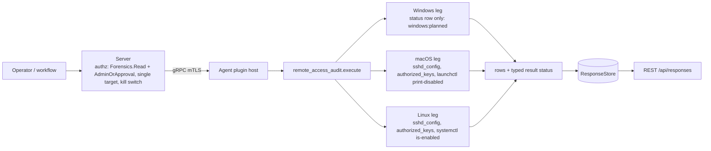

# remote_access_audit

<!-- BEGIN GENERATED: plugin-doc-gen header -->
| | |
|---|---|
| **What it does** | SSH inbound-access audit: sshd_config as written, per-account authorized_keys fingerprints, sshd service state; never key comments, option values or paths |
| **Version** | 1.0.0 |
| **Kind** | Collector · read-only · gathered (crossplatform.security.remote_access_audit) |
| **Platforms** | Windows 🟡 planned · macOS ✅ · Linux 🟡 constrained |
| **Actions** | `list` (definition `crossplatform.security.remote_access_audit`) |
| **Security** | securable `Forensics` · operation Read · risk High · dispatch ReadOnly · approval gate AdminOrApproval |
| **Roles** | execute: admin · author: content-author |
<!-- END GENERATED -->

## How it works

`list` reports who can log in to this host over SSH, as configured, and changes nothing: the `sshd_config` values that govern inbound access, the public keys each account trusts, whether the `sshd` service is enabled, and where each fact came from. Rows come in this order: a `status` row first saying whether the read was complete (a second `unsupported` status row follows, and wins, only if a leg threw after its rows had started), the three `source` rows (`sshd_config`, `homes`, `service`; each says `read`, `absent`, `refused` or `failed`, so zero `key` rows is never an ambiguous empty success), a `config` row for every allowlisted setting, the `service` rows, then one `file` row per `authorized_keys` file followed by a `key` row for every key line `sshd` would accept. `sshd_config` is read as `sshd` reads it: the first value of a setting wins in directive order, `Include` files are parsed at the directive's position, and a `Match` block is counted but never evaluated. A key row carries the type, the fingerprint (byte-identical to `ssh-keygen -lf`; a certificate reports the key it carries) and the option **names** it uses; every key blob is decoded completely and within bounds. A key comment, an option **value** and any key-file path are never emitted (see Sensitivity).

**What it does not read.** `sshd` can accept a login from sources this plugin never opens: a certificate authority (`TrustedUserCAKeys`), keys or principals supplied by a command (`AuthorizedKeysCommand`, `AuthorizedPrincipalsCommand`), a principals file (`AuthorizedPrincipalsFile`), host-based authentication (`HostbasedAuthentication yes`) and a method requirement that changes what a key alone is worth (`AuthenticationMethods`). When `sshd_config` sets one of them at global scope the listing is `CONSTRAINED` with `<os>:remote_access_audit:sshd_config:other_credential_sources`: the token is presence only (no value, no path), and it means the key rows below are not the whole answer to who can log in. The same holds for the Remote Login access list on macOS (see caveat 1) and for any account whose home is outside the walked roots (caveat 3).



## OS capability

<!-- BEGIN GENERATED: plugin-doc-gen capability -->
| Action | Windows | macOS | Linux |
|---|---|---|---|
| `list` | 🟡 planned · rung 1 · per-profile .ssh\\authorized_keys, %ProgramData%\\ssh\\administrators_authorized_keys and sshd_config via win_profiles | ✅ supported · rung 2 · bounded reads of /etc/ssh/sshd_config (Include followed, config symlinks followed as sshd does) and each account's authorized_keys (no-follow; pure parsers, SHA-256 fingerprints); one bounded launchctl print-disabled system argv | 🟡 constrained · rung 2 · bounded reads of /etc/ssh/sshd_config (Include followed, config symlinks followed as sshd does) and each account's authorized_keys (no-follow; pure parsers, SHA-256 fingerprints); one bounded systemctl is-enabled argv per sshd unit |

**Declared limits per leg** (descriptor fallback text, verbatim):

- **`list` / Windows** — not read yet: one unsupported status row, windows:planned
- **`list` / macOS** — configured access as written, not sshd's effective policy; the launchd override is not 'running'; CA trust, key and principals commands and hostbased auth are not read; key comments, option values and key-file paths are never emitted; only homes under /Users owned by uid 500 or above, and /var/root, are walked; a symlinked key file or .ssh is refused; network mounts are skipped
- **`list` / Linux** — constrained: the agent runs unprivileged, so other users' homes (usually 0700) are refused, not empty, and the listing is constrained; configured access as written, not sshd's effective policy (Match is not evaluated); CA trust, key and principals commands and hostbased auth are not read; key comments, option values and key-file paths are never emitted; only homes under /home and /root are walked; a symlinked key file or .ssh is refused; network mounts are skipped
<!-- END GENERATED -->

## Privileges and prerequisites

| OS | Runs as | Extra grant needed | Measured | If the read is refused |
|---|---|---|---|---|
| Windows | n/a — the leg reads nothing (caveat 5) | n/a | n/a | n/a — the placeholder reports `unsupported` with `windows:planned` |
| macOS | agent daemon (root LaunchDaemon) | None for `launchctl print-disabled system`, which answers an unprivileged caller. Reading another user's `~/.ssh` needs the access the agent identity already has as root; an identity that cannot open a home reports it refused. Homes walked: the entries of `/Users` owned by uid 500 or above, and `/var/root` (the rest are counted on the `homes` source row, not read) | `launchctl print-disabled system` and `/etc/ssh` reads verified as a normal user on macOS 26.6.2; see Sample output | `PERMISSION_DENIED` / partial with `macos:remote_access_audit:<source>:permission_denied` when a source was refused and none was read, `CONSTRAINED` when another source was read; the `file` row says `refused` |
| Linux | agent daemon, dedicated unprivileged account (`yuzu-agent` on the packaged unit), never root by design (`docs/agent-privilege-model.md`) | None for `systemctl is-enabled`. Homes walked: every directory directly under `/home`, and `/root`. `sshd_config` is world-readable (0644) on the Debian-family packages but **0600 root on the RHEL family** (verified on Rocky 9 and Amazon Linux 2023), where the unprivileged agent reads it as `refused` with `linux:remote_access_audit:sshd_config:permission_denied`. **Other users' homes are usually 0700 or 0750, so an unprivileged agent cannot open them: `CONSTRAINED` with `linux:remote_access_audit:homes:permission_denied` and one `refused` file row per `AuthorizedKeysFile` entry per account (two by default) is the common outcome, never "no keys".** The real options are accepting the refusal or granting the agent `CAP_DAC_READ_SEARCH` as an **ambient** capability: a systemd drop-in for the agent unit (`[Service]` `AmbientCapabilities=CAP_DAC_READ_SEARCH`). A file capability on the agent binary does not work on the packaged unit, because `NoNewPrivileges=true` (`deploy/systemd/yuzu-agent.service`) makes file capabilities inert (verified in a container: effective capabilities empty under it, present with ambient capabilities). The trade-off is real: `CAP_DAC_READ_SEARCH` lets every plugin the agent hosts read any file the agent can name, so grant it only where this audit is wanted. Packaging for it is #4916; do not loosen home modes | Not measured on the `yuzu-agent` account; the capture runs as euid 0 in a container, see Sample output | `PERMISSION_DENIED` / partial with `linux:remote_access_audit:<source>:permission_denied` when a source was refused and none was read, `CONSTRAINED` when another source was read |

Subprocesses: Linux runs `systemctl is-enabled <unit>` once for each of `ssh.service`, `sshd.service` and `ssh.socket` (argv resolved from `/usr/bin/systemctl` or `/bin/systemctl`, no shell, 5 s deadline each, no sudo); macOS runs `/bin/launchctl print-disabled system` once (5 s deadline). Both go through the bounded runner and have sink-manifest rows (`docs/agent-spawn-sink-manifest.md`). Files are read in process. Symlink handling: caveat 1. No network use.

## Data contract

### Inputs

<!-- BEGIN GENERATED: plugin-doc-gen inputs -->
The action takes no parameters.
<!-- END GENERATED -->

### Outputs

Every row is pipe-delimited; field 0 is the row kind and `-` is an absent value; the order and the field meanings are in the table below. `port` is comma-joined across occurrences, and the deprecated `ChallengeResponseAuthentication` shares the `kbdinteractiveauthentication` slot. `unknown` in a `service` row means two things: on Linux it always comes with a `service:*` token and a `CONSTRAINED` listing (the unit could not be queried); on macOS the read succeeded and launchd has no override entry for the label, so the status stays `supported` (`enabled` there is a launchd override, not "running"). Every free field is scrubbed of NUL and invalid UTF-8, pipe-escaped and cut at 4096 bytes.

<!-- BEGIN GENERATED: plugin-doc-gen outputs -->
**`crossplatform.security.remote_access_audit` — `row_kind|field_1|field_2|field_3|field_4|field_5|field_6|field_7`**

| Field | Type | Values | Available | Example | Description |
|---|---|---|---|---|---|
| `row_kind` | string | `status` `source` `config` `service` `file` `key` | Windows, Linux, macOS | `key` | Row shape discriminator (field 0). Values: status, source, config, service, file, key. |
| `field_1` | string | - | Windows, Linux, macOS | `alice` | status: the literal "list". source: sshd_config, homes or service. config: the setting (permitrootlogin, passwordauthentication, pubkeyauthentication, kbdinteractiveauthentication, permitemptypasswords, usepam, port, authorizedkeysfile, allowusers_count, allowgroups_count, denyusers_count, denygroups_count, match_blocks). service: the unit (ssh.service, sshd.service, ssh.socket, or com.openssh.sshd on macOS). file and key: the account, which is the HOME DIRECTORY NAME, not necessarily the login name. |
| `field_2` | string | - | Windows, Linux, macOS | `supported` | status: supported, constrained, permission_denied or unsupported (the planned Windows leg, and a leg that threw). source: read, absent, refused or failed (absent is a state, not a failure). config: the value as written in the first occurrence, "-" when unset or sshd_config was not read; authorizedkeysfile reports only default, none or custom:<n>, never a path; the counts are numbers. service: the state - systemctl is-enabled output (enabled, enabled-runtime, linked, linked-runtime, alias, masked, masked-runtime, static, indirect, disabled, generated, transient, bad, not-found) or enabled/disabled for launchd, or unknown (never read as disabled). file: authorized_keys, authorized_keys2 or custom. key: the same kind. |
| `field_3` | string | - | Windows, Linux, macOS | `SHA256:BPH4QduMtDlX59CWZCda5Zf0U0jseMmFVimvek7EMhA` | status: reason token(s) for a non-supported read, "-" when complete; tokens look like linux:remote_access_audit:homes:permission_denied or windows:planned. source: files read (sshd_config plus includes), accounts walked, or units queried, "-" unless read. config: where the value came from (sshd_config or include:<file name>), "-" when unset. service: the mechanism. file: read, absent, refused or failed. key: the key type as written (ssh-ed25519, ssh-rsa, ecdsa-sha2-nistp256, a -cert-v01 certificate type, ...). |
| `field_4` | string | - | Linux, macOS | `2` | source (homes row only): the number of home-root entries not treated as accounts (macOS: owned by a uid under 500, such as /Users/Shared), "-" on Linux where nothing is detectably skipped, or when the roots were not listed. file: the number of key lines listed (accepted and within the row budget; keys:row_cap in the status reason means the listing stopped before the last accepted line of the file), "-" unless read. key: the fingerprint, SHA256: plus unpadded base64, identical to ssh-keygen -lf (a certificate reports the key it carries). |
| `field_5` | string | - | Linux, macOS | `256` | file: the number of lines sshd would not accept (unparseable key, unknown option, truncated or trailing-byte blob, RSA under 1024 bits), "-" unless read. key: the key size in bits (RSA modulus, 256 for ed25519, the curve size for ECDSA), "-" for a key of an unknown type. |
| `field_6` | string | - | Linux, macOS | `has_command,has_from` | file: the number of lines over 16 KiB that were not parsed, "-" unless read. key: comma-separated flags from cert_authority, certificate, has_command, has_from, has_principals, unknown_type, or "-". A row flagged unknown_type records a line present in the file, not a key sshd is known to accept: OpenSSH 10 refuses an unknown type at parse time; whether this host's sshd knows the type is not checked. |
| `field_7` | string | - | Linux, macOS | `no-pty,command,from` | key: the lowercased option NAMES the line carries (restrict, cert-authority, [no-]port-forwarding, [no-]agent-forwarding, [no-]x11-forwarding, [no-]touch-required, [no-]verify-required, [no-]pty, [no-]user-rc, command, principals, from, expiry-time, environment, permitopen, permitlisten, tunnel), or "-". Option VALUES are never emitted. Not used by the other kinds. |
<!-- END GENERATED -->

### Result status

The leading `status` row carries the same tokens as the result status; a leg that throws is `UNAVAILABLE` and the last `status` row wins.

| Status | Completeness | Provenance | When |
|---|---|---|---|
| `OK` | full | (empty) | every source that exists was read in full; no keys is `supported` with `file` rows saying `absent` or `read\|0` |
| `CONSTRAINED` | partial | `<os>:remote_access_audit:sshd_config:<cause>`, `<os>:remote_access_audit:include:<cause>`, `<os>:remote_access_audit:keys:<cause>`, with `<cause>` one of `symlink_refused`, `not_regular`, `oversized`, `invalid_bytes`, `invalid_quotes` (a configuration line with an unterminated quote, skipped as `sshd` would refuse it), or an errno token (`eio`, `eloop`, `enotdir`, `enametoolong`, `errno_<n>`); the same causes appear on `homes` (`<os>:remote_access_audit:homes:<errno token>`, a home root or home that could not be listed or opened) | a file could not be read: a symlinked key-side file, `.ssh` or home (refused, never followed), a dangling link among the entries of a listed `Include` directory (`include:enoent`: the directory listed the name and it then reads absent; a literal `Include` path that reads absent is silent, as an `Include` wildcard that matches nothing is in `sshd`) or a loop (`include:eloop`), a FIFO or other non-regular target, a file over 256 KiB (config) or 1 MiB (keys), a NUL byte in `sshd_config` or an `Include` file (in `authorized_keys` a NUL cuts that line only, see the keys row below), an I/O error; its source or `file` row says `failed` and the other sources are still reported |
| `CONSTRAINED` | partial | `<os>:remote_access_audit:include:depth_cap`, `<os>:remote_access_audit:include:too_many`, `<os>:remote_access_audit:include:in_match`, `<os>:remote_access_audit:include:pattern_unsupported` | an `Include` was not followed: nested deeper than 4 levels, more than 32 `Include` patterns (arguments) or included files in all (every pattern counts, even one whose wildcard matches nothing, and a single `Include` line with 33 patterns is over the cap), inside a `Match` block (whose condition is not evaluated), or a `~` path or wildcard in a directory component |
| `CONSTRAINED` | partial | `<os>:remote_access_audit:keys:path_token_unsupported`, `<os>:remote_access_audit:keys:match_scoped_authorizedkeysfile`, `<os>:remote_access_audit:keys:path_token_cap` | an `AuthorizedKeysFile` entry uses `%u`, `%U`, another token or `~` and was skipped (never guessed), or `AuthorizedKeysFile` also appears inside a `Match` block (the global value is used), or it lists more than 100 paths (the first 100 are read, the `authorizedkeysfile` row still reports the real count) |
| `CONSTRAINED` | partial | `<os>:remote_access_audit:sshd_config:other_credential_sources` | `sshd_config` sets, at global scope, a keyword for a login source this plugin does not read: `TrustedUserCAKeys`, `AuthorizedKeysCommand`, `AuthorizedPrincipalsFile`, `AuthorizedPrincipalsCommand`, `HostbasedAuthentication yes` or an `AuthenticationMethods` other than `any`. Presence only: no value and no path is emitted, and the first occurrence decides (a first `none` leaves a later value ignored, as in `sshd`); a `Match`-scoped directive is counted by `match_blocks` and not flagged |
| `CONSTRAINED` | partial | `<os>:remote_access_audit:keys:malformed`, `<os>:remote_access_audit:keys:oversized_line`, `<os>:remote_access_audit:keys:unknown_key_type`, `<os>:remote_access_audit:keys:invalid_bytes` | an `authorized_keys` line `sshd` would not accept (unparseable key, unknown option, a second `command`/`from`/`principals`, truncated or trailing-byte blob, RSA under 1024 bits) or a line over 16 KiB was counted and not emitted; or a key of a type this plugin does not know was inventoried over its raw blob; or a line held a NUL byte and was read only up to it, as `sshd` reads it (the file row stays `read` and the key before the NUL is reported) |
| `CONSTRAINED` | partial | `<os>:remote_access_audit:keys:network_mount_skipped`, `<os>:remote_access_audit:sshd_config:network_mount_skipped`, `<os>:remote_access_audit:include:network_mount_skipped`, `<os>:remote_access_audit:keys:mounts_unreadable`, `<os>:remote_access_audit:homes:too_many`, `<os>:remote_access_audit:keys:file_cap`, `<os>:remote_access_audit:keys:row_cap`, `<os>:remote_access_audit:keys:field_oversized` | the `sshd_config` file, an `Include` file or directory, a home root, home or key path on a network filesystem named by the run-start mount table was never opened; or the mount table could not be read (nothing is guarded, the config half included); or more than 512 accounts, 1024 key-file reads or 2048 rows / 1 MiB were reached (the listing stops there; when a single `authorized_keys` file is what fills the row budget its `file` row and its first keys are kept and the rest, including later accounts, are not listed); or a directory held more than 4096 entries (only the first 4096 are examined, `homes:too_many` or `include:too_many`); or a field was cut at 4096 bytes |
| `CONSTRAINED` | partial | `<os>:remote_access_audit:service:systemctl_unavailable`, `<os>:remote_access_audit:service:launchctl_unavailable`, `<os>:remote_access_audit:service:output_truncated`, `<os>:remote_access_audit:service:no_output`, `<os>:remote_access_audit:service:unrecognised_output`, `<os>:remote_access_audit:service:exit_nonzero`, `subprocess_runner:deadline`, `subprocess_runner:cancelled`, `subprocess_runner:signaled`, `subprocess_runner:line_limit`, `subprocess_runner:spawn_error` | the service query failed: the tool is not installed or could not be started (a non-systemd host: `systemctl_unavailable`/`launchctl_unavailable`, a failed service source and never "disabled"), timed out, was cut short, printed nothing or something unrecognised; the `service` source row says `failed`. A missing unit is not a failure: `systemd` 249 and 252 print `Failed to get unit file state for <unit>: No such file or directory` on stderr, which is read as `not-found`. `subprocess_runner:spawn_error` is never emitted by this plugin: an unstartable tool is `service:*_unavailable` |
| `PERMISSION_DENIED` | partial | `<os>:remote_access_audit:sshd_config:permission_denied`, `<os>:remote_access_audit:homes:permission_denied`, `<os>:remote_access_audit:keys:permission_denied`, `<os>:remote_access_audit:include:permission_denied` | a source was refused and no source was read; accumulated constrained tokens may follow, comma-joined |
| `UNAVAILABLE` | unknown | `windows:planned`, `windows:leg:exception` / `linux:leg:exception` / `macos:leg:exception` | Windows: one `status\|list\|unsupported\|windows:planned` row (caveat 5); or a leg threw, reported as an `unsupported` status row instead of unwinding across the plugin boundary |

### Where the data goes

- **Instruction result.** Rows travel over the agent's mTLS gRPC channel as the command response and land in the standard `ResponseStore`, kept 90 days (`--response-retention-days`, default 90) and served over `GET /api/responses` (legacy), `GET /api/v1/responses/{id}` and the equivalent MCP result-poll tools. `list` is also a gathered definition (`crossplatform.security.remote_access_audit`, 3600s TTL).
- **Not consumed by** daily-sync, TAR, DEX, or metrics.
- **Default off, and how to turn it on.** The plugin is Forensics-class and ships off: the server seeds a default-off kill switch at boot, so nothing dispatches until an operator runs `PUT /api/v1/plugin-config/remote_access_audit/kill-switch {"enabled":true}` (`PluginConfig:Write`, audited as `plugin_config.kill_switch.set`; the MCP twin is `set_plugin_kill_switch`). After that, dispatch is gated at `Forensics:Read` with `AdminOrApproval` (Administrator by default; a non-admin needs a delegated `Forensics:Read` grant plus an approval) and is single-target: exactly one device per request. While the switch is off, REST `/api/command` answers "permission denied: Forensics:Read" even to an Administrator, the dashboard console says "No agents connected", MCP returns an "emergency stop" message, and instruction execute answers 503 "no agents reached ... concurrency claim" (misleading; check the switch first). The switch is checked when a command is dispatched: disabling stops new dispatches, a run already in flight completes, and a delayed or staggered command already sent still runs (up to 10 minutes).
- **Sensitivity.** Per-account key fingerprints on one named machine are identity material: they say which keys can log in as which account, and the account is the home directory's name. Key comments, option values, principals lists and key-file paths are never emitted. A key fingerprint is the same on every host that trusts the key, so results from two machines can be joined on it to show where one person's or one service's key is trusted: that cross-host linkability is inherent in the fact reported, and listing every walked home as an account, keyless ones included, is deliberate. Which accounts hold keys that can log in to a named machine is works-council co-determination-relevant. User names in the samples are replaced with `jsmith`. Dispatch is gated `Forensics:Read` + `AdminOrApproval`, but stored rows are readable by any `Response:Read` holder (Administrator, Operator, Viewer, PlatformEngineer and ITServiceOwner by default; any authenticated session while RBAC is off), audited as `response.read` (REST v1 `/responses/{id}`, `/aggregate`, `/export`), `execution.detail.fetch` (`/executions/{id}/responses`) and `mcp.query_responses`; the legacy `/api/responses` routes and the dashboard results view write only a scope-drop `denied` row, never a success row (known gap #4990). There is no per-user erasure path. The Instructions UAT runner cannot exercise Forensics-tier dispatch (known gap #5261); neither gap is fixed here.
- **Siblings:** `privacy_permissions`, `browser_inventory` and `execution_artifacts` (the other Forensics-class plugins) and `mgmt_posture` (which plane controls the device).

## Sample output

<!-- BEGIN GENERATED: plugin-doc-gen samples -->
**macOS** — captured: macos macOS 26.6.2 arm64 · bare-metal · 2026-10-17 · euid 501 (account redacted to jsmith) · leg-hash 58c6c41593ed

```
== action=list
status|list|constrained|macos:remote_access_audit:homes:permission_denied
source|sshd_config|read|3
source|homes|read|2|1
source|service|read|1
config|permitrootlogin|-|-
config|passwordauthentication|-|-
config|pubkeyauthentication|-|-
config|kbdinteractiveauthentication|-|-
config|permitemptypasswords|-|-
config|usepam|yes|include:100-macos.conf
config|port|-|-
config|authorizedkeysfile|custom:1|sshd_config
… 12 of 21 rows shown
[result_status] CONSTRAINED / PARTIAL / macos:remote_access_audit:homes:permission_denied
```

**Linux** — captured: linux Debian GNU/Linux 13 (trixie) aarch64 · container · 2026-10-17 · euid 0 · leg-hash 58c6c41593ed

```
== action=list
status|list|constrained|linux:remote_access_audit:keys:malformed,linux:remote_access_audit:keys:oversized_line,linux:remote_access_audit:keys:symlink_refused
source|sshd_config|read|3
source|homes|read|4|-
source|service|read|3
config|permitrootlogin|prohibit-password|include:10-test.conf
config|passwordauthentication|no|include:10-test.conf
config|pubkeyauthentication|-|-
config|kbdinteractiveauthentication|no|sshd_config
config|permitemptypasswords|-|-
config|usepam|yes|sshd_config
config|port|-|-
config|authorizedkeysfile|custom:3|sshd_config
… 12 of 47 rows shown
[result_status] CONSTRAINED / PARTIAL / linux:remote_access_audit:keys:malformed,linux:remote_access_audit:keys:oversized_line,linux:remote_access_audit:keys:symlink_refused
```
<!-- END GENERATED -->

## Caveats and known gaps

1. **Configured, not effective.** Rows report what the files say, not what `sshd` enforces: a `Match` block is counted and not evaluated, defaults are not applied (an unset setting is `-`), and an `Include` wildcard is expanded in byte order where `sshd` uses `glob(3)`'s locale order (it only matters when two included files set the same setting). That includes `Match all`, the one `Match` that always applies: under `sshd` its directives override the global values, and here they are not applied. Validity is not checked either: a directive or value `sshd` would refuse (a keyword with no argument, an unknown value, a bad `Match` condition, `AuthorizedKeysFile none` mixed with a path) is skipped or listed as written with no token, and only an unbalanced quote is flagged; `sshd -t` is the validity check. Symlinks follow a two-tier rule. Under `/etc/ssh` (writable by root only: `sshd_config`, the Include directory, each Include file) a link is followed as `sshd` follows it, so stock macOS (`crypto.conf` links to `crypto/apple.conf`) and NixOS read as `SUPPORTED`; a link target outside `/etc/ssh` is read, with no owner or mode check on the target (`sshd` applies none to its config), and a non-regular target is still refused. A home parent (`/home`, `/Users`) is root-owned like `/etc/ssh`, so one link hop is allowed (Fedora Atomic ships `/home -> var/home`): the link is resolved by `readlink`, its target is checked against the mount table before anything is opened, and the target is then opened component by component with no further link followed (a link chain or a linked component is refused as `homes:eloop`); only the entries beneath it are the account's to write. Where the audited account can write (a home, `.ssh`, `authorized_keys*`, an absolute `AuthorizedKeysFile` path) a link is never followed, because a root agent would read what the account cannot: that file reports `failed` with a `symlink_refused`/`enotdir` token and the listing is `CONSTRAINED`. An absolute `AuthorizedKeysFile` path is opened from `/` one component at a time, so a link anywhere in its directory chain (stock macOS `/etc`, `/var` and `/tmp` are links to `/private/*`) is reported `failed` with `symlink_refused`, with no allow-list of platform aliases. The same rule applies to an absolute entry spelled through a linked parent: on a host where `/home` is a link (Fedora Atomic) the walked home is `/var/home/alice`, so an entry `/home/alice/.ssh/k` is not recognised as inside the home and reports `failed` with `symlink_refused`, although the home-parent resolution itself is supported. A home is opened the same way, from `/` one component at a time, so a link in the home's own path is refused as `homes:eloop` and no `realpath` ever touches a dead mount; the macOS root home is therefore configured as `/private/var/root`, the canonical spelling of `/var/root`. On macOS, Remote Login is also gated by an access list outside both files (`pam_sacl`, group `com.apple.access_ssh`): a user can hold a key in `authorized_keys` and still be refused at login, and this plugin does not read that list. Likewise nothing here reads a credential source named in "What it does not read" above.
2. **A syntactic inventory, not `sshd`'s validity check.** A key row means the line parses by `sshd`'s grammar and its blob decodes completely. Option **values** are not validated (a nonsense `expiry-time` or `environment` still counts), an ECDSA point is checked for its length and `0x04` prefix but not for lying on the curve, a certificate's signature is not verified (its structure is), and a key of a type this plugin does not know (`ssh-dss`, a newer algorithm) is inventoried over its raw blob with the `unknown_type` flag and no size; a row flagged `unknown_type` records a line present in the file, not a key sshd is known to accept: OpenSSH 10 refuses an unknown type at parse time; whether this host's sshd knows the type is not checked. A tampered certificate or off-curve point that `sshd` would reject can therefore appear here. A certificate row reports the fingerprint of the embedded key, so a fingerprint is not an identifier of the certificate itself.
3. **Identity is the home directory's name, and only these homes are walked.** `account` is the basename of the home directory the plugin walked, not the login name. Linux walks every directory directly under `/home`, plus `/root`; macOS walks every directory under `/Users` owned by uid 500 or above, plus `/var/root`. An account whose home is elsewhere (a service account such as `git` or `jenkins`, a directory-service or relocated home) is not walked on either OS, and on macOS a hidden account whose home is owned by a uid under 500 is skipped: the `homes` source row reports how many `/Users` entries were skipped (a number on macOS, `/Users/Shared` always among them; `-` on Linux, where nothing is detectably skipped without a login-name lookup), and neither OS can tell an absent account from one outside these roots. Any directory under a walked root is listed as an account, so a `lost+found` on an ext4 `/home` appears as one `refused` or `absent` account. An `AuthorizedKeysFile` entry with `%u`, `%U` or another token needs the login name and is reported as unsupported rather than guessed. An account whose home the agent cannot open is `refused`, so a Linux listing from the unprivileged agent is usually `CONSTRAINED` (see Privileges).
4. **Blocking I/O on mounts is guarded by name.** The `sshd_config` path, every `Include` file and directory (and each listed entry of an `Include` directory, by name), the home roots, the homes and the key paths under a network filesystem named by the mount table (`yuzu::shared::is_network_fstype`, plus `webdav`/`afpfs`/`macfuse`/`osxfuse` on macOS) are never opened, because an open on a dead hard mount pins a worker with no deadline. The mount table is read once, before the first path is touched, and `//`, `.` and `..` in a configured path are folded lexically before the compare. On macOS a mount is matched under both spellings of the firmlinked data volume (`/System/Volumes/Data/Users/alice` and `/Users/alice`). A configured path that is itself a link (a home parent, the config file, an `Include` file or directory) is also checked at the target of that one link. The list is by filesystem name, so a stacked filesystem or a bare `fuse` mount over a dead server still blocks (#4875), and a late mount after the run-start snapshot is not seen; a link chain, a link before a `..` (including a link in a parent directory of the configured path, which reaches the mount before the one-hop target check), and an entry of a listed `Include` directory that is itself a link into a mount are not resolved. The reads carry no deadline of their own and there is no total key-byte budget: the worst case is 1,024 key-file reads of up to 1 MiB each (1 GiB read through) on one shared command worker, which takes seconds on a warm disk and longer on a cold one, until the family execute deadline (#4875) lands. One account controls two such files by default, so reaching the full 1 GiB takes 512 accounts each holding two 1 MiB files.
5. **Windows is planned, not read.** The Windows leg (per-profile `.ssh\authorized_keys`, `%ProgramData%\ssh\administrators_authorized_keys` and `sshd_config` via the profile walk, with the OpenSSH Server service state) reports one `unsupported` row, `windows:planned`; the Windows leg follows as its own PR. The effective policy (`sshd -T`, which evaluates `Match` and applies defaults) is not run on any OS; this plugin reports configured access only.

## Source and tests

<!-- BEGIN GENERATED: plugin-doc-gen source -->
- Plugin: `agents/plugins/remote_access_audit/src/remote_access_audit_config_parsers.hpp` · `agents/plugins/remote_access_audit/src/remote_access_audit_keys_parsers.hpp` · `agents/plugins/remote_access_audit/src/remote_access_audit_legs.hpp` · `agents/plugins/remote_access_audit/src/remote_access_audit_linux.cpp` · `agents/plugins/remote_access_audit/src/remote_access_audit_macos.cpp` · `agents/plugins/remote_access_audit/src/remote_access_audit_plugin.cpp` · `agents/plugins/remote_access_audit/src/remote_access_audit_posix_fs.hpp` · `agents/plugins/remote_access_audit/src/remote_access_audit_win.cpp`
- Definitions: `content/definitions/remote_access_audit.yaml`
- Capability rows: `server/core/src/capability_decls/plugin_action_catalogue_remote_access_audit.hpp`
- Tests: `tests/test_remote_access_audit_definition.py` · `tests/unit/test_remote_access_audit_config_parsers.cpp` · `tests/unit/test_remote_access_audit_keys_parsers.cpp` · `tests/unit/test_remote_access_audit_legs.cpp` · `tests/unit/test_remote_access_audit_local_dispatcher.cpp` · `tests/unit/test_remote_access_audit_posix_fs.cpp`
- Privilege row: `docs/agent-privilege-model.md`
- Changelog: `changelog.d/2026-10-17-remote_access_audit.added.md`
<!-- END GENERATED -->
