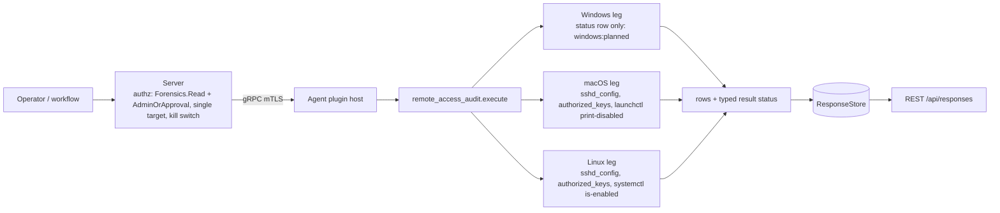
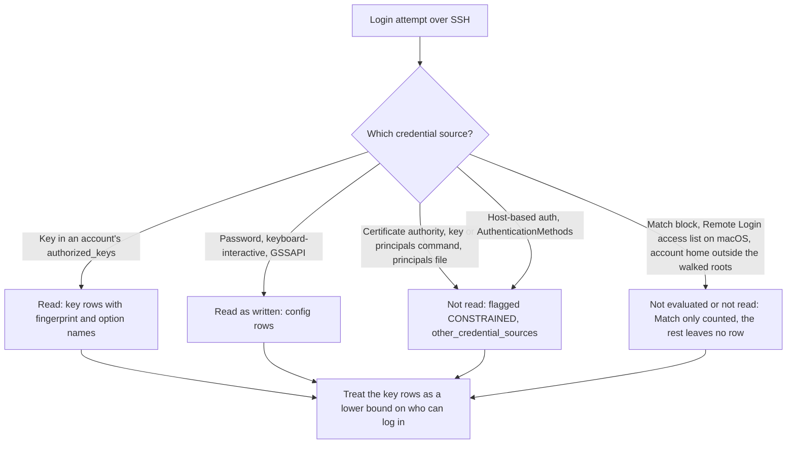
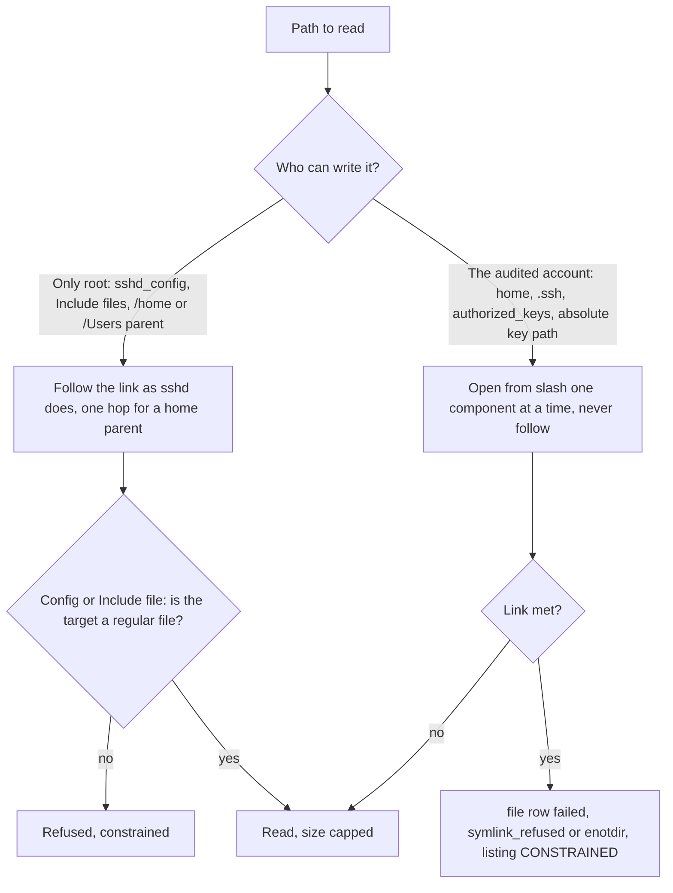

# remote_access_audit

<!-- BEGIN GENERATED: plugin-doc-gen header -->
| | |
|---|---|
| **What it does** | SSH inbound-access audit: sshd_config as written, per-account authorized_keys fingerprints, sshd service state; never key comments, option values or paths |
| **Version** | 1.0.0 |
| **Kind** | Collector · read-only · gathered (crossplatform.security.remote_access_audit) |
| **Platforms** | Windows 🟡 planned · macOS ✅ · Linux 🟡 constrained |
| **Actions** | `list` (definition `crossplatform.security.remote_access_audit`) |
| **Security** | securable `Forensics` · operation Read · risk High · dispatch ReadOnly · approval gate AdminOrApproval |
| **Roles** | execute: admin · author: content-author |
<!-- END GENERATED -->

## How it works

`list` reports who can log in to this host over SSH, as configured, and changes nothing. It reads, in this order: `/etc/ssh/sshd_config` (with `Include` files followed at the directive's position), the state of the `sshd` service units, and the `authorized_keys` files of each account home it walks. It answers with a `status` row first saying whether the read was complete, then three `source` rows (`sshd_config`, `homes`, `service`, each `read`, `absent`, `refused` or `failed`, so zero `key` rows is never an ambiguous empty success), a `config` row for every allowlisted setting, the `service` rows, and one `file` row per `authorized_keys` file followed by a `key` row for every key line this plugin's bounded decoder accepts (a line it refuses is counted and never listed: see caveat 2). A leg that throws after its rows have started adds a second `unsupported` status row, which wins.

`sshd_config` is read as `sshd` reads it: the first value of a setting wins, and a `Match` block is counted but never evaluated. A key row carries the type, the fingerprint (byte-identical to `ssh-keygen -lf`; a certificate reports the key it carries) and the option **names** it uses; every key blob is decoded completely and within bounds. A key comment, an option **value** and any key-file path are never emitted (see Sensitivity). The plugin is deliberately a configured-access inventory, not `sshd -T`, not a login history and not a validity check.

**What it does not read.** `sshd` can accept a login from sources this plugin never opens: a certificate authority (`TrustedUserCAKeys`), keys or principals supplied by a command (`AuthorizedKeysCommand`, `AuthorizedPrincipalsCommand`), a principals file (`AuthorizedPrincipalsFile`), host-based authentication (`HostbasedAuthentication yes`) and a method requirement that changes what a key alone is worth (`AuthenticationMethods`). When `sshd_config` sets one of those sources at global scope to a value other than its inert one (`none`; `no` for `HostbasedAuthentication`; `any` for `AuthenticationMethods`; see the `CONSTRAINED` row below) the listing is `CONSTRAINED` with `<os>:remote_access_audit:sshd_config:other_credential_sources`: the token is presence only (no value, no path), and it means the key rows are not the whole answer to who can log in. The same holds for the Remote Login access list on macOS (caveat 1) and for any account whose home is outside the walked roots (caveat 3). A login that needs no key is governed by the `config` rows: the no-key methods reported are password, keyboard-interactive and GSSAPI (`passwordauthentication`, `kbdinteractiveauthentication`, `gssapiauthentication`), as written and never flagged; other no-key methods (`KerberosAuthentication`, a PAM-supplied method) are not read.

**Symlinks follow a two-tier rule.** Under `/etc/ssh` (writable by root only: `sshd_config`, the `Include` directory, each `Include` file) a link is followed as `sshd` follows it, so stock macOS and NixOS links do not make the listing `CONSTRAINED`; a target outside `/etc/ssh` is read with no owner or mode check (`sshd` applies none), and a non-regular target is still refused. A home parent (`/home`, `/Users`) is root-owned too, so one link hop is allowed (Fedora Atomic ships `/home -> var/home`). Where the audited account can write (a home, `.ssh`, `authorized_keys*`, an absolute `AuthorizedKeysFile` path) a link is never followed, because a root agent would read what the account cannot: that file reports `failed` with a `symlink_refused` or `enotdir` token. Absolute paths and homes are opened from `/` one component at a time without following a link, so a link anywhere in the chain is refused; the macOS root home is therefore configured as `/private/var/root`, the canonical spelling of `/var/root`.



### What you can decide with it

| Question | Rows to use | Linux (unprivileged agent) | macOS (agent runs as root) | Windows |
|---|---|---|---|---|
| Is password, keyboard-interactive or GSSAPI login allowed, and may root log in? | `config` rows | Answered if `sshd_config` is readable; on RHEL-family hosts the file is 0600 root, so it reads `refused` | Answered | Nothing: `windows:planned` |
| Is the SSH service switched on? | `service` rows | `systemctl is-enabled` state of `ssh`/`sshd` services and sockets | launchd override only (`enabled` is not "running") | Nothing |
| Which public keys can log in as which account? | `file` and `key` rows | Usually refused: other users' homes are 0700 or 0750, so `CONSTRAINED` with `homes:permission_denied` is the common result, never "no keys" | Expected to be answered for homes under `/Users` owned by uid 500 or above and `/var/root` when the agent runs as root (not measured: the capture is euid 501 and reads `homes:permission_denied`) | Nothing |
| Are any keys restricted (forced command, source address)? | `key` flags and option names | As above | As above (not measured as root) | Nothing |
| Is the same key trusted on several hosts? | `key` fingerprint | Join the fingerprint across hosts | Same | Nothing |
| Who can log in right now, with what policy, and from which source? | none | Not answerable: no effective policy, no login history, no sessions | Not answerable | Not answerable |

A clean `OK` with zero `key` rows means every walked home was readable and held no accepted key, which is not the same as "nobody can log in": passwords, certificates, key commands and accounts outside the walked homes are separate questions answered by the `config` rows, the `CONSTRAINED` token above, or not at all. A `CONSTRAINED` or `PERMISSION_DENIED` result means the missing part is unknown, not empty. The action is read-only and needs the server-side kill switch enabled first (see Where the data goes).

### Diagrams

#### Who can log in: what is covered



Key rows and `config` rows are the part the plugin can vouch for. The credential sources in the third group are announced by a constrained status when `sshd_config` sets them at global scope; the last group is at most hinted (a `match_blocks` count; the `homes` skipped count covers only home-root entries not treated as accounts, such as a macOS uid under 500, and says nothing about accounts whose home is outside the walked roots), so a clean result never proves that nobody else can log in.

#### Symlink rule



Paths only root can change are read the way `sshd` reads them, so ordinary distribution links do not distort the result. Anything the audited account controls is never followed, since a root agent would otherwise read files the account itself could not.

## OS capability

<!-- BEGIN GENERATED: plugin-doc-gen capability -->
| Action | Windows | macOS | Linux |
|---|---|---|---|
| `list` | 🟡 planned · rung 1 · per-profile .ssh\\authorized_keys, %ProgramData%\\ssh\\administrators_authorized_keys and sshd_config via win_profiles | ✅ supported · rung 2 · bounded reads of /etc/ssh/sshd_config (Include followed, config symlinks followed as sshd does) and each account's authorized_keys (no-follow; pure parsers, SHA-256 fingerprints); one bounded launchctl print-disabled system argv | 🟡 constrained · rung 2 · bounded reads of /etc/ssh/sshd_config (Include followed, config symlinks followed as sshd does) and each account's authorized_keys (no-follow; pure parsers, SHA-256 fingerprints); one bounded systemctl is-enabled argv per sshd unit |

**Declared limits per leg** (descriptor fallback text, verbatim):

- **`list` / Windows** — not read yet: one unsupported status row, windows:planned
- **`list` / macOS** — configured access as written, not sshd's effective policy; the launchd override is not 'running'; CA trust, key and principals commands, a principals file, hostbased auth and AuthenticationMethods are not read; the Remote Login access list (pam_sacl) is not read; key comments, option values and key-file paths are never emitted; only homes under /Users owned by uid 500 or above, and /var/root, are walked; a symlinked key file or .ssh is refused; network mounts are skipped
- **`list` / Linux** — constrained: the agent runs unprivileged, so other users' homes (usually 0700) are refused, not empty, and the listing is constrained; configured access as written, not sshd's effective policy (Match is not evaluated); CA trust, key and principals commands, a principals file, hostbased auth and AuthenticationMethods are not read; key comments, option values and key-file paths are never emitted; only homes under /home and /root are walked; a symlinked key file or .ssh is refused; network mounts are skipped
<!-- END GENERATED -->

## Privileges and prerequisites

| OS | Runs as | Extra grant needed | Measured | If the read is refused |
|---|---|---|---|---|
| Windows | n/a — the leg reads nothing (caveat 5) | n/a | n/a | n/a — the placeholder reports `unsupported` with `windows:planned` |
| macOS | agent daemon (root LaunchDaemon) | None for `launchctl print-disabled system`, which answers an unprivileged caller. Reading another user's `~/.ssh` needs the access the agent identity already has as root; an identity that cannot open a home reports it refused. Homes walked: the entries of `/Users` owned by uid 500 or above, and `/var/root` (the rest are counted on the `homes` source row, not read) | `launchctl print-disabled system` and `/etc/ssh` reads verified as a normal user on macOS 26.6.2; see Sample output | `PERMISSION_DENIED` / partial with `macos:remote_access_audit:<source>:permission_denied` when a source was refused and no source yielded any evidence, `CONSTRAINED` when another source was read in whole or in part; the `file` row says `refused` |
| Linux | agent daemon, dedicated unprivileged account (`yuzu-agent` on the packaged unit), never root by design (`docs/agent-privilege-model.md`) | None for `systemctl is-enabled`. Homes walked: every directory directly under `/home`, and `/root`. `sshd_config` is world-readable (0644) on the Debian-family packages but **0600 root on the RHEL family** (verified on Rocky 9 and Amazon Linux 2023), where an agent without the capability reads it as `refused` with `linux:remote_access_audit:sshd_config:permission_denied`. **Other users' homes are usually 0700 or 0750. The packaged unit grants the agent `CAP_DAC_READ_SEARCH` as an ambient capability by default, so it opens them and the audit returns key data. Without the capability the result is `CONSTRAINED` with `linux:remote_access_audit:homes:permission_denied` and one `refused` file row per `AuthorizedKeysFile` entry per account (two by default), never "no keys"; that is now the outcome for an operator opt-out, a dev install without the capability, or a manual launch.** The opt-outs are in `docs/user-manual/upgrading.md` ("Behaviour change: the packaged Linux agent can read root-only files"). A file capability on the agent binary does not work on the packaged unit, because `NoNewPrivileges=true` (`deploy/systemd/yuzu-agent.service`) makes file capabilities inert (verified in a container: effective capabilities empty under it, present with ambient capabilities). The trade-off is real: `CAP_DAC_READ_SEARCH` lets every plugin the agent hosts read any file the agent can name. The grant is not measured for this plugin. Do not loosen home modes | Not measured on the `yuzu-agent` account; the capture runs as euid 0 in a container, see Sample output | `PERMISSION_DENIED` / partial with `linux:remote_access_audit:<source>:permission_denied` when a source was refused and no source yielded any evidence, `CONSTRAINED` when another source was read in whole or in part |

Subprocesses: Linux runs `systemctl is-enabled <unit>` once for each of `ssh.service`, `sshd.service`, `ssh.socket` and `sshd.socket` (argv resolved from `/usr/bin/systemctl` or `/bin/systemctl`, no shell, 5 s deadline each, no sudo). `sshd.socket` is listed for distributions that ship it (Fedora and Arch). Whether RHEL 9's `openssh-server` package ships `sshd.socket` is not verified. On a socket-activated host `ssh.service` can read `disabled` while `ssh.socket` is `enabled`; read both. macOS runs `/bin/launchctl print-disabled system` once (5 s deadline). Both go through the bounded runner and have sink-manifest rows (`docs/agent-spawn-sink-manifest.md`). Files are read in process. Symlink handling: see How it works. No network use. A containerised agent (`Dockerfile.agent`) audits the image's `/etc/ssh` and `/home`, not the host's.

## Data contract

### Inputs

<!-- BEGIN GENERATED: plugin-doc-gen inputs -->
The action takes no parameters.
<!-- END GENERATED -->

### Outputs

Every row is pipe-delimited; field 0 is the row kind and `-` is an absent value; the order and the field meanings are in the table below. `port` is comma-joined across occurrences, and the deprecated `ChallengeResponseAuthentication` shares the `kbdinteractiveauthentication` slot. `unknown` in a `service` row means two things: on Linux it always comes with a `service:*` or `subprocess_runner:*` token and a `CONSTRAINED` listing (the unit could not be queried); on macOS the read succeeded and launchd has no override entry for the label, so the status stays `supported` (`enabled` there is a launchd override, not "running"). Every free field is scrubbed of NUL and invalid UTF-8, pipe-escaped and cut at 4096 bytes.

<!-- BEGIN GENERATED: plugin-doc-gen outputs -->
**`crossplatform.security.remote_access_audit` — `row_kind|field_1|field_2|field_3|field_4|field_5|field_6|field_7`**

| Field | Type | Values | Available | Example | Description |
|---|---|---|---|---|---|
| `row_kind` | string | `status` `source` `config` `service` `file` `key` | Windows, Linux, macOS | `key` | Row shape discriminator (field 0). Values: status, source, config, service, file, key. |
| `field_1` | string | - | Windows, Linux, macOS | `alice` | status: the literal "list". source: sshd_config, homes or service. config: the setting (permitrootlogin, passwordauthentication, pubkeyauthentication, kbdinteractiveauthentication, gssapiauthentication, permitemptypasswords, usepam, port, authorizedkeysfile, allowusers_count, allowgroups_count, denyusers_count, denygroups_count, match_blocks). service: the unit (ssh.service, sshd.service, ssh.socket, sshd.socket, or com.openssh.sshd on macOS). file and key: the account, which is the HOME DIRECTORY NAME, not necessarily the login name. |
| `field_2` | string | - | Windows, Linux, macOS | `supported` | status: supported, constrained, permission_denied or unsupported (the planned Windows leg, and a leg that threw). source: read, absent, refused or failed (absent is a state, not a failure). config: the value as written in the first occurrence, "-" when unset or sshd_config was not read; authorizedkeysfile reports only default, none or custom:<n>, never a path; the counts are numbers. service: the state - systemctl is-enabled output (enabled, enabled-runtime, linked, linked-runtime, alias, masked, masked-runtime, static, indirect, disabled, generated, transient, bad, not-found) or enabled/disabled for launchd, or unknown (never read as disabled). file: authorized_keys, authorized_keys2 or custom. key: the same kind. |
| `field_3` | string | - | Windows, Linux, macOS | `ssh-ed25519` | status: reason token(s) for a non-supported read, "-" when complete; tokens look like linux:remote_access_audit:homes:permission_denied or windows:planned. source: files read (sshd_config plus includes), accounts walked, or units queried, "-" unless read. config: where the value came from (sshd_config or include:<file name>), "-" when unset. service: the mechanism. file: read, absent, refused or failed. key: the key type as written (ssh-ed25519, ssh-rsa, ecdsa-sha2-nistp256, a -cert-v01 certificate type, ...). |
| `field_4` | string | - | Linux, macOS | `2` | source (homes row only): the number of home-root entries not treated as accounts (macOS: owned by a uid under 500, such as /Users/Shared), "-" on Linux where nothing is detectably skipped, or when the roots were not listed (counted over the homes examined: a lower bound when keys:row_cap, keys:file_cap or homes:too_many is set). file: the number of key lines listed (accepted and within the row budget; keys:row_cap in the status reason means the listing stopped before the last accepted line of the file), "-" unless read. key: the fingerprint, SHA256: plus unpadded base64, identical to ssh-keygen -lf (a certificate reports the key it carries). |
| `field_5` | string | - | Linux, macOS | `256` | file: the number of lines this plugin refused as malformed (unparseable key, unknown option, unknown key type, a truncated or trailing-byte blob, a certificate signature that is truncated, has trailing bytes or is a WebAuthn signature it does not decode, RSA under 1024 bits), "-" unless read. key: the key size in bits (RSA modulus, 256 for ed25519, the curve size for ECDSA). |
| `field_6` | string | - | Linux, macOS | `has_command,has_from` | file: the number of lines over 16 KiB that were not parsed, "-" unless read. key: comma-separated flags from cert_authority, certificate, has_command, has_from, has_principals, or "-". |
| `field_7` | string | - | Linux, macOS | `no-pty,command,from` | key: the lowercased option NAMES the line carries (restrict, cert-authority, [no-]port-forwarding, [no-]agent-forwarding, [no-]x11-forwarding, [no-]touch-required, [no-]verify-required, [no-]pty, [no-]user-rc, command, principals, from, expiry-time, environment, permitopen, permitlisten, tunnel), or "-". Option VALUES are never emitted. Not used by the other kinds. |
<!-- END GENERATED -->

### Result status

The leading `status` row carries the same tokens as the result status; a leg that throws is `UNAVAILABLE` and the last `status` row wins.

| Status | Completeness | Provenance | When |
|---|---|---|---|
| `OK` | full | (empty) | every source that exists was read in full; no keys is `supported` with `file` rows saying `absent` or `read\|0` |
| `CONSTRAINED` | partial | `<os>:remote_access_audit:sshd_config:<cause>`, `<os>:remote_access_audit:include:<cause>`, `<os>:remote_access_audit:keys:<cause>`, with `<cause>` one of `symlink_refused`, `not_regular`, `oversized`, `invalid_bytes`, `invalid_quotes` (`sshd_config` only: a configuration line in that file or an `Include` file with an unterminated quote, skipped as `sshd` would refuse it), or an errno token (`eio`, `eloop`, `enotdir`, `enametoolong`, `errno_<n>`); the same causes appear on `homes` (`<os>:remote_access_audit:homes:<errno token>`, a home root or home that could not be listed or opened; when only some home roots could not be listed, the homes that did list are still audited and the `homes` source row keeps its error state (`refused` or `failed`) with `-` counts) | a file could not be read: a symlinked key-side file, `.ssh` or home (not followed: the `file` row is `failed` with `symlink_refused`), a dangling link among the entries of a listed `Include` directory (`include:enoent`: the directory listed the name and it then reads absent; a literal `Include` path that reads absent is silent, as an `Include` wildcard that matches nothing is in `sshd`) or a loop (`include:eloop`), a FIFO or other non-regular target, a file over 256 KiB (config) or 1 MiB (keys), a NUL byte in `sshd_config` or an `Include` file (in `authorized_keys` a NUL cuts that line only, see the keys row below), an I/O error; its source or `file` row says `failed` and the other sources are still reported |
| `CONSTRAINED` | partial | `<os>:remote_access_audit:include:depth_cap`, `<os>:remote_access_audit:include:too_many`, `<os>:remote_access_audit:include:in_match`, `<os>:remote_access_audit:include:pattern_unsupported` | an `Include` was not followed: nested deeper than 4 levels, more than 32 `Include` patterns (arguments) or included files in all (every pattern counts, even one whose wildcard matches nothing, and a single `Include` line with 33 patterns is over the cap), inside a `Match` block (whose condition is not evaluated), or a `~` path or wildcard in a directory component |
| `CONSTRAINED` | partial | `<os>:remote_access_audit:keys:path_token_unsupported`, `<os>:remote_access_audit:keys:match_scoped_authorizedkeysfile`, `<os>:remote_access_audit:keys:path_token_cap` | an `AuthorizedKeysFile` entry uses `%u`, `%U`, another token or `~` and was skipped (never guessed), or `AuthorizedKeysFile` also appears inside a `Match` block (the global value is used), or it lists more than 100 paths (the first 100 are read, the `authorizedkeysfile` row still reports the real count) |
| `CONSTRAINED` | partial | `<os>:remote_access_audit:sshd_config:other_credential_sources` | `sshd_config` sets, at global scope, a keyword for a login source this plugin does not read to a value other than its inert one (`none`; `no` for `HostbasedAuthentication`; `any` for `AuthenticationMethods`): `TrustedUserCAKeys`, `AuthorizedKeysCommand`, `AuthorizedPrincipalsFile`, `AuthorizedPrincipalsCommand`, `HostbasedAuthentication yes` or an `AuthenticationMethods` other than `any`. `GSSAPIAuthentication` is not in this set: it is a `config` row. Presence only: no value and no path is emitted, and the first occurrence decides (a first `none` leaves a later value ignored, as in `sshd`); a `Match`-scoped directive is counted by `match_blocks` and not flagged |
| `CONSTRAINED` | partial | `<os>:remote_access_audit:keys:malformed`, `<os>:remote_access_audit:keys:oversized_line`, `<os>:remote_access_audit:keys:unknown_key_type`, `<os>:remote_access_audit:keys:invalid_bytes` | an `authorized_keys` line this plugin refuses (unparseable key, unknown option, a second `command`/`from`/`principals`, truncated or trailing-byte blob or certificate signature, a WebAuthn-signed certificate, RSA under 1024 bits) or a line over 16 KiB was counted and not emitted; or a line of a key type this plugin does not know was refused and counted malformed (it is not reported as a key); or a line held a NUL byte and was read only up to it, as `sshd` reads it (the file row stays `read` and the key before the NUL is reported) |
| `CONSTRAINED` | partial | `<os>:remote_access_audit:keys:network_mount_skipped`, `<os>:remote_access_audit:sshd_config:network_mount_skipped`, `<os>:remote_access_audit:include:network_mount_skipped`, `<os>:remote_access_audit:keys:mounts_unreadable`, `<os>:remote_access_audit:homes:too_many`, `<os>:remote_access_audit:keys:file_cap`, `<os>:remote_access_audit:keys:row_cap`, `<os>:remote_access_audit:keys:field_oversized` | the `sshd_config` file, an `Include` file or directory, a home root, home or key path on a network filesystem named by the run-start mount table was never opened; or the mount table could not be read (nothing is guarded, the config half included); or more than 512 accounts, 1024 key-file reads or 2048 rows / 1 MiB were reached (the listing stops there; when a single `authorized_keys` file is what fills the row budget its `file` row and its first keys are kept and the rest, including later accounts, are not listed); or a directory held more than 4096 entries (only the first 4096 are examined, `homes:too_many` or `include:too_many`); or a field was cut at 4096 bytes |
| `CONSTRAINED` | partial | `<os>:remote_access_audit:service:systemctl_unavailable`, `<os>:remote_access_audit:service:launchctl_unavailable`, `<os>:remote_access_audit:service:output_truncated`, `<os>:remote_access_audit:service:no_output`, `<os>:remote_access_audit:service:unrecognised_output`, `<os>:remote_access_audit:service:exit_nonzero`, `subprocess_runner:deadline`, `subprocess_runner:cancelled`, `subprocess_runner:signaled`, `subprocess_runner:line_limit`, `subprocess_runner:spawn_error` | the service query failed: the tool is not installed or could not be started (a non-systemd host: `systemctl_unavailable`/`launchctl_unavailable`, a failed service source and never "disabled"), timed out, was cut short, printed nothing or something unrecognised; the `service` source row says `failed` when no unit answered or any unit's query failed (the units that did answer keep their rows, and a failed unit's own row says `unknown`). A missing unit is not a failure: `systemd` 249 and 252 print `Failed to get unit file state for <unit>: No such file or directory` on stderr, which is read as `not-found`. `subprocess_runner:spawn_error` and `subprocess_runner:line_limit` are never emitted by this plugin: an unstartable tool is `service:*_unavailable`, and the runner is never told to stop at the line cap |
| `PERMISSION_DENIED` | partial | `<os>:remote_access_audit:sshd_config:permission_denied`, `<os>:remote_access_audit:homes:permission_denied`, `<os>:remote_access_audit:keys:permission_denied`, `<os>:remote_access_audit:include:permission_denied` | a source was refused and no source yielded any evidence (a source read in part counts as read: one answered service unit, or one home listed from a partial listing); accumulated constrained tokens may follow, comma-joined |
| `UNAVAILABLE` | unknown | `windows:planned`, `windows:leg:exception` / `linux:leg:exception` / `macos:leg:exception` | Windows: one `status\|list\|unsupported\|windows:planned` row (caveat 5); or a leg threw, reported as an `unsupported` status row instead of unwinding across the plugin boundary |

### Where the data goes

- **Instruction result.** Rows travel over the agent's mTLS gRPC channel as the command response and land in the standard `ResponseStore`, kept 90 days (`--response-retention-days`, default 90) and served over `GET /api/responses` (legacy), `GET /api/v1/responses/{id}` and the equivalent MCP result-poll tools. `list` is also a gathered definition (`crossplatform.security.remote_access_audit`, 3600s TTL).
- **Not consumed by** daily-sync, Echo, DEX, or metrics.
- **Default off, and how to turn it on.** The plugin is Forensics-class and ships off: the server seeds a default-off kill switch at boot, so nothing dispatches until an operator runs `PUT /api/v1/plugin-config/remote_access_audit/kill-switch {"enabled":true}` (`PluginConfig:Write`, audited as `plugin_config.kill_switch.set`; the MCP twin is `set_plugin_kill_switch`). After that, dispatch is gated at `Forensics:Read` with `AdminOrApproval` (Administrator by default; a non-admin needs a delegated `Forensics:Read` grant plus an approval) and is single-target: exactly one device per request. While the switch is off, REST `/api/command` answers "permission denied: Forensics:Read" even to an Administrator, the dashboard console says "No agents connected", MCP returns an "emergency stop" message, and instruction execute answers 503 "no agents reached ... concurrency claim" (misleading; check the switch first). The switch is checked when a command is dispatched: disabling stops new dispatches, a run already in flight completes, and a delayed or staggered command already sent still runs (up to 10 minutes).
- **Sensitivity.** Per-account key fingerprints on one named machine are identity material: they say which keys can log in as which account, and the account is the home directory's name. Key comments, option values, principals lists and key-file paths are never emitted. A key fingerprint is the same on every host that trusts the key, so results from two machines can be joined on it to show where one person's or one service's key is trusted: that cross-host linkability is inherent in the fact reported, and listing every walked home as an account, keyless ones included, is deliberate. Which accounts hold keys that can log in to a named machine is works-council co-determination-relevant. In the macOS sample the account name is replaced with `jsmith`. Dispatch is gated `Forensics:Read` + `AdminOrApproval`, and stored rows are served only to callers holding `Forensics:Read` on the stored-response read paths (REST legacy and v1, MCP, the dashboard including the executions drawer and the hardware result poll) and in the server's own consumers of them (bundle collation, result-set membership, policy checks, the live output stream); other readers see them as absent, so an empty result does not imply that no data exists. Reads are audited as `response.read` on REST v1 `/responses/{id}`, `/aggregate` and `/export` and on the legacy `/api/responses/...` twins (all fail-closed), `execution.detail.fetch` (`/executions/{id}/responses`) and `mcp.query_responses`, and a read that serves these rows additionally writes `response.forensics.read` (on the dashboard results fragment it is the only row written; bundle collation writes this row too, with `surface=bundle`, next to its own `bundle.collate` row). Only the `plugin` name is stored with a row, so the filter works per plugin, not per action. A command's failure text is reduced to a short machine token in the server's derived copies of it (execution record, event outbox and stream, failure notification, analytics event, webhook and offload payload); the stored response row keeps the plugin's own message and is served through the tier. The tier is decided by the plugin the server recorded when it dispatched the command, not by the command id the agent echoes back; a response with no server dispatch record is stored `~unverified` and is served under the same tier. There is no per-user erasure path. The Instructions UAT runner cannot exercise Forensics-tier dispatch (known gap #5261), which is not fixed here.
- **Siblings:** `privacy_permissions`, `browser_inventory` and `execution_artifacts` (the other Forensics-class plugins) and `mgmt_posture` (which plane controls the device).

## Sample output

<!-- BEGIN GENERATED: plugin-doc-gen samples -->
**macOS** — captured: macos macOS 26.6.2 arm64 · bare-metal · 2026-10-18 · euid 501 (account redacted to jsmith) · leg-hash 58c6c41593ed

```
== action=list
status|list|constrained|macos:remote_access_audit:homes:permission_denied
source|sshd_config|read|3
source|homes|read|2|1
source|service|read|1
config|permitrootlogin|-|-
config|passwordauthentication|-|-
config|pubkeyauthentication|-|-
config|kbdinteractiveauthentication|-|-
config|gssapiauthentication|-|-
config|permitemptypasswords|-|-
config|usepam|yes|include:100-macos.conf
config|port|-|-
… 12 of 22 rows shown
[result_status] CONSTRAINED / PARTIAL / macos:remote_access_audit:homes:permission_denied
```

**Linux** — captured: linux Ubuntu 26.04.1 LTS x86_64 · container · 2026-10-18 · euid 0 · leg-hash 58c6c41593ed

```
== action=list
status|list|constrained|linux:remote_access_audit:keys:malformed,linux:remote_access_audit:keys:oversized_line,linux:remote_access_audit:keys:symlink_refused
source|sshd_config|read|3
source|homes|read|5|-
source|service|read|4
config|permitrootlogin|prohibit-password|include:10-test.conf
config|passwordauthentication|no|include:10-test.conf
config|pubkeyauthentication|-|-
config|kbdinteractiveauthentication|no|sshd_config
config|gssapiauthentication|-|-
config|permitemptypasswords|-|-
config|usepam|yes|sshd_config
config|port|-|-
… 12 of 53 rows shown
[result_status] CONSTRAINED / PARTIAL / linux:remote_access_audit:keys:malformed,linux:remote_access_audit:keys:oversized_line,linux:remote_access_audit:keys:symlink_refused
```
<!-- END GENERATED -->

## Caveats and known gaps

1. **Configured, not effective.** Rows report what the files say, not what `sshd` enforces: a `Match` block (including `Match all`) is counted and not evaluated, defaults are not applied (an unset setting is `-`), an `Include` wildcard is expanded in byte order where `sshd` uses locale order, and directives `sshd` would refuse are listed as written with only an unbalanced quote flagged. On macOS, Remote Login is also gated by an access list outside both files (`pam_sacl`, group `com.apple.access_ssh`), which a user can fail even with a key present and which this plugin does not read; `sshd -t` and `sshd -T` are the validity and effective-policy checks.
2. **A syntactic inventory, not `sshd`'s validity check.** A key row means the line parses by `sshd`'s grammar and its blob decodes completely. The lines counted malformed (the `file` row's `field_5`) are the lines this plugin refuses, which is not the set `sshd` rejects. Option values are not validated, an ECDSA point is not checked against the curve, and a certificate's signature is not verified; a certificate signed with a WebAuthn `webauthn-sk-` algorithm carries signature fields this plugin does not decode, so it is counted malformed (tracked in issue #6263). A line of a key type this plugin does not know (`ssh-dss`, a newer algorithm) is counted malformed and never reported as a key, so a key `sshd` accepts can be missing here and a tampered certificate `sshd` rejects can appear; a certificate row reports the embedded key's fingerprint, not the certificate's.
3. **Identity is the home directory's name, and only these homes are walked.** `account` is the basename of the walked home, not the login name; Linux walks every directory directly under `/home` plus `/root`, macOS every `/Users` entry owned by uid 500 or above plus `/var/root`, so a service account with its home elsewhere is never seen and the plugin cannot tell it from an absent account. Over 512 homes the first 512 in directory order are kept (`homes:too_many`), any directory under a walked root such as `lost+found` is listed as an account, and an `AuthorizedKeysFile` entry using `%u`, `%U` or another token is reported unsupported rather than guessed.
4. **Blocking I/O on mounts is guarded by name, with residuals.** The config path, `Include` files, home roots, homes and key paths on a network filesystem named by the run-start mount table (`yuzu::shared::is_network_fstype`, plus `webdav`/`afpfs`/`macfuse`/`osxfuse` on macOS) are never opened, because an open on a dead hard mount pins a worker with no deadline. A stacked filesystem, a bare `fuse` mount over a dead server, a mount made after the snapshot, a link chain and an entry of a listed `Include` directory that is itself a link into a mount are not caught (#4875), and the reads carry no deadline of their own, so the worst case is 1,024 key-file reads of up to 1 MiB on one shared command worker.
5. **Windows is not read.** The Windows leg reports one `unsupported` row, `windows:planned`, and reads no key file, `sshd_config` or service state; the intended mechanism is a per-profile `.ssh\authorized_keys`, `%ProgramData%\ssh\administrators_authorized_keys` and `sshd_config` read through the profile walk. No leg runs `sshd -T`, so configured access is all this plugin reports on any OS.

## Source and tests

<!-- BEGIN GENERATED: plugin-doc-gen source -->
- Plugin: `agents/plugins/remote_access_audit/src/remote_access_audit_config_parsers.hpp` · `agents/plugins/remote_access_audit/src/remote_access_audit_keys_parsers.hpp` · `agents/plugins/remote_access_audit/src/remote_access_audit_legs.hpp` · `agents/plugins/remote_access_audit/src/remote_access_audit_linux.cpp` · `agents/plugins/remote_access_audit/src/remote_access_audit_macos.cpp` · `agents/plugins/remote_access_audit/src/remote_access_audit_plugin.cpp` · `agents/plugins/remote_access_audit/src/remote_access_audit_posix_fs.hpp` · `agents/plugins/remote_access_audit/src/remote_access_audit_win.cpp`
- Definitions: `content/definitions/remote_access_audit.yaml`
- Capability rows: `server/core/src/capability_decls/plugin_action_catalogue_remote_access_audit.hpp`
- Tests: `tests/test_remote_access_audit_definition.py` · `tests/unit/test_remote_access_audit_config_parsers.cpp` · `tests/unit/test_remote_access_audit_keys_parsers.cpp` · `tests/unit/test_remote_access_audit_legs.cpp` · `tests/unit/test_remote_access_audit_local_dispatcher.cpp` · `tests/unit/test_remote_access_audit_posix_fs.cpp`
- Privilege row: `docs/agent-privilege-model.md`
- Changelog: `changelog.d/2026-10-17-remote_access_audit.added.md`
<!-- END GENERATED -->
