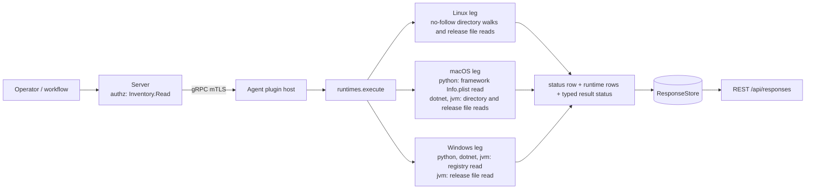
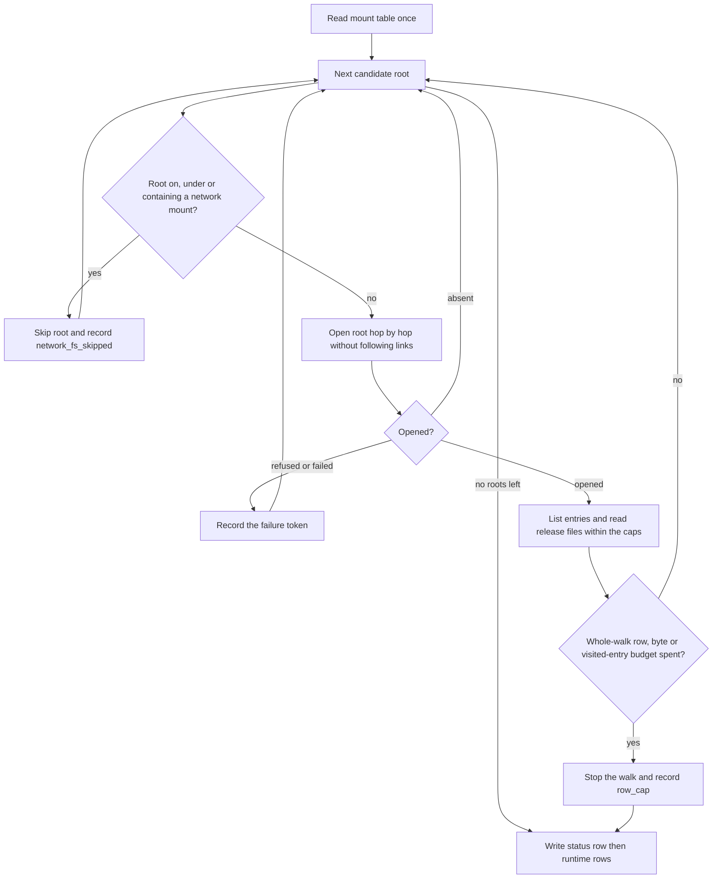
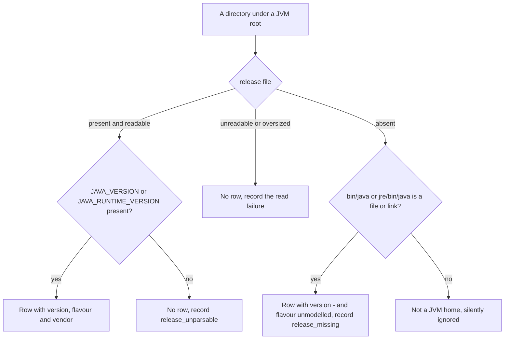

# runtimes

<!-- BEGIN GENERATED: plugin-doc-gen header -->
| | |
|---|---|
| **What it does** | Installed .NET, JVM and Python runtime inventory |
| **Version** | 1.0.0 |
| **Kind** | Collector · read-only · gathered (crossplatform.runtimes.dotnet, crossplatform.runtimes.jvm, crossplatform.runtimes.python) |
| **Platforms** | Windows ✅ · macOS ✅ · Linux ✅ |
| **Actions** | `dotnet` (definition `crossplatform.runtimes.dotnet`) · `jvm` (definition `crossplatform.runtimes.jvm`) · `python` (definition `crossplatform.runtimes.python`) |
| **Security** | securable `Inventory` · operation Read · risk Low · dispatch ReadOnly · approval gate None |
| **Roles** | execute: endpoint-admin, endpoint-operator · author: content-author |
<!-- END GENERATED -->

## How it works

`dotnet`, `jvm` and `python` each answer one question: which .NET, Java or Python runtimes are installed on this host. The plugin walks a fixed list of install roots and reads names and small metadata files only; it never starts `java`, `dotnet` or `python`. `dotnet` lists the `shared/<framework>/<version>` and `sdk/<version>` directory names under `/usr/share/dotnet`, `/usr/lib/dotnet` and `/usr/lib64/dotnet` on Linux and under `/usr/local/share/dotnet` (and its `x64` Rosetta sub-root) on macOS; on Windows it reads the .NET installer keys `HKLM\SOFTWARE\dotnet\Setup\InstalledVersions` (shared frameworks and SDKs) and the .NET Framework release keys under `NDP` in both registry views, because the shared frameworks of a real host are registered in the 32-bit (WOW6432Node) view only. `jvm` reads the `release` file of every home under `/usr/lib/jvm`, `/opt/java`, `/usr/lib64/jvm` and `/var/opt/java`; a home that has a java binary but no `release` file (some distribution OpenJDK 8 packages) is still listed, with version `-` and a `release_missing` constraint. On macOS `jvm` walks the bundles under `/Library/Java/JavaVirtualMachines` and reads each `Contents/Home/release` (falling back to the `JavaVM` dictionary of `Contents/Info.plist` when there is no `release` file). On Windows `jvm` is registry-first: it takes the home directories registered by JavaSoft, Eclipse Adoptium, Microsoft and Azul Zulu, removes duplicates by path, then reads each home's `release` file once. The vendor and flavour come from that file's `IMPLEMENTOR` and `IMAGE_TYPE`, never from the registry key that registered the home: a non-Oracle JDK (Microsoft's build, measured) also writes the Oracle JavaSoft key, and Temurin writes only its own Adoptium key. Every directory is opened without following symlinks, and a root on, under or containing a network mount is not opened at all. `python` ships on all three OSes: on Windows it reads the python.org PEP 514 keys under `HKLM\SOFTWARE\Python\PythonCore` in both registry views (per-user hives are never opened) and reports the full `x.y.z`; on macOS it lists `/Library/Frameworks/Python.framework/Versions/<x.y>` and reads each version's `Resources/Info.plist` (the full `x.y.z` from `CFBundleVersion`); on Linux it lists the `python3.<minor>` regular files in `/usr/bin`, `/usr/local/bin` and `/var/usrlocal/bin` (all three are tried on every host; the last exists only where `/usr/local` is a symlink to `../var/usrlocal`, as on an rpm-ostree host, and is absent elsewhere) and reports **major.minor only**, because the patch level is not stored anywhere without running the interpreter (caveat 4). Each action writes one `status` row first, then zero or more runtime rows, so an empty list is never inferred from silence. The plugin is read-only, does no vulnerability matching (a row is presence and the upstream version string, not an assessment) and does not detect runtimes embedded inside other applications such as Electron or Node bundles. The `vendor` field of `jvm` is the build's self-reported `IMPLEMENTOR` string: an input to a licensing review, not proof of the licence.



### What you can decide with it

| Question | Linux | macOS | Windows |
|---|---|---|---|
| Which .NET shared frameworks and SDKs are installed, and at what exact version? (`dotnet`) | One row per framework or SDK version directory under the three roots, including hosts where no package manager owns the install | One row per framework or SDK version directory under `/usr/local/share/dotnet` and its `x64` sub-root; Homebrew's dotnet is not walked | One row per runtime or SDK version registered by the .NET installers, plus .NET Framework 3.5 and 4.x, with the install path |
| Which JVMs are installed, JDK or JRE, which version, from which vendor? (`jvm`) | One row per home under the four roots; flavour and vendor come from the `release` file, so Debian and SUSE builds report flavour `unmodelled` | One row per bundle under `/Library/Java/JavaVirtualMachines`; flavour and vendor come from the `release` file when there is one | One row per registered home (JavaSoft, Eclipse Adoptium, Azul Zulu); flavour and vendor come from the home's `release` file, not from which registry key registered it |
| Which Python interpreters are installed, and at what version? (`python`) | One row per `python3.<minor>` file in `/usr/bin`, `/usr/local/bin` and `/var/usrlocal/bin` (the last exists only on rpm-ostree hosts); version is major.minor only | One row per python.org framework version, with the full `x.y.z` | One row per python.org PythonCore tag, with the full `x.y.z` |
| Is an end-of-life runtime installed on this host? | Yes, by comparing the `version` column against your own support list; the plugin attaches no verdict (a Linux Python `3.x` is enough for an end-of-life check by minor, not for a patch-level one) | Yes, by the same comparison | Yes, by the same comparison |

What a result proves. `supported` with zero runtime rows means none was found at the standard roots; it does not mean none is installed (a runtime in `/usr/java`, under a version manager in a home directory or in a custom prefix is not walked; for `python` that includes Homebrew, pyenv, conda, virtual environments and per-user Windows installs). `constrained` means a read failed, was skipped (a network mount) or hit a cap, so the rows may be incomplete; read the reason tokens before trusting a negative. A runtime reachable only through a symlinked alias entry can be missed (caveat 2). For the packaged-application view use `installed_apps`; for a licensing probe use `license_scan`.

### Diagrams

#### One action's walk



The mount table is read once per dispatch. A candidate on a network mount is never touched, because an open on a dead hard mount would pin one of the agent's shared command workers. The caps apply across all roots and nesting levels together, so a large tree ends the walk with `row_cap` and a `CONSTRAINED` result rather than a silent truncation. A single directory that exceeds its own entry cap also records `row_cap`, but the walk carries on with the remaining directories.

#### How a JVM home becomes a row



A home with no `release` file is only reported when a java binary proves it is a JVM, and then it carries no version: the plugin does not run `java -version`. Such a host reads `constrained` for as long as the package is installed.

## OS capability

<!-- BEGIN GENERATED: plugin-doc-gen capability -->
| Action | Windows | macOS | Linux |
|---|---|---|---|
| `dotnet` | ✅ supported · rung 1 · HKLM\\SOFTWARE\\dotnet\\Setup\\InstalledVersions\\<arch>\\{sharedfx,sdk} values + NDP v4 Full Release key table and v3.5 Version, both registry views; no filesystem walk | ✅ supported · rung 1 · /usr/local/share/dotnet (and x64/) shared/<framework>/<version> and sdk/<version> directory walk; network mounts skipped via getmntinfo_r_np | ✅ supported · rung 1 · /usr/share/dotnet, /usr/lib/dotnet, /usr/lib64/dotnet shared/<framework>/<version> and sdk/<version> directory walk; network mounts skipped via /proc/self/mountinfo |
| `jvm` | ✅ supported · rung 1 · HKLM JavaSoft, Eclipse Adoptium, Microsoft JDK and Azul Zulu keys (both views) + one <home>\\release read; no Program Files walk | ✅ supported · rung 1 · /Library/Java/JavaVirtualMachines/*/Contents/Home/release read (Contents/Info.plist JavaVM dict fallback); network mounts skipped via getmntinfo_r_np | ✅ supported · rung 1 · <home>/release file reads under /usr/lib/jvm, /opt/java, /usr/lib64/jvm, /var/opt/java (bin/java probe when a home has no release); network mounts skipped via /proc/self/mountinfo |
| `python` | ✅ supported · rung 1 · HKLM\\SOFTWARE\\Python\\PythonCore\\<tag> Version/SysVersion/InstallPath in both registry views (PEP 514); per-user hives never read | ✅ supported · rung 1 · single-level listing of /Library/Frameworks/Python.framework/Versions; version from each version's Resources/Info.plist; network mounts skipped via getmntinfo_r_np | 🟡 constrained · rung 1 · single-level listing of /usr/bin and /usr/local/bin for python3.<minor> regular files; version is major.minor from the name (patch level not read); network mounts skipped via /proc/self/mountinfo |

**Declared limits per leg** (descriptor fallback text, verbatim):

- **`jvm` / macOS** — fixture-verified only: no JDK is installed on the macOS development host, so this leg rests on trees built from the documented bundle layout
- **`python` / Linux** — patch level unavailable without running the interpreter
<!-- END GENERATED -->

## Privileges and prerequisites

| OS | Runs as | Extra grant needed | Measured | If the read is refused |
|---|---|---|---|---|
| Windows | agent service, LocalSystem today (`#1442`; the intended identity is `NT SERVICE\YuzuAgent`) | None expected: `HKLM\SOFTWARE\Python`, `HKLM\SOFTWARE\dotnet`, the JDK vendor keys and the `NDP` keys are readable by Users by default, and a JDK `release` file sits in a Program Files directory (inferred, not measured as the service account) | See the sample below (a developer-workstation capture, not the service account) | `windows:runtimes:<python\|dotnet\|jvm>_reg:access_denied`; rows read before the refusal are still returned. A JDK `release` file that cannot be read keeps the home as a row (version from the registry tag, flavour `unmodelled`) and adds `windows:runtimes:jvm:release_unreadable`; a JVM registry key whose home value is present but empty, mistyped or oversized records `windows:runtimes:jvm:home_unusable` |
| macOS | agent daemon (root under the shipped LaunchDaemon today, `docs/agent-privilege-model.md`) | None expected: the python.org, Microsoft .NET and JDK installers write `/Library/Frameworks/Python.framework`, `/usr/local/share/dotnet` and `/Library/Java/JavaVirtualMachines` world-readable (inferred from the installer payload permissions, not measured as the agent account); the mount table read (`getmntinfo_r_np(MNT_NOWAIT)`, answered from the kernel's cache) needs no grant | The `Info.plist` shape is a real python.org 3.13.1 capture (`tests/unit/fixtures/wave10/runtimes/macos/python_framework.manifest`); the live sample was taken as an unprivileged user on a host with no framework installed; the `dotnet` and `jvm` legs are verified against fixture trees only (caveat 1) | `macos:runtimes:permission_denied`; an unreadable mount table adds `macos:runtimes:mountinfo_unreadable` and the walk still runs |
| Linux | agent daemon, dedicated unprivileged account (`yuzu-agent` on the packaged unit), never root by design (`docs/agent-privilege-model.md`) | None expected: the stock install trees under `/usr`, `/opt` and `/var/opt/java` are expected to be world-readable (0755 directories, 0644 `release` files; the `python3.<minor>` listing under `/usr/bin` was read successfully by an unprivileged user in the live capture, the `dotnet`/`jvm` trees are inferred) | Walked trees are captured as test fixtures (`tests/unit/fixtures/wave10/runtimes/linux/provenance.txt`); the live sample was taken as an unprivileged user (`euid 1000`) in a WSL2 VM, not as the packaged unit's `yuzu-agent` account | `status\|<action>\|constrained\|linux:runtimes:permission_denied`; rows read before the refusal are still returned, and a later readable root never hides it |

No external binaries, no subprocesses, no shell-out, no network use: the plugin opens directories and reads files only. Every directory is opened `O_NOFOLLOW` hop by hop and listed with a per-directory entry cap of 16,384; a `release` read is bounded to 64 KiB and each recognised value to 256 bytes; the macOS `Info.plist` read to 256 KiB; each Windows registry walk to 512 tags across both views (so at most 512 rows), 1 MiB of row text and 64 KiB per value; one action's whole walk is bounded to 4,096 rows, 1 MiB of row text and 65,536 directory entries visited (`row_cap`). A root on, under or containing a network mount (by filesystem type, from `/proc/self/mountinfo` on Linux and `getmntinfo_r_np(MNT_NOWAIT)` on macOS) is not opened and records `network_fs_skipped`; caveat 5 lists what that guard cannot see.

## Data contract

### Inputs

<!-- BEGIN GENERATED: plugin-doc-gen inputs -->
No action takes parameters.
<!-- END GENERATED -->

### Outputs

Every row is pipe-delimited. The first row is always `status|<action>|<level>|<reason>` (`level` is `supported`, `constrained` or `unsupported`; `reason` is comma-joined tokens, or `-`). Runtime rows follow as `<action>|<flavour>|<version>|<install_path>|<vendor>`, one per runtime found; the first field is `row_kind` (`status`, or the action name) and is the first column below. `supported` with zero runtime rows means none was found at the standard roots (caveat 3 lists what is not walked); `constrained` means a read failed or was skipped and the rows may be incomplete, so failure never reads as absent. A field the host did not supply is `-`, and every flavour mapper has a named `unmodelled` value distinct from no data. Free-text fields (`version`, `install_path`, `vendor`) go through `yuzu::util::safe_output_field`, so a value containing a pipe or ending in a backslash cannot shift the field count on the server's escape-aware decoder or on the agent's installed-software collector, which splits the python rows escape-aware too. `runtimes` is not in the server's `kKeyValuePlugins` set (`server/core/src/result_parsing.hpp`), so its rows are not decoded as two-cell key and value rows.

<!-- BEGIN GENERATED: plugin-doc-gen outputs -->
**`crossplatform.runtimes.dotnet` — `row_kind|flavour|version|install_path|vendor`**

| Field | Type | Values | Available | Example | Description |
|---|---|---|---|---|---|
| `row_kind` | string | `status` `dotnet` | Windows, macOS, Linux | `dotnet` | Row shape discriminator (the wire row's leading tag). Values: status (exactly one per result, always first), dotnet (one per runtime found). |
| `flavour` | string | `core` `runtime` `sdk` `netfx` `unmodelled` | Windows, macOS, Linux | `core` | Runtime kind. Values: core (Linux and macOS: a Microsoft.NETCore.App, Microsoft.AspNetCore.App or Microsoft.WindowsDesktop.App shared framework), runtime (Windows: a shared framework from the registry), sdk (an SDK install), netfx (Windows: .NET Framework), unmodelled (any other shared-framework name — reported, never dropped). On Linux and macOS the three core frameworks all read core at the same version; the install path tells them apart. Status rows: the action name. |
| `version` | string | - | Windows, macOS, Linux | `8.0.31` | Version taken from the install directory name on Linux and macOS, or the registry value name on Windows (e.g. 8.0.31, or a preview build such as 9.0.100-preview.1.24101.2). Status rows: the level (supported, constrained or unsupported). |
| `install_path` | string | - | Windows, macOS, Linux | `/usr/share/dotnet/shared/Microsoft.NETCore.App/8.0.31` | Absolute path of the framework or SDK version directory the version was read from. Status rows: the comma-joined failure tokens, or -. |
| `vendor` | string | - | Windows, macOS, Linux | `-` | "-" on Linux and on the native macOS root: the install tree carries no vendor field. Windows rows and the macOS x64 (Rosetta) sub-root rows read "Microsoft". |

**`crossplatform.runtimes.jvm` — `row_kind|flavour|version|install_path|vendor`**

| Field | Type | Values | Available | Example | Description |
|---|---|---|---|---|---|
| `row_kind` | string | `status` `jvm` | Windows, macOS, Linux | `jvm` | Row shape discriminator (the wire row's leading tag). Values: status (exactly one per result, always first), jvm (one per runtime found). |
| `flavour` | string | `jdk` `jre` `unmodelled` | Windows, macOS, Linux | `jdk` | Image kind from the IMAGE_TYPE key of the release file. Values: jdk, jre, unmodelled (the file does not say — Debian and SUSE OpenJDK release files have no IMAGE_TYPE, and a release-less home has no file at all; never guessed from the path). Status rows: the action name. |
| `version` | string | - | Windows, macOS, Linux | `17.0.20` | JAVA_VERSION from the release file, falling back to JAVA_RUNTIME_VERSION. A release file with neither key yields no row and a release_unparsable constraint; on Linux a home with a java binary but no release file yields - and a release_missing constraint; on Windows such a home keeps its row, with the version key of the registry registration as the version, and no constraint; on macOS the Info.plist JavaVM dictionary of the bundle supplies the version. Status rows: the level (supported, constrained or unsupported). |
| `install_path` | string | - | Windows, macOS, Linux | `/opt/java/openjdk` | Absolute path of the JVM home directory. Status rows: the comma-joined failure tokens, or -. |
| `vendor` | string | - | Windows, macOS, Linux | `Eclipse Adoptium` | IMPLEMENTOR from the release file (e.g. Eclipse Adoptium, Debian), self-reported by the build and not verified; on macOS, a bundle with an openable Contents and no release file under Contents/Home reports JVMVendor from its Info.plist instead; "-" when the source gives no vendor. |

**`crossplatform.runtimes.python` — `row_kind|flavour|version|install_path|vendor`**

| Field | Type | Values | Available | Example | Description |
|---|---|---|---|---|---|
| `row_kind` | string | `status` `python` | Windows, macOS, Linux | `python` | Row shape discriminator (the wire row's leading tag). Values: status (exactly one per result, always first), python (one per interpreter found). |
| `flavour` | string | `cpython` `unmodelled` | Windows, macOS, Linux | `cpython` | Interpreter kind. Values: cpython (a python.org PythonCore registry tag on Windows, or the python.org framework on macOS, identified by its bundle identifier), unmodelled (any other bundle identifier on macOS; every Linux row — a file name does not say what implementation it is). Status rows: the action name. |
| `version` | string | - | Windows, macOS, Linux | `3.14.6` | Interpreter version. Windows: the PythonCore Version value (x.y.z), else SysVersion, else the tag's major.minor. macOS: the full x.y.z from Info.plist, else the version directory name (x.y). Linux: major.minor from the python3.<minor> file name — the patch level is not available. - when none could be determined. Status rows: the level (supported, constrained or unsupported). |
| `install_path` | string | - | Windows, macOS, Linux | `/usr/bin/python3.11` | Windows: the InstallPath key's default value (backslashes are written as /), or - when the tag has none. macOS: the framework version directory. Linux: the interpreter file. Status rows: the comma-joined failure tokens, or -. |
| `vendor` | string | - | Windows, macOS, Linux | `PythonCore` | Windows: PythonCore. macOS: the framework's CFBundleIdentifier (org.python.python), or - when the plist could not be read. Linux: always "-". |
<!-- END GENERATED -->

### Result status

Every read sets a typed result status; a degraded read is `CONSTRAINED`, never an empty `OK`.

| Status | Completeness | Provenance | When |
|---|---|---|---|
| `OK` | full | (empty) | The read finished with no failure, populated, or none found at the standard roots (`status\|<action>\|supported\|-` with zero rows): any action on any OS |
| `CONSTRAINED` | partial | `linux:runtimes:permission_denied` / `linux:runtimes:symlink_refused` / `linux:runtimes:not_a_directory` / `linux:runtimes:open_failed` / `linux:runtimes:stat_failed` / `linux:runtimes:read_failed` / `linux:runtimes:row_cap` / `linux:runtimes:not_regular` / `linux:runtimes:oversized` / `linux:runtimes:field_oversized` / `linux:runtimes:release_unparsable` / `linux:runtimes:release_missing` / `linux:runtimes:network_fs_skipped` / `linux:runtimes:mountinfo_unreadable` / `macos:runtimes:permission_denied` / `macos:runtimes:symlink_refused` / `macos:runtimes:not_a_directory` / `macos:runtimes:open_failed` / `macos:runtimes:stat_failed` / `macos:runtimes:read_failed` / `macos:runtimes:row_cap` / `macos:runtimes:network_fs_skipped` / `macos:runtimes:mountinfo_unreadable` (the macOS walks) / `macos:runtimes:release_unparsable` / `macos:runtimes:release_missing` / `macos:runtimes:field_oversized` / `macos:runtimes:not_regular` / `macos:runtimes:oversized` / `windows:runtimes:python_reg:access_denied` / `windows:runtimes:python_reg:open_failed` / `windows:runtimes:python_reg:enum_failed` / `windows:runtimes:python_reg:name_too_long` / `windows:runtimes:python_reg:row_cap` / `windows:runtimes:dotnet_reg:access_denied` / `windows:runtimes:dotnet_reg:open_failed` / `windows:runtimes:dotnet_reg:enum_failed` / `windows:runtimes:dotnet_reg:name_too_long` / `windows:runtimes:dotnet_reg:row_cap` / `windows:runtimes:jvm_reg:access_denied` / `windows:runtimes:jvm_reg:open_failed` / `windows:runtimes:jvm_reg:enum_failed` / `windows:runtimes:jvm_reg:name_too_long` / `windows:runtimes:jvm_reg:row_cap` / `windows:runtimes:jvm:release_unreadable` / `windows:runtimes:jvm:home_unusable` / `internal_error` | One or more reads failed, were refused or skipped (a network mount), or hit a cap, and the rows returned may be incomplete; the tokens of every root are accumulated and comma-joined in the status row. `internal_error` is a caught exception on any leg: it never crosses the plugin boundary and the command returns 1 (a failed command) |
| `UNAVAILABLE` | partial | `macos:planned` / `windows:planned` | Only while a leg is declared planned in the plugin's action table, when the action answers `status\|<action>\|unsupported\|<os>:planned` and nothing else. With the macOS and Windows `dotnet` and `jvm` legs shipped, no action answers it today |

### Where the data goes

- **Instruction result.** Every row is server instruction-result data — the standard retention policy, served over REST `/api/responses`. Nothing here is a durable server-side table of its own.
- **Consumed by** the `installed_software` daily-sync source, for all three actions: each `python` row becomes one `Python` entry (`kind` `app`, ecosystem `python`; the vendor column becomes `publisher` on Windows, where it is the `PythonCore` registry tag, and a `-` or an empty value reads `via:python`, as does every Linux row because the Linux leg always emits `-`; it is ignored on macOS, where the column is a bundle identifier, not a vendor), each `dotnet` row one `.NET Runtime`, `.NET SDK` or `.NET Framework` entry (publisher `Microsoft`, ecosystem `dotnet`; any other framework is `.NET`) and each `jvm` row one `Java JDK`, `Java JRE` or `Java` entry (publisher the row's vendor, the build's `IMPLEMENTOR` or, on macOS for a bundle with an openable `Contents` and no `release` file under `Contents/Home`, its `Info.plist` `JVMVendor`, and `via:jvm` when the row has none, ecosystem `jvm`), with `version` as reported; flavour and path are not carried. A `constrained` read of any of the three actions (a skipped network mount, an unreadable root, a cap, an access-denied registry key) is reported as a status-only section for that source and contributes no rows, not even the installs the read did list: the server keeps that source's stored rows and shows them as unconfirmed until a read succeeds again, nothing is deleted, and no other source is affected. The section's tokens (the status row's own, else `constrained`) are the only signal that the read failed rather than that none is installed. Not consumed by TAR, DEX or metrics.
- **Sensitivity.** Rows name installed runtimes with their exact version, install path and vendor, which is a patch-level and licensing-relevant software inventory for the device. The legs read only fixed machine-scope roots (`/usr`, `/opt`, `/var/opt/java`, `/var/usrlocal/bin`, `/usr/local/share/dotnet`, `/Library/Java/JavaVirtualMachines`, `/Library/Frameworks/Python.framework`, `HKLM\SOFTWARE\Python`, `HKLM\SOFTWARE\dotnet`, the JDK vendor keys and the registered JDK homes' `release` files; never a user hive or home directory) and the mount table (`/proc/self/mountinfo` on Linux, `getmntinfo_r_np` on macOS; used only to decide what to skip, never emitted), so no user-profile root is walked; `install_path` and `vendor` echo directory and file text as found, so a name planted under those roots reaches a row after the UTF-8 and pipe scrub (`yuzu::util::sanitize_utf8` replaces invalid lead and continuation bytes but still passes overlong, surrogate and out-of-range sequences that protobuf rejects: #4864).
- **Siblings:** `crossplatform.runtimes.dotnet`, `crossplatform.runtimes.jvm`, `crossplatform.runtimes.python`.

## Sample output

<!-- BEGIN GENERATED: plugin-doc-gen samples -->
**Windows** — captured: windows Windows 10.0.26200 x86_64 · bare-metal · 2026-11-04 · interactive user (elevated) · leg-hash 3cef2d295916

```
== action=dotnet
status|dotnet|supported|-
dotnet|netfx|4.8.1|C:/Windows/Microsoft.NET/Framework/v4.0.30319/|Microsoft
dotnet|netfx|4.8.1|C:/Windows/Microsoft.NET/Framework64/v4.0.30319/|Microsoft
dotnet|runtime|8.0.33|C:/Program Files (x86)/dotnet/|Microsoft
dotnet|runtime|8.0.33|C:/Program Files/dotnet/|Microsoft
dotnet|runtime|9.0.22|C:/Program Files (x86)/dotnet/|Microsoft
dotnet|runtime|9.0.22|C:/Program Files/dotnet/|Microsoft
[result_status] OK / FULL

== action=jvm
status|jvm|supported|-
jvm|jdk|21.0.13|C:/Program Files/Temurin/|Eclipse Adoptium
jvm|unmodelled|21.0.12.1|C:/Program Files/Microsoft/jdk-21.0.12.101-hotspot/|Microsoft
[result_status] OK / FULL

== action=python
status|python|supported|-
python|cpython|3.14.6|C:/Python314/|PythonCore
[result_status] OK / FULL
```

**macOS** — captured: macos macOS 26.6.2 arm64 · bare-metal · 2026-11-04 · euid 501 · leg-hash 3cef2d295916

```
== action=dotnet
status|dotnet|supported|-
[result_status] OK / FULL

== action=jvm
status|jvm|supported|-
[result_status] OK / FULL

== action=python
status|python|supported|-
[result_status] OK / FULL
```

**Linux** — captured: linux Ubuntu 26.04.1 LTS x86_64 · vm · 2026-10-28 · euid 1000 · leg-hash 3cef2d295916

```
== action=dotnet
status|dotnet|supported|-
[result_status] OK / FULL

== action=jvm
status|jvm|supported|-
[result_status] OK / FULL

== action=python
status|python|supported|-
python|unmodelled|3.14|/usr/bin/python3.14|-
[result_status] OK / FULL
```
<!-- END GENERATED -->

## Caveats and known gaps

1. **Parts of the macOS and Windows `dotnet` and `jvm` legs are verified against fixtures, not real installs.** No JDK is installed on the development Mac (installing one needs administrator rights), so the macOS `jvm` leg and its capability-matrix status rest on fixture trees built from the documented bundle layout, and the macOS `dotnet` leg is likewise tree-based. On the Windows capture host the .NET Framework mapping is Microsoft's documented release table, no SDK was installed (the `sdk` flavour is untested against a real host), and the Temurin `release` file was not read, so its vendor was not observed. Homebrew's dotnet and JDKs (under `/opt/homebrew`) are not machine-scope roots and are not walked.
2. **Runtimes reachable only through an alias entry are not listed.** A framework, version or JVM home entry that is itself a symlink (Debian `default-java`, Fedora `java`) is skipped silently because its real directory is a sibling entry. A Linux `python3.<minor>` symlink is skipped too: an alternatives link leaves its real file listed as a sibling entry, while a link into another prefix is not followed, so that interpreter is not listed. A runtime reachable only through such a link is missed, while a symlink at a candidate root that is not a same-action alias is a `symlink_refused` constraint, not a skip.
3. **Only standard locations are walked.** `dotnet` reads `/usr/share/dotnet`, `/usr/lib/dotnet` and `/usr/lib64/dotnet`; `jvm` reads `/usr/lib/jvm`, `/opt/java`, `/usr/lib64/jvm` and `/var/opt/java` (Linux), `/Library/Java/JavaVirtualMachines` (macOS) and the registered homes (Windows); `JAVA_HOME` and `PATH` are never consulted. A runtime installed elsewhere (an Oracle RPM under `/usr/java`, a version manager in a home directory, a custom prefix) is not found by design, since the plugin does not search user profiles, so `supported` with zero rows means none found at these roots. `python` reads `/usr/bin`, `/usr/local/bin` and `/var/usrlocal/bin` (Linux; the last is tried on every host but exists only where `/usr/local` is a symlink to `../var/usrlocal`, as on rpm-ostree hosts such as Fedora CoreOS and RHEL Edge, and is absent elsewhere), `/Library/Frameworks/Python.framework/Versions` (macOS) and `HKLM\SOFTWARE\Python\PythonCore` (Windows); Homebrew, pyenv, conda, virtual environments, Xcode's `Python3.framework` and the Microsoft Store and per-user Windows installs are not walked, and other PEP 514 publishers (for example Anaconda) are not listed. A Homebrew interpreter is the `brew` ecosystem's row, and a distro or Windows Uninstall entry is the other ecosystem's row, so the same interpreter can appear in more than one source.
4. **Version data can be missing or partial, and is never guessed.** On Windows a home whose registry tag is the only version evidence reports that tag (for example `21.0.13.9`, the installer's four-part form), and the vendor of such a home is empty. Some OpenJDK 8 packages ship no `release` file: Ubuntu 22.04 `openjdk-8-jre-headless`, Rocky 9 `java-1.8.0-openjdk-headless` and Alpine 3.20 `openjdk8-jre-base` were measured to ship none. Such a home is reported with version `-`, flavour `unmodelled` and `release_missing`, so the host reads `constrained` while it is installed; the `install_path` names the major, and reading the real version would need the package manager or `java -version`, which this plugin never uses. Linux `python` reports major.minor only: the row version is taken from the file name (`python3.11` reads `3.11`), and the patch level is not stored in any file the plugin can read without starting the interpreter, so it is not guessed. The Linux descriptor leg is declared `constrained` for this reason; the status row stays `supported` because the limit is known and constant, not a failed read. A symlinked `python3.X` entry (some distributions alias a minor to another) is skipped, as `python3` itself is: only regular files count. A missing or unreadable `python` version file never raises a constraint: on macOS a version directory whose `Info.plist` is absent, binary, oversized or unreadable still produces a row, with the directory's `x.y` as the version and vendor `-`, and on Windows a tag with no `Version` or `SysVersion` value reports the tag's `major.minor`; only a failure to open or list a root (or a cap) makes the result `constrained`. A `jvm` `release` file that parses but has no version key differs by OS: on Windows the home keeps its row with the registry tag (or no token) and no constraint; on macOS and Linux there is no row and the action records `release_unparsable`.
5. **Network mounts are skipped from a dispatch-start snapshot.** A root on, under or containing a mount of a listed network type (`nfs`, `cifs`, `smb3`, `9p`, `virtiofs`, `autofs`, network `fuse.*` and others in `yuzu::shared::is_network_fstype`) is never opened, so a healthy network-mounted JDK is skipped too, and a host whose `/` is a network or virtiofs mount skips every root. The guard cannot see a mount that appears after the snapshot, a stacked filesystem such as an overlay over a dead network mount, an unlisted network type or a hang on a local block device; each can pin one of the agent's shared command workers until the kernel returns, and an unreadable mount table (`mountinfo_unreadable`) leaves the walk guarded only by the mounts read (#4875). On macOS the snapshot is `getmntinfo_r_np(MNT_NOWAIT)` (the kernel's cache, unprivileged) and a mount the system creates under `/System/Volumes/Data` is also matched by its logical spelling without that prefix; the residuals above apply there too, with one difference: a failed snapshot leaves the macOS walks (`python`, `dotnet` and `jvm`) with no guard at all (it records `macos:runtimes:mountinfo_unreadable` and the status is `constrained`). On Windows the `jvm` `release` read is made only on a fixed local drive (`GetDriveTypeW` must answer `DRIVE_FIXED`): a home on a remote, removable, optical, RAM or unknown-type drive is never opened and is kept as a row with `windows:runtimes:jvm:release_unreadable` (a registry home value that is empty, mistyped or oversized records `windows:runtimes:jvm:home_unusable` instead), so a JDK on a removable or network drive reads as unreadable, not absent. Each ancestor directory of the `release` path below the drive root must not be a reparse point either (otherwise the home reads as unreadable), but that is a best-effort check (`GetFileAttributesW` per ancestor, then a separate `CreateFileW`): a check-then-open race by a local writer of a user-writable ancestor, for example flipping a directory to a junction to a UNC path, is a disclosed residual, and the leaf open, `CreateFileW`, and `ReadFile` have no deadline: a dead FIXED volume (iSCSI, USB, VHD) can block the calling sync thread until the kernel returns, the same residual as the other Windows readers.

## Source and tests

<!-- BEGIN GENERATED: plugin-doc-gen source -->
- Plugin: `agents/plugins/runtimes/src/runtimes_legs.hpp` · `agents/plugins/runtimes/src/runtimes_linux.cpp` · `agents/plugins/runtimes/src/runtimes_linux_parsers.hpp` · `agents/plugins/runtimes/src/runtimes_macos.cpp` · `agents/plugins/runtimes/src/runtimes_macos_parsers.hpp` · `agents/plugins/runtimes/src/runtimes_parsers.hpp` · `agents/plugins/runtimes/src/runtimes_plugin.cpp` · `agents/plugins/runtimes/src/runtimes_python_parsers.hpp` · `agents/plugins/runtimes/src/runtimes_win.cpp` · `agents/plugins/runtimes/src/runtimes_win_parsers.hpp`
- Definitions: `content/definitions/runtimes.yaml`
- Capability rows: `server/core/src/capability_decls/plugin_action_catalogue_runtimes.hpp`
- Tests: `tests/test_runtimes_definition.py` · `tests/unit/test_runtimes_linux_parsers.cpp` · `tests/unit/test_runtimes_local_dispatcher.cpp` · `tests/unit/test_runtimes_macos_dotnet_jvm.cpp` · `tests/unit/test_runtimes_parsers.cpp` · `tests/unit/test_runtimes_python_parsers.cpp` · `tests/unit/test_runtimes_win_walk.cpp`
- Privilege row: `docs/agent-privilege-model.md`
- Changelog: `changelog.d/2026-10-28-runtimes-python.added.md` · `changelog.d/2026-11-04-runtimes-dotnet-jvm-drivers-inventory.added.md`
<!-- END GENERATED -->
