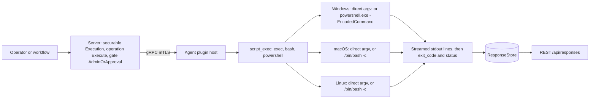
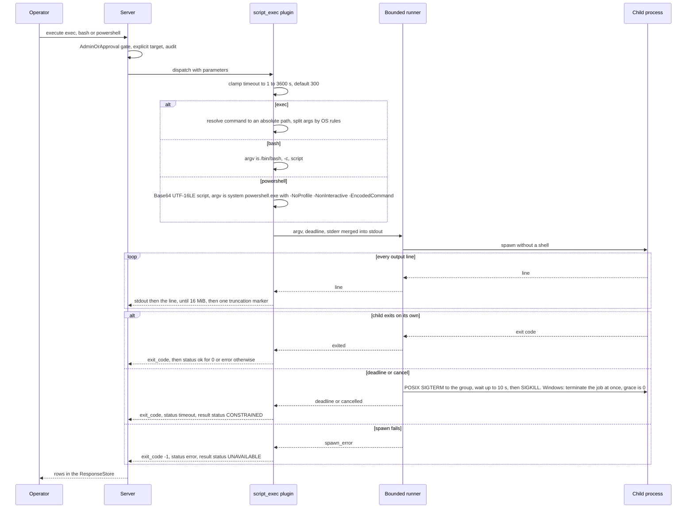

# script_exec

<!-- BEGIN GENERATED: plugin-doc-gen header -->
| | |
|---|---|
| **What it does** | Executes commands and scripts with streaming output (admin-only) |
| **Version** | 1.1.0 |
| **Kind** | Action · mutating · gathered (device.script_exec.exec, device.script_exec.powershell, device.script_exec.bash) |
| **Platforms** | Windows ✅ · macOS ✅ · Linux ✅ |
| **Actions** | `bash` (definition `device.script_exec.bash`) · `exec` (definition `device.script_exec.exec`) · `powershell` (definition `device.script_exec.powershell`) |
| **Security** | securable `Execution` · operation Execute · risk Critical · dispatch Destructive · approval gate AdminOrApproval |
| **Roles** | execute: endpoint-admin · author: content-author |
<!-- END GENERATED -->

## How it works

`script_exec` runs one program or one script on the device, as the agent's own identity, and streams what it prints. There is no sandbox, no allow-list and no per-command policy on the endpoint: whatever the caller names runs with the full rights of the agent process, so the only control is who may dispatch the action (see "What you can decide with it"). All three actions share one runner. `exec` runs a named program directly with no shell: the `command` is resolved to an absolute path and the `args` string is split into separate arguments by the plugin. `bash` runs `/bin/bash -c <script>` and `powershell` runs the system `powershell.exe` with `-NoProfile -NonInteractive -EncodedCommand <Base64 of the script>`; in both, the interpreter, not the plugin, parses the script text.

Output is streamed line by line as the child produces it (`stdout|<line>`, stdout and stderr merged), followed by a final `exit_code|<N>` and `status|ok`, `status|error` or `status|timeout`. The plugin does not interpret, filter or rewrite the output. It stops forwarding after 16 MiB (see Outputs), clamps the timeout to 1 to 3600 seconds, and when the deadline passes it terminates the child. It does not check file or process permissions itself: a program that fails for its own permission reasons reports that through its own exit code and output.



### What you can decide with it

This plugin does not answer a question about the device; it lets an authorised operator or automation do anything the agent can do. The result tells you what the command printed and whether it exited cleanly, nothing more.

| Need | Use | What you get |
|---|---|---|
| Run a known program with fixed arguments, safely, on any OS | `exec` | No shell: pipes, redirection, `&&`, globbing and `$VAR` are passed as literal text, never interpreted. Rung 2: no shell, the plugin parses the arguments |
| A multi-line or piped POSIX script | `bash` (Linux, macOS) | Full bash semantics, including expansion and quoting inside the script. Rung 3: an interpreter (bash) parses the script text |
| A PowerShell script, cmdlets or .NET calls | `powershell` (Windows) | Full PowerShell semantics. Rung 3: an interpreter (PowerShell) parses the script text |
| Run a `.bat`, `.cmd` or `.com` on Windows | `exec` with `cmd.exe` and `/c <file>` | The runner refuses to launch these file types directly, so name `cmd.exe` as the command |
| The same task on a mixed fleet | One definition per OS | `bash` is refused on Windows and `powershell` on Linux and macOS, each with an `error` row and `status\|error`. Use `exec` where one command exists everywhere |

Where the quoting boundary sits for each action:

| Action | Who parses the text | Practical consequence |
|---|---|---|
| `exec`, Linux and macOS | The plugin splits `args` on spaces and tabs; single or double quotes group words and are stripped; there is no escape character | Safe against shell injection. A quote of one type can be written inside a quoted run of the other type; to mix both in one argument, put two quoted runs side by side with no space between them (`"it's "'"x"'` is the single argument `it's "x"`) |
| `exec`, Windows | The plugin splits `args` with the C runtime rules: only double quotes group, a backslash escapes a quote, a single quote is ordinary text | `'two words'` becomes two arguments on Windows; use `"two words"` |
| `bash` | bash parses the whole script, once | Quote inside the script as in any bash script; the plugin passes the script as one argument and adds no quoting |
| `powershell` | PowerShell parses the Base64-encoded script | Nothing needs escaping at the transport level; quote inside the script as in any PowerShell script |

Who can run it, and what it runs as. The action is classed Critical and Destructive and sits behind the `AdminOrApproval` gate on the `Execution` securable: an administrator may dispatch it, anyone else needs an approval, and it must name its target devices explicitly (a fleet-wide `__all__` target is refused for Destructive actions). The script then runs as the agent's identity. Today that is the LocalSystem account on Windows and root on macOS (the shipped service has no dedicated account); on Linux it is the agent account of the install, which is unprivileged on the packaged unit and root only if the agent itself is run as root. The design target is an unprivileged account on every OS (`docs/agent-privilege-model.md`), but until that lands treat an approved script as having full control of a Windows or macOS endpoint. Nothing in the plugin limits what it may read, write or kill.

What a result does and does not prove: `status|ok` means the child exited with code 0 within the deadline; it does not mean the script achieved its goal unless the script checks and exits non-zero on failure. Output past 16 MiB is not delivered, and a command that changes state is not undone by anything here, so preview with a read-only command first and verify with a second run.

### Diagrams

#### One run, end to end



The plugin is a thin shell around the shared runner: it builds the argument list, forwards each line as it arrives and turns the runner's outcome into the final two rows. A command that cannot be resolved never reaches the runner and gets `status|error` then `exit_code|-1`. On Windows the 10-second graceful stop is disabled because the child has no console to receive it, so a timeout is an immediate hard kill (caveat 2).

## OS capability

<!-- BEGIN GENERATED: plugin-doc-gen capability -->
| Action | Windows | macOS | Linux |
|---|---|---|---|
| `bash` | ⛔ unsupported | ✅ supported · rung 3 · subprocess_runner:bash_c | ✅ supported · rung 3 · subprocess_runner:bash_c |
| `exec` | ✅ supported · rung 2 · subprocess_runner:direct_argv | ✅ supported · rung 2 · subprocess_runner:direct_argv | ✅ supported · rung 2 · subprocess_runner:direct_argv |
| `powershell` | ✅ supported · rung 3 · subprocess_runner:powershell_encodedcommand | ⛔ unsupported | ⛔ unsupported |
<!-- END GENERATED -->

## Privileges and prerequisites

| OS | Runs as | Extra grant needed | Measured | If the read is refused |
|---|---|---|---|---|
| Windows | Agent service account: LocalSystem today, not yet the intended `NT SERVICE\YuzuAgent` (`docs/agent-privilege-model.md`). The child inherits it, so a script runs as SYSTEM | None. The privilege-model row lists no extra privilege, and LocalSystem already has full local rights | Captured as `SYSTEM` on bare metal (see Sample output) | Not a distinct denial path: a command that cannot be resolved or launched returns `status\|error` and `exit_code\|-1` (resolution failure before the runner, launch failure from the runner); a program's own permission failure appears in its output and exit code |
| macOS | Agent daemon as root: the shipped LaunchDaemon has no `UserName` key (`docs/agent-privilege-model.md`). The child inherits it, so a script runs as root | None | Captured at euid 501, not the root identity the deployed daemon normally runs as (see Sample output) | Same as Windows: `status\|error` and `exit_code\|-1` for a launch failure, otherwise the program's own failure text |
| Linux | Agent daemon, dedicated unprivileged account (`yuzu-agent` on the packaged unit); the child inherits it. No sudo is added, so a script is limited to what that account can do, and runs as root only if the agent itself is run as root | None. A privileged task needs its own approved instruction and a sudoers entry for that one binary (`docs/agent-privilege-model.md`) | Captured as euid 0 in a container, not the unprivileged agent account (see Sample output) | Same as Windows |

Subprocesses: yes, the entire plugin exists to spawn one, always through the shared bounded runner and never through a wrapper shell. `exec` launches the operator-named program; `bash` starts `/bin/bash` itself as the interpreter; `powershell` launches `WindowsPowerShell\v1.0\powershell.exe` under the system directory, resolved at runtime and never a bare name, so no PATH search can substitute it. The child gets a minimal environment on Linux and macOS (`PATH`, `HOME`, `USER`, `LANG`, `LC_ALL`, `TERM`, `TZ` from the agent's own environment) and the agent's full environment on Windows. No network use by the plugin itself; whatever the launched command does is outside its scope.

## Data contract

### Inputs

<!-- BEGIN GENERATED: plugin-doc-gen inputs -->
| Definition | Parameter | Type | Required | Default | Constraints | Description |
|---|---|---|---|---|---|---|
| `device.script_exec.bash` | `script` | string | yes | - | maxLength 65536 | The bash script body to execute. Passed to /bin/bash -c. Example: "echo yuzu-capture". |
| `device.script_exec.bash` | `timeout` | int32 | no | 300 | minimum 1 · maximum 3600 | Maximum execution time in seconds. Range: 1-3600. Example: 600. Out-of-range values are rejected with a 400 by POST /api/instructions/{id}/execute. |
| `device.script_exec.exec` | `command` | string | yes | - | maxLength 4096 | Full path or name of the program to execute. A path-like value (contains '/', or on Windows '\' or a drive prefix) must already be absolute, or is resolved against a fixed safe directory; a bare name is searched across the app directory, the Windows system directory, then PATH (Windows), or PATH alone (POSIX). Example: "/usr/bin/id" or "notepad.exe". |
| `device.script_exec.exec` | `args` | string | no | - | maxLength 8192 | Space-separated arguments passed to the command. On Linux/macOS, single or double quotes delimit an argument containing spaces (quote characters stripped, no escaping). On Windows, only double quotes are meaningful, with CRT/CommandLineToArgvW backslash-escaping rules — a single quote has no special meaning there. Example: "-la /tmp" or "\"two words\" --flag". |
| `device.script_exec.exec` | `timeout` | int32 | no | 300 | minimum 1 · maximum 3600 | Maximum execution time in seconds. Process is terminated if this threshold is exceeded. Range: 1-3600. Example: 600. Out-of-range values are rejected with a 400 by POST /api/instructions/{id}/execute. |
| `device.script_exec.powershell` | `script` | string | yes | - | maxLength 65536 | The PowerShell script body to execute. Automatically encoded as UTF-16LE Base64 for safe transport. Example: "Get-Service \| Where-Object Status -eq 'Running'". |
| `device.script_exec.powershell` | `timeout` | int32 | no | 300 | minimum 1 · maximum 3600 | Maximum execution time in seconds. Range: 1-3600. Example: 600. Out-of-range values are rejected with a 400 by POST /api/instructions/{id}/execute. |
<!-- END GENERATED -->

### Outputs

Each row is exactly two pipe-delimited fields, `stream|content`. `stream` is `stdout`, `exit_code`, `status` or, before anything runs, `error`. A `stdout` line is the child's output verbatim, with stdout and stderr merged into one stream; a blank line still produces its own `stdout|` row. A run with no output still ends with its `exit_code` and `status` rows.

**Output cap.** The plugin forwards at most 16 MiB of output per run, counting each line's bytes plus one for its newline, so a command that prints only blank lines is capped too. When the limit is crossed it emits one row, `stdout|[output truncated — exceeded 16 MiB limit]`, and drops everything after it. The child is not stopped by this: it keeps running until it exits or reaches its deadline, and `exit_code` and `status` still describe how it ended.

**Timeout.** `timeout` is in seconds, default 300. The server rejects a value outside 1 to 3600 for a normal dispatch; the plugin also clamps on its own (below 1 becomes 1, above 3600 becomes 3600) and treats a non-numeric value, or a number too large for a 32-bit integer, as 300.

**Early failures.** A missing `command` or `script` returns a single `error|...` row and no `exit_code` or `status` row. Calling `bash` on Windows or `powershell` on Linux or macOS returns an `error` row and `status|error` with no `exit_code`. A command that cannot be resolved returns `status|error` then `exit_code|-1` (status first, the reverse of a normal run); a Windows system directory that cannot be found returns an `error` row first, then the same two.

<!-- BEGIN GENERATED: plugin-doc-gen outputs -->
**`device.script_exec.bash` — `stream|content|exit_code|status`**

| Field | Type | Values | Available | Example | Description |
|---|---|---|---|---|---|
| `stream` | string | - | Linux, macOS | `stdout` | Which output line this row represents: stdout for a captured output line, exit_code for the final numeric exit code, status for the final ok/error/timeout verdict, or error for an early, pre-execution failure. Values: stdout, exit_code, status, error. |
| `content` | string | - | Linux, macOS | `yuzu-capture` | The value paired with stream: the captured line text for stdout, the numeric exit code as a string for exit_code, the verdict string for status, or a human-readable failure message for error. Stdout and stderr are merged into this same stream. Values: free text. |
| `exit_code` | int32 | - | Linux, macOS | `0` | The process exit code, present on the row where stream is exit_code; -1 when the runner reports a spawn error. Values: any int32; -1 = spawn/resolve failure. |
| `status` | string | - | Linux, macOS | `ok` | The terminal verdict, present on the row where stream is status: ok (exit code 0), error (nonzero exit or spawn error), or timeout (the runner's deadline or a cancellation fired). Values: ok, error, timeout. |

**`device.script_exec.exec` — `stream|content|exit_code|status`**

| Field | Type | Values | Available | Example | Description |
|---|---|---|---|---|---|
| `stream` | string | - | Windows, Linux, macOS | `stdout` | Which output line this row represents: stdout for a captured output line, exit_code for the final numeric exit code, status for the final ok/error/timeout verdict, or error for an early, pre-execution failure. Values: stdout, exit_code, status, error. |
| `content` | string | - | Windows, Linux, macOS | `yuzu-capture` | The value paired with stream: the captured line text for stdout, the numeric exit code as a string for exit_code, the verdict string for status, or a human-readable failure message for error. Stdout and stderr are merged into this same stream. Values: free text. |
| `exit_code` | int32 | - | Windows, Linux, macOS | `0` | The process exit code, present on the row where stream is exit_code; -1 when the runner reports a spawn error or the command could not be resolved. Values: any int32; -1 = spawn/resolve failure. |
| `status` | string | - | Windows, Linux, macOS | `ok` | The terminal verdict, present on the row where stream is status: ok (exit code 0), error (nonzero exit, spawn error, or an early parameter/resolution failure), or timeout (the runner's deadline or a cancellation fired). Values: ok, error, timeout. |

**`device.script_exec.powershell` — `stream|content|exit_code|status`**

| Field | Type | Values | Available | Example | Description |
|---|---|---|---|---|---|
| `stream` | string | - | Windows | `stdout` | Which output line this row represents: stdout for a captured output line (including PowerShell's own progress-stream CLIXML text on a headless run), exit_code for the final numeric exit code, status for the final ok/error/timeout verdict, or error for an early, pre-execution failure. Values: stdout, exit_code, status, error. |
| `content` | string | - | Windows | `yuzu-capture` | The value paired with stream: the captured line text for stdout, the numeric exit code as a string for exit_code, the verdict string for status, or a human-readable failure message for error. Stdout and stderr are merged into this same stream. Values: free text. |
| `exit_code` | int32 | - | Windows | `0` | The process exit code, present on the row where stream is exit_code; -1 when the runner reports a spawn error or the Windows system directory could not be resolved. Values: any int32; -1 = spawn/resolve failure. |
| `status` | string | - | Windows | `ok` | The terminal verdict, present on the row where stream is status: ok (exit code 0), error (nonzero exit, spawn error, or an early resolution failure), or timeout (the runner's deadline or a cancellation fired). Values: ok, error, timeout. |
<!-- END GENERATED -->

### Result status

| Status | Completeness | Provenance | When |
|---|---|---|---|
| `UNDECLARED` (agent default) | none | none | Every clean exit: `status\|ok` for exit code 0, or `status\|error` for the child's own nonzero exit. Also every early refusal (missing parameter, wrong OS for the action, unresolvable command), which never reaches the runner |
| `UNAVAILABLE` / `PARTIAL` | partial | `subprocess_runner:spawn_error` | The runner could not start the child. The rows say `status\|error` and `exit_code\|-1` |
| `CONSTRAINED` / `PARTIAL` | partial | `subprocess_runner:deadline` | The `timeout` elapsed while the child was still running and it was terminated. The rows say `status\|timeout` |
| `CONSTRAINED` / `PARTIAL` | partial | `subprocess_runner:cancelled` | The run was cancelled before the child finished. The rows say `status\|timeout` |
| `CONSTRAINED` / `PARTIAL` | partial | `subprocess_runner:signaled` | The child was killed by a signal rather than exiting. The rows say `status\|error` |

The runner can also report a stop at a line limit (`subprocess_runner:line_limit`), but this plugin never sets a line limit, so that status cannot occur here. The 16 MiB output cap is not a result status: a truncated run keeps the status of how the child actually ended.

None of the captured samples hit these paths, so every sample line reads `[result_status] UNDECLARED / UNKNOWN`, including the three `[rc] 1` lines (Windows `bash`, macOS `powershell`, Linux `powershell`), which are the plugin's own refusal of an action on the wrong OS.

### Where the data goes

- **Instruction result only.** Rows travel over the agent's mTLS gRPC channel as the command response and land in the ResponseStore (90-day retention per the `core.crossplatform.scripting` instruction set default, `content/definitions/scripting_set.yaml`), queryable at `/api/responses/{id}`. The server renders `script_exec` results with the generic key-value (`Agent`/`Key`/`Value`) display shape, not a plugin-specific column layout (`server/core/src/result_parsing.hpp`).
- **Not consumed by** daily-sync inventory, the TAR warehouse, DEX, or metrics — no reference to `script_exec` or any `device.script_exec.*` definition id was found outside the plugin's own files, the capability catalogue, the dispatch-gate/execution-tracker comments, and `scripting_set.yaml`. Nothing runs on a schedule; `gather.ttlSeconds: 3600` in the definition YAML is a response-cache TTL, not a poll schedule (`content/definitions/script_exec.yaml`).
- **Not consumed by** an early dispatch-time gate either: `Execution`/`AdminOrApproval` is enforced at the shared dispatch chokepoint for every caller including MCP, not duplicated by an earlier check (`server/core/src/dispatch_destructive_gate.hpp`).
- **Sensitivity.** `content` is opaque, operator-chosen free text — the plugin forwards the launched
  command's/script's stdout (and merged stderr) verbatim, so what it carries depends entirely on what
  the caller ran. It can trivially include device identifiers (hostnames, IPs), person identifiers
  (usernames, logged-in account names), and installed-software details (whatever the command chooses
  to print) — the plugin itself never names or filters any of these, it just streams whatever the
  child process writes.
- **Siblings:** `content_dist.execute_staged` — the only other plugin on the `Execution` securable with this gate (`server/core/src/dispatch_destructive_gate.hpp`). All three `script_exec` definitions are bundled together in the `core.crossplatform.scripting` instruction set (`content/definitions/scripting_set.yaml`).
- **MCP / REST.** Discover: `discover_plugins` (summary) → `yuzu://plugin-docs` (this page as data) → `discover_instructions` / `get_definition("device.script_exec.exec")`. Run: `execute_instruction {definition_id, parameters}`. Read: `/api/responses/{id}`.

## Sample output

<!-- BEGIN GENERATED: plugin-doc-gen samples -->
**Windows** — captured: windows Microsoft Windows NT 10.0.26200.0 x64 · bare-metal · 2026-09-07 · SYSTEM · leg-hash a6cac34c1781

```
== action=exec command=cmd args="/c echo yuzu-capture"
stdout|yuzu-capture
exit_code|0
status|ok
[result_status] UNDECLARED / UNKNOWN

== action=powershell script="Write-Output yuzu-capture"
stdout|#< CLIXML
stdout|yuzu-capture
stdout|<Objs Version="1.1.0.1" xmlns="http://schemas.microsoft.com/powershell/2004/04"><Obj S="progress" RefId="0"><TN RefId="0"><T>System.Management.Automation.PSCustomObject</T><T>System.Object</T></TN><MS><I64 N="SourceId">1</I64><PR N="Record"><AV>Preparing modules for first use.</AV><AI>0</AI><Nil /><PI>-1</PI><PC>-1</PC><T>Completed</T><SR>-1</SR><SD> </SD></PR></MS></Obj></Objs>
exit_code|0
status|ok
[result_status] UNDECLARED / UNKNOWN

== action=bash script="echo yuzu-capture"
error|bash action is not available on Windows
status|error
[result_status] UNDECLARED / UNKNOWN
[rc] 1
```

**macOS** — captured: macos macOS 26.6.2 arm64 · bare-metal · 2026-09-07 · euid 501 (jsmith) · leg-hash a6cac34c1781

```
== action=exec command=echo args=yuzu-capture
stdout|yuzu-capture
exit_code|0
status|ok
[result_status] UNDECLARED / UNKNOWN

== action=powershell script="Write-Output yuzu-capture"
error|powershell action is Windows-only
status|error
[result_status] UNDECLARED / UNKNOWN
[rc] 1

== action=bash script="echo yuzu-capture"
stdout|yuzu-capture
exit_code|0
status|ok
[result_status] UNDECLARED / UNKNOWN
```

**Linux** — captured: linux Debian GNU/Linux 13 (trixie) aarch64 · container · 2026-09-07 · euid 0 · leg-hash a6cac34c1781

```
== action=exec command=echo args=yuzu-capture
stdout|yuzu-capture
exit_code|0
status|ok
[result_status] UNDECLARED / UNKNOWN

== action=powershell script="Write-Output yuzu-capture"
error|powershell action is Windows-only
status|error
[result_status] UNDECLARED / UNKNOWN
[rc] 1

== action=bash script="echo yuzu-capture"
stdout|yuzu-capture
exit_code|0
status|ok
[result_status] UNDECLARED / UNKNOWN
```
<!-- END GENERATED -->

## Caveats and known gaps

1. **The Windows `powershell` sample's CLIXML noise is expected, not an error.** PowerShell emits a `#< CLIXML` progress record, a block of XML text, when its output is redirected rather than shown on a console, and the plugin forwards it as ordinary `stdout|` lines without filtering. `exit_code|0` and `status|ok` in the sample confirm it is cosmetic.
2. **A timeout on Windows is an immediate hard kill.** The plugin asks for a 10-second graceful stop on every run, but on Windows the child has no console to receive it, so the grace is forced to 0 and the job is terminated at once. A script that needs time to clean up should enforce its own limit shorter than `timeout`.
3. **`powershell` corrupts non-ASCII script text.** The script is widened to UTF-16 one byte at a time, so each byte of a multi-byte UTF-8 character becomes its own code unit and the character arrives as the wrong text. Keep PowerShell scripts to ASCII, or build non-ASCII strings in the script itself (for example with `[char]` codes).
4. **A relative `command` resolves against a fixed directory, not the agent's working directory.** That directory is `/` on Linux and macOS and the Windows system directory on Windows, so an instruction that relied on a `./helper`-style command needs an absolute path. A bare Windows name is searched in the agent's own directory, then the system directory, then `PATH`; a `.bat`, `.cmd` or `.com` file cannot be launched directly, so use `cmd.exe /c`.
5. **The child environment differs by OS.** On Linux and macOS it is limited to `PATH`, `HOME`, `USER`, `LANG`, `LC_ALL`, `TERM` and `TZ` taken from the agent's own environment; on Windows it is the agent's full environment, with loader-injection variables removed. A script that depends on another variable works on Windows and fails on Linux and macOS unless it sets that variable itself.

## Source and tests

<!-- BEGIN GENERATED: plugin-doc-gen source -->
- Plugin: `agents/plugins/script_exec/src/script_exec_parsers.hpp` · `agents/plugins/script_exec/src/script_exec_plugin.cpp`
- Definitions: `content/definitions/script_exec.yaml`
- Capability rows: `server/core/src/capability_decls/plugin_action_catalogue_d.hpp`
- Tests: `tests/unit/test_script_exec_actions.cpp` · `tests/unit/test_script_exec_parsers.cpp` · `tests/unit/test_script_exec_win_actions.cpp`
- Privilege row: `docs/agent-privilege-model.md`
<!-- END GENERATED -->
