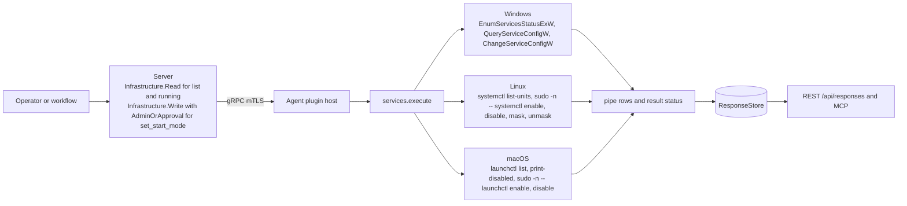
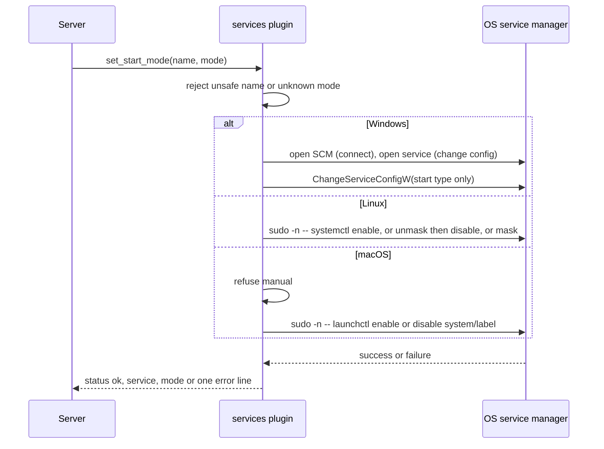
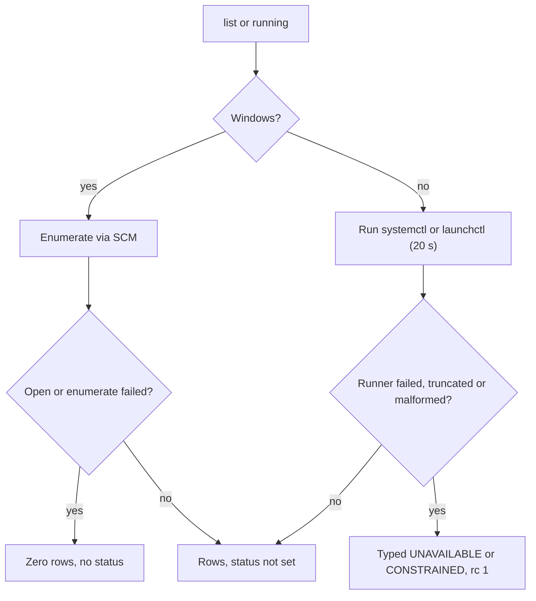

# services

<!-- BEGIN GENERATED: plugin-doc-gen header -->
| | |
|---|---|
| **What it does** | System services — enumerate, query, and configure service startup types |
| **Version** | 0.2.0 |
| **Kind** | Action · mutating · gathered (crossplatform.service.list, crossplatform.service.running) |
| **Platforms** | Windows ✅ · macOS ✅ · Linux ✅ |
| **Actions** | `list` (definition `crossplatform.service.list`) · `running` (definition `crossplatform.service.running`) · `set_start_mode` (definition `crossplatform.service.set_start_mode`) |
| **Security** | `list`: securable `Infrastructure` · operation Read · risk Low · dispatch ReadOnly · approval gate None; `running`: securable `Infrastructure` · operation Read · risk Low · dispatch ReadOnly · approval gate None; `set_start_mode`: securable `Infrastructure` · operation Write · risk High · dispatch Mutating · approval gate AdminOrApproval |
| **Roles** | execute: `list`: endpoint-admin, endpoint-operator; `running`: endpoint-admin, endpoint-operator; `set_start_mode`: endpoint-admin · author: content-author |
<!-- END GENERATED -->

## How it works

`list` and `running` read the host's service registry and return one `svc|` row per service: the Service Control Manager on Windows (Win32 services only, not kernel drivers), `systemctl list-units` on Linux (`--type=service` units that systemd has loaded, which is not every unit file on disk and excludes timers, sockets and other unit types) and `launchctl list` on macOS. `running` is the same read narrowed to services that are up: Windows asks the Service Control Manager for every state except stopped, Linux keeps systemd's `running` sub-state, and macOS keeps rows that have a PID (`launchctl` has no filter of its own, so the plugin filters after parsing). On macOS one extra call, `launchctl print-disabled system`, supplies each row's startup type; a label that domain holds no override for reads `unknown`.

`set_start_mode` is the only mutation. It checks the service name and mode, then changes one service's boot-time start setting and nothing else: it does not start, stop or restart the service. Windows sets the Service Control Manager start type. Linux runs `systemctl enable` for `automatic`, `unmask` then `disable` for `manual`, and `mask` for `disabled`. macOS runs `launchctl enable` or `disable` against `system/<label>` and refuses `manual`, because launchd only has enabled and disabled. Linux and macOS commands run as shell-free argv under a 20 second deadline, prefixed with `sudo -n --` unless the agent is already root. The plugin is deliberately not a change history; the Echo service collector does that separately.



### What you can decide with it

| Question | Action | Windows | macOS | Linux |
|---|---|---|---|---|
| Which services exist? | `list` | Every Win32 service the Service Control Manager knows, running or not | Every launchd job `launchctl list` reports, up to 512 rows | Every `.service` unit systemd has loaded (`--type=service --all`); a unit file that was never loaded does not appear |
| Is a service up right now? | `running` or `list` | `status` is the SCM state; `running` returns every service that is not stopped | The PID column is the answer (`-` means not running); `status` is a last-exit code, not a state | `status` is systemd's sub-state (`running`, `dead`, `exited`, `failed`) |
| Will it start at boot? | `list` (`startup_type`) | `automatic`, `boot`, `manual`, `disabled`, `system` or `unknown`; delayed-start reads as `automatic` | `automatic` (explicit enable override), `disabled`, or `unknown` (no override recorded, which is the common case) | Not answered: Linux rows have no startup field |
| Change how it starts | `set_start_mode` | Exact: automatic, manual or disabled | `automatic` or `disabled` only | `disabled` is a systemd mask, stronger than the other platforms' disabled |

What it cannot tell you: whether a service is healthy, why it stopped, what depends on it, or what changed since last time. An empty Windows result is not proof of zero services (caveat 2), and a Linux or macOS result with a non-OK status is a partial answer, not a clean one.

Safe workflow for `set_start_mode`:

1. Run `list` and record the service's current `startup_type` (Windows and macOS only; Linux gives no startup type to record).
2. Run `set_start_mode` with the target `name` and `mode`. The change takes effect at the next boot or login; a running service keeps running.
3. Run `list` again and confirm the new `startup_type` (Windows and macOS). On Linux this plugin has no read-back, so confirm with `systemctl is-enabled` by other means.
4. To undo, call `set_start_mode` with the value recorded in step 1. Windows `boot` and `system` start types cannot be restored, because the action only accepts `automatic`, `manual` and `disabled`.

Target restrictions: `name` is 1 to 256 characters from letters, digits, `.`, `_`, `@` and `-`, so a Windows service name containing a space, or a systemd instance name with escaped characters, cannot be targeted. The action needs the `endpoint-admin` role and passes the `AdminOrApproval` gate.

### Diagrams



The plugin validates input first, then makes exactly one start-setting change per call (Linux `manual` adds a best-effort `unmask` beforehand). Nothing starts or stops the service, and a failure produces a single `error|` line instead of the three success lines.



This shows why the two families of legs fail differently: Windows has no way to say it could not read, while Linux and macOS attach a typed status to any degraded run, so a status other than the default means the rows are incomplete.

## OS capability

<!-- BEGIN GENERATED: plugin-doc-gen capability -->
| Action | Windows | macOS | Linux |
|---|---|---|---|
| `list` | ✅ supported · rung 1 · win32_service_api | ✅ supported · rung 2 · runner argv 'launchctl list' | ✅ supported · rung 2 · runner argv 'systemctl list-units' |
| `running` | ✅ supported · rung 1 · win32_service_api | ✅ supported · rung 2 · runner argv 'launchctl list' | ✅ supported · rung 2 · runner argv 'systemctl list-units' |
| `set_start_mode` | ✅ supported · rung 1 · win32_service_api | ✅ supported · rung 2 · runner argv 'sudo -n -- launchctl enable\|disable' | ✅ supported · rung 2 · runner argv 'sudo -n -- systemctl enable\|disable\|mask\|unmask' |
<!-- END GENERATED -->

## Privileges and prerequisites

| OS | Runs as | Extra grant needed | Measured | If the read is refused |
|---|---|---|---|---|
| Windows | agent service account, LocalSystem today (#1442) | `list`/`running`: none beyond the default account. `set_start_mode`: the plugin asks the Service Control Manager for `SC_MANAGER_CONNECT` and the target service for `SERVICE_CHANGE_CONFIG`, so the right is decided by that service's access-control list. The plugin enables or checks no privilege itself; the `SeAssignPrimaryTokenPrivilege` entry in `docs/agent-privilege-model.md` is not exercised by this code. | 2026-09-07, bare-metal, captured as `SYSTEM`; `list` and `running` only, `set_start_mode` stopped at parameter validation | `list`/`running`: a failed `OpenSCManagerW` or `EnumServicesStatusExW` returns an **empty** list with no error and no result status, so a refusal reads like "zero services". A single service whose configuration cannot be opened reports `startup_type` `unknown`. `set_start_mode`: failures are explicit `error\|...` rows (`access denied changing service '<name>'`, `service '<name>' not found`, or the Win32 error code). |
| macOS | agent daemon, root (the shipped LaunchDaemon has no `UserName` key) | None as root: the `sudo -n --` prefix is skipped when the agent's effective uid is 0. A non-root agent needs the sudoers grants `/bin/launchctl enable system/*` and `/bin/launchctl disable system/*` (the installed grant also covers `bootstrap`/`bootout`, which this plugin does not use). | 2026-09-07, bare-metal, captured as an unprivileged interactive user, not the root identity the daemon runs under | `list`/`running`: a failed `launchctl list` or `launchctl print-disabled` sets a typed `UNAVAILABLE` or `CONSTRAINED` status through the shared runner seam. `set_start_mode`: a `sudo -n` denial is captured (stderr merged into the output) and appended to the `error\|launchctl command failed for '<name>' (exit=<n>)` line. |
| Linux | agent daemon, dedicated unprivileged account by design (`docs/agent-privilege-model.md`) | `list`/`running`: none. `set_start_mode`: the sudoers grant `systemctl enable`, `disable`, `mask` and `unmask` (`/bin/systemctl` and `/usr/bin/systemctl`); the `sudo -n --` prefix is skipped when the agent is root. Under the packaged unit's `NoNewPrivileges=true`, `sudo` cannot escalate, so this grant takes effect only on a unit without that setting. | 2026-09-06, container, captured as root (`euid 0`), not the deployed unprivileged identity | `list`/`running`: a typed `UNAVAILABLE` or `CONSTRAINED` status; the captured sample shows `subprocess_runner:spawn_error` on both because `systemctl` could not be resolved in the capture container, not because of a permission denial. `set_start_mode`: a missing grant surfaces as `error\|systemctl command failed for '<name>' (exit=1): sudo: a password is required`. |

Binaries and network: Linux runs `systemctl` (`list-units` for reads; `enable`, `disable`, `mask`, `unmask` under `sudo -n --` for the mutation). macOS runs `launchctl` (`list` and `print-disabled` for reads; `enable`, `disable` under `sudo -n --` for the mutation). Both go through the bounded, shell-free runner with a 20 second deadline. Windows uses the Service Control Manager API only, with no subprocess. No network access on any OS.

## Data contract

### Inputs

<!-- BEGIN GENERATED: plugin-doc-gen inputs -->
| Definition | Parameter | Type | Required | Default | Constraints | Description |
|---|---|---|---|---|---|---|
| `crossplatform.service.set_start_mode` | `name` | string | yes | - | pattern: ^[a-zA-Z0-9._@-]+$ · minLength 1 · maxLength 256 | The service identifier. On Windows, the short service name (e.g. "Spooler"). On Linux, the systemd unit name (e.g. "nginx.service"). On macOS, the launchd label (e.g. "com.apple.metadata.mds"). |
| `crossplatform.service.set_start_mode` | `mode` | string | yes | - | enum: automatic, manual, disabled | Target startup type. "automatic" starts the service at boot. "manual" prevents auto-start but allows on-demand start. "disabled" prevents the service from starting entirely (Linux: systemctl mask; macOS: launchctl disable). |
<!-- END GENERATED -->

### Outputs
Rows are pipe-delimited, prefixed `svc|`, one per service. The row **shape** differs by OS, not just the values: Windows and macOS emit the four fields the schema names (`name|display_name|status|startup_type`, where macOS puts the PID in the second slot), but Linux emits only **three** (`name|status|description`), because that leg never derives a startup type. A consumer must branch on OS before indexing a row (the server's own device-page parser does). `set_start_mode` never writes a `svc|` row: on success it writes three lines, `status|ok`, `service|<name>`, `mode|<mode>`; on any failure it writes one `error|<message>` line and none of the three, with return code 1. There is no placeholder-row convention for the reads. On Windows an enumeration failure returns zero rows with no status; on Linux and macOS a degraded run sets a typed `UNAVAILABLE` or `CONSTRAINED` status before whatever rows were parsed and returns code 1. On macOS the row cap (512) ends the list with a `svc|__truncated__|-|<total>|-` sentinel row.

<!-- BEGIN GENERATED: plugin-doc-gen outputs -->
**`crossplatform.service.list` — `name|display_name|status|startup_type`**

| Field | Type | Values | Available | Example | Description |
|---|---|---|---|---|---|
| `name` | string | - | Windows, Linux, macOS | `ADPSvc` | The service's short identifier: a Win32 service name, a systemd unit name, or a launchd label. Values: free text. |
| `display_name` | string | - | Windows, macOS | `Aggregated Data Platform Service (windows) · 1111 (darwin)` | Column 2, whose meaning is OS-specific. On Windows it is the Service Control Manager's human-readable display name. On macOS it holds the launchd job's numeric PID as a string, or "-" when not running (the platform has no per-service display name in `launchctl list`). It is NOT emitted on Linux at all -- the Linux leg's row carries only 3 pipe fields (name, status, description), so this column is absent from the wire, not merely empty. Values: free text (windows) · integer PID or "-" (darwin) · field absent (linux). |
| `status` | string | - | Windows, Linux, macOS | `stopped (windows) · 0 (darwin)` | Column 3, whose meaning is OS-specific. On Windows it is the service's current SCM state. On Linux it is systemd's SUB state from `systemctl list-units`. On macOS it is launchctl's raw last-exit-status code for the job -- an integer as a string, NOT a running/stopped word; use the display_name (PID) column to tell whether a macOS service is currently running. Values: stopped, start_pending, stop_pending, running, continue_pending, pause_pending, paused, unknown (windows) · free text systemd SUB state, e.g. running, dead, exited, failed (linux) · integer exit-status code as a string (darwin). |
| `startup_type` | string | - | Windows, macOS | `manual (windows) · unknown (darwin)` | Column 4: the service's configured startup type. On Windows this is the SCM's 5-state taxonomy. On macOS it is an honest 3-value read derived from a bulk `launchctl print-disabled` join -- a label with no explicit override reports "unknown" rather than a guessed default. It is NOT emitted on Linux at all (no 4th column on the wire), because the systemctl leg does not derive a startup type. Values: automatic, boot, manual, disabled, system, unknown (windows) · automatic, disabled, unknown (darwin) · field absent (linux). |

**`crossplatform.service.running` — `name|display_name|status|startup_type`**

| Field | Type | Values | Available | Example | Description |
|---|---|---|---|---|---|
| `name` | string | - | Windows, Linux, macOS | `AppXSvc` | The service's short identifier: a Win32 service name, a systemd unit name, or a launchd label. Values: free text. |
| `display_name` | string | - | Windows, macOS | `AppX Deployment Service (AppXSVC) (windows) · 1111 (darwin)` | Column 2, whose meaning is OS-specific. On Windows it is the Service Control Manager's human-readable display name. On macOS it holds the launchd job's numeric PID as a string, or "-" when not running (the platform has no per-service display name in `launchctl list`). It is NOT emitted on Linux at all -- the Linux leg's row carries only 3 pipe fields (name, status, description), so this column is absent from the wire, not merely empty. Values: free text (windows) · integer PID or "-" (darwin) · field absent (linux). |
| `status` | string | - | Windows, Linux, macOS | `running (windows) · 0 (darwin)` | Column 3, whose meaning is OS-specific. On Windows it is the service's current SCM state (always "running" for this action's filtered result). On Linux it is systemd's SUB state from `systemctl list-units --state=running`. On macOS it is launchctl's raw last-exit-status code for the job -- an integer as a string, NOT a running/stopped word; this action's own running-filter is applied on the PID column, not this one. Values: running (windows, this action always filters to it) · free text systemd SUB state (linux) · integer exit-status code as a string (darwin). |
| `startup_type` | string | - | Windows, macOS | `automatic (windows) · unknown (darwin)` | Column 4: the service's configured startup type. On Windows this is the SCM's 5-state taxonomy. On macOS it is an honest 3-value read derived from a bulk `launchctl print-disabled` join -- a label with no explicit override reports "unknown" rather than a guessed default. It is NOT emitted on Linux at all (no 4th column on the wire), because the systemctl leg does not derive a startup type. Values: automatic, boot, manual, disabled, system, unknown (windows) · automatic, disabled, unknown (darwin) · field absent (linux). |

**`crossplatform.service.set_start_mode` — `status|service|mode`**

| Field | Type | Values | Available | Example | Description |
|---|---|---|---|---|---|
| `status` | string | - | Windows, Linux, macOS | `ok` | Literal "ok" on a successful mode change. On any failure the plugin instead writes a single "error\|<message>" line and this row does not appear at all. Values: ok (the only value ever emitted). |
| `service` | string | - | Windows, Linux, macOS | `-` | The `name` parameter echoed back unmodified, on a successful mode change only. Values: free text — echoes the name parameter. |
| `mode` | string | - | Windows, Linux, macOS | `-` | The `mode` parameter echoed back unmodified, on a successful mode change only. Values: automatic, disabled (all OS) · manual additionally on windows/linux (darwin rejects it before this row is ever written). |
<!-- END GENERATED -->

### Result status

| Status | Completeness | Provenance | When |
|---|---|---|---|
| `UNDECLARED` (default) | UNKNOWN | (empty) | Every Windows read (including a failed one), every Linux/macOS read that completed cleanly, a successful `set_start_mode` on any OS, and every `set_start_mode` validation or platform-decision error (missing `name`/`mode`, unsafe name, invalid mode, macOS `manual`, a command that ran and exited non-zero). The plugin sets no status on these paths. |
| `UNAVAILABLE` | PARTIAL | `subprocess_runner:spawn_error` | Linux/macOS `list`/`running`/`set_start_mode`: `systemctl`/`launchctl` (or `sudo`) could not be started or was not found; shown in `docs/samples/linux.txt` |
| `CONSTRAINED` | PARTIAL | `subprocess_runner:deadline` | The 20 second runner deadline elapsed and the child was killed |
| `CONSTRAINED` | PARTIAL | `subprocess_runner:cancelled` | The `systemctl`/`launchctl` run was cancelled before it finished |
| `CONSTRAINED` | PARTIAL | `subprocess_runner:signaled` | The child was killed by a signal rather than exiting cleanly |
| `OK` | PARTIAL | `subprocess_runner:line_limit` | Defined by the shared runner for a capped line count. This plugin sets no line limit, so it does not occur here. |
| `CONSTRAINED` | PARTIAL | `services:output_truncated` | Linux/macOS `list`/`running`: the captured output hit the runner's byte cap but the tool itself exited cleanly |
| `CONSTRAINED` | PARTIAL | `services:malformed_launchctl_capture` | macOS `list`/`running`: `launchctl list` exited cleanly but its output has no lines or no `PID\tStatus\tLabel` header. No `svc\|` rows are emitted, so a failed read is distinguishable from a host with nothing running. Reported only when no runner failure has already set a status. |

### Where the data goes

- **Instruction result only.** Rows travel the agent's mTLS gRPC channel as the command response into the ResponseStore (`response_retention_days`, default 90), queryable at `/api/responses/{id}`; the dashboard's generic result viewer renders `services` through its key/value fallback schema (`result_parsing.hpp`).
- **Device pages "Get live info".** The `services` live-snapshot kind (`device.live.services` audit verb) dispatches `list` directly and re-parses the same 3-versus-4-field row shape to render the device card (`device_routes.cpp`, `device_ui.cpp`).
- **Not consumed by** daily-sync inventory, Echo, or DEX and metrics: nothing here runs on a schedule; the plugin executes only when dispatched.
- **Sensitivity.** `name`/`display_name` rows name installed services and applications on the host. Windows service display names, macOS launchd labels and Linux unit names are an installed-software inventory by another route. `status`/`startup_type` carry nothing beyond that service's own state. Nothing in any row identifies a specific device or person.
- **Siblings:** `agents/plugins/echo/src/echo_service_collector.cpp` performs its own, independently implemented service enumeration (the same three OS mechanisms) for Echo's diff-based change detection; it shares no code with this plugin.
- **MCP / REST.** Discover: `discover_plugins` (summary), then `yuzu://plugin-docs` (this page as data), then `discover_instructions` / `get_definition("crossplatform.service.list")`. Run: `execute_instruction {definition_id, parameters}`. Read: `/api/responses/{id}`; live snapshot via the device page's `services` kind.
## Sample output

<!-- BEGIN GENERATED: plugin-doc-gen samples -->
**Windows** — captured: windows Microsoft Windows NT 10.0.26200.0 x64 · bare-metal · 2026-09-07 · SYSTEM · leg-hash e724207e0989

```
== action=list
svc|ADPSvc|Aggregated Data Platform Service|stopped|manual
svc|ALG|Application Layer Gateway Service|stopped|manual
svc|AppIDSvc|Application Identity|stopped|manual
svc|Appinfo|Application Information|stopped|manual
svc|AppMgmt|Application Management|stopped|manual
svc|AppReadiness|App Readiness|stopped|manual
svc|AppVClient|Microsoft App-V Client|stopped|disabled
svc|AppXSvc|AppX Deployment Service (AppXSVC)|running|automatic
svc|ApxSvc|Windows Virtual Audio Device Proxy Service|stopped|manual
svc|AssignedAccessManagerSvc|AssignedAccessManager Service|stopped|manual
svc|AsusUpdateCheck|AsusUpdateCheck|stopped|automatic
svc|AudioEndpointBuilder|Windows Audio Endpoint Builder|running|automatic
… 12 of 289 rows shown
[result_status] UNDECLARED / UNKNOWN

== action=running
svc|AppXSvc|AppX Deployment Service (AppXSVC)|running|automatic
svc|AudioEndpointBuilder|Windows Audio Endpoint Builder|running|automatic
svc|Audiosrv|Windows Audio|running|automatic
svc|BFE|Base Filtering Engine|running|automatic
svc|BrokerInfrastructure|Background Tasks Infrastructure Service|running|automatic
svc|BTAGService|Bluetooth Audio Gateway Service|running|manual
svc|BthAvctpSvc|AVCTP service|running|manual
svc|bthserv|Bluetooth Support Service|running|manual
svc|camsvc|Capability Access Manager Service|running|automatic
svc|CCleaner7|CCleaner 7|running|automatic
svc|CDPSvc|Connected Devices Platform Service|running|automatic
svc|CertPropSvc|Certificate Propagation|running|manual
… 12 of 115 rows shown
[result_status] UNDECLARED / UNKNOWN

== action=set_start_mode
error|missing required parameter: name
[result_status] UNDECLARED / UNKNOWN
[rc] 1
```

**macOS** — captured: macos macOS 26.6.2 arm64 · bare-metal · 2026-09-07 · euid 501 (jsmith) · leg-hash e724207e0989

```
== action=list
svc|io.tailscale.ipn.macsys.login-item-helper|-|0|unknown
svc|com.apple.SafariHistoryServiceAgent|-|0|unknown
svc|com.apple.progressd|1111|0|unknown
svc|com.apple.enhancedloggingd|-|0|unknown
svc|com.apple.cloudphotod|1012|0|unknown
svc|com.apple.MENotificationService|1099|0|unknown
svc|com.apple.Finder|1186|0|unknown
svc|com.apple.homed|889|0|unknown
svc|com.apple.dataaccess.dataaccessd|1223|0|unknown
svc|com.apple.quicklook|-|0|unknown
svc|com.apple.parentalcontrols.check|-|0|unknown
svc|com.apple.mediaremoteagent|1057|0|unknown
… 12 of 513 rows shown
[result_status] UNDECLARED / UNKNOWN

== action=running
svc|com.apple.progressd|1111|0|unknown
svc|com.apple.cloudphotod|1012|0|unknown
svc|com.apple.MENotificationService|1099|0|unknown
svc|com.apple.Finder|1186|0|unknown
svc|com.apple.homed|889|0|unknown
svc|com.apple.dataaccess.dataaccessd|1223|0|unknown
svc|com.apple.mediaremoteagent|1057|0|unknown
svc|com.apple.FontWorker|1042|0|unknown
svc|com.apple.bird|941|0|unknown
svc|com.apple.knowledgeconstructiond|2105|0|unknown
svc|com.apple.inputanalyticsd|1559|0|unknown
svc|com.apple.GameController.gamecontrolleragentd|974|0|unknown
… 12 of 279 rows shown
[result_status] UNDECLARED / UNKNOWN

== action=set_start_mode
error|missing required parameter: name
[result_status] UNDECLARED / UNKNOWN
[rc] 1
```

**Linux** — captured: linux Debian GNU/Linux 13 (trixie) aarch64 · container · 2026-09-06 · euid 0 · leg-hash e724207e0989

```
== action=list
[result_status] UNAVAILABLE / PARTIAL / subprocess_runner:spawn_error
[rc] 1

== action=running
[result_status] UNAVAILABLE / PARTIAL / subprocess_runner:spawn_error
[rc] 1

== action=set_start_mode
error|missing required parameter: name
[result_status] UNDECLARED / UNKNOWN
[rc] 1
```
<!-- END GENERATED -->

## Caveats and known gaps

1. **Linux rows have three fields, not four.** The Linux leg emits `svc|name|status|description`; Windows and macOS emit four. A consumer that indexes by the schema's column names misreads Linux `status` and `description` as `display_name` and `status`, and has no startup type to read at all.
2. **A Windows enumeration failure looks like zero services.** If `OpenSCManagerW` or `EnumServicesStatusExW` fails, `enumerate_services_win` returns an empty list and the plugin sets no result status, unlike Linux and macOS, which forward a typed status for the same class of failure. Treat an empty Windows `list` on a host that should have services as unreliable, not as proof.
3. **macOS `status` is an exit code, and some labels never appear.** `status` is launchctl's last-exit code (`0` for nearly every row), so use the PID in the second field to tell whether a job is running. The list is capped at 512 rows with the `__truncated__` sentinel, and a launchd label containing a character outside letters, digits, `.`, `_`, `@` and `-` is dropped silently, without a status and without counting toward the sentinel's total.
4. **The macOS startup type is rarely known.** The join uses the `system` domain's override list only, so any label with no recorded override reads `unknown`; every row in the captured sample is `unknown`. That capture ran as an unprivileged user against the user's job list, so it does not show what the root daemon sees.
5. **`set_start_mode` has never been captured past validation.** Every OS sample stops at `error|missing required parameter: name`, so the `sudo`-wrapped and Win32 changes are verified from source and unit tests only. The Linux `list` and `running` captures also failed with `spawn_error`, so the three-field Linux row shape is likewise verified from source, not from a captured row.

## Source and tests

<!-- BEGIN GENERATED: plugin-doc-gen source -->
- Plugin: `agents/plugins/services/src/services_macos_launchd.hpp` · `agents/plugins/services/src/services_parsers.hpp` · `agents/plugins/services/src/services_plugin.cpp`
- Definitions: `content/definitions/services.yaml`
- Capability rows: `server/core/src/capability_decls/plugin_action_catalogue_d.hpp`
- Tests: `tests/unit/agent/test_services_macos.cpp` · `tests/unit/test_services_parsers.cpp`
- Privilege row: `docs/agent-privilege-model.md`
<!-- END GENERATED -->
