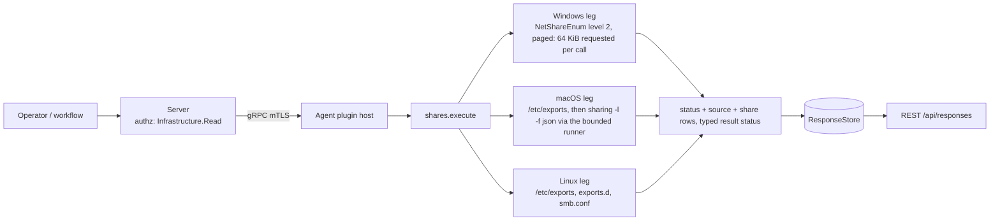
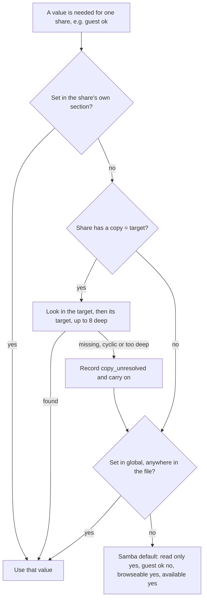
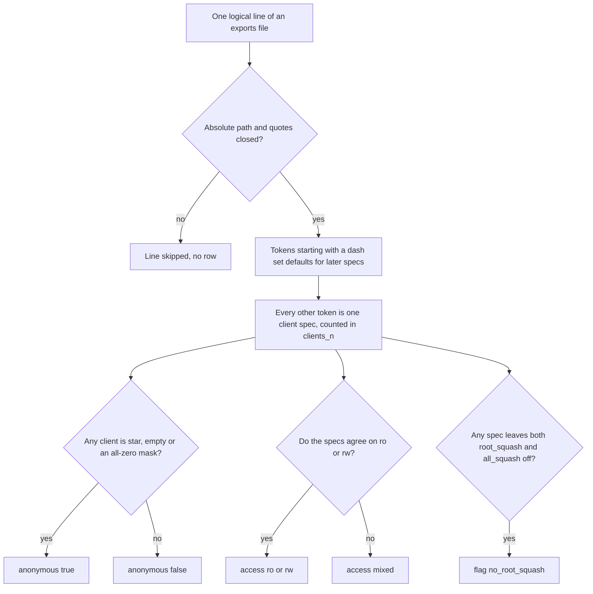

# shares

<!-- BEGIN GENERATED: plugin-doc-gen header -->
| | |
|---|---|
| **What it does** | Shares this host serves over SMB/NFS: names, paths and a few flags, never ACLs |
| **Version** | 1.0.0 |
| **Kind** | Collector · read-only · gathered (crossplatform.network.shares) |
| **Platforms** | Windows ✅ · macOS ✅ · Linux ✅ |
| **Actions** | `list` (definition `crossplatform.network.shares`) |
| **Security** | securable `Infrastructure` · operation Read · risk Low · dispatch ReadOnly · approval gate None |
| **Roles** | execute: endpoint-admin, endpoint-operator · author: content-author |
<!-- END GENERATED -->

## How it works

`list` reports the shares this host serves over SMB and NFS: for each, the name, the path, read-only or read-write, whether anonymous access is configured, and a few flags. It changes nothing. On Linux it reads three kinds of local configuration file, so the answer is what the files declare, not what `nfsd` or `smbd` is serving right now; on macOS it reads what the system records as share points plus `/etc/exports`, again as written rather than live (below); on Windows it asks the Server service what it publishes now (below). Rows come in a fixed order. A `status` row comes first and says whether the read was complete. One `source` row follows for each source the leg knows about (`exports`, `exports_d`, `smb_conf` on Linux; `exports`, `sharing` on macOS; `netshareenum` on Windows), saying `read`, `absent`, `refused` or `failed`, so zero `share` rows is never an ambiguous empty success. The `share` rows come last. On Linux the leg reads `/etc/exports`, the `/etc/exports.d/*.exports` snippets and `/etc/samba/smb.conf` with bounded reads that never follow a symlink at the final path component (a symlinked ancestor directory is followed), under one row and byte budget for the whole listing. Exports lines follow the `exports(5)` grammar. `smb.conf` is read the way Samba reads it in the main: lines before the first `[header]` belong to `[global]`, parameter synonyms collapse to one key so the last occurrence wins, a share that sets nothing itself inherits through its `copy =` chain, then `[global]`, then Samba's built-in defaults. One known difference is in caveat 1. Access control lists, `valid users` and NFS client host lists are never read into a row; an NFS export carries a client count and an anonymous flag only. These rows are not the mapped-drive and session observations `tar` records for `mapdrive`, which track mapped shares in both directions (shares this host maps and sessions into its own shares), not the exports it is configured to offer.

On Windows the leg asks the Server service what it publishes now, through `NetShareEnum` level 2 (name, path, type) from `netapi32`, a page at a time: each call asks for at most 64 KiB (never `MAX_PREFERRED_LENGTH`; the size is a request, not a guarantee), one page is converted at a time and freed before the next, and every entry is charged against the same row and byte budget before it is kept, so memory held is the page the service returns plus the budgeted rows. That bounds memory, not time: the `NetShareEnum` call itself has no deadline, so a wedged (not stopped) Server service holds the dispatch worker until it answers (#3925). Each Windows row carries exactly one kind flag (`disk`, `print`, `device`, `ipc`, or `other` for any other type), then `special` for an administrative share (`ADMIN$`, `C$`, `IPC$`: flagged, never hidden) or `hidden` for any other share whose name ends in `$` (the Windows convention for a share that is not browsable, the meaning `hidden` carries on Linux for `browseable = no`), and `temporary` when the share is temporary. Access and anonymous are `-`: share-level permissions are not read, and neither are ACLs (level 502) or the share remark. If level 2 is refused with `ERROR_ACCESS_DENIED` the leg retries level 1 (names and kind, no paths) and reports `constrained`; refused at both levels is `permission_denied`. A stopped Server service is reported as `unsupported` with a named token, never as an empty list. Any other failure on any page, or an enumeration that returns `ERROR_MORE_DATA` without a share it has not already returned, discards the rows gathered so far: a partial list is never reported as a complete one. The enumeration is not a snapshot: the service pages by position in its live share list, so a share created or deleted while the leg is reading can be skipped or repeated. A share name returned twice (compared without regard to ASCII case) is kept once, and a multi-page enumeration that ends with a different number of shares than the first page announced is `constrained` with `windows:shares:netshareenum:inconsistent_drain`, the rows kept.

On macOS the leg reads two sources, `/etc/exports` first. `/etc/exports` is a bounded no-follow read (256 KiB, never following a symlink at the final path component) in Apple's BSD `exports(5)` grammar as `mountd` reads it, not the Linux one: entries are joined as `get_export_entry` joins them (a trailing backslash appends the next physical line directly, with no separator), a field starting `#` makes the entry a comment, fields are bounded as `nextfield` bounds them (single or double quotes, a backslash makes the next character literal), `-` options are comma-separated lists whose last item may take the next field as its value (`-maproot root`), and every path on a line is one row. Hosts and netgroups are counted (`clients_<n>`), never listed. A line `mountd` rejects (an option or host before any path, a path after an option or host, a repeated `-network` or `-mask`, a `-network` together with a host, a `-mask` without a `-network`, `-maproot` (or `-root`, `-r`) together with `-mapall`, a malformed network or mask value, mismatched network and mask families) yields no row and no token, as the Linux parser skips a malformed line. A network or mask given as a name is classified by shape and never resolved (the plugin does no resolver I/O), so a name `mountd` could not resolve still yields a row with one client. `no_root_squash` follows the last `-maproot` / `-mapall` / `-root` / `-r` credential, as `mountd` applies the last one, and a numeric user counts as root when `atoi` reads it as 0 (`0`, `00`, `0x0`, `-0`), with no account lookup. A carriage return is not trimmed from a line end, as `mountd` keeps it in the last field, so a CRLF file reads as paths ending in a CR. The anonymous flag follows `mountd` and the kernel rather than the Linux rule: an export with no host and no network is open to everyone, an IPv6 `-network` with no `-mask` or an all-zero one is too (`mountd` zero-fills an absent IPv6 mask and the kernel treats a zero mask as the default entry that matches every address), and an IPv4 `-network` never is, because a zero or absent IPv4 mask is replaced by the classful mask (`-network 0.0.0.0` exports to `0.0.0.0/8`). The grammar is read from Apple's open `mountd.c` (`get_export_entry`, `nextfield`, `clean_pathname`, `do_opt`, `get_net`, `do_export`) and `nfs_subs.c` (`nfsrv_hang_addrlist`, `nfsrv_export_lookup`). The share points come from `/usr/sbin/sharing -l -f json`, run through the bounded subprocess runner (absolute argv, no shell, no PATH search, a 5 second deadline that kills the child's process group, a 2 MiB output cap): there is no public API for share-point records and the directory-service node behind them is never read directly. Each record becomes one SMB row: its `smb_name` (else the record key), its path, `ro` or `rw`, and the guest-access flag; a record with SMB sharing switched off is listed and flagged `unavailable`, never hidden, and one that requires SMB encryption is flagged `sealed`. AFP share points are not reported, and ACLs, permissions and remarks are never read. A tool that cannot start, hits its deadline, is cancelled or killed, is cut at the output cap, exits nonzero (unless it printed its exact no-records text) or prints anything other than a JSON object is a `failed` `sharing` source with a named token: the listing is `constrained`, the `/etc/exports` rows are kept, and both source rows are still emitted. The bounds are stated precisely: the tool is time-bounded and byte-bounded; the `/etc/exports` read is byte-capped but has no deadline of its own, like every other plain file read the plugins make (#4875), on a system-volume path.



### What you can decide with it

| Question | Where the answer is | What to know |
|---|---|---|
| Which SMB shares does this host offer, and where do they point? | `share` rows with proto `smb`: name, path, `ro`/`rw` | Includes `[homes]`, `[printers]` and `print$` (flagged `special`); a `hidden` flag means `browseable = no`. On macOS the rows come from `sharing -l`: `unavailable` means SMB sharing is switched off for that share point and `sealed` that SMB encryption is required |
| Which NFS paths does this host export, and to how many clients? | `share` rows with proto `nfs`: path, `ro`/`rw`/`mixed`, `clients_<n>` | Client names are never listed, only the count; `mixed` means the client specs disagree on ro or rw |
| Does anything look open to everyone? | The anonymous column | NFS on Linux: any client spec of `*`, an empty client or an all-zero network mask. NFS on macOS: an export with no host and no network, or an IPv6 network with no or an all-zero mask (an IPv4 network never counts, see How it works). SMB: only `guest ok = yes` as written; whether a client can really connect as guest also depends on `map to guest` and `security` |
| Is root exposed on an NFS export? | The `no_root_squash` flag | Set when neither `root_squash` nor `all_squash` is in effect for some client spec |
| Is the picture complete? | The leading `status` row and the `source` rows | Any `constrained` token names what was not read (a Samba registry backend, an `include =`, usershares, a refused or oversized file) |

On Windows an `unsupported` status row and result status `UNAVAILABLE` mean the Server service is stopped or its RPC endpoint does not answer. On macOS a `supported` result with no `share` rows means `sharing -l` listed no share point and `/etc/exports` declares none; a tool that failed or answered unrecognisably is `constrained` with a token, never that. On Linux a `supported` result with no `share` rows means the three files declare no shares; it does not rule out exports added at runtime without touching `/etc/exports`, a Samba instance started with another config file, or a share kept in Samba's registry (the last is flagged). A host with Samba installed commonly reports `constrained` with `usershares_not_read`, because usershares are never listed and the default usershares directory (`/var/lib/samba/usershares`) exists; setting `usershare max shares = 0` in `smb.conf` states they are off and returns `OK`.

### Diagrams

#### How a Samba share value is resolved



Synonyms such as `writable`, `public` and `browsable` are folded into one key first, so the last occurrence wins as in Samba. The `[global]` lookup is against the whole merged file, which is the one place this plugin differs from Samba (caveat 1).

#### How an NFS export line becomes a row



A spec's own options override the line defaults, and each `sec=` flavour inside a spec is judged separately. A line with no client at all is treated as open to everyone with `clients_0`.

## OS capability

<!-- BEGIN GENERATED: plugin-doc-gen capability -->
| Action | Windows | macOS | Linux |
|---|---|---|---|
| `list` | ✅ supported · rung 1 · NetShareEnum level 2 (netapi32); level 1 (names, no paths) when level 2 is refused | ✅ supported · rung 2 · /usr/sbin/sharing -l -f json through the bounded runner (5 s deadline, no shell) plus a byte-capped no-follow read of /etc/exports (BSD exports(5) grammar as mountd parses it) | ✅ supported · rung 1 · bounded no-follow reads of /etc/exports, /etc/exports.d/*.exports and /etc/samba/smb.conf (pure parsers); one lstat of the usershares directory |

**Declared limits per leg** (descriptor fallback text, verbatim):

- **`list` / Windows** — live Server-service state, not the LanmanServer registry: a stopped Server service is unavailable (windows:shares:netshareenum:server_not_started, or windows:shares:netshareenum:server_unavailable when its RPC endpoint does not answer); STYPE_SPECIAL shares (ADMIN$, C$, IPC$) are flagged special, never hidden, and any other share whose name ends in $ is flagged hidden; access and anonymous are -, ACLs and level 502 are never read
- **`list` / macOS** — share points as recorded, not live smbd state (a record with SMB sharing off is flagged unavailable, SMB encryption required is flagged sealed; AFP is not reported); /etc/exports as written, not live nfsd state, hosts counted never listed, an IPv6 network with no or a zero mask is anonymous as the kernel treats it, an IPv4 network never is (classful mask); a tool that cannot start, times out, exits nonzero or prints anything but a JSON object or its no-records text fails the sharing source with a named token
- **`list` / Linux** — configured shares as written, not live nfsd/smbd state; Samba registry backend, include= files and usershares are not read (constrained token); a symlinked config file or exports.d is refused
<!-- END GENERATED -->

## Privileges and prerequisites

| OS | Runs as | Extra grant needed | Measured | If the read is refused |
|---|---|---|---|---|
| Windows | agent service, LocalSystem today (`#1442`; the intended identity is `NT SERVICE\YuzuAgent`). For a non-interactive caller the `NetShareEnum` contract requires Administrators, Power Users, Print Operators or Server Operators at level 2 (on Windows Server 2022: Administrators, Access Control Assistance Operators or Server Operators); level 1 needs no membership | None for LocalSystem (an Administrator), so level 2 answers. Under the intended `NT SERVICE\YuzuAgent` identity (non-interactive, in none of those groups) the contract admits only level 1, so every host would answer names and kind only, `CONSTRAINED` with `windows:shares:netshareenum:level2_permission_denied` and paths `-`; `scripts/install-agent-user.ps1` grants nothing for this and `-Check` does not verify it; level 2 under that identity would need it to be a member of Administrators or Power Users (per the contract: on Windows Server 2022 it lists Administrators or Access Control Assistance Operators instead, and Server Operators exists only on a domain controller; not measured here) | Measured 2026-10-27 on kingsley (bare-metal Windows 11) as LocalSystem (elevated): level 2 answers, and ADMIN$, C$ and IPC$ are flagged special. Still unmeasured: the level-1 fallback under a non-admin service identity and the exact status of a stopped Server service (caveat 3) | `CONSTRAINED` with `windows:shares:netshareenum:level2_permission_denied` and names only, when level 2 returns `ERROR_ACCESS_DENIED` and level 1 answers; `PERMISSION_DENIED` / partial with `windows:shares:netshareenum:permission_denied` when both are refused |
| macOS | agent daemon, root today (the LaunchDaemon; `#1455` tracks narrowing it) | None: `/etc/exports` is world-readable and `sharing -l` reads the local OpenDirectory node for a normal user | Measured 2026-10-29 on braga (bare-metal macOS 26.6.2 arm64) as uid 501 through `plugin-capture`, not as the root LaunchDaemon; root can only widen what `sharing -l` reads (caveat 3) | `PERMISSION_DENIED` / partial with `macos:shares:exports:permission_denied` when `/etc/exports` was refused and `sharing` was not read, `CONSTRAINED` when it was; a `sharing` failure is `CONSTRAINED` with `macos:shares:sharing:<reason>` |
| Linux | agent daemon, dedicated unprivileged account (`yuzu-agent` on the packaged unit), never root by design (`docs/agent-privilege-model.md`) | None: `/etc/exports`, `/etc/exports.d/*.exports` and `/etc/samba/smb.conf` are world-readable (0644) on stock packages. A site that tightens them can grant read access to the agent account, or accept the token | Not measured on the `yuzu-agent` account; the sample was captured as `euid 0` in a container | `PERMISSION_DENIED` / partial with `linux:shares:<source>:permission_denied` when a source was refused and none was read, `CONSTRAINED` when another source was read; the source row says `refused` |

The only subprocess is the macOS leg's `/usr/sbin/sharing -l -f json` (a compile-time literal argv through the bounded runner, no shell interpreter; sink `shares/run_macos#1`); otherwise no subprocess, no shell interpreter and no network use beyond the local Server-service RPC the Windows API makes. The Linux and macOS legs read files in process, never following a symlink at the final path component (a symlinked ancestor directory is followed), and probes the Samba usershares directory with one `lstat` (it is never listed).

## Data contract

### Inputs

<!-- BEGIN GENERATED: plugin-doc-gen inputs -->
The action takes no parameters.
<!-- END GENERATED -->

### Outputs

Every row is pipe-delimited; field 0 is the row kind, `-` is an absent value, and the first row is always `status|list|<supported\|constrained\|permission_denied\|unsupported>|<reason or ->`. A `source|<exports\|exports_d\|smb_conf\|netshareenum\|sharing>|<read\|absent\|refused\|failed>|<share count or ->` row follows for every source the leg knows about (Linux three, macOS two, `exports` and `sharing`, Windows one, `netshareenum`; `absent` is a state, not a failure). Each share is `share|<nfs\|smb>|<name or ->|<path or ->|<ro\|rw\|mixed\|->|<true\|false\|->|<flags or ->|<source>`: the name is the SMB share name and `-` for NFS (identified by path), `mixed` means clients, security flavours, or a Samba read/write list disagree with the share default, and the flags are a closed set: `hidden`, `unavailable` (Samba `available = no`; macOS: SMB sharing switched off for a share point, or an NFS export marked `-offline`), `special` (Samba `[homes]`, `[printers]`, `[print$]`), `sealed` (macOS: SMB encryption required), `no_root_squash` (root is not squashed: no `root_squash` or `all_squash` in effect) and `clients_<n>`; Windows rows add the kind (`disk`, `print`, `device`, `ipc`, `other`, exactly one per row) and `temporary`, use `special` for `STYPE_SPECIAL` administrative shares and `hidden` for any other share whose name ends in `$`. Every free field is scrubbed of NUL and invalid UTF-8, pipe-escaped, and has a backslash folded to `/` and CR or LF folded to a space (so a Windows path reads `C:/Users`).

<!-- BEGIN GENERATED: plugin-doc-gen outputs -->
**`crossplatform.network.shares` — `row_kind|field_1|field_2|field_3|field_4|field_5|field_6|field_7`**

| Field | Type | Values | Available | Example | Description |
|---|---|---|---|---|---|
| `row_kind` | string | `status` `source` `share` | Windows, Linux, macOS | `share` | Row shape discriminator (field 0). Values: status, source, share. |
| `field_1` | string | - | Windows, Linux, macOS | `smb` | status: the literal "list". source: exports, exports_d, smb_conf, netshareenum or sharing. share: nfs or smb. |
| `field_2` | string | - | Windows, Linux, macOS | `supported` | status: supported, constrained, permission_denied or unsupported (a stopped Windows Server service, and a leg that threw). source: read, absent, refused or failed (absent is a state, not a failure). share: the SMB share name, or "-" for NFS (identified by path). |
| `field_3` | string | - | Windows, Linux, macOS | `-` | status: reason token(s) for a non-supported read, "-" when complete; tokens look like linux:shares:exports:permission_denied, linux:shares:smb_conf:registry_backend, windows:shares:netshareenum:server_not_started, macos:shares:sharing:exit_nonzero, macos:shares:exports:symlink_refused. source: the number of shares read from it, "-" unless it was read. share: the exported path ("-" when none is set). |
| `field_4` | string | - | Linux, macOS | `rw` | share: ro, rw, mixed (clients, security flavours or a Samba read/write list disagree with the share default) or "-" when unknown. Windows rows carry `-`: share-level permissions are not read. Not used by the other kinds. |
| `field_5` | string | - | Linux, macOS | `false` | share: true when any client may use it (guest, `*`, a wildcard made only of `*`/`?`, a network with an all-zero mask, on macOS an export with no host and no network or an IPv6 network with no or a zero mask), false when not, "-" when unknown. For SMB this reflects `guest ok` as written; whether a client can actually connect as guest also depends on global authentication settings (`map to guest`, `security`). Windows rows carry `-`: share-level permissions are not read. Not used by the other kinds. |
| `field_6` | string | - | Windows, Linux, macOS | `clients_2` | share: comma-separated flags from hidden, unavailable (Samba available = no; macOS SMB sharing off, or an NFS export marked offline), special, sealed (macOS: SMB encryption required), no_root_squash, clients_<n> (the NFS client count; hosts are never listed), or "-"; on Windows exactly one kind (disk, print, device, ipc or other), then special (STYPE_SPECIAL) or hidden (a share that is not special and whose name ends in $), then temporary when set. Not used by the other kinds. |
| `field_7` | string | - | Windows, Linux, macOS | `exports` | share: the source it came from (exports, exports_d, smb_conf, netshareenum or sharing). Not used by the other kinds. |
<!-- END GENERATED -->

### Result status

`list` sets `OK`/`FULL` when every source that exists was read in full, including a host that serves nothing. A source that could not be read for a reason other than being absent makes the result `CONSTRAINED`/`PARTIAL` (or `PERMISSION_DENIED`/`PARTIAL` when a source was refused and none was read), with the same tokens in the leading `status` row. No exception crosses the plugin boundary: a leg that throws is reported as an `unsupported` status row and `UNAVAILABLE` (the last status row wins if the leg had already written one).

| Status | Completeness | Provenance | When |
|---|---|---|---|
| `OK` | full | (empty) | every source that exists was read in full; no shares is `supported` with `absent` or `read\|0` source rows |
| `CONSTRAINED` | partial | `linux:shares:<exports\|exports_d\|smb_conf>:<errno token>`, `linux:shares:<source>:symlink_refused`, `linux:shares:<source>:not_regular`, `linux:shares:<source>:oversized`, `linux:shares:<source>:invalid_bytes`, `linux:shares:exports_d:not_a_directory` | Linux: a source could not be read (a symlinked file or `exports.d` (a NixOS-style `/etc`) is refused rather than followed, a FIFO, a file over 256 KiB, a NUL byte, an I/O error; a containerised agent reads the image's `/etc`, not the host's); its source row says `failed` and the other sources are still reported. A refusal (EACCES/EPERM) is `refused`, not `failed` (the `PERMISSION_DENIED` row below) |
| `CONSTRAINED` | partial | `linux:shares:exports_d:too_many` | Linux: more than 64 `exports.d` snippets or 4096 directory entries; the source row stays `read` with the count of shares read, and the excess snippets are cut |
| `CONSTRAINED` | partial | `linux:shares:smb_conf:registry_backend`, `linux:shares:smb_conf:include_unresolved`, `linux:shares:smb_conf:copy_unresolved`, `linux:shares:smb_conf:usershares_not_read` | Linux: the Samba shares are incomplete by design: a registry backend (`config backend = registry`, `registry shares = yes`), a live `include =` or `config file =`, a `copy =` target that is missing, names `[global]`, is cyclic, over 255 bytes, deeper than 8, defined after the copying share or re-opened after it (Samba snapshots a copy target where the directive stands; any `copy` line counts, not only the last, and a flagged copying share is still listed, with inherited values that may differ from what Samba applies), or usershares (configured, or the default usershares directory exists and `usershare max shares` is not `0`). A stock Debian host has a compiled-in usershare default the file does not show, so with `usershare max shares` unset and the directory present it lands here, because usershares may be in use and are not listed; `usershare max shares = 0` states they are off and gives `OK`, whatever `usershare path` says |
| `CONSTRAINED` | partial | `linux:shares:smb_conf:usershares_unreadable` | Linux: `usershare max shares` is unset and an `lstat` of the default usershares directory failed for a reason other than absence (for example a permission error), so whether usershares are in use is unknown |
| `CONSTRAINED` | partial | `linux:shares:row_cap`, `linux:shares:field_oversized` | more than 512 shares or 1 MiB of share text (name, path and flags, plus a fixed 64-byte charge per share) before pipe-escaping across all sources (the listing stops there; the wire can be up to about twice that), or a name or path over 4096 bytes was cut |
| `PERMISSION_DENIED` | partial | `linux:shares:<source>:permission_denied` | a source was refused and no source was read; accumulated constrained tokens may follow, comma-joined |
| `CONSTRAINED` | partial | `windows:shares:netshareenum:level2_permission_denied` | Windows: level 2 returned `ERROR_ACCESS_DENIED` and level 1 answered; names and kinds only, every path `-` |
| `CONSTRAINED` | partial | `windows:shares:netshareenum:status_<n>`, `windows:shares:netshareenum:no_progress` | Windows: a page failed with another `NET_API_STATUS` (`<n>`, decimal), or `ERROR_MORE_DATA` arrived with no share not already returned (no entries, or only names seen before); the source row says `failed` and no share rows are reported, even if earlier pages were read |
| `CONSTRAINED` | partial | `windows:shares:netshareenum:inconsistent_drain` | Windows: a multi-page enumeration finished with a different number of shares than the first page announced, so a share created or deleted while it ran may be missing or repeated, or the first page's `totalentries` (documented as a hint, not a guarantee) disagreed with the count read; the rows are kept and the source row says `read` with the count |
| `CONSTRAINED` | partial | `windows:shares:row_cap`, `windows:shares:field_oversized` | Windows: the same budget as Linux (512 shares, 1 MiB, 4096 bytes per name or path); the listing stops at the first share the budget refuses |
| `PERMISSION_DENIED` | partial | `windows:shares:netshareenum:permission_denied` | Windows: `ERROR_ACCESS_DENIED` at level 2 and again at level 1; source row `refused` |
| `UNAVAILABLE` | unknown | `windows:shares:netshareenum:server_not_started` / `windows:shares:netshareenum:server_unavailable` | Windows: the Server service is stopped (`NERR_ServerNotStarted`) or its RPC endpoint does not answer (`RPC_S_SERVER_UNAVAILABLE`, `RPC_S_UNKNOWN_IF`); one `unsupported` status row and a `failed` source row, never an empty list |
| `CONSTRAINED` | partial | `macos:shares:sharing:spawn_error`, `macos:shares:sharing:deadline`, `macos:shares:sharing:cancelled`, `macos:shares:sharing:signaled`, `macos:shares:sharing:line_limit` | macOS: `/usr/sbin/sharing` could not be started, was killed at its 5 second deadline, was cancelled, died by signal or was line-limited. The shared runner classifier names these `subprocess_runner:spawn_error`, `subprocess_runner:deadline`, `subprocess_runner:cancelled`, `subprocess_runner:signaled` and `subprocess_runner:line_limit`; this leg reports only the last segment under its own `macos:shares:sharing:` prefix and never puts the `subprocess_runner:` form on the wire. The `sharing` source row says `failed`, the `/etc/exports` rows are kept |
| `CONSTRAINED` | partial | `macos:shares:sharing:output_truncated`, `macos:shares:sharing:exit_nonzero`, `macos:shares:sharing:unrecognised_output` | macOS: the tool's output hit the 2 MiB cap, it exited nonzero (its exact no-records text is read at any exit code and is `supported` with `read\|0`), or it printed anything but a JSON object, including empty or whitespace-only text (an empty-host capture is not yet measured, caveat 4); the `sharing` source row says `failed` |
| `CONSTRAINED` | partial | `macos:shares:sharing:malformed_records_<n>` | macOS: `<n>` records were not an object with a string `path`; they are skipped, their siblings are kept and the `sharing` source row says `read` with the kept count |
| `CONSTRAINED` | partial | `macos:shares:exports:<errno token>`, `macos:shares:exports:symlink_refused`, `macos:shares:exports:not_regular`, `macos:shares:exports:oversized`, `macos:shares:exports:invalid_bytes` | macOS: `/etc/exports` could not be read for a reason other than absence or refusal (a symlink is refused rather than followed, a FIFO, a file over 256 KiB, a NUL byte, an I/O error); the `exports` source row says `failed` and `sharing` is still reported |
| `CONSTRAINED` | partial | `macos:shares:row_cap`, `macos:shares:field_oversized` | macOS: the same single budget as Linux (512 shares, 1 MiB, 4096 bytes per name or path) spans both sources, `/etc/exports` charged first |
| `PERMISSION_DENIED` | partial | `macos:shares:exports:permission_denied` | macOS: `/etc/exports` was refused and the `sharing` source was not read (it is `CONSTRAINED` with the same token when `sharing` was read) |
| `UNAVAILABLE` | unknown | `windows:leg:exception` / `linux:leg:exception` / `macos:leg:exception` | a leg threw: an `unsupported` status row, reported instead of unwinding across the plugin boundary |

### Where the data goes

- **Instruction result.** Rows travel over the agent's mTLS gRPC channel as the command response and land in the ResponseStore, queryable at `/api/responses/{id}`. `list` is also a gathered definition (`crossplatform.network.shares`, 3600s TTL).
- **Not consumed by** daily-sync, TAR, DEX, or metrics.
- **Default on, and how to turn it off.** The plugin is on by default; disable it with the generic per-plugin kill switch (`PUT /api/v1/plugin-config/shares/kill-switch`) or by omitting it from `--plugin-allowlist`.
- **Sensitivity.** Share names and paths can embed account names: Samba `[homes]`, per-user shares and Windows user-profile paths. Treat the result as sensitive; dispatch is gated at `Infrastructure:Read` and the stored result is readable by `Response:Read` holders, as for every plugin. No ACLs, `valid users` lists or NFS client host lists are read into a row; NFS clients are a count and an anonymous flag.
- **Siblings:** `tar` `mapdrive` (the mapped drives and sessions this host makes and receives, not the exports it offers) and `network_config`.

## Sample output

The macOS capture was taken natively on braga (bare-metal macOS 26.6.2 arm64) through the agent's `LocalDispatcher` as a normal user (uid 501), not as the root LaunchDaemon; the host has one share point and no `/etc/exports`, so the sample shows `exports` as `absent` and one SMB row, with the share name and home path redacted (`jsmith`) and the redaction noted in the stamp. The Windows capture was taken natively on kingsley (bare-metal Windows 11) through the agent's `LocalDispatcher` as LocalSystem (elevated), the identity the agent service runs as today; the host publishes only the three administrative shares, so the sample shows ADMIN$, C$ and IPC$ flagged `special` and nothing else. Nothing needed redacting. The Linux capture was taken in the Debian 13 agent build container with `samba-common` and `nfs-kernel-server` installed and NFS and Samba shares seeded under `/srv`; the stock package files (`/etc/exports`, `/etc/samba/smb.conf`) are parser test fixtures (with trailing whitespace stripped), and the three seeded inputs (`/etc/exports`, `/etc/exports.d/archive.exports`, `/etc/samba/smb.conf`) are committed verbatim as fixtures that assert the five `share` rows below. The capture reports `OK` because that container has no default usershares directory; a host where `/var/lib/samba/usershares` exists and `usershare max shares` is unset reports `CONSTRAINED` with `linux:shares:smb_conf:usershares_not_read`.

<!-- BEGIN GENERATED: plugin-doc-gen samples -->
**Windows** — captured: windows Windows 10.0.26200 x86_64 · bare-metal · 2026-10-28 · LocalSystem (elevated) · leg-hash 9e4e83a528e3

```
== action=list
status|list|supported|-
source|netshareenum|read|3
share|smb|ADMIN$|C:/Windows|-|-|disk,special|netshareenum
share|smb|C$|C:/|-|-|disk,special|netshareenum
share|smb|IPC$|-|-|-|ipc,special|netshareenum
[result_status] OK / FULL
```

**macOS** — captured: macos macOS 26.6.2 arm64 · bare-metal · 2026-10-29 · euid 501 (share name and home path redacted) · leg-hash 9e4e83a528e3

```
== action=list
status|list|supported|-
source|exports|absent|-
source|sharing|read|1
share|smb|J Smith’s Public Folder|/Users/jsmith/Public|rw|true|-|sharing
[result_status] OK / FULL
```

**Linux** — captured: linux Debian GNU/Linux 13 (trixie) aarch64 · container · 2026-10-12 · euid 0 · leg-hash 9e4e83a528e3

```
== action=list
status|list|supported|-
source|exports|read|2
source|exports_d|read|1
source|smb_conf|read|2
share|nfs|-|/srv/nfs/public|ro|true|clients_1|exports
share|nfs|-|/srv/nfs/projects|mixed|false|no_root_squash,clients_2|exports
share|nfs|-|/srv/nfs/archive|ro|true|clients_1|exports_d
share|smb|public|/srv/samba/public|ro|true|-|smb_conf
share|smb|projects|/srv/samba/projects|rw|false|hidden|smb_conf
[result_status] OK / FULL
```
<!-- END GENERATED -->

## Caveats and known gaps

1. **Configured, not live; some Samba scope is not read.** Linux reports what the files say, not whether `nfsd` or `smbd` runs or what a client sees. The Samba registry backend, `include =` files and usershares are reported as `constrained` tokens, never as a wrong share list, and `[global]` parameters written after a share section apply to it here but not in Samba.
2. **The access flags are approximations of the written configuration.** The SMB anonymous flag reflects `guest ok` alone, and `mixed` uses a read or write list only as a presence test, never reading its names. Share names and paths can identify people (Samba `[homes]` and per-user shares), so dispatch is gated at `Infrastructure:Read`.
3. **Windows is measured under LocalSystem only; macOS is measured as a normal user.** The Windows leg reads the live state of the Server service through `NetShareEnum`, not the `LanmanServer` registry configuration, and it never reads level 502 (ACLs) or the share remark. It was run natively on kingsley on 2026-10-27 as LocalSystem (elevated): level 2 answered and the administrative shares were flagged `special`. Still unmeasured: the level-1 fallback under a non-admin service identity (the contract predicts it under `NT SERVICE\YuzuAgent`) and the exact status of a stopped Server service, which are taken from the API contract. Paging has not been exercised: the capture host publishes three shares, so no enumeration spanning more than one page has been observed, and the 64 KiB size asked for is a request the service may not honour. `totalentries` is documented as a hint, so `inconsistent_drain` on a stable multi-page host is an unmeasured false-positive risk (the rows are kept; only the status is `constrained`). The macOS leg was captured on braga on 2026-10-29 as uid 501 through `plugin-capture`; the agent runs as root as a LaunchDaemon today (`#1455`), and `sharing -l` reads the local OpenDirectory node and answered unprivileged, so root can only widen it. The JSON shape (an object keyed by record name with integer `smb_*` flags) is measured on macOS 26.6.2 only; older releases may differ (a flag that is not an integer is ignored; a record that is not an object with a string `path` is malformed and skipped, siblings kept). The `/etc/exports` grammar is derived from Apple's `mountd` source, not from a live `nfsd`: braga has no `/etc/exports`, so only the `absent` arm is a native capture and every populated shape is a test reconstruction. A line `mountd` would reject is skipped silently (no token), which is a disclosed limit. A `-network` or `-mask` name is never resolved: `mountd` rejects a name `getnetbyname` cannot resolve, the plugin reports it as one client, so a stale network name still yields a row for an export `mountd` does not serve. Likewise a `-maproot` user that is not `root` and not a number is not looked up, so an account other than `root` that is uid 0 is not seen.
4. **macOS: AFP and the empty host.** AFP share points are not reported (the `sharing` tool's AFP flags are documented obsolete). The text `No share point records.` that `sharing -l` prints when there is none is taken from the tool's string table, not observed live (removing braga's only share point would change the host), so a host with no share point may report `constrained` with `macos:shares:sharing:unrecognised_output` until the first empty-host capture widens what is recognised; empty or whitespace-only output is deliberately a named failure rather than an empty success. Output that is not well-formed UTF-8 (for example a share name with an invalid byte) fails the whole `sharing` source with `macos:shares:sharing:unrecognised_output` rather than yielding partial rows, so the valid share points beside it are not reported either. The `/etc/exports` read has no deadline of its own (#4875).


## Source and tests

<!-- BEGIN GENERATED: plugin-doc-gen source -->
- Plugin: `agents/plugins/shares/src/shares_legs.hpp` · `agents/plugins/shares/src/shares_linux.cpp` · `agents/plugins/shares/src/shares_macos.cpp` · `agents/plugins/shares/src/shares_parsers.hpp` · `agents/plugins/shares/src/shares_plugin.cpp` · `agents/plugins/shares/src/shares_posix_fs.hpp` · `agents/plugins/shares/src/shares_win.cpp`
- Definitions: `content/definitions/shares.yaml`
- Capability rows: `server/core/src/capability_decls/plugin_action_catalogue_shares.hpp`
- Tests: `tests/test_shares_definition.py` · `tests/unit/test_shares_legs.cpp` · `tests/unit/test_shares_local_dispatcher.cpp` · `tests/unit/test_shares_parsers.cpp` · `tests/unit/test_shares_posix_fs.cpp`
- Privilege row: `docs/agent-privilege-model.md`
- Changelog: `changelog.d/2026-10-12-shares.added.md` · `changelog.d/2026-10-27-shares-windows-leg.added.md` · `changelog.d/2026-10-29-shares-macos-leg.added.md`
<!-- END GENERATED -->
