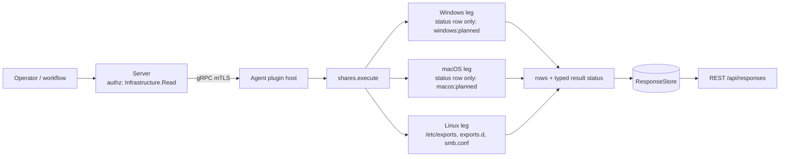

# shares

<!-- BEGIN GENERATED: plugin-doc-gen header -->
| | |
|---|---|
| **What it does** | Shares this host serves over SMB/NFS: names, paths and a few flags, never ACLs |
| **Version** | 1.0.0 |
| **Kind** | Collector · read-only · gathered (crossplatform.network.shares) |
| **Platforms** | Windows 🟡 planned · macOS 🟡 planned · Linux ✅ |
| **Actions** | `list` (definition `crossplatform.network.shares`) |
| **Security** | securable `Infrastructure` · operation Read · risk Low · dispatch ReadOnly · approval gate None |
| **Roles** | execute: endpoint-admin, endpoint-operator · author: content-author |
<!-- END GENERATED -->

## How it works

`list` reports the shares this host is configured to serve over SMB and NFS: names, paths, read-only or read-write, whether anonymous access is configured, and a few flags. For SMB the anonymous flag reflects `guest ok` as written: whether a client can actually connect as guest also depends on global authentication settings (`map to guest`, `security`). It reads local configuration files and changes nothing. The first row is always a `status` row saying whether the read was complete, then one `source` row per source the leg knows about (so zero `share` rows is never an ambiguous empty success), then the `share` rows. These are configured exports, not live `nfsd` or `smbd` state, and they are not the mapped-drive and session observations `tar` records for `mapdrive` (which track mappings this host makes and sessions against its shares). ACLs, `valid users` and NFS client host lists are never emitted: an NFS export carries a client count (`clients_<n>`) and an `anonymous` flag only.

On Linux the leg reads `/etc/exports`, the `/etc/exports.d/*.exports` snippets and `/etc/samba/smb.conf` with bounded reads that never follow a symlink at the final path component (a symlinked ancestor directory is followed), under one row and byte budget per listing. The exports files use the `exports(5)` grammar. `smb.conf` is parsed with Samba's own semantics: lines before the first `[header]` belong to `[global]`, parameter synonyms collapse to one key so the last occurrence wins, a `copy =` chain and `[global]` are consulted when a share does not set a value itself, and Samba's built-in defaults apply last. A line the parser cannot read (a UTF-8 BOM on the first line, an unterminated `[header`, a relative or option-first exports line) is skipped without a count, as `nfsd` and `testparm` reject it too.



## OS capability

<!-- BEGIN GENERATED: plugin-doc-gen capability -->
| Action | Windows | macOS | Linux |
|---|---|---|---|
| `list` | 🟡 planned · rung 1 · NetShareEnum level 2 (netapi32) | 🟡 planned · rung 2 · share-point listing plus /etc/exports (BSD syntax) | ✅ supported · rung 1 · bounded no-follow reads of /etc/exports, /etc/exports.d/*.exports and /etc/samba/smb.conf (pure parsers); one lstat of the usershares directory |

**Declared limits per leg** (descriptor fallback text, verbatim):

- **`list` / Windows** — not read yet: one unsupported status row, windows:planned
- **`list` / macOS** — not read yet: one unsupported status row, macos:planned
- **`list` / Linux** — configured shares as written, not live nfsd/smbd state; Samba registry backend, include= files and usershares are not read (constrained token); a symlinked config file or exports.d is refused
<!-- END GENERATED -->

## Privileges and prerequisites

| OS | Runs as | Extra grant needed | Measured | If the read is refused |
|---|---|---|---|---|
| Windows | n/a — the leg reads nothing (caveat 3) | n/a | n/a | n/a — the placeholder reports `unsupported` with `windows:planned` |
| macOS | n/a — the leg reads nothing (caveat 3) | n/a | n/a | n/a — the placeholder reports `unsupported` with `macos:planned` |
| Linux | agent daemon, dedicated unprivileged account (`yuzu`), never root by design (`docs/agent-privilege-model.md`) | None: `/etc/exports`, `/etc/exports.d/*.exports` and `/etc/samba/smb.conf` are world-readable (0644) on stock packages. A site that tightens them can grant read access to the agent account, or accept the token | Not measured on the `yuzu` account; see Sample output for the capture | `PERMISSION_DENIED` / partial with `linux:shares:<source>:permission_denied` when a source was refused and none was read, `CONSTRAINED` when another source was read; the source row says `refused` |

No subprocess, no shell interpreter and no network use. The Linux leg reads files in process, never following a symlink at the final path component (a symlinked ancestor directory is followed), and probes the Samba usershares directory with one `lstat` (it is never listed).

## Data contract

### Inputs

<!-- BEGIN GENERATED: plugin-doc-gen inputs -->
The action takes no parameters.
<!-- END GENERATED -->

### Outputs

Every row is pipe-delimited; field 0 is the row kind, `-` is an absent value, and the first row is always `status|list|<supported\|constrained\|permission_denied\|unsupported>|<reason or ->`. A `source|<exports\|exports_d\|smb_conf>|<read\|absent\|refused\|failed>|<share count or ->` row follows for every source the leg knows about (Linux three; the macOS and Windows placeholders answer the status row alone; `absent` is a state, not a failure). Each share is `share|<nfs\|smb>|<name or ->|<path or ->|<ro\|rw\|mixed\|->|<true\|false\|->|<flags or ->|<source>`: the name is the SMB share name and `-` for NFS (identified by path), `mixed` means clients, security flavours, or a Samba read/write list disagree with the share default, and the flags are a closed set: `hidden`, `unavailable` (Samba `available = no`), `special` (Samba `[homes]`, `[printers]`, `[print$]`), `no_root_squash` (root is not squashed: no `root_squash` or `all_squash` in effect) and `clients_<n>`. Every free field is scrubbed of NUL and invalid UTF-8 and pipe-escaped.

<!-- BEGIN GENERATED: plugin-doc-gen outputs -->
**`crossplatform.network.shares` — `row_kind|field_1|field_2|field_3|field_4|field_5|field_6|field_7`**

| Field | Type | Values | Available | Example | Description |
|---|---|---|---|---|---|
| `row_kind` | string | `status` `source` `share` | Windows, Linux, macOS | `share` | Row shape discriminator (field 0). Values: status, source, share. |
| `field_1` | string | - | Windows, Linux, macOS | `smb` | status: the literal "list". source: exports, exports_d or smb_conf. share: nfs or smb. |
| `field_2` | string | - | Windows, Linux, macOS | `supported` | status: supported, constrained, permission_denied or unsupported (the planned macOS and Windows legs, and a leg that threw). source: read, absent, refused or failed (absent is a state, not a failure). share: the SMB share name, or "-" for NFS (identified by path). |
| `field_3` | string | - | Windows, Linux, macOS | `-` | status: reason token(s) for a non-supported read, "-" when complete; tokens look like linux:shares:exports:permission_denied, linux:shares:smb_conf:registry_backend, macos:planned, windows:planned. source: the number of shares read from it, "-" unless it was read. share: the exported path ("-" when none is set). |
| `field_4` | string | - | Linux | `rw` | share: ro, rw, mixed (clients, security flavours or a Samba read/write list disagree with the share default) or "-" when unknown. Not used by the other kinds. |
| `field_5` | string | - | Linux | `false` | share: true when any client may use it (guest, `*`, a wildcard made only of `*`/`?`, or a network with an all-zero mask), false when not, "-" when unknown. For SMB this reflects `guest ok` as written; whether a client can actually connect as guest also depends on global authentication settings (`map to guest`, `security`). Not used by the other kinds. |
| `field_6` | string | - | Linux | `clients_2` | share: comma-separated flags from hidden, unavailable, special, no_root_squash, clients_<n> (the NFS client count; hosts are never listed), or "-". Not used by the other kinds. |
| `field_7` | string | - | Linux | `exports` | share: the source it came from (exports, exports_d or smb_conf). Not used by the other kinds. |
<!-- END GENERATED -->

### Result status

`list` sets `OK`/`FULL` when every source that exists was read in full, including a host that serves nothing. A source that could not be read for a reason other than being absent makes the result `CONSTRAINED`/`PARTIAL` (or `PERMISSION_DENIED`/`PARTIAL` when a source was refused and none was read), with the same tokens in the leading `status` row. No exception crosses the plugin boundary: a leg that throws is reported as an `unsupported` status row and `UNAVAILABLE` (the last status row wins if the leg had already written one).

| Status | Completeness | Provenance | When |
|---|---|---|---|
| `OK` | full | (empty) | every source that exists was read in full; no shares is `supported` with `absent` or `read\|0` source rows |
| `CONSTRAINED` | partial | `linux:shares:<exports\|exports_d\|smb_conf>:<errno token>`, `linux:shares:<source>:symlink_refused`, `linux:shares:<source>:not_regular`, `linux:shares:<source>:oversized`, `linux:shares:<source>:invalid_bytes`, `linux:shares:exports_d:not_a_directory` | Linux: a source could not be read (a symlinked file or `exports.d` (a NixOS-style `/etc`) is refused rather than followed, a FIFO, a file over 256 KiB, a NUL byte, an I/O error; a containerised agent reads the image's `/etc`, not the host's); its source row says `failed` and the other sources are still reported. A refusal (EACCES/EPERM) is `refused`, not `failed` (the `PERMISSION_DENIED` row below) |
| `CONSTRAINED` | partial | `linux:shares:exports_d:too_many` | Linux: more than 64 `exports.d` snippets or 4096 directory entries; the source row stays `read` with the count of shares read, and the excess snippets are cut |
| `CONSTRAINED` | partial | `linux:shares:smb_conf:registry_backend`, `linux:shares:smb_conf:include_unresolved`, `linux:shares:smb_conf:copy_unresolved`, `linux:shares:smb_conf:usershares_not_read` | Linux: the Samba shares are incomplete by design: a registry backend (`config backend = registry`, `registry shares = yes`), a live `include =` or `config file =`, a `copy =` target that is missing, names `[global]`, is cyclic, over 255 bytes, deeper than 8, defined after the copying share or re-opened after it (Samba snapshots a copy target where the directive stands; any `copy` line counts, not only the last, and a flagged copying share is still listed, with inherited values that may differ from what Samba applies), or usershares (configured, or the default usershares directory exists and `usershare max shares` is not `0`). A stock Debian host has a compiled-in usershare default the file does not show, so with `usershare max shares` unset and the directory present it lands here, because usershares may be in use and are not listed; `usershare max shares = 0` states they are off and gives `OK`, whatever `usershare path` says |
| `CONSTRAINED` | partial | `linux:shares:smb_conf:usershares_unreadable` | Linux: `usershare max shares` is unset and an `lstat` of the default usershares directory failed for a reason other than absence (for example a permission error), so whether usershares are in use is unknown |
| `CONSTRAINED` | partial | `linux:shares:row_cap`, `linux:shares:field_oversized` | more than 512 shares or 1 MiB of share text (name, path and flags, plus a fixed 64-byte charge per share) before pipe-escaping across all sources (the listing stops there; the wire can be up to about twice that), or a name or path over 4096 bytes was cut |
| `PERMISSION_DENIED` | partial | `linux:shares:<source>:permission_denied` | a source was refused and no source was read; accumulated constrained tokens may follow, comma-joined |
| `UNAVAILABLE` | unknown | `windows:planned` / `macos:planned` | Windows or macOS: one `status\|list\|unsupported\|<os>:planned` row (caveat 3) |
| `UNAVAILABLE` | unknown | `windows:leg:exception` / `linux:leg:exception` / `macos:leg:exception` | a leg threw: an `unsupported` status row, reported instead of unwinding across the plugin boundary |

### Where the data goes

- **Instruction result.** Rows travel over the agent's mTLS gRPC channel as the command response and land in the ResponseStore, queryable at `/api/responses/{id}`. `list` is also a gathered definition (`crossplatform.network.shares`, 3600s TTL).
- **Not consumed by** daily-sync, TAR, DEX, or metrics.
- **Default on, and how to turn it off.** The plugin is on by default; disable it with the generic per-plugin kill switch (`PUT /api/v1/plugin-config/shares/kill-switch`) or by omitting it from `--plugin-allowlist`.
- **Sensitivity.** Share names and paths can embed account names: Samba `[homes]` and per-user shares. Treat the result as sensitive; dispatch is gated at `Infrastructure:Read` and the stored result is readable by `Response:Read` holders, as for every plugin. No ACLs, `valid users` lists or NFS client host lists are read into a row; NFS clients are a count and an anonymous flag.
- **Siblings:** `tar` `mapdrive` (the mapped drives and sessions this host makes and receives, not the exports it offers) and `network_config`.

## Sample output

The Linux capture was taken in the Debian 13 agent build container with `samba-common` and `nfs-kernel-server` installed and NFS and Samba shares seeded under `/srv`; the stock package files (`/etc/exports`, `/etc/samba/smb.conf`) are parser test fixtures (with trailing whitespace stripped), and the three seeded inputs (`/etc/exports`, `/etc/exports.d/archive.exports`, `/etc/samba/smb.conf`) are committed verbatim as fixtures that assert the five `share` rows below.

<!-- BEGIN GENERATED: plugin-doc-gen samples -->
**Linux** — captured: linux Debian GNU/Linux 13 (trixie) aarch64 · container · 2026-10-12 · euid 0 · leg-hash 9e669e86fe0e

```
== action=list
status|list|supported|-
source|exports|read|2
source|exports_d|read|1
source|smb_conf|read|2
share|nfs|-|/srv/nfs/public|ro|true|clients_1|exports
share|nfs|-|/srv/nfs/projects|mixed|false|no_root_squash,clients_2|exports
share|nfs|-|/srv/nfs/archive|ro|true|clients_1|exports_d
share|smb|public|/srv/samba/public|ro|true|-|smb_conf
share|smb|projects|/srv/samba/projects|rw|false|hidden|smb_conf
[result_status] OK / FULL
```
<!-- END GENERATED -->

## Caveats and known gaps

1. **No documented customer driver.** No documented customer driver for this plugin was found (as in `mgmt_posture`'s caveat); it exists to answer what this host exposes over SMB and NFS, which no other plugin reports. Pure capability-gap reasoning.
2. **Configured, not live; some Samba scope is not read.** Linux reports what the files say, not whether `nfsd` or `smbd` runs or what a client sees. The Samba registry backend, `include =` files and usershares are reported as `constrained` tokens, never as a wrong share list. `[global]` parameters written after a share section apply to it here but not in Samba.
3. **Windows and macOS are planned.** The Windows `NetShareEnum` level-2 read, which will flag the administrative `STYPE_SPECIAL` shares (`ADMIN$`, `IPC$`, drive shares) as `special` rather than hide them, and the macOS share-point and `/etc/exports` read are not implemented; each leg reports one `unsupported` row, `windows:planned` or `macos:planned`.
4. **Names and paths can identify people.** See the sensitivity bullet: a share name or path may contain an account name, so dispatch is gated at `Infrastructure:Read` (the stored result is readable by `Response:Read` holders, as for every plugin) and the definition says so.

## Source and tests

<!-- BEGIN GENERATED: plugin-doc-gen source -->
- Plugin: `agents/plugins/shares/src/shares_legs.hpp` · `agents/plugins/shares/src/shares_linux.cpp` · `agents/plugins/shares/src/shares_macos.cpp` · `agents/plugins/shares/src/shares_parsers.hpp` · `agents/plugins/shares/src/shares_plugin.cpp` · `agents/plugins/shares/src/shares_posix_fs.hpp` · `agents/plugins/shares/src/shares_win.cpp`
- Definitions: `content/definitions/shares.yaml`
- Capability rows: `server/core/src/capability_decls/plugin_action_catalogue_shares.hpp`
- Tests: `tests/test_shares_definition.py` · `tests/unit/test_shares_legs.cpp` · `tests/unit/test_shares_local_dispatcher.cpp` · `tests/unit/test_shares_parsers.cpp` · `tests/unit/test_shares_posix_fs.cpp`
- Privilege row: `docs/agent-privilege-model.md`
- Changelog: `changelog.d/2026-10-12-shares.added.md`
<!-- END GENERATED -->
