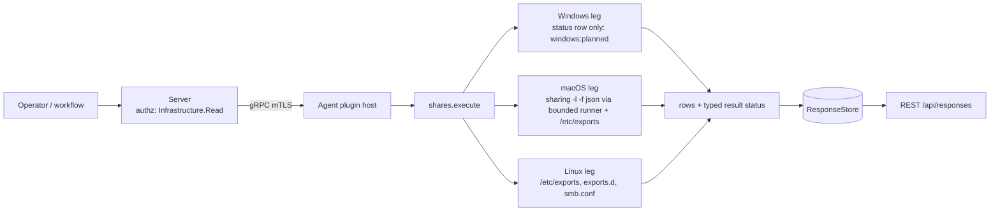

# shares

<!-- BEGIN GENERATED: plugin-doc-gen header -->
<!-- END GENERATED -->

## How it works

`list` reports the shares this host is configured to serve over SMB and NFS: names, paths, read-only or read-write, whether anonymous access is allowed, and a few flags. It reads local configuration (Linux) or asks one built-in tool and reads one file (macOS) and changes nothing. The first row is always a `status` row saying whether the read was complete, then one `source` row per source the leg knows about (so zero `share` rows is never an ambiguous empty success), then the `share` rows. These are configured exports, not live `nfsd` or `smbd` state, and they are not the mapped-drive and session observations `tar` records for `mapdrive` (which track mappings this host makes and sessions against its shares). ACLs, `valid users` and NFS client host lists are never emitted: an NFS export carries a client count (`clients_<n>`) and an `anonymous` flag only.

On Linux the leg reads `/etc/exports`, the `/etc/exports.d/*.exports` snippets and `/etc/samba/smb.conf` with bounded reads that never follow a symlink, under one row and byte budget per listing. The exports files use the `exports(5)` grammar. `smb.conf` is parsed with Samba's own semantics: parameter synonyms collapse to one key so the last occurrence wins, a `copy =` chain and `[global]` are consulted when a share does not set a value itself, and Samba's built-in defaults apply last. On macOS the leg runs `/usr/sbin/sharing -l -f json` through the bounded runner for SMB share points and reads `/etc/exports` (the BSD `exports(5)` grammar that macOS `nfsd` reads) for NFS.

## OS capability

<!-- BEGIN GENERATED: plugin-doc-gen capability -->
<!-- END GENERATED -->

## Privileges and prerequisites

| OS | Runs as | Extra grant needed | Measured | If the read is refused |
|---|---|---|---|---|
| Windows | n/a — the leg reads nothing (caveat 3) | n/a | n/a | n/a — the placeholder reports `unsupported` with `windows:planned` |
| macOS | agent daemon, default account | None for `sharing -l -f json`, which lists share points to an unprivileged caller; `/etc/exports` is read with the agent's own permissions (not measured: the reference Mac has no such file) | `sharing` measured unprivileged (euid 501) on the reference Mac, 2026-10-12; `/etc/exports` is absent on that host, so the read is untested against a real file (caveat 4) | `CONSTRAINED` / partial with a `subprocess_runner:*` or `macos:shares:*` token; `PERMISSION_DENIED` / partial only when `/etc/exports` was refused and nothing was read; `UNAVAILABLE` / unknown with `subprocess_runner:spawn_error` when the tool could not be started |
| Linux | agent daemon, dedicated unprivileged account (`yuzu`), never root by design (`docs/agent-privilege-model.md`) | None: `/etc/exports`, `/etc/exports.d/*.exports` and `/etc/samba/smb.conf` are world-readable (0644) on stock packages. A site that tightens them can grant read access to the agent account, or accept the token | Not measured on the `yuzu` account; see Sample output for the capture | `PERMISSION_DENIED` / partial with `linux:shares:<source>:permission_denied` when a source was refused and none was read, `CONSTRAINED` when another source was read; the source row says `refused` |

No shell interpreter and no network use. The macOS leg runs one fixed absolute argv through the bounded runner (sink `shares/run_macos#1`); both legs read files in process, never following a symlink, and probe the Samba usershares directory with one `lstat` (it is never listed).

## Data contract

### Inputs

<!-- BEGIN GENERATED: plugin-doc-gen inputs -->
<!-- END GENERATED -->

### Outputs

Every row is pipe-delimited; field 0 is the row kind, `-` is an absent value, and the first row is always `status|list|<supported\|constrained\|permission_denied\|unsupported>|<reason or ->`. A `source|<exports\|exports_d\|smb_conf\|sharing>|<read\|absent\|refused\|failed>|<share count or ->` row follows for every source the leg knows about (Linux three, macOS two: `exports` and `sharing`; `absent` is a state, not a failure). Each share is `share|<nfs\|smb>|<name or ->|<path or ->|<ro\|rw\|mixed\|->|<true\|false\|->|<flags or ->|<source>`: the name is the SMB share name and `-` for NFS (identified by path), `mixed` means clients or security flavours disagree, and the flags are a closed set: `hidden`, `unavailable`, `special` (Samba `[homes]`, `[printers]`, `[print$]`), `sealed`, `no_root_squash` and `clients_<n>`. Every free field is scrubbed of NUL and invalid UTF-8 and pipe-escaped.

<!-- BEGIN GENERATED: plugin-doc-gen outputs -->
<!-- END GENERATED -->

### Result status

`list` sets `OK`/`FULL` when every source that exists was read in full, including a host that serves nothing. A source that could not be read for a reason other than being absent makes the result `CONSTRAINED`/`PARTIAL` (or `PERMISSION_DENIED`/`PARTIAL` when a source was refused and none was read), with the same tokens in the leading `status` row. No exception crosses the plugin boundary: a leg that throws is reported as an `unsupported` status row and `UNAVAILABLE` (the last status row wins if the leg had already written one).

| Status | Completeness | Provenance | When |
|---|---|---|---|
| `OK` | full | (empty) | every source that exists was read in full; no shares is `supported` with `absent` or `read\|0` source rows |
| `CONSTRAINED` | partial | `linux:shares:<exports\|exports_d\|smb_conf>:<errno token>`, `linux:shares:<source>:symlink_refused`, `linux:shares:<source>:not_regular`, `linux:shares:<source>:oversized`, `linux:shares:<source>:invalid_bytes`, `linux:shares:exports_d:not_a_directory`, `linux:shares:exports_d:too_many` | Linux: a source could not be read (a symlinked file or `exports.d`, a FIFO, a file over 256 KiB, a NUL byte, an unreadable directory, more than 64 snippets or 4096 directory entries); its source row says `failed` and the other sources are still reported |
| `CONSTRAINED` | partial | `linux:shares:smb_conf:registry_backend`, `linux:shares:smb_conf:include_unresolved`, `linux:shares:smb_conf:copy_unresolved`, `linux:shares:smb_conf:usershares_not_read` | Linux: the Samba shares are incomplete by design: a registry backend (`config backend = registry`, `registry shares = yes`), a live `include =`, a `copy =` target that is missing, cyclic or deeper than 8, or usershares (configured, or the usershares directory exists) |
| `CONSTRAINED` | partial | `linux:shares:row_cap`, `macos:shares:row_cap`, `linux:shares:field_oversized`, `macos:shares:field_oversized` | more than 512 shares or 1 MiB of share text across all sources (the listing stops there), or a name or path over 4096 bytes was cut |
| `CONSTRAINED` | partial | `macos:shares:sharing:exit_nonzero`, `macos:shares:sharing:output_truncated`, `macos:shares:sharing:unrecognised_output`, `macos:shares:sharing:malformed_records:<n>`, `macos:shares:exports:<cause>` | macOS: `sharing` exited nonzero, its output was truncated or was not a JSON object, a record had no string `path` (the valid ones are still emitted), or `/etc/exports` could not be read (same causes as Linux) |
| `CONSTRAINED` | partial | `subprocess_runner:deadline`, `subprocess_runner:cancelled`, `subprocess_runner:signaled`, `subprocess_runner:line_limit`, `subprocess_runner:spawn_error` | macOS: `sharing` ran but timed out, was cancelled, was killed by a signal or hit the 8192-line cap, or (`spawn_error`) `/usr/sbin/sharing` could not be started; `/etc/exports` is still read; `source\|sharing\|failed` |
| `PERMISSION_DENIED` | partial | `linux:shares:<source>:permission_denied`, `macos:shares:exports:permission_denied` | a source was refused and no source was read; accumulated constrained tokens may follow, comma-joined |
| `UNAVAILABLE` | unknown | `windows:planned` | Windows: one `status\|list\|unsupported\|windows:planned` row (caveat 3) |
| `UNAVAILABLE` | unknown | `windows:leg:exception` / `linux:leg:exception` / `macos:leg:exception` | a leg threw: an `unsupported` status row, reported instead of unwinding across the plugin boundary |

### Where the data goes

- **Instruction result.** Rows travel over the agent's mTLS gRPC channel as the command response and land in the ResponseStore, queryable at `/api/responses/{id}`. `list` is also a gathered definition (`crossplatform.network.shares`, 3600s TTL).
- **Not consumed by** daily-sync, TAR, DEX, or metrics.
- **Sensitivity.** Share names and paths can embed account names: Samba `[homes]` and per-user shares, macOS record names such as "<Name>'s Public Folder" and `/Users/<name>/Public`. Treat the result as sensitive; it is gated at `Infrastructure:Read`. No ACLs, `valid users` lists or NFS client host lists are read into a row; NFS clients are a count and an anonymous flag.
- **Siblings:** `tar` `mapdrive` (the mapped drives and sessions this host makes and receives, not the exports it offers) and `network_config`.

## Sample output

<!-- BEGIN GENERATED: plugin-doc-gen samples -->
<!-- END GENERATED -->

## Caveats and known gaps

1. **No documented customer driver.** No documented customer driver for this plugin was found (as in `mgmt_posture`'s caveat); it exists to answer what this host exposes over SMB and NFS, which no other plugin reports. Pure capability-gap reasoning.
2. **Configured, not live; some Samba scope is not read.** Linux reports what the files say, not whether `nfsd` or `smbd` runs or what a client sees. The Samba registry backend, `include =` files and usershares (including a Debian build's compiled-in usershare default, which the file does not show: the directory `lstat` is the detection) are reported as `constrained` tokens, never as a wrong share list. A symlinked `/etc/exports`, `smb.conf` or `/etc/exports.d` (a NixOS-style `/etc`) is refused rather than followed, and a containerised agent reads the image's `/etc`, not the host's.
3. **Windows is planned.** The `NetShareEnum` level-2 read, which will flag the administrative `STYPE_SPECIAL` shares (`ADMIN$`, `IPC$`, drive shares) as `special` rather than hide them, is not implemented; the leg reports one `unsupported` row, `windows:planned`.
4. **macOS scope and an unverified edge.** macOS reports SMB share points from `sharing -l -f json` and NFS from `/etc/exports`; the `sharepoints` directory-service node is not read (permission denied unprivileged). The output of `sharing` with no share points at all has not been observed (the reference Mac has one), so whitespace or `{}` is read as an empty list and any other text reports `unrecognised_output`; the `/etc/exports` parser follows `man exports` but has only been exercised on reconstructed fixtures, because the reference Mac has no such file.
5. **Names and paths can identify people.** See the sensitivity bullet: a share name or path may contain an account name, so the plugin is gated at `Infrastructure:Read` and the definition says so.

## Source and tests

<!-- BEGIN GENERATED: plugin-doc-gen source -->
<!-- END GENERATED -->
