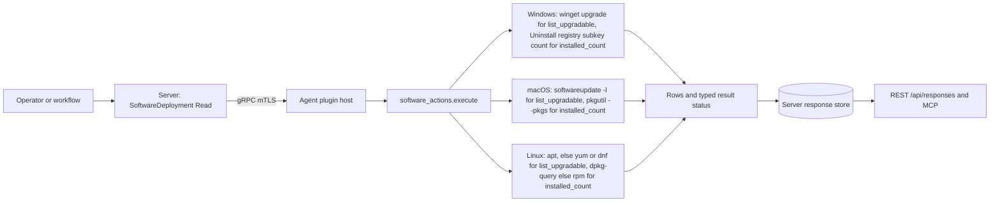
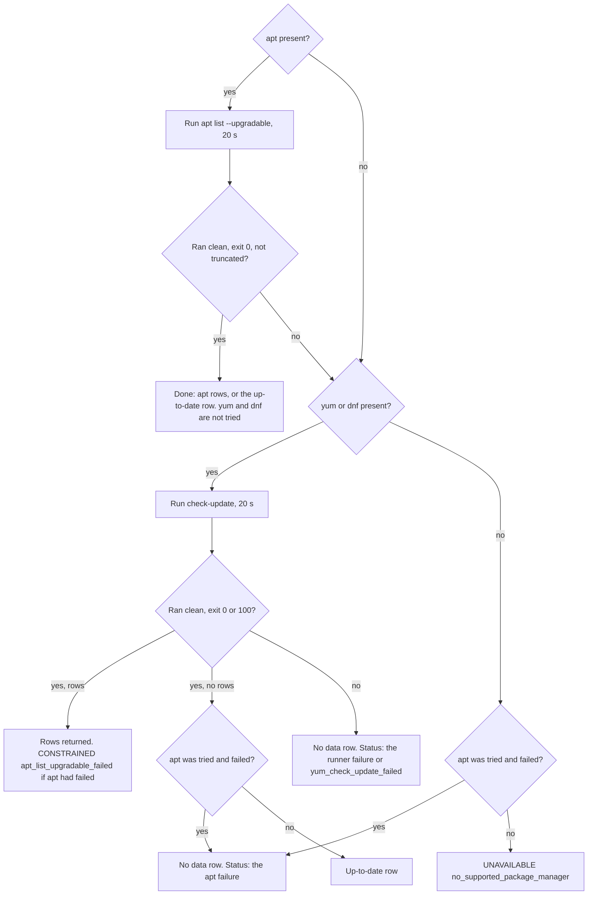

# software_actions

<!-- BEGIN GENERATED: plugin-doc-gen header -->
| | |
|---|---|
| **What it does** | Lists upgradable packages and counts installed software |
| **Version** | 1.1.0 |
| **Kind** | Collector · read-only · gathered (device.software_actions.list_upgradable, device.software_actions.installed_count) |
| **Platforms** | Windows ✅ · macOS ✅ · Linux ✅ |
| **Actions** | `installed_count` (definition `device.software_actions.installed_count`) · `list_upgradable` (definition `device.software_actions.list_upgradable`) |
| **Security** | securable `SoftwareDeployment` · operation Read · risk Low · dispatch ReadOnly · approval gate None |
| **Roles** | execute: endpoint-admin, endpoint-operator · author: content-author |
<!-- END GENERATED -->

## How it works

`list_upgradable` asks the host's own package tool what has an update waiting and reports one row per package. On Windows that tool is `winget upgrade` (60-second deadline), on macOS `softwareupdate -l` (60 seconds), and on Linux `apt list --upgradable` (20 seconds). On Linux, apt is authoritative when it runs clean: its answer, rows or "up to date", ends the query. `yum` or `dnf check-update` (20 seconds) is tried only when apt is absent or did not give a usable answer. `installed_count` returns one number: a native count of Uninstall registry subkeys on Windows (no subprocess), `pkgutil --pkgs` receipts on macOS, and `dpkg-query` or `rpm -qa` packages on Linux (20-second deadline for the subprocess legs). Every tool is run as a plain argument list through the agent's shared subprocess runner, which enforces a time limit, never through a shell.

A query that did not complete never looks clean. If the tool is missing, cannot start, times out, is cut short or fails with nothing parsed, the result carries a failure status and no `count|` or "up to date" row. The "System is up to date" row is written only when a tool ran clean and listed nothing. Neither action is a patch-compliance check or a software inventory: there is no severity, no publisher, no install date and no per-user breakdown here (see `installed_apps` for inventory).



### What you can decide with it

| | Windows | macOS | Linux |
|---|---|---|---|
| `list_upgradable` asks | `winget upgrade --accept-source-agreements` (60 s) | `softwareupdate -l` (60 s) | `apt list --upgradable` (20 s), else `yum` or `dnf check-update` (20 s) |
| What it covers | Applications winget can match to one of its sources | Apple's own software-update list; no third-party, Homebrew or other app query is made | OS packages known to the host's apt or yum/dnf; no snap, flatpak or language-package query |
| Where it works | Expected to work only when the agent runs in a user session (not measured). Winget is installed per user, and that per-user launcher does not exist when the agent runs as LocalSystem (the built-in all-powerful Windows service account); the Windows capture, taken as `SYSTEM`, fails with `subprocess_runner:spawn_error` | Measured as an ordinary user; nothing in the plugin needs more | Measured as root in a container; the plugin uses no `sudo` |
| Row shape | name, current version, available version | Apple's update label, with `-` for both versions | apt: name, current, available. yum or dnf: name, `-`, available |
| `installed_count` counts | Subkeys of the 64-bit `Uninstall` registry key (captured: 124) | Installer receipts listed by `pkgutil --pkgs` (captured: 68) | Installed packages from `dpkg-query` (including held ones), else lines of `rpm -qa` (captured: 206) |

| Question | Use | Answer and limits |
|---|---|---|
| Does winget, Apple or the Linux package manager see an update waiting? | `list_upgradable` | Yes: one row per package. No: the `upgradable\|none\|System is up to date\|-` row, which means that one tool ran clean and listed nothing. A failure status with no data row means unknown, not clean |
| Roughly how much software is on this host, and has it changed? | `installed_count` | A trend on one host. The units differ per OS (registry subkeys, receipts, packages), so counts do not compare across Windows, macOS and Linux, and a Windows count excludes 32-bit applications |
| Is this host patched? | Neither | Not answerable. The lists are one tool per OS with its own scope, apt reads the package lists already on the host and the plugin never refreshes them, nothing is graded by severity or security, and on Windows the action does not run under the service account. Use `windows_updates` for missing-patch state, `vuln_scan` for CVE matching and `installed_apps` for a real inventory |

### Diagrams

#### Linux `list_upgradable` decision flow



apt is the only source consulted on a Debian-family host that runs it cleanly, so an unrelated `dnf` problem can never overwrite apt's answer. The fallback to `yum` or `dnf` exists for RPM hosts and for hosts where apt failed; in that second case a clean but empty `yum` answer is still reported as the apt failure, never as "up to date". A `yum` or `dnf` exit code of 100 means updates are available and is treated as success.

## OS capability

<!-- BEGIN GENERATED: plugin-doc-gen capability -->
| Action | Windows | macOS | Linux |
|---|---|---|---|
| `installed_count` | ✅ supported · rung 1 · native Reg*W subkey count of the Uninstall key | ✅ supported · rung 2 · pkgutil --pkgs via bounded argv runner | ✅ supported · rung 2 · dpkg-query/rpm via bounded argv runner |
| `list_upgradable` | 🟡 constrained · rung 2 · winget via bounded argv runner | ✅ supported · rung 2 · softwareupdate -l via bounded argv runner | ✅ supported · rung 2 · apt/yum check-update via bounded argv runner |

**Declared limits per leg** (descriptor fallback text, verbatim):

- **`installed_count` / Windows** — reads only the default (64-bit) registry view, matching the powershell payload it replaced; 32-bit applications registered under WOW6432Node are not counted
- **`list_upgradable` / Windows** — winget is a PER-USER App Execution Alias under %LOCALAPPDATA%; under the shipped LocalSystem service account that path does not exist, so this leg resolves only when the agent runs in a user-session context. An unresolvable winget reports UNAVAILABLE, never a clean empty result
<!-- END GENERATED -->

## Privileges and prerequisites

| OS | Runs as | Extra grant needed | Measured | If the read is refused |
|---|---|---|---|---|
| Windows | Agent service account: LocalSystem today, not yet the intended virtual service account (`docs/agent-privilege-model.md`); no row for this plugin there | `installed_count` reads `HKLM\...\Uninstall` natively and needs nothing extra. `list_upgradable` needs `%LOCALAPPDATA%` (the current user's application-data folder) and a user-session context: winget is a per-user launcher stub (a Windows "App Execution Alias") that does not exist when the agent runs as LocalSystem | 2026-09-07 on bare metal as `SYSTEM`: `installed_count` returned 124, `list_upgradable` failed with `subprocess_runner:spawn_error` | `list_upgradable`: `UNAVAILABLE` / partial with `subprocess_runner:spawn_error` or `software_actions:localappdata_unset`. `installed_count`: `UNAVAILABLE` / partial with `software_actions:registry_query_failed` |
| macOS | Agent daemon as root: the shipped LaunchDaemon has no `UserName` key (`docs/agent-privilege-model.md`). The plugin does not drop privilege | None: `softwareupdate -l` and `pkgutil --pkgs` ran for an ordinary user | 2026-09-07 on macOS 26.6.2 as an ordinary non-root user, below the production identity | `UNAVAILABLE` / partial with `software_actions:softwareupdate_not_present` or `software_actions:softwareupdate_failed`; `installed_count`: `software_actions:pkgutil_not_present` or `software_actions:pkgutil_query_failed` |
| Linux | Agent daemon, dedicated unprivileged account (`yuzu-agent` on the packaged unit), never root by design (`docs/agent-privilege-model.md`) | None in the plugin: it uses no `sudo`. `apt list --upgradable`, `dpkg-query` and `rpm -qa` are local reads. `yum` or `dnf check-update` can contact repositories, and whether an unprivileged account may refresh their metadata is the tool's own behaviour, not measured here | 2026-09-06 in a container as root (`euid 0`), a more privileged identity than production | `list_upgradable`: `UNAVAILABLE` / partial with `software_actions:no_supported_package_manager`, `software_actions:apt_list_upgradable_failed` or `software_actions:yum_check_update_failed`; `installed_count`: `software_actions:dpkg_query_failed`, `software_actions:rpm_query_failed` or `software_actions:no_supported_package_manager` |

Subprocesses, all run as a plain argument list through the agent's subprocess runner with a time limit and no shell: `winget.exe` (Windows `list_upgradable`, 60 s), `softwareupdate` (macOS `list_upgradable`, 60 s), `apt` and `yum` or `dnf` (Linux `list_upgradable`, 20 s each), `dpkg-query` or `rpm` (Linux `installed_count`, 20 s), `pkgutil` (macOS `installed_count`, 20 s). A tool that outlives its deadline is killed and reported as `subprocess_runner:deadline`. `installed_count` on Windows spawns nothing. Network: `winget upgrade` and `softwareupdate -l` reach their configured update sources, and `yum` or `dnf check-update` can; the other legs are local reads.

## Data contract

### Inputs

<!-- BEGIN GENERATED: plugin-doc-gen inputs -->
Neither action takes parameters.
<!-- END GENERATED -->

### Outputs

Pipe-delimited rows, one literal-discriminator field followed by the action's own fields. `list_upgradable` writes one `upgradable|...` line per upgradable package, or a single sentinel row when the query ran clean and nothing is pending; `installed_count` writes exactly one `count|N` line, or none at all on a degraded read — a `count|0` line is never emitted for a failed or absent query.

<!-- BEGIN GENERATED: plugin-doc-gen outputs -->
**`device.software_actions.installed_count` — `count`**

| Field | Type | Values | Available | Example | Description |
|---|---|---|---|---|---|
| `count` | int32 | - | Windows, Linux, macOS | `124` | Non-negative count of installed packages or applications; the line is omitted entirely (never emitted as 0) when the underlying query failed. Values: non-negative integer. |

**`device.software_actions.list_upgradable` — `package_name|current_version|available_version`**

| Field | Type | Values | Available | Example | Description |
|---|---|---|---|---|---|
| `package_name` | string | - | Windows, Linux, macOS | `none` | The package or application name; the literal 'none' on the clean-scan sentinel row when nothing is upgradable. Values: free text, or the literal `none`. |
| `current_version` | string | - | Windows, Linux, macOS | `System is up to date` | The currently installed version, or '-' when not read; on the up-to-date sentinel row this field carries the literal sentence 'System is up to date' instead of a version. Values: free text, or `-`, or the literal `System is up to date`. |
| `available_version` | string | - | Windows, Linux, macOS | `-` | The version available to upgrade to, or '-' when not applicable or not read. Values: free text, or `-`. |
<!-- END GENERATED -->

### Result status

A clean read sets no result status (the agent records `UNDECLARED` / `UNKNOWN`, as the macOS and Linux samples show). Every failure below sets one and writes no `count|` line and no "up to date" row. Actions that fail return exit code 1. A partial result (`CONSTRAINED`) that still wrote data rows returns 0, so check the result status and not only the exit code: this covers `winget_header_unrecognized`, `winget_rows_unmapped`, `winget_partial_exit`, `softwareupdate_partial_exit`, and on Linux `apt_list_upgradable_failed` when `yum` or `dnf` found rows. A `CONSTRAINED` result with no rows written (for example `winget_no_table`) returns 1.

| Status | Completeness | Provenance | When |
|---|---|---|---|
| `UNDECLARED` | — | — | A clean run: rows, the up-to-date row, or a `count\|N` line |
| `UNAVAILABLE` | PARTIAL | `software_actions:localappdata_unset` | Windows `list_upgradable`: no `%LOCALAPPDATA%` in the agent's environment, so the winget path cannot be built |
| `UNAVAILABLE` | PARTIAL | `subprocess_runner:spawn_error` | The runner could not start the tool (for example winget under LocalSystem, as in the Windows sample) |
| `CONSTRAINED` | PARTIAL | `subprocess_runner:deadline` / `subprocess_runner:cancelled` / `subprocess_runner:signaled` | The tool outlived its deadline and was killed, the run was cancelled, or the tool was killed by a signal |
| `OK` | PARTIAL | `subprocess_runner:line_limit` | Never emitted by this plugin, which sets no line cap; named because the shared runner can produce it |
| `UNAVAILABLE` | PARTIAL | `software_actions:winget_failed` / `software_actions:softwareupdate_failed` / `software_actions:apt_list_upgradable_failed` / `software_actions:yum_check_update_failed` | The tool ran but the capture was unusable (truncated or a failing exit) or a failing exit parsed no rows; on Linux this is also the status when apt failed and yum or dnf found nothing |
| `UNAVAILABLE` | PARTIAL | `software_actions:softwareupdate_not_present` / `software_actions:no_supported_package_manager` | `softwareupdate` is missing, or on Linux neither apt nor yum or dnf is present |
| `UNAVAILABLE` | PARTIAL | `software_actions:registry_query_failed` / `software_actions:dpkg_query_failed` / `software_actions:rpm_query_failed` / `software_actions:pkgutil_query_failed` / `software_actions:pkgutil_not_present` | `installed_count`: the registry read or the package-manager query failed, or `pkgutil` is absent |
| `CONSTRAINED` | PARTIAL | `software_actions:winget_header_unrecognized` / `software_actions:winget_rows_unmapped` / `software_actions:winget_partial_exit` / `software_actions:winget_no_table` | winget's table was found but its header could not be read (rows are name only), some rows were dropped as unmapped, winget exited non-zero but rows still parsed, or no recognisable table was found (the row is then `upgradable\|none\|-\|-`) |
| `CONSTRAINED` | PARTIAL | `software_actions:softwareupdate_partial_exit` | `softwareupdate -l` exited non-zero but update labels still parsed |
| `CONSTRAINED` | PARTIAL | `software_actions:apt_list_upgradable_failed` | Linux: apt failed but `yum` or `dnf` returned rows; the rows are real and apt's failure is flagged |

### Where the data goes

- **Instruction result only.** Rows travel over the agent's mTLS gRPC channel as the command response and land in the server's response store (90-day default retention), queryable at `/api/responses/{id}`.
- **Not consumed by** daily-sync inventory, the TAR warehouse, DEX (Digital Employee Experience) or metrics: nothing outside the plugin, its definitions and the capability files references either definition id. Nothing runs on a schedule; `gather.ttlSeconds` (300 for `list_upgradable`, 120 for `installed_count`) is the window the agent has to respond to a dispatch, not a trigger.
- **Sensitivity.** `list_upgradable` rows name installed software with its current and available versions, which is an installed-software inventory by another route; `installed_count` carries only a number and nothing identifying.
- **Siblings:** `installed_apps` is the general software inventory (name, version, publisher, install date, per-user breakdown, and the daily-sync collector). `windows_updates` covers missing patches and pending reboots, and `vuln_scan` CVE matching. `software_actions` answers only "does the platform's package tool list an update" and "roughly how many packages".
- **MCP / REST.** Discover: `discover_plugins` (summary), then `yuzu://plugin-docs` (this page as data), then `discover_instructions` / `get_definition("device.software_actions.list_upgradable")`. Run: `execute_instruction {definition_id, parameters}`. Read: `/api/responses/{id}`.

## Sample output

<!-- BEGIN GENERATED: plugin-doc-gen samples -->
**Windows** — captured: windows Microsoft Windows NT 10.0.26200.0 x64 · bare-metal · 2026-09-07 · SYSTEM · leg-hash c95c61957b6f

```
== action=list_upgradable
[result_status] UNAVAILABLE / PARTIAL / subprocess_runner:spawn_error
[rc] 1

== action=installed_count
count|124
[result_status] UNDECLARED / UNKNOWN
```

**macOS** — captured: macos macOS 26.6.2 arm64 · bare-metal · 2026-09-07 · euid 501 (jsmith) · leg-hash c95c61957b6f

```
== action=list_upgradable
upgradable|none|System is up to date|-
[result_status] UNDECLARED / UNKNOWN

== action=installed_count
count|68
[result_status] UNDECLARED / UNKNOWN
```

**Linux** — captured: linux Debian GNU/Linux 13 (trixie) aarch64 · container · 2026-09-06 · euid 0 · leg-hash c95c61957b6f

```
== action=list_upgradable
upgradable|none|System is up to date|-
[result_status] UNDECLARED / UNKNOWN

== action=installed_count
count|206
[result_status] UNDECLARED / UNKNOWN
```
<!-- END GENERATED -->

## Caveats and known gaps

1. **It cannot say whether a host is patched.** Each OS answers from one tool with its own scope (winget's sources, Apple's update list, apt or yum/dnf), apt reads the package lists already on the host and the plugin never refreshes them, and no row carries a severity or a security flag. "Up to date" means that one tool listed nothing.
2. **The Windows `list_upgradable` leg does not work under the shipped service account.** winget is installed per user, and its launcher does not exist when the agent runs as LocalSystem, so the Windows capture (taken as `SYSTEM`) is a `subprocess_runner:spawn_error` failure. The action is expected to work only when the agent runs in a user session (not measured; the `SYSTEM` capture fails). Even then it lists only what winget has a source for, not Windows Update.
3. **`installed_count` is a gauge, not an inventory, and its unit differs per OS.** Windows counts every subkey of the 64-bit `Uninstall` key whether or not the subkey holds any values, and misses 32-bit applications and per-user installs; macOS counts installer receipts; Linux counts installed packages, held ones included. Compare a host with itself over time, never across operating systems.
4. **Row shapes carry some conventions to special-case.** The up-to-date row puts a sentence in the `current_version` field, so key on the package name `none`. macOS rows hold Apple's update label with `-` for both versions, and `yum` or `dnf` rows have no current version. A row `upgradable|none|-|-` with `CONSTRAINED` / `winget_no_table` means winget's output was not recognised, not that the host is up to date.
5. **A failed query is never made to look clean, and that is an invariant.** Failures write a typed status and no `count|0` or up-to-date row, and a failed apt followed by a clean empty `yum` answer still reports the apt failure. Do not add a fallback that emits `count|0` or the up-to-date row on error.

## Source and tests

<!-- BEGIN GENERATED: plugin-doc-gen source -->
- Plugin: `agents/plugins/software_actions/src/software_actions_parsers.hpp` · `agents/plugins/software_actions/src/software_actions_plugin.cpp`
- Definitions: `content/definitions/software_actions.yaml`
- Capability rows: `server/core/src/capability_decls/plugin_action_catalogue_d.hpp`
- Tests: `tests/unit/test_software_actions_actions.cpp` · `tests/unit/test_software_actions_parsers.cpp`
- Privilege row: `docs/agent-privilege-model.md` (no row yet)
<!-- END GENERATED -->
