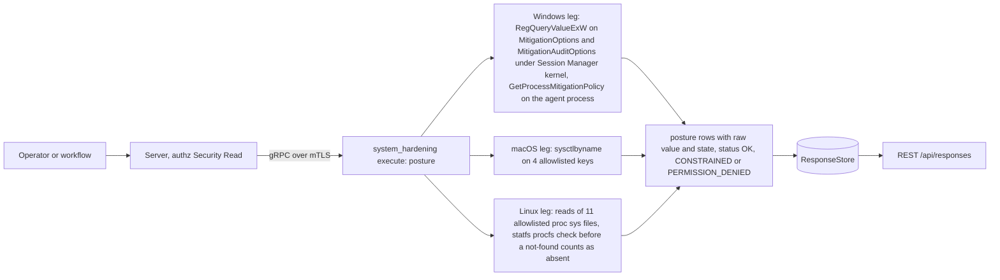
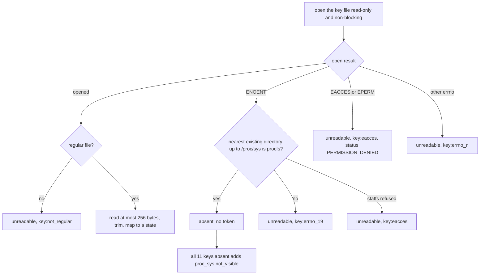
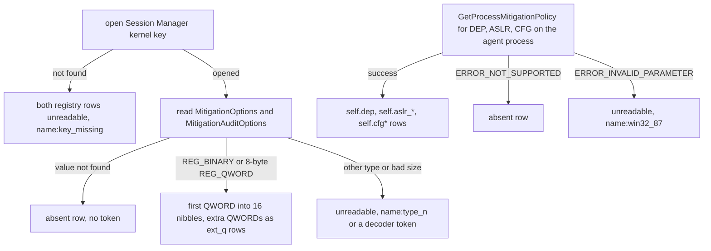

# system_hardening

<!-- BEGIN GENERATED: plugin-doc-gen header -->
| | |
|---|---|
| **What it does** | Exploit-mitigation and kernel-hardening posture (read-only) |
| **Version** | 1.0.0 |
| **Kind** | Collector · read-only · gathered (crossplatform.system_hardening.posture) |
| **Platforms** | Windows ✅ · macOS ✅ · Linux ✅ |
| **Actions** | `posture` (definition `crossplatform.system_hardening.posture`) |
| **Security** | securable `Security` · operation Read · risk Low · dispatch ReadOnly · approval gate None |
| **Roles** | execute: endpoint-admin, endpoint-operator, security-admin · author: content-author |
<!-- END GENERATED -->

## How it works

`posture` reads a fixed list of exploit-mitigation and kernel-hardening settings and writes one row per setting: `posture|<os>|<key>|<raw>|<state>`. It takes no parameters, so no request text reaches a path or a registry name, and it never starts a process. Linux reads 11 `/proc/sys` files, macOS reads 4 `sysctl` values with `sysctlbyname`, and Windows decodes two system-wide mitigation registry values and asks Windows about the agent's own process. Each key reads as a **value** with a state, as **`absent`** (the OS definitively says the key is not there) or as **`unreadable`** (the read failed). A failed read is never reported as absent, and a not-found counts as absence only where the surface being read is itself confirmed present. The state describes the hardening, not the raw number: `kernel.sysrq=0` is `enabled`, `kern.coredump=1` is `disabled`.



### What is read and how absence is decided

- **Linux.** `kernel.randomize_va_space`, `kernel.kptr_restrict`, `kernel.yama.ptrace_scope`, `kernel.dmesg_restrict`, `kernel.unprivileged_bpf_disabled`, `kernel.sysrq`, `fs.protected_hardlinks`, `fs.protected_symlinks`, `fs.protected_fifos`, `fs.protected_regular`, `fs.suid_dumpable`. One table maps each key to its path; there is no directory walk. A file that opens but is not a regular file (a FIFO, device or directory mounted at the path) is never read and reads `unreadable` with `<key>:not_regular`. An `ENOENT` is `absent` only when `statfs` confirms that the key's nearest existing directory, up to `/proc/sys`, is a mounted procfs; otherwise it becomes `ENODEV` and the key reads `unreadable` with `<key>:errno_19`. If that confirmation `statfs` is itself refused (`EACCES` or `EPERM`, as a seccomp profile or an LSM can do), the refusal is kept and the key reads `unreadable` with `<key>:eacces`.
- **macOS.** `kern.securelevel`, `kern.coredump`, `kern.sugid_coredump`, `kern.bootargs`. `kern.nx` is deliberately not read: it is an unknown oid on Apple Silicon. An empty `kern.bootargs` is a successful read of an empty string, not a failure.
- **Windows.** The `MitigationOptions` and `MitigationAuditOptions` values under `HKLM\SYSTEM\CurrentControlSet\Control\Session Manager\kernel`, decoded into `mitigation.<policy>` and `mitigation_audit.<policy>` rows, and `GetProcessMitigationPolicy` on the agent's own process for the `self.*` rows (DEP, ASLR, CFG). No other process is enumerated. A not-found VALUE is `absent`, but a not-found `Session Manager\kernel` KEY, which exists on every install, reads `unreadable` with `<name>:key_missing`. From `GetProcessMitigationPolicy`, `ERROR_NOT_SUPPORTED` is `absent`, while `ERROR_INVALID_PARAMETER` reads `unreadable` with `<name>:win32_87`, because every supported target (Windows 10 and later, x64) implements the three policies and the error can only mean a malformed call.

Absence is not a failure: an `absent` row adds no reason token and does not lower the result status. A host that lacks an optional key (Linux without Yama, a default Windows install with no `MitigationOptions`) reports `OK`. Each `unreadable` row carries one reason token. The one token that belongs to no row is the Linux backstop `proc_sys:not_visible`: all eleven keys `ENOENT` on a confirmed procfs keeps every row `absent` but reports `CONSTRAINED`.

### What you can decide with it

| Question | Where to look | What a result means |
|---|---|---|
| Is memory-layout randomization and exploit hardening on? | Linux `kernel.randomize_va_space`, `kernel.kptr_restrict`, `fs.suid_dumpable`; Windows `mitigation.dep`, `mitigation.aslr_*`, `mitigation.cfg` | Linux and macOS states read directly (`enabled`, `partial`, `disabled`). On Windows, `default` or `absent` means no system-wide override is set and the OS defaults apply; it does not mean unprotected |
| Can local users inspect or attach to other processes? | Linux `kernel.yama.ptrace_scope`, `kernel.dmesg_restrict`, `kernel.kptr_restrict`, `kernel.unprivileged_bpf_disabled` | `ptrace_scope` `absent` means the kernel does not expose the Yama setting (not built in or not active); the plugin cannot tell which |
| Are link and temp-directory tricks blocked? | Linux `fs.protected_*` | The four keys are independent; `disabled` on any one leaves that class open |
| Are core dumps and boot overrides locked down? | macOS `kern.coredump`, `kern.sugid_coredump`, `kern.bootargs`; Linux `fs.suid_dumpable` | A non-empty macOS `kern.bootargs` is `unmodelled` and the raw column carries the whole string |
| Can the keyboard trigger kernel functions (reboot, crash dump, process kill)? | Linux `kernel.sysrq` | `enabled` is `0` (all off), `disabled` is `1` (all on), `partial` is a bitmask of allowed functions |
| Is the agent process itself hardened? | Windows `self.*` | These describe the agent process only, not the host |

**Linux keys.** The state follows the kernel's documented value meanings.

| Key | What it limits | `enabled` | `partial` | `disabled` |
|---|---|---|---|---|
| `kernel.randomize_va_space` | Predictable memory addresses for exploits (ASLR) | `2` full randomization | `1` | `0` off |
| `kernel.kptr_restrict` | Kernel addresses visible to local users | `2` hidden from all | `1` hidden from unprivileged users | `0` exposed |
| `kernel.yama.ptrace_scope` | One process attaching to another's memory | `1` to `3` (descendants only, admin only, or none) | - | `0` any same-user process |
| `kernel.dmesg_restrict` | Reading the kernel log without privilege | `1` | - | `0` |
| `kernel.unprivileged_bpf_disabled` | Unprivileged eBPF programs | `1` or `2` | - | `0` allowed |
| `kernel.sysrq` | Keyboard-triggered kernel functions | `0` all off | `2` to `511` a function bitmask | `1` all on |
| `fs.protected_hardlinks` | Hard-link abuse in world-writable sticky directories | `1` | - | `0` |
| `fs.protected_symlinks` | Symlink-following abuse in world-writable sticky directories | `1` | - | `0` |
| `fs.protected_fifos` | Opening other users' FIFOs in sticky directories | `2` (also group-writable) | `1` (world-writable) | `0` |
| `fs.protected_regular` | Opening other users' regular files in sticky directories | `2` (also group-writable) | `1` (world-writable) | `0` |
| `fs.suid_dumpable` | Core dumps of setuid programs leaking memory | `0` no dump | `2` root-readable only | `1` any dump |

**macOS keys.** `kern.securelevel`: `2` is `enabled`, `1` is `partial`, `-1` or `0` is `disabled` (the captured Mac reads `0`, so its row is `disabled`). `kern.coredump` and `kern.sugid_coredump`: `0` is `enabled` (dumps off), `1` is `disabled`. `kern.bootargs`: empty is `enabled` (no boot-argument overrides), anything else is `unmodelled`.

**Windows policies.** One registry value decodes into one row per policy, because the first 8 bytes are a map of 16 two-bit nibbles in the kernel's policy order: `dep`, `sehop`, `force_relocate_images`, `heap_terminate`, `aslr_bottom_up`, `aslr_high_entropy`, `strict_handle_checks`, `win32k_system_call_disable`, `extension_point_disable`, `prohibit_dynamic_code`, `cfg`, `block_non_microsoft_binaries`, `font_disable`, `image_load_no_remote`, `image_load_no_low_label`, `image_load_prefer_system32`. A nibble is a tri-state override: `0` is `default` (not set), `1` is `on`, `2` is `off`, and `3` to `15` are `unmodelled`. Only `dep`, `sehop`, `aslr_bottom_up`, `aslr_high_entropy` and `cfg` (and the value `1`) are confirmed on hardware; the other positions are inferred by order. Each further 8 bytes of a longer value appear as an `ext_q<n>` row (`default` when zero, otherwise `unmodelled`). The `self.*` rows read the agent's own mitigation flags: `self.dep`, `self.aslr_bottom_up`, `self.aslr_force_relocate`, `self.aslr_high_entropy`, `self.cfg`, `self.cfg_export_suppression`, `self.cfg_strict_mode`, each `on` or `off`, with the raw flags word in decimal.

**What it cannot tell you.** The plugin does not report Linux LSM state (SELinux, AppArmor), macOS SIP or Gatekeeper (see `platform_security`), the mitigations of any process other than the agent, or whether a Windows override is effective on a given binary. `OK` means no key failed to read; it is not a hardening score.

### Diagrams

#### Linux read of one key



This is the check that stops a hidden or replaced `/proc/sys` (a `ProcSubset=pid` mount, a tmpfs overmount, a container that does not expose it) from reading as "every mitigation absent". The all-eleven-absent backstop covers the remaining case of a confirmed procfs that has none of the keys. A FIFO or device placed at a key path is handled without blocking.

#### Windows decode



The registry half reports the system-wide override; the process half reports the agent's own effective flags. On a default install the two registry values do not exist, so both rows read `absent` and the run is `OK`.

## OS capability

<!-- BEGIN GENERATED: plugin-doc-gen capability -->
| Action | Windows | macOS | Linux |
|---|---|---|---|
| `posture` | ✅ supported · rung 1 · HKLM\\SYSTEM\\CurrentControlSet\\Control\\Session Manager\\kernel mitigation registry + GetProcessMitigationPolicy (agent process) | ✅ supported · rung 1 · allowlisted sysctlbyname reads (kern.securelevel/coredump/sugid_coredump/bootargs) | ✅ supported · rung 1 · allowlisted /proc/sys reads (open/read, errno-classified absent/unreadable; a missing key is absent only when statfs confirms its nearest existing directory is procfs) |

**Declared limits per leg** (descriptor fallback text, verbatim):

- **`posture` / Windows** — Rig-verified 2026-09-21: MitigationOptions/MitigationAuditOptions are ABSENT on a default Windows 11 install (rows read `absent`, not a failure); a present value decodes as 16 two-bit nibbles (dep, sehop, aslr_bottom_up, aslr_high_entropy and cfg confirmed on hardware); GetProcessMitigationPolicy succeeds for DEP/ASLR/CFG on x64.
<!-- END GENERATED -->

## Privileges and prerequisites

| OS | Runs as | Extra grant needed | Measured | If the read is refused |
|---|---|---|---|---|
| Windows | agent service account (LocalSystem today, #1442) | None documented for this plugin (`docs/agent-privilege-model.md`) | `NT AUTHORITY\SYSTEM` on a bare-metal Windows 11 Pro host (10.0.26200): probe 2026-09-21, sample captured 2026-09-24 (`docs/samples/windows.txt`); the mitigation probe summary is in the `system_hardening_win.cpp` banner | `ERROR_FILE_NOT_FOUND`/`ERROR_PATH_NOT_FOUND` on a registry value reports that row `absent` with no token (the default state of a fresh install), as does `ERROR_NOT_SUPPORTED` from `GetProcessMitigationPolicy` for that `self.*` row; `ERROR_INVALID_PARAMETER` reports it `unreadable` with `<name>:win32_87`; `ERROR_ACCESS_DENIED` reports it `unreadable` with `<name>:access_denied` and the action reports `PERMISSION_DENIED`/`PARTIAL`; any other Win32 error reports `unreadable` with `<name>:win32_<n>`. A not-found on the `Session Manager\kernel` key itself reports both registry rows `unreadable` with `<name>:key_missing` and the action reports `CONSTRAINED`/`PARTIAL`: that key exists on every install, so its absence is never a clean answer |
| macOS | agent daemon, root today (LaunchDaemon carries no `UserName` key, `docs/agent-privilege-model.md` TL;DR); this plugin's reads need no elevation beyond that default | None; `sysctlbyname` reads of these keys are unprivileged | 2026-09-23, bare-metal Mac, unprivileged (euid 501): real capture (`docs/samples/macos.txt`). No root-privileged run has been captured, so the root identity above is the documented production default, not a measured one | `EPERM` reports the key `unreadable` with reason `<key>:eacces` and the action reports `PERMISSION_DENIED`/`PARTIAL`; an unknown oid (`ENOENT`) reports it `absent` with no token and leaves the result unchanged |
| Linux | agent daemon, dedicated unprivileged account (the agent never runs as root on Linux) | None; the allowlisted `/proc/sys` files are world-readable on current kernels. On older kernels the four `fs.protected_*` files were root-only (mode 0600), so a non-root agent there reads them `unreadable` (`<key>:eacces`) and the action reports `PERMISSION_DENIED`; that is from kernel history and was not measured here | 2026-09-23, aarch64 Debian 13 container, root (`euid 0`): a real live capture of the built `.so` (`docs/samples/linux.txt`). Further hand runs during development (a tmpfs over `/proc/sys` and a `subset=pid` procfs each gave eleven `errno_19` rows and `CONSTRAINED`/`PARTIAL`; a tmpfs over `/proc/sys/kernel` made only the six `kernel.*` keys `unreadable`; all ten keys present on kernel 7.0 read world-readable, mode 0644, as a non-root user, uid 65534, in a container) are not captured in a committed file; the surface check itself is covered by a fake-statfs unit test (`tests/unit/test_system_hardening_parsers.cpp`) | `EACCES`/`EPERM` reports the key `unreadable` with reason `<key>:eacces` and the action reports `PERMISSION_DENIED`/`PARTIAL`; a leaf that is not a regular file reports `unreadable` with `<key>:not_regular`; any other errno reports `unreadable` with `<key>:errno_<n>`; a missing file (`ENOENT`, for example `kernel.yama.ptrace_scope` on a kernel that does not expose Yama) reports it `absent` with no token, but only once `statfs` confirms the nearest existing directory above it is a mounted procfs, otherwise it is remapped to `ENODEV` and reads `unreadable` with `<key>:errno_19` (a refused confirmation `statfs` is never downgraded to `ENODEV`; it reads `unreadable` with `<key>:eacces`). If ALL ELEVEN keys read `ENOENT` on a confirmed procfs, one additional `proc_sys:not_visible` token downgrades the result to `CONSTRAINED` (each row still reads `absent`) |

Binaries and subprocesses: none. Every leg is an in-process read (`/proc/sys`, `sysctlbyname`, the Windows registry API and `GetProcessMitigationPolicy`); no `sysctl`, `reg` or PowerShell binary is run. Network: none.

## Data contract

### Inputs

<!-- BEGIN GENERATED: plugin-doc-gen inputs -->
The action takes no parameters.
<!-- END GENERATED -->

### Outputs

Pipe-delimited rows, one per allowlisted key, in allowlist order, written via `write_output()`. The first field is the fixed literal `posture`, then `<os>`, `<key>`, `<raw>` and `<state>`. `<raw>` is `-` when nothing was read (`absent` or `unreadable`); a raw value that was read passes through the shared untrusted-output escaper, with newlines and NULs folded to spaces so no value can split or cut a row. A Linux value is judged whole (whitespace trimmed from both ends), never on its first line, and emptiness on macOS is judged on the whole value, so `"\n-v"` is `unmodelled`, not `enabled`.

- **Windows row names.** A value that was not decoded (absent or unreadable) reports one row under its registry row name, `mitigation_options` or `mitigation_audit_options`, and a failed self policy one row under `self.dep`, `self.aslr` or `self.cfg`. Windows rows can outnumber the allowlist, because one registry value decodes into one row per policy field.
- **`unmodelled`.** A value that was read but cannot be interpreted: non-numeric, empty or out-of-range text on Linux and macOS, or a Windows nibble with no modelled meaning. A Windows blob whose structure cannot be decoded at all (empty, odd length, not QWORD-aligned, oversized) is `unreadable` with a reason token.
- **Return codes.** The action returns 0 for every data-level outcome: an unreadable key is a degraded result and an absent key is not a failure. Return 1 happens in two cases. An unknown action name returns 1 with the single row `unknown action: <name>`. An internal exception (any leg) returns 1, adding a `constrained|<os>|internal_error|-|unreadable` row (the same five fields as every other row) after any rows already written.

<!-- BEGIN GENERATED: plugin-doc-gen outputs -->
**`crossplatform.system_hardening.posture` — `row_kind|os|key|raw|state`**

| Field | Type | Values | Available | Example | Description |
|---|---|---|---|---|---|
| `row_kind` | string | `posture` `constrained` | Windows, Linux, macOS | `posture` | Row family: `posture` (one per allowlisted key) or `constrained` (an internal-error row: `os` is the host leg, `key` is `internal_error`, `state` is `unreadable`). |
| `os` | string | `linux` `macos` `windows` | Windows, Linux, macOS | `linux` | The leg that produced the row. |
| `key` | string | - | Windows, Linux, macOS | `kernel.randomize_va_space` | Allowlisted key: a sysctl name (Linux, macOS) or a policy name (Windows: mitigation.<policy> and mitigation_audit.<policy> from the registry, self.<policy> from the agent process; a registry value that was not decoded (absent or unreadable) reports under mitigation_options or mitigation_audit_options, and a failed self policy under self.dep, self.aslr or self.cfg; the trailing QWORDs of a longer registry blob appear as ext_q<n> rows). |
| `raw` | string | - | Windows, Linux, macOS | `2` | The raw value read (integer, string, or 0x-prefixed hex on Windows); "-" when nothing was read (absent or unreadable). An empty macOS kern.bootargs is a successful read and an empty column. |
| `state` | string | `enabled` `disabled` `partial` `on` `off` `default` `unmodelled` `absent` `unreadable` | Windows, Linux, macOS | `enabled` | Linux and macOS: enabled/disabled/partial describe the hardening (enabled = protection on, partial = on at a weaker level), not the sysctl value. Windows: on/off/default, because a system-wide mitigation nibble is a tri-state override (not set / always on / always off), not a hardening level. unmodelled = a value was read that this table has no interpretation for. absent = the key does not exist here (only where the surface being read is confirmed present). unreadable = the read failed, or the surface itself (a hidden /proc/sys, a missing Session Manager\kernel key) was not there. |
<!-- END GENERATED -->

### Result status

| Status | Completeness | Provenance | When |
|---|---|---|---|
| `OK` | `FULL` | — | No key was `unreadable`: every key was either read or `absent`, except that all eleven Linux keys `absent` on a confirmed procfs is the `proc_sys:not_visible` backstop (`CONSTRAINED`, next row). An absent key adds no reason token, so a host that lacks an optional key (Yama not exposed by the Linux kernel, `MitigationOptions` never written on a default Windows install) still reports `OK`. |
| `CONSTRAINED` | `PARTIAL` | `<key>:errno_<n>`, `<key>:not_regular`, `<name>:win32_<n>`, `<name>:key_missing`, `<name>:type_<n>`, `<name>:oversized`, `proc_sys:not_visible` | At least one key was `unreadable`, or the Linux backstop fired, and none was refused. The reason lists one `<key>:<cause>` token per unreadable key, whose row reads `unreadable`; `proc_sys:not_visible` alone means all eleven Linux keys read `absent` on a confirmed procfs, with no `unreadable` row. Windows decoder failures (`empty_blob`, `odd_length`, `not_qword_aligned`, `oversized`) appear as `<name>:<token>`. |
| `CONSTRAINED` | `PARTIAL` | `internal_error` | Any leg: an unexpected exception escaped a leg and was contained in `execute()`; the action returns 1 with the row `constrained\|<os>\|internal_error\|-\|unreadable`. |
| `PERMISSION_DENIED` | `PARTIAL` | `<key>:eacces`, `<name>:access_denied` | Any leg: a read was refused — `EACCES`/`EPERM` on Linux and macOS (token `<key>:eacces`) or `ERROR_ACCESS_DENIED` on Windows (token `<name>:access_denied`). A refusal outranks every other unreadable cause in the same run; the reason still lists every unreadable key's token. |

### Where the data goes

- **Instruction result.** Rows travel over the agent's mTLS gRPC channel as the command response and land in the ResponseStore, queryable at `/api/responses/{id}`. `posture` is also a gathered definition (`crossplatform.system_hardening.posture`, 300s TTL).
- **Not consumed by** daily-sync, TAR, DEX, or metrics.
- **Sensitivity.** Rows carry kernel and mitigation settings only: no username, path, process name or installed-software name. The values are a security-posture baseline of the host (for example ASLR off, ptrace unrestricted, core dumps enabled), which is useful to an attacker choosing an exploit, so the rows warrant the same handling as other `Security` data. `kern.bootargs`, where non-empty, echoes the host's whole boot-argument string (newlines and NULs shown as spaces).
- **Siblings:** `vuln_scan` (its configuration checks read two of the same Linux keys, `kernel.randomize_va_space` and `fs.suid_dumpable`, as pass/fail findings; this plugin reports the raw value and state) and `bitlocker` (disk encryption posture).

## Sample output

<!-- BEGIN GENERATED: plugin-doc-gen samples -->
**Windows** — captured: windows Windows 10.0.26200 x86_64 · bare-metal · 2026-09-24 · LocalSystem (elevated) · leg-hash e678758a486f

```
== action=posture
posture|windows|mitigation_options|-|absent
posture|windows|mitigation_audit_options|-|absent
posture|windows|self.dep|3|on
posture|windows|self.aslr_bottom_up|5|on
posture|windows|self.aslr_force_relocate|5|off
posture|windows|self.aslr_high_entropy|5|on
posture|windows|self.cfg|0|off
posture|windows|self.cfg_export_suppression|0|off
posture|windows|self.cfg_strict_mode|0|off
[result_status] OK / FULL
```

**macOS** — captured: macos macOS 26.6.2 arm64 · bare-metal · 2026-09-23 · euid 501 · leg-hash e678758a486f

```
== action=posture
posture|macos|kern.securelevel|0|disabled
posture|macos|kern.coredump|1|disabled
posture|macos|kern.sugid_coredump|0|enabled
posture|macos|kern.bootargs||enabled
[result_status] OK / FULL
```

**Linux** — captured: linux Debian GNU/Linux 13 (trixie) aarch64 · container · 2026-09-23 · euid 0 · leg-hash e678758a486f

```
== action=posture
posture|linux|kernel.randomize_va_space|2|enabled
posture|linux|kernel.kptr_restrict|0|disabled
posture|linux|kernel.yama.ptrace_scope|-|absent
posture|linux|kernel.dmesg_restrict|1|enabled
posture|linux|kernel.unprivileged_bpf_disabled|0|disabled
posture|linux|kernel.sysrq|1|disabled
posture|linux|fs.protected_hardlinks|1|enabled
posture|linux|fs.protected_symlinks|1|enabled
posture|linux|fs.protected_fifos|0|disabled
posture|linux|fs.protected_regular|0|disabled
posture|linux|fs.suid_dumpable|0|enabled
[result_status] OK / FULL
```
<!-- END GENERATED -->

## Caveats and known gaps

1. **Two state vocabularies.** Linux and macOS report `enabled`, `disabled` or `partial`, while Windows reports `on`, `off` or `default` because a system-wide mitigation nibble is a tri-state override, not a hardening level, so consumers key on the `<os>` column. The three non-value states (`unmodelled`, `absent`, `unreadable`) are the same on every OS.
2. **`absent` is reported only where the surface is confirmed present, and it does not downgrade the run.** A missing optional key (no Yama, no `MitigationOptions` on a default Windows install) adds no token and the run stays `OK`, while a hidden Linux surface or a missing Windows `Session Manager\kernel` key reads `unreadable`. The one exception is the Linux backstop: all eleven keys `absent` on a confirmed procfs adds `proc_sys:not_visible` and reports `CONSTRAINED`.
3. **Windows: the self rows are the agent process only, and only part of the mitigation layout is hardware-confirmed.** The `self.*` rows describe the agent's own process, while the system-wide policy is the `mitigation.*` registry rows. Five of the sixteen nibble positions and the nibble value `1` were confirmed on hardware; the other positions and values, trailing `ext_q<n>` QWORDs, every `MitigationAuditOptions` row, a `REG_QWORD` value and Windows on ARM64 (x64 emulation) are unmeasured.
4. **Fixed allowlists, no discovery; a container reads the kernel the agent runs on.** The plugin reads only the keys listed above. The Linux keys are kernel-global, so a containerised agent (including the shipped `deploy/docker/Dockerfile.agent` image, where the Linux sample was captured) reports the kernel it runs on: the host's under a shared-kernel runtime such as runc, the guest kernel's under Kata or a microVM, and under gVisor a synthetic procfs that may implement only some of the keys (unmeasured here; the rest would read `absent`).
5. **A privileged local actor can still mislead the Linux read.** The surface check detects a hidden or replaced `/proc/sys`, but root or `CAP_SYS_ADMIN` in the agent's mount namespace can bind a real procfs directory or a forged regular file over a key, so the value reads as that file says. A filesystem that never answers, such as an unresponsive FUSE daemon, can make the read block, and no in-plugin bound can cancel a hung system call.

## Source and tests

<!-- BEGIN GENERATED: plugin-doc-gen source -->
- Plugin: `agents/plugins/system_hardening/src/system_hardening_legs.hpp` · `agents/plugins/system_hardening/src/system_hardening_linux.cpp` · `agents/plugins/system_hardening/src/system_hardening_macos.cpp` · `agents/plugins/system_hardening/src/system_hardening_parsers.hpp` · `agents/plugins/system_hardening/src/system_hardening_plugin.cpp` · `agents/plugins/system_hardening/src/system_hardening_win.cpp` · `agents/plugins/system_hardening/src/system_hardening_win_parsers.hpp`
- Definitions: `content/definitions/system_hardening.yaml`
- Capability rows: `server/core/src/capability_decls/plugin_action_catalogue_system_hardening.hpp`
- Tests: `tests/unit/test_system_hardening_local_dispatcher.cpp` · `tests/unit/test_system_hardening_parsers.cpp` · `tests/unit/test_system_hardening_win_parsers.cpp`
- Privilege row: `docs/agent-privilege-model.md`
<!-- END GENERATED -->
